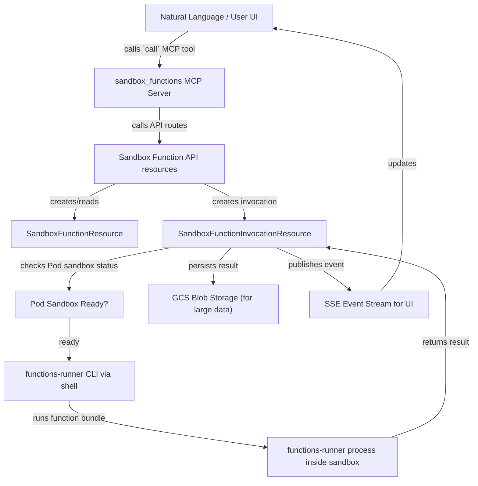
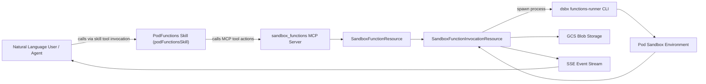

<!-- source: DeepWiki mcp.deepwiki.com · repo dust-tt/dust · page 6.2 Sandbox Functions (Pod Functions) · fetched 2026-10-26 -->

# Sandbox Functions (Pod Functions)

<details>
<summary>Relevant source files</summary>

The following files were used as context for generating this wiki page:

- [cli/dust-sandbox/functions-runner/emit.test.ts](cli/dust-sandbox/functions-runner/emit.test.ts)
- [cli/dust-sandbox/functions-runner/emit.ts](cli/dust-sandbox/functions-runner/emit.ts)
- [cli/dust-sandbox/functions-runner/fixtures/bad-schema.ts](cli/dust-sandbox/functions-runner/fixtures/bad-schema.ts)
- [cli/dust-sandbox/functions-runner/fixtures/big-output.ts](cli/dust-sandbox/functions-runner/fixtures/big-output.ts)
- [cli/dust-sandbox/functions-runner/fixtures/default-output.ts](cli/dust-sandbox/functions-runner/fixtures/default-output.ts)
- [cli/dust-sandbox/functions-runner/fixtures/echo.ts](cli/dust-sandbox/functions-runner/fixtures/echo.ts)
- [cli/dust-sandbox/functions-runner/fixtures/invalid-output.ts](cli/dust-sandbox/functions-runner/fixtures/invalid-output.ts)
- [cli/dust-sandbox/functions-runner/fixtures/slow-import.ts](cli/dust-sandbox/functions-runner/fixtures/slow-import.ts)
- [cli/dust-sandbox/functions-runner/invoke.test.ts](cli/dust-sandbox/functions-runner/invoke.test.ts)
- [cli/dust-sandbox/functions-runner/invoke.ts](cli/dust-sandbox/functions-runner/invoke.ts)
- [cli/dust-sandbox/functions-runner/protocol.test.ts](cli/dust-sandbox/functions-runner/protocol.test.ts)
- [cli/dust-sandbox/functions-runner/protocol.ts](cli/dust-sandbox/functions-runner/protocol.ts)
- [cli/dust-sandbox/functions-runner/runner.test.ts](cli/dust-sandbox/functions-runner/runner.test.ts)
- [cli/dust-sandbox/functions-runner/runner.ts](cli/dust-sandbox/functions-runner/runner.ts)
- [cli/dust-sandbox/functions-runner/serve.test.ts](cli/dust-sandbox/functions-runner/serve.test.ts)
- [cli/dust-sandbox/functions-runner/serve.ts](cli/dust-sandbox/functions-runner/serve.ts)
- [cli/dust-sandbox/src/commands/function/envelope.rs](cli/dust-sandbox/src/commands/function/envelope.rs)
- [cli/dust-sandbox/src/commands/function/get.rs](cli/dust-sandbox/src/commands/function/get.rs)
- [cli/dust-sandbox/src/commands/function/mod.rs](cli/dust-sandbox/src/commands/function/mod.rs)
- [cli/dust-sandbox/src/commands/function/run.rs](cli/dust-sandbox/src/commands/function/run.rs)
- [cli/dust-sandbox/src/commands/function/warm.rs](cli/dust-sandbox/src/commands/function/warm.rs)
- [front-api/routes/w/[wId]/sandbox-functions/[functionId]/invocations.test.ts](front-api/routes/w/[wId]/sandbox-functions/[functionId]/invocations.test.ts)
- [front-api/routes/w/[wId]/sandbox-functions/[functionId]/invocations.ts](front-api/routes/w/[wId]/sandbox-functions/[functionId]/invocations.ts)
- [front/components/assistant/conversation/ConversationSidePanelContainer.tsx](front/components/assistant/conversation/ConversationSidePanelContainer.tsx)
- [front/components/assistant/conversation/constant.test.ts](front/components/assistant/conversation/constant.test.ts)
- [front/components/assistant/conversation/constant.ts](front/components/assistant/conversation/constant.ts)
- [front/lib/api/actions/servers/common/viz/instructions.ts](front/lib/api/actions/servers/common/viz/instructions.ts)
- [front/lib/api/actions/servers/interactive_content/instructions_v2.ts](front/lib/api/actions/servers/interactive_content/instructions_v2.ts)
- [front/lib/api/actions/servers/sandbox_functions/metadata.ts](front/lib/api/actions/servers/sandbox_functions/metadata.ts)
- [front/lib/api/actions/servers/sandbox_functions/tools/call.ts](front/lib/api/actions/servers/sandbox_functions/tools/call.ts)
- [front/lib/api/actions/servers/sandbox_functions/tools/get.test.ts](front/lib/api/actions/servers/sandbox_functions/tools/get.test.ts)
- [front/lib/api/actions/servers/sandbox_functions/tools/get.ts](front/lib/api/actions/servers/sandbox_functions/tools/get.ts)
- [front/lib/api/actions/servers/sandbox_functions/tools/index.ts](front/lib/api/actions/servers/sandbox_functions/tools/index.ts)
- [front/lib/api/actions/servers/sandbox_functions/tools/list.test.ts](front/lib/api/actions/servers/sandbox_functions/tools/list.test.ts)
- [front/lib/api/actions/servers/sandbox_functions/tools/list.ts](front/lib/api/actions/servers/sandbox_functions/tools/list.ts)
- [front/lib/api/actions/servers/sandbox_functions/tools/publish.test.ts](front/lib/api/actions/servers/sandbox_functions/tools/publish.test.ts)
- [front/lib/api/actions/servers/sandbox_functions/tools/publish.ts](front/lib/api/actions/servers/sandbox_functions/tools/publish.ts)
- [front/lib/api/sandbox_functions/call_sandbox_function.test.ts](front/lib/api/sandbox_functions/call_sandbox_function.test.ts)
- [front/lib/api/sandbox_functions/call_sandbox_function.ts](front/lib/api/sandbox_functions/call_sandbox_function.ts)
- [front/lib/api/sandbox_functions/errors.ts](front/lib/api/sandbox_functions/errors.ts)
- [front/lib/api/sandbox_functions/publish_sandbox_function.test.ts](front/lib/api/sandbox_functions/publish_sandbox_function.test.ts)
- [front/lib/api/sandbox_functions/publish_sandbox_function.ts](front/lib/api/sandbox_functions/publish_sandbox_function.ts)
- [front/lib/api/sandbox_functions/result_delivery.test.ts](front/lib/api/sandbox_functions/result_delivery.test.ts)
- [front/lib/api/sandbox_functions/result_delivery.ts](front/lib/api/sandbox_functions/result_delivery.ts)
- [front/lib/api/sandbox_functions/result_envelope.test.ts](front/lib/api/sandbox_functions/result_envelope.test.ts)
- [front/lib/api/sandbox_functions/result_envelope.ts](front/lib/api/sandbox_functions/result_envelope.ts)
- [front/lib/api/sandbox_functions/workspace_user.ts](front/lib/api/sandbox_functions/workspace_user.ts)
- [front/lib/api/viz/extract_file_refs.test.ts](front/lib/api/viz/extract_file_refs.test.ts)
- [front/lib/api/viz/extract_file_refs.ts](front/lib/api/viz/extract_file_refs.ts)
- [front/lib/resources/sandbox_function_invocation_resource.test.ts](front/lib/resources/sandbox_function_invocation_resource.test.ts)
- [front/lib/resources/sandbox_function_invocation_resource.ts](front/lib/resources/sandbox_function_invocation_resource.ts)
- [front/lib/resources/sandbox_function_resource.test.ts](front/lib/resources/sandbox_function_resource.test.ts)
- [front/lib/resources/sandbox_function_resource.ts](front/lib/resources/sandbox_function_resource.ts)
- [front/lib/resources/skill/code_defined/global/pod_functions.ts](front/lib/resources/skill/code_defined/global/pod_functions.ts)
- [front/lib/resources/storage/models/sandbox_function.ts](front/lib/resources/storage/models/sandbox_function.ts)
- [front/types/api/pod_function_reference.test.ts](front/types/api/pod_function_reference.test.ts)
- [front/types/api/sandbox_functions.ts](front/types/api/sandbox_functions.ts)
- [viz/app/content/ClientVisualizationWrapper.tsx](viz/app/content/ClientVisualizationWrapper.tsx)
- [viz/app/content/ServerVisualizationWrapper.tsx](viz/app/content/ServerVisualizationWrapper.tsx)
- [viz/app/content/ServerVisualizationWrapperClient.tsx](viz/app/content/ServerVisualizationWrapperClient.tsx)
- [viz/app/content/page.tsx](viz/app/content/page.tsx)
- [viz/app/lib/parseFileRefs.test.ts](viz/app/lib/parseFileRefs.test.ts)
- [viz/app/lib/parseFileRefs.ts](viz/app/lib/parseFileRefs.ts)
- [viz/app/lib/pod-function-hooks.test.tsx](viz/app/lib/pod-function-hooks.test.tsx)
- [viz/app/lib/pod-function-hooks.tsx](viz/app/lib/pod-function-hooks.tsx)
- [viz/app/lib/pod-function-slug.test.ts](viz/app/lib/pod-function-slug.test.ts)
- [viz/app/lib/pod-function-slug.ts](viz/app/lib/pod-function-slug.ts)

</details>


This page documents the **Sandbox Functions** (also known as **Pod Functions**) subsystem of the Dust platform. Sandbox Functions provide a powerful way to run hosted TypeScript functions in a persistent, sandboxed environment within a Pod—referred to as the "Pod's Computer." These functions can persist data, invoke other Dust tools, and serve as server-side extensions accessible across all conversations in a Pod. 

This documentation covers the lifecycle of `SandboxFunctionResource` and `SandboxFunctionInvocationResource`, the publishing and invocation pipeline, execution modes (`fast` vs. `durable`), integration with the MCP tool system, and details of the `functions-runner` protocol used internally in the Dust sandbox environment.

---

## Overview and Terminology

- **SandboxFunctionResource**: Represents a published sandbox function in the database. It includes metadata like slug, description, input/output schemas, user identity policies, and the published bundle hash.
- **SandboxFunctionInvocationResource**: Represents an invocation (execution) of a sandbox function, tracking input, status, execution results, errors, and GCS storage paths for invocation input/output blobs.
- **Publishing Pipeline**: The process of bundling, validating, and deploying a source TypeScript function to the Pod sandbox, resulting in a `SandboxFunctionResource`.
- **Invocation Pipeline**: The process of calling a sandbox function either inline (fast) or through a durable Temporal workflow, managing the lifecycle, concurrency, and results.
- **Execution Modes**:
  - `fast`: Runs synchronously inline in an API request, limited feature set (cannot call Dust tools that require user approvals).
  - `durable`: Runs asynchronously via Temporal workflow, supports tool calls that wait on user approval or authentication.
- **MCP Tool Integration**: Published sandbox functions are available as MCP tools within the Dust platform tooling ecosystem, enabling invocation and management via the MCP protocol.
- **functions-runner Protocol**: The runtime protocol and execution harness inside Dust's sandbox environment, orchestrating function sandboxing, invocation, result delivery, and caching.

---

## 1. SandboxFunctionResource: Lifecycle and Schema

The `SandboxFunctionResource` class models a Pod Function. It extends the generic `BaseResource` and wraps the `SandboxFunctionModel` Sequelize model.

### Key Attributes:
- `slug`: A unique function name encoded as `${appPrefix}__${functionName}`, e.g. `myapp__list-notes`.
- `description`: Human-readable description of the function.
- `userIdentity`: Defines what user identity the function requires (`optional`, `workspace_user_required`, `interactive_workspace_user_required`, `pod_member_required`).
- `executionMode`: Either `fast` or `durable`. Defaults to `durable`.
- `defaultStake`: Approval level when the function is shared as an MCP tool (`never_ask`, `low`, `high`).
- `bundleSha256`: SHA256 hash of the published function bundle code. Used for caching validation and versioning.
- `inputSchema` and `outputSchema`: JSON Schema describing the function's typed input and output, extracted from the source code's zod schema exports.

### Creation and Validation:
- The static method `makeNew` initializes a new sandbox function linked to a Pod (space), a file resource (the TS source), slug, and schema.
- Publishing requires valid slugs and JSON schemas.
- The Pod's space must be a project (Pod).
- User identity policies are ranked by strength to allow controlled evolution of authorization.

Sources:

- `front/lib/resources/sandbox_function_resource.ts:10-200`  
- `front/lib/resources/storage/models/sandbox_function.ts:50-110`  
- `front/types/api/sandbox_functions.ts:15-150`

---

## 2. SandboxFunctionInvocationResource: Invocation Lifecycle

`SandboxFunctionInvocationResource` manages function calls. Each invocation tracks:

- `sandboxFunction`: The target function resource.
- `input`: The input data passed to the function (validated inside the sandbox).
- `status`: One of `created`, `errored`, or `succeeded`.
- `origin`: Invocation origin, e.g., `interactive_session` or `delegated`.
- `result`: The output or error from the invocation.
- `gcsPath`: Blob storage path for persisted invocation data.
- Handles authorization for invocation, validation, retries, and event publishing.

### Invocation Creation:
- Created with `makeNew(auth, { sandboxFunction, input, origin })`.
- Ensures the Pod sandbox is ready via `ensurePodSandboxReady`.
- Generates an execution ID and invocation token to authenticate and manage the invocation lifecycle.
- Input validation happens inside the sandbox environment.

### Managing Execution Outcome:
- Invocations can be marked as succeeded or failed (`succeed(output)`, `fail(error)`).
- Results can be large: they may be "spilled" to GCS file storage and referenced by pointer metadata.
- Invocations publish events on status changes for real-time UI updates.

### Event Streaming:
- Clients can listen to invocation events streamed via SSE for real-time feedback during executions.

Sources:

- `front/lib/resources/sandbox_function_invocation_resource.ts:1-2500` (truncated for brevity)  
- `front/types/api/sandbox_functions.ts:9-57`

---

## 3. Publishing Pipeline

Publishing a Pod Function consists of:

- Authoring the function as a TypeScript module in the Pod's file system, exporting a default object with `fetch(request: Request): Promise<Response>` and a `schema` export with zod-typed input/output.
- Using the `publish` MCP tool or API action to validate, bundle, and upload the function to the Pod sandbox.
- Automatic extraction of JSON schemas for input/output validation.
- Computation and storage of the `bundleSha256` hash for versioning.
- Locking on publish to avoid concurrent publishes to the same slug.
- Publishing emits events and updates the stored `SandboxFunctionResource` metadata.
- Supports versioned slugs with app prefixes to isolate functions by app namespace.

Function source layout is expected to be structured, e.g.:

```
/files/pod-<podId>/
  MyApp/
    MyApp.tsx            # The corresponding Frame's source
    functions/
      list-notes.ts      # One file per function
      post-note.ts
      lib/
        notes.ts         # Shared helpers
    databases/
      notes.db.ts        # Drizzle schema for shared DB
```

This layout ensures a clear namespace and enablement of code reuse and deployment.

Sources:

- `front/lib/resources/skill/code_defined/global/pod_functions.ts:10-150`  
- `front/lib/api/actions/servers/sandbox_functions/metadata.ts:10-140`

---

## 4. Execution Modes: Fast vs Durable

Pod Functions can execute in two modes:

### Fast Mode
- Runs inline synchronously within the API request.
- Limited to short execution time (max ~10 seconds inline).
- Cannot invoke Dust tools that require waiting on user approval or personal authentication.
- Suitable for quick, stateless logic that does not require tool calls.
- Once the inline timeout is exceeded, the invocation is failed rather than handed off to workflow to avoid repeated side effects.

### Durable Mode
- Runs asynchronously through a Temporal workflow.
- Supports tool calls that may require user approval or personal authentication.
- Can pause and resume invocation execution.
- Uses the `launchSandboxFunctionInvocationWorkflow` Temporal client to invoke.
- Allows longer runtime (up to 2 minutes per execution segment).
- Invocation status and results are persisted durably.

This separation isolates UI responsiveness requirements from complex workflow-driven operations.

Sources:

- `front/lib/resources/sandbox_function_invocation_resource.ts:75-130`  
- `front/types/api/sandbox_functions.ts:25-40`

---

## 5. MCP Tool Integration

Published sandbox functions are integrated as MCP tools under the `sandbox_functions` MCP server:

- Tools include `list`, `get`, `publish`, `unpublish`, `call`, and `inspect_invocations`.
- These tools invoke operations on `SandboxFunctionResource` and `SandboxFunctionInvocationResource`, exposing function publishing, inspection, and invocation functionality.
- Tool schemas reflect and validate the function slugs and input/output schemas.
- MCP tool stake levels (`never_ask`, `low`, `high`) map to publishing stakes.
- MCP protocols for authorization and interaction leverage the function user identity policies.
- The `call` tool is the primary user-facing mechanism to invoke functions programmatically from Dust agents and UI.

Sources:

- `front/lib/api/actions/servers/sandbox_functions/metadata.ts:10-140`  
- `front/lib/resources/sandbox_function_invocation_resource.ts:600-900` (tool integration parts)

---

## 6. The functions-runner Protocol and Runtime

The runtime for Pod Functions is implemented in the `dsbx` binary's `functions-runner` module, consisting of:

- **Runner Harness** (`runner.js` embedded in the binary): Runs the compiled TS bundle, validating input/output using the extracted zod schemas.
- **Commands**:
  - `run`: Executes an invocation, reads a request envelope from stdin, writes a protocol v3 result envelope to stdout.
  - `get`: Returns the function’s JSON schema contract.
  - `build`: Bundles TS sources into standalone bundles with inlined zod schema.
- **Warm Servers**: Functions can be "warmed" (resident servers) to improve latency by avoiding cold startups.
- **Egress Proxied User**: Untrusted function code runs as the "agent-proxied" user inside the sandbox, limiting network access via nftables and domain allow-listing.
- **Cache**: Bundles cache by SHA256 to speed re-invocations.
- **Result Delivery**: Results are serialized as JSON envelopes on stdout with metadata including timings, runner kind (warm vs cold), and outcome.
- **Error Handling**: Structured errors delivered as part of the protocol to distinguish runner and invocation failures.

This runtime is invoked by the `SandboxFunctionInvocationResource` via shell commands in the sandbox environment using `spawnFunction` methods.

---

## 7. Data Flow and Execution Summary



This describes the typical end-to-end flow from user or agent invocation through the MCP tool, the API resource layer, invocation execution in the sandbox, and event streaming back to the UI.

Sources:

- `front/lib/resources/sandbox_function_invocation_resource.ts:20-200`  
- `front/lib/api/sandbox_functions/call_sandbox_function.ts` (calls to spawn processes)  
- `cli/dust-sandbox/src/commands/function/run.rs` (runs sandbox function process)  
- `front/lib/api/actions/servers/sandbox_functions/metadata.ts`

---

## 8. Authorization and User Identity Policies

- Functions enforce invocation authorization based on their `userIdentity` policy.
- Policies range from:
  - `optional`: no user required
  - `workspace_user_required`: a workspace user session is mandatory
  - `interactive_workspace_user_required`: user must be interactively logged in
  - `pod_member_required`: caller must be a Pod member
- These policies are ranked to prevent downgrade in republishing.
- Authorization is checked both in resource layer (`authorizeSandboxFunctionInvocation`) and in the MCP tool layer.
- Frame share tokens provide scoped invocation authority for embedded frames.

Sources:

- `front/lib/api/sandbox_functions/workspace_user.ts`  
- `front/lib/resources/sandbox_function_resource.ts:75-135`  
- `front/types/api/sandbox_functions.ts:15-40`

---

## 9. Publishing Locking

- Publishing a sandbox function acquires a distributed lock (`sandbox_function:publish:${sandboxFunctionSId}`) to prevent conflicting publishes for the same function.
- The lock has a time-to-live of 5 minutes to cover the entire bundle and publish flow.
- This ensures serialization of deployment and consistent updates of the bundle SHA256.

Sources:

- `front/lib/resources/sandbox_function_resource.ts:50-130`  
- `front/lib/resources/sandbox_function_resource.ts:170-230`

---

## 10. Relationship to MCP Tool System and Pod Functions Skill

- The **Pod Functions Skill** is a named global skill exposing sandbox functions as callable tools inside the Dust agent framework.
- Implements tool calls compliant with MCP and Dust's tool invocation framework.
- The skill can invoke pod functions by slug, bridging natural language agents' calls to persistent, typed, versioned code in the Pod sandbox.
- Pod Functions Skill documentation includes authoring instructions, app folder structuring, and recommended best practices for Frame app integration.

Sources:

- `front/lib/resources/skill/code_defined/global/pod_functions.ts:15-140`  
- `front/lib/api/actions/servers/sandbox_functions/metadata.ts`  
- `front/lib/api/sandbox_functions/publish_sandbox_function.ts`

---

## 11. Summary Mermaid Diagram: Natural Language to Code Entities



---

## Conclusion

The Sandbox Functions subsystem enables Dust Pods to host typed, server-side TypeScript functions running in a secure, sandboxed environment. These functions extend the platform with durable, persistent capabilities accessible from frames and agents across conversations in the Pod. The lifecycle is tightly integrated with MCP tooling, Temporal workflows, and the Dust sandbox runtime protocol, providing a robust foundation for building interactive, persistent Pod applications.

---

### Sources

- `front/lib/resources/sandbox_function_resource.ts:1-23000`  
- `front/lib/resources/sandbox_function_invocation_resource.ts:1-2500`  
- `front/lib/api/actions/servers/sandbox_functions/metadata.ts:1-150`  
- `front/lib/resources/skill/code_defined/global/pod_functions.ts:1-140`  
- `cli/dust-sandbox/src/commands/function/run.rs:1-130`  
- `cli/dust-sandbox/src/commands/function/mod.rs:1-200`  
- `front/types/api/sandbox_functions.ts:1-170`

---

