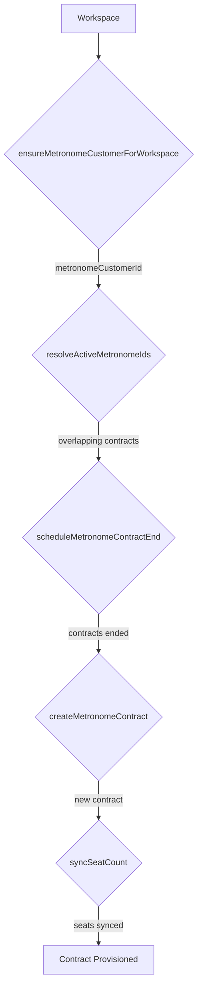
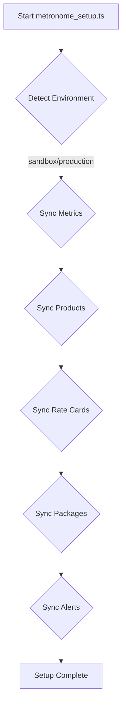
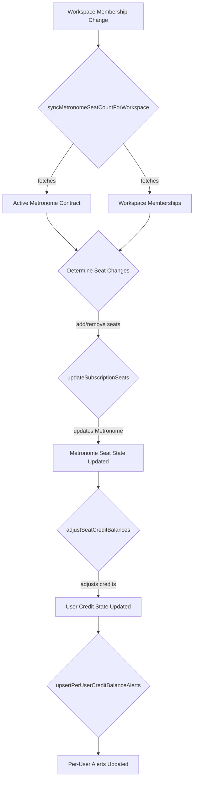
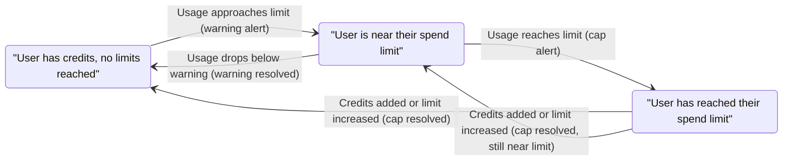
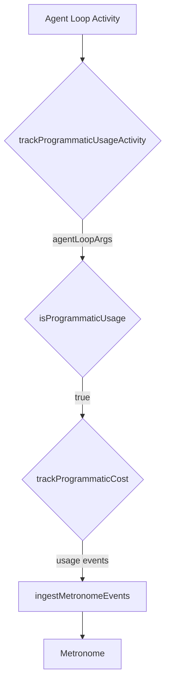

<!-- source: DeepWiki mcp.deepwiki.com · repo dust-tt/dust · page 9.1 Metronome Billing Integration · fetched 2026-10-26 -->

# Metronome Billing Integration

<details>
<summary>Relevant source files</summary>

The following files were used as context for generating this wiki page:

- [front-api/routes/poke/workspaces/[wId]/switch_contract.test.ts](front-api/routes/poke/workspaces/[wId]/switch_contract.test.ts)
- [front-api/routes/poke/workspaces/[wId]/switch_contract.ts](front-api/routes/poke/workspaces/[wId]/switch_contract.ts)
- [front-api/routes/w/[wId]/coupon/redeem.ts](front-api/routes/w/[wId]/coupon/redeem.ts)
- [front-api/routes/w/[wId]/credits/upgrade-requests.test.ts](front-api/routes/w/[wId]/credits/upgrade-requests.test.ts)
- [front-api/routes/w/[wId]/credits/upgrade-requests.ts](front-api/routes/w/[wId]/credits/upgrade-requests.ts)
- [front-api/routes/w/[wId]/members/[uId]/spend_limit.test.ts](front-api/routes/w/[wId]/members/[uId]/spend_limit.test.ts)
- [front-api/routes/w/[wId]/subscriptions/checkout/business-activation.ts](front-api/routes/w/[wId]/subscriptions/checkout/business-activation.ts)
- [front-api/routes/w/[wId]/subscriptions/checkout/index.ts](front-api/routes/w/[wId]/subscriptions/checkout/index.ts)
- [front-api/routes/w/[wId]/usage-status.test.ts](front-api/routes/w/[wId]/usage-status.test.ts)
- [front-api/routes/w/[wId]/usage-status.ts](front-api/routes/w/[wId]/usage-status.ts)
- [front-api/routes/w/[wId]/usage_settings/default_user_spend_limit.test.ts](front-api/routes/w/[wId]/usage_settings/default_user_spend_limit.test.ts)
- [front-api/routes/w/[wId]/usage_settings/default_user_spend_limit.ts](front-api/routes/w/[wId]/usage_settings/default_user_spend_limit.ts)
- [front-api/routes/w/[wId]/usage_settings/index.ts](front-api/routes/w/[wId]/usage_settings/index.ts)
- [front-api/routes/w/[wId]/usage_settings/programmatic_usage_limit.test.ts](front-api/routes/w/[wId]/usage_settings/programmatic_usage_limit.test.ts)
- [front-api/routes/w/[wId]/usage_settings/programmatic_usage_limit.ts](front-api/routes/w/[wId]/usage_settings/programmatic_usage_limit.ts)
- [front/admin/audit_log_schemas/membership.upgrade_request_created.json](front/admin/audit_log_schemas/membership.upgrade_request_created.json)
- [front/components/assistant/conversation/input_bar/InputBarUsageBanner.tsx](front/components/assistant/conversation/input_bar/InputBarUsageBanner.tsx)
- [front/components/credits/UsageUpgradeButton.tsx](front/components/credits/UsageUpgradeButton.tsx)
- [front/components/navigation/AppStatusBanner.tsx](front/components/navigation/AppStatusBanner.tsx)
- [front/components/pages/onboarding/CheckoutPage.tsx](front/components/pages/onboarding/CheckoutPage.tsx)
- [front/components/poke/coupons/CreateCouponForm.tsx](front/components/poke/coupons/CreateCouponForm.tsx)
- [front/components/poke/subscriptions/FreePlanUpgradeDialog.tsx](front/components/poke/subscriptions/FreePlanUpgradeDialog.tsx)
- [front/components/poke/subscriptions/SwitchContractDialog.tsx](front/components/poke/subscriptions/SwitchContractDialog.tsx)
- [front/components/workspace/UpgradeRequestsTable.tsx](front/components/workspace/UpgradeRequestsTable.tsx)
- [front/lib/actions/tool_loading.test.ts](front/lib/actions/tool_loading.test.ts)
- [front/lib/actions/tool_loading.ts](front/lib/actions/tool_loading.ts)
- [front/lib/api/assistant/agent_message_consumption_attribution/attribution_builder.ts](front/lib/api/assistant/agent_message_consumption_attribution/attribution_builder.ts)
- [front/lib/api/assistant/agent_message_consumption_attribution/enabled_skill_footprint.ts](front/lib/api/assistant/agent_message_consumption_attribution/enabled_skill_footprint.ts)
- [front/lib/api/assistant/agent_message_consumption_attribution/store.test.ts](front/lib/api/assistant/agent_message_consumption_attribution/store.test.ts)
- [front/lib/api/assistant/agent_message_consumption_attribution/store.ts](front/lib/api/assistant/agent_message_consumption_attribution/store.ts)
- [front/lib/api/assistant/agent_message_consumption_attribution/tool_footprint.test.ts](front/lib/api/assistant/agent_message_consumption_attribution/tool_footprint.test.ts)
- [front/lib/api/assistant/agent_message_consumption_attribution/tool_footprint.ts](front/lib/api/assistant/agent_message_consumption_attribution/tool_footprint.ts)
- [front/lib/api/assistant/credit_cost.test.ts](front/lib/api/assistant/credit_cost.test.ts)
- [front/lib/api/assistant/credit_cost.ts](front/lib/api/assistant/credit_cost.ts)
- [front/lib/api/checkout/business_activation.test.ts](front/lib/api/checkout/business_activation.test.ts)
- [front/lib/api/checkout/business_activation.ts](front/lib/api/checkout/business_activation.ts)
- [front/lib/api/credits/credit_based_payg.ts](front/lib/api/credits/credit_based_payg.ts)
- [front/lib/api/credits/programmatic_usage_limit.test.ts](front/lib/api/credits/programmatic_usage_limit.test.ts)
- [front/lib/api/credits/programmatic_usage_limit.ts](front/lib/api/credits/programmatic_usage_limit.ts)
- [front/lib/api/credits/upgrade_requests.ts](front/lib/api/credits/upgrade_requests.ts)
- [front/lib/api/keys/spend_limit.ts](front/lib/api/keys/spend_limit.ts)
- [front/lib/api/membership.test.ts](front/lib/api/membership.test.ts)
- [front/lib/api/membership.ts](front/lib/api/membership.ts)
- [front/lib/api/metronome/credit_state_dispatcher.test.ts](front/lib/api/metronome/credit_state_dispatcher.test.ts)
- [front/lib/api/metronome/credit_state_dispatcher.ts](front/lib/api/metronome/credit_state_dispatcher.ts)
- [front/lib/api/metronome/process_webhook.test.ts](front/lib/api/metronome/process_webhook.test.ts)
- [front/lib/api/metronome/process_webhook.ts](front/lib/api/metronome/process_webhook.ts)
- [front/lib/api/metronome/reconcile_credit_state.test.ts](front/lib/api/metronome/reconcile_credit_state.test.ts)
- [front/lib/api/metronome/reconcile_credit_state.ts](front/lib/api/metronome/reconcile_credit_state.ts)
- [front/lib/api/metronome/seat_sync.ts](front/lib/api/metronome/seat_sync.ts)
- [front/lib/api/poke/plugins/workspaces/apply_coupon.test.ts](front/lib/api/poke/plugins/workspaces/apply_coupon.test.ts)
- [front/lib/api/poke/plugins/workspaces/apply_coupon.ts](front/lib/api/poke/plugins/workspaces/apply_coupon.ts)
- [front/lib/api/poke/plugins/workspaces/manage_programmatic_usage_configuration.ts](front/lib/api/poke/plugins/workspaces/manage_programmatic_usage_configuration.ts)
- [front/lib/api/poke/plugins/workspaces/sync_api_key_cap_alerts.ts](front/lib/api/poke/plugins/workspaces/sync_api_key_cap_alerts.ts)
- [front/lib/api/poke/plugins/workspaces/sync_metronome_seats.ts](front/lib/api/poke/plugins/workspaces/sync_metronome_seats.ts)
- [front/lib/api/poke/switch_contract.ts](front/lib/api/poke/switch_contract.ts)
- [front/lib/api/users/spend_limit.ts](front/lib/api/users/spend_limit.ts)
- [front/lib/api/workspace/default_user_spend_limit.test.ts](front/lib/api/workspace/default_user_spend_limit.test.ts)
- [front/lib/api/workspace/default_user_spend_limit.ts](front/lib/api/workspace/default_user_spend_limit.ts)
- [front/lib/credits/agent_message_billing.test.ts](front/lib/credits/agent_message_billing.test.ts)
- [front/lib/credits/agent_message_billing.ts](front/lib/credits/agent_message_billing.ts)
- [front/lib/credits/checkout_payment_status.test.ts](front/lib/credits/checkout_payment_status.test.ts)
- [front/lib/credits/checkout_payment_status.ts](front/lib/credits/checkout_payment_status.ts)
- [front/lib/credits/credit_payg.ts](front/lib/credits/credit_payg.ts)
- [front/lib/metronome/alerts/per_user_credit_balance.ts](front/lib/metronome/alerts/per_user_credit_balance.ts)
- [front/lib/metronome/alerts/programmatic_cap.ts](front/lib/metronome/alerts/programmatic_cap.ts)
- [front/lib/metronome/alerts/spend_limits.test.ts](front/lib/metronome/alerts/spend_limits.test.ts)
- [front/lib/metronome/alerts/spend_limits.ts](front/lib/metronome/alerts/spend_limits.ts)
- [front/lib/metronome/alerts/usage_cap.ts](front/lib/metronome/alerts/usage_cap.ts)
- [front/lib/metronome/client.test.ts](front/lib/metronome/client.test.ts)
- [front/lib/metronome/client.ts](front/lib/metronome/client.ts)
- [front/lib/metronome/constants.ts](front/lib/metronome/constants.ts)
- [front/lib/metronome/contracts.test.ts](front/lib/metronome/contracts.test.ts)
- [front/lib/metronome/contracts.ts](front/lib/metronome/contracts.ts)
- [front/lib/metronome/coupons.test.ts](front/lib/metronome/coupons.test.ts)
- [front/lib/metronome/coupons.ts](front/lib/metronome/coupons.ts)
- [front/lib/metronome/events.test.ts](front/lib/metronome/events.test.ts)
- [front/lib/metronome/events.ts](front/lib/metronome/events.ts)
- [front/lib/metronome/live_user_credit_inputs.test.ts](front/lib/metronome/live_user_credit_inputs.test.ts)
- [front/lib/metronome/live_user_credit_inputs.ts](front/lib/metronome/live_user_credit_inputs.ts)
- [front/lib/metronome/programmatic_credit_state_machine.test.ts](front/lib/metronome/programmatic_credit_state_machine.test.ts)
- [front/lib/metronome/programmatic_credit_state_machine.ts](front/lib/metronome/programmatic_credit_state_machine.ts)
- [front/lib/metronome/seat_types.test.ts](front/lib/metronome/seat_types.test.ts)
- [front/lib/metronome/seat_types.ts](front/lib/metronome/seat_types.ts)
- [front/lib/metronome/seats.test.ts](front/lib/metronome/seats.test.ts)
- [front/lib/metronome/seats.ts](front/lib/metronome/seats.ts)
- [front/lib/metronome/seats_sync.test.ts](front/lib/metronome/seats_sync.test.ts)
- [front/lib/metronome/setup_common.ts](front/lib/metronome/setup_common.ts)
- [front/lib/metronome/setup_legacy.ts](front/lib/metronome/setup_legacy.ts)
- [front/lib/metronome/setup_new_pricing.ts](front/lib/metronome/setup_new_pricing.ts)
- [front/lib/metronome/types.test.ts](front/lib/metronome/types.test.ts)
- [front/lib/metronome/types.ts](front/lib/metronome/types.ts)
- [front/lib/metronome/user_block.test.ts](front/lib/metronome/user_block.test.ts)
- [front/lib/metronome/user_block.ts](front/lib/metronome/user_block.ts)
- [front/lib/metronome/user_credit_state_machine.test.ts](front/lib/metronome/user_credit_state_machine.test.ts)
- [front/lib/metronome/user_credit_state_machine.ts](front/lib/metronome/user_credit_state_machine.ts)
- [front/lib/metronome/workspace_credit_state_machine.test.ts](front/lib/metronome/workspace_credit_state_machine.test.ts)
- [front/lib/metronome/workspace_credit_state_machine.ts](front/lib/metronome/workspace_credit_state_machine.ts)
- [front/lib/model_constructors/types/tool_search.ts](front/lib/model_constructors/types/tool_search.ts)
- [front/lib/notifications/workflows/upgrade-request-created.ts](front/lib/notifications/workflows/upgrade-request-created.ts)
- [front/lib/plans/credit_priced_plans.ts](front/lib/plans/credit_priced_plans.ts)
- [front/lib/plans/stripe.test.ts](front/lib/plans/stripe.test.ts)
- [front/lib/plans/stripe.ts](front/lib/plans/stripe.ts)
- [front/lib/resources/coupon_redemption_resource.test.ts](front/lib/resources/coupon_redemption_resource.test.ts)
- [front/lib/resources/coupon_redemption_resource.ts](front/lib/resources/coupon_redemption_resource.ts)
- [front/lib/resources/coupon_resource.test.ts](front/lib/resources/coupon_resource.test.ts)
- [front/lib/resources/coupon_resource.ts](front/lib/resources/coupon_resource.ts)
- [front/lib/resources/membership_resource.ts](front/lib/resources/membership_resource.ts)
- [front/lib/resources/membership_upgrade_request_resource.ts](front/lib/resources/membership_upgrade_request_resource.ts)
- [front/lib/resources/storage/models/coupon_redemptions.ts](front/lib/resources/storage/models/coupon_redemptions.ts)
- [front/lib/resources/storage/models/coupons.ts](front/lib/resources/storage/models/coupons.ts)
- [front/lib/resources/storage/models/membership.ts](front/lib/resources/storage/models/membership.ts)
- [front/lib/resources/storage/models/membership_upgrade_requests.ts](front/lib/resources/storage/models/membership_upgrade_requests.ts)
- [front/lib/resources/subscription_resource.ts](front/lib/resources/subscription_resource.ts)
- [front/lib/swr/upgrade_requests.ts](front/lib/swr/upgrade_requests.ts)
- [front/lib/swr/user.ts](front/lib/swr/user.ts)
- [front/migrations/20260408_backfill_metronome_events.ts](front/migrations/20260408_backfill_metronome_events.ts)
- [front/migrations/20260605_backfill_membership_pool_cap_overrides.ts](front/migrations/20260605_backfill_membership_pool_cap_overrides.ts)
- [front/migrations/pre-deploy/20260727135138_add_reason_to_membership_upgrade_requests.sql](front/migrations/pre-deploy/20260727135138_add_reason_to_membership_upgrade_requests.sql)
- [front/migrations/pre-deploy/20260729153513_add_pool_cap_override_expires_at_to_memberships.sql](front/migrations/pre-deploy/20260729153513_add_pool_cap_override_expires_at_to_memberships.sql)
- [front/scripts/audit_metronome_seat_state.ts](front/scripts/audit_metronome_seat_state.ts)
- [front/scripts/backfill_db_free_credits_from_metronome.ts](front/scripts/backfill_db_free_credits_from_metronome.ts)
- [front/scripts/backfill_stranded_ended_backend_only_subscriptions.ts](front/scripts/backfill_stranded_ended_backend_only_subscriptions.ts)
- [front/scripts/fix_metronome_future_seat_segment.ts](front/scripts/fix_metronome_future_seat_segment.ts)
- [front/scripts/metronome_setup.ts](front/scripts/metronome_setup.ts)
- [front/scripts/remove_duplicated_credits.ts](front/scripts/remove_duplicated_credits.ts)
- [front/scripts/set_programmatic_monthly_limit_legacy_credits.ts](front/scripts/set_programmatic_monthly_limit_legacy_credits.ts)
- [front/scripts/workspace_helpers.ts](front/scripts/workspace_helpers.ts)
- [front/temporal/analytics_queue/activities/agent_analytics.ts](front/temporal/analytics_queue/activities/agent_analytics.ts)
- [front/temporal/usage_queue/activities.ts](front/temporal/usage_queue/activities.ts)
- [front/temporal/usage_queue/client.ts](front/temporal/usage_queue/client.ts)
- [front/temporal/usage_queue/helpers.ts](front/temporal/usage_queue/helpers.ts)
- [front/temporal/usage_queue/signals.ts](front/temporal/usage_queue/signals.ts)
- [front/temporal/usage_queue/worker.ts](front/temporal/usage_queue/worker.ts)
- [front/temporal/usage_queue/workflows.ts](front/temporal/usage_queue/workflows.ts)
- [front/tests/utils/AgentMCPActionFactory.ts](front/tests/utils/AgentMCPActionFactory.ts)
- [front/tests/utils/CouponFactory.ts](front/tests/utils/CouponFactory.ts)
- [front/tests/utils/MembershipFactory.ts](front/tests/utils/MembershipFactory.ts)
- [front/tests/utils/metronome_contracts.ts](front/tests/utils/metronome_contracts.ts)
- [front/types/api/credits/programmatic_usage_limit.ts](front/types/api/credits/programmatic_usage_limit.ts)
- [front/types/coupon.ts](front/types/coupon.ts)
- [front/types/credits.ts](front/types/credits.ts)
- [front/types/memberships.test.ts](front/types/memberships.test.ts)
- [front/types/memberships.ts](front/types/memberships.ts)

</details>


This page documents Dust's integration with Metronome, a usage-based billing platform. It covers the Metronome client, the contract lifecycle, subscription management, webhook processing, seat synchronization, and the user credit state machine. Key functions and classes like `provisionMetronomeContract`, `syncSeatCount`, `UserCreditState`, `processMetronomeWebhook`, and the PAYG (Pay-As-You-Go) model are explained in detail.

Sources:
- [front/lib/metronome/client.ts]()
- [front/scripts/metronome_setup.ts]()
- [front/lib/resources/subscription_resource.ts]()
- [front/lib/api/metronome/process_webhook.ts]()
- [front/lib/metronome/seats.ts]()
- [front/lib/metronome/constants.ts]()
- [front/lib/metronome/events.ts]()
- [front/lib/plans/stripe.ts]()
- [front/lib/metronome/contracts.ts]()
- [front/temporal/usage_queue/activities.ts]()
- [front/lib/resources/membership_resource.ts]()
- [front/lib/api/membership.ts]()

## Metronome Client

The Metronome client is responsible for interacting with the Metronome API. It is initialized as a singleton to ensure consistent configuration and efficient resource usage. The client handles API key management, retries for transient errors, and provides methods for various Metronome operations.

The `getMetronomeClient` function [front/lib/metronome/client.ts:56-68]() returns a configured `Metronome` SDK instance. It ensures that the `METRONOME_API_KEY` environment variable is set and configures the client with an increased `maxRetries` to handle rate limits gracefully.

```typescript
export function getMetronomeClient(): Metronome {
  if (!cachedClient) {
    const bearerToken = config.getMetronomeApiKey();
    if (!bearerToken) {
      throw new Error("METRONOME_API_KEY is not set");
    }
    cachedClient = new Metronome({ bearerToken, maxRetries: 5 });
  }
  return cachedClient;
}
```

The client also provides utility functions for date manipulation, ensuring that timestamps sent to Metronome adhere to its specific boundary requirements (e.g., `floorToHourISO`, `ceilToHourISO`, `floorToMidnightUTC`, `ceilToMidnightUTC`) [front/lib/metronome/client.ts:71-99]().

Sources:
- [front/lib/metronome/client.ts:56-68]()
- [front/lib/metronome/client.ts:71-99]()

## Contract Lifecycle and Subscription Management

The Metronome contract represents a billing agreement for a workspace. Its lifecycle involves creation, updates, and termination, closely tied to Dust's subscription model.

### Provisioning a Metronome Contract

The `provisionMetronomeContract` function [front/lib/metronome/contracts.ts:190-279]() is central to establishing a new billing contract. It ensures a Metronome customer exists for the workspace, ends any overlapping existing contracts, and then creates the new contract based on a specified package alias.

**Diagram: Metronome Contract Provisioning**


Sources:
- [front/lib/metronome/contracts.ts:190-279]()

The `ensureMetronomeCustomerForWorkspace` function [front/lib/metronome/contracts.ts:50-108]() idempotently creates or retrieves a Metronome customer for a given workspace. It also ensures that the Metronome customer is linked to a Stripe customer if `stripeCustomerId` is provided, which is crucial for paid plans.

```typescript
export async function ensureMetronomeCustomerForWorkspace({
  workspace,
  stripeCustomerId,
  stripeCollectionMethod,
}: {
  workspace: LightWorkspaceType;
  stripeCustomerId?: string;
  stripeCollectionMethod?: MetronomeStripeCollectionMethod;
}): Promise<Result<{ metronomeCustomerId: string }, Error>> {
  // ... logic to find or create Metronome customer ...
  // ... logic to update workspace with metronomeCustomerId ...
  // ... logic to ensure Stripe billing config ...
}
```

Sources:
- [front/lib/metronome/contracts.ts:50-108]()

### Subscription Resource Integration

The `SubscriptionResource` [front/lib/resources/subscription_resource.ts:142-142]() manages the mapping between Dust's internal subscription model and Metronome contracts. It tracks the `metronomeContractId` [front/lib/resources/subscription_resource.ts:128]() and provides methods to determine if a subscription is Metronome-billed (`isMetronomeOnlyBilled`) or shadow-billed (`isMetronomeShadowBilled`) alongside Stripe.

```typescript
export class SubscriptionResource extends BaseResource<SubscriptionModel> {
  // ...
  get isMetronomeShadowBilled(): boolean {
    return !!this.stripeSubscriptionId && !!this.metronomeContractId;
  }

  get isMetronomeOnlyBilled(): boolean {
    return !!this.metronomeContractId && !this.stripeSubscriptionId;
  }
  // ...
}
```

Sources:
- [front/lib/resources/subscription_resource.ts:142-142]()
- [front/lib/resources/subscription_resource.ts:128]()

### Metronome Setup Script

The `metronome_setup.ts` script [front/scripts/metronome_setup.ts:1-13]() is used to idempotently synchronize Metronome's metrics, products, rate cards, and packages with the definitions in the Dust codebase. This script is critical for maintaining consistency between the application's billing logic and Metronome's configuration. It can run in dry-run mode or execute changes.

**Diagram: Metronome Setup Script Flow**


Sources:
- [front/scripts/metronome_setup.ts:1-13]()

## Webhook Processing

Metronome webhooks are crucial for real-time updates on billing events, such as contract changes, credit balance alerts, and usage thresholds. The `processMetronomeWebhook` function [front/lib/api/metronome/process_webhook.ts:156-156]() is the entry point for handling these events.

**Diagram: Metronome Webhook Processing**
```mermaid
graph TD
    A[Metronome Webhook Event] --> B{unwrapMetronomeWebhook};
    B -- parsed event --> C{processMetronomeWebhook};
    C -- event type --> D{switch (event.type)};
    D -- "contract.start" --> D1[handleContractStart];
    D -- "contract.end" --> D2[handleContractEnd];
    D -- "credit.create" --> D3[handleCreditCreate];
    D -- "credit.segment.start" --> D4[handleCreditSegmentStart];
    D -- "alerts.spend_threshold_reached" --> D5[handleSpendThresholdReached];
    D -- "alerts.spend_threshold_resolved" --> D6[handleSpendThresholdResolved];
    D -- "payment_gate.payment_status" --> D7[handlePaymentGatePaymentStatus];
    D -- "customer.alert.created" --> D8[handleCustomerAlertCreated];
    D -- "customer.alert.deleted" --> D9[handleCustomerAlertDeleted];
    D -- "customer.alert.updated" --> D10[handleCustomerAlertUpdated];
    D -- "invoice.created" --> D11[handleInvoiceCreated];
    D -- "invoice.updated" --> D12[handleInvoiceUpdated];
    D -- "invoice.finalized" --> D13[handleInvoiceFinalized];
    D -- "invoice.voided" --> D14[handleInvoiceVoided];
    D -- "invoice.paid" --> D15[handleInvoicePaid];
    D -- "invoice.payment_failed" --> D16[handleInvoicePaymentFailed];
    D -- "invoice.payment_succeeded" --> D17[handleInvoicePaymentSucceeded];
    D -- "invoice.payment_refunded" --> D18[handleInvoicePaymentRefunded];
    D -- "invoice.payment_reversed" --> D19[handleInvoicePaymentReversed];
    D -- "invoice.payment_disputed" --> D20[handleInvoicePaymentDisputed];
    D -- "invoice.payment_dispute_closed" --> D21[handleInvoicePaymentDisputeClosed];
    D -- "invoice.payment_dispute_won" --> D22[handleInvoicePaymentDisputeWon];
    D -- "invoice.payment_dispute_lost" --> D23[handleInvoicePaymentDisputeLost];
    D -- "invoice.payment_refund_failed" --> D24[handleInvoicePaymentRefundFailed];
    D -- "invoice.payment_refund_succeeded" --> D25[handleInvoicePaymentRefundSucceeded];
    D -- "invoice.payment_refund_reversed" --> D26[handleInvoicePaymentRefundReversed];
    D -- "invoice.payment_refund_disputed" --> D27[handleInvoicePaymentRefundDisputed];
    D -- "invoice.payment_refund_dispute_closed" --> D28[handleInvoicePaymentRefundDisputeClosed];
    D -- "invoice.payment_refund_dispute_won" --> D29[handleInvoicePaymentRefundDisputeWon];
    D -- "invoice.payment_refund_dispute_lost" --> D30[handleInvoicePaymentRefundDisputeLost];
    D -- "invoice.payment_refund_failed" --> D31[handleInvoicePaymentRefundFailed];
    D -- "invoice.payment_refund_succeeded" --> D32[handleInvoicePaymentRefundSucceeded];
    D -- "invoice.payment_refund_reversed" --> D33[handleInvoicePaymentRefundReversed];
    D -- "invoice.payment_refund_disputed" --> D34[handleInvoicePaymentRefundDisputed];
    D -- "invoice.payment_refund_dispute_closed" --> D35[handleInvoicePaymentRefundDisputeClosed];
    D -- "invoice.payment_refund_dispute_won" --> D36[handleInvoicePaymentRefundDisputeWon];
    D -- "invoice.payment_refund_dispute_lost" --> D37[handleInvoicePaymentRefundDisputeLost];
    D -- default --> D38[Log unhandled event];
```

The `unwrapMetronomeWebhook` function [front/lib/metronome/client.ts:109-115]() verifies the webhook signature and parses the payload.

Key event handlers within `processMetronomeWebhook` include:
*   **`contract.start`**: Triggered when a Metronome contract becomes active. This handler performs critical actions like:
    *   Invalidating the contract cache [front/lib/api/metronome/process_webhook.ts:72]().
    *   Applying legacy credit migrations if applicable [front/lib/api/metronome/process_webhook.ts:26]().
    *   Swapping the Dust subscription to reflect the new contract [front/lib/api/metronome/process_webhook.ts:260-260]().
    *   Carrying over contract balances on renewal [front/lib/api/metronome/process_webhook.ts:73]().
    *   Ensuring WorkOS organization for paid plans [front/lib/api/metronome/process_webhook.ts:29]().
    *   Reconciling workspace user credit states [front/lib/api/metronome/process_webhook.ts:27]().
*   **`alerts.spend_threshold_reached` / `alerts.spend_threshold_resolved`**: These events manage credit balance alerts, dispatching notifications for low balance, pool exhaustion, or cap reached events [front/lib/api/metronome/process_webhook.ts:10-25]().
*   **`payment_gate.payment_status`**: Handles payment status updates for payment-gated contracts, marking AWU purchase attempts as successful or failed [front/lib/api/metronome/process_webhook.ts:32-34]().

Sources:
- [front/lib/api/metronome/process_webhook.ts:156-156]()
- [front/lib/metronome/client.ts:109-115]()
- [front/lib/api/metronome/process_webhook.ts:72]()
- [front/lib/api/metronome/process_webhook.ts:26]()
- [front/lib/api/metronome/process_webhook.ts:260-260]()
- [front/lib/api/metronome/process_webhook.ts:73]()
- [front/lib/api/metronome/process_webhook.ts:29]()
- [front/lib/api/metronome/process_webhook.ts:27]()
- [front/lib/api/metronome/process_webhook.ts:10-25]()
- [front/lib/api/metronome/process_webhook.ts:32-34]()

## Seat Synchronization

Seat synchronization ensures that the number and type of active users in a Dust workspace are correctly reflected in Metronome for billing purposes. The `syncSeatCount` function [front/lib/metronome/seats.ts:19-19]() is the primary mechanism for this.

**Diagram: Seat Synchronization Flow**


Sources:
- [front/lib/metronome/seats.ts:19-19]()

The `syncSeatCount` function [front/lib/metronome/seats.ts:19-19]() performs the following steps:
1.  Fetches the active Metronome contract for the workspace.
2.  Retrieves all active memberships for the workspace.
3.  Compares the current Metronome seat state with the desired state based on Dust memberships.
4.  Calls `updateSubscriptionSeats` [front/lib/metronome/client.ts:400-400]() to add or remove seats in Metronome.
5.  Calls `adjustSeatCreditBalances` [front/lib/metronome/client.ts:420-420]() to update individual user credit balances based on their seat type.
6.  Manages per-user credit balance alerts using `upsertPerUserCreditBalanceAlerts` [front/lib/metronome/alerts/per_user_credit_balance.ts:4-4]() and `clearPerUserCreditBalanceAlerts` [front/lib/metronome/alerts/per_user_credit_balance.ts:3-3]().

The `classifySeatChange` function [front/lib/metronome/seats.ts:179-190]() determines how a user's seat type change should be handled (immediate, deferred, cancelled, or no-op) based on the contract, product seat types, and any pending scheduled changes. This logic is crucial for managing upgrades/downgrades and ensuring users retain access for already-paid allowances.

Sources:
- [front/lib/metronome/seats.ts:19-19]()
- [front/lib/metronome/client.ts:400-400]()
- [front/lib/metronome/client.ts:420-420]()
- [front/lib/metronome/alerts/per_user_credit_balance.ts:4-4]()
- [front/lib/metronome/alerts/per_user_credit_balance.ts:3-3]()
- [front/lib/metronome/seats.ts:179-190]()

## User Credit State Machine

The `UserCreditState` [front/types/memberships.ts:27-27]() represents the billing status of a user within a workspace, particularly concerning their AWU (AI Work Unit) credits. This state machine is critical for managing user access and applying spend limits.

**Diagram: User Credit State Machine**


Sources:
- [front/types/memberships.ts:27-27]()

The `UserCreditState` can be one of:
*   `"active"`: The user has sufficient credits and is not near any spend limits.
*   `"near_limit"`: The user is approaching their spend limit, triggering warning notifications. This state is managed by `upsertMetronomePerUserWarningAlert` [front/lib/api/membership.ts:13]() and `setUserNearLimit` [front/lib/metronome/user_block.ts:10-10]().
*   `"blocked"`: The user has reached their spend limit and cannot perform further actions that consume credits. This state is managed by `upsertMetronomePerUserCapAlert` [front/lib/api/membership.ts:12]() and `setUserBlocked` [front/lib/metronome/user_block.ts:11-11]().

The `reconcileWorkspaceUserCreditStates` function [front/lib/api/metronome/reconcile_credit_state.ts:10-10]() is a Temporal activity that periodically updates the credit states for all users in a workspace. This ensures that the `UserCreditState` accurately reflects their Metronome credit balances and any active spend limits.

Sources:
- [front/lib/api/membership.ts:13]()
- [front/lib/metronome/user_block.ts:10-10]()
- [front/lib/api/membership.ts:12]()
- [front/lib/metronome/user_block.ts:11-11]()
- [front/lib/api/metronome/reconcile_credit_state.ts:10-10]()

## PAYG (Pay-As-You-Go)

Dust supports a PAYG model where users consume AWU credits, which are billed through Metronome.

### Ingesting Usage Events

Usage events, such as LLM calls and tool invocations, are sent to Metronome for billing. The `ingestMetronomeEvents` function [front/lib/metronome/client.ts:128-173]() batches these events and sends them to Metronome's ingest API. It filters out events older than 34 days to avoid Metronome rejections.

```typescript
export async function ingestMetronomeEvents(
  events: MetronomeEvent[]
): Promise<void> {
  // ... filtering logic for old events ...
  for (let i = 0; i < validEvents.length; i += METRONOME_INGEST_BATCH_SIZE) {
    const batch = validEvents.slice(i, i + METRONOME_INGEST_BATCH_SIZE);
    await client.v1.usage.ingest({ usage: batch });
  }
  // ... error handling and logging ...
}
```

Sources:
- [front/lib/metronome/client.ts:128-173]()

The `emitMetronomeUsageEvents` activity [front/temporal/usage_queue/activities.ts:210-210]() is responsible for generating and ingesting these events. It constructs `llm_usage_v3` events using `buildLlmUsageEvents` [front/lib/metronome/events.ts:161-229]() and `tool_use_v2` events using `buildToolUseEvents` [front/lib/metronome/events.ts:231-280](). These events include details like `transaction_id`, `customer_id`, `event_type`, `timestamp`, and various properties for granular billing.

Sources:
- [front/temporal/usage_queue/activities.ts:210-210]()
- [front/lib/metronome/events.ts:161-229]()
- [front/lib/metronome/events.ts:231-280]()

### Programmatic Usage Tracking

Programmatic usage, typically via API keys, is tracked separately. The `trackProgrammaticUsageActivity` [front/temporal/usage_queue/activities.ts:121-204]() activity identifies programmatic usage based on the `userMessageOrigin` and calls `trackProgrammaticCost` [front/lib/api/programmatic_usage/tracking.ts:6-6]() to record the associated costs.

**Diagram: Programmatic Usage Tracking**


Sources:
- [front/temporal/usage_queue/activities.ts:121-204]()
- [front/lib/api/programmatic_usage/tracking.ts:6-6]()

Programmatic usage also has its own set of alerts (`PROGRAMMATIC_CAP_ALERT_NAME`, `PROGRAMMATIC_LOW_BALANCE_ALERT_NAME`, `PROGRAMMATIC_CRITICAL_BALANCE_ALERT_NAME`) [front/lib/api/metronome/process_webhook.ts:39-41]() that trigger specific `ProgrammaticCreditEvent`s [front/lib/api/metronome/process_webhook.ts:128-146]() to manage the programmatic credit state machine.

Sources:
- [front/lib/api/metronome/process_webhook.ts:39-41]()
- [front/lib/api/metronome/process_webhook.ts:128-146]()

---

