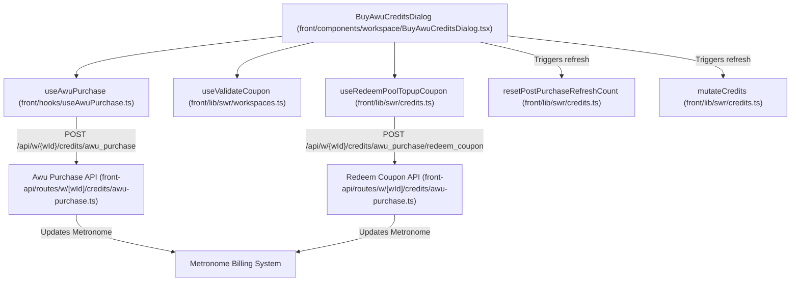

<!-- source: DeepWiki mcp.deepwiki.com · repo dust-tt/dust · page 9.2 Usage Management UI · fetched 2026-10-26 -->

# Usage Management UI

Relevant source files

The following files were used as context for generating this wiki page:

- [front-api/routes/poke/workspaces/[wId]/credits/api-keys-usage.ts](front-api/routes/poke/workspaces/[wId]/credits/api-keys-usage.ts)
- [front-api/routes/poke/workspaces/[wId]/credits/consumption-export.ts](front-api/routes/poke/workspaces/[wId]/credits/consumption-export.ts)
- [front-api/routes/poke/workspaces/[wId]/credits/index.ts](front-api/routes/poke/workspaces/[wId]/credits/index.ts)
- [front-api/routes/poke/workspaces/[wId]/credits/members-usage.ts](front-api/routes/poke/workspaces/[wId]/credits/members-usage.ts)
- [front-api/routes/w/[wId]/credits/awu-pool-summary.test.ts](front-api/routes/w/[wId]/credits/awu-pool-summary.test.ts)
- [front-api/routes/w/[wId]/credits/awu-pool-summary.ts](front-api/routes/w/[wId]/credits/awu-pool-summary.ts)
- [front-api/routes/w/[wId]/credits/index.ts](front-api/routes/w/[wId]/credits/index.ts)
- [front-api/routes/w/[wId]/credits/members-usage.test.ts](front-api/routes/w/[wId]/credits/members-usage.test.ts)
- [front-api/routes/w/[wId]/credits/members-usage.ts](front-api/routes/w/[wId]/credits/members-usage.ts)
- [front-api/routes/w/[wId]/credits/purchase.test.ts](front-api/routes/w/[wId]/credits/purchase.test.ts)
- [front-api/routes/w/[wId]/credits/purchase.ts](front-api/routes/w/[wId]/credits/purchase.ts)
- [front-api/routes/w/[wId]/credits/usage-configuration.test.ts](front-api/routes/w/[wId]/credits/usage-configuration.test.ts)
- [front-api/routes/w/[wId]/credits/usage-configuration.ts](front-api/routes/w/[wId]/credits/usage-configuration.ts)
- [front-api/routes/w/[wId]/members/[uId]/seat-type.test.ts](front-api/routes/w/[wId]/members/[uId]/seat-type.test.ts)
- [front-api/routes/w/[wId]/members/[uId]/seat-type.ts](front-api/routes/w/[wId]/members/[uId]/seat-type.ts)
- [front-api/routes/w/[wId]/members/[uId]/spend_limit.ts](front-api/routes/w/[wId]/members/[uId]/spend_limit.ts)
- [front-api/routes/w/[wId]/metronome/contract.ts](front-api/routes/w/[wId]/metronome/contract.ts)
- [front-api/routes/w/[wId]/seats/plan.ts](front-api/routes/w/[wId]/seats/plan.ts)
- [front-api/routes/w/[wId]/subscriptions/checkout/business-activation.test.ts](front-api/routes/w/[wId]/subscriptions/checkout/business-activation.test.ts)
- [front-api/routes/w/[wId]/subscriptions/index.test.ts](front-api/routes/w/[wId]/subscriptions/index.test.ts)
- [front-api/routes/w/[wId]/subscriptions/status.ts](front-api/routes/w/[wId]/subscriptions/status.ts)
- [front-api/routes/w/[wId]/trial/start.ts](front-api/routes/w/[wId]/trial/start.ts)
- [front-spa/src/app/layouts/AuthenticatedPage.tsx](front-spa/src/app/layouts/AuthenticatedPage.tsx)
- [front-spa/src/app/layouts/UnauthenticatedPage.tsx](front-spa/src/app/layouts/UnauthenticatedPage.tsx)
- [front-spa/src/app/routes/onboardingRoutes.tsx](front-spa/src/app/routes/onboardingRoutes.tsx)
- [front/components/members/InviteEmailButtonWithModal.tsx](front/components/members/InviteEmailButtonWithModal.tsx)
- [front/components/pages/onboarding/PaymentProcessingPage.tsx](front/components/pages/onboarding/PaymentProcessingPage.tsx)
- [front/components/pages/onboarding/SelectSubscriptionPage.tsx](front/components/pages/onboarding/SelectSubscriptionPage.tsx)
- [front/components/pages/onboarding/SubscribePage.tsx](front/components/pages/onboarding/SubscribePage.tsx)
- [front/components/pages/onboarding/SubscriptionPlans.tsx](front/components/pages/onboarding/SubscriptionPlans.tsx)
- [front/components/pages/onboarding/TrialEndedPage.tsx](front/components/pages/onboarding/TrialEndedPage.tsx)
- [front/components/pages/onboarding/TrialPage.tsx](front/components/pages/onboarding/TrialPage.tsx)
- [front/components/pages/onboarding/VerifyPage.tsx](front/components/pages/onboarding/VerifyPage.tsx)
- [front/components/pages/workspace/UsagePage.tsx](front/components/pages/workspace/UsagePage.tsx)
- [front/components/pages/workspace/subscription/SubscriptionPage.tsx](front/components/pages/workspace/subscription/SubscriptionPage.tsx)
- [front/components/poke/credits/CreditStateLogsLink.tsx](front/components/poke/credits/CreditStateLogsLink.tsx)
- [front/components/poke/credits/MemberConsumptionExportButton.tsx](front/components/poke/credits/MemberConsumptionExportButton.tsx)
- [front/components/poke/credits/PokeApiKeysUsageTable.tsx](front/components/poke/credits/PokeApiKeysUsageTable.tsx)
- [front/components/poke/credits/PokeMembersUsageTable.tsx](front/components/poke/credits/PokeMembersUsageTable.tsx)
- [front/components/poke/credits/PokeUsageTab.tsx](front/components/poke/credits/PokeUsageTab.tsx)
- [front/components/poke/credits/ReconcileCreditStateButton.tsx](front/components/poke/credits/ReconcileCreditStateButton.tsx)
- [front/components/poke/pages/KillPage.tsx](front/components/poke/pages/KillPage.tsx)
- [front/components/poke/pages/WorkspacePage.tsx](front/components/poke/pages/WorkspacePage.tsx)
- [front/components/poke/shadcn/ui/form/fields.tsx](front/components/poke/shadcn/ui/form/fields.tsx)
- [front/components/poke/subscriptions/EnterpriseUpgradeDialog.tsx](front/components/poke/subscriptions/EnterpriseUpgradeDialog.tsx)
- [front/components/poke/subscriptions/columns.tsx](front/components/poke/subscriptions/columns.tsx)
- [front/components/poke/subscriptions/table.tsx](front/components/poke/subscriptions/table.tsx)
- [front/components/poke/workspace/table.tsx](front/components/poke/workspace/table.tsx)
- [front/components/workspace/BuyAwuCreditsDialog.tsx](front/components/workspace/BuyAwuCreditsDialog.tsx)
- [front/components/workspace/ChangeSeatModal.tsx](front/components/workspace/ChangeSeatModal.tsx)
- [front/components/workspace/EditSpendLimitModal.tsx](front/components/workspace/EditSpendLimitModal.tsx)
- [front/components/workspace/MembersSelectionBanner.tsx](front/components/workspace/MembersSelectionBanner.tsx)
- [front/components/workspace/MembersUsageTable.tsx](front/components/workspace/MembersUsageTable.tsx)
- [front/components/workspace/SeatCard.tsx](front/components/workspace/SeatCard.tsx)
- [front/components/workspace/usage/UsageNotificationsCard.tsx](front/components/workspace/usage/UsageNotificationsCard.tsx)
- [front/components/workspace/usage/UsageProgrammaticLimitCard.tsx](front/components/workspace/usage/UsageProgrammaticLimitCard.tsx)
- [front/components/workspace/usage/UsageSettingsCard.tsx](front/components/workspace/usage/UsageSettingsCard.tsx)
- [front/hooks/useTableRowsSelection.ts](front/hooks/useTableRowsSelection.ts)
- [front/lib/api/credits/api_keys_usage.ts](front/lib/api/credits/api_keys_usage.ts)
- [front/lib/api/credits/awu_pool_summary.ts](front/lib/api/credits/awu_pool_summary.ts)
- [front/lib/api/credits/balance_threshold_alert.ts](front/lib/api/credits/balance_threshold_alert.ts)
- [front/lib/api/credits/consumption_export.test.ts](front/lib/api/credits/consumption_export.test.ts)
- [front/lib/api/credits/consumption_export.ts](front/lib/api/credits/consumption_export.ts)
- [front/lib/api/credits/members_usage.ts](front/lib/api/credits/members_usage.ts)
- [front/lib/api/credits/seat_plan.ts](front/lib/api/credits/seat_plan.ts)
- [front/lib/api/credits/usage_configuration.ts](front/lib/api/credits/usage_configuration.ts)
- [front/lib/api/permissions/legacy_acls.ts](front/lib/api/permissions/legacy_acls.ts)
- [front/lib/api/poke/plugins/workspaces/manage_credit_usage_configuration.ts](front/lib/api/poke/plugins/workspaces/manage_credit_usage_configuration.ts)
- [front/lib/api/poke/workspace_info.ts](front/lib/api/poke/workspace_info.ts)
- [front/lib/api/subscription.ts](front/lib/api/subscription.ts)
- [front/lib/api/subscription/checkout_url.ts](front/lib/api/subscription/checkout_url.ts)
- [front/lib/client/subscription.ts](front/lib/client/subscription.ts)
- [front/lib/credits/awu_purchase.test.ts](front/lib/credits/awu_purchase.test.ts)
- [front/lib/credits/awu_purchase.ts](front/lib/credits/awu_purchase.ts)
- [front/lib/credits/awu_purchase_constants.ts](front/lib/credits/awu_purchase_constants.ts)
- [front/lib/iam/session.ts](front/lib/iam/session.ts)
- [front/lib/metronome/per_user_usage.test.ts](front/lib/metronome/per_user_usage.test.ts)
- [front/lib/metronome/per_user_usage.ts](front/lib/metronome/per_user_usage.ts)
- [front/lib/metronome/plan_type.ts](front/lib/metronome/plan_type.ts)
- [front/lib/metronome/programmatic_awu_usage.ts](front/lib/metronome/programmatic_awu_usage.ts)
- [front/lib/poke/types.ts](front/lib/poke/types.ts)
- [front/lib/resources/credit_usage_configuration_resource.ts](front/lib/resources/credit_usage_configuration_resource.ts)
- [front/lib/resources/storage/models/credit_usage_configurations.ts](front/lib/resources/storage/models/credit_usage_configurations.ts)
- [front/lib/swr/credits.ts](front/lib/swr/credits.ts)
- [front/lib/swr/memberships.ts](front/lib/swr/memberships.ts)
- [front/lib/swr/usage_settings.ts](front/lib/swr/usage_settings.ts)
- [front/migrations/pre-deploy/20260731152015_add_require_upgrade_request_reason_to_credit_usage_configuration.sql](front/migrations/pre-deploy/20260731152015_add_require_upgrade_request_reason_to_credit_usage_configuration.sql)
- [front/poke/swr/credits.ts](front/poke/swr/credits.ts)
- [front/scripts/debug_seat_balances.ts](front/scripts/debug_seat_balances.ts)
- [front/scripts/debug_user_awu_spend.ts](front/scripts/debug_user_awu_spend.ts)
- [front/temporal/upsert_queue/activities.test.ts](front/temporal/upsert_queue/activities.test.ts)
- [front/temporal/upsert_queue/activities.ts](front/temporal/upsert_queue/activities.ts)
- [front/types/api/credits/usage_configuration.ts](front/types/api/credits/usage_configuration.ts)
- [x/spolu/credit_pricing/billing/overview.md](x/spolu/credit_pricing/billing/overview.md)
- [x/spolu/credit_pricing/billing/plan.md](x/spolu/credit_pricing/billing/plan.md)

This page details the user interface components and underlying logic for managing workspace usage, billing, and member-specific settings within the Dust platform. It covers the `UsagePage` component, the `MembersUsageTable`, modals for changing seat types and configuring spend limits, the process for purchasing AWU credits, and the administrative billing interface available in Poke.

## UsagePage

The `UsagePage` [front/components/pages/workspace/UsagePage.tsx:1-700]() is the central hub for workspace administrators to monitor and manage their team's usage and billing. It provides an overview of credit consumption, allows for seat management, and enables configuration of spending policies.

The page is structured with several tabs:
*   **Members**: Displays a table of all workspace members with their individual usage, seat types, and spend limits.
*   **Groups**: Shows usage aggregated by groups.
*   **Upgrade Requests**: Lists pending requests from members to upgrade their seat or increase their spend limit.
*   **Top-ups History**: Provides a record of all AWU credit purchases.

Key features of the `UsagePage` include:
*   **Credit Pool Overview**: A progress bar and summary of the workspace's overall AWU credit pool, including projected usage and remaining balance [front/components/pages/workspace/UsagePage.tsx:299-340]().
*   **Seat Plan Information**: Displays the current subscription plan and available seat types [front/components/pages/workspace/UsagePage.tsx:342-359]().
*   **Usage Settings Cards**: Components like `UsageSettingsCard` [front/components/workspace/usage/UsageSettingsCard.tsx:26-196](), `UsageNotificationsCard` [front/components/workspace/usage/UsageNotificationsCard.tsx:1-100](), and `UsageProgrammaticLimitCard` [front/components/workspace/usage/UsageProgrammaticLimitCard.tsx:1-85]() allow configuration of various usage-related policies.
*   **Bulk Actions**: Administrators can perform bulk actions on selected members, such as changing seat types or editing spend limits [front/components/pages/workspace/UsagePage.tsx:400-401]().

The page leverages several SWR hooks for data fetching, including `useMembersUsage` [front/lib/swr/memberships.ts:226-240](), `useSeatPlan` [front/lib/swr/credits.ts:240-254](), `useAwuPoolSummary` [front/lib/swr/credits.ts:256-270](), and `useUsageSettings` [front/lib/swr/usage_settings.ts:20-34]().

```mermaid
graph TD
    UsagePage["UsagePage (front/components/pages/workspace/UsagePage.tsx)"]
    UsagePage --> MembersUsageTable["MembersUsageTable (front/components/workspace/MembersUsageTable.tsx)"]
    UsagePage --> GroupsUsageTable["GroupsUsageTable (front/components/workspace/GroupsUsageTable.tsx)"]
    UsagePage --> UpgradeRequestsTable["UpgradeRequestsTable (front/components/workspace/UpgradeRequestsTable.tsx)"]
    UsagePage --> TopUpsHistoryTable["TopUpsHistoryTable (front/components/workspace/TopUpsHistoryTable.tsx)"]
    UsagePage --> UsageSettingsCard["UsageSettingsCard (front/components/workspace/usage/UsageSettingsCard.tsx)"]
    UsagePage --> UsageNotificationsCard["UsageNotificationsCard (front/components/workspace/usage/UsageNotificationsCard.tsx)"]
    UsagePage --> UsageProgrammaticLimitCard["UsageProgrammaticLimitCard (front/components/workspace/usage/UsageProgrammaticLimitCard.tsx)"]
    UsagePage --> ChangeSeatModal["ChangeSeatModal (front/components/workspace/ChangeSeatModal.tsx)"]
    UsagePage --> EditSpendLimitModal["EditSpendLimitModal (front/components/workspace/EditSpendLimitModal.tsx)"]
    UsagePage --> BuyAwuCreditsDialog["BuyAwuCreditsDialog (front/components/workspace/BuyAwuCreditsDialog.tsx)"]

    MembersUsageTable -- "MemberUsageType[]" --> useMembersUsage["useMembersUsage (front/lib/swr/memberships.ts)"]
    UsagePage -- "SeatPlanResponseBody" --> useSeatPlan["useSeatPlan (front/lib/swr/credits.ts)"]
    UsagePage -- "AwuPoolSummaryResponseBody" --> useAwuPoolSummary["useAwuPoolSummary (front/lib/swr/credits.ts)"]
    UsagePage -- "UsageSettingsType" --> useUsageSettings["useUsageSettings (front/lib/swr/usage_settings.ts)"]
```

Sources:
- [front/components/pages/workspace/UsagePage.tsx:1-700]()
- [front/components/workspace/usage/UsageSettingsCard.tsx:26-196]()
- [front/components/workspace/usage/UsageNotificationsCard.tsx:1-100]()
- [front/components/workspace/usage/UsageProgrammaticLimitCard.tsx:1-85]()
- [front/lib/swr/memberships.ts:226-240]()
- [front/lib/swr/credits.ts:240-254]()
- [front/lib/swr/credits.ts:256-270]()
- [front/lib/swr/usage_settings.ts:20-34]()
- [front/components/pages/workspace/UsagePage.tsx:299-340]()
- [front/components/pages/workspace/UsagePage.tsx:342-359]()
- [front/components/pages/workspace/UsagePage.tsx:400-401]()

## MembersUsageTable

The `MembersUsageTable` [front/components/workspace/MembersUsageTable.tsx:1-305]() component displays a detailed breakdown of each member's usage within the workspace. It is a `DataTable` from the Sparkle design system, providing sorting, pagination, and selection capabilities.

Each row in the table represents a `MemberUsageType` [front/lib/api/credits/members_usage.ts:90-163]() and includes:
*   **Member Information**: Name, email, and avatar.
*   **Seat Type**: Current and scheduled seat types, with an icon indicating the type [front/components/workspace/MembersUsageTable.tsx:140-160]().
*   **Usage Bar**: A visual representation of AWU credit consumption against their allowance and spend limit [front/components/workspace/MembersUsageTable.tsx:205-305](). This bar distinguishes between credits consumed from the individual allowance and those from the workspace pool.
*   **Spend Limit**: The effective spend limit in AWU credits and its source (e.g., user override, group default, workspace default) [front/components/workspace/MembersUsageTable.tsx:187-202]().
*   **Model Tiers**: Configured model tiers for the user.

The table supports bulk selection of members, enabling administrators to apply changes to multiple users simultaneously.

Sources:
- [front/components/workspace/MembersUsageTable.tsx:1-305]()
- [front/lib/api/credits/members_usage.ts:90-163]()
- [front/components/workspace/MembersUsageTable.tsx:140-160]()
- [front/components/workspace/MembersUsageTable.tsx:205-305]()
- [front/components/workspace/MembersUsageTable.tsx:187-202]()

## Seat Change Modals

Two primary modals facilitate seat type changes: `ChangeSeatModal` and `BulkChangeSeatModal`.

### ChangeSeatModal

The `ChangeSeatModal` [front/components/workspace/ChangeSeatModal.tsx:74-196]() allows an administrator to change the seat type for a single member. It displays available seat plans, their pricing, and the potential invoice impact of the change.

Key aspects:
*   **Member Context**: The modal is opened with a specific `MemberUsageType` [front/components/workspace/ChangeSeatModal.tsx:77]().
*   **Seat Selection**: Users can select from available `MembershipSeatType` options, grouped by billing frequency (monthly/yearly) [front/components/workspace/ChangeSeatModal.tsx:140-165]().
*   **Invoice Preview**: It fetches and displays a preview of the invoice impact using `useBulkSeatChangePreview` [front/lib/swr/memberships.ts:260-274]() to inform the administrator of cost changes [front/components/workspace/ChangeSeatModal.tsx:196-209]().
*   **Subscription Cancellation Check**: Prevents seat changes if the workspace's subscription is scheduled for cancellation [front/components/workspace/ChangeSeatModal.tsx:101-104]().
*   **Action**: The `doUpdateSeatType` function from `useUpdateMemberSeatType` [front/lib/swr/memberships.ts:242-258]() is used to persist the seat change.

### BulkChangeSeatModal

The `BulkChangeSeatModal` [front/components/workspace/BulkChangeSeatModal.tsx:1-190]() is similar to `ChangeSeatModal` but operates on multiple selected members. It takes an array of `MemberUsageType` [front/components/workspace/BulkChangeSeatModal.tsx:30]() and applies the chosen seat type to all of them. It also provides an invoice preview for the bulk change. The `useBulkChangeSeatType` hook [front/lib/swr/memberships.ts:276-290]() handles the API call for bulk updates.

Sources:
- [front/components/workspace/ChangeSeatModal.tsx:74-196]()
- [front/components/workspace/ChangeSeatModal.tsx:77]()
- [front/components/workspace/ChangeSeatModal.tsx:140-165]()
- [front/lib/swr/memberships.ts:260-274]()
- [front/components/workspace/ChangeSeatModal.tsx:196-209]()
- [front/components/workspace/ChangeSeatModal.tsx:101-104]()
- [front/lib/swr/memberships.ts:242-258]()
- [front/components/workspace/BulkChangeSeatModal.tsx:1-190]()
- [front/components/workspace/BulkChangeSeatModal.tsx:30]()
- [front/lib/swr/memberships.ts:276-290]()

## Spend Limit Configuration

Spend limits can be configured at the workspace level (default), group level, or individual member level.

### EditSpendLimitModal

The `EditSpendLimitModal` [front/components/workspace/EditSpendLimitModal.tsx:1-140]() allows administrators to set or modify the AWU credit spend limit for a single member. It displays the current limit, its source, and provides an input field to set a new limit. The `useUpdateMemberSpendLimit` hook [front/lib/swr/memberships.ts:308-322]() is used to update the limit.

### BulkEditSpendLimitModal

The `BulkEditSpendLimitModal` [front/components/workspace/BulkEditSpendLimitModal.tsx:1-100]() extends the functionality of `EditSpendLimitModal` to multiple selected members. It uses the `useBulkSetUserSpendLimit` hook [front/lib/swr/memberships.ts:292-306]() to apply the same spend limit to all selected users.

### UsageSettingsCard

The `UsageSettingsCard` [front/components/workspace/usage/UsageSettingsCard.tsx:26-196]() component, displayed on the `UsagePage`, includes a setting for the "Default per-user workspace credit pool monthly limit" [front/components/workspace/usage/UsageSettingsCard.tsx:84-120](). This sets the default spend limit for all users who do not have an individual or group-level override. It uses `useDefaultUserSpendLimit` [front/lib/swr/usage_settings.ts:36-50]() and `useUpdateDefaultUserSpendLimit` [front/lib/swr/usage_settings.ts:52-66]() to manage this setting.

Sources:
- [front/components/workspace/EditSpendLimitModal.tsx:1-140]()
- [front/lib/swr/memberships.ts:308-322]()
- [front/components/workspace/BulkEditSpendLimitModal.tsx:1-100]()
- [front/lib/swr/memberships.ts:292-306]()
- [front/components/workspace/usage/UsageSettingsCard.tsx:26-196]()
- [front/components/workspace/usage/UsageSettingsCard.tsx:84-120]()
- [front/lib/swr/usage_settings.ts:36-50]()
- [front/lib/swr/usage_settings.ts:52-66]()

## AWU Credit Purchases

The `BuyAwuCreditsDialog` [front/components/workspace/BuyAwuCreditsDialog.tsx:1-1092]() facilitates the purchase of additional AWU credits for the workspace pool.

Key features:
*   **Amount Selection**: Users can select predefined amounts or enter a custom amount of credits to purchase [front/components/workspace/BuyAwuCreditsDialog.tsx:60-61]().
*   **Payment Method**: Displays the workspace's default payment method and allows for selection if multiple are available [front/components/workspace/BuyAwuCreditsDialog.tsx:63-77]().
*   **Coupon Redemption**: Includes a separate tab for redeeming coupon codes, which can grant bonus credits [front/components/workspace/BuyAwuCreditsDialog.tsx:115-195]().
*   **Purchase Flow**: The `useAwuPurchase` hook [front/hooks/useAwuPurchase.ts:1-92]() manages the purchase process, including Stripe integration for payment.
*   **Credit Refresh**: After a successful purchase, the dialog triggers a refresh of the workspace's credit balance using `resetPostPurchaseRefreshCount` [front/lib/swr/credits.ts:55-58]() and `mutateCredits` [front/lib/swr/credits.ts:95-96]().

The purchase process involves the `/api/w/[wId]/credits/awu_purchase` API route [front-api/routes/w/[wId]/credits/awu-purchase.ts:1-100]().

Sources:
- [front/components/workspace/BuyAwuCreditsDialog.tsx:1-1092]()
- [front/components/workspace/BuyAwuCreditsDialog.tsx:60-61]()
- [front/components/workspace/BuyAwuCreditsDialog.tsx:63-77]()
- [front/components/workspace/BuyAwuCreditsDialog.tsx:115-195]()
- [front/hooks/useAwuPurchase.ts:1-92]()
- [front/lib/swr/credits.ts:55-58]()
- [front/lib/swr/credits.ts:95-96]()
- [front-api/routes/w/[wId]/credits/awu-purchase.ts:1-100]()

## Poke Admin Billing Interface

The Poke admin interface provides a comprehensive view and management tools for workspace billing and usage, accessible via the `WorkspacePage` [front/components/poke/pages/WorkspacePage.tsx:53-170]().

### WorkspacePage (Poke)

The `WorkspacePage` in Poke [front/components/poke/pages/WorkspacePage.tsx:53-170]() includes a dedicated "Usage" tab (`PokeUsageTab`) [front/components/poke/credits/PokeUsageTab.tsx:33-49]() that offers detailed insights into a workspace's credit consumption and billing status.

Key elements within the Poke `UsageTab`:
*   **Credit State Machine**: Displays the current credit state for both the workspace pool and programmatic usage (e.g., `active`, `active_low_balance`, `depleted`) [front/components/poke/credits/PokeUsageTab.tsx:103-178]().
*   **Spend Counters**: Shows a comparison of AWU credit consumption from Elasticsearch, Redis rate-limiter, and Metronome, helping to identify discrepancies [front/components/poke/credits/PokeUsageTab.tsx:64-76]().
*   **Alerts**: Lists Metronome alerts related to credit balances and spend limits [front/components/poke/credits/PokeUsageTab.tsx:112-113]().
*   **Reconcile Credit State Button**: Allows administrators to manually trigger a reconciliation of the credit state [front/components/poke/credits/PokeUsageTab.tsx:143]().
*   **Usage Charts**: Visualizations of AWU usage over time, including `PokeWorkspaceUsageChart` [front/components/poke/analytics/PokeWorkspaceUsageChart.tsx:1-100]() and `PokeAwuUsageFromAnalyticsChart` [front/components/poke/credits/PokeAwuUsageFromAnalyticsChart.tsx:1-67]().
*   **Tables**:
    *   `PokeMembersUsageTable` [front/components/poke/credits/PokeMembersUsageTable.tsx:1-100](): A Poke-specific version of the members usage table with additional diagnostic information.
    *   `PokeApiKeysUsageTable` [front/components/poke/credits/PokeApiKeysUsageTable.tsx:1-100](): Details usage attributed to API keys.
    *   `PokeTopUpsHistoryTable` [front/components/poke/credits/PokeTopUpsHistoryTable.tsx:1-85](): History of AWU credit top-ups.

### Credits API Routes

The backend API routes for managing credits and usage are crucial for both the user-facing UI and the Poke admin interface.

*   **`/api/w/[wId]/credits`**: This route [front-api/routes/w/[wId]/credits/index.ts:1-100]() provides an overview of the workspace's credit balance and pending credits. The `useCredits` hook [front/lib/swr/credits.ts:60-97]() consumes this endpoint.
*   **`/api/w/[wId]/credits/members-usage`**: Used by `useMembersUsage` [front/lib/swr/memberships.ts:226-240]() to fetch detailed usage information for each member.
*   **`/api/w/[wId]/credits/awu-pool-summary`**: Provides a summary of the AWU credit pool, consumed by `useAwuPoolSummary` [front/lib/swr/credits.ts:256-270]().
*   **`/api/w/[wId]/credits/awu_purchase`**: Handles the purchase of AWU credits. The `usePurchaseCredits` hook [front/lib/swr/credits.ts:104-170]() interacts with this endpoint.
*   **`/api/w/[wId]/members/[uId]/seat-type`**: Used to update a single member's seat type [front-api/routes/w/[wId]/members/[uId]/seat-type.ts:1-100]().
*   **`/api/w/[wId]/members/bulk-seat-type`**: For bulk updates of member seat types.
*   **`/api/w/[wId]/members/bulk-spend-limit`**: For bulk updates of member spend limits.
*   **`/api/w/[wId]/users/[uId]/spend_limit`**: Manages individual user spend limits.
*   **`/api/w/[wId]/usage_settings`**: Configures workspace-wide usage settings, including the default user spend limit.

Sources:
- [front/components/poke/pages/WorkspacePage.tsx:53-170]()
- [front/components/poke/credits/PokeUsageTab.tsx:33-49]()
- [front/components/poke/credits/PokeUsageTab.tsx:103-178]()
- [front/components/poke/credits/PokeUsageTab.tsx:64-76]()
- [front/components/poke/credits/PokeUsageTab.tsx:112-113]()
- [front/components/poke/credits/PokeUsageTab.tsx:143]()
- [front/components/poke/analytics/PokeWorkspaceUsageChart.tsx:1-100]()
- [front/components/poke/credits/PokeAwuUsageFromAnalyticsChart.tsx:1-67]()
- [front/components/poke/credits/PokeMembersUsageTable.tsx:1-100]()
- [front/components/poke/credits/PokeApiKeysUsageTable.tsx:1-100]()
- [front/components/poke/credits/PokeTopUpsHistoryTable.tsx:1-85]()
- [front-api/routes/w/[wId]/credits/index.ts:1-100]()
- [front/lib/swr/credits.ts:60-97]()
- [front/lib/swr/memberships.ts:226-240]()
- [front/lib/swr/credits.ts:256-270]()
- [front/lib/swr/credits.ts:104-170]()
- [front-api/routes/w/[wId]/members/[uId]/seat-type.ts:1-100]()

---

