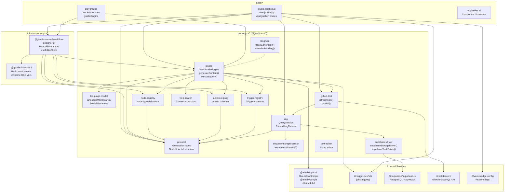
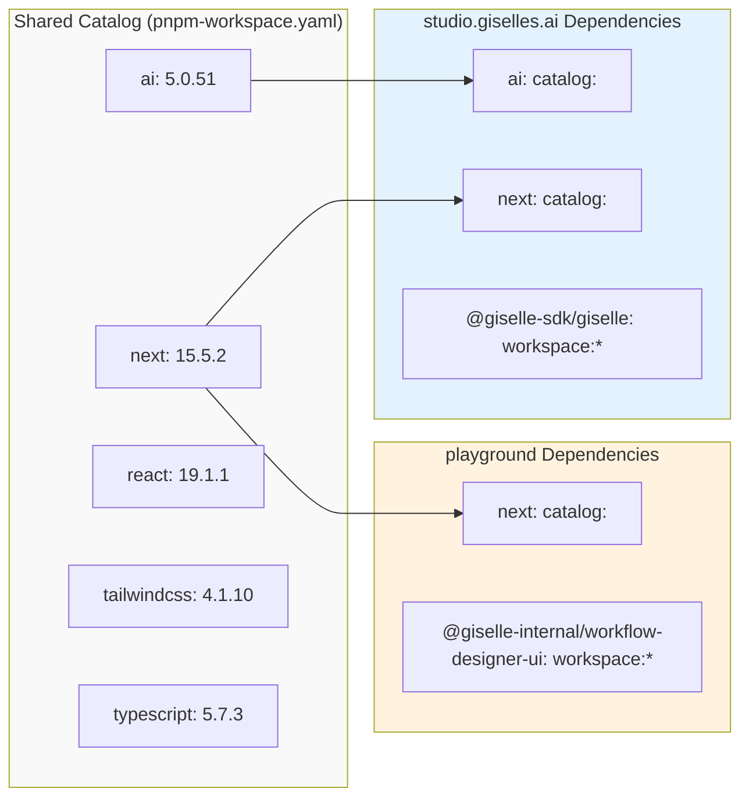
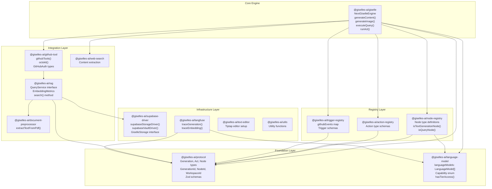
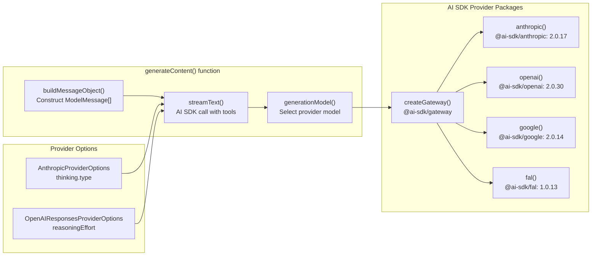
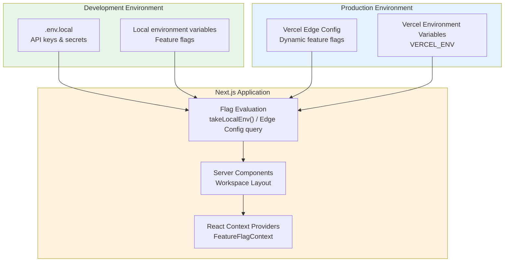

<!-- source: DeepWiki mcp.deepwiki.com · repo giselles-ai/giselle · page 1 Overview · fetched 2026-10-26 -->

# Overview

<details>
<summary>Relevant source files</summary>

The following files were used as context for generating this wiki page:

- [apps/playground/giselle-engine.ts](apps/playground/giselle-engine.ts)
- [apps/playground/package.json](apps/playground/package.json)
- [apps/studio.giselles.ai/app/giselle-engine.ts](apps/studio.giselles.ai/app/giselle-engine.ts)
- [apps/studio.giselles.ai/package.json](apps/studio.giselles.ai/package.json)
- [internal-packages/workflow-designer-ui/package.json](internal-packages/workflow-designer-ui/package.json)
- [package.json](package.json)
- [packages/giselle/package.json](packages/giselle/package.json)
- [packages/giselle/src/engine/acts/run-act.ts](packages/giselle/src/engine/acts/run-act.ts)
- [packages/giselle/src/engine/generations/generate-content.ts](packages/giselle/src/engine/generations/generate-content.ts)
- [packages/giselle/src/engine/generations/generate-image.ts](packages/giselle/src/engine/generations/generate-image.ts)
- [packages/giselle/src/engine/generations/internal/use-generation-executor.ts](packages/giselle/src/engine/generations/internal/use-generation-executor.ts)
- [packages/giselle/src/engine/generations/types.ts](packages/giselle/src/engine/generations/types.ts)
- [packages/giselle/src/engine/generations/utils.ts](packages/giselle/src/engine/generations/utils.ts)
- [packages/giselle/src/engine/operations/execute-query.ts](packages/giselle/src/engine/operations/execute-query.ts)
- [packages/giselle/src/engine/telemetry/index.ts](packages/giselle/src/engine/telemetry/index.ts)
- [packages/giselle/src/engine/telemetry/types.ts](packages/giselle/src/engine/telemetry/types.ts)
- [packages/giselle/src/engine/triggers/resolve-trigger.ts](packages/giselle/src/engine/triggers/resolve-trigger.ts)
- [packages/giselle/src/engine/types.ts](packages/giselle/src/engine/types.ts)
- [packages/giselle/src/react/generations/generation-runner.tsx](packages/giselle/src/react/generations/generation-runner.tsx)
- [pnpm-lock.yaml](pnpm-lock.yaml)
- [pnpm-workspace.yaml](pnpm-workspace.yaml)

</details>


## Purpose and Scope

This documentation covers the **Giselle AI platform**, an AI workflow orchestration system that enables users to design, execute, and manage complex AI workflows through a visual interface. The platform provides:

- **Visual workflow design** using a node-based canvas interface
- **Multi-provider LLM integration** (OpenAI, Anthropic, Google, Fal-AI)
- **RAG (Retrieval-Augmented Generation)** capabilities with document and code vector stores
- **Tool execution** for GitHub operations, web search, and database queries
- **Background job processing** for long-running AI operations
- **Real-time streaming** of generation results

This page provides a high-level overview of the entire system architecture, monorepo organization, and how the major components interact. For detailed information about specific subsystems:

- Workflow design and visual editing: see [Workflow Designer UI](#4)
- AI execution pipeline: see [Core Engine and SDK](#2)
- Document processing and RAG: see [Data Processing Systems](#3)
- Production application features: see [Studio Application](#5.1)

## System Architecture

The Giselle platform follows a **layered monorepo architecture** with clear separation between applications, UI components, and engine packages.



**Figure 1: High-Level System Architecture with Code Entities**

Sources: [pnpm-lock.yaml:242-1162](), [pnpm-workspace.yaml:1-6](), [apps/studio.giselles.ai/giselle-engine.ts:1-535](), [packages/giselle/src/engine/types.ts:1-228]()

The architecture consists of three primary layers:

1. **Application Layer** (`apps/*`): Next.js applications with API routes and UI
2. **Internal Packages** (`internal-packages/*`): Private UI component libraries
3. **Engine Packages** (`packages/*`): Core engine modules with `@giselles-ai/*` namespace

## Monorepo Organization

The codebase uses **pnpm workspaces** with a shared dependency catalog to maintain version consistency across 70+ dependencies.

### Workspace Structure

| Workspace Type | Path | Purpose | Example Packages |
|---------------|------|---------|------------------|
| Apps | `apps/*` | User-facing applications | `studio.giselles.ai`, `playground`, `ui.giselles.ai` |
| Internal Packages | `internal-packages/*` | Private UI libraries | `@giselle-internal/ui`, `@giselle-internal/workflow-designer-ui` |
| Engine Packages | `packages/*` | Core engine modules with `@giselles-ai/*` namespace | `giselle`, `protocol`, `language-model`, `rag`, `node-registry` |
| Tools | `tools/*` | Build utilities | `tsconfig` |

Sources: [pnpm-workspace.yaml:1-6](), [pnpm-lock.yaml:242-264]()

### Dependency Management



**Figure 2: Dependency Catalog and Workspace Protocol**

The catalog enforces consistent versions across packages using the `catalog:` specifier, while workspace packages use `workspace:*` protocol for internal dependencies.

Sources: [pnpm-workspace.yaml:7-105](), [apps/studio.giselles.ai/package.json:21-101](), [apps/playground/package.json:18-36]()

## Key Applications

### studio.giselles.ai

The **production application** deployed to Vercel, providing the full Giselle platform experience.

**Engine Configuration:**

The application creates a `NextGiselleEngine` instance at [apps/studio.giselles.ai/giselle-engine.ts:196-396]():

```typescript
export const giselleEngine = NextGiselleEngine({
  basePath: "/api/giselle",
  storage,                          // supabaseStorageDriver
  llmProviders: ["openai", "anthropic", "google"],
  vault,                           // supabaseVaultDriver
  vectorStoreQueryServices: {
    github: gitHubQueryService,
    githubIssue: gitHubIssueQueryService,
    githubPullRequest: gitHubPullRequestQueryService,
    document: getDocumentVectorStoreQueryService()
  },
  callbacks: {
    generationComplete: async (args) => { ... },
    generationFailed: async (args) => { ... },
    embeddingComplete: async (args) => { ... }
  },
  aiGateway: { httpReferer, xTitle }
})
```

**Runtime Environment Detection:**

The system detects execution context via `getRuntimeEnv()` at [apps/studio.giselles.ai/giselle-engine.ts:180-185]():
- `"trigger.dev"`: Inside Trigger.dev job
- `"vercel"`: Vercel deployment
- `"local"`: Development environment
- `"unknown"`: Fallback

**Content Generation Processor:**

Based on environment, generation work is delegated at [apps/studio.giselles.ai/giselle-engine.ts:189-194]():
- **Self-processing**: Local and development environments execute directly
- **Trigger.dev**: Production uses `jobs.trigger<typeof generateContentJob>("generate-content", ...)` for background processing

**Key Features:**
- **Trigger.dev integration** via `@trigger.dev/sdk` ([apps/studio.giselles.ai/package.json:66]())
- **Sentry monitoring** via `@sentry/nextjs` ([apps/studio.giselles.ai/package.json:62]())
- **OpenTelemetry** via `@vercel/otel` ([apps/studio.giselles.ai/package.json:69]())
- **PDF processing** via `@embedpdf/pdfium` ([apps/studio.giselles.ai/package.json:27]())
- **Feature flags** via `@vercel/edge-config` ([apps/studio.giselles.ai/package.json:67]())

Sources: [apps/studio.giselles.ai/giselle-engine.ts:1-535](), [apps/studio.giselles.ai/package.json:1-133]()

### playground

The **development application** with simplified configuration for rapid iteration.

**Engine Configuration:**

Creates a `NextGiselleEngine` instance at [apps/playground/giselle-engine.ts:122-141]():

```typescript
export const giselleEngine = NextGiselleEngine({
  basePath: "/api/giselle",
  storage,  // fsStorageDriver or supabaseStorageDriver based on VERCEL env
  llmProviders,  // Dynamically detected from env vars
  integrationConfigs,
  vault: nodeVaultDriver({ secret: process.env.VAULT_SECRET }),
  callbacks: {
    generationComplete: async (args) => {
      await traceGeneration(args);
    }
  }
})
```

**Differences from Studio:**
- Uses `fsStorageDriver()` locally instead of only Supabase ([apps/playground/giselle-engine.ts:22-24]())
- Uses `nodeVaultDriver()` with in-memory encryption ([apps/playground/giselle-engine.ts:137-139]())
- Dynamic LLM provider detection based on available API keys ([apps/playground/giselle-engine.ts:26-39]())
- No Trigger.dev background job processing
- No Sentry error tracking
- Simplified observability (Langfuse only)

Sources: [apps/playground/giselle-engine.ts:1-141](), [apps/playground/package.json:1-42]()

### ui.giselles.ai

A **component showcase application** for viewing and testing UI components in isolation.

Sources: [apps/ui.giselles.ai/package.json:1-27]()

## Core Engine Packages

The engine ecosystem is organized around specific concerns with the `@giselles-ai/*` namespace:



**Figure 3: Engine Package Dependencies with Code Entities**

### @giselles-ai/giselle

The **core orchestration engine** that coordinates all AI operations.

**Key Functions:**
- `NextGiselleEngine()`: Factory function creating engine instance with `GiselleEngineConfig` ([packages/giselle/src/engine/types.ts:194-227]())
- `generateContent()`: Text generation with streaming and tool support ([packages/giselle/src/engine/generations/generate-content.ts:62-447]())
- `generateImage()`: Image generation via Fal-AI, DALL-E, Imagen ([packages/giselle/src/engine/generations/generate-image.ts:32-366]())
- `executeQuery()`: Vector store query with RAG ([packages/giselle/src/engine/operations/execute-query.ts:40-542]())
- `runAct()`: Workflow execution orchestration ([packages/giselle/src/engine/acts/run-act.ts:123-201]())
- `useGenerationExecutor()`: React hook for generation lifecycle ([packages/giselle/src/engine/generations/internal/use-generation-executor.ts:59-452]())

**Key Types:**
- `GiselleEngineContext`: Main context type with storage, vault, callbacks ([packages/giselle/src/engine/types.ts:90-127]())
- `GenerationMetadata`: Custom metadata for tracing ([packages/giselle/src/engine/generations/types.ts:8-10]())

Sources: [packages/giselle/package.json:1-80](), [packages/giselle/src/engine/types.ts:1-228](), [packages/giselle/src/engine/generations/generate-content.ts:1-519]()

### @giselles-ai/protocol

The **type system** defining all data structures with Zod validation.

**Key Types:**
- `Generation`, `QueuedGeneration`, `RunningGeneration`, `CompletedGeneration`: Generation lifecycle states
- `Act`, `Sequence`: Workflow execution tracking
- `NodeId`, `GenerationId`, `ActId`, `WorkspaceId`: ID types with Zod schemas
- `GenerationContext`: Context for generation execution
- `OperationNode`: Union type for all node types

**Key Type Guards:**
- `isTextGenerationNode()`, `isImageGenerationNode()`, `isQueryNode()`: Runtime type checking

Sources: [pnpm-lock.yaml:1084-1120](), [packages/giselle/src/engine/types.ts:1-228]()

### @giselles-ai/language-model

Provides **provider-agnostic abstractions** for language models.

**Key Exports:**
- `languageModels`: Array of `LanguageModel` definitions with capabilities and tiers
- `Capability`: Enum for model capabilities (Reasoning, OptionalSearchGrounding, etc.)
- `hasCapability()`: Check if model supports a capability
- `hasTierAccess()`: Check user tier access to model

Sources: [packages/giselle/src/engine/generations/generate-content.ts:8-11](), [pnpm-lock.yaml:1043-1058]()

### @giselles-ai/node-registry

Defines **node type schemas** and utility functions.

**Key Exports:**
- Node type definitions for all workflow nodes
- Type guard functions (`isClonedFileDataPayload()`, etc.)
- Node content schemas

Sources: [pnpm-lock.yaml:1059-1083](), [internal-packages/workflow-designer-ui/package.json:17-24]()

### @giselles-ai/action-registry & @giselles-ai/trigger-registry

Define **action and trigger schemas** for workflow integrations.

**trigger-registry Key Exports:**
- `githubEvents`: Map of GitHub event IDs to event definitions

Sources: [pnpm-lock.yaml:828-843](), [packages/giselle/src/engine/triggers/resolve-trigger.ts:9]()

### @giselles-ai/rag

Implements the **vector store system** for RAG operations.

**Key Types:**
- `QueryService<TContext, TMetadata>`: Interface for vector store queries with `search()` method
- `EmbeddingMetrics`: Metrics tracking for embeddings
- `QueryContext`: Union type for GitHub and Document query contexts

**Key Functionality:**
- Document chunking
- Embedding generation via AI SDK
- PostgreSQL + pgvector integration
- Similarity search

Sources: [packages/giselle/src/engine/types.ts:19,162-193](), [packages/giselle/src/engine/operations/execute-query.ts:21](), [pnpm-lock.yaml:1121-1162]()

## Technology Stack

### Frontend Stack

| Technology | Version | Purpose |
|-----------|---------|---------|
| Next.js | 15.5.2 | React framework with App Router |
| React | 19.1.1 | UI library |
| Tailwind CSS | 4.1.10 | Styling with @theme blocks |
| XyFlow | 12.8.3 | Canvas-based workflow editor |
| Radix UI | 1.1.2 | Accessible UI primitives |
| Zustand | 5.0.8 | State management |
| Motion | 12.3.1 | Animation library |

Sources: [pnpm-workspace.yaml:7-105](), [pnpm-lock.yaml:138-254]()

### Backend Stack

| Technology | Version | Purpose |
|-----------|---------|---------|
| Vercel AI SDK | 5.0.51 | Unified LLM interface |
| Supabase | 2.50.5 | Database & storage |
| PostgreSQL + pgvector | 0.2.1 | Vector similarity search |
| Drizzle ORM | 0.44.2 | Type-safe database queries |
| Trigger.dev | 4.0.4 | Background job orchestration |
| unstorage | 1.14.4 | Key-value storage abstraction |

Sources: [pnpm-workspace.yaml:7-105](), [pnpm-lock.yaml:138-254]()

### LLM Provider Integration



**Figure 4: LLM Provider Integration Code Flow**

The `generateContent()` function at [packages/giselle/src/engine/generations/generate-content.ts:62-447]() orchestrates the generation:

1. **Message Building**: `buildMessageObject()` constructs `ModelMessage[]` from node configuration and context ([packages/giselle/src/engine/generations/utils.ts:36-302]())
2. **Provider Selection**: `generationModel()` selects the provider via AI Gateway ([packages/giselle/src/engine/generations/generate-content.ts:489-518]())
3. **Provider Options**: `getProviderOptions()` configures provider-specific settings like `thinking.type` for Anthropic or `reasoningEffort` for OpenAI ([packages/giselle/src/engine/generations/generate-content.ts:449-487]())
4. **Streaming**: `streamText()` from AI SDK handles streaming with tool support ([packages/giselle/src/engine/generations/generate-content.ts:256-288]())

Sources: [packages/giselle/src/engine/generations/generate-content.ts:1-519](), [packages/giselle/src/engine/generations/utils.ts:36-302](), [pnpm-workspace.yaml:8-12](), [packages/giselle/package.json:56-61]()

### Build Toolchain

| Tool | Version | Purpose |
|------|---------|---------|
| pnpm | 10.16.0 | Package manager with workspaces |
| Turbo | 2.4.2 | Monorepo build orchestration |
| tsup | 8.3.5 | TypeScript package bundler |
| Biome | 2.0.6 | Linting and formatting |
| TypeScript | 5.7.3 | Type safety |
| Vitest | 3.2.4 | Unit testing |
| Playwright | 1.53.0 | E2E testing |

Sources: [package.json:264-282](), [pnpm-workspace.yaml:8-28](), [knip.ts:1-120]()

## Deployment and Infrastructure

### Hosting

- **Application Hosting**: Vercel (studio.giselles.ai, playground, ui.giselles.ai)
- **Background Jobs**: Trigger.dev v4 with Node.js 22.x runtime
- **Database**: Supabase PostgreSQL with Drizzle ORM
- **Blob Storage**: Supabase Storage (S3-compatible via `@aws-sdk/client-s3`)
- **Vector Store**: PostgreSQL with pgvector extension (`pgvector: 0.2.1`)

**Background Job Configuration:**

Trigger.dev jobs are configured at [apps/studio.giselles.ai/trigger.config.ts]() with two main jobs:
- `generate-content`: Executes `generateContent()` asynchronously
- `run-act-job`: Executes full workflow `runAct()` asynchronously

Job triggering occurs at [apps/studio.giselles.ai/giselle-engine.ts:426-534]() via:
```typescript
await jobs.trigger<typeof generateContentJob>("generate-content", {
  generationId: generation.id,
  requestId,
  userId,
  team: { id, subscriptionId, plan }
})
```

Sources: [apps/studio.giselles.ai/package.json:66](), [apps/studio.giselles.ai/giselle-engine.ts:19,426-534](), [pnpm-lock.yaml:175-176,178-179]()

### Configuration Management



**Figure 5: Configuration and Feature Flag System**

Sources: [apps/studio.giselles.ai/package.json:62](), Diagram 6 from high-level system diagrams

### Observability

| Service | Purpose | Integration Point |
|---------|---------|-------------------|
| Sentry | Error tracking | `@sentry/nextjs` instrumentation |
| Langfuse | LLM tracing & metrics | `langfuse-vercel` SDK |
| OpenTelemetry | Distributed tracing | `@vercel/otel` integration |
| Vercel Speed Insights | Performance monitoring | Built-in |

Sources: [apps/studio.giselles.ai/package.json:56,64,67,80](), [apps/studio.giselles.ai/instrumentation-client.ts:1-29]()

## Development Workflow

### Build Pipeline

The monorepo uses **Turbo** for orchestrating builds with caching and filtering capabilities:

```bash
# Build all packages
pnpm turbo build

# Build only SDK packages  
pnpm turbo build --filter="@giselle-sdk/*"

# Build studio app and its dependencies
pnpm turbo build --filter=studio.giselles.ai
```

Sources: [package.json:277-279](), [knip.ts:85-116]()

### Code Quality Gates

1. **Biome**: Linting and formatting ([package.json:265-267]())
2. **Knip**: Unused code detection ([package.json:274-276]())
3. **Type Checking**: TypeScript strict mode ([apps/studio.giselles.ai/tsconfig.json:7]())
4. **Unit Tests**: Vitest with happy-dom ([pnpm-workspace.yaml:95]())
5. **E2E Tests**: Playwright ([apps/studio.giselles.ai/package.json:107,116]())

Sources: [package.json:264-282](), [knip.ts:1-120](), [apps/studio.giselles.ai/tsconfig.json:1-38]()

### Release Process

**Changesets** manages versioning and publishing for SDK packages:

```bash
# Create a changeset
pnpm changeset

# Version packages (creates release PR)
pnpm changeset version

# Publish to npm
pnpm changeset publish
```

Sources: [package.json:268-270](), Diagram 7 from high-level system diagrams

## Summary

The Giselle platform is a comprehensive AI workflow orchestration system built on modern web technologies. Its **layered monorepo architecture** separates concerns between user-facing applications, internal UI components, and a robust SDK ecosystem. The system leverages **Next.js 15 with React 19** for the frontend, integrates with **multiple LLM providers** through the Vercel AI SDK, and uses **PostgreSQL with pgvector** for RAG capabilities. **Trigger.dev** handles background job processing while **Supabase** provides database and storage infrastructure. The entire stack is deployed to **Vercel** with comprehensive observability through Sentry, Langfuse, and OpenTelemetry.

Sources: All diagrams and sections above

---

