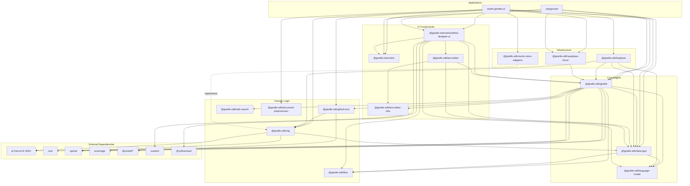

<!-- source: DeepWiki mcp.deepwiki.com · repo giselles-ai/giselle · page 1.1 Project Structure and Organization · fetched 2026-10-26 -->

# Project Structure and Organization

<details>
<summary>Relevant source files</summary>

The following files were used as context for generating this wiki page:

- [apps/playground/package.json](apps/playground/package.json)
- [apps/studio.giselles.ai/package.json](apps/studio.giselles.ai/package.json)
- [internal-packages/workflow-designer-ui/package.json](internal-packages/workflow-designer-ui/package.json)
- [package.json](package.json)
- [packages/giselle/package.json](packages/giselle/package.json)
- [pnpm-lock.yaml](pnpm-lock.yaml)
- [pnpm-workspace.yaml](pnpm-workspace.yaml)

</details>


## Purpose and Scope

This document describes the physical organization of the Giselle AI monorepo, including the directory structure, package boundaries, and how different components are distributed across the filesystem. It covers the `apps/`, `packages/`, `internal-packages/`, and `tools/` directories, the pnpm workspace configuration, and the dependency relationships between packages. For information about the build system and task orchestration, see [Build System and Dependencies](#1.2). For development workflows and tooling, see [Development Workflow](#1.3).

## Monorepo Overview

The Giselle AI project is organized as a pnpm monorepo with Turbo for task orchestration. The workspace is defined in [pnpm-workspace.yaml:1-6]() and contains four primary directory categories:

```mermaid
graph TB
    Root["Root<br/>(pnpm workspace)"]
    
    Apps["apps/<br/>(Deployable applications)"]
    Packages["packages/<br/>(Giselle SDK modules)"]
    InternalPkgs["internal-packages/<br/>(Shared UI components)"]
    Tools["tools/<br/>(Build configurations)"]
    
    Studio["studio.giselles.ai<br/>(Production app)"]
    Playground["playground<br/>(Dev environment)"]
    
    GisellePkg["@giselle-sdk/giselle<br/>(Core engine)"]
    DataType["@giselle-sdk/data-type<br/>(Type definitions)"]
    LangModel["@giselle-sdk/language-model<br/>(LLM abstractions)"]
    RAG["@giselle-sdk/rag<br/>(Vector operations)"]
    Flow["@giselle-sdk/flow<br/>(Workflow primitives)"]
    DocPreproc["@giselle-sdk/document-preprocessor<br/>(PDF extraction)"]
    GitHubTool["@giselle-sdk/github-tool<br/>(GitHub integration)"]
    Langfuse["@giselle-sdk/langfuse<br/>(Observability)"]
    Supabase["@giselle-sdk/supabase-driver<br/>(Storage driver)"]
    VectorAdapters["@giselle-sdk/vector-store-adapters<br/>(Store implementations)"]
    TextEditor["@giselle-sdk/text-editor<br/>(Tiptap wrapper)"]
    TextEditorUtils["@giselle-sdk/text-editor-utils<br/>(Editor utilities)"]
    WebSearch["@giselle-sdk/web-search<br/>(Search integration)"]
    Utils["@giselle-sdk/utils<br/>(Shared utilities)"]
    
    UI["@giselle-internal/ui<br/>(Component library)"]
    WDUI["@giselle-internal/workflow-designer-ui<br/>(Editor components)"]
    
    TSConfig["@giselle/giselle-sdk-tsconfig<br/>(Shared TypeScript config)"]
    
    Root --> Apps
    Root --> Packages
    Root --> InternalPkgs
    Root --> Tools
    
    Apps --> Studio
    Apps --> Playground
    
    Packages --> GisellePkg
    Packages --> DataType
    Packages --> LangModel
    Packages --> RAG
    Packages --> Flow
    Packages --> DocPreproc
    Packages --> GitHubTool
    Packages --> Langfuse
    Packages --> Supabase
    Packages --> VectorAdapters
    Packages --> TextEditor
    Packages --> TextEditorUtils
    Packages --> WebSearch
    Packages --> Utils
    
    InternalPkgs --> UI
    InternalPkgs --> WDUI
    
    Tools --> TSConfig
```



**Sources:** [pnpm-workspace.yaml:1-6](), [pnpm-lock.yaml:255-1656]()

### Directory Layout

The repository follows a clear separation of concerns:

| Directory | Purpose | Visibility | Example Package |
|-----------|---------|------------|-----------------|
| `apps/` | Deployable Next.js applications | Private (not published) | `studio.giselles.ai` |
| `packages/` | Reusable SDK modules with `@giselle-sdk/*` scope | Public/Internal | `@giselle-sdk/giselle` |
| `internal-packages/` | Shared UI components with `@giselle-internal/*` scope | Internal only | `@giselle-internal/ui` |
| `tools/` | Build configurations and tooling with `@giselle/*` scope | Internal only | `@giselle/giselle-sdk-tsconfig` |
| `scripts/` | Utility scripts and codemods | Not packages | `report-colors.mjs` |

**Sources:** [pnpm-workspace.yaml:1-6](), [package.json:1-47]()

## Apps Directory

The `apps/` directory contains three Next.js 15 applications that consume the SDK packages:

### studio.giselles.ai

The production application deployed at studio.giselles.ai. This is the primary user-facing application that provides:

- Visual workflow designer interface
- Stage system for workflow execution
- Team and subscription management
- Vector store configuration
- GitHub integration

**Key characteristics:**
- Next.js 15 with App Router and Server Actions
- React 19
- Drizzle ORM for database access (`drizzle-orm`)
- Supabase for authentication and storage (`@supabase/supabase-js`, `@supabase/ssr`)
- Full SDK integration (`@giselle-sdk/giselle`, `@giselle-sdk/rag`, `@giselle-sdk/github-tool`, etc.)
- Production observability (`@sentry/nextjs`, `langfuse-vercel`, `@vercel/otel`)
- Trigger.dev integration (`@trigger.dev/sdk`)
- Turbopack for development builds (`next dev --turbopack`)

**Configuration files:**
- [apps/studio.giselles.ai/next.config.ts:1-164]() - Next.js configuration with Sentry integration
- [apps/studio.giselles.ai/trigger.config.ts:1-28]() - Trigger.dev job configuration
- [apps/studio.giselles.ai/tsconfig.json:1-39]() - TypeScript configuration with path aliases

**Sources:** [apps/studio.giselles.ai/package.json:1-127](), [apps/studio.giselles.ai/next.config.ts:1-164](), [apps/studio.giselles.ai/trigger.config.ts:1-28]()

### playground

A simplified development environment for testing SDK features locally without the full production stack.

**Key characteristics:**
- Minimal dependencies (only core SDK packages)
- Simplified feature flag configuration
- Local-only storage (filesystem via `unstorage`)
- Faster iteration cycle with Turbopack
- Excludes production services (Sentry, Langfuse, Trigger.dev)

**Package dependencies:**
```json
{
  "@giselle-sdk/giselle": "workspace:*",
  "@giselle-sdk/data-type": "workspace:*",
  "@giselle-internal/ui": "workspace:^",
  "@giselle-internal/workflow-designer-ui": "workspace:*",
  "@giselle-sdk/langfuse": "workspace:^",
  "@giselle-sdk/supabase-driver": "workspace:^"
}
```

**Configuration files:**
- [apps/playground/next.config.ts:1-17]() - Minimal Next.js configuration

**Sources:** [apps/playground/package.json:1-48](), [apps/playground/next.config.ts:1-17]()

### ui.giselles.ai

A component showcase application for the `@giselle-internal/ui` package, serving as a living style guide and development environment for UI components.

**Key characteristics:**
- Next.js 15 with Turbopack
- Displays component examples and documentation
- Minimal dependencies (only `@giselle-internal/ui` and core React)
- Used for visual testing and component development

**Package dependencies:**
```json
{
  "@giselle-internal/ui": "workspace:*",
  "clsx": "catalog:",
  "lucide-react": "catalog:",
  "next": "catalog:",
  "react": "catalog:",
  "react-dom": "catalog:"
}
```

**Sources:** [apps/ui.giselles.ai/package.json:1-27](), [pnpm-lock.yaml:661-703]()

## Packages Directory (Giselle SDK)

The `packages/` directory contains the modular Giselle SDK. All packages use the `@giselle-sdk/*` scope and are organized by functional domain.

### Core Engine Packages

#### @giselle-sdk/giselle

The primary engine export that orchestrates AI operations. This is the main entry point that most applications consume.

**Key exports:**
- `NextGiselleEngine` factory for Next.js integration
- `useGenerationExecutor` for generation lifecycle management
- HTTP routers (`createJsonRouters`, `createFormDataRouters`)
- Generation functions (`generateText`, `generateContent`, `generateImage`)
- Storage interfaces (`GiselleStorage`)
- `batchWriter` utility for buffered writes

**Dependencies:**
- `@giselle-sdk/flow` - Workflow primitives (`workspace:^`)
- `@giselle-sdk/language-model` - LLM abstractions (`workspace:^`)
- `@giselle-sdk/github-tool` - GitHub integration (`workspace:^`)
- `@giselle-sdk/text-editor-utils` - Text processing (`workspace:^`)
- `@giselle-sdk/web-search` - Search capabilities (`workspace:^`)
- `@ai-sdk/anthropic`, `@ai-sdk/fal`, `@ai-sdk/google`, `@ai-sdk/openai`, `@ai-sdk/perplexity` - LLM providers (`catalog:`)
- `ai` - Vercel AI SDK 5.0.51 (`catalog:`)
- `openai` - Direct OpenAI integration (`catalog:`)
- `unstorage` - Storage abstraction (`catalog:`)
- `pg` - PostgreSQL client (`catalog:`)
- `swr` - React data fetching (`catalog:`)

**Key utilities:**
- [packages/giselle/src/utils/batch.ts:1-123]() - `batchWriter` for buffered operations

**Sources:** [pnpm-lock.yaml:919-1018](), [packages/giselle/src/utils/batch.ts:1-123]()

#### @giselle-sdk/data-type

Type definitions and Zod schemas for the entire system. This package provides the shared type system used across all SDK packages.

**Key exports:**
- Node type definitions (text generation, image generation, query, action)
- Workspace schemas
- Generation result types
- Validation schemas

**Dependencies:**
- `@giselle-sdk/flow` - Flow type definitions
- `@giselle-sdk/language-model` - Model type definitions
- `zod` - Runtime validation

**Sources:** [packages/data-type/package.json (inferred from pnpm-lock.yaml:804-827)]()

#### @giselle-sdk/language-model

LLM provider abstractions that enable model-agnostic code.

**Key exports:**
- Model ID type definitions
- Provider mapping
- Model capability definitions
- Tier-based model filtering

**Dependencies:**
- `zod` - Schema validation

**Sources:** [packages/language-model/package.json (inferred from pnpm-lock.yaml:1050-1064)]()

### Data Processing Packages

#### @giselle-sdk/rag

Vector search and RAG (Retrieval-Augmented Generation) operations.

**Key exports:**
- Embedding generation
- Vector similarity search
- Chunking strategies
- Query services

**Dependencies:**
- `@giselle-sdk/data-type` - Type definitions
- `@ai-sdk/google` - Google embeddings
- `@ai-sdk/openai` - OpenAI embeddings
- `ai` - Embedding utilities
- `openai` - Direct OpenAI integration
- `pg` - PostgreSQL client
- `pgvector` - Vector operations

**Sources:** [packages/rag/package.json (inferred from pnpm-lock.yaml:1066-1110)]()

#### @giselle-sdk/document-preprocessor

PDF and document processing utilities.

**Key exports:**
- PDF text extraction
- Image rendering from PDFs
- Text normalization

**Dependencies:**
- `@embedpdf/pdfium` - PDFium WASM bindings
- `pngjs` - PNG manipulation

**Sources:** [packages/document-preprocessor/package.json (inferred from pnpm-lock.yaml:829-855)]()

### Integration Packages

#### @giselle-sdk/github-tool

GitHub API integration for workflow tools and vector store ingestion.

**Key exports:**
- GitHub tool definitions
- Repository indexing
- Webhook handling
- GraphQL client setup

**Dependencies:**
- `@giselle-sdk/rag` - Vector operations
- `@octokit/auth-app` - GitHub App authentication
- `@octokit/core` - GitHub API client
- `@octokit/webhooks` - Webhook verification
- `@urql/core` - GraphQL client
- `gql.tada` - Type-safe GraphQL
- `tar` - Tarball extraction

**Sources:** [packages/github-tool/package.json (inferred from pnpm-lock.yaml:970-1020)]()

#### @giselle-sdk/web-search

Web search integration for action nodes.

**Dependencies:** (minimal, inferred to be a lightweight wrapper)

**Sources:** (Referenced in @giselle-sdk/giselle dependencies)

### Storage and Observability Packages

#### @giselle-sdk/supabase-driver

Storage driver implementation for Supabase and S3-compatible services.

**Key exports:**
- `SupabaseStorage` implementation
- S3 adapter
- Storage interface compliance

**Dependencies:**
- `@giselle-sdk/giselle` - Storage interface
- `@aws-sdk/client-s3` - S3 operations
- `@supabase/supabase-js` - Supabase client
- `zod` - Configuration validation

**Sources:** [packages/supabase-driver/package.json (inferred from pnpm-lock.yaml:1112-1132)]()

#### @giselle-sdk/langfuse

Langfuse observability integration with callback system.

**Key exports:**
- Generation callbacks
- Embedding callbacks
- Metadata enrichment
- Trace context management

**Dependencies:**
- `@giselle-sdk/giselle` - Engine callbacks
- `@giselle-sdk/data-type` - Type definitions
- `@giselle-sdk/language-model` - Model metadata
- `@giselle-sdk/rag` - Embedding callbacks
- `langfuse` - Langfuse SDK

**Sources:** [packages/langfuse/package.json (inferred from pnpm-lock.yaml:1022-1048)]()

#### @giselle-sdk/vector-store-adapters

Vector store implementations for different sources.

**Key exports:**
- GitHub repository vector store
- Document vector store
- Pull request embeddings store

**Dependencies:**
- Implements vector store interfaces from `@giselle-sdk/rag`

**Sources:** [apps/studio.giselles.ai/package.json:33]()

### UI and Editor Packages

#### @giselle-sdk/text-editor

Tiptap-based text editor wrapper used in node configuration.

**Key exports:**
- Configured Tiptap editor
- Placeholder extensions
- Editor state management

**Dependencies:**
- `@giselle-sdk/data-type` - Type definitions
- `@giselle-sdk/giselle` - Engine integration
- `@giselle-sdk/text-editor-utils` - Utilities
- `@tiptap/react` - React integration
- `@tiptap/extension-placeholder` - Placeholder support
- `clsx` - Conditional classes
- `lucide-react` - Icons

**Sources:** [packages/text-editor/package.json (inferred from pnpm-lock.yaml:1134-1196)]()

#### @giselle-sdk/text-editor-utils

Shared utilities for text editor functionality.

**Key exports:**
- Text transformation utilities
- Content serialization
- Editor helpers

**Sources:** (Referenced in multiple packages)

### Supporting Packages

#### @giselle-sdk/flow

Workflow and trigger primitive definitions.

**Key exports:**
- Flow trigger schemas
- Workflow step definitions
- Trigger condition types

**Dependencies:**
- `zod` - Schema validation

**Sources:** [packages/flow/package.json (inferred from pnpm-lock.yaml:857-868)]()

#### @giselle-sdk/utils

Shared utilities used across SDK packages.

**Key exports:**
- Common helper functions
- Type utilities

**Sources:** (Referenced in @giselle-sdk/giselle and @giselle-sdk/data-type)

## Internal Packages Directory

The `internal-packages/` directory contains shared UI components used by applications but not intended for external distribution.

### @giselle-internal/ui

Base component library providing design system primitives.

**Key exports:**
- Button, Input, Dialog components
- Radix UI wrappers
- Tailwind-based styling
- Icon components

**Dependencies:**
- `clsx` - Conditional classes
- `lucide-react` - Icon library
- `radix-ui` - Unstyled primitives
- `react` / `react-dom` - React runtime

**Sources:** [internal-packages/ui/package.json (inferred from pnpm-lock.yaml:658-690)]()

### @giselle-internal/workflow-designer-ui

Workflow designer-specific components built on ReactFlow.

**Key exports:**
- `Editor` component
- `NodeComponent` implementations
- Properties panels
- Toolbar components
- Generation result displays

**Dependencies:**
- `@giselle-internal/ui` - Base components
- `@giselle-sdk/giselle` - Engine integration
- `@giselle-sdk/data-type` - Type definitions
- `@giselle-sdk/flow` - Flow definitions
- `@giselle-sdk/language-model` - Model types
- `@giselle-sdk/text-editor` - Text editing
- `@xyflow/react` - ReactFlow canvas
- `zustand` - State management
- `swr` - Data fetching
- `react-markdown` - Markdown rendering
- `motion` - Animations

**Sources:** [internal-packages/workflow-designer-ui/package.json (inferred from pnpm-lock.yaml:692-802)]()

## Tools Directory

The `tools/` directory contains shared build configurations and tooling.

### @giselle/giselle-sdk-tsconfig

Shared TypeScript configuration for SDK packages.

**Usage:**
```json
{
  "extends": "@giselle/giselle-sdk-tsconfig"
}
```

Referenced by all SDK packages for consistent TypeScript compilation settings.

**Sources:** (Referenced throughout pnpm-lock.yaml in devDependencies)

## Package Dependency Graph



**Sources:** [pnpm-lock.yaml:255-1656]()

## Workspace Protocol and Dependency Management

The monorepo uses pnpm's workspace protocol for internal dependencies, enabling rapid development without publishing:

### Workspace Dependency Syntax

| Syntax | Meaning | Example | Usage |
|--------|---------|---------|-------|
| `workspace:*` | Match any version in workspace | `"@giselle-sdk/giselle": "workspace:*"` | Used for packages that must always use the local version |
| `workspace:^` | Match with semver caret | `"@giselle-internal/ui": "workspace:^"` | Used for packages that could theoretically use published versions |

### Catalog System

The workspace uses pnpm's catalog feature to centralize external dependency versions. Defined in [pnpm-workspace.yaml:7-105]() and referenced in individual packages with the `catalog:` protocol:

```json
{
  "dependencies": {
    "next": "catalog:",
    "react": "catalog:",
    "zod": "catalog:"
  }
}
```

**Common cataloged dependencies (from pnpm-workspace.yaml catalog):**
- `next`: `15.5.2`
- `react`: `19.1.1`
- `react-dom`: `19.1.1`
- `typescript`: `5.7.3`
- `zod`: `3.25.76`
- `ai`: `5.0.51`
- `@xyflow/react`: `12.8.3`
- `tailwindcss`: `4.1.10`
- `@tailwindcss/postcss`: `4.1.10`
- `@ai-sdk/anthropic`: `2.0.17`
- `@ai-sdk/openai`: `2.0.30`
- `@ai-sdk/google`: `2.0.14`
- `@supabase/supabase-js`: `2.50.5`
- `@trigger.dev/sdk`: `4.0.4`
- `langfuse`: `3.38.4`

**Sources:** [pnpm-workspace.yaml:7-105](), [pnpm-lock.yaml:7-254]()

### Package Manager Configuration

The workspace enforces strict package manager and Node.js version constraints:

**Package manager:**
- pnpm version: `10.16.0` (specified in [apps/studio.giselles.ai/package.json:20]())
- Lockfile version: `9.0` with `autoInstallPeers: true` ([pnpm-lock.yaml:1-5]())

**Node.js version:**
- Required: `22.x` ([apps/studio.giselles.ai/package.json:5-6]())

**Dependency overrides:**
```yaml
pnpm:
  overrides:
    vite: "7.1.3"
    cookie: "1.0.2"
    "@electric-sql/client": "1.0.10"
```

These overrides ensure consistent versions across the dependency tree, particularly important for:
- `vite`: Build tool version consistency
- `cookie`: Security updates
- `@electric-sql/client`: Version compatibility

**Sources:** [apps/studio.giselles.ai/package.json:4-6,20](), [pnpm-lock.yaml:1-5,256-260]()

### Package Manager Configuration

The workspace enforces Node.js version constraints and uses specific overrides:

```yaml
# pnpm-workspace.yaml
packageManager: "pnpm@10.16.0"

engines:
  node: ">=22"

pnpm:
  overrides:
    vite: "7.1.3"
    cookie: "1.0.2"
    "@electric-sql/client": "1.0.10"
```

**Sources:** [package.json:36-46](), [pnpm-lock.yaml:250-253]()

## Scripts and Utilities

The `scripts/` directory contains non-package utilities:

### report-colors.mjs

A ripgrep-based utility for auditing color usage across the codebase.

**Usage:**
```bash
node scripts/report-colors.mjs
node scripts/report-colors.mjs --out .reports/report-colors.json
```

**Scans for:**
- Tailwind utility classes (`text-*`, `bg-*`, `border-*`, etc.)
- Hex colors (`#fff`, `#ffffff`, etc.)
- CSS functions (`rgba()`, `hsla()`, `oklch()`)
- CSS variables (`--color-*`, `--brand-*`, etc.)
- SVG attributes (`fill=`, `stroke=`)

**Sources:** [scripts/report-colors.mjs:1-337](), [package.json:21-22]()

### Codemods

Code transformation utilities for automated refactoring:

- `replace-text-black-600-20.mjs` - Consolidates `text-black-600/20` usages
- `replace-text-white-900-to-inverse.mjs` - Updates color class patterns

**Usage:**
```bash
# Preview changes
pnpm codemod:text-black-600-20

# Apply changes
pnpm codemod:text-black-600-20:apply
```

**Sources:** [package.json:23-26]()

## Build Configuration and TypeScript Setup

### Build Output Locations

Each package type produces build artifacts in different locations:

| Package Type | Build Output | Build Command | Example |
|--------------|--------------|---------------|---------|
| Next.js apps | `.next/` directory | `next build --turbopack` | [apps/studio.giselles.ai/package.json:11]() |
| SDK packages | `dist/` directory | `tsup` | SDK packages use tsup for bundling |
| Internal packages | Not built separately | Consumed as TypeScript source | Used directly via path aliases |

### TypeScript Configuration

**Studio app configuration:**
- Base config: [apps/studio.giselles.ai/tsconfig.json:1-39]()
- Module resolution: `bundler`
- JSX: `preserve` (handled by Next.js)
- Path aliases:
  - `@/*` maps to app root
  - `@giselles-ai/*` maps to `./packages/*`
  - `@giselles-ai/icons/*` maps to workflow-designer-ui icons

**SDK packages configuration:**
- Shared config: `@giselle/giselle-sdk-tsconfig` (referenced in devDependencies)
- Target: `ES2017`
- Module system: ESM

### PostCSS Configuration

All applications use Tailwind CSS v4 with the PostCSS plugin:

```javascript
// apps/studio.giselles.ai/postcss.config.mjs
const config = {
  plugins: {
    "@tailwindcss/postcss": {},
  },
};
```

**Sources:** [apps/studio.giselles.ai/package.json:9-11](), [apps/studio.giselles.ai/tsconfig.json:1-39](), [apps/studio.giselles.ai/postcss.config.mjs:1-9]()

### Server External Packages

Both Next.js apps configure `serverExternalPackages` to prevent bundling of certain Node.js-specific dependencies:

**Studio app externals:**
```typescript
export const serverExternalPackages = [
  "@embedpdf/pdfium",
  "@opentelemetry/sdk-node",
  "pino",
  "pino-pretty",
  "unstorage",
  "happy-dom",
  "@supabase/supabase-js",
  "@supabase/realtime-js",
];
```

**Playground app externals:**
```typescript
serverExternalPackages: [
  "unstorage",
  "happy-dom",
  "@supabase/supabase-js",
  "@supabase/realtime-js",
]
```

These packages are excluded from webpack bundling to avoid compatibility issues with native modules and Node.js-specific APIs.

**Sources:** [apps/studio.giselles.ai/next.config.ts:13-22](), [apps/playground/next.config.ts:5-10](), [knip.ts:10-83]()

## Summary

The Giselle AI monorepo structure provides clear separation between:

1. **Applications** (`apps/`) - Deployable Next.js applications consuming the SDK
2. **Public SDK** (`packages/@giselle-sdk/*`) - Modular, reusable packages organized by domain
3. **Internal UI** (`internal-packages/@giselle-internal/*`) - Shared components not for external distribution
4. **Build tooling** (`tools/@giselle/*`) - Shared configurations

This architecture enables:
- Independent versioning of SDK modules
- Shared UI components across applications
- Clear dependency boundaries
- Efficient build caching with Turbo
- Type-safe workspace dependencies with pnpm

The workspace protocol and catalog system ensure version consistency while allowing rapid local development without publishing packages to npm.

**Sources:** [pnpm-workspace.yaml:1-102](), [package.json:1-47](), [pnpm-lock.yaml:1-1656]()

---

