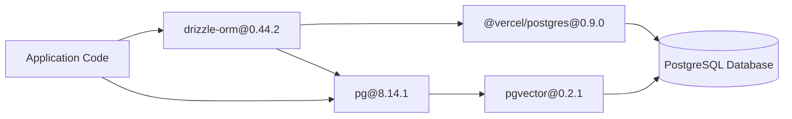
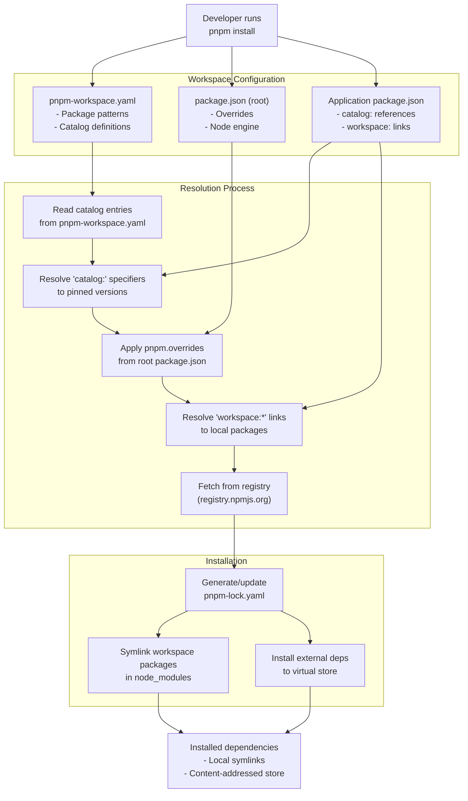

<!-- source: DeepWiki mcp.deepwiki.com · repo giselles-ai/giselle · page 1.3 Build System and Development Workflow · fetched 2026-10-26 -->

# Build System and Dependencies

<details>
<summary>Relevant source files</summary>

The following files were used as context for generating this wiki page:

- [apps/playground/package.json](apps/playground/package.json)
- [apps/studio.giselles.ai/package.json](apps/studio.giselles.ai/package.json)
- [docs/packages-license.md](docs/packages-license.md)
- [internal-packages/workflow-designer-ui/package.json](internal-packages/workflow-designer-ui/package.json)
- [package.json](package.json)
- [packages/document-preprocessor/README.md](packages/document-preprocessor/README.md)
- [packages/document-preprocessor/package.json](packages/document-preprocessor/package.json)
- [packages/document-preprocessor/src/global.d.ts](packages/document-preprocessor/src/global.d.ts)
- [packages/document-preprocessor/src/index.ts](packages/document-preprocessor/src/index.ts)
- [packages/document-preprocessor/src/pdf.ts](packages/document-preprocessor/src/pdf.ts)
- [packages/document-preprocessor/src/text.test.ts](packages/document-preprocessor/src/text.test.ts)
- [packages/document-preprocessor/src/text.ts](packages/document-preprocessor/src/text.ts)
- [packages/document-preprocessor/src/types.ts](packages/document-preprocessor/src/types.ts)
- [packages/document-preprocessor/tsconfig.json](packages/document-preprocessor/tsconfig.json)
- [packages/document-preprocessor/tsup.config.ts](packages/document-preprocessor/tsup.config.ts)
- [packages/document-preprocessor/turbo.json](packages/document-preprocessor/turbo.json)
- [packages/document-preprocessor/vitest.config.mts](packages/document-preprocessor/vitest.config.mts)
- [packages/giselle/package.json](packages/giselle/package.json)
- [pnpm-lock.yaml](pnpm-lock.yaml)
- [pnpm-workspace.yaml](pnpm-workspace.yaml)

</details>


## Purpose and Scope

This document describes the build system architecture, dependency management strategy, and package organization in the Giselle AI monorepo. It covers the pnpm workspace configuration, Turbo build orchestration, version catalog management, and key external dependencies. For information about the monorepo's directory structure and organization, see [Project Structure and Organization](#1.1). For development workflows and tooling, see [Development Workflow](#1.3).

## Package Management with pnpm

The project uses **pnpm** as its package manager with workspace support enabled. The workspace configuration defines the monorepo structure and dependency management behavior.

### Workspace Configuration

The workspace is configured in [pnpm-workspace.yaml:1-7]() with four primary workspace patterns:

```yaml
packages:
  - apps/*
  - internal-packages/*
  - packages/*
  - tools/*
minimumReleaseAge: 1440
```

The `minimumReleaseAge: 1440` setting enforces a 24-hour minimum age (in minutes) for package releases before they can be installed, reducing the risk of using untested versions.

### Lockfile Structure

The lockfile [pnpm-lock.yaml:1-6]() uses lockfile version 9.0 with specific settings:

```yaml
lockfileVersion: '9.0'

settings:
  autoInstallPeers: true
  excludeLinksFromLockfile: false
```

The `autoInstallPeers: true` setting automatically installs peer dependencies, while `excludeLinksFromLockfile: false` includes workspace links in the lockfile for deterministic builds.

### Package Manager Version

The project requires **pnpm@10.16.0** as specified in [package.json:36]():

```json
"packageManager": "pnpm@10.16.0"
```

This exact version is enforced through the `packageManager` field, ensuring consistency across development environments.

**Sources:** [pnpm-workspace.yaml:1-7](), [pnpm-lock.yaml:1-6](), [package.json:36]()

## Dependency Catalog System

The project uses pnpm's catalog feature to centralize version management across the monorepo. All shared dependency versions are defined once and referenced throughout the workspace.

### Catalog Definition

The catalog is defined in [pnpm-workspace.yaml:7-102]() and contains 100+ pinned versions. Key categories include:

| Category | Example Dependencies | Purpose |
|----------|---------------------|---------|
| Core Framework | `next: 15.5.2`, `react: 19.1.1` | Next.js and React ecosystem |
| Build Tools | `typescript: 5.7.3`, `tsup: 8.3.5` | TypeScript compilation and bundling |
| AI Integration | `ai: 5.0.44`, `openai: 5.11.0` | LLM provider SDKs |
| Database | `pg: 8.14.1`, `pgvector: 0.2.1` | PostgreSQL and vector extensions |
| Testing | `vitest: 3.2.4`, `playwright: 1.53.0` | Unit and E2E testing frameworks |
| Code Quality | `@biomejs/biome: 2.0.6` | Formatting and linting |
| UI Components | `@xyflow/react: 12.8.3`, `lucide-react: 0.473.0` | Visual workflow and icons |

### Catalog Usage Pattern

Dependencies reference catalog versions using the `catalog:` specifier. For example, in [apps/studio.giselles.ai/package.json:84-92]():

```json
"next": "catalog:",
"react": "catalog:",
"react-dom": "catalog:",
"pg": "catalog:",
"openai": "catalog:"
```

This pattern ensures all workspace packages use the same versions for shared dependencies, preventing version conflicts and duplicate installations.

### Catalog in Lockfile

The lockfile mirrors the catalog structure in [pnpm-lock.yaml:7-248](), creating a single source of truth for resolved versions. When a catalog entry is updated, all packages referencing it are automatically updated during the next install.

**Sources:** [pnpm-workspace.yaml:7-102](), [pnpm-lock.yaml:7-248](), [apps/studio.giselles.ai/package.json:84-92]()

## Turbo Build Orchestration

The project uses **Turbo** (version 2.4.2) for task orchestration, caching, and parallel execution across the monorepo.

### Turbo Configuration

Turbo configuration is defined in `turbo.json` (not shown in provided files) and orchestrates tasks like:

- `build` - Build all packages and applications
- `dev` - Start development servers
- `test` - Run test suites
- `check-types` - TypeScript type checking

### Build Scripts

The root [package.json:5-26]() defines several build-related scripts:

```json
"build": "turbo build",
"build-sdk": "turbo build --filter '@giselle-sdk/*'",
"build-data-type": "turbo build --filter '@giselle-sdk/data-type'",
"check-types": "turbo check-types",
"dev": "turbo dev --filter playground",
"dev:studio.giselles.ai": "NODE_NO_WARNINGS=1 turbo dev --filter studio.giselles.ai"
```

### Task Filtering

Turbo's `--filter` flag enables selective execution:

- `--filter '@giselle-sdk/*'` - Run tasks only for SDK packages matching the glob pattern
- `--filter playground` - Run tasks only for the playground app
- `--filter studio.giselles.ai` - Run tasks only for the production Studio app

This filtering reduces build times during development by avoiding unnecessary rebuilds.

### Turbo Caching

Turbo caches task outputs locally (`.turbo` directory) and optionally remotely. This enables:

1. **Incremental builds** - Skip rebuilding unchanged packages
2. **Parallel execution** - Build independent packages concurrently
3. **Task dependencies** - Automatically build dependencies before dependents

**Sources:** [package.json:5-26]()

## Workspace Dependency Graph

The following diagram shows how workspace packages depend on each other and external dependencies:

```mermaid
graph TB
    subgraph "External Dependencies"
        AI_SDK["ai@5.0.44"]
        Next["next@15.5.2"]
        React["react@19.1.1"]
        OpenAI["openai@5.11.0"]
        Anthropic["@ai-sdk/anthropic@2.0.17"]
        Google["@ai-sdk/google@2.0.14"]
        Supabase["@supabase/supabase-js@2.50.5"]
        PG["pg@8.14.1"]
        Drizzle["drizzle-orm@0.44.2"]
        XYFlow["@xyflow/react@12.8.3"]
    end
    
    subgraph "SDK Packages (packages/)"
        Giselle["@giselle-sdk/giselle"]
        DataType["@giselle-sdk/data-type"]
        LangModel["@giselle-sdk/language-model"]
        RAG["@giselle-sdk/rag"]
        Flow["@giselle-sdk/flow"]
        DocPreproc["@giselle-sdk/document-preprocessor"]
        GitHub["@giselle-sdk/github-tool"]
        Langfuse["@giselle-sdk/langfuse"]
        SupabaseDriver["@giselle-sdk/supabase-driver"]
        VectorAdapters["@giselle-sdk/vector-store-adapters"]
        TextEditor["@giselle-sdk/text-editor"]
        TextEditorUtils["@giselle-sdk/text-editor-utils"]
        WebSearch["@giselle-sdk/web-search"]
    end
    
    subgraph "Internal Packages (internal-packages/)"
        UI["@giselle-internal/ui"]
        WDUI["@giselle-internal/workflow-designer-ui"]
    end
    
    subgraph "Applications (apps/)"
        Studio["studio.giselles.ai"]
        Playground["playground"]
    end
    
    %% SDK Internal Dependencies
    Giselle --> DataType
    Giselle --> LangModel
    Giselle --> Flow
    Giselle --> GitHub
    Giselle --> TextEditorUtils
    Giselle --> WebSearch
    
    DataType --> Flow
    DataType --> LangModel
    
    RAG --> DataType
    
    GitHub --> RAG
    
    Langfuse --> DataType
    Langfuse --> Giselle
    Langfuse --> LangModel
    Langfuse --> RAG
    
    TextEditor --> DataType
    TextEditor --> Giselle
    TextEditor --> TextEditorUtils
    
    %% UI Package Dependencies
    WDUI --> UI
    WDUI --> DataType
    WDUI --> Flow
    WDUI --> Giselle
    WDUI --> LangModel
    WDUI --> TextEditor
    WDUI --> TextEditorUtils
    
    %% Application Dependencies
    Studio --> Giselle
    Studio --> DataType
    Studio --> DocPreproc
    Studio --> GitHub
    Studio --> Langfuse
    Studio --> LangModel
    Studio --> RAG
    Studio --> SupabaseDriver
    Studio --> VectorAdapters
    Studio --> UI
    Studio --> WDUI
    
    Playground --> Giselle
    Playground --> DataType
    Playground --> Langfuse
    Playground --> SupabaseDriver
    Playground --> UI
    Playground --> WDUI
    
    %% External Dependencies
    Giselle --> AI_SDK
    Giselle --> OpenAI
    Giselle --> Anthropic
    Giselle --> Google
    Giselle --> PG
    Giselle --> Next
    
    RAG --> AI_SDK
    RAG --> OpenAI
    RAG --> PG
    
    Studio --> Next
    Studio --> React
    Studio --> Drizzle
    Studio --> Supabase
    
    WDUI --> XYFlow
    WDUI --> Next
    WDUI --> React
    
    Playground --> Next
    Playground --> React
```



**Sources:** [apps/studio.giselles.ai/package.json:21-102](), [apps/playground/package.json:18-35](), [pnpm-lock.yaml:255-1110]()

## Key External Dependencies

The project integrates several critical external dependencies that form the foundation of its functionality.

### AI and LLM Integration

The **Vercel AI SDK** (`ai@5.0.44`) provides the core abstraction layer for LLM interactions. Provider-specific integrations include:

| Package | Version | Purpose |
|---------|---------|---------|
| `@ai-sdk/anthropic` | 2.0.17 | Claude models integration |
| `@ai-sdk/openai` | 2.0.30 | OpenAI models integration |
| `@ai-sdk/google` | 2.0.14 | Google Gemini integration |
| `@ai-sdk/google-vertex` | 3.0.27 | Google Vertex AI integration |
| `@ai-sdk/perplexity` | 2.0.9 | Perplexity API integration |
| `@ai-sdk/fal` | 1.0.13 | Fal.ai image generation |

These are defined in the catalog [pnpm-workspace.yaml:34-41]() and used throughout the SDK packages.

The **OpenAI SDK** (`openai@5.11.0`) is used directly for advanced features like embeddings generation and fine-tuning that require lower-level API access.

### Next.js and React Ecosystem

The application layer uses **Next.js 15.5.2** with **React 19.1.1**, representing cutting-edge versions:

- **Next.js 15.5.2** - Server Components, Server Actions, App Router, Turbopack
- **React 19.1.1** - New hooks, improved performance, concurrent rendering
- **@next/env** - Environment variable loading
- **@next/third-parties** - Third-party script optimization

These versions are specified in [pnpm-workspace.yaml:14-16]() and [pnpm-workspace.yaml:25-26]().

### Database and Storage

Database access is handled through multiple layers:



- **drizzle-orm@0.44.2** - Type-safe ORM for schema definition and queries
- **@vercel/postgres@0.9.0** - Serverless PostgreSQL connection pooling
- **pg@8.14.1** - Core PostgreSQL client driver
- **pgvector@0.2.1** - Vector similarity search extension

Storage services include:

- **@vercel/blob@0.27.3** - Blob storage for files and images
- **@aws-sdk/client-s3@3.842.0** - S3-compatible object storage
- **unstorage@1.14.4** - Universal storage abstraction layer
- **@supabase/supabase-js@2.50.5** - Supabase client for auth and storage

### UI and Visualization

Workflow visualization uses **@xyflow/react@12.8.3** (formerly ReactFlow), defined in [pnpm-workspace.yaml:32]():

```
"@xyflow/react": 12.8.3
```

UI component libraries include:

- **Radix UI** - Accessible component primitives (dialogs, dropdowns, tooltips)
- **lucide-react@0.473.0** - Icon library
- **motion@12.3.1** - Animation library (Framer Motion)
- **Tiptap 2.11.5** - Rich text editor framework

### Observability and Monitoring

Observability is integrated through multiple systems:

- **langfuse@3.38.4** / **langfuse-vercel@3.37.0** - LLM tracing and analytics
- **@sentry/nextjs@9.30.0** - Error tracking and performance monitoring
- **OpenTelemetry** - Distributed tracing infrastructure:
  - `@opentelemetry/api@1.9.0`
  - `@opentelemetry/sdk-node@0.51.1`
  - `@opentelemetry/sdk-trace-base@1.30.1`
- **@vercel/otel@1.10.0** - Vercel's OpenTelemetry integration

These packages are specified in [apps/studio.giselles.ai/package.json:39-65]().

### Background Processing

Asynchronous task processing uses **@trigger.dev/sdk@4.0.4**, defined in [pnpm-workspace.yaml:102]():

```
"@trigger.dev/sdk": 4.0.4
```

This handles long-running operations like document ingestion, GitHub repository indexing, and resumable generation tasks.

**Sources:** [pnpm-workspace.yaml:14-102](), [apps/studio.giselles.ai/package.json:21-102](), [pnpm-lock.yaml:7-248]()

## Build Scripts and Commands

### Root-Level Scripts

The root [package.json:5-26]() defines workspace-wide commands:

| Script | Command | Purpose |
|--------|---------|---------|
| `build` | `turbo build` | Build all workspace packages |
| `build-sdk` | `turbo build --filter '@giselle-sdk/*'` | Build only SDK packages |
| `build-data-type` | `turbo build --filter '@giselle-sdk/data-type'` | Build data-type package only |
| `check-types` | `turbo check-types` | TypeScript type checking |
| `format` | `biome check --write .` | Format code with Biome |
| `clean` | `turbo clean` | Remove build artifacts |
| `dev` | `turbo dev --filter playground` | Start playground dev server |
| `dev:studio.giselles.ai` | `NODE_NO_WARNINGS=1 turbo dev --filter studio.giselles.ai` | Start Studio dev server |
| `test` | `turbo test` | Run all test suites |
| `tidy` | `knip --no-config-hints` | Find unused dependencies |
| `changeset` | `changeset` | Create changeset for versioning |
| `version` | `changeset version` | Bump versions based on changesets |

### Application-Level Scripts

The Studio application [apps/studio.giselles.ai/package.json:8-18]() defines:

```json
"dev": "next dev --turbopack",
"dev-debug": "LOGLEVEL=debug pnpm run dev",
"build": "next build",
"build:analyze": "ANALYZE=true next build",
"start": "next start",
"test": "vitest run",
"test:e2e": "playwright test",
"check-types": "tsc --noEmit"
```

Notable patterns:

- **--turbopack flag** - Uses Next.js 15's Turbopack bundler for faster development
- **LOGLEVEL=debug** - Enables debug logging for troubleshooting
- **ANALYZE=true** - Generates bundle analysis reports via `@next/bundle-analyzer`

### Utility Scripts

The project includes custom utility scripts in [package.json:21-26]():

```json
"report:colors": "node scripts/report-colors.mjs",
"report:colors:out": "node scripts/report-colors.mjs --out .reports/report-colors.json",
"codemod:text-black-600-20": "node scripts/codemods/replace-text-black-600-20.mjs",
"codemod:text-black-600-20:apply": "node scripts/codemods/replace-text-black-600-20.mjs --apply"
```

The color report script [scripts/report-colors.mjs:1-337]() uses `ripgrep` to analyze color usage across the codebase, generating reports on:

- Tailwind utility classes (`text-*`, `bg-*`, `border-*`, etc.)
- Hex color literals
- CSS functional notations (`rgba()`, `oklch()`, etc.)
- CSS custom properties (`--color-*`, `--brand-*`, etc.)

This enables systematic refactoring of the design system.

**Sources:** [package.json:5-26](), [apps/studio.giselles.ai/package.json:8-18](), [scripts/report-colors.mjs:1-337]()

## Version Constraints and Overrides

### Node.js Version Requirements

The project requires **Node.js 22.x**, enforced in multiple locations:

- Root [package.json:37-39](): `"node": ">=22"`
- Studio [apps/studio.giselles.ai/package.json:4-6](): `"node": "22.x"`
- Playground [apps/playground/package.json:4-6](): `"node": "22.x"`

The root allows `>=22` for flexibility, while applications pin to `22.x` for production consistency.

### Dependency Overrides

The root [package.json:40-46]() defines critical version overrides:

```json
"pnpm": {
  "overrides": {
    "vite": "7.1.3",
    "cookie": "1.0.2",
    "@electric-sql/client": "1.0.10"
  }
}
```

These overrides force specific versions across the entire dependency tree:

- **vite@7.1.3** - Latest Vite version for improved performance and compatibility
- **cookie@1.0.2** - Security patch for cookie parsing vulnerabilities
- **@electric-sql/client@1.0.10** - Stable version of Electric SQL client

Overrides in [pnpm-lock.yaml:250-253]() mirror this configuration:

```yaml
overrides:
  vite: 7.1.3
  cookie: 1.0.2
  '@electric-sql/client': 1.0.10
```

### TypeScript Version

TypeScript is pinned to **5.7.3** throughout the workspace via the catalog [pnpm-workspace.yaml:9]():

```
typescript: 5.7.3
```

This version provides the latest language features while maintaining stability across all packages.

**Sources:** [package.json:37-46](), [apps/studio.giselles.ai/package.json:4-6](), [pnpm-lock.yaml:250-253](), [pnpm-workspace.yaml:9]()

## Dependency Resolution Flow

The following diagram illustrates how dependencies are resolved and installed in the workspace:



**Sources:** [pnpm-workspace.yaml:1-102](), [package.json:40-46](), [pnpm-lock.yaml:1-253]()

## Development Tools

### Code Quality with Biome

**Biome** (version 2.0.6) replaces ESLint and Prettier, providing unified formatting and linting. It's configured via `biome.json` (not shown) and invoked through:

```bash
pnpm format  # Format entire workspace
```

Biome is specified in the catalog [pnpm-workspace.yaml:8]():

```
"@biomejs/biome": 2.0.6
```

### Dependency Analysis with Knip

**Knip** (version 5.61.3) detects unused dependencies, exports, and files. The [package.json:17]() script:

```json
"tidy": "knip --no-config-hints"
```

This runs as part of CI/CD to prevent accumulation of dead code.

### Bundle Analysis

The Studio application includes [apps/studio.giselles.ai/package.json:106]() `@next/bundle-analyzer@15.3.4` for analyzing production bundles:

```bash
pnpm build:analyze  # Generate bundle report
```

This identifies large dependencies and optimization opportunities.

**Sources:** [pnpm-workspace.yaml:8](), [package.json:17,32](), [apps/studio.giselles.ai/package.json:106]()

## Build Output Structure

The following table describes build outputs for different package types:

| Package Type | Build Tool | Output Directory | Entry Points |
|--------------|-----------|------------------|--------------|
| SDK Packages | `tsup` | `dist/` | ESM + CJS bundles |
| Applications | `next build` | `.next/` | Server and client bundles |
| Internal Packages | `tsc` or `tsup` | `dist/` | ESM bundles |
| Tools | `tsc` | `dist/` | ESM bundles |

SDK packages use **tsup@8.3.5** (specified in [pnpm-workspace.yaml:12]()) to generate dual ESM/CJS bundles for maximum compatibility. This is typically configured with:

```typescript
// tsup.config.ts
export default defineConfig({
  entry: ['src/index.ts'],
  format: ['esm', 'cjs'],
  dts: true,
  clean: true,
});
```

Applications use Next.js's built-in build system with **Turbopack** in development and optimized production bundles.

**Sources:** [pnpm-workspace.yaml:12](), [apps/studio.giselles.ai/package.json:9,11]()

---

