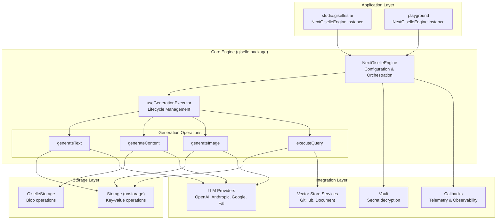
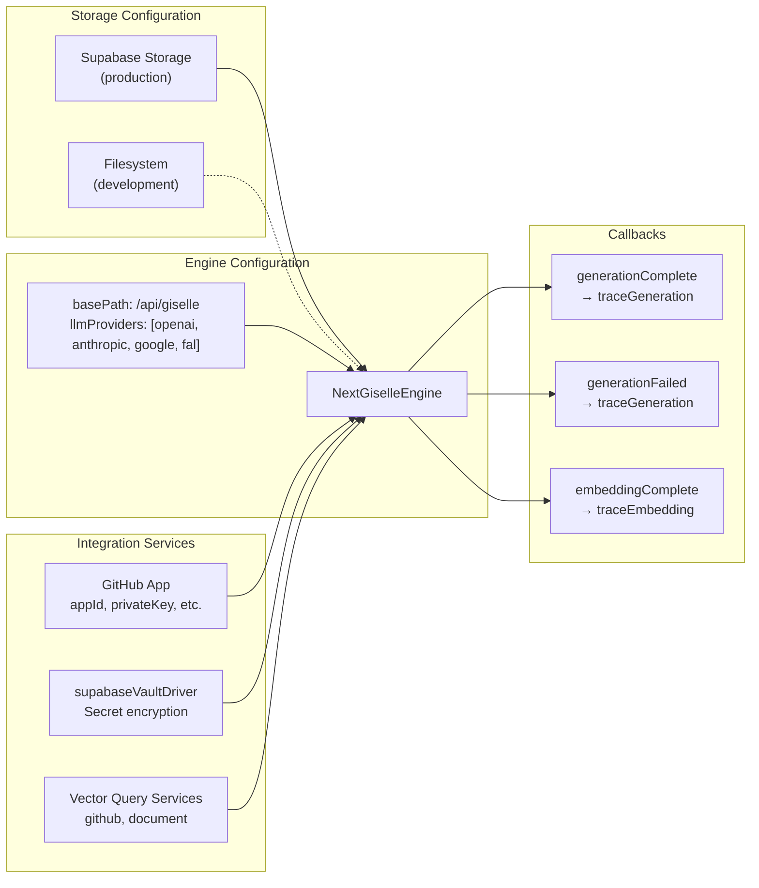
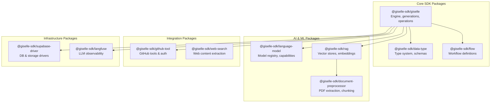
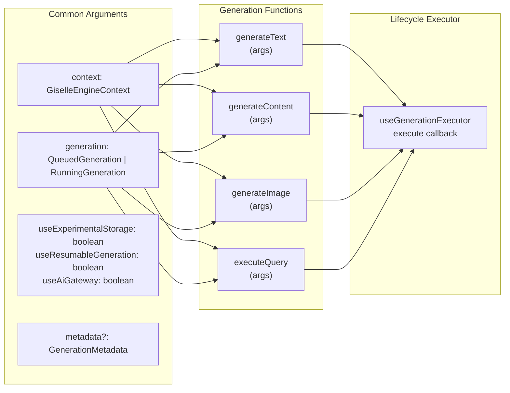
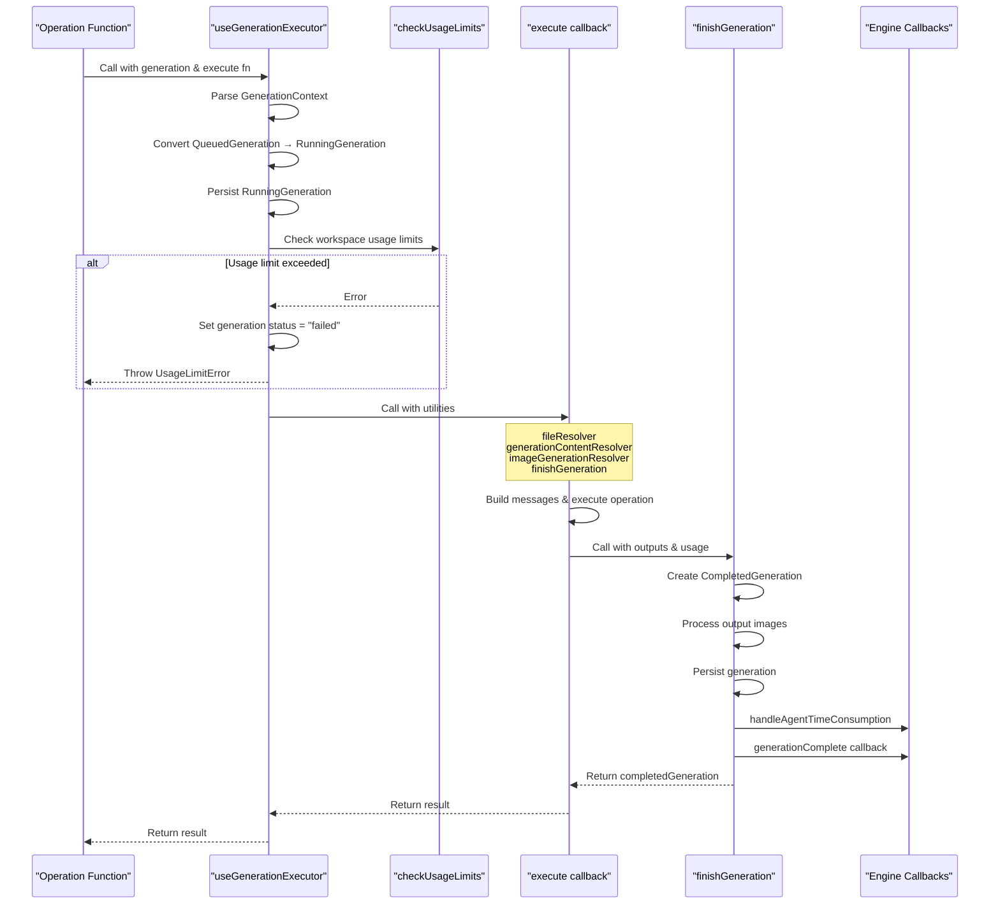
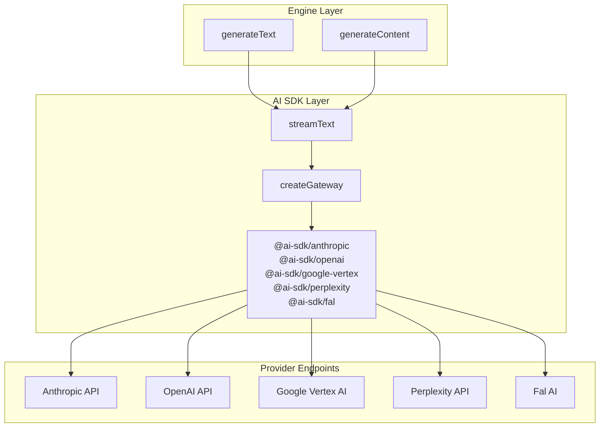
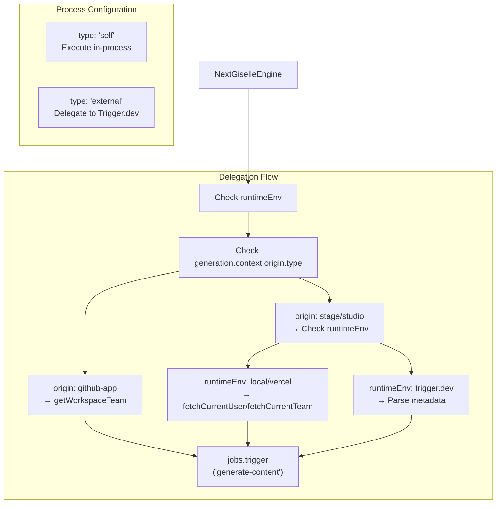
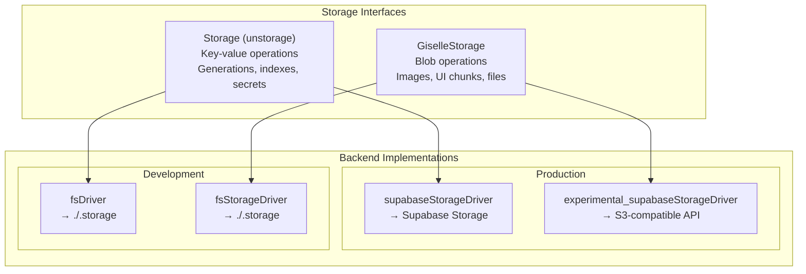

<!-- source: DeepWiki mcp.deepwiki.com · repo giselles-ai/giselle · page 2 Core Engine and SDK · fetched 2026-10-26 -->

# Core Engine and SDK

<details>
<summary>Relevant source files</summary>

The following files were used as context for generating this wiki page:

- [apps/playground/giselle-engine.ts](apps/playground/giselle-engine.ts)
- [apps/studio.giselles.ai/app/giselle-engine.ts](apps/studio.giselles.ai/app/giselle-engine.ts)
- [packages/giselle/src/engine/acts/run-act.ts](packages/giselle/src/engine/acts/run-act.ts)
- [packages/giselle/src/engine/generations/generate-content.ts](packages/giselle/src/engine/generations/generate-content.ts)
- [packages/giselle/src/engine/generations/generate-image.ts](packages/giselle/src/engine/generations/generate-image.ts)
- [packages/giselle/src/engine/generations/internal/use-generation-executor.ts](packages/giselle/src/engine/generations/internal/use-generation-executor.ts)
- [packages/giselle/src/engine/generations/types.ts](packages/giselle/src/engine/generations/types.ts)
- [packages/giselle/src/engine/generations/utils.ts](packages/giselle/src/engine/generations/utils.ts)
- [packages/giselle/src/engine/operations/execute-query.ts](packages/giselle/src/engine/operations/execute-query.ts)
- [packages/giselle/src/engine/telemetry/index.ts](packages/giselle/src/engine/telemetry/index.ts)
- [packages/giselle/src/engine/telemetry/types.ts](packages/giselle/src/engine/telemetry/types.ts)
- [packages/giselle/src/engine/triggers/resolve-trigger.ts](packages/giselle/src/engine/triggers/resolve-trigger.ts)
- [packages/giselle/src/engine/types.ts](packages/giselle/src/engine/types.ts)
- [packages/giselle/src/react/generations/generation-runner.tsx](packages/giselle/src/react/generations/generation-runner.tsx)

</details>


## Purpose and Scope

The Core Engine and SDK form the foundation of the Giselle AI platform, orchestrating AI operations through a unified interface. The `@giselle-sdk/giselle` package provides the core engine (`NextGiselleEngine`) that manages generation lifecycles, provider integrations, storage operations, and tool execution. The broader SDK ecosystem includes specialized packages for language models, RAG operations, document processing, and external integrations.

This document provides an overview of the engine architecture, SDK packages, and integration patterns. For detailed information about specific subsystems, see:
- Generation pipeline implementation: [Generation Pipeline and Lifecycle](#2.2)
- LLM provider abstractions: [Language Models and AI Providers](#2.3)
- Storage backends and data persistence: [Storage Architecture](#2.4)
- Tool preparation and execution: [Tool System and External Integrations](#2.6)

---

## Architecture Overview

The engine architecture separates concerns into distinct layers: configuration, execution, storage, and integration.



**Sources:** [apps/studio.giselles.ai/app/giselle-engine.ts:218-400](), [apps/playground/giselle-engine.ts:141-160](), [packages/giselle/src/engine/types.ts:87-122]()

---

## NextGiselleEngine Configuration

The `NextGiselleEngine` function initializes the core engine with configuration for storage, integrations, callbacks, and runtime behavior.

### Configuration Interface

| Configuration Field | Type | Purpose |
|---|---|---|
| `basePath` | `string` | API route prefix (e.g., `/api/giselle`) |
| `storage` | `Storage` | Key-value storage (unstorage) |
| `experimental_storage` | `GiselleStorage` | Blob storage (S3-compatible) |
| `llmProviders` | `LanguageModelProvider[]` | Enabled LLM providers |
| `integrationConfigs` | `GiselleIntegrationConfig` | GitHub, etc. integration settings |
| `vault` | `Vault` | Secret encryption/decryption interface |
| `vectorStoreQueryServices` | `Object` | Vector store query implementations |
| `callbacks` | `Object` | Lifecycle event handlers |
| `onConsumeAgentTime` | `Function` | Usage tracking callback |
| `fetchUsageLimitsFn` | `Function` | Usage limit enforcement |
| `telemetry` | `Object` | Observability settings |
| `aiGateway` | `Object` | AI Gateway routing configuration |
| `logger` | `GiselleLogger` | Logging interface |
| `waitUntil` | `Function` | Background task deferral |

**Sources:** [packages/giselle/src/engine/types.ts:189-220]()

### Studio Configuration Example



The Studio configuration instantiates storage drivers based on runtime environment, sets up GitHub App authentication, configures vector store query services, and registers callbacks for telemetry via Langfuse.

**Sources:** [apps/studio.giselles.ai/app/giselle-engine.ts:43-70](), [apps/studio.giselles.ai/app/giselle-engine.ts:218-400]()

### Runtime Environment Detection

The engine adapts behavior based on runtime context:

| Runtime | Condition | Behavior |
|---|---|---|
| `trigger.dev` | `process.env.TRIGGERDOTDEV === "1"` | Background job execution context |
| `vercel` | `process.env.VERCEL === "1"` | Vercel serverless/edge runtime |
| `local` | `process.env.NODE_ENV === "development"` | Local development environment |
| `unknown` | None of the above | Fallback runtime |

Content generation is delegated to Trigger.dev when `generateContentProcessor === "trigger.dev"`, determined by checking `USE_TRIGGER_DEV` environment variable or inferring from runtime environment.

**Sources:** [apps/studio.giselles.ai/app/giselle-engine.ts:202-217]()

---

## SDK Package Ecosystem

The SDK is organized into specialized packages under the `@giselle-sdk` namespace.

### Core SDK Packages



**Sources:** Based on import patterns in [apps/studio.giselles.ai/app/giselle-engine.ts:1-41](), [packages/giselle/src/engine/generations/generate-text.ts:1-29]()

### Package Responsibilities

| Package | Primary Responsibilities |
|---|---|
| `@giselle-sdk/giselle` | Core engine, generation operations, lifecycle management |
| `@giselle-sdk/data-type` | Zod schemas for nodes, outputs, generations, identifiers |
| `@giselle-sdk/language-model` | Model registry, capability detection, tier-based access |
| `@giselle-sdk/rag` | Vector store interfaces, embedding generation, similarity search |
| `@giselle-sdk/github-tool` | GitHub API tools (issues, files, PRs), authentication |
| `@giselle-sdk/supabase-driver` | Storage drivers for Supabase (S3-compatible, Vault) |
| `@giselle-sdk/langfuse` | Langfuse tracing for generation and embedding operations |

---

## Generation Operations

The engine provides four primary generation operation types, each implemented as a separate function with consistent lifecycle management through `useGenerationExecutor`.

### Operation Function Signatures



**Sources:** [packages/giselle/src/engine/generations/generate-text.ts:36-42](), [packages/giselle/src/engine/generations/generate-content.ts:62-72](), [packages/giselle/src/engine/generations/generate-image.ts:34-39](), [packages/giselle/src/engine/operations/execute-query.ts:43-47]()

### Operation Implementations

| Operation | File | LLM Integration | Output Types |
|---|---|---|---|
| `generateText` | `generate-text.ts` | Vercel AI SDK `streamText` | `generated-text`, `reasoning`, `source` |
| `generateContent` | `generate-content.ts` | Vercel AI SDK `streamText` + smoothStream | `generated-text`, `reasoning`, `source` |
| `generateImage` | `generate-image.ts` | Vercel AI SDK `experimental_generateImage` | `generated-image` |
| `executeQuery` | `execute-query.ts` | Vector store query services | `query-result` |

The primary difference between `generateText` and `generateContent` is that `generateContent` includes:
1. UI message chunk streaming to storage for resumability
2. Smooth streaming transformation (`smoothStream`)
3. Abort signal support for cancellation
4. Always uses experimental storage

**Sources:** [packages/giselle/src/engine/generations/generate-text.ts:227-245](), [packages/giselle/src/engine/generations/generate-content.ts:258-292](), [packages/giselle/src/engine/generations/generate-image.ts:169-175](), [packages/giselle/src/engine/operations/execute-query.ts:80-90]()

---

## useGenerationExecutor Lifecycle

The `useGenerationExecutor` function provides consistent lifecycle management across all generation operations.



**Sources:** [packages/giselle/src/engine/generations/internal/use-generation-executor.ts:59-411]()

### Resolver Functions

The executor provides three resolver functions to the operation's `execute` callback:

| Resolver | Purpose | Implementation |
|---|---|---|
| `fileResolver` | Retrieve file content by `FileId` | Reads from storage at `filePath()` |
| `generationContentResolver` | Resolve node output to text | Finds generation by node/act, formats output |
| `imageGenerationResolver` | Resolve node output to images | Finds generation, loads image blobs as `ImagePart[]` |

These resolvers enable operations to build message objects with content from upstream nodes in the workflow graph.

**Sources:** [packages/giselle/src/engine/generations/internal/use-generation-executor.ts:146-324]()

### finishGeneration Function

The `finishGeneration` callback provided to operations handles completion logic:

1. Sanitize usage metrics with `sanitizeGenerationUsage`
2. Create `CompletedGeneration` with outputs and usage
3. Process output file blobs (images) from storage
4. Persist completed generation
5. Call `handleAgentTimeConsumption` for usage tracking
6. Invoke `callbacks.generationComplete` for telemetry

**Sources:** [packages/giselle/src/engine/generations/internal/use-generation-executor.ts:326-398]()

---

## Integration Points

The engine integrates with external services through well-defined interfaces.

### LLM Provider Integration

The engine uses the Vercel AI SDK to abstract provider differences:



When `useAiGateway` is enabled, the engine uses the AI Gateway pattern with custom headers for request identification:

```
headers: {
  "http-referer": "https://studio.giselles.ai",
  "x-title": "Giselle"
}
```

Provider models are constructed as `gateway(${provider}/${modelId})` (e.g., `gateway("openai/gpt-4o")`).

**Sources:** [packages/giselle/src/engine/generations/generate-text.ts:360-412](), [apps/studio.giselles.ai/app/giselle-engine.ts:391-398]()

### Vector Store Integration

Vector stores are accessed through the `QueryService` interface:

```typescript
// From engine configuration
vectorStoreQueryServices: {
  github?: GitHubVectorStoreQueryService<Record<string, unknown>>;
  githubPullRequest?: GitHubVectorStoreQueryService<Record<string, unknown>>;
  document?: DocumentVectorStoreQueryService<Record<string, unknown>>;
}
```

The `executeQuery` operation uses these services to perform similarity search with embedding generation and result ranking.

**Sources:** [packages/giselle/src/engine/types.ts:103-107](), [packages/giselle/src/engine/operations/execute-query.ts:299-502]()

### Tool Integration

Tools are prepared dynamically based on node configuration:

| Tool Category | Configuration Source | Preparation |
|---|---|---|
| GitHub Tools | `operationNode.content.tools?.github` | Decrypt PAT/secret, prepare `githubTools()` |
| Postgres Tools | `operationNode.content.tools?.postgres` | Decrypt connection string, create `createPostgresTools()` |
| OpenAI Web Search | `operationNode.content.tools?.openaiWebSearch` | Prepare `openai.tools.webSearchPreview()` |
| Anthropic Web Search | `operationNode.content.tools?.anthropicWebSearch` | Prepare `anthropic.tools.webSearch_20250305()` |
| Google Search Grounding | `operationNode.content.llm.configurations.searchGrounding` | Prepare `vertex.tools.googleSearch()` |
| Google URL Context | `operationNode.content.llm.configurations.urlContext` | Prepare `vertex.tools.urlContext()` |

Tools are injected into the `streamText` call and cleaned up after generation via `cleanupFunctions`.

**Sources:** [packages/giselle/src/engine/generations/generate-text.ts:77-211](), [packages/giselle/src/engine/generations/generate-content.ts:112-245]()

---

## Process Delegation

The engine supports delegating operations to external job processors via `setGenerateContentProcess` and `setRunActProcess`.

### Generate Content Process Delegation



The delegation logic branches based on:
1. **Generation origin type** (`github-app` vs. `stage`/`studio`)
2. **Runtime environment** (`local`/`vercel` vs. `trigger.dev`)

When delegating to Trigger.dev, the engine packages metadata including `userId`, `team`, and `requestId` for telemetry correlation.

**Sources:** [apps/studio.giselles.ai/app/giselle-engine.ts:402-493]()

### Run Act Process Delegation

Similar delegation occurs for Act execution via `setRunActProcess`:

```typescript
giselleEngine.setRunActProcess(async ({ act, generationOriginType }) => {
  // Branch by generationOriginType
  // Fetch user context
  // Trigger run-act-job
});
```

**Sources:** [apps/studio.giselles.ai/app/giselle-engine.ts:495-537]()

---

## Callbacks and Telemetry

The engine invokes callbacks at key lifecycle events for observability and usage tracking.

### Callback Types

```mermaid
graph TB
    subgraph "Generation Callbacks"
        GEN_COMPLETE["generationComplete<br/>Args: generation, inputMessages, outputFileBlobs, providerMetadata"]
        GEN_FAILED["generationFailed<br/>Args: generation, inputMessages"]
    end
    
    subgraph "Embedding Callbacks"
        EMBED_COMPLETE["embeddingComplete<br/>Args: embeddingMetrics, generation, queryContext"]
    end
    
    subgraph "Telemetry Implementations"
        TRACE_GEN["traceGeneration<br/>(Langfuse)"]
        TRACE_EMBED["traceEmbedding<br/>(Langfuse)"]
    end
    
    subgraph "Usage Tracking"
        CONSUME_TIME["onConsumeAgentTime<br/>Args: workspaceId, startedAt, endedAt, totalDurationMs"]
    end
    
    GEN_COMPLETE --> TRACE_GEN
    GEN_FAILED --> TRACE_GEN
    EMBED_COMPLETE --> TRACE_EMBED
    
    CONSUME_TIME -.-> "Database Insert"
```

**Sources:** [packages/giselle/src/engine/types.ts:57-85](), [apps/studio.giselles.ai/app/giselle-engine.ts:256-389]()

### Telemetry Context

Callbacks receive metadata for correlation:

| Field | Source | Purpose |
|---|---|---|
| `requestId` | `getRequestId()` or parsed from metadata | Trace request across services |
| `userId` | `fetchCurrentUser()` or `"github-app"` | Identify user for analytics |
| `team` | `fetchCurrentTeam()` or `getWorkspaceTeam()` | Team-level metrics |
| `sessionId` | `generation.context.origin.actId` | Group generations by Act |
| `tags` | `["plan:pro", "teamType:personal"]` | Filter traces by plan/team type |

When executing in Trigger.dev context, metadata is parsed from `GenerationMetadata` to avoid circular authentication calls.

**Sources:** [apps/studio.giselles.ai/app/giselle-engine.ts:107-200](), [apps/studio.giselles.ai/app/giselle-engine.ts:256-298]()

---

## Storage Interface Abstraction

The engine uses two storage interfaces to separate concerns:



The `useExperimentalStorage` flag controls which interface is used for generation and file operations. The migration to `GiselleStorage` enables direct S3-compatible operations for improved performance.

**Sources:** [apps/studio.giselles.ai/app/giselle-engine.ts:43-70](), [apps/playground/giselle-engine.ts:17-39]()

---

