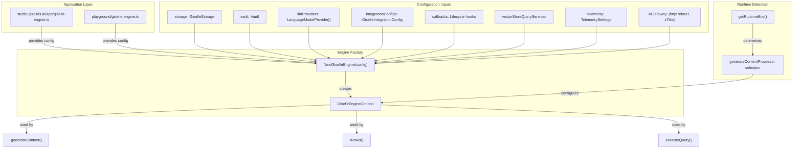
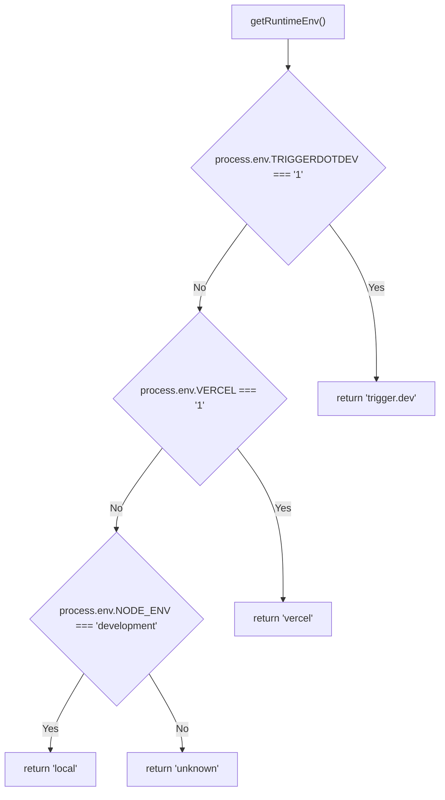
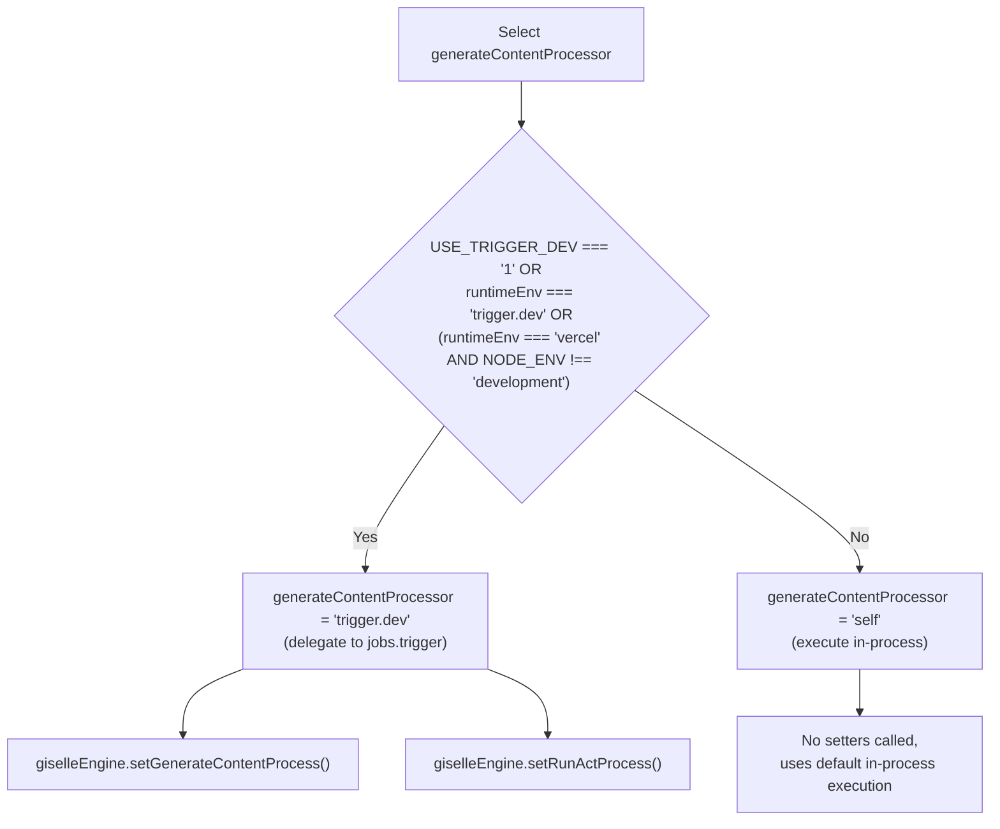
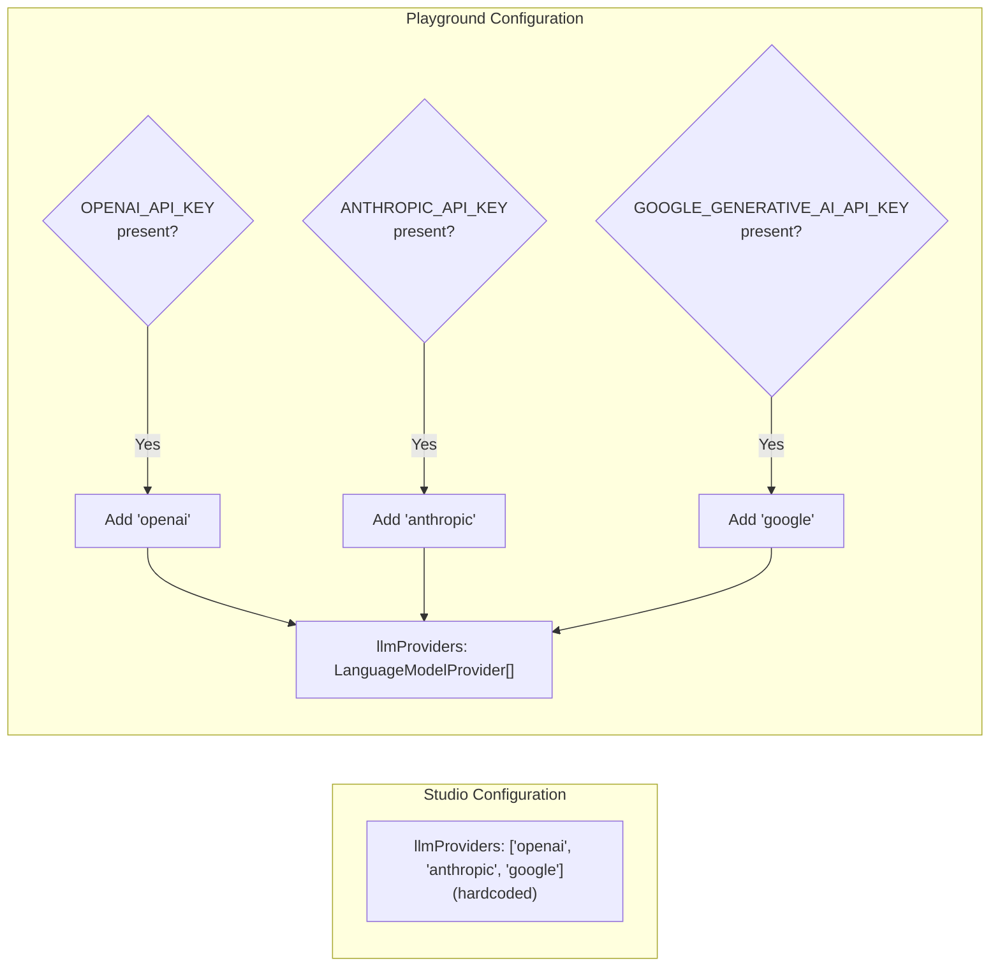
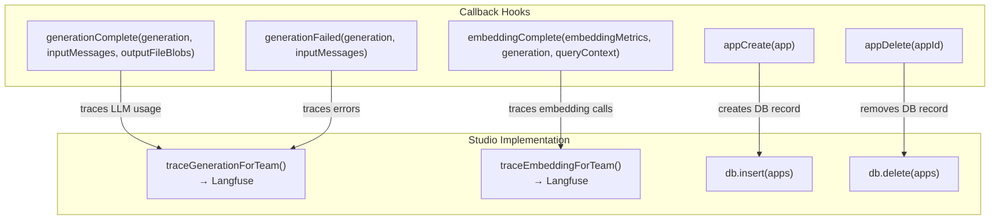
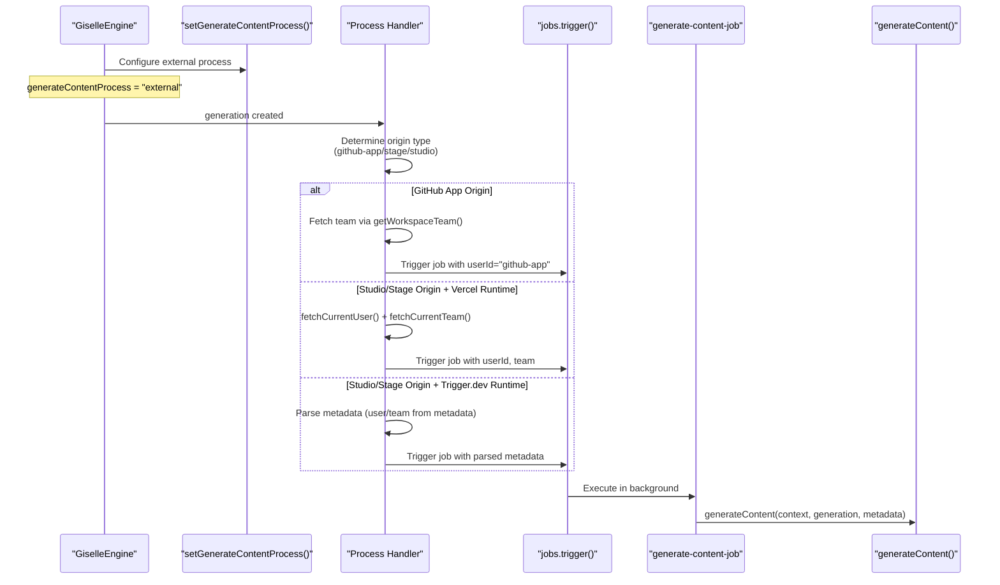
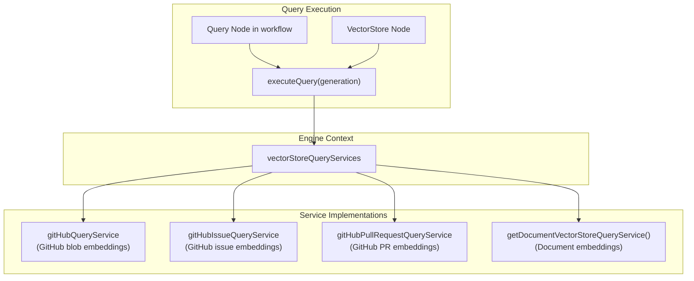

<!-- source: DeepWiki mcp.deepwiki.com · repo giselles-ai/giselle · page 2.1 Engine Architecture and Configuration · fetched 2026-10-26 -->

# Engine Architecture and Configuration

<details>
<summary>Relevant source files</summary>

The following files were used as context for generating this wiki page:

- [apps/playground/giselle-engine.ts](apps/playground/giselle-engine.ts)
- [apps/studio.giselles.ai/app/giselle-engine.ts](apps/studio.giselles.ai/app/giselle-engine.ts)
- [packages/giselle/src/engine/acts/run-act.ts](packages/giselle/src/engine/acts/run-act.ts)
- [packages/giselle/src/engine/generations/generate-content.ts](packages/giselle/src/engine/generations/generate-content.ts)
- [packages/giselle/src/engine/generations/generate-image.ts](packages/giselle/src/engine/generations/generate-image.ts)
- [packages/giselle/src/engine/generations/internal/use-generation-executor.ts](packages/giselle/src/engine/generations/internal/use-generation-executor.ts)
- [packages/giselle/src/engine/generations/types.ts](packages/giselle/src/engine/generations/types.ts)
- [packages/giselle/src/engine/generations/utils.ts](packages/giselle/src/engine/generations/utils.ts)
- [packages/giselle/src/engine/operations/execute-query.ts](packages/giselle/src/engine/operations/execute-query.ts)
- [packages/giselle/src/engine/telemetry/index.ts](packages/giselle/src/engine/telemetry/index.ts)
- [packages/giselle/src/engine/telemetry/types.ts](packages/giselle/src/engine/telemetry/types.ts)
- [packages/giselle/src/engine/triggers/resolve-trigger.ts](packages/giselle/src/engine/triggers/resolve-trigger.ts)
- [packages/giselle/src/engine/types.ts](packages/giselle/src/engine/types.ts)
- [packages/giselle/src/react/generations/generation-runner.tsx](packages/giselle/src/react/generations/generation-runner.tsx)

</details>


This page documents the architecture and configuration of the Giselle Engine, specifically focusing on the `NextGiselleEngine` initialization, runtime environment detection, and how the engine is configured across different deployment environments (Studio, Playground, local, Vercel, Trigger.dev).

For information about the generation execution pipeline and lifecycle, see [Generation Pipeline and Lifecycle](#2.2). For details about Act orchestration, see [Act Runner and Workflow Orchestration](#2.4).

## Overview

The Giselle Engine is initialized through the `NextGiselleEngine` factory function, which creates a `GiselleEngineContext` containing all runtime dependencies, configuration, and callback hooks. The engine supports flexible deployment through runtime environment detection and process delegation, allowing the same codebase to execute in multiple contexts: local development, Vercel serverless functions, and Trigger.dev background jobs.

## Engine Initialization

### NextGiselleEngine Factory

The engine is instantiated by calling `NextGiselleEngine()` with a `GiselleEngineConfig` object. This factory creates the internal `GiselleEngineContext` and returns an engine instance with methods for generation execution, workflow management, and storage operations.



**Sources:**
- [apps/studio.giselles.ai/app/giselle-engine.ts:196-396]()
- [apps/playground/giselle-engine.ts:122-140]()
- [packages/giselle/src/engine/types.ts:194-227]()

### GiselleEngineContext Structure

The `GiselleEngineContext` is the central dependency container passed to all engine operations. It contains configured instances of storage, vault, providers, and callbacks.

| Property | Type | Purpose |
|----------|------|---------|
| `storage` | `GiselleStorage` | Abstraction for file/blob storage (Supabase S3 or filesystem) |
| `vault` | `Vault` | Secure credential storage (Supabase pgsodium or in-memory) |
| `llmProviders` | `LanguageModelProvider[]` | Enabled AI providers (openai, anthropic, google) |
| `integrationConfigs` | `GiselleIntegrationConfig` | GitHub App credentials and configuration |
| `vectorStoreQueryServices` | Object | RAG query services for GitHub and document vector stores |
| `callbacks` | Object | Lifecycle hooks (generationComplete, generationFailed, etc.) |
| `aiGateway` | Object | AI Gateway headers for request routing |
| `telemetry` | Object | Observability settings (isEnabled, waitForFlushFn) |
| `logger` | `GiselleLogger` | Structured logging instance |
| `waitUntil` | `WaitUntil` | Async task scheduling for serverless environments |
| `generateContentProcess` | `GenerateContentProcess` | Self or external (Trigger.dev) execution |
| `runActProcess` | `RunActProcess` | Self or external (Trigger.dev) execution |

**Sources:**
- [packages/giselle/src/engine/types.ts:90-127]()

## Runtime Environment Detection

### getRuntimeEnv Function

The engine detects its runtime environment to adapt behavior for different deployment contexts:



The detected environment influences:
1. **Processor selection** - Whether to use Trigger.dev for async processing
2. **Telemetry context** - How to retrieve user/team information for tracing
3. **Callback behavior** - Different authentication flows based on context

**Sources:**
- [apps/studio.giselles.ai/app/giselle-engine.ts:180-187]()

### Processor Selection Logic



In Studio production (Vercel), content generation and Act execution are delegated to Trigger.dev jobs to avoid serverless timeout limits. In Playground and local development, execution happens in-process.

**Sources:**
- [apps/studio.giselles.ai/app/giselle-engine.ts:189-194]()
- [apps/studio.giselles.ai/app/giselle-engine.ts:426-534]()

## Configuration Components

### Storage Driver Configuration

The engine supports two storage drivers:

**Studio (Production):**
```typescript
const storage = experimental_supabaseStorageDriver({
  endpoint: process.env.SUPABASE_STORAGE_URL,
  region: process.env.SUPABASE_STORAGE_REGION,
  accessKeyId: process.env.SUPABASE_STORAGE_ACCESS_KEY_ID,
  secretAccessKey: process.env.SUPABASE_STORAGE_SECRET_ACCESS_KEY,
  bucket: "app",
});
```

**Playground:**
```typescript
const storage = isVercelEnvironment
  ? experimental_supabaseStorageDriver({ /* ... */ })
  : fsStorageDriver({ root: "./.storage" });
```

The storage abstraction is used for:
- Generation state persistence
- Generated images and file artifacts
- Node generation indexes
- Act execution state

**Sources:**
- [apps/studio.giselles.ai/app/giselle-engine.ts:40-46]()
- [apps/playground/giselle-engine.ts:14-24]()

### Vault Driver Configuration

The vault securely stores encrypted credentials:

**Studio:**
```typescript
const vault = supabaseVaultDriver({
  url: process.env.SUPABASE_URL,
  serviceKey: process.env.SUPABASE_SERVICE_KEY,
});
```

**Playground:**
```typescript
const vault = nodeVaultDriver({
  secret: process.env.VAULT_SECRET,
});
```

The vault is queried when:
- Resolving GitHub PAT tokens for tool execution
- Decrypting PostgreSQL connection strings for database tools
- Accessing stored secrets referenced by `secretId`

**Sources:**
- [apps/studio.giselles.ai/app/giselle-engine.ts:48-51]()
- [apps/playground/giselle-engine.ts:137-139]()
- [packages/giselle/src/engine/generations/generate-content.ts:118-134]()

### LLM Provider Configuration

Providers are conditionally enabled based on environment variables:



Studio always includes all three providers. Playground conditionally includes providers based on available API keys.

**Sources:**
- [apps/studio.giselles.ai/app/giselle-engine.ts:199]()
- [apps/playground/giselle-engine.ts:26-39]()

### AI Gateway Configuration

Studio configures AI Gateway headers for request routing through a gateway proxy:

```typescript
aiGateway: {
  httpReferer: process.env.VERCEL_ENV === "preview"
    ? `https://${process.env.VERCEL_URL}`
    : "https://studio.giselles.ai",
  xTitle: process.env.VERCEL_ENV === "preview" ? "Giselle(preview)" : "Giselle",
}
```

These headers are passed to the Vercel AI SDK's `createGateway()` to identify requests and apply usage limits or routing rules.

**Sources:**
- [apps/studio.giselles.ai/app/giselle-engine.ts:387-394]()
- [packages/giselle/src/engine/generations/generate-content.ts:489-503]()

### Integration Configuration

GitHub App credentials are configured for trigger/action integration:

```typescript
integrationConfigs: {
  github: {
    auth: { /* legacy auth */ },
    authV2: {
      appId: process.env.GITHUB_APP_ID,
      privateKey: process.env.GITHUB_APP_PRIVATE_KEY,
      clientId: process.env.GITHUB_APP_CLIENT_ID,
      clientSecret: process.env.GITHUB_APP_CLIENT_SECRET,
      webhookSecret: process.env.GITHUB_APP_WEBHOOK_SECRET,
    },
  },
}
```

The `authV2` configuration is used by the GitHub trigger resolver and action executor.

**Sources:**
- [apps/studio.giselles.ai/app/giselle-engine.ts:70-84]()
- [apps/studio.giselles.ai/app/giselle-engine.ts:207-226]()
- [packages/giselle/src/engine/types.ts:133-146]()

## Callback System

### Lifecycle Callbacks

The engine provides hooks for observing generation lifecycle events:



**Callback Execution Context:**

The callbacks execute with different authentication contexts based on `generation.context.origin.type`:

| Origin Type | User Context | Team Context | Request ID |
|-------------|--------------|--------------|------------|
| `"github-app"` | `"github-app"` | Fetched via `getWorkspaceTeam()` | From `getRequestId()` |
| `"studio"` or `"stage"` (Vercel) | `fetchCurrentUser()` | `fetchCurrentTeam()` | From `getRequestId()` |
| `"studio"` or `"stage"` (Trigger.dev) | From `metadata.userId` | From `metadata.team` | From `metadata.requestId` |

This branching logic ensures callbacks can identify the user/team even when running in background jobs where session context is unavailable.

**Sources:**
- [apps/studio.giselles.ai/app/giselle-engine.ts:234-385]()
- [apps/studio.giselles.ai/app/giselle-engine.ts:88-178]()
- [packages/giselle/src/engine/types.ts:111-118]()

### Telemetry Configuration

Telemetry settings control observability integration:

```typescript
telemetry: {
  isEnabled: true,
  waitForFlushFn: waitForLangfuseFlush,
}
```

The `waitForFlushFn` ensures telemetry data is flushed before serverless functions terminate. Studio uses Langfuse for LLM tracing; Playground uses a minimal implementation.

**Sources:**
- [apps/studio.giselles.ai/app/giselle-engine.ts:201-204]()
- [packages/giselle/src/engine/types.ts:99-103]()

## Process Delegation

### Content Generation Process

When Trigger.dev is enabled, the engine delegates content generation to a background job:



This delegation prevents serverless timeout issues by moving long-running AI generation to a durable background job.

**Sources:**
- [apps/studio.giselles.ai/app/giselle-engine.ts:426-489]()
- [packages/giselle/src/engine/types.ts:33-40]()

### Act Execution Process

Similarly, Act execution can be delegated:

```typescript
giselleEngine.setRunActProcess(async ({ act, generationOriginType }) => {
  const requestId = getRequestId();
  switch (generationOriginType) {
    case "github-app": {
      const team = await getWorkspaceTeam(act.workspaceId);
      await jobs.trigger<typeof runActJob>("run-act-job", {
        actId: act.id,
        requestId,
        userId: "github-app",
        team: { id: team.id, subscriptionId: team.activeSubscriptionId, plan: team.plan },
      });
      break;
    }
    case "stage":
    case "studio": {
      const [currentUser, currentTeam] = await Promise.all([
        fetchCurrentUser(),
        fetchCurrentTeam(),
      ]);
      await jobs.trigger<typeof runActJob>("run-act-job", { /* ... */ });
      break;
    }
  }
});
```

**Sources:**
- [apps/studio.giselles.ai/app/giselle-engine.ts:491-533]()
- [packages/giselle/src/engine/types.ts:42-54]()

## Vector Store Query Services

The engine connects to vector store query services for RAG functionality:



These services are injected at engine initialization and used by `executeQuery()` to perform semantic search against configured vector stores.

**Sources:**
- [apps/studio.giselles.ai/app/giselle-engine.ts:228-233]()
- [packages/giselle/src/engine/operations/execute-query.ts:290-541]()
- [packages/giselle/src/engine/types.ts:105-110]()

## Configuration Differences: Studio vs Playground

| Aspect | Studio | Playground |
|--------|--------|------------|
| Storage | Supabase S3 | Filesystem (local) or Supabase S3 (Vercel) |
| Vault | Supabase pgsodium | In-memory with VAULT_SECRET |
| LLM Providers | Always all 3 (openai, anthropic, google) | Conditional on API key presence |
| Process Delegation | Trigger.dev in production | Always in-process |
| Callbacks | Full Langfuse tracing + DB persistence | Basic tracing only |
| Vector Store Services | All 4 services configured | None configured |
| GitHub Integration | Full GitHub App auth | Optional (if env vars present) |
| AI Gateway | Configured with referer/title | Not configured |
| Telemetry | Enabled with flush function | Enabled without flush |

**Sources:**
- [apps/studio.giselles.ai/app/giselle-engine.ts:40-396]()
- [apps/playground/giselle-engine.ts:1-141]()

## Sample App Workspace IDs

Both Studio and Playground support a `SAMPLE_APP_WORKSPACE_IDS` environment variable:

```typescript
let sampleAppWorkspaceIds: WorkspaceId[] | undefined;
if (process.env.SAMPLE_APP_WORKSPACE_IDS) {
  const workspaceIdStrings = process.env.SAMPLE_APP_WORKSPACE_IDS.split(",")
    .map((id) => id.trim())
    .filter((id) => id.length > 0);
  const parsedWorkspaceIds: WorkspaceId[] = [];
  for (const workspaceIdString of workspaceIdStrings) {
    const parseResult = WorkspaceId.safeParse(workspaceIdString);
    if (parseResult.success) {
      parsedWorkspaceIds.push(parseResult.data);
    }
  }
  if (parsedWorkspaceIds.length > 0) {
    sampleAppWorkspaceIds = parsedWorkspaceIds;
  }
}
```

These workspace IDs are likely used to identify example or template workspaces that are treated specially by the system.

**Sources:**
- [apps/studio.giselles.ai/app/giselle-engine.ts:53-68]()
- [apps/playground/giselle-engine.ts:105-120]()

---

