<!-- source: DeepWiki mcp.deepwiki.com · repo giselles-ai/giselle · page 2.2 Generation Pipeline and Lifecycle · fetched 2026-10-26 -->

# Generation Pipeline and Lifecycle

<details>
<summary>Relevant source files</summary>

The following files were used as context for generating this wiki page:

- [apps/playground/giselle-engine.ts](apps/playground/giselle-engine.ts)
- [apps/studio.giselles.ai/app/giselle-engine.ts](apps/studio.giselles.ai/app/giselle-engine.ts)
- [packages/giselle/src/engine/acts/run-act.ts](packages/giselle/src/engine/acts/run-act.ts)
- [packages/giselle/src/engine/generations/generate-content.ts](packages/giselle/src/engine/generations/generate-content.ts)
- [packages/giselle/src/engine/generations/generate-image.ts](packages/giselle/src/engine/generations/generate-image.ts)
- [packages/giselle/src/engine/generations/internal/use-generation-executor.ts](packages/giselle/src/engine/generations/internal/use-generation-executor.ts)
- [packages/giselle/src/engine/generations/types.ts](packages/giselle/src/engine/generations/types.ts)
- [packages/giselle/src/engine/generations/utils.ts](packages/giselle/src/engine/generations/utils.ts)
- [packages/giselle/src/engine/operations/execute-query.ts](packages/giselle/src/engine/operations/execute-query.ts)
- [packages/giselle/src/engine/telemetry/index.ts](packages/giselle/src/engine/telemetry/index.ts)
- [packages/giselle/src/engine/telemetry/types.ts](packages/giselle/src/engine/telemetry/types.ts)
- [packages/giselle/src/engine/triggers/resolve-trigger.ts](packages/giselle/src/engine/triggers/resolve-trigger.ts)
- [packages/giselle/src/engine/types.ts](packages/giselle/src/engine/types.ts)
- [packages/giselle/src/react/generations/generation-runner.tsx](packages/giselle/src/react/generations/generation-runner.tsx)

</details>


## Purpose and Scope

This document explains the generation execution pipeline, covering how AI operations progress through their lifecycle from creation to completion or failure. It details the `useGenerationExecutor` orchestrator, streaming operations, cancellation mechanisms, and the distinction between local and delegated execution.

For information about language model integration and provider configuration, see [Language Models and AI Providers](#2.3). For storage mechanisms used to persist generation data, see [Storage Architecture](#2.4). For the workflow orchestration that triggers generations, see [Giselle Engine Architecture](#2.1).

---

## Generation Lifecycle States

A generation progresses through distinct states from initiation to completion:

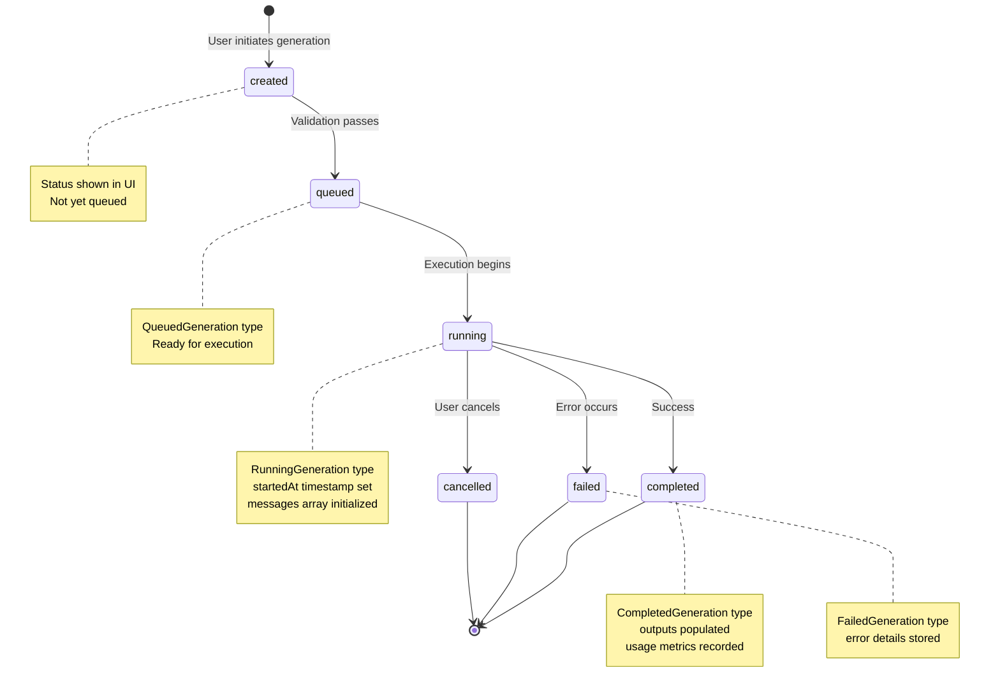

**Sources:**
- [packages/giselle/src/engine/generations/internal/use-generation-executor.ts:84-95]()
- [internal-packages/workflow-designer-ui/src/editor/node/node.tsx:196-241]()

### Generation Type Definitions

| State | Type | Key Properties | Storage Path |
|-------|------|----------------|--------------|
| `created` | Initial UI state | No formal type | Display only |
| `queued` | `QueuedGeneration` | `status: "queued"`, `context`, `createdAt` | `generations/{id}/generation.json` |
| `running` | `RunningGeneration` | `status: "running"`, `startedAt`, `messages: []` | Same path, updated |
| `completed` | `CompletedGeneration` | `status: "completed"`, `completedAt`, `outputs`, `usage` | Same path, finalized |
| `failed` | `FailedGeneration` | `status: "failed"`, `failedAt`, `error` | Same path, with error |
| `cancelled` | Part of running flow | Detected via storage check | Same path |

**Sources:**
- [packages/giselle/src/engine/generations/internal/use-generation-executor.ts:24-25]()
- [packages/giselle/src/concepts/generation/output.ts:1-107]()

---

## useGenerationExecutor Architecture

The `useGenerationExecutor` function orchestrates the entire generation lifecycle, providing a consistent execution environment across all generation types.

```mermaid
graph TB
    Input["useGenerationExecutor<br/>args: {context, generation, execute}"]
    
    subgraph "Initialization"
        ParseContext["Parse GenerationContext<br/>from generation.context"]
        CreateRunning["Create RunningGeneration<br/>(if QueuedGeneration)<br/>status: 'running'<br/>startedAt: Date.now()"]
        PersistRunning["Persist to storage<br/>via setGeneration()"]
    end
    
    subgraph "Pre-Execution Checks"
        ExtractWorkspace["Extract workspaceId<br/>from origin.workspaceId"]
        CheckLimits["checkUsageLimits()<br/>fetchUsageLimitsFn"]
        LimitError["Throw UsageLimitError<br/>Set failed state"]
    end
    
    subgraph "Resolver Setup"
        FileResolver["fileResolver(fileId)<br/>→ DataContent<br/>from storage paths"]
        TextResolver["generationContentResolver<br/>(nodeId, outputId)<br/>→ string"]
        ImageResolver["imageGenerationResolver<br/>(nodeId, outputId)<br/>→ ImagePart[]"]
        FinishGen["finishGeneration()<br/>callback builder"]
    end
    
    subgraph "User Execute Function"
        UserExecute["execute({<br/>  runningGeneration,<br/>  generationContext,<br/>  fileResolver,<br/>  ...resolvers,<br/>  finishGeneration<br/>})"]
        GenLogic["Generation-specific logic<br/>(text/image/query)"]
        CallFinish["Call finishGeneration({<br/>  outputs,<br/>  usage,<br/>  inputMessages<br/>})"]
    end
    
    subgraph "Completion Flow"
        Sanitize["sanitizeGenerationUsage(usage)"]
        CreateCompleted["Create CompletedGeneration<br/>status: 'completed'<br/>completedAt: Date.now()"]
        ProcessImages["Process image outputs<br/>getGeneratedImage()"]
        Persist["Persist completed state"]
        ConsumeTime["handleAgentTimeConsumption()"]
        Callback["callbacks.generationComplete()"]
    end
    
    Input --> ParseContext
    ParseContext --> CreateRunning
    CreateRunning --> PersistRunning
    PersistRunning --> ExtractWorkspace
    ExtractWorkspace --> CheckLimits
    CheckLimits -->|Pass| FileResolver
    CheckLimits -->|Fail| LimitError
    
    FileResolver --> TextResolver
    TextResolver --> ImageResolver
    ImageResolver --> FinishGen
    FinishGen --> UserExecute
    
    UserExecute --> GenLogic
    GenLogic --> CallFinish
    
    CallFinish --> Sanitize
    Sanitize --> CreateCompleted
    CreateCompleted --> ProcessImages
    ProcessImages --> Persist
    Persist --> ConsumeTime
    ConsumeTime --> Callback
    Callback --> Output["Return result"]
```

**Sources:**
- [packages/giselle/src/engine/generations/internal/use-generation-executor.ts:59-411]()

### Key Responsibilities

**1. State Transition Management**

The executor transitions a generation from `queued` to `running`, then to either `completed` or `failed`:

```typescript
// Transition queued → running
const runningGeneration: RunningGeneration = isQueuedGeneration(args.generation)
  ? {
      ...args.generation,
      status: "running",
      messages: [],
      startedAt: Date.now(),
    }
  : args.generation;
```

**Sources:**
- [packages/giselle/src/engine/generations/internal/use-generation-executor.ts:86-95]()

**2. Usage Limit Validation**

Before execution begins, usage limits are checked:

```typescript
const usageLimitStatus = await checkUsageLimits({
  workspaceId,
  generation: args.generation,
  fetchUsageLimitsFn: args.context.fetchUsageLimitsFn,
});

if (usageLimitStatus.type === "error") {
  const failedGeneration: Generation = {
    ...runningGeneration,
    status: "failed",
    failedAt: Date.now(),
    error: {
      name: usageLimitStatus.error,
      message: usageLimitStatus.error,
      dump: usageLimitStatus,
    },
  } as const;
  await setGeneration(failedGeneration);
  throw new UsageLimitError(usageLimitStatus.error);
}
```

**Sources:**
- [packages/giselle/src/engine/generations/internal/use-generation-executor.ts:123-145]()

**3. Content Resolution**

Three resolver functions enable accessing previous generation outputs and files:

| Resolver | Purpose | Returns |
|----------|---------|---------|
| `fileResolver` | Retrieve file content | `DataContent` (Uint8Array) |
| `generationContentResolver` | Get text output from previous nodes | `string \| undefined` |
| `imageGenerationResolver` | Get image output from previous nodes | `ImagePart[] \| undefined` |

**Sources:**
- [packages/giselle/src/engine/generations/internal/use-generation-executor.ts:146-324]()

**4. Completion Finalization**

The `finishGeneration` callback handles completion state:

```typescript
async function finishGeneration({
  outputs,
  usage,
  inputMessages,
  generateMessages,
  providerMetadata,
}: FinishGenerationArgs) {
  const sanitizedUsage = sanitizeGenerationUsage(usage);
  const completedGeneration = {
    ...runningGeneration,
    status: "completed",
    completedAt: Date.now(),
    outputs,
    usage: sanitizedUsage,
    messages: generateMessages ?? [],
  } satisfies CompletedGeneration;

  // Process image outputs into outputFileBlobs
  const outputFileBlobs: OutputFileBlob[] = [];
  for (const output of outputs) {
    if (output.type !== "generated-image") continue;
    // ... image blob processing
  }

  await Promise.all([
    setGeneration(completedGeneration),
    handleAgentTimeConsumption({ workspaceId, generation: completedGeneration, ... }),
    args.context.callbacks?.generationComplete?.({
      generation: completedGeneration,
      inputMessages,
      outputFileBlobs,
      providerMetadata,
      generationMetadata: args.metadata,
    }),
  ]);
  
  return { completedGeneration, outputFileBlobs };
}
```

**Sources:**
- [packages/giselle/src/engine/generations/internal/use-generation-executor.ts:326-398]()

---

## Generation Type Implementations

Different generation types use `useGenerationExecutor` with type-specific execution logic.

### Text Generation Flow

Text generation with streaming is implemented in `generateContent`:

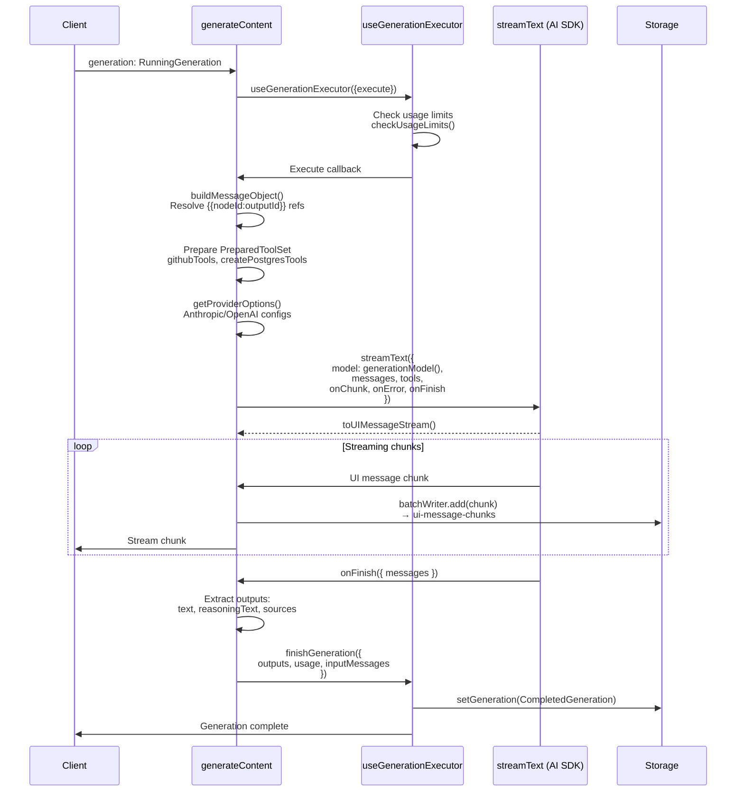

**Sources:**
- [packages/giselle/src/engine/generations/generate-content.ts:62-447]()

The text generation implementation in `generateContent`:

1. **Message Building**: `buildMessageObject()` constructs `ModelMessage[]` by resolving `{{nd-X:otp-Y}}` template patterns with source node outputs
2. **Tool Preparation**: Creates `PreparedToolSet` with:
   - `githubTools()` from `@giselles-ai/github-tool` 
   - `createPostgresTools()` for database queries
   - `openai.tools.webSearch()` or `anthropic.tools.webSearch_20250305()`
   - `google.tools.googleSearch()` and `google.tools.urlContext()`
3. **Provider Options**: `getProviderOptions()` configures provider-specific settings:
   - Anthropic: `thinking.budgetTokens`
   - OpenAI: `textVerbosity`, `reasoningEffort`, `reasoningSummary`
4. **Streaming**: Uses `streamText().toUIMessageStream()` with `smoothStream({ delayInMs: 1000 })` transform
5. **Output Extraction**: Awaits `streamTextResult.text`, `streamTextResult.reasoningText`, `streamTextResult.sources`

**Sources:**
- [packages/giselle/src/engine/generations/generate-content.ts:103-244]()
- [packages/giselle/src/engine/generations/generate-content.ts:256-288]()
- [packages/giselle/src/engine/generations/generate-content.ts:289-411]()
- [packages/giselle/src/engine/generations/generate-content.ts:449-487]()

### Chunk Persistence and Resumability

The `generateContent` function persists streaming chunks for resumability:

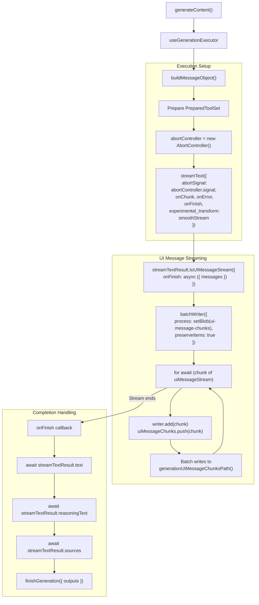

**Key Implementation Details:**

1. **Smooth Streaming**: `experimental_transform: smoothStream({ delayInMs: 1000, chunking: "line" })` controls output rate
2. **Chunk Persistence**: `batchWriter` accumulates chunks and writes newline-delimited JSON to `generations/{id}/ui-message-chunks`
3. **Cancellation Checking**: `onChunk` callback polls `getGeneration()` to detect `status === "cancelled"`, then calls `abortController.abort()`
4. **Abort Signal**: `AbortController.signal` propagates cancellation to AI SDK's `streamText()`
5. **Error Handling**: `onError` callback stores error in `generationError` variable for later processing

**Sources:**
- [packages/giselle/src/engine/generations/generate-content.ts:256-288]()
- [packages/giselle/src/engine/generations/generate-content.ts:289-412]()
- [packages/giselle/src/engine/generations/generate-content.ts:414-438]()
- [packages/giselle/src/utils/batch-writer.ts:1-100]() (inferred)

### Image Generation Flow

Image generation follows a simpler, non-streaming pattern:

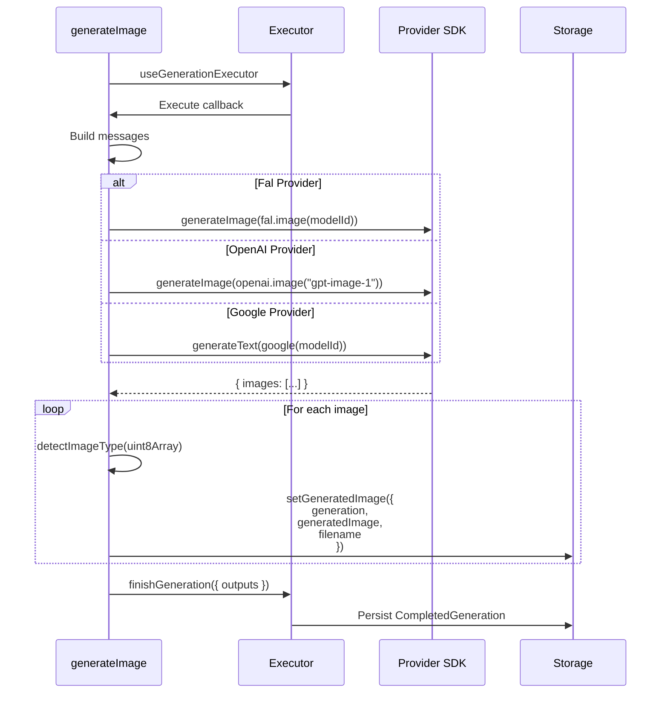

**Sources:**
- [packages/giselle/src/engine/generations/generate-image.ts:34-135]()
- [packages/giselle/src/engine/generations/generate-image.ts:137-221]()
- [packages/giselle/src/engine/generations/generate-image.ts:223-308]()
- [packages/giselle/src/engine/generations/generate-image.ts:310-380]()

### Query Execution Flow

Query nodes execute vector store searches:

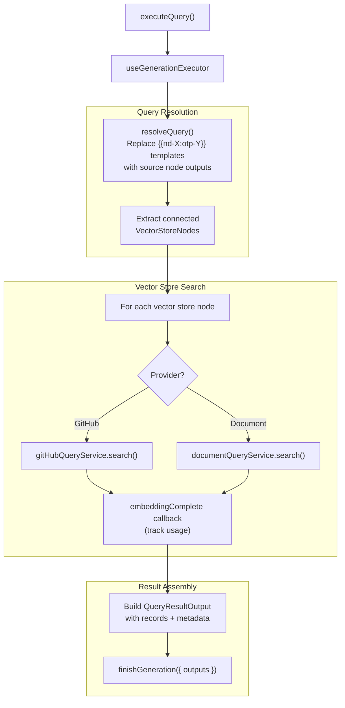

**Sources:**
- [packages/giselle/src/engine/operations/execute-query.ts:43-126]()
- [packages/giselle/src/engine/operations/execute-query.ts:299-502]()

---

## Streaming Operations

### UI Message Stream Structure

Text generation streams data as UI messages to the client:

```typescript
type UIMessageStreamChunk = 
  | { type: "text-delta", text: string }
  | { type: "tool-call", toolName: string, args: unknown }
  | { type: "tool-result", toolName: string, result: unknown }
  | { type: "finish", ... }
```

**Streaming Pipeline:**

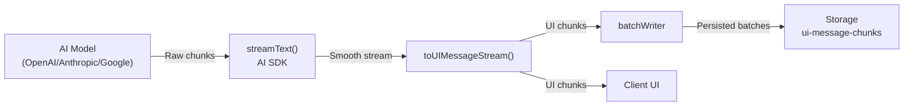

**Sources:**
- [packages/giselle/src/engine/generations/generate-content.ts:258-292]()
- [packages/giselle/src/engine/generations/generate-content.ts:418-442]()

### Batch Writing for Resumability

The `batchWriter` accumulates chunks and writes them in batches:

```typescript
const writer = batchWriter<StreamItem<typeof uiMessageStream>>({
  process: (batch) => {
    return context.experimental_storage.setBlob(
      generationUiMessageChunksPath(generation.id),
      new TextEncoder().encode(
        batch.map((chunk) => JSON.stringify(chunk)).join("\n")
      )
    );
  },
  preserveItems: true,
  logger,
});

for await (const chunk of uiMessageStream) {
  writer.add(chunk);
  uiMessageChunks.push(chunk);
}
await writer.close();
```

**Sources:**
- [packages/giselle/src/engine/generations/generate-content.ts:418-442]()

---

## Cancellation Support

### Cancellation Detection

Generations can be cancelled during execution through two mechanisms:

**1. OnChunk Polling (generateContent)**

```typescript
streamText({
  // ...
  onChunk: async () => {
    const currentGeneration = await getGeneration({
      storage: context.storage,
      experimental_storage: context.experimental_storage,
      useExperimentalStorage: true,
      generationId: generation.id,
    });
    if (currentGeneration?.status === "cancelled") {
      logger.debug(`${generation.id} will abort`);
      abortController.abort();
    }
  },
  onAbort: () => {
    logger.debug({ generationId: generation.id }, "streamText onAbort");
  },
  // ...
});
```

**Sources:**
- [packages/giselle/src/engine/generations/generate-content.ts:265-276]()

**2. AbortSignal Propagation**

The executor propagates `AbortSignal` to generation functions:

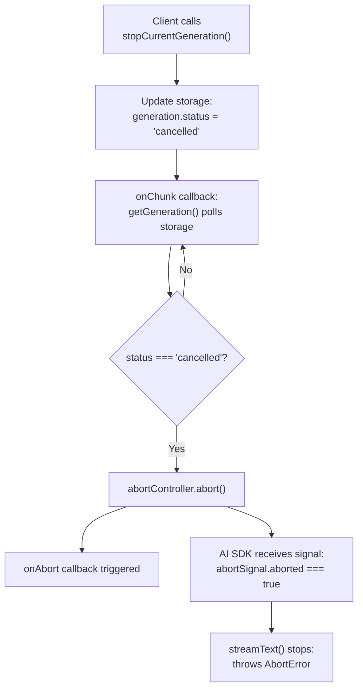

**Code Entity Flow:**

1. UI calls `stopCurrentGeneration()` which updates generation status via `setGeneration()`
2. `onChunk` callback in `streamText()` polls storage: `await getGeneration({ storage, generationId })`
3. If `currentGeneration?.status === "cancelled"`, calls `abortController.abort()`
4. `onAbort` callback logs: `logger.debug({ generationId }, "streamText onAbort")`
5. AI SDK receives `abortSignal.aborted === true` and stops streaming

**Sources:**
- [packages/giselle/src/engine/generations/generate-content.ts:264-276]()
- [packages/giselle/src/engine/generations/internal/use-generation-executor.ts:62]()
- [internal-packages/workflow-designer-ui/src/editor/node/node.tsx:207-216]()

### UI Cancellation Flow

In the workflow designer UI, users can cancel running generations:

```typescript
{(currentGeneration?.status === "queued" || currentGeneration?.status === "running") && (
  <button
    type="button"
    onClick={(e) => {
      e.stopPropagation();
      stopCurrentGeneration();
    }}
  >
    <SquareIcon className="w-2 h-2" />
  </button>
)}
```

**Sources:**
- [internal-packages/workflow-designer-ui/src/editor/node/node.tsx:206-225]()

---

## Process Delegation: Self vs Trigger.dev

The engine supports two execution modes for content generation:

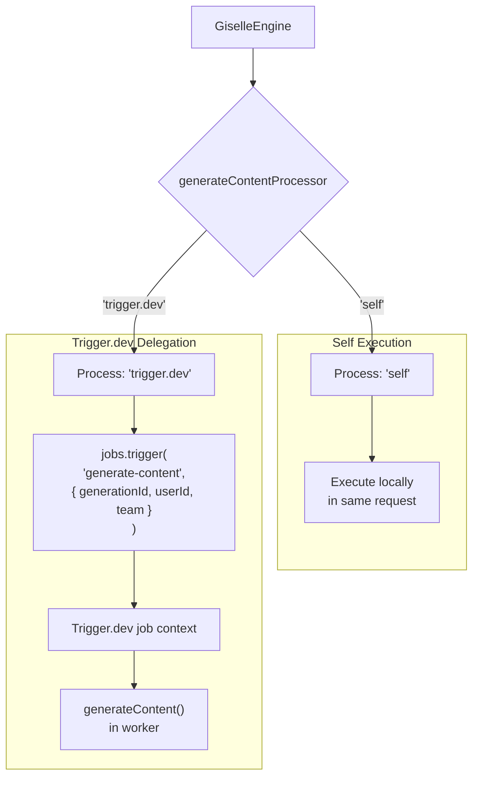

### Delegation Configuration

The choice between self-execution and delegation is determined at engine initialization:

```typescript
const generateContentProcessor =
  process.env.USE_TRIGGER_DEV === "1" ||
  runtimeEnv === "trigger.dev" ||
  (runtimeEnv === "vercel" && process.env.NODE_ENV !== "development")
    ? "trigger.dev"
    : "self";
```

**Decision Logic:**

| Condition | Processor | Reason |
|-----------|-----------|--------|
| `USE_TRIGGER_DEV=1` | `trigger.dev` | Explicitly enabled |
| Runtime is Trigger.dev | `trigger.dev` | Already in worker context |
| Production Vercel | `trigger.dev` | Long-running operations need background jobs |
| Development (local/Vercel) | `self` | Immediate feedback for debugging |

**Sources:**
- [apps/studio.giselles.ai/app/giselle-engine.ts:211-216]()

### Trigger.dev Process Configuration

When delegated, the engine provides a process function:

```typescript
giselleEngine.setGenerateContentProcess(async ({ generation, metadata }) => {
  const requestId = getRequestId();
  
  switch (generation.context.origin.type) {
    case "github-app": {
      const team = await getWorkspaceTeam(generation.context.origin.workspaceId);
      await jobs.trigger<typeof generateContentJob>("generate-content", {
        generationId: generation.id,
        requestId,
        userId: "github-app",
        team: { id: team.id, type: team.type, subscriptionId: team.activeSubscriptionId },
      });
      break;
    }
    case "stage":
    case "studio": {
      // Fetch user/team based on runtime environment
      // Trigger job with user context
      break;
    }
  }
});
```

The job receives `GenerationMetadata` containing user and team context to avoid circular authentication calls:

```typescript
type GenerationMetadata = {
  userId: string;
  requestId: string;
  team: { id: string; type: string; subscriptionId: string | null };
};
```

**Sources:**
- [apps/studio.giselles.ai/app/giselle-engine.ts:430-493]()
- [packages/giselle/src/engine/generations/generate-content.ts:62-77]()

---

## Storage Paths and Persistence

### Generation Storage Paths

| Path Pattern | Purpose | Format | Function |
|--------------|---------|--------|----------|
| `generations/{id}/generation.json` | Main generation state | JSON with `Generation` type | `generationPath()` |
| `generations/byNode/{nodeId}.json` | Node → Generation index | Array of `NodeGenerationIndex` | `nodeGenerationIndexPath()` |
| `generations/byAct/{actId}.json` | Act → Generation index | Array of `{id, nodeId, createdAt}` | `actGenerationIndexPath()` |
| `generations/{id}/ui-message-chunks` | Streaming chunks (resumable) | Newline-delimited JSON | `generationUiMessageChunksPath()` |
| `generations/{id}/generated-images/{filename}` | Image outputs | Binary blob (uint8Array) | `generatedImagePath()` |

**Sources:**
- [packages/giselle/src/engine/generations/utils.ts:316-318]()
- [packages/giselle/src/engine/generations/utils.ts:335-337]()
- [packages/giselle/src/engine/path.ts:1-20]() (inferred from usage)
- [packages/giselle/src/engine/generations/utils.ts:612-614]()

### Storage Backend

The engine uses `GiselleStorage` interface for all generation persistence:

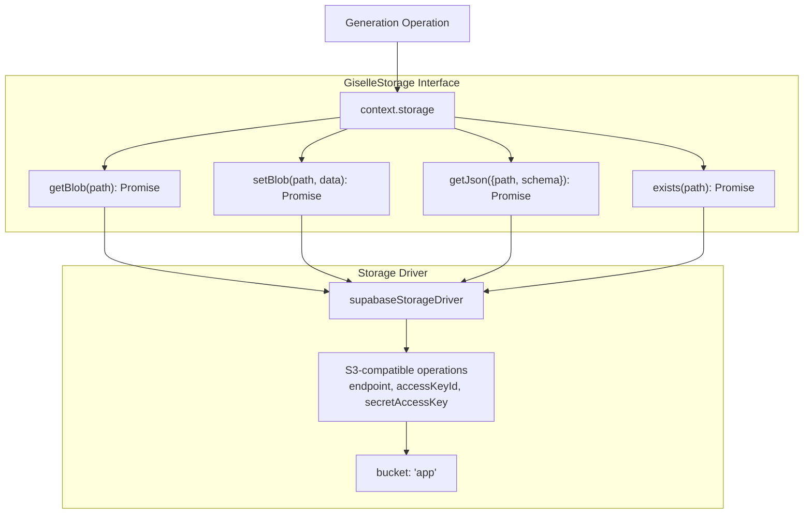

**Implementation in Studio:**

```typescript
const storage = experimental_supabaseStorageDriver({
  endpoint: process.env.SUPABASE_STORAGE_URL ?? "",
  region: process.env.SUPABASE_STORAGE_REGION ?? "",
  accessKeyId: process.env.SUPABASE_STORAGE_ACCESS_KEY_ID ?? "",
  secretAccessKey: process.env.SUPABASE_STORAGE_SECRET_ACCESS_KEY ?? "",
  bucket: "app",
});
```

**Sources:**
- [apps/studio.giselles.ai/app/giselle-engine.ts:40-46]()
- [packages/giselle/src/engine/storage/types.ts:1-20]() (inferred)

---

## Callbacks and Telemetry

### Lifecycle Callbacks

The engine invokes callbacks at key lifecycle events:

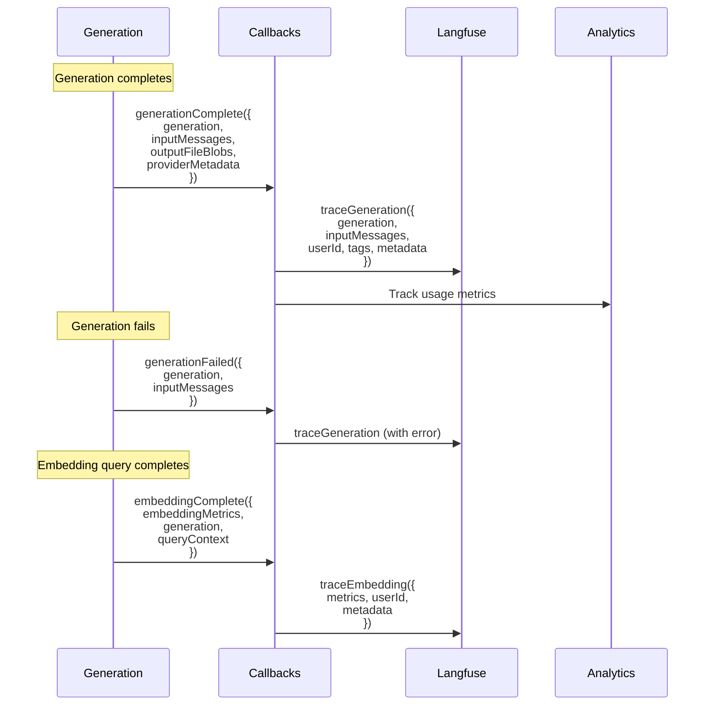

**Sources:**
- [apps/studio.giselles.ai/app/giselle-engine.ts:256-298]()
- [apps/studio.giselles.ai/app/giselle-engine.ts:299-328]()
- [apps/studio.giselles.ai/app/giselle-engine.ts:329-389]()

### Callback Timing

Callbacks are invoked during `finishGeneration`:

```typescript
await Promise.all([
  setGeneration(completedGeneration),
  handleAgentTimeConsumption({ workspaceId, generation: completedGeneration, ... }),
  (async () => {
    const result = await args.context.callbacks?.generationComplete?.({
      generation: completedGeneration,
      inputMessages,
      outputFileBlobs,
      providerMetadata,
      generationMetadata: args.metadata,
    });
    return result;
  })(),
]);
```

This ensures storage persistence, usage tracking, and telemetry occur concurrently.

**Sources:**
- [packages/giselle/src/engine/generations/internal/use-generation-executor.ts:372-390]()

---

## Summary: Key Components

| Component | File Path | Responsibility |
|-----------|-----------|----------------|
| `useGenerationExecutor` | `packages/giselle/src/engine/generations/internal/use-generation-executor.ts` | Lifecycle orchestration, state transitions, resolver setup |
| `generateText` | `packages/giselle/src/engine/generations/generate-text.ts` | Text generation via `streamText()` |
| `generateContent` | `packages/giselle/src/engine/generations/generate-content.ts` | Content generation with resumable streaming |
| `generateImage` | `packages/giselle/src/engine/generations/generate-image.ts` | Image generation (Fal, OpenAI, Google) |
| `executeQuery` | `packages/giselle/src/engine/operations/execute-query.ts` | Vector store query execution |
| `setGenerateContentProcess` | `apps/studio.giselles.ai/app/giselle-engine.ts` | Trigger.dev delegation configuration |
| UI Status Display | `internal-packages/workflow-designer-ui/src/editor/node/node.tsx` | Visual lifecycle state feedback |

**Sources:**
- [packages/giselle/src/engine/generations/internal/use-generation-executor.ts:1-412]()
- [packages/giselle/src/engine/generations/generate-text.ts:1-467]()
- [packages/giselle/src/engine/generations/generate-content.ts:1-523]()
- [packages/giselle/src/engine/generations/generate-image.ts:1-381]()
- [packages/giselle/src/engine/operations/execute-query.ts:1-503]()
- [apps/studio.giselles.ai/app/giselle-engine.ts:430-538]()
- [internal-packages/workflow-designer-ui/src/editor/node/node.tsx:196-241]()

---

