<!-- source: DeepWiki mcp.deepwiki.com · repo giselles-ai/giselle · page 2.3 Language Models and AI Provider Integration · fetched 2026-10-26 -->

# Language Models and AI Integration

<details>
<summary>Relevant source files</summary>

The following files were used as context for generating this wiki page:

- [apps/playground/giselle-engine.ts](apps/playground/giselle-engine.ts)
- [apps/playground/package.json](apps/playground/package.json)
- [apps/studio.giselles.ai/app/giselle-engine.ts](apps/studio.giselles.ai/app/giselle-engine.ts)
- [apps/studio.giselles.ai/package.json](apps/studio.giselles.ai/package.json)
- [internal-packages/workflow-designer-ui/package.json](internal-packages/workflow-designer-ui/package.json)
- [package.json](package.json)
- [packages/giselle/package.json](packages/giselle/package.json)
- [packages/giselle/src/engine/acts/run-act.ts](packages/giselle/src/engine/acts/run-act.ts)
- [packages/giselle/src/engine/generations/generate-content.ts](packages/giselle/src/engine/generations/generate-content.ts)
- [packages/giselle/src/engine/generations/generate-image.ts](packages/giselle/src/engine/generations/generate-image.ts)
- [packages/giselle/src/engine/generations/internal/use-generation-executor.ts](packages/giselle/src/engine/generations/internal/use-generation-executor.ts)
- [packages/giselle/src/engine/generations/types.ts](packages/giselle/src/engine/generations/types.ts)
- [packages/giselle/src/engine/generations/utils.ts](packages/giselle/src/engine/generations/utils.ts)
- [packages/giselle/src/engine/operations/execute-query.ts](packages/giselle/src/engine/operations/execute-query.ts)
- [packages/giselle/src/engine/telemetry/index.ts](packages/giselle/src/engine/telemetry/index.ts)
- [packages/giselle/src/engine/telemetry/types.ts](packages/giselle/src/engine/telemetry/types.ts)
- [packages/giselle/src/engine/triggers/resolve-trigger.ts](packages/giselle/src/engine/triggers/resolve-trigger.ts)
- [packages/giselle/src/engine/types.ts](packages/giselle/src/engine/types.ts)
- [packages/giselle/src/react/generations/generation-runner.tsx](packages/giselle/src/react/generations/generation-runner.tsx)
- [pnpm-lock.yaml](pnpm-lock.yaml)
- [pnpm-workspace.yaml](pnpm-workspace.yaml)

</details>


## Purpose and Scope

This document describes the language model integration architecture in the Giselle platform, covering how multiple LLM providers (OpenAI, Anthropic, Google, Perplexity) are abstracted and integrated through the Vercel AI SDK. It details model selection, provider-specific configurations, tier-based access control, and the generation pipeline that powers text and image generation workflows.

For information about the generation lifecycle and execution flow, see [Generation Pipeline and State Management](#2.2). For storage of generation artifacts, see [Storage Architecture](#2.4).

## Provider Architecture

The Giselle Engine supports multiple LLM providers through a unified abstraction layer, with provider availability determined at engine initialization.

### Provider Registration

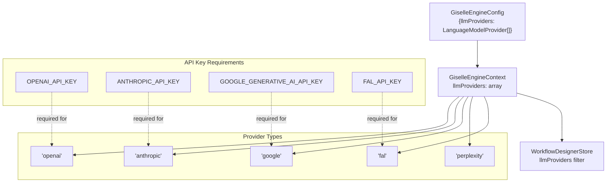

**Sources:** 
- [apps/studio.giselles.ai/app/giselle-engine.ts:271]()
- [apps/playground/giselle-engine.ts:41-54]()
- [packages/giselle/src/engine/types.ts:67-101]()

The `llmProviders` array in `GiselleEngineContext` controls which providers are available throughout the application. In the studio app, all supported providers are enabled, while the playground conditionally enables providers based on available API keys.

### Provider SDK Mapping

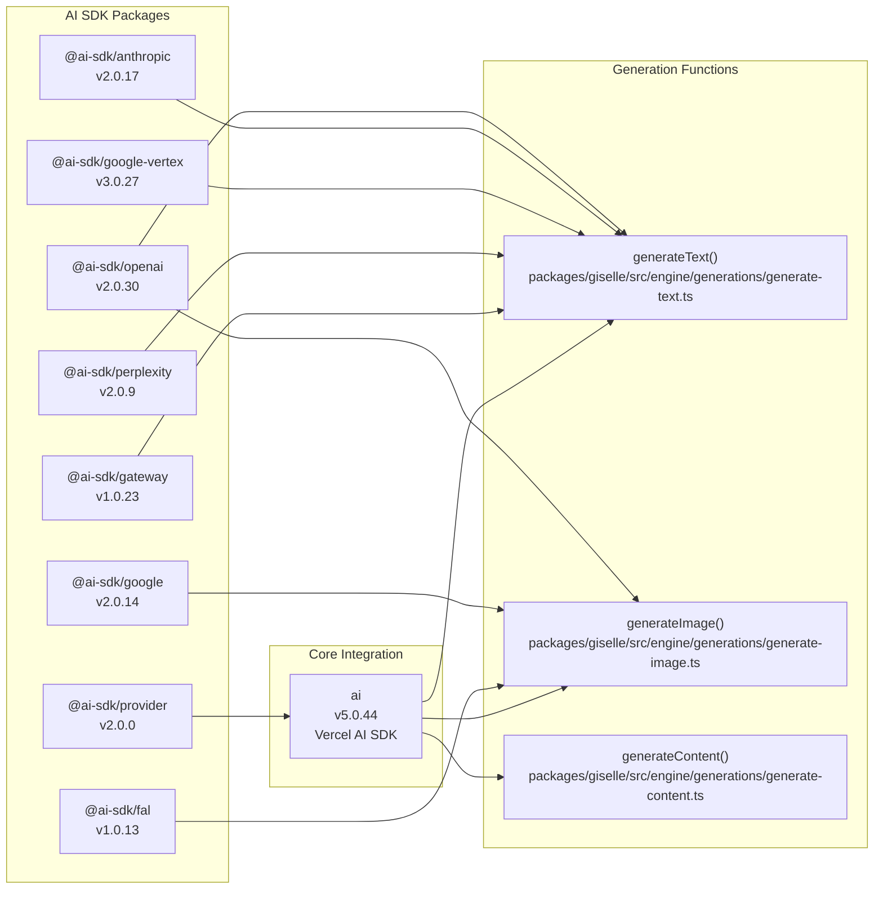

**Sources:**
- [pnpm-lock.yaml:9-41]()
- [packages/giselle/src/engine/generations/generate-text.ts:1-6]()
- [packages/giselle/src/engine/generations/generate-image.ts:1-6]()

## AI SDK Integration

Giselle uses the Vercel AI SDK (`ai` package v5.0.44) as the primary abstraction for interacting with language models. The SDK provides unified interfaces for streaming, tool calling, and multi-modal generation.

### Core Functions

| Function | Purpose | Return Type | Primary Use Case |
|----------|---------|-------------|------------------|
| `streamText()` | Stream text generation with tool support | `UIMessageStream` | Real-time text generation in Studio |
| `generateText()` | Non-streaming text generation | `GenerateTextResult` | Tool execution, batch processing |
| `experimental_generateImage()` | Generate images | `GenerateImageResult` | Image generation nodes |
| `createUIMessageStreamResponse()` | Convert stream to HTTP response | `Response` | HTTP API endpoints |

**Sources:**
- [packages/giselle/src/engine/generations/generate-text.ts:19]()
- [packages/giselle/src/http/router.ts:81-98]()

### Model Instantiation Pattern

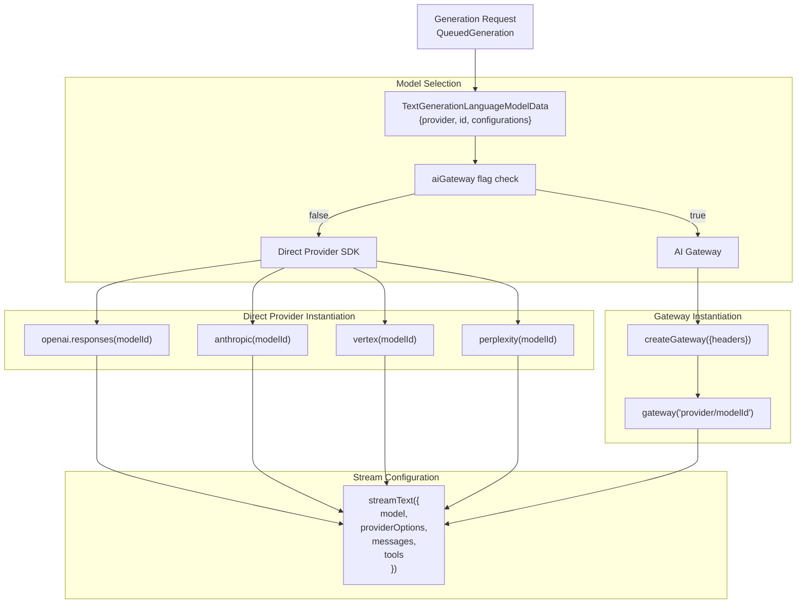

**Sources:**
- [packages/giselle/src/engine/generations/generate-text.ts:348-400]()
- [packages/giselle/src/engine/generations/generate-content.ts:228-231]()

The `generationModel()` function handles provider-specific model instantiation. When the `aiGateway` flag is enabled, requests are routed through the AI Gateway using the format `"provider/modelId"`, otherwise direct provider SDKs are used.

## Model Selection System

### Model Registry

The `@giselle-sdk/language-model` package maintains a centralized registry of available models with their capabilities and tier restrictions.

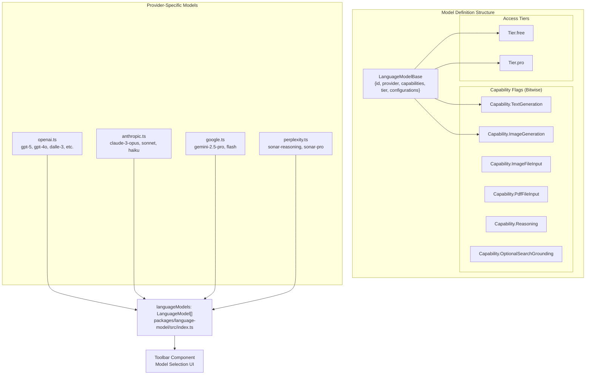

**Sources:**
- [packages/language-model/src/base.ts]() (referenced in imports)
- [internal-packages/workflow-designer-ui/src/editor/tool/toolbar/toolbar.tsx:27-29]()

### UI Model Filtering

The toolbar component implements sophisticated filtering based on user tier, provider availability, search query, and capability category.

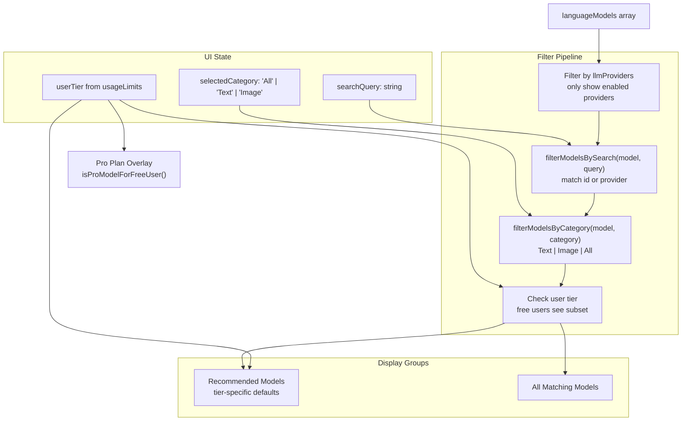

**Sources:**
- [internal-packages/workflow-designer-ui/src/editor/tool/toolbar/toolbar.tsx:92-127]()
- [internal-packages/workflow-designer-ui/src/editor/tool/toolbar/model-components.tsx]() (referenced in imports)

The filtering logic automatically adjusts the category selector based on search results, selecting "Text" if only text models match, "Image" if only image models match, or "All" if both are present.

## Provider-Specific Features

### Reasoning Configuration

Anthropic's Claude models and OpenAI's o1/o3 models support extended reasoning capabilities with provider-specific configuration.

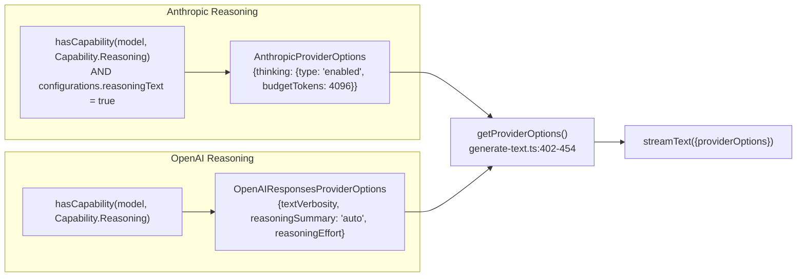

**Sources:**
- [packages/giselle/src/engine/generations/generate-text.ts:402-454]()
- [packages/giselle/src/engine/generations/generate-content.ts:226]()

Anthropic reasoning uses a fixed budget of 4096 tokens based on Zed's configuration. OpenAI reasoning supports configurable `textVerbosity` and `reasoningEffort` from the model configuration.

### Search Grounding

Multiple providers support search grounding through different tool integrations.

| Provider | Tool Name | Configuration | Capability Check |
|----------|-----------|---------------|------------------|
| OpenAI | `web_search_preview` | `openai.tools.webSearchPreview(config)` | `Capability.OptionalSearchGrounding` |
| Google | `google_search` | `google.tools.googleSearch({})` | `Capability.OptionalSearchGrounding` + `configurations.searchGrounding` |
| Anthropic | `web_search` | `anthropic.tools.webSearch_20250305(config)` | Provider-specific tool |
| Perplexity | Built-in | `search_domain_filter` in provider options | Provider-level configuration |

**Sources:**
- [packages/giselle/src/engine/generations/generate-text.ts:156-198]()
- [packages/giselle/src/engine/generations/generate-content.ts:182-224]()

Search grounding tools are conditionally added to the tool set based on model capabilities and user configuration. Perplexity's search is configured through provider options rather than as a separate tool.

### Tool Execution Limits

OpenAI's newer models (gpt-5, gpt-5-mini, gpt-5-nano) have tool step limits disabled to allow unrestricted agentic behavior.

```typescript
const shouldDisableToolStepLimit =
  operationNode.content.llm.provider === "openai" &&
  ["gpt-5", "gpt-5-mini", "gpt-5-nano"].includes(operationNode.content.llm.id);

const streamTextResult = streamText({
  ...(shouldDisableToolStepLimit
    ? {}
    : { stopWhen: stepCountIs(preparedToolCount + 1) }),
});
```

**Sources:**
- [packages/giselle/src/engine/generations/generate-text.ts:209-224]()

## Tier-Based Access Control

### Model Tier System

Models are classified into `free` and `pro` tiers in the language model registry. The UI enforces these restrictions at the toolbar level.

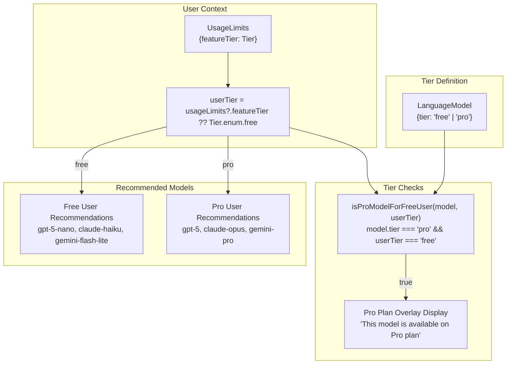

**Sources:**
- [internal-packages/workflow-designer-ui/src/editor/tool/toolbar/toolbar.tsx:130-163]()
- [internal-packages/workflow-designer-ui/src/editor/tool/toolbar/model-components.tsx]() (referenced)

### Recommended Models by Tier

The toolbar displays tier-specific recommended models, ensuring free users see accessible options while pro users see premium models.

**Free Tier Recommendations:**
- OpenAI: `gpt-5-nano`
- Anthropic: `claude-3-5-haiku-20241022`
- Google: `gemini-2.5-flash-lite-preview-06-17`

**Pro Tier Recommendations:**
- OpenAI: `gpt-5`
- Anthropic: `claude-3-opus-20240229`, `claude-3-sonnet-20240229`
- Google: `gemini-2.5-pro-exp-03-25`, `gemini-1.5-pro-latest`, `gemini-1.0-pro`

**Sources:**
- [internal-packages/workflow-designer-ui/src/editor/tool/toolbar/toolbar.tsx:133-163]()

## Usage Calculation System

### Usage Calculator Interface

The `UsageCalculator` interface defines how to calculate usage metrics for different models. Each calculator returns usage data with optional cost information.

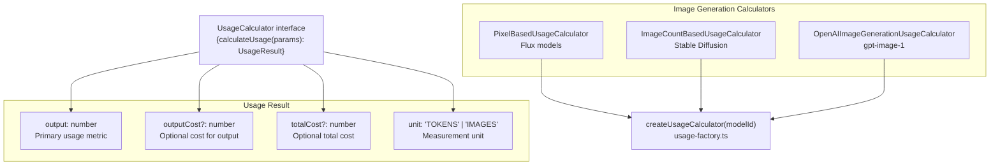

**Sources:**
- [packages/language-model/src/fal.ts:143-160]()
- [packages/language-model/src/openai-image.ts:92-108]()
- [packages/language-model/src/usage-factory.ts:1-21]()

### Fal Image Generation Usage

Fal models use two different usage calculation strategies depending on the model.

#### Pixel-Based Calculation

Used by Flux models (`flux/schnell`, `flux-pro/v1.1`):

```typescript
class PixelBasedUsageCalculator {
  calculateUsage({ width, height, n }: FalImageGenerationParams) {
    const totalPixels = width * height * n;
    return {
      output: Math.ceil(totalPixels / 1_000_000) * 1_000_000,  // Round up to millions
      unit: "IMAGES" as const,
    };
  }
}
```

**Sources:**
- [packages/language-model/src/fal.ts:143-151]()

#### Image Count-Based Calculation

Used by Stable Diffusion models:

```typescript
class ImageCountBasedUsageCalculator {
  calculateUsage({ n }: { width: number; height: number; n: number }) {
    return {
      output: n,  // Simple count of images
      unit: "IMAGES" as const,
    };
  }
}
```

**Sources:**
- [packages/language-model/src/fal.ts:153-160]()

### OpenAI Image Generation Usage

OpenAI's `gpt-image-1` uses a cost-based calculator with a pricing table by size and quality.

```typescript
class OpenAIImageGenerationUsageCalculator {
  calculateUsage({ width, height, quality }: OpenAIImageGenerationParams) {
    const totalPixels = width * height;
    const price = openAICostTable[quality][getSizeKey(width, height)];
    
    return {
      output: totalPixels,
      outputCost: price ?? 0,
      totalCost: price ?? 0,
      unit: "IMAGES" as const,
    };
  }
}
```

**Pricing Table (USD per image):**

| Quality | 1024x1024 | 1536x1024 | 1024x1536 |
|---------|-----------|-----------|-----------|
| low     | $0.011    | $0.016    | $0.016    |
| medium  | $0.042    | $0.063    | $0.063    |
| high    | $0.167    | $0.250    | $0.250    |
| auto    | $0.042    | $0.063    | $0.063    |

**Note:** The `auto` quality uses medium pricing as a conservative estimate since the actual quality chosen by OpenAI cannot be determined in advance.

**Sources:**
- [packages/language-model/src/openai-image.ts:59-108]()

### Usage Calculator Factory

The `createUsageCalculator()` factory function returns the appropriate calculator instance for a given model ID.

```typescript
const usageCalculatorMap: Record<string, UsageCalculator> = {
  "fal-ai/stable-diffusion-v3-medium": new ImageCountBasedUsageCalculator(),
  "fal-ai/flux/schnell": new PixelBasedUsageCalculator(),
  "fal-ai/flux-pro/v1.1": new PixelBasedUsageCalculator(),
  "gpt-image-1": new OpenAIImageGenerationUsageCalculator(),
};

export function createUsageCalculator(modelId: string): UsageCalculator {
  if (usageCalculatorMap[modelId]) {
    return usageCalculatorMap[modelId];
  }
  throw new Error(`Unknown model: ${modelId}`);
}
```

**Sources:**
- [packages/language-model/src/usage-factory.ts:8-20]()

## Model Provider Utilities

### Image Generation Model Provider Detection

The `getImageGenerationModelProvider()` function extracts the model family from a Fal model ID for provider-specific handling.

```typescript
function getImageGenerationModelProvider(
  provider: string,
): ImageGenerationModelProvider | undefined {
  // Extract model family from model ID
  // E.g., "fal-ai/flux/schnell" -> "flux"
  // E.g., "fal-ai/stable-diffusion-v3-medium" -> "stable-diffusion"
  
  const parts = provider.split("/");
  if (parts.length < 2) return undefined;
  
  if (parts[1] === "flux" || parts[1] === "flux-pro") return "flux";
  if (parts[1].startsWith("recraft")) return "recraft";
  if (parts[1] === "ideogram") return "ideogram";
  if (parts[1].startsWith("stable-diffusion")) return "stable-diffusion";
  
  return undefined;
}
```

**Model Families:**
- `flux` - Flux models (schnell, pro variants)
- `recraft` - Recraft models
- `ideogram` - Ideogram models
- `stable-diffusion` - Stable Diffusion variants

**Sources:**
- [packages/language-model/src/fal.ts:110-135]()
- [packages/language-model/src/fal.test.ts:4-48]()

## AI Gateway Configuration

The AI Gateway provides unified rate limiting, monitoring, and cost tracking across all providers when enabled.

### Gateway Setup

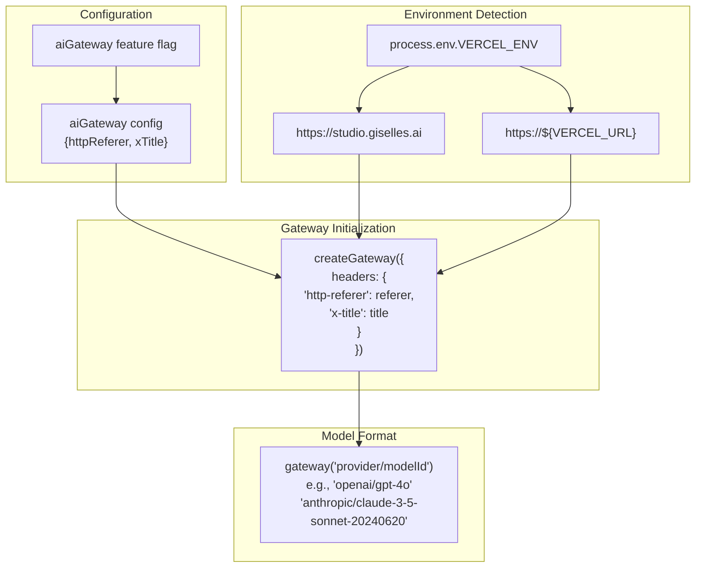

**Sources:**
- [apps/studio.giselles.ai/app/giselle-engine.ts:352-359]()
- [packages/giselle/src/engine/generations/generate-text.ts:354-378]()

The gateway is configured with environment-specific HTTP referer headers to identify traffic origin (preview vs production). The model specifier format follows the pattern `"provider/modelId"` for gateway routing.

### Gateway vs Direct Provider

```typescript
function generationModel(languageModel, useAiGateway, gatewayOptions) {
  if (useAiGateway) {
    const gateway = createGateway(gatewayOptions ? {
      headers: {
        "http-referer": gatewayOptions.httpReferer,
        "x-title": gatewayOptions.xTitle,
      }
    } : undefined);
    
    return gateway(`${llmProvider}/${languageModel.id}`);
  }
  
  // Direct provider SDKs
  switch (llmProvider) {
    case "anthropic": return anthropic(languageModel.id);
    case "openai": return openai.responses(languageModel.id);
    case "google": return vertex(languageModel.id);
    case "perplexity": return perplexity(languageModel.id);
  }
}
```

**Sources:**
- [packages/giselle/src/engine/generations/generate-text.ts:348-400]()

## Generation Pipeline Integration

### Text Generation Flow

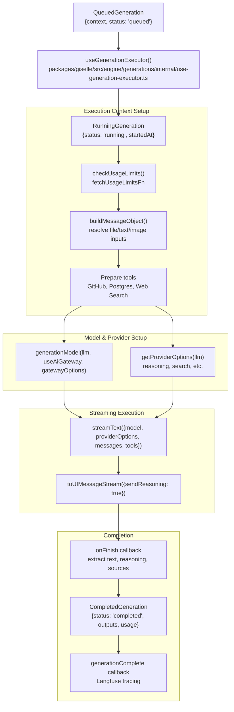

**Sources:**
- [packages/giselle/src/engine/generations/generate-text.ts:37-346]()
- [packages/giselle/src/engine/generations/internal/use-generation-executor.ts:54-395]()

### Image Generation Flow

Image generation follows a similar pattern but uses `experimental_generateImage()` from the AI SDK with provider-specific implementations.

| Provider | SDK Function | Models |
|----------|--------------|--------|
| OpenAI | `openai.image(modelId)` | `dall-e-3`, `dall-e-2` |
| Google | `google.image(modelId)` | `gemini-2.5-flash-image-preview` |
| Fal | `fal.image(modelId)` | Multiple image models |

**Sources:**
- [packages/giselle/src/engine/generations/generate-image.ts:1-350]()
- [packages/language-model/src/google-image.ts:1-41]()

### Batch Generation (Trigger.dev)

For long-running text generation in production (non-studio contexts), the system delegates to Trigger.dev using `generateContent()`.

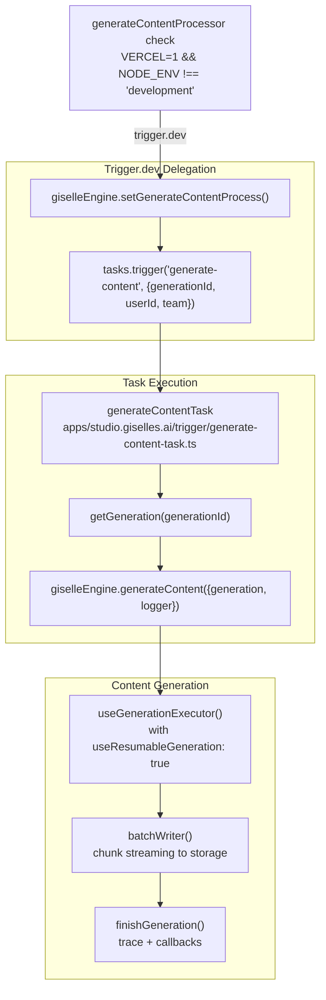

**Sources:**
- [apps/studio.giselles.ai/app/giselle-engine.ts:234-410]()
- [apps/studio.giselles.ai/trigger/generate-content-task.ts:1-100]()
- [packages/giselle/src/engine/generations/generate-content.ts:60-393]()

The `generateContent()` function uses a `batchWriter` to efficiently stream UI message chunks to storage in batches, enabling resumable generation and better handling of long-running tasks.

## Configuration Workflow

### Engine Initialization

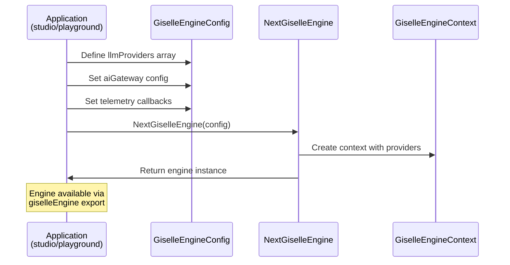

**Sources:**
- [apps/studio.giselles.ai/app/giselle-engine.ts:267-362]()
- [apps/playground/giselle-engine.ts:141-160]()

### Workspace Provider Integration

The `WorkspaceProvider` component passes feature flags and configuration to React components, enabling conditional behavior based on enabled features.

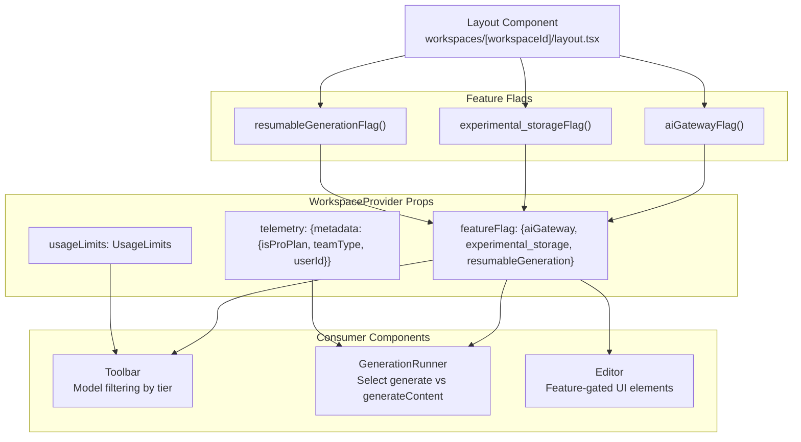

**Sources:**
- [apps/studio.giselles.ai/app/workspaces/[workspaceId]/layout.tsx:29-145]()
- [packages/giselle/src/react/workspace/provider.tsx:25-67]()
- [apps/playground/app/workspaces/[workspaceId]/layout.tsx:4-20]()

The playground app uses hardcoded feature flags for simplicity, while the studio app dynamically loads flags from Vercel Edge Config based on the environment.

---

