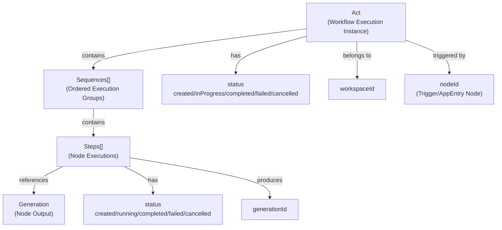
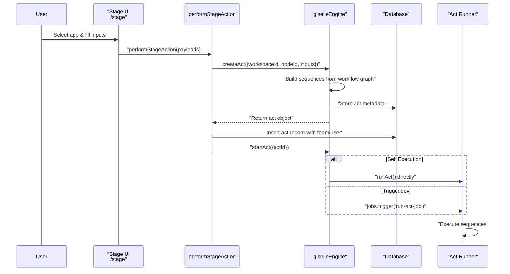
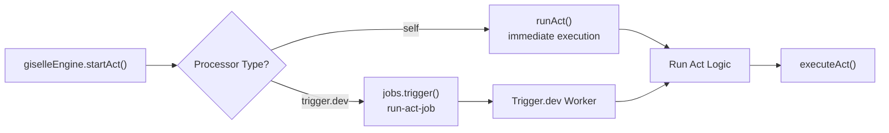
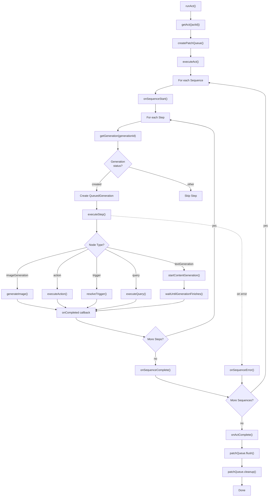
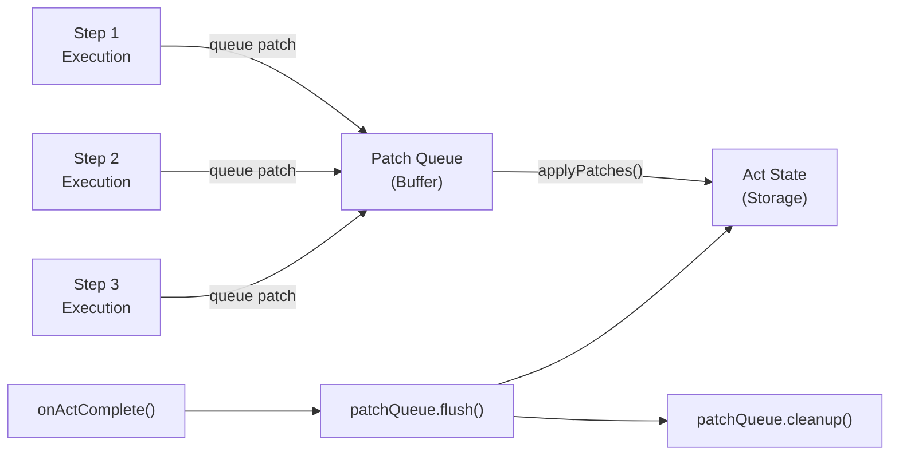
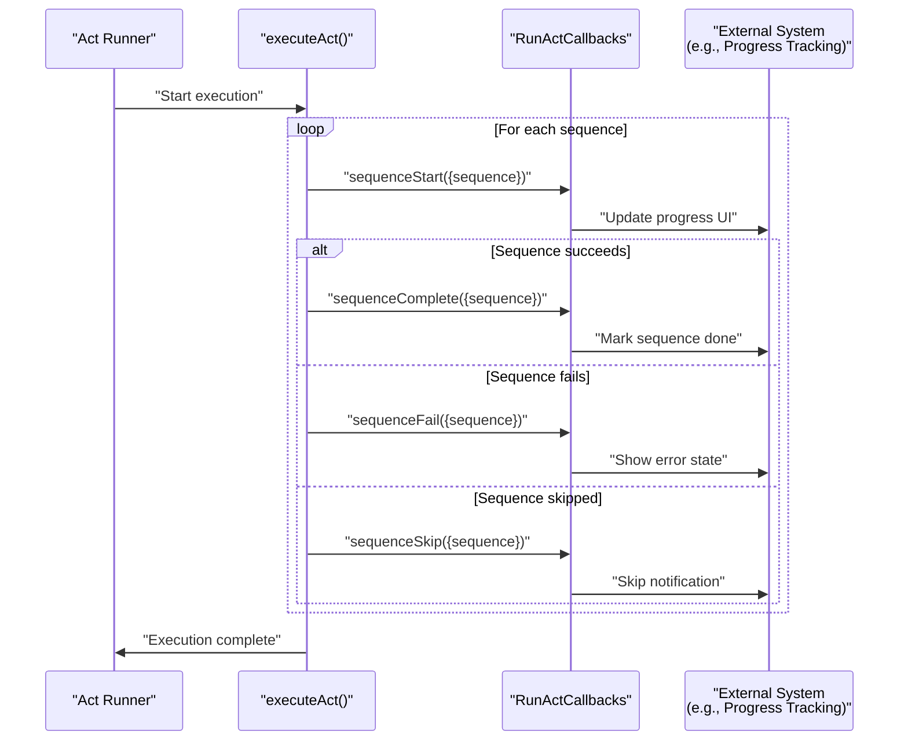
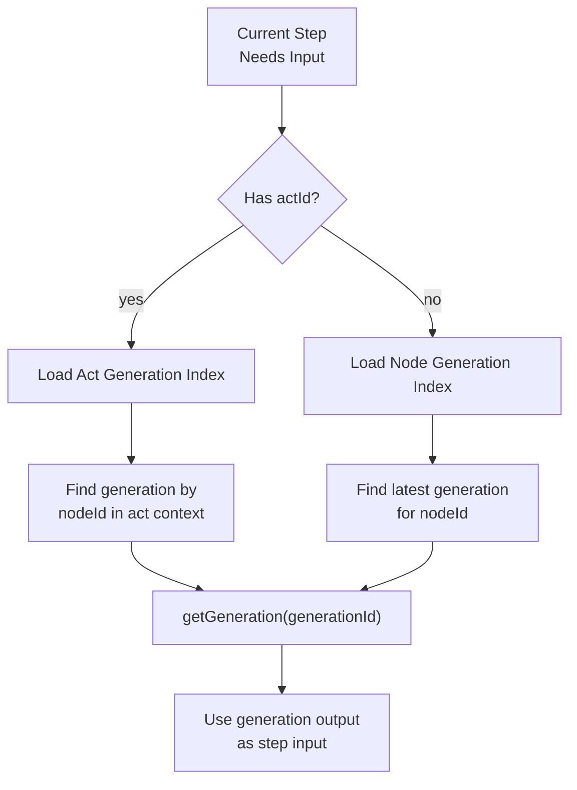
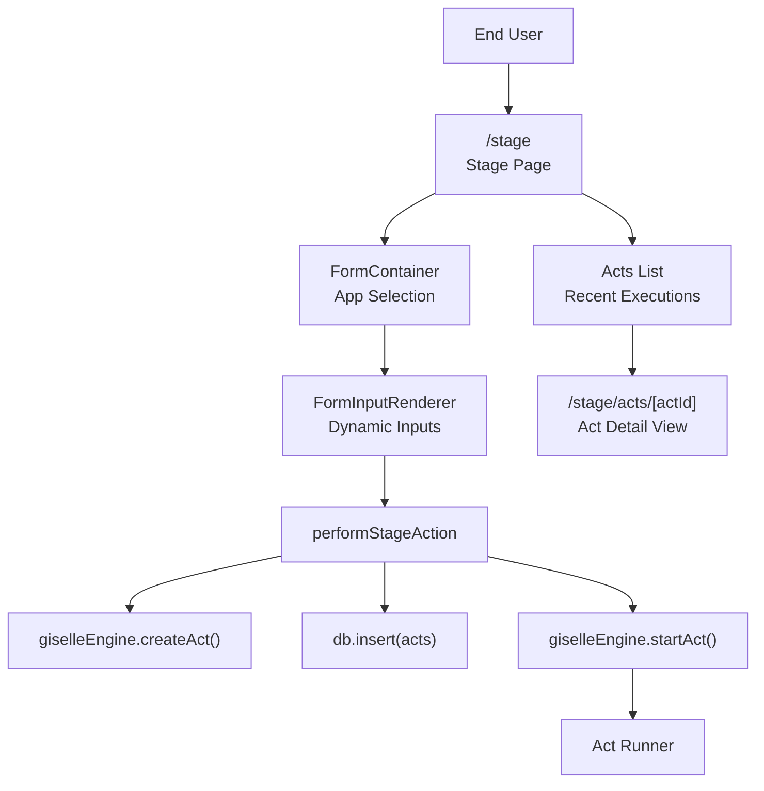
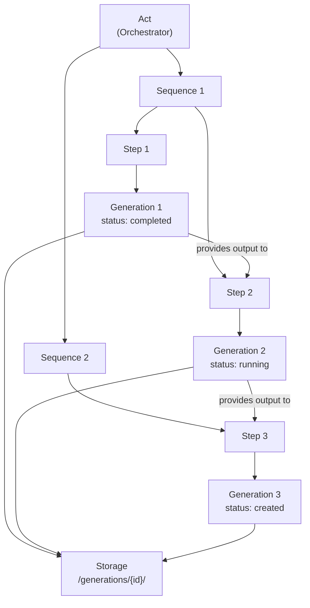
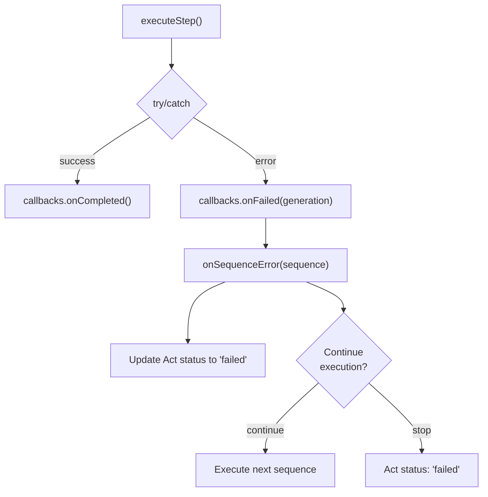

<!-- source: DeepWiki mcp.deepwiki.com · repo giselles-ai/giselle · page 2.4 Act Runner and Workflow Orchestration · fetched 2026-10-26 -->

# Act Runner and Workflow Orchestration

<details>
<summary>Relevant source files</summary>

The following files were used as context for generating this wiki page:

- [apps/playground/.gitignore](apps/playground/.gitignore)
- [apps/playground/giselle-engine.ts](apps/playground/giselle-engine.ts)
- [apps/studio.giselles.ai/app/(main)/workspaces/actions.ts](apps/studio.giselles.ai/app/(main)/workspaces/actions.ts)
- [apps/studio.giselles.ai/app/api/workspaces/route.ts](apps/studio.giselles.ai/app/api/workspaces/route.ts)
- [apps/studio.giselles.ai/app/giselle-engine.ts](apps/studio.giselles.ai/app/giselle-engine.ts)
- [apps/studio.giselles.ai/app/stage/(top)/actions.ts](apps/studio.giselles.ai/app/stage/(top)/actions.ts)
- [apps/studio.giselles.ai/app/stage/(top)/circular-carousel.module.css](apps/studio.giselles.ai/app/stage/(top)/circular-carousel.module.css)
- [apps/studio.giselles.ai/app/stage/(top)/circular-carousel.tsx](apps/studio.giselles.ai/app/stage/(top)/circular-carousel.tsx)
- [apps/studio.giselles.ai/app/stage/(top)/form-input-renderer.tsx](apps/studio.giselles.ai/app/stage/(top)/form-input-renderer.tsx)
- [apps/studio.giselles.ai/app/stage/(top)/form.tsx](apps/studio.giselles.ai/app/stage/(top)/form.tsx)
- [apps/studio.giselles.ai/app/stage/(top)/helpers.ts](apps/studio.giselles.ai/app/stage/(top)/helpers.ts)
- [apps/studio.giselles.ai/app/stage/(top)/page.tsx](apps/studio.giselles.ai/app/stage/(top)/page.tsx)
- [apps/studio.giselles.ai/app/stage/(top)/resizable-layout.tsx](apps/studio.giselles.ai/app/stage/(top)/resizable-layout.tsx)
- [apps/studio.giselles.ai/app/stage/(top)/services.ts](apps/studio.giselles.ai/app/stage/(top)/services.ts)
- [apps/studio.giselles.ai/app/stage/(top)/settings-dialog.tsx](apps/studio.giselles.ai/app/stage/(top)/settings-dialog.tsx)
- [apps/studio.giselles.ai/app/stage/(top)/team-card.tsx](apps/studio.giselles.ai/app/stage/(top)/team-card.tsx)
- [apps/studio.giselles.ai/app/stage/(top)/types.ts](apps/studio.giselles.ai/app/stage/(top)/types.ts)
- [apps/studio.giselles.ai/app/stage/acts/[actId]/actions.ts](apps/studio.giselles.ai/app/stage/acts/[actId]/actions.ts)
- [apps/studio.giselles.ai/app/stage/acts/[actId]/lib/data.ts](apps/studio.giselles.ai/app/stage/acts/[actId]/lib/data.ts)
- [apps/studio.giselles.ai/app/stage/acts/[actId]/lib/utils.ts](apps/studio.giselles.ai/app/stage/acts/[actId]/lib/utils.ts)
- [apps/studio.giselles.ai/app/stage/acts/components/filterable-acts-list.tsx](apps/studio.giselles.ai/app/stage/acts/components/filterable-acts-list.tsx)
- [apps/studio.giselles.ai/app/stage/acts/page.tsx](apps/studio.giselles.ai/app/stage/acts/page.tsx)
- [apps/studio.giselles.ai/app/stage/acts/types/index.ts](apps/studio.giselles.ai/app/stage/acts/types/index.ts)
- [apps/studio.giselles.ai/app/stage/layout.tsx](apps/studio.giselles.ai/app/stage/layout.tsx)
- [apps/studio.giselles.ai/app/stage/showcase/[appId]/actions.ts](apps/studio.giselles.ai/app/stage/showcase/[appId]/actions.ts)
- [apps/studio.giselles.ai/app/stage/showcase/[appId]/page.tsx](apps/studio.giselles.ai/app/stage/showcase/[appId]/page.tsx)
- [packages/giselle/src/engine/acts/run-act.ts](packages/giselle/src/engine/acts/run-act.ts)
- [packages/giselle/src/engine/generations/generate-content.ts](packages/giselle/src/engine/generations/generate-content.ts)
- [packages/giselle/src/engine/generations/generate-image.ts](packages/giselle/src/engine/generations/generate-image.ts)
- [packages/giselle/src/engine/generations/internal/use-generation-executor.ts](packages/giselle/src/engine/generations/internal/use-generation-executor.ts)
- [packages/giselle/src/engine/generations/types.ts](packages/giselle/src/engine/generations/types.ts)
- [packages/giselle/src/engine/generations/utils.ts](packages/giselle/src/engine/generations/utils.ts)
- [packages/giselle/src/engine/operations/execute-query.ts](packages/giselle/src/engine/operations/execute-query.ts)
- [packages/giselle/src/engine/telemetry/index.ts](packages/giselle/src/engine/telemetry/index.ts)
- [packages/giselle/src/engine/telemetry/types.ts](packages/giselle/src/engine/telemetry/types.ts)
- [packages/giselle/src/engine/triggers/resolve-trigger.ts](packages/giselle/src/engine/triggers/resolve-trigger.ts)
- [packages/giselle/src/engine/types.ts](packages/giselle/src/engine/types.ts)
- [packages/giselle/src/react/generations/generation-runner.tsx](packages/giselle/src/react/generations/generation-runner.tsx)

</details>


## Purpose and Scope

This document explains how Acts orchestrate multi-step AI workflows in the Giselle Engine. An Act represents a single execution instance of a workflow, managing the sequential and parallel execution of nodes (steps) through sequences, handling state updates via patch queues, and providing lifecycle callbacks for monitoring progress. This page covers the core orchestration logic, while generation-specific execution is detailed in [Generation Pipeline and Lifecycle](#2.2) and engine configuration in [Engine Architecture and Configuration](#2.1).

## Act Concept and Data Model

An Act is the runtime representation of a workflow execution. It contains sequences (ordered groups of steps), each step corresponding to a node generation in the workflow graph.



**Sources:** [packages/giselle/src/engine/acts/run-act.ts:1-25]()

### Act Status Lifecycle

| Status | Description |
|--------|-------------|
| `created` | Act initialized but not started |
| `inProgress` | Act currently executing |
| `completed` | All sequences completed successfully |
| `failed` | At least one step failed |
| `cancelled` | Execution cancelled by user |

**Sources:** [apps/studio.giselles.ai/app/stage/acts/types/index.ts:1-7]()

## Act Creation and Initialization

Acts are created through the `giselleEngine.createAct()` method and started with `giselleEngine.startAct()`. The Stage system provides the primary interface for this workflow.

### Creation Flow Diagram



**Sources:** [apps/studio.giselles.ai/app/stage/(top)/actions.ts:9-51](), [apps/studio.giselles.ai/app/stage/(top)/page.tsx:1-169]()

### Act Creation Implementation

The `createAct` method builds the execution plan:

```typescript
// From giselleEngine
const { act } = await giselleEngine.createAct({
  workspaceId: trigger.workspaceId,
  nodeId: trigger.nodeId,
  inputs: [
    {
      type: "parameters",
      items: parameterItems
    }
  ],
  generationOriginType: "stage" // or "github-app"
});
```

**Key Components:**
- `workspaceId`: The workflow to execute
- `nodeId`: Entry point node (trigger or appEntry)
- `inputs`: Input data (parameters, webhook events)
- `generationOriginType`: Execution context (`"stage"`, `"studio"`, `"github-app"`)

**Sources:** [apps/studio.giselles.ai/app/stage/(top)/actions.ts:14-24]()

### Starting Act Execution

After creation, the act must be explicitly started:

```typescript
await giselleEngine.startAct({
  actId: act.id,
  generationOriginType: "stage"
});
```

This triggers either direct execution or delegates to Trigger.dev based on configuration.

**Sources:** [apps/studio.giselles.ai/app/stage/(top)/actions.ts:41-44]()

## Execution Architecture

### Processor Selection

The engine supports two execution strategies configured at initialization:

**Self Execution** - Direct invocation within the same process:
```typescript
// Default for local development
const runtimeEnv = getRuntimeEnv(); // "local"
const generateContentProcessor = "self";
```

**External Execution** - Delegated to Trigger.dev for production:
```typescript
// Configured for production
if (process.env.USE_TRIGGER_DEV === "1" || runtimeEnv === "vercel") {
  generateContentProcessor = "trigger.dev";
}
```

**Sources:** [apps/studio.giselles.ai/app/giselle-engine.ts:180-194]()

### Act Runner Process Configuration



**Sources:** [apps/studio.giselles.ai/app/giselle-engine.ts:491-533](), [packages/giselle/src/engine/types.ts:42-54]()

### setRunActProcess Configuration

When Trigger.dev is enabled, the engine configures external processing:

```typescript
giselleEngine.setRunActProcess(async ({ act, generationOriginType }) => {
  const requestId = getRequestId();
  
  switch (generationOriginType) {
    case "github-app": {
      const team = await getWorkspaceTeam(act.workspaceId);
      await jobs.trigger<typeof runActJob>("run-act-job", {
        actId: act.id,
        requestId,
        userId: "github-app",
        team: {
          id: team.id,
          subscriptionId: team.activeSubscriptionId,
          plan: team.plan
        }
      });
      break;
    }
    case "stage":
    case "studio": {
      const [currentUser, currentTeam] = await Promise.all([
        fetchCurrentUser(),
        fetchCurrentTeam()
      ]);
      await jobs.trigger<typeof runActJob>("run-act-job", {
        actId: act.id,
        requestId,
        userId: currentUser.id,
        team: { /* team data */ }
      });
      break;
    }
  }
});
```

**Sources:** [apps/studio.giselles.ai/app/giselle-engine.ts:491-533]()

## Sequence and Step Execution

An Act's execution is organized into sequences, with each sequence containing multiple steps that execute in order or in parallel.

### Execution Flow



**Sources:** [packages/giselle/src/engine/acts/run-act.ts:123-200]()

### executeStep Implementation

The `executeStep` function routes to the appropriate operation handler based on node type:

```typescript
async function executeStep(args: {
  context: GiselleEngineContext;
  generation: QueuedGeneration;
  callbacks?: {
    onCompleted?: () => void | Promise<void>;
    onFailed?: (generation: Generation) => void | Promise<void>;
  };
  logger?: GiselleLogger;
  metadata?: GenerationMetadata;
}) {
  try {
    switch (args.generation.context.operationNode.content.type) {
      case "action":
        await executeAction(args);
        break;
      case "imageGeneration":
        await generateImage({ ...args });
        break;
      case "textGeneration": {
        await startContentGeneration(args);
        const finishedGeneration = await waitUntilGenerationFinishes({
          context: args.context,
          generationId: args.generation.id
        });
        if (isFailedGeneration(finishedGeneration)) {
          await args.callbacks?.onFailed?.(finishedGeneration);
        }
        if (isCompletedGeneration(finishedGeneration)) {
          await args.callbacks?.onCompleted?.();
        }
        break;
      }
      case "trigger":
        await resolveTrigger({ context: args.context, generation: args.generation });
        break;
      case "query":
        await executeQuery(args);
        break;
      case "appEntry":
        break; // No execution needed
      default:
        throw new Error(`Unhandled step type`);
    }
    await args.callbacks?.onCompleted?.();
  } catch (_e) {
    await args.callbacks?.onFailed?.(args.generation);
  }
}
```

**Sources:** [packages/giselle/src/engine/acts/run-act.ts:59-113]()

### waitUntilGenerationFinishes

For text generation (which may be processed asynchronously), the runner polls until completion:

```typescript
async function waitUntilGenerationFinishes(args: {
  context: GiselleEngineContext;
  generationId: GenerationId;
}) {
  while (true) {
    const generation = await getGeneration({
      context: args.context,
      generationId: args.generationId
    });
    
    if (!generation) {
      throw new Error(`Generation(id: ${args.generationId}) is not found`);
    }
    
    if (
      generation.status === "completed" ||
      generation.status === "failed" ||
      generation.status === "cancelled"
    ) {
      return generation;
    }
    
    await new Promise((resolve) => setTimeout(resolve, 1000));
  }
}
```

**Sources:** [packages/giselle/src/engine/acts/run-act.ts:26-50]()

## Patch Queue Management

The patch queue system manages concurrent state updates during Act execution, ensuring consistency when multiple steps modify the Act state simultaneously.

### Patch Queue Concept



**Sources:** [packages/giselle/src/engine/acts/run-act.ts:131-133]()

### Patch Queue Lifecycle

1. **Creation** - A patch queue is created at the start of `runAct()`:
```typescript
const patchQueue = createPatchQueue(args.context);
const applyPatches = patchQueue.createApplyPatches();
```

2. **Usage** - The `applyPatches` function is passed to `executeAct()` which queues updates during step execution

3. **Flushing** - On act completion, all pending patches are applied:
```typescript
await executeAct({
  act,
  applyPatches,
  // ... other args
  onActComplete: async () => {
    await patchQueue.flush();
  }
});
```

4. **Cleanup** - Resources are released after execution:
```typescript
patchQueue.cleanup();
```

**Sources:** [packages/giselle/src/engine/acts/run-act.ts:123-200]()

## Lifecycle Callbacks

The Act runner provides callback hooks for monitoring and reacting to execution events.

### Callback Types

```typescript
export interface RunActCallbacks {
  sequenceStart?: (args: { sequence: Sequence }) => void | Promise<void>;
  sequenceFail?: (args: { sequence: Sequence }) => void | Promise<void>;
  sequenceComplete?: (args: { sequence: Sequence }) => void | Promise<void>;
  sequenceSkip?: (args: { sequence: Sequence }) => void | Promise<void>;
}
```

**Sources:** [packages/giselle/src/engine/acts/run-act.ts:52-57]()

### Callback Invocation Flow



**Sources:** [packages/giselle/src/engine/acts/run-act.ts:159-186]()

### Callback Implementation Example

In the `runAct` function, callbacks are wired to logging and external handlers:

```typescript
await executeAct({
  act,
  applyPatches,
  startGeneration: async (generationId, callbacks) => { /* ... */ },
  onSequenceStart: async (sequence) => {
    args.context.logger.debug({ sequence }, `Starting sequence ${sequence.id}`);
    await args.callbacks?.sequenceStart?.({ sequence });
  },
  onSequenceError: async (sequence) => {
    args.context.logger.error({ sequence }, `Sequence ${sequence.id} failed`);
    await args.callbacks?.sequenceFail?.({ sequence });
  },
  onSequenceComplete: async (sequence) => {
    args.context.logger.debug({ sequence }, `Sequence ${sequence.id} completed`);
    await args.callbacks?.sequenceComplete?.({ sequence });
  },
  onSequenceSkip: async (sequence) => {
    args.context.logger.debug({ sequence }, `Skipping sequence ${sequence.id}`);
    await args.callbacks?.sequenceSkip?.({ sequence });
  },
  onActComplete: async () => {
    await patchQueue.flush();
  }
});
```

**Sources:** [packages/giselle/src/engine/acts/run-act.ts:159-189]()

## Generation Execution within Acts

Acts coordinate generation execution by maintaining generation indexes and providing context resolution.

### Act-Scoped Generation Lookup

When a step needs data from a previous generation within the same Act, it uses act-scoped lookup:



**Sources:** [packages/giselle/src/engine/generations/internal/use-generation-executor.ts:180-234]()

### Generation Index Paths

The system maintains two index types:

**Node Generation Index** (`/generations/byNode/{nodeId}.json`):
- Lists all generations for a node across all Acts
- Used in studio/playground without Act context

**Act Generation Index** (referenced in code but path varies):
- Lists generations specific to an Act
- Used during Act execution for step-to-step data flow

**Sources:** [packages/giselle/src/engine/generations/internal/use-generation-executor.ts:211-233]()

### Generation Context Resolution

The `useGenerationExecutor` provides resolvers for accessing previous generation outputs:

```typescript
async function generationContentResolver(nodeId: NodeId, outputId: OutputId) {
  const generation = await findGeneration(nodeId);
  if (generation === undefined || !isCompletedGeneration(generation)) {
    return undefined;
  }
  
  const generationOutput = generation.outputs.find(
    (o) => o.outputId === outputId
  );
  
  if (generationOutput === undefined) {
    return undefined;
  }
  
  return formatGenerationOutput(generationOutput);
}
```

**Sources:** [packages/giselle/src/engine/generations/internal/use-generation-executor.ts:245-277]()

## Stage System Integration

The Stage system provides a production interface for Act execution, separate from the workflow designer.

### Stage Components



**Sources:** [apps/studio.giselles.ai/app/stage/(top)/page.tsx:25-169](), [apps/studio.giselles.ai/app/stage/(top)/form.tsx:46-390]()

### Stage Act Creation Flow

The Stage system workflow:

1. **App Selection** - User selects a published application (FlowTrigger) from their team
2. **Input Collection** - Dynamic form renders based on trigger parameters
3. **Validation** - Client-side validation using `parseFormInputs()`
4. **Act Creation** - Server action calls `performStageAction()`
5. **Database Recording** - Act metadata stored with team/user associations
6. **Execution Start** - Act begins processing via configured runner

**Sources:** [apps/studio.giselles.ai/app/stage/(top)/page.tsx:14-45](), [apps/studio.giselles.ai/app/stage/(top)/actions.ts:9-51]()

### Stage Act Tracking

Acts created through Stage are tracked in the database:

```typescript
await db.insert(actsSchema).values({
  teamDbId: team.dbId,
  directorDbId: user.dbId,
  sdkActId: act.id,
  sdkFlowTriggerId: payloads.trigger.id,
  sdkWorkspaceId: payloads.trigger.workspaceId
});
```

This enables:
- **History Views** - `/stage/acts` lists all user's acts
- **Progress Tracking** - Real-time status updates via polling
- **Detail Views** - `/stage/acts/[actId]` shows execution details
- **Team Analytics** - Act usage statistics per team

**Sources:** [apps/studio.giselles.ai/app/stage/(top)/actions.ts:32-39](), [apps/studio.giselles.ai/app/stage/acts/page.tsx:14-147]()

## Act Status Monitoring

### Status Navigation Links

The Stage system creates smart navigation links based on Act status:

```typescript
let link = `/stage/acts/${tmpAct.id}`;
let targetStep = null;

switch (tmpAct.status) {
  case "created":
  case "inProgress":
    targetStep = findStepByStatus("running") ?? getFirstStep();
    break;
  case "completed":
    targetStep = getLastStep();
    break;
  case "cancelled":
    targetStep = findStepByStatus("cancelled");
    break;
  case "failed":
    targetStep = findStepByStatus("failed");
    break;
}

if (targetStep) {
  link += `/${targetStep.id}`;
}
```

This directs users to the most relevant step:
- In-progress Acts → currently running step
- Completed Acts → final step with results
- Failed Acts → step that failed
- Cancelled Acts → step where cancellation occurred

**Sources:** [apps/studio.giselles.ai/app/stage/(top)/services.ts:68-93]()

### Act List Filtering

The Acts page provides comprehensive filtering:

| Filter Type | Description |
|-------------|-------------|
| `is:open` | Non-archived acts (all current acts) |
| `is:archived` | Archived acts (future feature) |
| Status filters | Filter by created/inProgress/completed/failed/cancelled |
| Free text | Search by workspace or team name |

**Sources:** [apps/studio.giselles.ai/app/stage/acts/components/filterable-acts-list.tsx:31-83]()

## Integration with Generation Pipeline

Acts delegate individual node execution to the generation system while maintaining orchestration control.

### Act-Generation Relationship



**Sources:** [packages/giselle/src/engine/acts/run-act.ts:136-158]()

### Generation Metadata in Acts

When Acts execute with external processors (Trigger.dev), generation metadata is passed through:

```typescript
export interface GenerationMetadata {
  [key: string]: string | number | GenerationMetadata | null | undefined;
}

// Example usage in Act execution
await executeStep({
  context: args.context,
  generation: queuedGeneration,
  callbacks,
  metadata: args.metadata // Passed from Act to Generation
});
```

This metadata includes:
- `requestId` - For request tracing
- `userId` - User who initiated the Act
- `team` - Team context (id, subscriptionId, plan)

**Sources:** [packages/giselle/src/engine/acts/run-act.ts:152-157](), [packages/giselle/src/engine/generations/types.ts:8-10]()

## Error Handling and Recovery

### Error Propagation



**Sources:** [packages/giselle/src/engine/acts/run-act.ts:59-113](), [packages/giselle/src/engine/acts/run-act.ts:166-172]()

### Execution Error Handling

The `runAct` function wraps execution in error handling:

```typescript
let executionError: Error | null = null;
try {
  await executeAct({
    // ... execution config
  });
} catch (error) {
  executionError = error as Error;
}

patchQueue.cleanup();
if (executionError !== null) {
  console.error("Execution failed:", executionError);
  throw executionError;
}
```

**Sources:** [packages/giselle/src/engine/acts/run-act.ts:134-199]()

## Summary

The Act Runner system provides:

1. **Orchestration** - Coordinates multi-step workflow execution through sequences
2. **State Management** - Patch queue ensures consistent concurrent updates
3. **Lifecycle Tracking** - Callbacks enable external progress monitoring
4. **Flexible Execution** - Supports both direct and external (Trigger.dev) processing
5. **Integration** - Seamlessly connects with generation pipeline and Stage UI
6. **Error Handling** - Graceful failure recovery and status propagation

The system serves as the backbone for workflow execution, bridging user-facing Stage interfaces with the low-level generation execution engine.

---

