<!-- source: DeepWiki mcp.deepwiki.com · repo giselles-ai/giselle · page 3 Knowledge and Context Systems · fetched 2026-10-26 -->

# Knowledge and Context Systems

<details>
<summary>Relevant source files</summary>

The following files were used as context for generating this wiki page:

- [apps/studio.giselles.ai/app/(main)/settings/team/vector-stores/actions.ts](apps/studio.giselles.ai/app/(main)/settings/team/vector-stores/actions.ts)
- [apps/studio.giselles.ai/app/(main)/settings/team/vector-stores/configure-sources-dialog.tsx](apps/studio.giselles.ai/app/(main)/settings/team/vector-stores/configure-sources-dialog.tsx)
- [apps/studio.giselles.ai/app/(main)/settings/team/vector-stores/data.ts](apps/studio.giselles.ai/app/(main)/settings/team/vector-stores/data.ts)
- [apps/studio.giselles.ai/app/(main)/settings/team/vector-stores/diagnostic-modal.tsx](apps/studio.giselles.ai/app/(main)/settings/team/vector-stores/diagnostic-modal.tsx)
- [apps/studio.giselles.ai/app/(main)/settings/team/vector-stores/document-embedding-profiles.ts](apps/studio.giselles.ai/app/(main)/settings/team/vector-stores/document-embedding-profiles.ts)
- [apps/studio.giselles.ai/app/(main)/settings/team/vector-stores/document-store-create-dialog.tsx](apps/studio.giselles.ai/app/(main)/settings/team/vector-stores/document-store-create-dialog.tsx)
- [apps/studio.giselles.ai/app/(main)/settings/team/vector-stores/document-vector-store-list.tsx](apps/studio.giselles.ai/app/(main)/settings/team/vector-stores/document-vector-store-list.tsx)
- [apps/studio.giselles.ai/app/(main)/settings/team/vector-stores/document/document-vector-store-item.tsx](apps/studio.giselles.ai/app/(main)/settings/team/vector-stores/document/document-vector-store-item.tsx)
- [apps/studio.giselles.ai/app/(main)/settings/team/vector-stores/document/page.tsx](apps/studio.giselles.ai/app/(main)/settings/team/vector-stores/document/page.tsx)
- [apps/studio.giselles.ai/app/(main)/settings/team/vector-stores/layout.tsx](apps/studio.giselles.ai/app/(main)/settings/team/vector-stores/layout.tsx)
- [apps/studio.giselles.ai/app/(main)/settings/team/vector-stores/navigation-layout.tsx](apps/studio.giselles.ai/app/(main)/settings/team/vector-stores/navigation-layout.tsx)
- [apps/studio.giselles.ai/app/(main)/settings/team/vector-stores/page.tsx](apps/studio.giselles.ai/app/(main)/settings/team/vector-stores/page.tsx)
- [apps/studio.giselles.ai/app/(main)/settings/team/vector-stores/repository-item.tsx](apps/studio.giselles.ai/app/(main)/settings/team/vector-stores/repository-item.tsx)
- [apps/studio.giselles.ai/app/(main)/settings/team/vector-stores/repository-list.tsx](apps/studio.giselles.ai/app/(main)/settings/team/vector-stores/repository-list.tsx)
- [apps/studio.giselles.ai/app/(main)/settings/team/vector-stores/repository-registration-dialog.tsx](apps/studio.giselles.ai/app/(main)/settings/team/vector-stores/repository-registration-dialog.tsx)
- [apps/studio.giselles.ai/app/(main)/settings/team/vector-stores/sidebar-menu.tsx](apps/studio.giselles.ai/app/(main)/settings/team/vector-stores/sidebar-menu.tsx)
- [apps/studio.giselles.ai/app/(main)/settings/team/vector-stores/types.ts](apps/studio.giselles.ai/app/(main)/settings/team/vector-stores/types.ts)
- [internal-packages/ui/components/form-field.tsx](internal-packages/ui/components/form-field.tsx)
- [internal-packages/ui/components/section-header.tsx](internal-packages/ui/components/section-header.tsx)
- [internal-packages/ui/components/status-indicator.tsx](internal-packages/ui/components/status-indicator.tsx)

</details>


The Knowledge and Context Systems provide retrieval-augmented generation (RAG) capabilities to the Giselle platform. These systems process documents (PDFs, text files, Markdown), manage vector stores (GitHub repositories and uploaded documents), generate embeddings using multiple providers, and execute semantic similarity searches to provide relevant context for AI generations.

The system consists of three primary components:
1. **Document Processing Pipeline** ([3.1](#31-document-processing-pipeline)): Extracts text and images from binary documents using the `@giselles-ai/document-preprocessor` package
2. **Vector Store Management** ([3.2](#32-vector-store-management)): Configures and manages GitHub and Document vector stores through the team settings UI
3. **RAG System and Query Execution** ([3.3](#33-rag-system-and-query-execution)): Chunks documents, generates embeddings, and performs similarity searches using PostgreSQL with pgvector

For information about how the Giselle Engine integrates vector stores into generation workflows, see page 2. For database schema details, see page 2.6.

## 3.1 Document Processing Pipeline

The document preprocessing system transforms raw binary files (PDFs, plain text, Markdown) into normalized text and image data suitable for embedding and indexing. The core functionality is implemented in the `@giselles-ai/document-preprocessor` package, which provides a unified API for extracting text and rendering images from various document formats.

### Architecture and Core Components

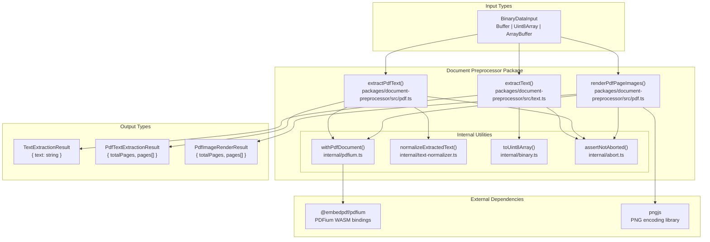

**Sources:** [packages/document-preprocessor/src/index.ts:1-13](), [packages/document-preprocessor/src/pdf.ts:1-138](), [packages/document-preprocessor/src/text.ts:1-37](), [packages/document-preprocessor/src/types.ts:1-53]()

### Processing Functions

| Function | Input | Options | Output | Use Case |
|----------|-------|---------|--------|----------|
| `extractText()` | Buffer, Uint8Array, ArrayBuffer | `encoding`, `signal` | `{ text: string }` | Plain text and Markdown files |
| `extractPdfText()` | Binary PDF data | `password`, `maxPages`, `signal` | `{ totalPages, pages: PdfTextPage[] }` | Extract text content from PDFs |
| `renderPdfPageImages()` | Binary PDF data | `password`, `targetDpi`, `maxPages`, `renderFormFields`, `signal` | `{ totalPages, pages: PdfImagePage[] }` | Render PDF pages as PNG images |

**Sources:** [packages/document-preprocessor/src/pdf.ts:21-54](), [packages/document-preprocessor/src/pdf.ts:56-99](), [packages/document-preprocessor/src/text.ts:13-36]()

### PDF Processing Implementation

The PDF processing pipeline uses the PDFium library through `@embedpdf/pdfium` bindings. The `withPdfDocument()` helper manages the PDFium document lifecycle:

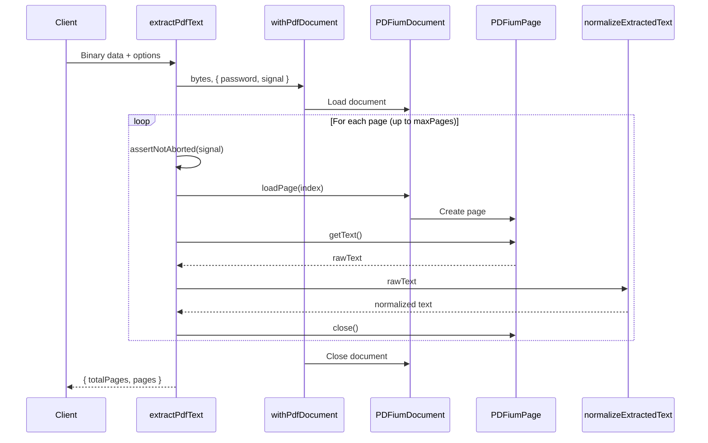

**Sources:** [packages/document-preprocessor/src/pdf.ts:21-54](), [packages/document-preprocessor/README.md:36-50]()

### Text Normalization

The `normalizeExtractedText()` function in [packages/document-preprocessor/src/internal/text-normalizer.ts]() performs the following transformations on extracted PDF text:

1. Repairs hyphenated line breaks (e.g., "exam-\nple" → "example")
2. Normalizes whitespace (multiple spaces/newlines → single space)
3. Removes trailing/leading whitespace
4. Preserves intentional paragraph breaks

**Sources:** [packages/document-preprocessor/README.md:9]()

### Image Rendering Pipeline

For PDFs that require visual processing, `renderPdfPageImages()` converts each page to a PNG buffer:

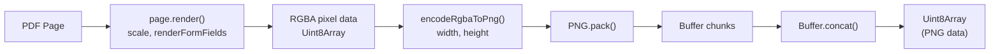

The rendering process:
1. Calculates scale factor from target DPI (default 144 DPI)
2. Renders page to RGBA pixel buffer using PDFium
3. Encodes RGBA data to PNG using `pngjs` library
4. Returns page number, dimensions, and PNG buffer

**Sources:** [packages/document-preprocessor/src/pdf.ts:56-99](), [packages/document-preprocessor/src/pdf.ts:101-130]()

### Abort Signal Support

All extraction functions accept an `AbortSignal` for cancellation:

```typescript
// From pdf.ts
for (let index = 0; index < limit; index += 1) {
    assertNotAborted(signal);  // Throws if aborted
    const page = document.loadPage(index);
    // ... process page
}
```

The `assertNotAborted()` helper throws immediately if the signal has been aborted, enabling responsive cancellation of long-running document processing operations.

**Sources:** [packages/document-preprocessor/src/pdf.ts:37](), [packages/document-preprocessor/README.md:72-79]()

### Security Considerations

From [packages/document-preprocessor/README.md:149-154]():

- **PDFium sandboxing**: PDFium engine executes in a sandboxed environment to mitigate malicious PDF risks
- **Password-protected PDFs**: Handle encrypted PDFs cautiously; not all encryption schemes are fully supported
- **Resource limits**: Enforce file size and processing time limits to prevent DoS attacks

The package supports password-protected PDFs through the `password` option in `PdfTextExtractionOptions` and `PdfImageRenderOptions`.

**Sources:** [packages/document-preprocessor/README.md:149-154](), [packages/document-preprocessor/src/types.ts:14-18](), [packages/document-preprocessor/src/types.ts:32-38]()

## 3.2 Vector Store Management

The vector store system manages two types of repositories: GitHub repositories (code, issues, and pull requests) and document uploads (PDFs and text files). Both use configurable embedding profiles and share a common architecture built on PostgreSQL with the pgvector extension. The management UI is located at `/settings/team/vector-stores` in the Studio application.

### Vector Store Types and Database Schema

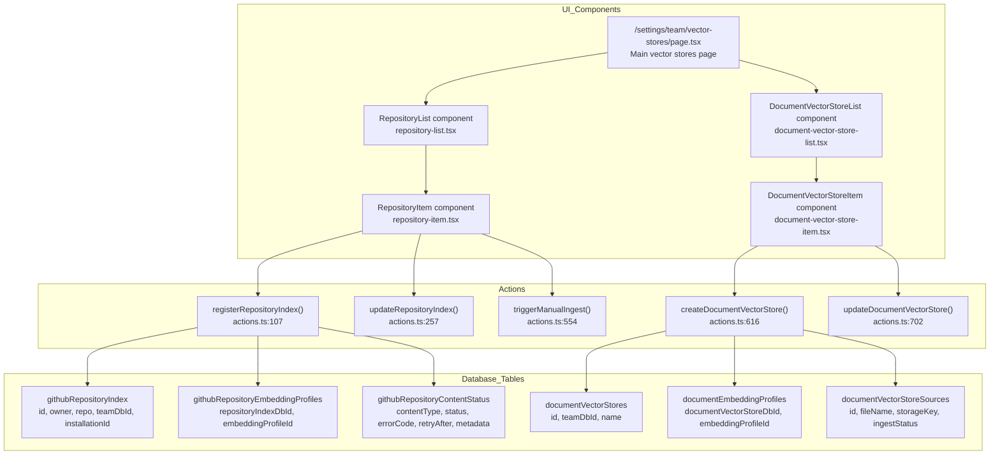

**Sources:** [apps/studio.giselles.ai/app/(main)/settings/team/vector-stores/page.tsx:1-80](), [apps/studio.giselles.ai/app/(main)/settings/team/vector-stores/actions.ts:1-892](), [apps/studio.giselles.ai/app/(main)/settings/team/vector-stores/repository-item.tsx:1-565]()

### GitHub Repository Vector Store

GitHub repositories are indexed with three content types: `blob` (code files), `issue` (issue titles, descriptions, and comments), and `pull_request` (merged PR content and discussions). Each content type can be enabled/disabled independently through the `ConfigureSourcesDialog` component, though `blob` is mandatory and cannot be disabled.

#### Repository Index Structure

| Field | Type | Description |
|-------|------|-------------|
| `id` | `GitHubRepositoryIndexId` | `gthbi_` prefixed CUID |
| `owner` | `string` | GitHub repository owner |
| `repo` | `string` | Repository name |
| `teamDbId` | `number` | Team association |
| `installationId` | `number` | GitHub App installation ID |

**Sources:** [apps/studio.giselles.ai/app/(main)/settings/team/vector-stores/actions.ts:166-177]()

#### Content Status Tracking

Each combination of repository + embedding profile + content type has a status record in `githubRepositoryContentStatus`. The `EmbeddingModelCard` component in `repository-item.tsx` displays status for each embedding profile and content type.

**Content Status Lifecycle**

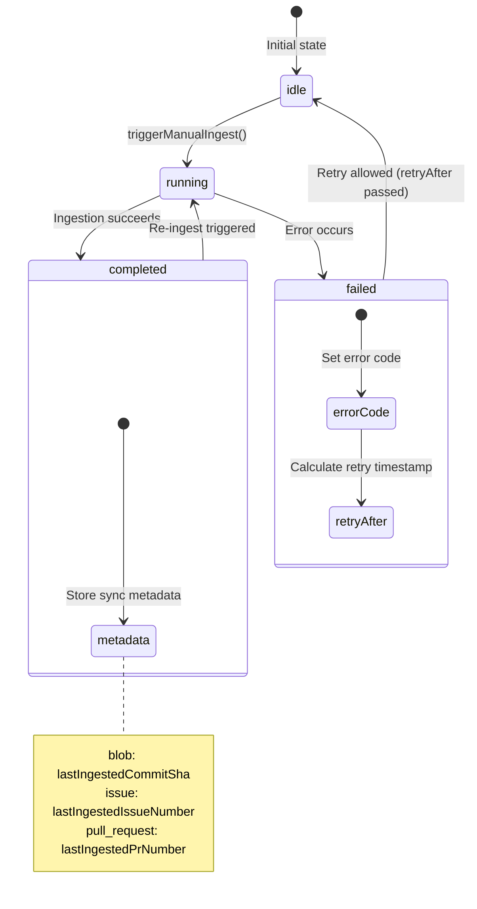

The status is displayed in the UI through the `StatusIndicator` and `StatusBadge` components. Each content type section shows:
- **Code**: Status, last sync time, and commit SHA (lines 283-374 in repository-item.tsx)
- **Issues**: Status, last sync time, and issue number (lines 376-468)
- **Pull Requests**: Status, last sync time, and PR number (lines 470-560)

**Sources:** [apps/studio.giselles.ai/app/(main)/settings/team/vector-stores/repository-item.tsx:240-565](), [apps/studio.giselles.ai/app/(main)/settings/team/vector-stores/types.ts:1-6]()

#### Registration and Configuration Flow

The `RepositoryRegistrationDialog` component (repository-registration-dialog.tsx) provides the UI for registering new GitHub repositories. Users select:
1. Owner/Organization (from GitHub App installations)
2. Repository name (filtered by selected owner)
3. Content types to ingest (Code, Issues, Pull Requests)
4. Embedding models (at least one required)

**Registration Flow**

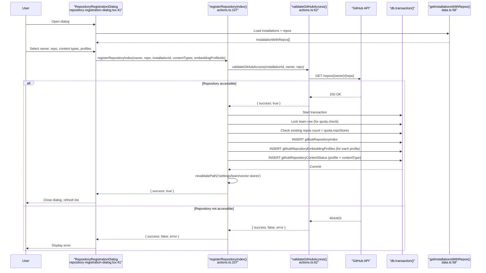

The registration process enforces quota limits by locking the team row during the transaction (lines 161-166 in actions.ts) and checking existing repository count before insertion (lines 188-201).

**Sources:** [apps/studio.giselles.ai/app/(main)/settings/team/vector-stores/actions.ts:62-251](), [apps/studio.giselles.ai/app/(main)/settings/team/vector-stores/repository-registration-dialog.tsx:41-477](), [apps/studio.giselles.ai/app/(main)/settings/team/vector-stores/data.ts:58-104]()

### Document Vector Store

Document vector stores allow teams to upload PDF and text files for RAG operations. Each store has a name and one or more embedding profiles. The UI is located at `/settings/team/vector-stores/document` and uses the `DocumentVectorStoreList` and `DocumentVectorStoreItem` components.

#### Document Vector Store Structure

| Field | Type | Description |
|-------|------|-------------|
| `id` | `DocumentVectorStoreId` | `dvs_` prefixed CUID (e.g., `dvs_clx9k2...`) |
| `teamDbId` | `number` | Foreign key to teams table |
| `name` | `string` | User-defined name displayed in UI |
| `createdAt` | `Date` | Creation timestamp |

The `createDocumentVectorStore()` action (actions.ts:616-700) creates the store and associated embedding profiles in a single transaction with quota enforcement.

**Sources:** [apps/studio.giselles.ai/app/(main)/settings/team/vector-stores/actions.ts:616-700](), [apps/studio.giselles.ai/app/(main)/settings/team/vector-stores/document/page.tsx:1-48]()

#### Document Source Management

Each uploaded file creates a `documentVectorStoreSources` record:

| Field | Type | Description |
|-------|------|-------------|
| `id` | `string` | Source ID (CUID) |
| `documentVectorStoreDbId` | `number` | Parent store |
| `fileName` | `string` | Original filename |
| `storageKey` | `string` | Supabase storage path |
| `ingestStatus` | `IngestStatus` | `idle`, `running`, `completed`, `failed` |
| `ingestErrorCode` | `string?` | Error code if failed |

**Sources:** [apps/studio.giselles.ai/app/(main)/settings/team/vector-stores/document/document-vector-store-item.tsx:254-270]()

#### Document Upload Flow

The `DocumentVectorStoreConfigureDialog` component provides drag-and-drop and file selection UI for uploading documents. File validation occurs client-side before upload.

**File Upload and Ingestion**

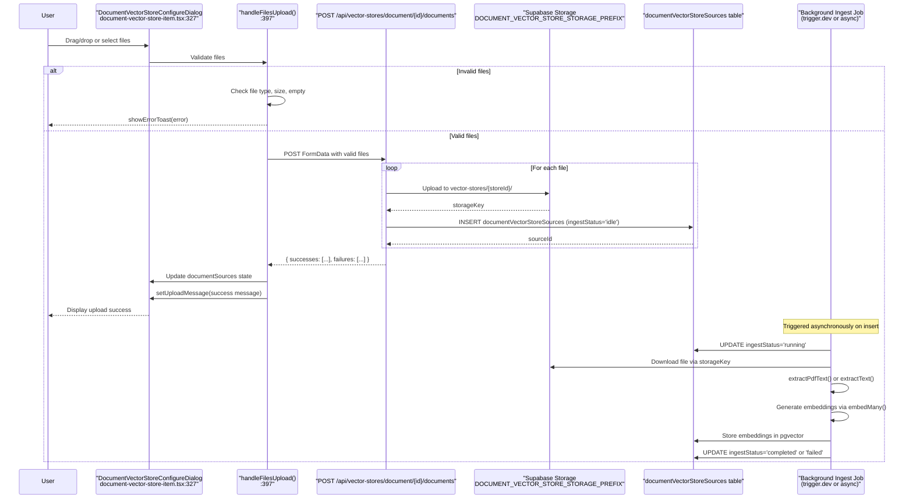

**File Validation Rules** (enforced in handleFilesUpload):
- Supported types: PDF, TXT, MD (defined in `DOCUMENT_VECTOR_STORE_SUPPORTED_MIME_TYPES`)
- Max file size: `DOCUMENT_VECTOR_STORE_MAX_FILE_SIZE_BYTES` (displayed as `DOCUMENT_VECTOR_STORE_MAX_FILE_SIZE_LABEL`)
- Empty files rejected
- Validation helper: `isSupportedDocumentFile()` checks MIME type and extension

**Sources:** [apps/studio.giselles.ai/app/(main)/settings/team/vector-stores/document/document-vector-store-item.tsx:327-634](), [apps/studio.giselles.ai/app/(main)/settings/team/vector-stores/actions.ts:55]()

### Embedding Profile System

Embedding profiles define which embedding model to use for a vector store. Different profiles have different dimensions and providers. The profiles are defined in `@giselles-ai/protocol` and re-exported by the vector store UI components.

#### Embedding Profile Configuration

The `EMBEDDING_PROFILES` constant in `@giselles-ai/protocol` defines four profiles:

| ID | Name | Provider | Model | Dimensions | GitHub Support | Document Support |
|----|------|----------|-------|------------|----------------|------------------|
| 1 | OpenAI Small | openai | text-embedding-3-small | 1536 | ✓ | ✓ |
| 2 | OpenAI Large | openai | text-embedding-3-large | 3072 | ✓ | ✓ |
| 3 | Google | google | text-embedding-004 | 768 | ✓ | ✓ |
| 4 | Cohere | cohere | embed-english-v3.0 | 1024 | ✗ | ✓ |

**GitHub Vector Store Profiles** (github-embedding-profiles.ts:1-13):
```typescript
import { EMBEDDING_PROFILES } from "@giselles-ai/protocol";

export const GITHUB_EMBEDDING_PROFILES = {
  1: EMBEDDING_PROFILES[1], // OpenAI Small
  2: EMBEDDING_PROFILES[2], // OpenAI Large
  3: EMBEDDING_PROFILES[3], // Google (excludes Cohere)
} as const;
```

**Document Vector Store Profiles** (document-embedding-profiles.ts:1-5):
```typescript
import { EMBEDDING_PROFILES } from "@giselles-ai/protocol";

// Surface all currently supported providers (OpenAI, Google, Cohere)
export const DOCUMENT_EMBEDDING_PROFILES = EMBEDDING_PROFILES;
```

Document Vector Stores support all four profiles, while GitHub Vector Stores exclude Cohere (profile ID 4) from the UI selection.

**Sources:** [apps/studio.giselles.ai/app/(main)/settings/team/vector-stores/github-embedding-profiles.ts:1-13](), [apps/studio.giselles.ai/app/(main)/settings/team/vector-stores/document-embedding-profiles.ts:1-6]()

#### Profile Selection and Updates

Users can select multiple embedding profiles when registering a vector store. The system enforces:
- At least one profile must be selected
- The blob content type for GitHub repositories cannot be disabled
- Updates create/remove embedding profiles and content statuses in a transaction

**Sources:** [apps/studio.giselles.ai/app/(main)/settings/team/vector-stores/actions.ts:114-145](), [apps/studio.giselles.ai/app/(main)/settings/team/vector-stores/actions.ts:216-367]()

### Manual Ingestion and Status Management

Teams can trigger manual ingestion for GitHub repositories through the "Ingest Now" option in the `RepoActionMenu` (repository-item.tsx:130-138). The system enforces ingestability rules before allowing manual triggers.

**Ingestability Check Flow**

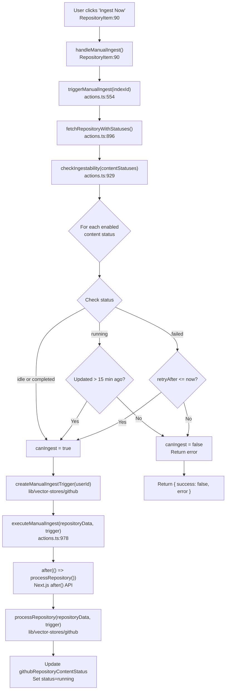

**Ingestability Rules** (checkIngestability function, actions.ts:929-973):
1. Content status must be `enabled: true`
2. Status must be one of:
   - `idle` or `completed` (ready to re-ingest)
   - `running` with `updatedAt` more than 15 minutes ago (stale, allow re-trigger)
   - `failed` with `retryAfter` timestamp in the past
3. At least one `blob` content status must exist

The manual ingest button is disabled when `canManuallyIngest` is false (repository-item.tsx:105-114).

**Sources:** [apps/studio.giselles.ai/app/(main)/settings/team/vector-stores/actions.ts:554-593](), [apps/studio.giselles.ai/app/(main)/settings/team/vector-stores/actions.ts:929-985](), [apps/studio.giselles.ai/app/(main)/settings/team/vector-stores/repository-item.tsx:90-114]()

### Diagnostic and Recovery System

When a GitHub repository becomes inaccessible (e.g., due to `DOCUMENT_NOT_FOUND` error from changed installation permissions), the `DiagnosticModal` component helps users diagnose and restore connectivity. The modal is triggered by clicking "Check ↗" next to failed content types (repository-item.tsx:320-327).

**Diagnostic Flow**

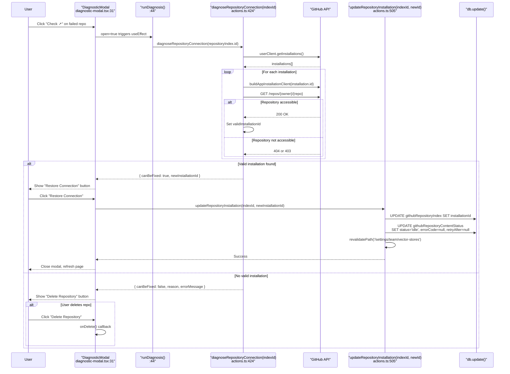

**Diagnostic Results** (DiagnosticResult type, types.ts:32-41):
- `canBeFixed: true` with `newInstallationId`: Repository found in another installation
- `canBeFixed: false` with reason:
  - `no-installation`: No installation has access
  - `repository-not-found`: Repository not found in database
  - `diagnosis-failed`: Error during diagnosis

The recovery process resets all content statuses to `idle` and clears error codes, allowing re-ingestion under the new installation (actions.ts:534-546).

**Sources:** [apps/studio.giselles.ai/app/(main)/settings/team/vector-stores/diagnostic-modal.tsx:23-206](), [apps/studio.giselles.ai/app/(main)/settings/team/vector-stores/actions.ts:424-549](), [apps/studio.giselles.ai/app/(main)/settings/team/vector-stores/types.ts:32-42]()

### Storage Layer Integration

Vector stores use two storage systems:

1. **Supabase PostgreSQL** (with pgvector extension) for embeddings and metadata
2. **Supabase Storage** for document source files

The storage prefix for document files is defined as:
```typescript
const DOCUMENT_VECTOR_STORE_STORAGE_PREFIX = "vector-stores";
```

This corresponds to a Supabase bucket where PDF and text files are stored before ingestion.

**Sources:** [apps/studio.giselles.ai/app/(main)/settings/team/vector-stores/actions.ts:53](), [apps/studio.giselles.ai/app/(main)/settings/team/vector-stores/actions.ts:43-52]()

## 3.3 RAG System and Query Execution

The RAG pipeline integrates document processing, embedding generation, and similarity search to enable context-aware generation operations. This section describes how processed documents are chunked, embedded, stored, and queried. The RAG implementation is primarily located in the `@giselles-ai/rag` package and supporting libraries in `lib/vector-stores/`.

### RAG Pipeline Architecture

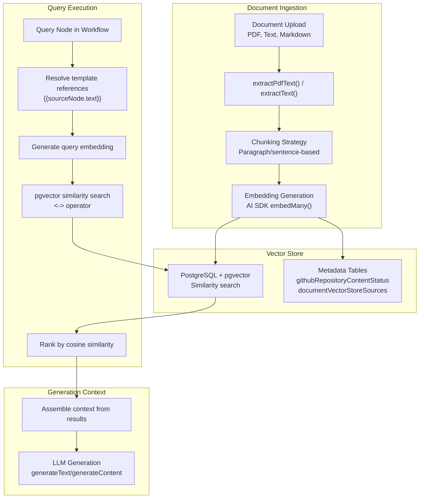

**Sources:** [packages/document-preprocessor/src/index.ts:1-13](), [apps/studio.giselles.ai/app/(main)/settings/team/vector-stores/actions.ts:1-42]()

### Chunking Strategies

After text extraction via `extractPdfText()` or `extractText()`, documents are split into chunks for embedding. The chunking implementation varies by content type and is handled by the ingestion pipeline (not directly visible in the provided vector store UI files).

**Content Type Chunking Strategies**

| Content Type | Strategy | Metadata Displayed in UI | Metadata Location in Code |
|--------------|----------|--------------------------|---------------------------|
| Code (blob) | File-based | Commit SHA (e.g., `abc1234`) | `blobStatus.metadata.lastIngestedCommitSha` (repository-item.tsx:350-356) |
| Issues | Issue-based | Issue number (e.g., `#42`) | `issueStatus.metadata.lastIngestedIssueNumber` (repository-item.tsx:444-448) |
| Pull Requests | PR-based | PR number (e.g., `#123`) | `pullRequestStatus.metadata.lastIngestedPrNumber` (repository-item.tsx:538-542) |
| PDF Documents | Page/paragraph-based | Page number, file name | `documentVectorStoreSources.fileName` (document-vector-store-item.tsx:280-295) |
| Plain Text | Paragraph-based | Source file name | `documentVectorStoreSources.fileName` |

The `metadata` field in `githubRepositoryContentStatus` stores chunk-specific information that is displayed in the UI after successful ingestion (status = `completed`).

**Sources:** [apps/studio.giselles.ai/app/(main)/settings/team/vector-stores/repository-item.tsx:346-361](), [apps/studio.giselles.ai/app/(main)/settings/team/vector-stores/repository-item.tsx:438-452](), [apps/studio.giselles.ai/app/(main)/settings/team/vector-stores/document/document-vector-store-item.tsx:286-295]()

### Embedding Generation

Embeddings are generated using the AI SDK's `embedMany()` function with the configured embedding profile:

```typescript
// Conceptual flow (actual implementation in lib/vector-stores)
const chunks = splitDocumentIntoChunks(text);
const embeddings = await embedMany({
  model: embeddingProfile.model,
  values: chunks.map(chunk => chunk.text),
});

// Store in pgvector
for (let i = 0; i < chunks.length; i++) {
  await db.insert(embeddingTable).values({
    content: chunks[i].text,
    embedding: embeddings[i],
    embeddingProfileId: profile.id,
    metadata: chunks[i].metadata,
  });
}
```

Each embedding profile (OpenAI Small, OpenAI Large, Google, Cohere) uses a different dimension size, which affects storage requirements and query performance.

**Sources:** [apps/studio.giselles.ai/app/(main)/settings/team/vector-stores/github-embedding-profiles.ts:1-13]()

### Query Resolution and Template References

Query nodes in workflows support template references to dynamically include content from source nodes:

```typescript
// Example query template
const queryTemplate = "Find code related to {{sourceNode.text}}";

// Resolution process
const resolvedQuery = resolveTemplateReferences(queryTemplate, sourceNodes);
// Result: "Find code related to authentication implementation"
```

The resolved query text is then embedded using the same embedding profile as the target vector store, ensuring semantic similarity search works correctly.

**Sources:** Based on workflow node query patterns in the codebase (implementation details in query execution layer not shown in provided files)

### Similarity Search with pgvector

PostgreSQL with the pgvector extension provides efficient similarity search using the cosine distance operator (`<->`):

```sql
-- Conceptual query structure
SELECT 
  content,
  metadata,
  1 - (embedding <-> $queryEmbedding) as similarity
FROM embeddings
WHERE embedding_profile_id = $profileId
  AND repository_index_db_id = $repositoryDbId  -- or document_vector_store_db_id
ORDER BY embedding <-> $queryEmbedding
LIMIT $topK;
```

The `<->` operator computes cosine distance between the query embedding and stored embeddings. Results are ranked by similarity (1 - distance), with the most similar chunks returned first.

**Sources:** Based on pgvector usage patterns (actual SQL in lib/vector-stores not shown in provided files)

### Query Execution and Context Assembly

The query execution flow integrates workflow nodes with vector stores through the Giselle Engine. While the detailed implementation is in the `@giselles-ai/rag` and engine packages (see page 2), the vector store UI surfaces key configuration:

**Vector Store Configuration for Queries**

The vector store system provides:
1. **Store Selection**: Users select which GitHub or Document vector store to query
2. **Embedding Profile**: Determines which embedding space to search within
3. **Content Type Filtering**: For GitHub stores, filter by blob/issue/pull_request
4. **Status Visibility**: UI shows which content is ready (`completed`) for querying

**Query Execution Components**

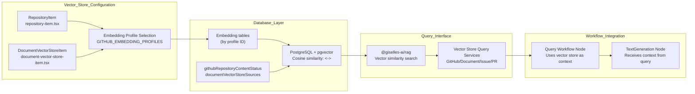

**Vector Store Status and Query Readiness**

Only vector stores with `status='completed'` content are ready for queries. The UI displays:
- **Ready badge** (green): Content ingested and queryable
- **Processing badge** (blue): Ingestion in progress, not yet queryable
- **Failed badge** (red): Ingestion failed, requires diagnostic check
- **Pending badge** (yellow): Ingestion queued, waiting to start

The `StatusIndicator` and `IngestStatusBadge` components visualize query readiness (repository-item.tsx:289-293, document-vector-store-item.tsx:63-127).

**Sources:** [apps/studio.giselles.ai/app/(main)/settings/team/vector-stores/repository-item.tsx:240-320](), [apps/studio.giselles.ai/app/(main)/settings/team/vector-stores/document/document-vector-store-item.tsx:63-127]()

### Error Handling and Retry Logic

The vector store system implements automatic retry logic for failed ingestion operations:

| Error Code | Description | Retry Strategy |
|------------|-------------|----------------|
| `DOCUMENT_NOT_FOUND` | Repository/file not accessible | Manual fix via diagnostic modal |
| `DOCUMENT_FETCH_ERROR` | Transient fetch failure | Exponential backoff with `retryAfter` |
| `DOCUMENT_RATE_LIMITED` | GitHub rate limit hit | Wait until rate limit reset |
| `DOCUMENT_TOO_LARGE` | File exceeds size limit | No retry (permanent failure) |

The `retryAfter` timestamp in `githubRepositoryContentStatus` controls when a failed ingestion can be retried. Users can manually trigger ingestion once `retryAfter` has passed.

**Sources:** [apps/studio.giselles.ai/app/(main)/settings/team/vector-stores/types.ts:1-5](), [apps/studio.giselles.ai/app/(main)/settings/team/vector-stores/repository-item.tsx:98-107](), [apps/studio.giselles.ai/app/(main)/settings/team/vector-stores/error-messages.ts]()

### Integration with Workflow Nodes

Vector stores are consumed by workflow nodes through node-specific interfaces:

1. **GitHub Vector Store Node**: Queries code and PR embeddings using repository-specific profiles
2. **Document Vector Store Node**: Queries uploaded document embeddings
3. **Query Node**: Generic interface supporting both GitHub and Document stores

Node properties panels allow users to select the target vector store and configure query parameters (e.g., `topK` results, embedding profile selection).

**Sources:** Based on workflow node patterns described in the architecture diagrams (detailed implementation in workflow-designer-ui not shown in provided files)

---

