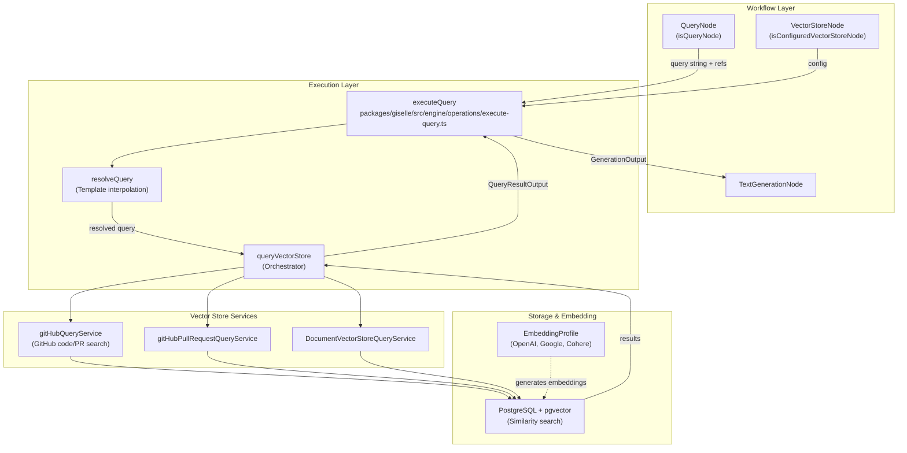
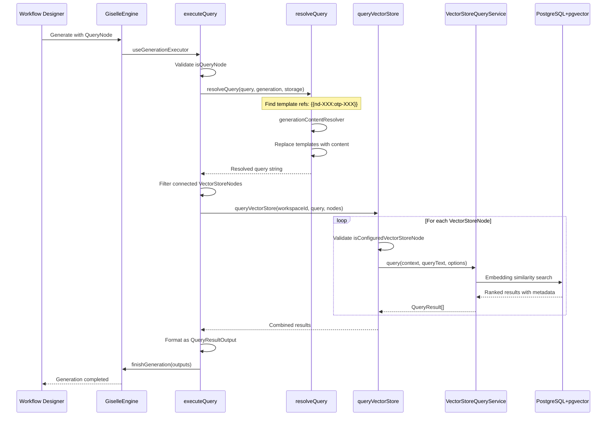
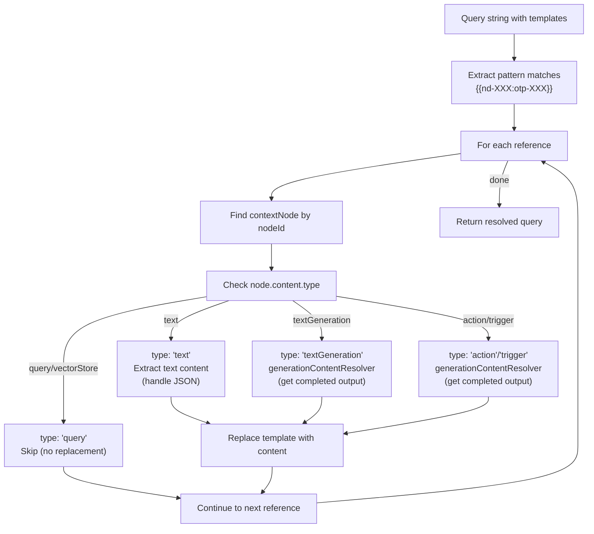
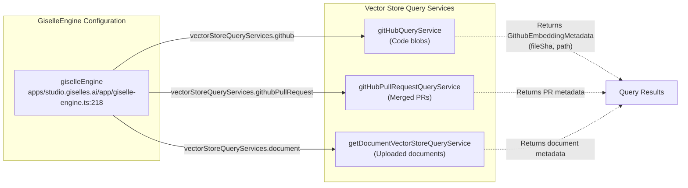
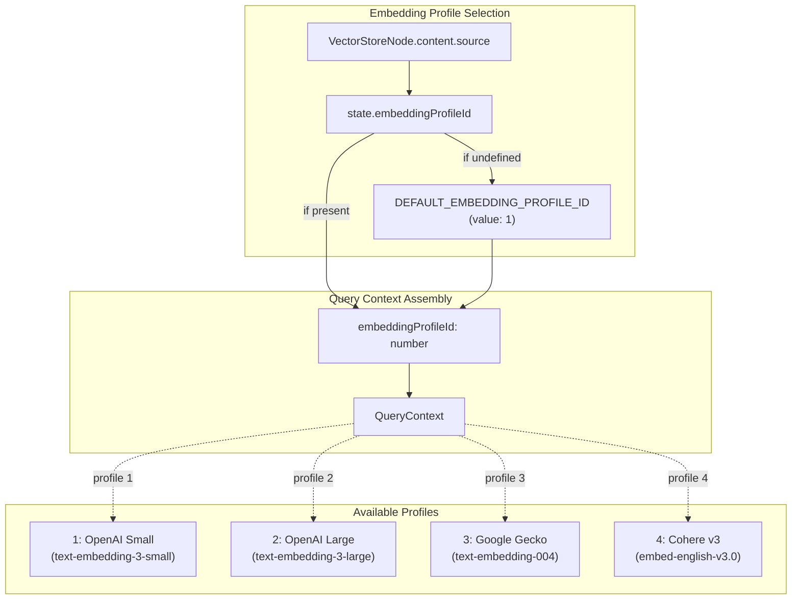
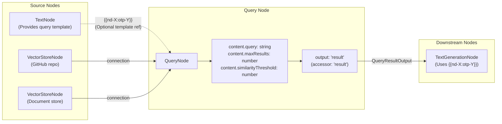
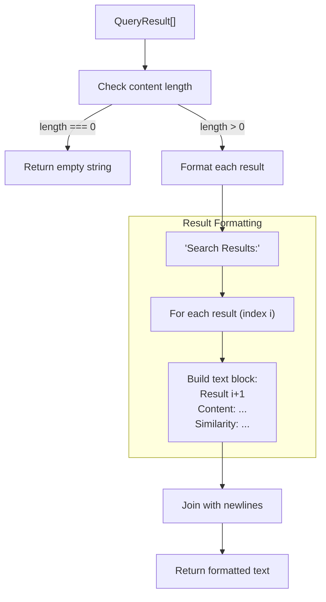

<!-- source: DeepWiki mcp.deepwiki.com · repo giselles-ai/giselle · page 3.3 RAG System and Query Execution · fetched 2026-10-26 -->

# RAG Implementation and Query Execution

<details>
<summary>Relevant source files</summary>

The following files were used as context for generating this wiki page:

- [apps/playground/giselle-engine.ts](apps/playground/giselle-engine.ts)
- [apps/studio.giselles.ai/app/(main)/settings/team/vector-stores/actions.ts](apps/studio.giselles.ai/app/(main)/settings/team/vector-stores/actions.ts)
- [apps/studio.giselles.ai/app/(main)/settings/team/vector-stores/configure-sources-dialog.tsx](apps/studio.giselles.ai/app/(main)/settings/team/vector-stores/configure-sources-dialog.tsx)
- [apps/studio.giselles.ai/app/(main)/settings/team/vector-stores/data.ts](apps/studio.giselles.ai/app/(main)/settings/team/vector-stores/data.ts)
- [apps/studio.giselles.ai/app/(main)/settings/team/vector-stores/diagnostic-modal.tsx](apps/studio.giselles.ai/app/(main)/settings/team/vector-stores/diagnostic-modal.tsx)
- [apps/studio.giselles.ai/app/(main)/settings/team/vector-stores/document-embedding-profiles.ts](apps/studio.giselles.ai/app/(main)/settings/team/vector-stores/document-embedding-profiles.ts)
- [apps/studio.giselles.ai/app/(main)/settings/team/vector-stores/document-store-create-dialog.tsx](apps/studio.giselles.ai/app/(main)/settings/team/vector-stores/document-store-create-dialog.tsx)
- [apps/studio.giselles.ai/app/(main)/settings/team/vector-stores/document-vector-store-list.tsx](apps/studio.giselles.ai/app/(main)/settings/team/vector-stores/document-vector-store-list.tsx)
- [apps/studio.giselles.ai/app/(main)/settings/team/vector-stores/document/document-vector-store-item.tsx](apps/studio.giselles.ai/app/(main)/settings/team/vector-stores/document/document-vector-store-item.tsx)
- [apps/studio.giselles.ai/app/(main)/settings/team/vector-stores/document/page.tsx](apps/studio.giselles.ai/app/(main)/settings/team/vector-stores/document/page.tsx)
- [apps/studio.giselles.ai/app/(main)/settings/team/vector-stores/layout.tsx](apps/studio.giselles.ai/app/(main)/settings/team/vector-stores/layout.tsx)
- [apps/studio.giselles.ai/app/(main)/settings/team/vector-stores/navigation-layout.tsx](apps/studio.giselles.ai/app/(main)/settings/team/vector-stores/navigation-layout.tsx)
- [apps/studio.giselles.ai/app/(main)/settings/team/vector-stores/page.tsx](apps/studio.giselles.ai/app/(main)/settings/team/vector-stores/page.tsx)
- [apps/studio.giselles.ai/app/(main)/settings/team/vector-stores/repository-item.tsx](apps/studio.giselles.ai/app/(main)/settings/team/vector-stores/repository-item.tsx)
- [apps/studio.giselles.ai/app/(main)/settings/team/vector-stores/repository-list.tsx](apps/studio.giselles.ai/app/(main)/settings/team/vector-stores/repository-list.tsx)
- [apps/studio.giselles.ai/app/(main)/settings/team/vector-stores/repository-registration-dialog.tsx](apps/studio.giselles.ai/app/(main)/settings/team/vector-stores/repository-registration-dialog.tsx)
- [apps/studio.giselles.ai/app/(main)/settings/team/vector-stores/sidebar-menu.tsx](apps/studio.giselles.ai/app/(main)/settings/team/vector-stores/sidebar-menu.tsx)
- [apps/studio.giselles.ai/app/(main)/settings/team/vector-stores/types.ts](apps/studio.giselles.ai/app/(main)/settings/team/vector-stores/types.ts)
- [apps/studio.giselles.ai/app/giselle-engine.ts](apps/studio.giselles.ai/app/giselle-engine.ts)
- [internal-packages/ui/components/form-field.tsx](internal-packages/ui/components/form-field.tsx)
- [internal-packages/ui/components/section-header.tsx](internal-packages/ui/components/section-header.tsx)
- [internal-packages/ui/components/status-indicator.tsx](internal-packages/ui/components/status-indicator.tsx)
- [packages/giselle/src/engine/acts/run-act.ts](packages/giselle/src/engine/acts/run-act.ts)
- [packages/giselle/src/engine/generations/generate-content.ts](packages/giselle/src/engine/generations/generate-content.ts)
- [packages/giselle/src/engine/generations/generate-image.ts](packages/giselle/src/engine/generations/generate-image.ts)
- [packages/giselle/src/engine/generations/internal/use-generation-executor.ts](packages/giselle/src/engine/generations/internal/use-generation-executor.ts)
- [packages/giselle/src/engine/generations/types.ts](packages/giselle/src/engine/generations/types.ts)
- [packages/giselle/src/engine/generations/utils.ts](packages/giselle/src/engine/generations/utils.ts)
- [packages/giselle/src/engine/operations/execute-query.ts](packages/giselle/src/engine/operations/execute-query.ts)
- [packages/giselle/src/engine/telemetry/index.ts](packages/giselle/src/engine/telemetry/index.ts)
- [packages/giselle/src/engine/telemetry/types.ts](packages/giselle/src/engine/telemetry/types.ts)
- [packages/giselle/src/engine/triggers/resolve-trigger.ts](packages/giselle/src/engine/triggers/resolve-trigger.ts)
- [packages/giselle/src/engine/types.ts](packages/giselle/src/engine/types.ts)
- [packages/giselle/src/react/generations/generation-runner.tsx](packages/giselle/src/react/generations/generation-runner.tsx)

</details>


## Purpose and Scope

This page documents the Retrieval-Augmented Generation (RAG) pipeline implementation in Giselle, specifically focusing on how vector store queries are executed and integrated into workflow generation processes. It covers query resolution, embedding-based similarity search, and result formatting for consumption by downstream nodes.

For information about the document processing and ingestion pipeline that populates vector stores, see [3.2](#3.2). For details on vector store management interfaces and registration, see [5.1.3](#5.1.3).

## RAG System Architecture

The RAG system consists of three primary components: query nodes that initiate searches, vector store services that perform similarity lookups, and the query execution engine that orchestrates the flow and formats results.



**Sources:** [packages/giselle/src/engine/operations/execute-query.ts:1-450](), [apps/studio.giselles.ai/app/giselle-engine.ts:251-255](), [packages/giselle/src/engine/types.ts:162-188]()

## Query Context Types

The system supports two types of vector store queries, each with its own context structure and configuration requirements.

| Context Type | Provider | Key Fields | Embedding Profile | Use Case |
|-------------|----------|------------|-------------------|----------|
| `GitHubQueryContext` | `github` | `owner`, `repo`, `contentType` (`blob` or `pullRequest`) | `EmbeddingProfileId` (default: 1) | Search repository code or merged pull requests |
| `DocumentVectorStoreQueryContext` | `document` | `documentVectorStoreId` | `EmbeddingProfileId` (default: 1) | Search uploaded documents (PDF, text) |

**Type Definitions:**

```typescript
// GitHubQueryContext structure
{
  provider: "github",
  workspaceId: WorkspaceId,
  owner: string,
  repo: string,
  contentType: "blob" | "pullRequest",
  embeddingProfileId: EmbeddingProfileId
}

// DocumentVectorStoreQueryContext structure
{
  provider: "document",
  workspaceId: WorkspaceId,
  documentVectorStoreId: string,
  embeddingProfileId: EmbeddingProfileId
}
```

**Sources:** [packages/giselle/src/engine/types.ts:162-179](), [packages/giselle/src/engine/operations/execute-query.ts:269-279]()

## Query Execution Pipeline

The query execution process follows a staged pipeline from node initialization through result formatting.



**Sources:** [packages/giselle/src/engine/operations/execute-query.ts:43-126](), [packages/giselle/src/engine/operations/execute-query.ts:299-450]()

## Query Resolution and Template Interpolation

Query nodes support dynamic query construction through template references that pull content from upstream nodes. The resolution process handles multiple node types and formats.

### Template Syntax

Query strings can contain references in the format `{{nd-{nodeId}:otp-{outputId}}}` which are replaced with actual content at execution time.

### Resolution Logic



**Key Implementation Details:**

- **JSON Content Handling:** [packages/giselle/src/engine/operations/execute-query.ts:199-201]() - If query is JSON content, converts to plain text using `jsonContentToText`
- **Pattern Matching:** [packages/giselle/src/engine/operations/execute-query.ts:204-208]() - Uses regex `/\{\{(nd-[a-zA-Z0-9]+):(otp-[a-zA-Z0-9]+)\}\}/g` to find all references
- **Generation Lookup:** [packages/giselle/src/engine/operations/execute-query.ts:136-194]() - `generationContentResolver` retrieves completed generation outputs by node and output IDs

**Sources:** [packages/giselle/src/engine/operations/execute-query.ts:128-267]()

## Vector Store Query Services

Each vector store type implements the `QueryService` interface, which provides a uniform abstraction for similarity searches across different providers.

### Service Interface

```typescript
// Generic QueryService signature
QueryService<TContext, TMetadata> = {
  query: (
    context: TContext,
    queryText: string,
    options: {
      maxResults?: number,
      similarityThreshold?: number
    }
  ) => Promise<QueryResult<TMetadata>[]>
}
```

### Configured Services

The engine is initialized with three query service implementations:



**Configuration:** [apps/studio.giselles.ai/app/giselle-engine.ts:251-255]()

**Query Execution:** [packages/giselle/src/engine/operations/execute-query.ts:299-450]() dispatches to appropriate service based on `vectorStoreNode.content.source.provider`

**Sources:** [apps/studio.giselles.ai/app/giselle-engine.ts:36-40](), [packages/giselle/src/engine/types.ts:181-187]()

## Embedding Profiles and Similarity Search

Each vector store query operates within the context of a specific embedding profile that determines which embedding model was used for indexing and should be used for query embedding.

### Embedding Profile Specification



**Profile Assignment:**
- [packages/giselle/src/engine/operations/execute-query.ts:334-335]() - GitHub blob queries use `state.embeddingProfileId ?? DEFAULT_EMBEDDING_PROFILE_ID`
- [packages/giselle/src/engine/operations/execute-query.ts:361-362]() - GitHub PR queries use same fallback logic
- [packages/giselle/src/engine/operations/execute-query.ts:387-388]() - Document vector store queries use same fallback logic

### Query Parameters

| Parameter | Type | Default | Description |
|-----------|------|---------|-------------|
| `maxResults` | `number` | `DEFAULT_MAX_RESULTS` | Maximum number of results to return |
| `similarityThreshold` | `number` | `DEFAULT_SIMILARITY_THRESHOLD` | Minimum cosine similarity score (0-1) |
| `embeddingProfileId` | `EmbeddingProfileId` | `1` (OpenAI Small) | Which embedding model to use |

**Sources:** [packages/giselle/src/engine/operations/execute-query.ts:299-450](), [apps/studio.giselles.ai/app/(main)/settings/team/vector-stores/github-embedding-profiles.ts:1-13]()

## Integration with Workflow Nodes

Query nodes connect to vector store nodes and expose their results to downstream text generation nodes through the output system.

### Node Connection Pattern



**Connection Filtering:** [packages/giselle/src/engine/operations/execute-query.ts:72-78]() - Only vector store nodes with active connections to the query node are included in the search

**Output Definition:** [packages/giselle/src/engine/operations/execute-query.ts:91-96]() - Query results are written to the output with accessor `"result"`

**Sources:** [packages/giselle/src/engine/operations/execute-query.ts:60-108]()

## Query Result Formatting

Query results are formatted as structured `QueryResultOutput` objects that can be consumed by downstream nodes or converted to plain text.

### Result Structure

```typescript
// QueryResultOutput type
{
  type: "query-result",
  outputId: OutputId,
  content: QueryResult[]
}

// QueryResult structure (varies by provider)
{
  content: string,           // The retrieved text chunk
  similarity: number,        // Cosine similarity score (0-1)
  source: VectorStoreSource, // GitHub or Document source info
  metadata: TMetadata        // Provider-specific metadata
}
```

### Text Conversion

The `queryResultToText` function converts structured query results into a readable text format for consumption by LLMs:



**Implementation:** [packages/giselle/src/engine/generations/utils.ts:442-461]() - Formats results as numbered blocks with content and similarity scores

**Usage in Text Generation:**
- [packages/giselle/src/engine/generations/internal/use-generation-executor.ts:243-253]() - `generationContentResolver` calls `queryResultToText` when resolving query node references
- [packages/giselle/src/engine/operations/execute-query.ts:186-187]() - Query outputs are converted to text when used as template replacements

**Sources:** [packages/giselle/src/engine/generations/utils.ts:442-461](), [packages/giselle/src/engine/operations/execute-query.ts:186-187](), [packages/giselle/src/engine/generations/internal/use-generation-executor.ts:243-253]()

## Observability and Telemetry

The RAG system includes telemetry hooks for tracking embedding usage and query performance.

### Embedding Callback

The `embeddingComplete` callback is invoked after each query execution to track embedding metrics:

```typescript
// Callback signature
embeddingComplete?: (args: {
  embeddingMetrics: EmbeddingMetrics,
  generation: RunningGeneration,
  queryContext: QueryContext,
  generationMetadata?: GenerationMetadata
}) => void | Promise<void>
```

**Invocation Points:**
- [apps/studio.giselles.ai/app/giselle-engine.ts:329-389]() - `traceEmbeddingForTeam` function traces embedding operations with plan tags and metadata
- Telemetry includes: team type, subscription status, resource provider, content type, embedding profile ID

**Metadata Captured:**

| Field | Description |
|-------|-------------|
| `generationId` | ID of the query generation |
| `teamId` | Team performing the query |
| `isProPlan` | Whether team has Pro subscription |
| `resourceProvider` | `"github"` or `"document"` |
| `embeddingProfileId` | Which embedding model was used |
| Provider-specific fields | `resourceOwner`, `resourceRepo`, `documentVectorStoreId`, etc. |

**Sources:** [apps/studio.giselles.ai/app/giselle-engine.ts:140-200](), [apps/studio.giselles.ai/app/giselle-engine.ts:329-389](), [packages/giselle/src/engine/types.ts:77-85]()

---

