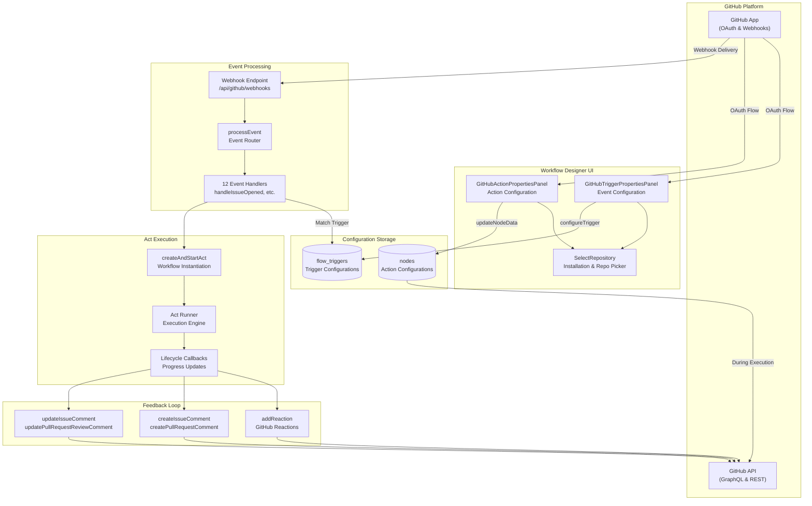
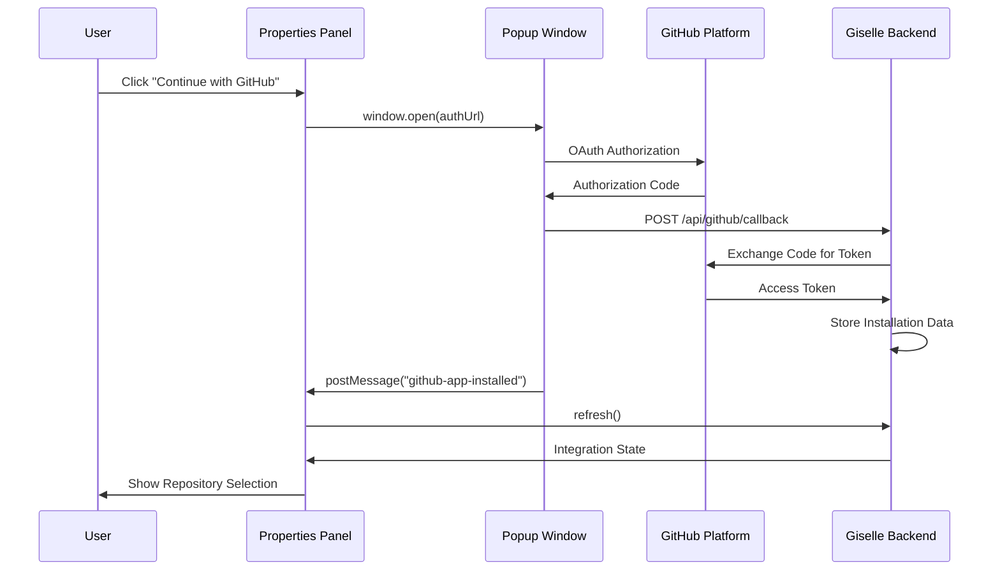
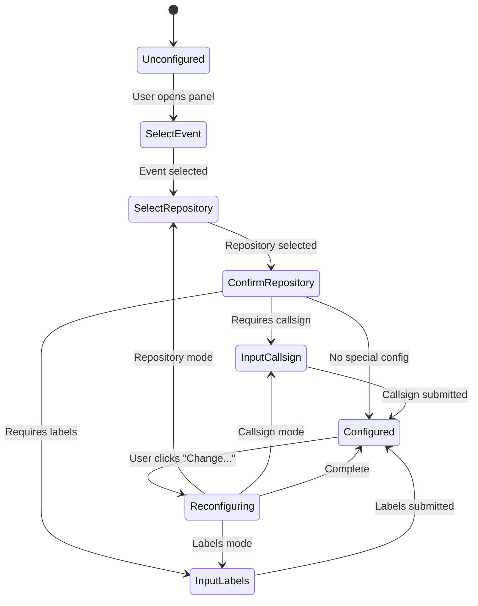
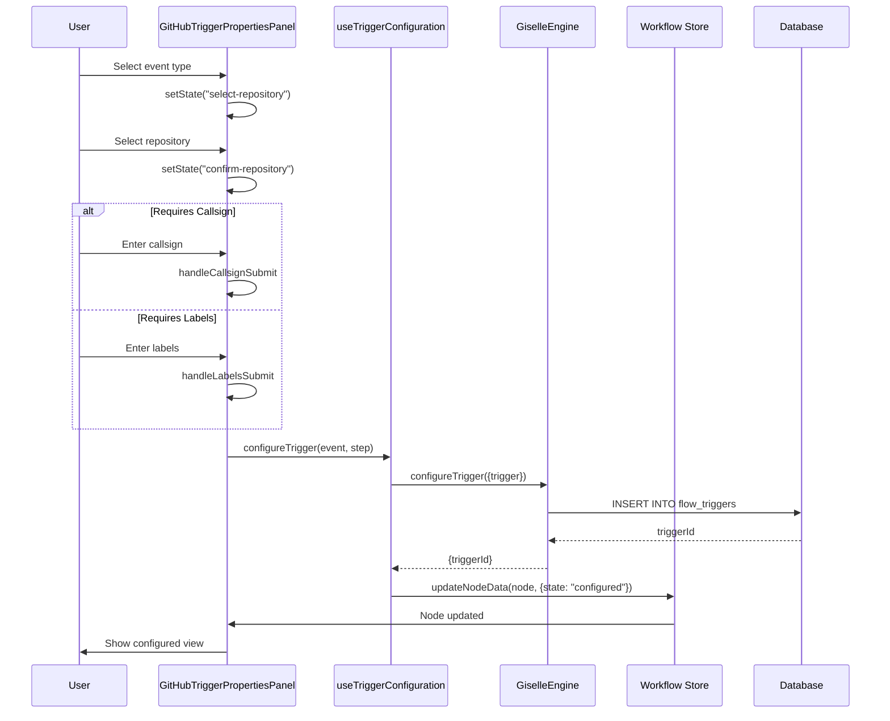
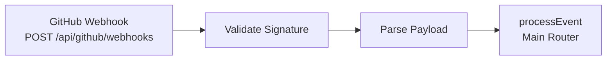
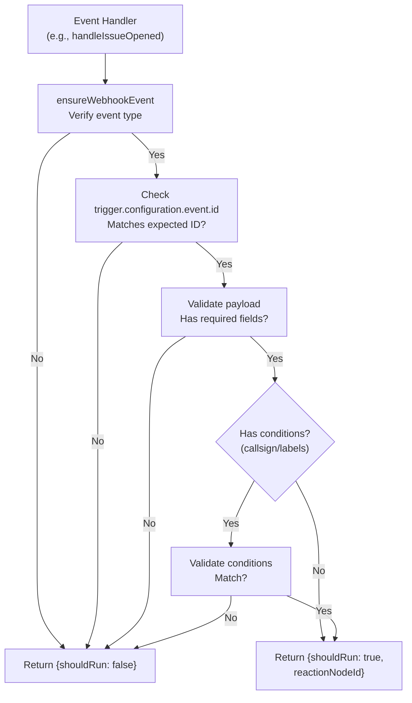
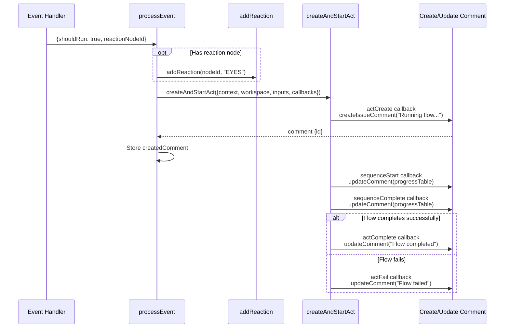
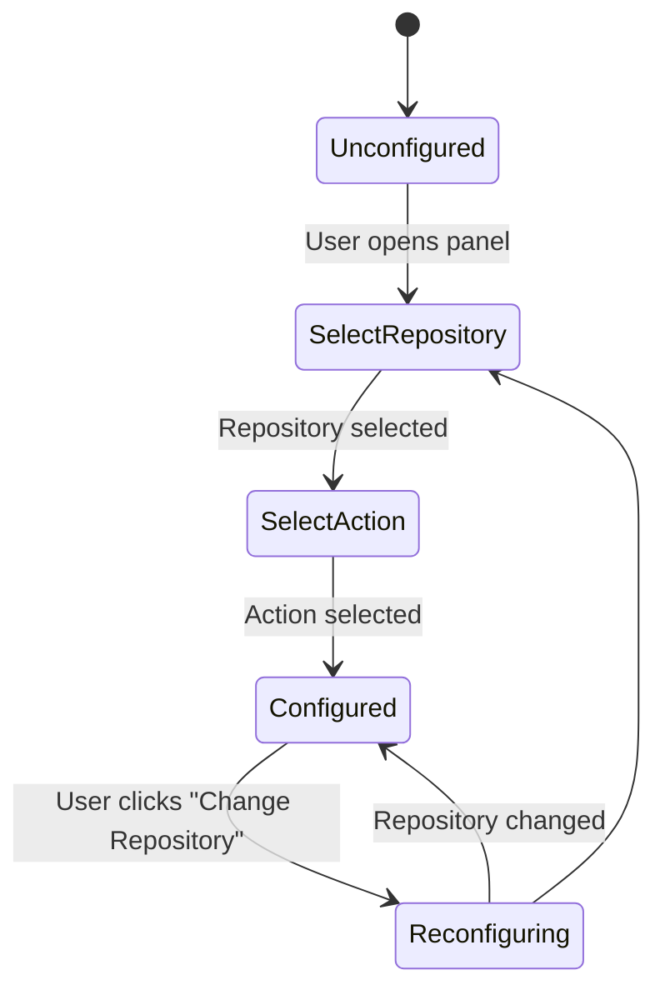
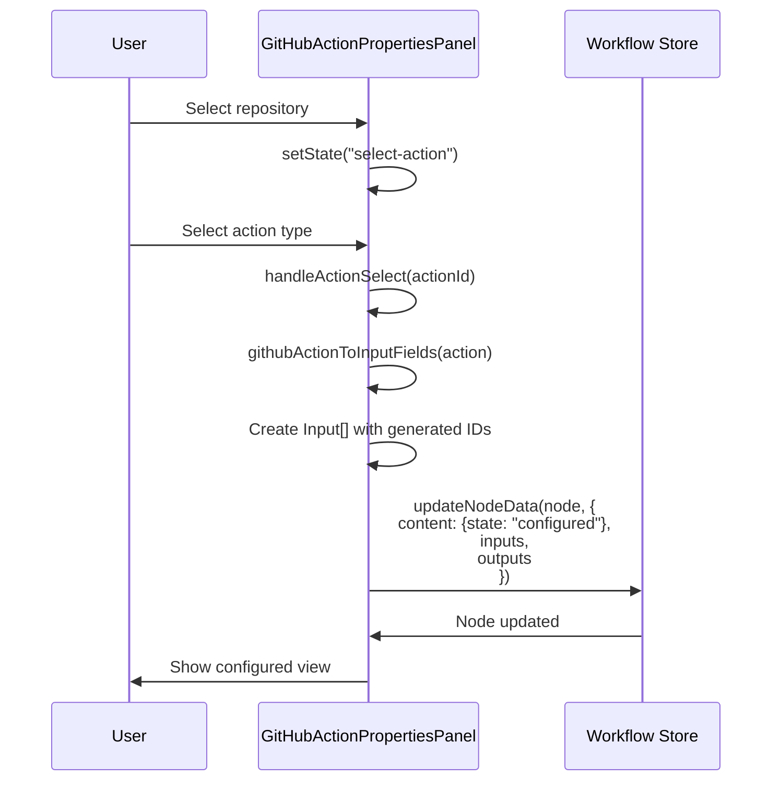
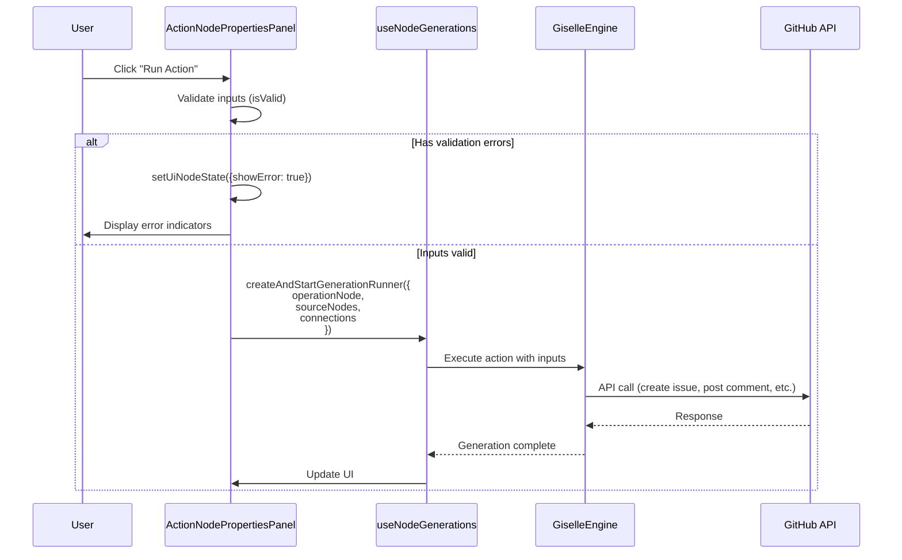

<!-- source: DeepWiki mcp.deepwiki.com · repo giselles-ai/giselle · page 4 GitHub Integration · fetched 2026-10-26 -->

# GitHub Integration

<details>
<summary>Relevant source files</summary>

The following files were used as context for generating this wiki page:

- [internal-packages/workflow-designer-ui/src/editor/properties-panel/action-node-properties-panel/github-action-properties-panel.tsx](internal-packages/workflow-designer-ui/src/editor/properties-panel/action-node-properties-panel/github-action-properties-panel.tsx)
- [internal-packages/workflow-designer-ui/src/editor/properties-panel/action-node-properties-panel/index.tsx](internal-packages/workflow-designer-ui/src/editor/properties-panel/action-node-properties-panel/index.tsx)
- [internal-packages/workflow-designer-ui/src/editor/properties-panel/action-node-properties-panel/ui/github-action-configured-view.tsx](internal-packages/workflow-designer-ui/src/editor/properties-panel/action-node-properties-panel/ui/github-action-configured-view.tsx)
- [internal-packages/workflow-designer-ui/src/editor/properties-panel/trigger-node-properties-panel/providers/github-trigger/components/event-type-display.tsx](internal-packages/workflow-designer-ui/src/editor/properties-panel/trigger-node-properties-panel/providers/github-trigger/components/event-type-display.tsx)
- [internal-packages/workflow-designer-ui/src/editor/properties-panel/trigger-node-properties-panel/providers/github-trigger/components/icons/index.tsx](internal-packages/workflow-designer-ui/src/editor/properties-panel/trigger-node-properties-panel/providers/github-trigger/components/icons/index.tsx)
- [internal-packages/workflow-designer-ui/src/editor/properties-panel/trigger-node-properties-panel/providers/github-trigger/components/install-application.tsx](internal-packages/workflow-designer-ui/src/editor/properties-panel/trigger-node-properties-panel/providers/github-trigger/components/install-application.tsx)
- [internal-packages/workflow-designer-ui/src/editor/properties-panel/trigger-node-properties-panel/providers/github-trigger/components/labels-input-step.tsx](internal-packages/workflow-designer-ui/src/editor/properties-panel/trigger-node-properties-panel/providers/github-trigger/components/labels-input-step.tsx)
- [internal-packages/workflow-designer-ui/src/editor/properties-panel/trigger-node-properties-panel/providers/github-trigger/components/unauthorized.tsx](internal-packages/workflow-designer-ui/src/editor/properties-panel/trigger-node-properties-panel/providers/github-trigger/components/unauthorized.tsx)
- [internal-packages/workflow-designer-ui/src/editor/properties-panel/trigger-node-properties-panel/providers/github-trigger/github-trigger-properties-panel.tsx](internal-packages/workflow-designer-ui/src/editor/properties-panel/trigger-node-properties-panel/providers/github-trigger/github-trigger-properties-panel.tsx)
- [internal-packages/workflow-designer-ui/src/editor/properties-panel/trigger-node-properties-panel/providers/github-trigger/utils/trigger-configuration.ts](internal-packages/workflow-designer-ui/src/editor/properties-panel/trigger-node-properties-panel/providers/github-trigger/utils/trigger-configuration.ts)
- [internal-packages/workflow-designer-ui/src/editor/properties-panel/trigger-node-properties-panel/providers/github-trigger/utils/use-trigger-configuration.ts](internal-packages/workflow-designer-ui/src/editor/properties-panel/trigger-node-properties-panel/providers/github-trigger/utils/use-trigger-configuration.ts)
- [internal-packages/workflow-designer-ui/src/editor/properties-panel/trigger-node-properties-panel/providers/manual-trigger/manual-trigger-properties-panel.tsx](internal-packages/workflow-designer-ui/src/editor/properties-panel/trigger-node-properties-panel/providers/manual-trigger/manual-trigger-properties-panel.tsx)
- [internal-packages/workflow-designer-ui/src/editor/properties-panel/trigger-node-properties-panel/ui/configured-views/github-trigger-configured-view.tsx](internal-packages/workflow-designer-ui/src/editor/properties-panel/trigger-node-properties-panel/ui/configured-views/github-trigger-configured-view.tsx)
- [internal-packages/workflow-designer-ui/src/editor/properties-panel/ui/select-repository.tsx](internal-packages/workflow-designer-ui/src/editor/properties-panel/ui/select-repository.tsx)
- [packages/giselle/src/engine/github/event-handlers.test.ts](packages/giselle/src/engine/github/event-handlers.test.ts)
- [packages/giselle/src/engine/github/event-handlers.ts](packages/giselle/src/engine/github/event-handlers.ts)
- [packages/protocol/src/trigger/github.ts](packages/protocol/src/trigger/github.ts)

</details>


This document describes the GitHub integration system, which enables workflows to be triggered by GitHub events (issues, pull requests, discussions) and to perform actions on GitHub repositories. The integration uses a GitHub App for authentication and webhook delivery.

For information about the workflow execution engine that processes GitHub-triggered workflows, see [Act Runner and Workflow Orchestration](#2.4). For the vector store system that indexes GitHub repository content, see [Vector Store Management](#3.2).

## System Purpose and Scope

The GitHub integration provides bidirectional interaction between Giselle workflows and GitHub repositories:

**Inbound (Triggers)**: Workflows can be triggered by 12 different GitHub event types, including issue creation, pull request events, and comments. Events are delivered via GitHub webhooks, matched against configured triggers, and initiate workflow execution.

**Outbound (Actions)**: Workflows can perform actions on GitHub repositories, such as creating issues, posting comments, and replying to discussions. Actions execute during workflow runs and use the GitHub API.

The integration consists of three main subsystems:
- **Configuration UI**: Properties panels for setting up triggers and actions in the workflow designer
- **Event Processing Engine**: Backend handlers that process incoming webhooks and create Acts
- **Action Execution**: Runtime components that execute GitHub operations during workflow execution

Sources: [internal-packages/workflow-designer-ui/src/editor/properties-panel/trigger-node-properties-panel/providers/github-trigger/github-trigger-properties-panel.tsx:1-849](), [packages/giselle/src/engine/github/event-handlers.ts:1-150](), [internal-packages/workflow-designer-ui/src/editor/properties-panel/action-node-properties-panel/github-action-properties-panel.tsx:1-179]()

## Architecture Overview



Sources: [internal-packages/workflow-designer-ui/src/editor/properties-panel/trigger-node-properties-panel/providers/github-trigger/github-trigger-properties-panel.tsx:165-228](), [packages/giselle/src/engine/github/event-handlers.ts:477-557]()

## GitHub App Configuration

### Installation Flow

The GitHub integration requires a GitHub App to be installed on the user's account or organization. The installation process follows this sequence:



The UI components handle three authentication states:

**Unauthorized State** (`status: "unauthorized"`): User has not connected GitHub account. Displays `Unauthorized` component with OAuth initiation button.

**Not Installed State** (`status: "not-installed"`): User is authenticated but hasn't installed the GitHub App. Displays `InstallGitHubApplication` component with installation link.

**Installed State** (`status: "installed"`): GitHub App is installed and ready. Displays repository selection and event/action configuration UI.

Sources: [internal-packages/workflow-designer-ui/src/editor/properties-panel/trigger-node-properties-panel/providers/github-trigger/components/unauthorized.tsx:1-54](), [internal-packages/workflow-designer-ui/src/editor/properties-panel/trigger-node-properties-panel/providers/github-trigger/components/install-application.tsx:1-59](), [internal-packages/workflow-designer-ui/src/editor/properties-panel/action-node-properties-panel/github-action-properties-panel.tsx:150-179]()

### Installation Data Structure

The integration state uses `GitHubIntegrationInstallation` objects:

```typescript
interface GitHubIntegrationInstallation {
  id: number;  // Installation ID from GitHub
  account: {
    login: string;  // Username or org name
  };
  repositories: Repository[];
}

interface Repository {
  node_id: string;    // GitHub GraphQL node ID
  name: string;
  private: boolean;
  owner: {
    login: string;
  };
}
```

The `SelectRepository` component provides a dropdown for selecting installations (organizations) and displays available repositories for the selected installation. The component manages state locally and calls `onChangeInstallation` and `onSelectRepository` callbacks when selections are made.

Sources: [internal-packages/workflow-designer-ui/src/editor/properties-panel/ui/select-repository.tsx:1-253](), [internal-packages/workflow-designer-ui/src/editor/properties-panel/trigger-node-properties-panel/providers/github-trigger/github-trigger-properties-panel.tsx:125-163]()

## GitHub Triggers

### Supported Event Types

The system supports 12 GitHub event types, defined in the trigger registry. Each event maps to a specific webhook event and has associated input fields that become outputs on the trigger node:

| Event ID | Webhook Event | Description | Special Configuration |
|----------|--------------|-------------|----------------------|
| `github.issue.created` | `issues.opened` | Issue opened | None |
| `github.issue.closed` | `issues.closed` | Issue closed | None |
| `github.issue.labeled` | `issues.labeled` | Label added to issue | **Labels required** |
| `github.issue_comment.created` | `issue_comment.created` | Comment on issue | **Callsign required** |
| `github.pull_request.opened` | `pull_request.opened` | Pull request opened | None |
| `github.pull_request.ready_for_review` | `pull_request.ready_for_review` | PR ready for review | None |
| `github.pull_request.closed` | `pull_request.closed` | Pull request closed | None |
| `github.pull_request.labeled` | `pull_request.labeled` | Label added to PR | **Labels required** |
| `github.pull_request_comment.created` | `issue_comment.created` (with PR check) | Comment on PR | **Callsign required** |
| `github.pull_request_review_comment.created` | `pull_request_review_comment.created` | Review comment on PR | **Callsign required** |
| `github.discussion.created` | `discussion.created` | Discussion created | None |
| `github.discussion_comment.created` | `discussion_comment.created` | Comment on discussion | **Callsign required** |

Sources: [packages/protocol/src/trigger/github.ts:1-107](), [internal-packages/workflow-designer-ui/src/editor/properties-panel/trigger-node-properties-panel/providers/github-trigger/components/icons/index.tsx:266-298]()

### Trigger Configuration State Machine

The trigger configuration UI uses a multi-step state machine:



The state machine is implemented in the `GitHubTriggerPropertiesPanel` component with a `GitHubTriggerSetupStep` discriminated union:

```typescript
type GitHubTriggerSetupStep =
  | { state: "select-event" }
  | { state: "select-repository"; eventId: GitHubEventId }
  | { state: "input-callsign"; eventId: GitHubEventId; owner: string; repo: string; repoNodeId: string; installationId: number; callsign?: string }
  | { state: "input-labels"; eventId: GitHubEventId; owner: string; repo: string; repoNodeId: string; installationId: number; labels?: string[] }
  | { state: "confirm-repository"; eventId: GitHubEventId; installationId: number; owner: string; repo: string; repoNodeId: string }
```

Sources: [internal-packages/workflow-designer-ui/src/editor/properties-panel/trigger-node-properties-panel/providers/github-trigger/github-trigger-properties-panel.tsx:230-273](), [internal-packages/workflow-designer-ui/src/editor/properties-panel/trigger-node-properties-panel/providers/github-trigger/github-trigger-properties-panel.tsx:297-848]()

### Callsign System

Comment-based triggers (issue comments, PR comments, review comments, discussion comments) require a **callsign** - a command prefix that must appear at the start of the comment for the trigger to fire. This prevents workflows from executing on every comment in a repository.

**Configuration UI**: The `InputCallsignStep` renders when `isTriggerRequiringCallsign(eventId)` returns true. It displays an input field with a `/` prefix placeholder and stores the callsign without the prefix.

**Parsing**: The `parseCommand` function extracts the callsign and content from comment bodies. The event handler checks if `command?.callsign` matches `conditions?.callsign` before triggering the workflow.

**Example**: If the callsign is configured as `code-review`, the workflow only triggers when comments start with `/code-review`.

Sources: [internal-packages/workflow-designer-ui/src/editor/properties-panel/trigger-node-properties-panel/providers/github-trigger/github-trigger-properties-panel.tsx:276-285](), [internal-packages/workflow-designer-ui/src/editor/properties-panel/trigger-node-properties-panel/providers/github-trigger/github-trigger-properties-panel.tsx:735-825](), [packages/giselle/src/engine/github/event-handlers.ts:200-226]()

### Labels System

Label-based triggers (`github.issue.labeled`, `github.pull_request.labeled`) require one or more **labels** to be configured. The workflow triggers when any of the configured labels is added to an issue or pull request.

**Configuration UI**: The `LabelsInputStep` component allows users to add multiple labels with a dynamic form. Users can add/remove label inputs and submit the list.

**Matching Logic**: The event handler checks if `conditions.labels.includes(addedLabel.name)` where `addedLabel` is the label from the webhook payload.

**Example**: If labels `["bug", "urgent"]` are configured, the workflow triggers when either the "bug" label or "urgent" label is added to an issue.

Sources: [internal-packages/workflow-designer-ui/src/editor/properties-panel/trigger-node-properties-panel/providers/github-trigger/github-trigger-properties-panel.tsx:288-295](), [internal-packages/workflow-designer-ui/src/editor/properties-panel/trigger-node-properties-panel/providers/github-trigger/components/labels-input-step.tsx:1-185](), [packages/giselle/src/engine/github/event-handlers.ts:353-384]()

### Trigger Configuration Flow



The `configureTrigger` method called by the hook creates a trigger record in the database with the configuration:

```typescript
{
  nodeId: string,
  workspaceId: string,
  enable: boolean,
  configuration: {
    provider: "github",
    repositoryNodeId: string,
    installationId: number,
    event: GitHubEventData  // Includes id, conditions
  }
}
```

Sources: [internal-packages/workflow-designer-ui/src/editor/properties-panel/trigger-node-properties-panel/providers/github-trigger/utils/use-trigger-configuration.ts:1-87](), [internal-packages/workflow-designer-ui/src/editor/properties-panel/trigger-node-properties-panel/providers/github-trigger/github-trigger-properties-panel.tsx:343-403]()

### Configured Trigger View

Once configured, the trigger displays the `GitHubTriggerConfiguredView` component, which shows:

1. **State Toggle**: Enable/Disable switch for the trigger
2. **Event Type**: Icon and label for the configured event
3. **Repository**: Owner/repo display with "Change Repository" button
4. **Callsign** (if applicable): Display with copy button and usage instructions
5. **Labels** (if applicable): Display as colored badges with "Change Labels" button

The view provides "Change..." buttons that transition the trigger into `reconfiguring` state, allowing users to modify specific aspects without starting from scratch.

Sources: [internal-packages/workflow-designer-ui/src/editor/properties-panel/trigger-node-properties-panel/ui/configured-views/github-trigger-configured-view.tsx:1-321]()

## Event Processing Pipeline

### Webhook Reception and Routing

When GitHub sends a webhook to the Giselle backend, the webhook endpoint validates the signature and routes the event to `processEvent`:



The `processEvent` function iterates through an array of 12 event handlers, each testing whether it should handle the event:

```typescript
const eventHandlers = [
  handleIssueOpened,
  handleIssueClosed,
  handleIssueCommentCreated,
  handleIssueLabeled,
  handlePullRequestCommentCreated,
  handlePullRequestReviewCommentCreated,
  handlePullRequestOpened,
  handlePullRequestReadyForReview,
  handlePullRequestClosed,
  handlePullRequestLabeled,
  handleDiscussionCreated,
  handleDiscussionCommentCreated,
];
```

Each handler returns an `EventHandlerResult`:
- `shouldRun: boolean` - Whether this handler matched the event
- `reactionNodeId?: string` - GitHub node ID to add a reaction to

Sources: [packages/giselle/src/engine/github/event-handlers.ts:462-475](), [packages/giselle/src/engine/github/event-handlers.ts:477-510]()

### Event Handler Structure

Each event handler follows a consistent pattern:



Example handler implementation:

```typescript
export function handleIssueCommentCreated<TEventName extends WebhookEventName>(
  args: EventHandlerArgs<TEventName>,
): EventHandlerResult {
  // Check webhook event type matches
  if (!args.deps.ensureWebhookEvent(args.event, "issue_comment.created") ||
      args.trigger.configuration.event.id !== "github.issue_comment.created") {
    return { shouldRun: false };
  }

  const comment = args.event.data.payload.comment;
  if (!comment) {
    return { shouldRun: false };
  }

  // Parse and validate callsign
  const command = args.deps.parseCommand(comment.body);
  const conditions = args.trigger.configuration.event.conditions;

  if (command?.callsign !== conditions?.callsign) {
    return { shouldRun: false };
  }

  return { shouldRun: true, reactionNodeId: comment.node_id };
}
```

Sources: [packages/giselle/src/engine/github/event-handlers.ts:200-226](), [packages/giselle/src/engine/github/event-handlers.ts:164-180]()

### Act Creation and Execution

When an event handler matches, `processEvent` creates and starts an Act:



The Act is created with inputs containing the webhook event:

```typescript
inputs: [
  {
    type: "github-webhook-event",
    webhookEvent: args.event,
  },
]
```

This makes the webhook payload available to nodes in the workflow via the trigger's outputs.

Sources: [packages/giselle/src/engine/github/event-handlers.ts:551-676](), [packages/giselle/src/engine/github/event-handlers.ts:677-804]()

### Progress Tracking

The event processing system provides real-time progress feedback by posting and updating comments on the GitHub issue/PR/discussion:

**Initial Comment**: Posted when the Act is created, showing a progress table with all sequences and steps in "pending" state.

**Progress Table Format**: HTML table showing sequences and steps with status icons:
- ⚪ Pending
- ⏳ In progress
- 🟢 Success
- ❌ Failed

**Updates**: The comment is updated whenever:
- A sequence starts (`sequenceStart` callback)
- A sequence completes (`sequenceComplete` callback)
- A sequence fails (`sequenceFail` callback)
- The Act completes (`actComplete` callback)
- The Act fails (`actFail` callback)

The progress table data structure:

```typescript
type ProgressTableRow = {
  id: string;
  status: "pending" | "in-progress" | "success" | "failed";
  updatedAt: Date | undefined;
  miniStepProgressTableRows: MiniStepProgressTableRow[];
};

type MiniStepProgressTableRow = {
  id: string;
  name: string;
  status: "pending" | "in-progress" | "success" | "failed";
  updatedAt: Date | undefined;
};
```

Sources: [packages/giselle/src/engine/github/event-handlers.ts:22-134](), [packages/giselle/src/engine/github/event-handlers.ts:548-804]()

## GitHub Actions

### Supported Action Types

GitHub actions allow workflows to interact with repositories during execution. The action registry defines available actions:

| Action ID | Description | Input Fields |
|-----------|-------------|--------------|
| `github.create.issue` | Create a new issue | title, body |
| `github.create.issueComment` | Post a comment on an issue | issue_number, body |
| `github.create.pullRequestComment` | Post a comment on a PR | pull_number, body |
| `github.reply.pullRequestReviewComment` | Reply to a review comment | comment_id, body |
| `github.get.discussion` | Fetch discussion details | discussion_number |
| `github.create.discussionComment` | Post a comment on a discussion | discussion_id, body |

Each action has an icon, label, and defined input fields that are mapped to node inputs when the action is configured.

Sources: [internal-packages/workflow-designer-ui/src/editor/properties-panel/action-node-properties-panel/github-action-properties-panel.tsx:82-102](), [internal-packages/workflow-designer-ui/src/editor/properties-panel/action-node-properties-panel/ui/github-action-configured-view.tsx:65-83]()

### Action Configuration State Machine

The action configuration follows a simpler flow than triggers:



State types:

```typescript
type GitHubActionSetupStep =
  | { state: "select-repository" }
  | { state: "select-action"; owner: string; repo: string; repoNodeId: string; installationId: number }
  | { state: "configure-action"; owner: string; repo: string; repoNodeId: string; installationId: number; actionId: string }
```

When an action is selected, the component:
1. Looks up the action definition from `githubActions[actionId]`
2. Maps input fields to node inputs using `githubActionToInputFields(action)`
3. Creates inputs with `InputId.generate()` for each field
4. Updates the node with the configuration and inputs
5. Creates a single output with accessor `"action-result"`

Sources: [internal-packages/workflow-designer-ui/src/editor/properties-panel/action-node-properties-panel/github-action-properties-panel.tsx:324-458]()

### Action Configuration Flow



Sources: [internal-packages/workflow-designer-ui/src/editor/properties-panel/action-node-properties-panel/github-action-properties-panel.tsx:368-415]()

### Configured Action View

The `GitHubActionConfiguredView` component displays:

1. **Repository Block**: Shows owner/repo with "Change Repository" button
2. **Event Type**: Icon and label for the action (reusing trigger icons)
3. **Input Parameters**: List of inputs with connection status
   - Shows connected source node and output
   - Displays "required" badge for required inputs
   - Shows "Select Source" dropdown for unconnected inputs
4. **Run Action Button**: Triggers execution (or stops if running)

The input connection system uses `useConnectedInputs` hook to resolve which outputs are connected to each input:

```typescript
type InputWithConnectedOutput = Input & {
  connectedOutput?: {
    node: Node;
    label: string;
    connectionId: ConnectionId;
  };
};
```

Sources: [internal-packages/workflow-designer-ui/src/editor/properties-panel/action-node-properties-panel/ui/github-action-configured-view.tsx:96-276](), [internal-packages/workflow-designer-ui/src/editor/properties-panel/action-node-properties-panel/ui/github-action-configured-view.tsx:284-412]()

### Action Execution

During workflow execution, action nodes execute their configured GitHub operation. The execution is triggered from the properties panel via `createAndStartGenerationRunner`:



Sources: [internal-packages/workflow-designer-ui/src/editor/properties-panel/action-node-properties-panel/index.tsx:12-80]()

## Data Model and Protocol

### GitHub Event Data Schema

The protocol package defines event data structures using Zod schemas:

```typescript
// Base event types (no conditions)
const GitHubIssueCreatedEventData = z.object({
  id: z.literal("github.issue.created"),
});

// Comment events (require callsign)
const GitHubEventIssueCommentCreatedData = z.object({
  id: z.literal("github.issue_comment.created"),
  conditions: z.object({
    callsign: z.string(),
  }),
});

// Label events (require labels array)
const GitHubEventIssueLabeledData = z.object({
  id: z.literal("github.issue.labeled"),
  conditions: z.object({
    labels: z.array(z.string()).min(1),
  }),
});

// Discriminated union of all event types
export const GitHubEventData = z.discriminatedUnion("id", [
  GitHubIssueCreatedEventData,
  GitHubEventIssueClosedData,
  GitHubEventIssueCommentCreatedData,
  GitHubEventIssueLabeledData,
  // ... 8 more event types
]);
```

The complete configuration structure:

```typescript
export const GitHubEventConfiguration = z.object({
  provider: z.literal("github"),
  event: GitHubEventData,
  installationId: z.number(),
  repositoryNodeId: z.string(),
});
```

Sources: [packages/protocol/src/trigger/github.ts:1-107]()

### Node State Schema

Trigger nodes maintain state in their `content.state` field:

```typescript
type TriggerNodeState =
  | { status: "unconfigured" }
  | { status: "configured"; flowTriggerId: TriggerId }
  | { status: "reconfiguring"; flowTriggerId: TriggerId }
```

Action nodes maintain state in their `content.command.state` field:

```typescript
type ActionCommandState =
  | { status: "unconfigured"; provider: "github" }
  | { status: "configured"; provider: "github"; commandId: string; repositoryNodeId: string; installationId: number }
  | { status: "reconfiguring"; provider: "github"; commandId: string }
```

Sources: [internal-packages/workflow-designer-ui/src/editor/properties-panel/trigger-node-properties-panel/providers/github-trigger/github-trigger-properties-panel.tsx:165-198](), [internal-packages/workflow-designer-ui/src/editor/properties-panel/action-node-properties-panel/github-action-properties-panel.tsx:116-146]()

### Helper Functions

The `createTriggerEvent` utility creates properly typed event configurations:

```typescript
function createTriggerEvent(args: {
  eventId: GitHubEventId;
  callsign?: string;
  labels?: string[];
}): GitHubEventData {
  switch (args.eventId) {
    case "github.issue.created":
    case "github.issue.closed":
      return { id: args.eventId };
    
    case "github.issue_comment.created":
      if (!args.callsign || args.callsign.length === 0) {
        throw new Error("Callsign is required for this trigger type");
      }
      return {
        id: args.eventId,
        conditions: { callsign: args.callsign },
      };
    
    case "github.issue.labeled":
      if (!args.labels || args.labels.length === 0) {
        throw new Error("Labels are required for this trigger type");
      }
      return {
        id: args.eventId,
        conditions: { labels: args.labels },
      };
    
    // ... other cases
  }
}
```

Sources: [internal-packages/workflow-designer-ui/src/editor/properties-panel/trigger-node-properties-panel/providers/github-trigger/utils/trigger-configuration.ts:1-50]()

## Code Organization

### UI Components Hierarchy

```
internal-packages/workflow-designer-ui/src/editor/properties-panel/
├── action-node-properties-panel/
│   ├── index.tsx                           # Main action panel wrapper
│   ├── github-action-properties-panel.tsx  # GitHub action configuration UI
│   ├── ui/
│   │   └── github-action-configured-view.tsx  # Configured action display
│   └── lib/
│       └── use-connected-inputs.ts         # Input connection resolution
│
├── trigger-node-properties-panel/
│   ├── providers/
│   │   └── github-trigger/
│   │       ├── github-trigger-properties-panel.tsx  # Main trigger configuration
│   │       ├── components/
│   │       │   ├── event-selection-step.tsx
│   │       │   ├── event-type-display.tsx
│   │       │   ├── labels-input-step.tsx
│   │       │   ├── repository-display.tsx
│   │       │   ├── unauthorized.tsx
│   │       │   ├── install-application.tsx
│   │       │   └── icons/
│   │       │       └── index.tsx            # Event type icons
│   │       └── utils/
│   │           ├── trigger-configuration.ts  # createTriggerEvent helper
│   │           └── use-trigger-configuration.ts  # Configuration hook
│   └── ui/
│       ├── configured-views/
│       │   └── github-trigger-configured-view.tsx  # Configured trigger display
│       ├── reconfiguring-views/
│       │   └── github-trigger-reconfiguring-view.tsx
│       └── select-repository.tsx            # Shared repository picker
│
└── ui/
    ├── select-repository.tsx                # Repository selection component
    └── ...
```

Sources: [internal-packages/workflow-designer-ui/src/editor/properties-panel/action-node-properties-panel/github-action-properties-panel.tsx:1-10](), [internal-packages/workflow-designer-ui/src/editor/properties-panel/trigger-node-properties-panel/providers/github-trigger/github-trigger-properties-panel.tsx:1-48]()

### Backend Event Processing

```
packages/giselle/src/engine/github/
├── event-handlers.ts          # Event handler implementations
│   ├── handleIssueOpened()
│   ├── handleIssueClosed()
│   ├── handleIssueCommentCreated()
│   ├── handleIssueLabeled()
│   ├── handlePullRequestCommentCreated()
│   ├── handlePullRequestReviewCommentCreated()
│   ├── handlePullRequestOpened()
│   ├── handlePullRequestReadyForReview()
│   ├── handlePullRequestClosed()
│   ├── handlePullRequestLabeled()
│   ├── handleDiscussionCreated()
│   ├── handleDiscussionCommentCreated()
│   └── processEvent()          # Main event router
│
└── event-handlers.test.ts      # Comprehensive test suite
```

Sources: [packages/giselle/src/engine/github/event-handlers.ts:1-150](), [packages/giselle/src/engine/github/event-handlers.ts:462-804]()

### Protocol Definitions

```
packages/protocol/src/trigger/
└── github.ts                   # GitHub event type definitions
    ├── GitHubEventData         # Discriminated union of all events
    ├── GitHubEventConfiguration  # Trigger configuration structure
    └── Individual event schemas
```

Sources: [packages/protocol/src/trigger/github.ts:1-107]()

### Key Dependencies

The GitHub integration relies on several key dependencies:

- **Event Handler Dependencies** (`EventHandlerDependencies`): Injected functions for GitHub API operations, reaction management, comment creation/updating, and Act creation
- **GitHub Tool Package** (`@giselles-ai/github-tool`): Provides GitHub API client functions and webhook event type definitions
- **Trigger Registry** (`@giselles-ai/trigger-registry`): Defines available GitHub event types and their metadata
- **Action Registry** (`@giselles-ai/action-registry`): Defines available GitHub action types and their input fields

Sources: [packages/giselle/src/engine/github/event-handlers.ts:136-149]()

---

