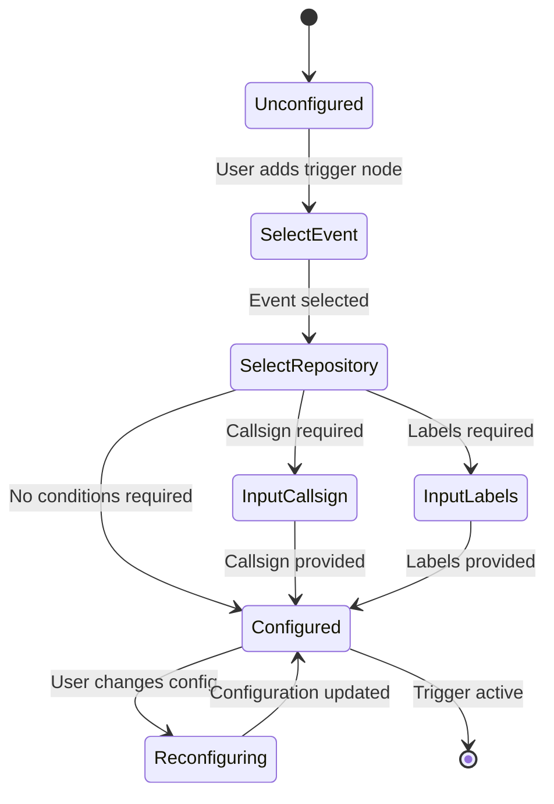
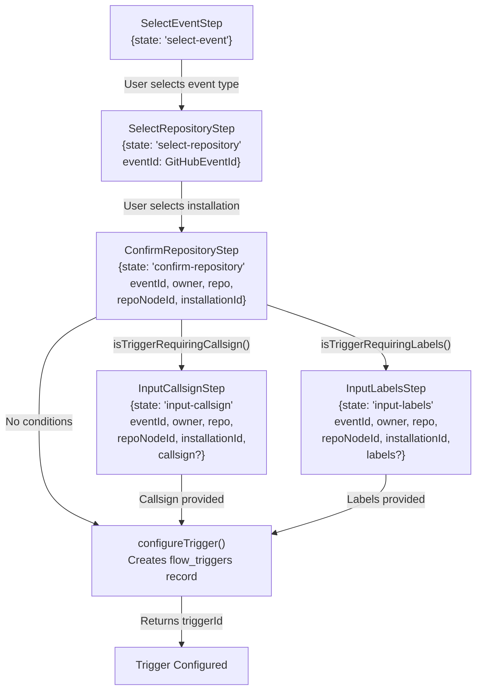
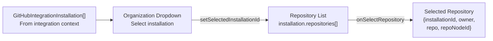
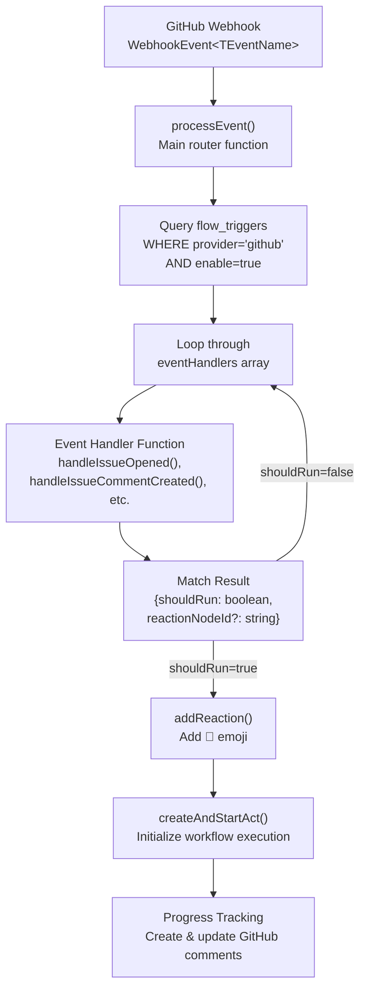
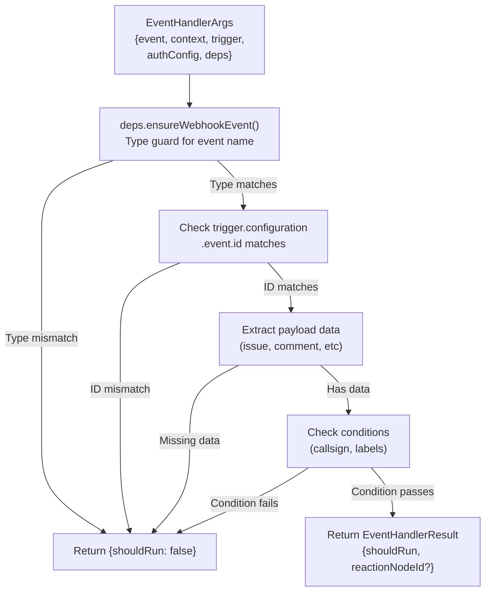
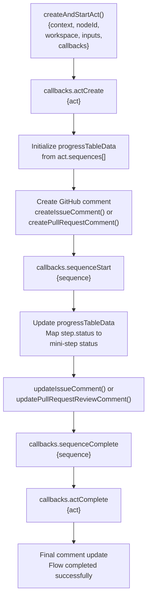
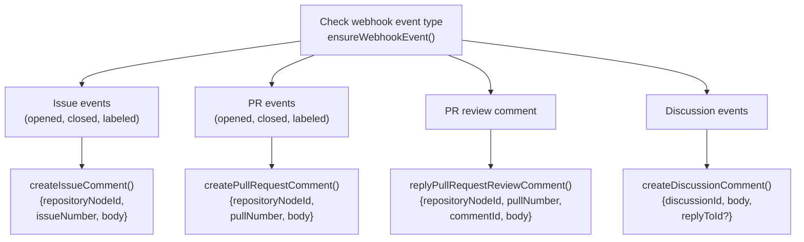
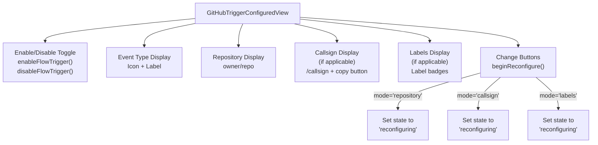

<!-- source: DeepWiki mcp.deepwiki.com · repo giselles-ai/giselle · page 4.1 GitHub Triggers and Event Processing · fetched 2026-10-26 -->

# GitHub Triggers and Event Processing

<details>
<summary>Relevant source files</summary>

The following files were used as context for generating this wiki page:

- [internal-packages/workflow-designer-ui/src/editor/properties-panel/action-node-properties-panel/github-action-properties-panel.tsx](internal-packages/workflow-designer-ui/src/editor/properties-panel/action-node-properties-panel/github-action-properties-panel.tsx)
- [internal-packages/workflow-designer-ui/src/editor/properties-panel/action-node-properties-panel/index.tsx](internal-packages/workflow-designer-ui/src/editor/properties-panel/action-node-properties-panel/index.tsx)
- [internal-packages/workflow-designer-ui/src/editor/properties-panel/action-node-properties-panel/ui/github-action-configured-view.tsx](internal-packages/workflow-designer-ui/src/editor/properties-panel/action-node-properties-panel/ui/github-action-configured-view.tsx)
- [internal-packages/workflow-designer-ui/src/editor/properties-panel/trigger-node-properties-panel/providers/github-trigger/components/event-type-display.tsx](internal-packages/workflow-designer-ui/src/editor/properties-panel/trigger-node-properties-panel/providers/github-trigger/components/event-type-display.tsx)
- [internal-packages/workflow-designer-ui/src/editor/properties-panel/trigger-node-properties-panel/providers/github-trigger/components/icons/index.tsx](internal-packages/workflow-designer-ui/src/editor/properties-panel/trigger-node-properties-panel/providers/github-trigger/components/icons/index.tsx)
- [internal-packages/workflow-designer-ui/src/editor/properties-panel/trigger-node-properties-panel/providers/github-trigger/components/install-application.tsx](internal-packages/workflow-designer-ui/src/editor/properties-panel/trigger-node-properties-panel/providers/github-trigger/components/install-application.tsx)
- [internal-packages/workflow-designer-ui/src/editor/properties-panel/trigger-node-properties-panel/providers/github-trigger/components/labels-input-step.tsx](internal-packages/workflow-designer-ui/src/editor/properties-panel/trigger-node-properties-panel/providers/github-trigger/components/labels-input-step.tsx)
- [internal-packages/workflow-designer-ui/src/editor/properties-panel/trigger-node-properties-panel/providers/github-trigger/components/unauthorized.tsx](internal-packages/workflow-designer-ui/src/editor/properties-panel/trigger-node-properties-panel/providers/github-trigger/components/unauthorized.tsx)
- [internal-packages/workflow-designer-ui/src/editor/properties-panel/trigger-node-properties-panel/providers/github-trigger/github-trigger-properties-panel.tsx](internal-packages/workflow-designer-ui/src/editor/properties-panel/trigger-node-properties-panel/providers/github-trigger/github-trigger-properties-panel.tsx)
- [internal-packages/workflow-designer-ui/src/editor/properties-panel/trigger-node-properties-panel/providers/github-trigger/utils/trigger-configuration.ts](internal-packages/workflow-designer-ui/src/editor/properties-panel/trigger-node-properties-panel/providers/github-trigger/utils/trigger-configuration.ts)
- [internal-packages/workflow-designer-ui/src/editor/properties-panel/trigger-node-properties-panel/providers/github-trigger/utils/use-trigger-configuration.ts](internal-packages/workflow-designer-ui/src/editor/properties-panel/trigger-node-properties-panel/providers/github-trigger/utils/use-trigger-configuration.ts)
- [internal-packages/workflow-designer-ui/src/editor/properties-panel/trigger-node-properties-panel/providers/manual-trigger/manual-trigger-properties-panel.tsx](internal-packages/workflow-designer-ui/src/editor/properties-panel/trigger-node-properties-panel/providers/manual-trigger/manual-trigger-properties-panel.tsx)
- [internal-packages/workflow-designer-ui/src/editor/properties-panel/trigger-node-properties-panel/ui/configured-views/github-trigger-configured-view.tsx](internal-packages/workflow-designer-ui/src/editor/properties-panel/trigger-node-properties-panel/ui/configured-views/github-trigger-configured-view.tsx)
- [internal-packages/workflow-designer-ui/src/editor/properties-panel/ui/select-repository.tsx](internal-packages/workflow-designer-ui/src/editor/properties-panel/ui/select-repository.tsx)
- [packages/giselle/src/engine/github/event-handlers.test.ts](packages/giselle/src/engine/github/event-handlers.test.ts)
- [packages/giselle/src/engine/github/event-handlers.ts](packages/giselle/src/engine/github/event-handlers.ts)
- [packages/protocol/src/trigger/github.ts](packages/protocol/src/trigger/github.ts)

</details>


This document describes the GitHub trigger system, which enables workflows to execute automatically in response to GitHub webhook events. It covers trigger configuration through the UI, webhook event processing, event matching logic, and Act execution initiation.

For information about GitHub Actions (performing actions on GitHub repositories), see [GitHub Actions and Integration](#4.2). For the broader Act execution lifecycle, see [Act Runner and Workflow Orchestration](#2.4).

## Purpose and Scope

The GitHub trigger system enables workflows to respond to GitHub repository events such as issue creation, pull request comments, and label additions. Users configure triggers through a multi-step UI, specifying the event type, target repository, and optional conditions (callsigns for comment events, labels for labeled events). When GitHub sends webhooks to the platform, the event processing engine matches incoming events against configured triggers and initiates Act executions for matching workflows.

## Trigger Configuration States

GitHub triggers progress through several states during configuration and operation:



Sources: [internal-packages/workflow-designer-ui/src/editor/properties-panel/trigger-node-properties-panel/providers/github-trigger/github-trigger-properties-panel.tsx:230-273]()

The trigger node's `content.state.status` field tracks these states:
- `unconfigured` - Initial state when node is created
- `configured` - Trigger is configured with a `flowTriggerId`
- `reconfiguring` - User is modifying an existing configuration

## GitHub Integration Authentication States

Before configuring triggers, the GitHub integration must be authenticated and installed:

| State | Description | User Action Required |
|-------|-------------|---------------------|
| `unset` | No GitHub configuration | N/A - system error |
| `unauthorized` | User needs to authorize GitHub App | Click "Continue with GitHub" |
| `not-installed` | GitHub App not installed on any accounts | Click "Install" |
| `invalid-credential` | Credentials expired or invalid | Re-authenticate |
| `installed` | GitHub App installed, ready to configure | Proceed with trigger configuration |
| `error` | Integration error occurred | Check error message |

Sources: [internal-packages/workflow-designer-ui/src/editor/properties-panel/trigger-node-properties-panel/providers/github-trigger/github-trigger-properties-panel.tsx:200-227]()

## Trigger Configuration Workflow

### Configuration Steps

The `GitHubTriggerPropertiesPanel` component implements a multi-step configuration wizard:



Sources: [internal-packages/workflow-designer-ui/src/editor/properties-panel/trigger-node-properties-panel/providers/github-trigger/github-trigger-properties-panel.tsx:230-273](), [internal-packages/workflow-designer-ui/src/editor/properties-panel/trigger-node-properties-panel/providers/github-trigger/github-trigger-properties-panel.tsx:278-295]()

### Event Type Selection

The `EventSelectionStep` component displays all available GitHub events:

| Event ID | Label | Requires Callsign | Requires Labels |
|----------|-------|-------------------|-----------------|
| `github.issue.created` | Issue Created | No | No |
| `github.issue.closed` | Issue Closed | No | No |
| `github.issue.labeled` | Issue Labeled | No | Yes |
| `github.issue_comment.created` | Issue Comment Created | Yes | No |
| `github.pull_request.opened` | Pull Request Opened | No | No |
| `github.pull_request.ready_for_review` | Pull Request Ready For Review | No | No |
| `github.pull_request.closed` | Pull Request Closed | No | No |
| `github.pull_request.labeled` | Pull Request Labeled | No | Yes |
| `github.pull_request_comment.created` | Pull Request Comment Created | Yes | No |
| `github.pull_request_review_comment.created` | Pull Request Review Comment Created | Yes | No |
| `github.discussion.created` | Discussion Created | No | No |
| `github.discussion_comment.created` | Discussion Comment Created | Yes | No |

Sources: [packages/protocol/src/trigger/github.ts:1-107](), [internal-packages/workflow-designer-ui/src/editor/properties-panel/trigger-node-properties-panel/providers/github-trigger/github-trigger-properties-panel.tsx:278-295]()

### Repository Selection

The `SelectRepository` component manages GitHub App installations and repository selection:



Sources: [internal-packages/workflow-designer-ui/src/editor/properties-panel/ui/select-repository.tsx:19-252]()

### Callsign Input

For comment-based triggers, the `InputCallsignStep` collects a callsign that must appear at the start of comments:

```typescript
// Callsign format: /callsign
// Example: /code-review, /check-policy
```

The system parses comments using `parseCommand()` to extract the callsign:

Sources: [internal-packages/workflow-designer-ui/src/editor/properties-panel/trigger-node-properties-panel/providers/github-trigger/github-trigger-properties-panel.tsx:343-403](), [packages/giselle/src/engine/github/event-handlers.ts:200-226]()

### Labels Input

For label-based triggers, the `LabelsInputStep` collects an array of labels that act as OR conditions:

```typescript
// If any of the specified labels is added, the trigger fires
// Example: ["bug", "urgent", "needs-review"]
```

Sources: [internal-packages/workflow-designer-ui/src/editor/properties-panel/trigger-node-properties-panel/providers/github-trigger/components/labels-input-step.tsx:1-184]()

### Trigger Storage

The `useTriggerConfiguration` hook calls `client.configureTrigger()` which creates a record in the `flow_triggers` table:

```typescript
{
  nodeId: NodeId,
  workspaceId: string,
  enable: boolean,
  configuration: {
    provider: "github",
    repositoryNodeId: string,
    installationId: number,
    event: GitHubEventData
  }
}
```

Sources: [internal-packages/workflow-designer-ui/src/editor/properties-panel/trigger-node-properties-panel/providers/github-trigger/utils/use-trigger-configuration.ts:29-86]()

## Event Handler Architecture

### Event Processing Flow

When GitHub sends a webhook, the system processes it through multiple layers:



Sources: [packages/giselle/src/engine/github/event-handlers.ts:477-821]()

### Event Handler Array

The system uses an array of handler functions that are checked in sequence:

```typescript
const eventHandlers = [
  handleIssueOpened,
  handleIssueClosed,
  handleIssueCommentCreated,
  handleIssueLabeled,
  handlePullRequestCommentCreated,
  handlePullRequestReviewCommentCreated,
  handlePullRequestOpened,
  handlePullRequestReadyForReview,
  handlePullRequestClosed,
  handlePullRequestLabeled,
  handleDiscussionCreated,
  handleDiscussionCommentCreated,
]
```

Sources: [packages/giselle/src/engine/github/event-handlers.ts:462-475]()

### Individual Event Handlers

Each handler implements the same signature and returns a match result:



Sources: [packages/giselle/src/engine/github/event-handlers.ts:164-180](), [packages/giselle/src/engine/github/event-handlers.ts:200-226]()

### Callsign Matching

For comment-based events, handlers use `parseCommand()` to extract and match callsigns:

```typescript
// Handler extracts callsign from comment
const command = deps.parseCommand(comment.body);

// Compare with configured callsign
const conditions = trigger.configuration.event.conditions;
if (command?.callsign !== conditions?.callsign) {
  return { shouldRun: false };
}
```

Sources: [packages/giselle/src/engine/github/event-handlers.ts:200-226](), [packages/giselle/src/engine/github/event-handlers.ts:228-257]()

### Label Matching

For label-based events, handlers check if the added label is in the configured set:

```typescript
// Extract added label from event
const addedLabel = event.data.payload.label;

// Check if it's in the configured labels array
const conditions = trigger.configuration.event.conditions;
const shouldRun = conditions.labels.includes(addedLabel.name);
```

Sources: [packages/giselle/src/engine/github/event-handlers.ts:353-384](), [packages/giselle/src/engine/github/event-handlers.ts:386-417]()

## Act Execution and Progress Tracking

### Act Creation with Callbacks

When an event matches, `processEvent()` calls `deps.createAndStartAct()` with lifecycle callbacks:



Sources: [packages/giselle/src/engine/github/event-handlers.ts:556-749]()

### Progress Table Structure

The system builds an HTML table to display progress in GitHub comments:

```typescript
type MiniStepProgressTableRow = {
  id: string,
  name: string,
  status: "pending" | "in-progress" | "success" | "failed",
  updatedAt: Date | undefined
}

type ProgressTableRow = {
  id: string,
  status: "pending" | "in-progress" | "success" | "failed",
  updatedAt: Date | undefined,
  miniStepProgressTableRows: MiniStepProgressTableRow[]
}

type ProgressTableData = ProgressTableRow[]
```

Sources: [packages/giselle/src/engine/github/event-handlers.ts:23-38]()

The `buildProgressTable()` function converts this data to HTML:

```html
<table>
  <tbody>
    <tr><td colspan='2'><strong>Step 1</strong></td></tr>
    <tr><td>⏳</td><td><details><summary><strong>Node Name</strong></summary>Status: In progress\nUpdated: Jan 1, 2024 12:00pm</details></td></tr>
    ...
  </tbody>
</table>
```

Sources: [packages/giselle/src/engine/github/event-handlers.ts:94-134]()

### Status Icon Mapping

The system maps Act step statuses to visual indicators:

| Step Status | Mini-Step Status | Icon | Display Text |
|-------------|------------------|------|--------------|
| `created` | `pending` | ⚪ | Pending |
| `queued` | `pending` | ⚪ | Pending |
| `running` | `in-progress` | ⏳ | In progress |
| `completed` | `success` | 🟢 | Success |
| `failed` | `failed` | ❌ | Failed |
| `cancelled` | `failed` | ❌ | Failed |

Sources: [packages/giselle/src/engine/github/event-handlers.ts:67-92]()

### Comment Creation by Event Type

Different event types require different comment creation methods:



Sources: [packages/giselle/src/engine/github/event-handlers.ts:583-675]()

## Event Handler Dependencies

The `processEvent()` function requires an `EventHandlerDependencies` object providing testable dependencies:

```typescript
interface EventHandlerDependencies {
  addReaction: typeof addReaction;
  ensureWebhookEvent: typeof ensureWebhookEvent;
  createAndStartAct: typeof createAndStartAct;
  parseCommand: typeof parseCommand;
  createIssueComment: typeof createIssueComment;
  createPullRequestComment: typeof createPullRequestComment;
  replyPullRequestReviewComment: typeof replyPullRequestReviewComment;
  updateIssueComment: typeof updateIssueComment;
  updatePullRequestReviewComment: typeof updatePullRequestReviewComment;
  createDiscussionComment: typeof createDiscussionComment;
  updateDiscussionComment: typeof updateDiscussionComment;
  getDiscussionForCommentCreation: typeof getDiscussionForCommentCreation;
}
```

Sources: [packages/giselle/src/engine/github/event-handlers.ts:136-149]()

## Configured Trigger Display

### GitHubTriggerConfiguredView Component

Once configured, triggers display their settings in the `GitHubTriggerConfiguredView`:



Sources: [internal-packages/workflow-designer-ui/src/editor/properties-panel/trigger-node-properties-panel/ui/configured-views/github-trigger-configured-view.tsx:70-320]()

### Reconfiguration Modes

The configured view supports reconfiguring different aspects of the trigger:

```typescript
type GitHubTriggerReconfigureMode = "repository" | "callsign" | "labels"
```

When a reconfiguration begins, the system:
1. Sets `node.content.state.status` to `"reconfiguring"`
2. Stores the `reconfigureMode` in a ref
3. Calls `client.reconfigureGitHubTrigger()` with the new configuration
4. Updates the UI back to `"configured"` status

Sources: [internal-packages/workflow-designer-ui/src/editor/properties-panel/trigger-node-properties-panel/providers/github-trigger/github-trigger-properties-panel.tsx:50](), [internal-packages/workflow-designer-ui/src/editor/properties-panel/trigger-node-properties-panel/ui/configured-views/github-trigger-configured-view.tsx:104-115]()

## Event Handler Testing

The event handlers are tested using mocked dependencies to verify matching logic without external dependencies:

```typescript
// Test structure
const testDeps: EventHandlerDependencies = {
  addReaction: vi.fn().mockResolvedValue(undefined),
  ensureWebhookEvent: createEnsureWebhookEventMock(),
  createAndStartAct: vi.fn().mockResolvedValue(undefined),
  parseCommand: vi.fn().mockReturnValue({ callsign: "giselle", content: "help me" }),
  // ... other mocked methods
}
```

Tests verify:
- Event type matching via `ensureWebhookEvent()`
- Trigger event ID matching
- Callsign extraction and comparison
- Label matching logic
- Reaction node ID extraction

Sources: [packages/giselle/src/engine/github/event-handlers.test.ts:54-126](), [packages/giselle/src/engine/github/event-handlers.test.ts:129-207]()

## Integration with Workflow System

### Trigger Node Output Configuration

When a trigger is configured, the system generates outputs based on the event type:

```typescript
const outputs: Output[] = githubEventToInputFields(githubEvent).map(
  (inputField) => ({
    id: OutputId.generate(),
    label: inputField.label,
    accessor: inputField.key,
  })
)
```

These outputs become available for downstream nodes to consume through connections.

Sources: [internal-packages/workflow-designer-ui/src/editor/properties-panel/trigger-node-properties-panel/providers/github-trigger/utils/use-trigger-configuration.ts:58-64]()

### Webhook Event Input

When `createAndStartAct()` is called, the webhook event is passed as an input:

```typescript
inputs: [
  {
    type: "github-webhook-event",
    webhookEvent: event
  }
]
```

This makes the full webhook payload available to nodes in the workflow through the trigger node's outputs.

Sources: [packages/giselle/src/engine/github/event-handlers.ts:561-566]()

---

