<!-- source: DeepWiki mcp.deepwiki.com · repo giselles-ai/giselle · page 5 Workflow Designer UI · fetched 2026-10-26 -->

# Workflow Designer UI

<details>
<summary>Relevant source files</summary>

The following files were used as context for generating this wiki page:

- [internal-packages/ui/components/note.tsx](internal-packages/ui/components/note.tsx)
- [internal-packages/workflow-designer-ui/src/app/globals.css](internal-packages/workflow-designer-ui/src/app/globals.css)
- [internal-packages/workflow-designer-ui/src/editor/chat/floating-chat.tsx](internal-packages/workflow-designer-ui/src/editor/chat/floating-chat.tsx)
- [internal-packages/workflow-designer-ui/src/editor/chat/index.ts](internal-packages/workflow-designer-ui/src/editor/chat/index.ts)
- [internal-packages/workflow-designer-ui/src/editor/context-menu/index.tsx](internal-packages/workflow-designer-ui/src/editor/context-menu/index.tsx)
- [internal-packages/workflow-designer-ui/src/editor/context-menu/types.ts](internal-packages/workflow-designer-ui/src/editor/context-menu/types.ts)
- [internal-packages/workflow-designer-ui/src/editor/hooks/use-keyboard-shortcuts.ts](internal-packages/workflow-designer-ui/src/editor/hooks/use-keyboard-shortcuts.ts)
- [internal-packages/workflow-designer-ui/src/editor/node/index.ts](internal-packages/workflow-designer-ui/src/editor/node/index.ts)
- [internal-packages/workflow-designer-ui/src/editor/v2/components/floating-properties-panel.tsx](internal-packages/workflow-designer-ui/src/editor/v2/components/floating-properties-panel.tsx)
- [internal-packages/workflow-designer-ui/src/editor/v2/components/v2-container.tsx](internal-packages/workflow-designer-ui/src/editor/v2/components/v2-container.tsx)
- [internal-packages/workflow-designer-ui/src/editor/v2/components/v2-footer.tsx](internal-packages/workflow-designer-ui/src/editor/v2/components/v2-footer.tsx)
- [internal-packages/workflow-designer-ui/src/editor/v2/state.ts](internal-packages/workflow-designer-ui/src/editor/v2/state.ts)
- [internal-packages/workflow-designer-ui/src/editor/v2/v2-placeholder.tsx](internal-packages/workflow-designer-ui/src/editor/v2/v2-placeholder.tsx)

</details>


## Purpose and Scope

The Workflow Designer UI is the visual interface system for creating and editing AI workflows in the Giselle platform. It provides a node-based canvas for assembling workflows, configuring AI model parameters, managing connections between components, and executing generations. The system is built on ReactFlow for the graph visualization and uses Zustand for state management.

This page covers the overall architecture, component structure, state management, and user interaction patterns of the designer interface. For detailed information about specific subsystems:
- Editor architecture and state management details: [5.1](#5.1)
- Node rendering and visual components: [5.2](#5.2)
- Properties panels for node configuration: [5.3](#5.3)
- Toolbar and node creation: [5.4](#5.4)
- Generation execution and results: [5.5](#5.5)
- Model configuration interfaces: [5.6](#5.6)

For information about the underlying workflow execution engine, see [Core Engine and SDK](#2).

## System Architecture

The Workflow Designer UI is organized as a layered component hierarchy that integrates ReactFlow for graph visualization with custom UI components for workflow-specific functionality.

### High-Level Component Architecture

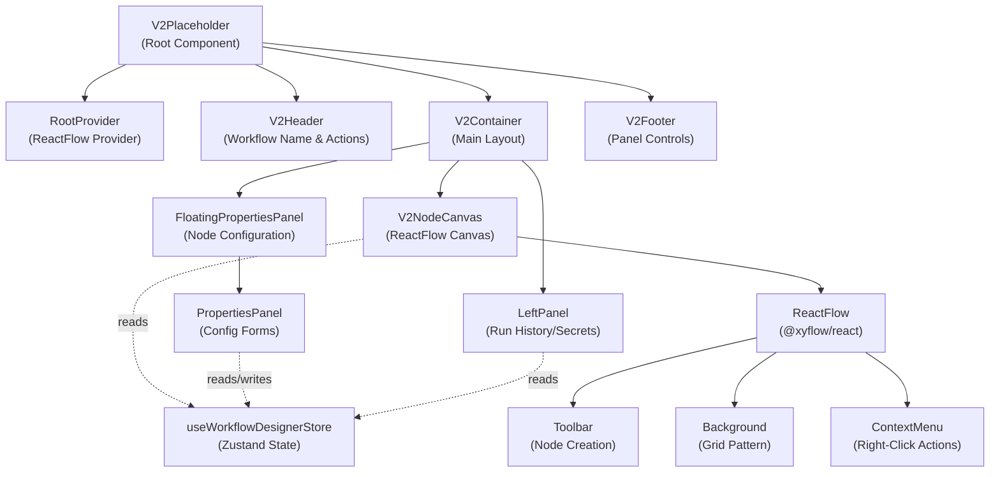

**Sources:** [internal-packages/workflow-designer-ui/src/editor/v2/v2-placeholder.tsx:1-107](), [internal-packages/workflow-designer-ui/src/editor/v2/components/v2-container.tsx:1-491]()

### Component Hierarchy and Data Flow

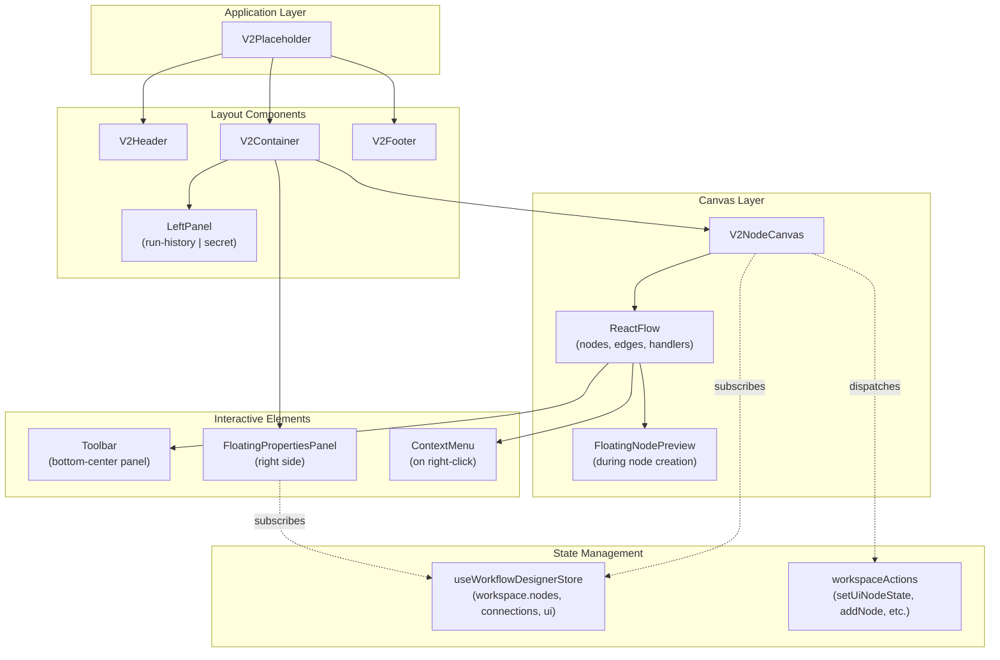

**Sources:** [internal-packages/workflow-designer-ui/src/editor/v2/v2-placeholder.tsx:66-106](), [internal-packages/workflow-designer-ui/src/editor/v2/components/v2-container.tsx:49-491]()

## Core Components

### V2Placeholder - Root Component

`V2Placeholder` is the top-level component that orchestrates the entire designer interface. It manages layout state, tour visibility, and read-only banner display.

| Component | Purpose |
|-----------|---------|
| `RootProvider` | Wraps the editor with ReactFlow context |
| `V2Header` | Displays workflow name and actions |
| `V2Container` | Main canvas and panels layout |
| `V2Footer` | Panel toggles and documentation link |
| `WorkspaceTour` | Interactive tour for new users |
| `FloatingChat` | AI assistant chat interface |

**Key State:**
- `layoutState.leftPanel`: Controls which left panel is visible (`"run-history"` \| `"secret"` \| `null`)
- `isTourOpen`: Controls workspace tour visibility
- `isChatOpen`: Controls floating chat visibility
- `showReadOnlyBanner`: Controls read-only mode banner

**Sources:** [internal-packages/workflow-designer-ui/src/editor/v2/v2-placeholder.tsx:16-107]()

### V2Container - Main Layout

`V2Container` implements the resizable panel layout using `react-resizable-panels`. It contains:
- Left panel (conditional) for run history or secrets
- Main canvas area with `V2NodeCanvas`
- Floating properties panel (conditional based on node selection)

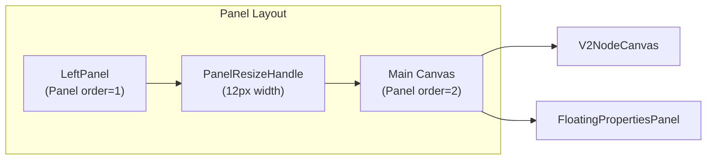

**Conditional Rendering Logic:**
- Left panel renders only if `leftPanel !== null`
- Floating properties panel renders when exactly one node is selected
- Panel visibility affects `defaultWidth` and `minWidth` based on node type

**Sources:** [internal-packages/workflow-designer-ui/src/editor/v2/components/v2-container.tsx:400-490]()

### V2NodeCanvas - ReactFlow Integration

`V2NodeCanvas` is the core canvas component that wraps ReactFlow and manages all graph interactions.

**Key Responsibilities:**
1. **Node Management**: Converts workspace nodes to ReactFlow nodes with UI state
2. **Edge Management**: Converts connections to ReactFlow edges with selection state
3. **Event Handling**: Processes node clicks, drags, connections, and deletions
4. **Keyboard Shortcuts**: Integrates with keyboard shortcut system
5. **Tool Integration**: Handles node creation from toolbar

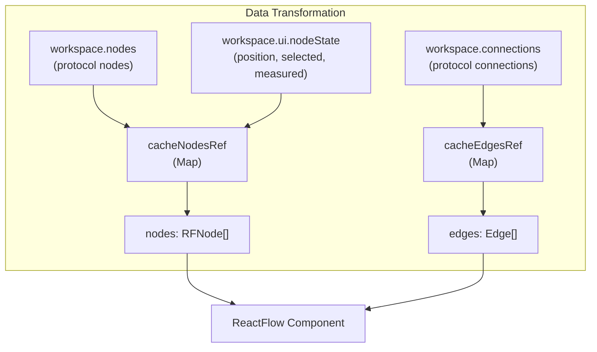

**Node Caching Strategy:**
The component uses `useMemo` with ref-based caching to optimize ReactFlow performance by only recreating nodes/edges when their relevant properties change ([v2-container.tsx:89-151]()).

**Sources:** [internal-packages/workflow-designer-ui/src/editor/v2/components/v2-container.tsx:53-398]()

## State Management

The Workflow Designer uses Zustand for centralized state management through `useWorkflowDesignerStore`. The store maintains workspace data and UI state.

### Store Structure

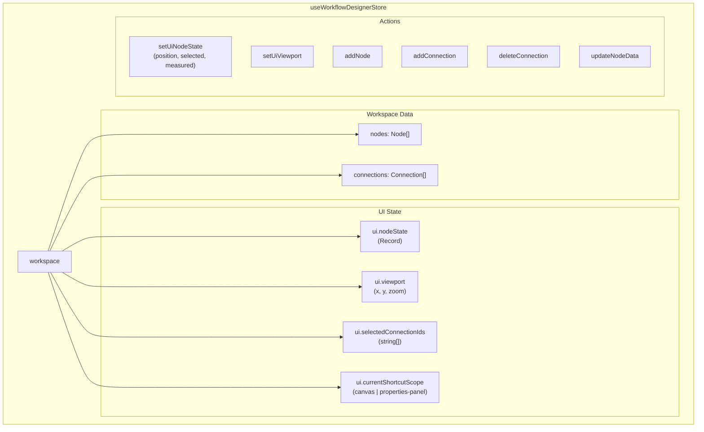

**State Access Patterns:**
- Components use `useShallow` selector to prevent unnecessary re-renders
- Actions are imported via `workspaceActions` from the store
- Node state is tracked per-node with unique `NodeId` keys

**Sources:** [internal-packages/workflow-designer-ui/src/editor/v2/components/v2-container.tsx:54-76]()

### Node State Management

Each node has associated UI state stored in `workspace.ui.nodeState[nodeId]`:

| Property | Type | Purpose |
|----------|------|---------|
| `position` | `{ x: number, y: number }` | Canvas position |
| `selected` | `boolean` | Selection state |
| `measured` | `{ width?: number, height?: number }` | Rendered dimensions |

**Update Flow:**
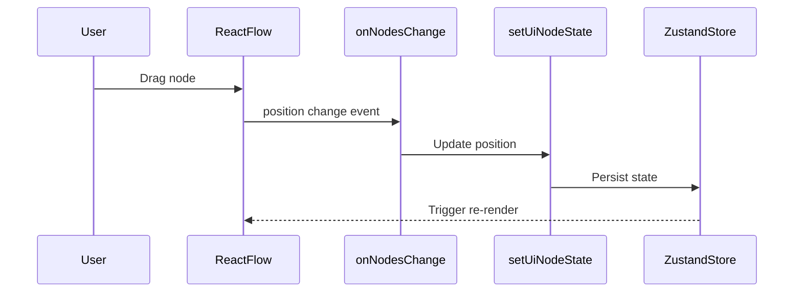

**Sources:** [internal-packages/workflow-designer-ui/src/editor/v2/components/v2-container.tsx:233-295]()

## User Interactions

### Node Connection Flow

When users connect nodes by dragging from one handle to another:

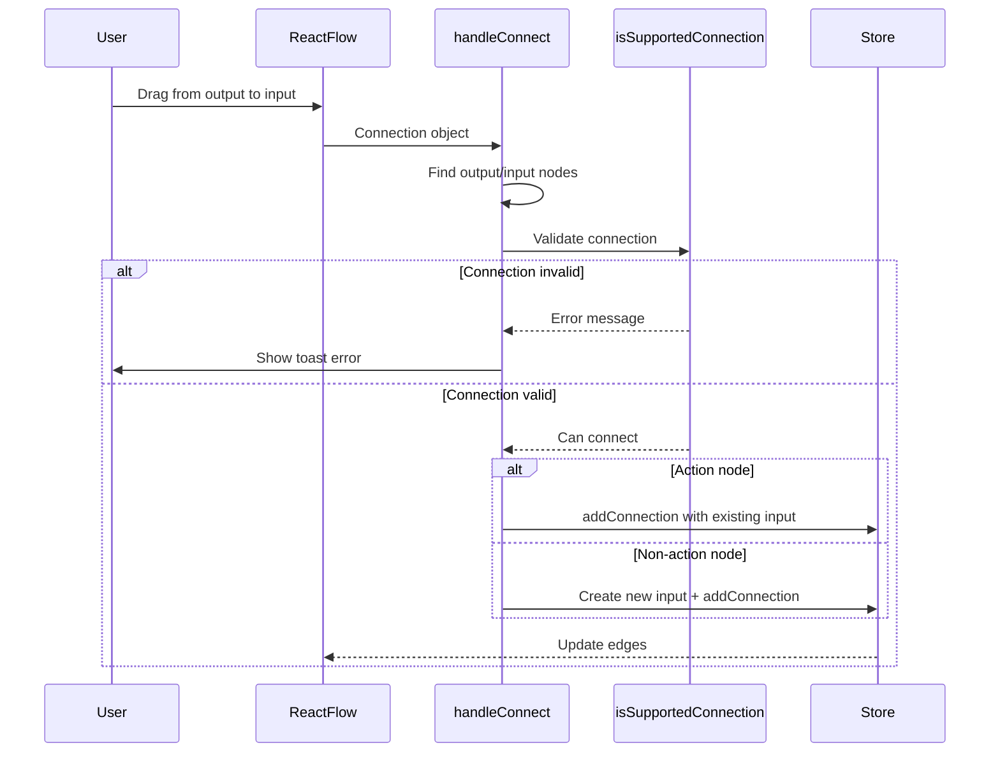

**Validation Logic:**
- Checks if nodes can be connected using `isSupportedConnection` from `@giselles-ai/giselle/react`
- Prevents duplicate connections to the same input/output
- For action nodes, uses existing input; for other nodes, dynamically creates new input

**Sources:** [internal-packages/workflow-designer-ui/src/editor/v2/components/v2-container.tsx:153-204](), [internal-packages/workflow-designer-ui/src/editor/v2/components/v2-container.tsx:206-221]()

### Node Creation with Toolbar

Node creation follows a state machine pattern managed by the toolbar:

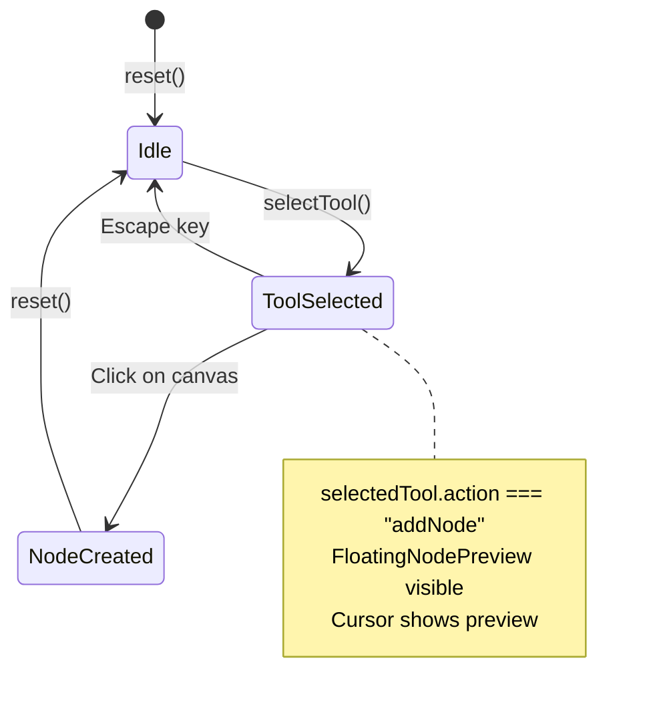

**Implementation:**
1. User selects tool from `Toolbar` component
2. `useToolbar` hook manages `selectedTool` state
3. `FloatingNodePreview` follows cursor when tool is selected
4. Canvas click event calls `addNode` with cursor position
5. Tool resets to "move" mode

**Sources:** [internal-packages/workflow-designer-ui/src/editor/v2/components/v2-container.tsx:317-344]()

### Keyboard Shortcuts

The editor provides comprehensive keyboard shortcuts managed by `useKeyboardShortcuts` hook:

| Shortcut | Action | Scope |
|----------|--------|-------|
| `t` | Select trigger tool | Canvas |
| `i` | Select source category | Canvas |
| `g` | Select language model tool | Canvas |
| `r` | Select retrieval category | Canvas |
| `d` | Select action tool | Canvas |
| `Escape` | Reset to move tool | Canvas |
| `Cmd/Ctrl + C` | Copy selected nodes | Canvas |
| `Cmd/Ctrl + V` | Paste nodes | Canvas |
| `Cmd/Ctrl + D` | Duplicate nodes | Canvas |
| `Cmd/Ctrl + Enter` | Generate (in properties panel) | Properties Panel |

**Shortcut Scope System:**
- `workspace.ui.currentShortcutScope` determines which shortcuts are active
- Canvas scope: Keyboard shortcuts for tools and node manipulation
- Properties panel scope: Generation shortcuts and form interactions
- Prevents conflicts between canvas and form interactions

**Sources:** [internal-packages/workflow-designer-ui/src/editor/hooks/use-keyboard-shortcuts.ts:1-139]()

### Context Menu

Right-clicking a node opens a context menu with actions:

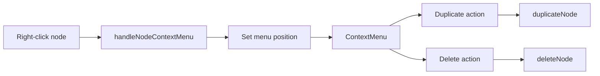

**Position Calculation:**
The context menu calculates position to avoid going off-screen by checking if cursor is within 200px of canvas edges ([v2-container.tsx:345-362]()).

**Sources:** [internal-packages/workflow-designer-ui/src/editor/v2/components/v2-container.tsx:345-362](), [internal-packages/workflow-designer-ui/src/editor/context-menu/index.tsx:1-59]()

## Floating Properties Panel

The `FloatingPropertiesPanel` provides a resizable, draggable panel for node configuration. It uses a custom implementation rather than a modal to maintain canvas context.

### Panel Architecture

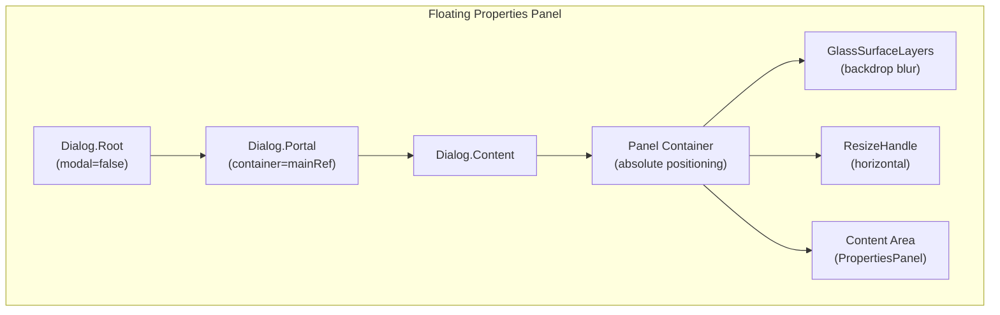

**Resize Implementation:**
- Uses mouse event handlers with throttling for performance
- Maintains `intermediateWidthRef` for smooth resize
- Respects `minWidth` and `maxWidth` constraints
- Position-aware (can be right or left aligned)

**Conditional Behavior:**
| Node Type | `defaultWidth` | `minWidth` | `autoHeight` |
|-----------|----------------|------------|--------------|
| `textGeneration` | 400px | 400px | false |
| `file` | default | default | true |
| `text` | default | default | true |
| `vectorStore` | default | default | true |
| `webPage` | default | default | true |
| `manualTrigger` | default | default | true |

**Sources:** [internal-packages/workflow-designer-ui/src/editor/v2/components/floating-properties-panel.tsx:1-179](), [internal-packages/workflow-designer-ui/src/editor/v2/components/v2-container.tsx:409-484]()

## Footer Panel Controls

`V2Footer` provides quick access to auxiliary panels and documentation:

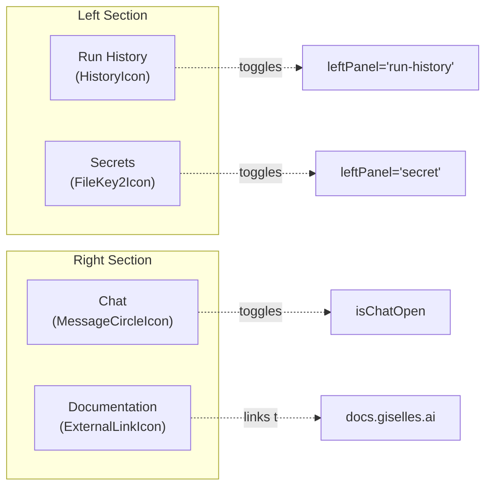

**Active State Styling:**
- Active panels shown in `#6B8FF0` (blue)
- Inactive panels shown in `text-inverse` with hover effect
- Icons are 14x14px for consistency

**Sources:** [internal-packages/workflow-designer-ui/src/editor/v2/components/v2-footer.tsx:1-118]()

## CSS and Styling

The designer uses a custom CSS theme system with CSS variables and Tailwind utilities.

### Canvas Styling

```css
/* ReactFlow pane with glass effect */
.giselle-workflow-editor-v3 .react-flow__pane {
  border: 0.5px solid rgba(235, 235, 235, 0.15);
  box-shadow: inset 0 0 40px rgba(200, 200, 200, 0.15);
}
```

**Cursor States:**
- Default: `cursor: default` for pane and nodes
- Node creation: `cursor: crosshair` when `data-floating-node="true"`
- Dragging: `cursor: default` (overrides ReactFlow's grab cursor)

**Sources:** [internal-packages/workflow-designer-ui/src/app/globals.css:1-240]()

### Custom Animations

The system defines several keyframe animations:

| Animation | Purpose | Usage |
|-----------|---------|-------|
| `pop-pop` | Node activity indicator | Loading states with 3 phases |
| `follow-through-overlap-spin` | Spinner animation | Progress indicators |
| `slideDown` / `slideUp` | Accordion transitions | Expandable sections |
| `shimmer` | Shimmer effect | Loading placeholders |
| `fadeInUp` | Entrance animation | Floating chat panel |

**Sources:** [internal-packages/workflow-designer-ui/src/app/globals.css:51-147](), [internal-packages/workflow-designer-ui/src/app/globals.css:168-223]()

## Integration with Core Systems

### Giselle Engine Integration

The Workflow Designer UI connects to the Giselle Engine through several integration points:

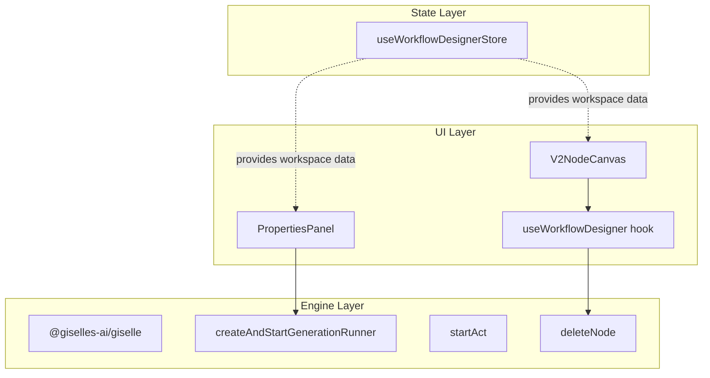

**Key Integration Methods:**
- `useWorkflowDesigner`: Hook providing `deleteNode`, `data` access
- `isSupportedConnection`: Validates node connections based on protocol rules
- `createAndStartGenerationRunner`: Initiates generation execution from properties panel

**Sources:** [internal-packages/workflow-designer-ui/src/editor/v2/components/v2-container.tsx:24-29](), [internal-packages/workflow-designer-ui/src/editor/v2/components/v2-container.tsx:77]()

### ReactFlow Node and Edge Types

The designer registers custom node and edge types with ReactFlow:

```javascript
// From node/index.ts and connector/index.ts
const nodeTypes = {
  giselle: NodeComponent  // Custom node renderer
};

const edgeTypes = {
  giselleConnector: ConnectorComponent  // Custom edge renderer
};
```

**Node Data Structure:**
```
RFNode {
  id: NodeId
  type: "giselle"
  position: { x, y }
  selected: boolean
  measured: { width?, height? }
  data: {}  // Empty, actual data in workspace store
}
```

**Edge Data Structure:**
```
Edge {
  id: string (connection.id)
  source: NodeId
  sourceHandle: OutputId
  target: NodeId
  targetHandle: InputId
  type: "giselleConnector"
  selected: boolean
  data: { connection }
}
```

**Sources:** [internal-packages/workflow-designer-ui/src/editor/v2/components/v2-container.tsx:34-36](), [internal-packages/workflow-designer-ui/src/editor/v2/components/v2-container.tsx:90-151]()

## Read-Only Mode

The designer supports a read-only mode for viewers and guests:

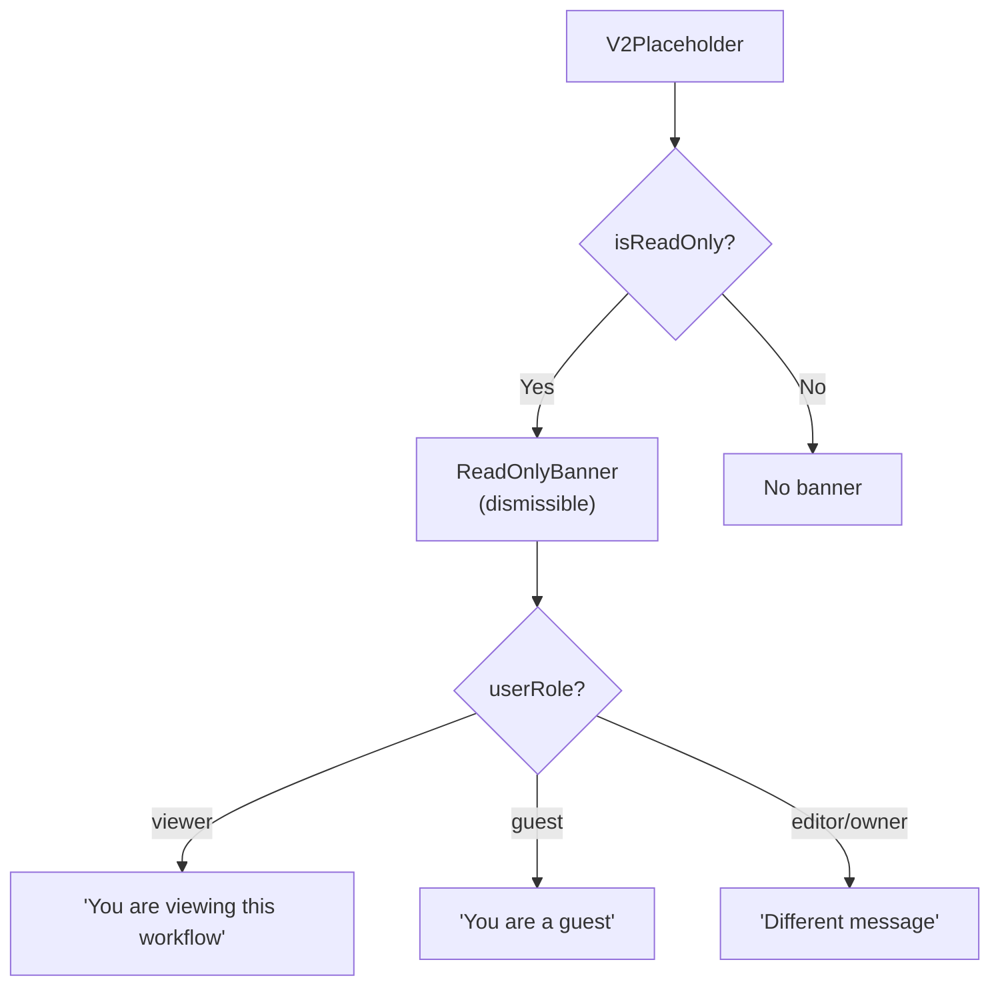

**Access Control:**
The `V2Placeholder` component accepts `isReadOnly` and `userRole` props to control UI behavior and messaging. Note: Actual enforcement of read-only restrictions happens at the API/action layer, not just the UI.

**Sources:** [internal-packages/workflow-designer-ui/src/editor/v2/v2-placeholder.tsx:16-75]()

## Summary

The Workflow Designer UI is a sophisticated React-based visual editor built on ReactFlow. Its architecture emphasizes:

1. **Separation of Concerns**: Layout (V2Container), canvas (V2NodeCanvas), and configuration (PropertiesPanel) are distinct layers
2. **Performance**: Node/edge caching and shallow selectors minimize re-renders
3. **State Management**: Centralized Zustand store with action creators for predictable updates
4. **User Experience**: Keyboard shortcuts, context menus, floating panels, and visual feedback
5. **Extensibility**: Plugin-based node types and edge types through ReactFlow registries

The system integrates tightly with the Giselle Engine ([2](#2)) for workflow execution while maintaining a clean separation between UI concerns and business logic.

---

