<!-- source: DeepWiki mcp.deepwiki.com · repo giselles-ai/giselle · page 5.1 Editor Architecture and State Management · fetched 2026-10-26 -->

# Editor Architecture and State Management

<details>
<summary>Relevant source files</summary>

The following files were used as context for generating this wiki page:

- [internal-packages/ui/components/note.tsx](internal-packages/ui/components/note.tsx)
- [internal-packages/workflow-designer-ui/src/app/globals.css](internal-packages/workflow-designer-ui/src/app/globals.css)
- [internal-packages/workflow-designer-ui/src/editor/chat/floating-chat.tsx](internal-packages/workflow-designer-ui/src/editor/chat/floating-chat.tsx)
- [internal-packages/workflow-designer-ui/src/editor/chat/index.ts](internal-packages/workflow-designer-ui/src/editor/chat/index.ts)
- [internal-packages/workflow-designer-ui/src/editor/context-menu/index.tsx](internal-packages/workflow-designer-ui/src/editor/context-menu/index.tsx)
- [internal-packages/workflow-designer-ui/src/editor/context-menu/types.ts](internal-packages/workflow-designer-ui/src/editor/context-menu/types.ts)
- [internal-packages/workflow-designer-ui/src/editor/hooks/use-keyboard-shortcuts.ts](internal-packages/workflow-designer-ui/src/editor/hooks/use-keyboard-shortcuts.ts)
- [internal-packages/workflow-designer-ui/src/editor/node/index.ts](internal-packages/workflow-designer-ui/src/editor/node/index.ts)
- [internal-packages/workflow-designer-ui/src/editor/v2/components/floating-properties-panel.tsx](internal-packages/workflow-designer-ui/src/editor/v2/components/floating-properties-panel.tsx)
- [internal-packages/workflow-designer-ui/src/editor/v2/components/v2-container.tsx](internal-packages/workflow-designer-ui/src/editor/v2/components/v2-container.tsx)
- [internal-packages/workflow-designer-ui/src/editor/v2/components/v2-footer.tsx](internal-packages/workflow-designer-ui/src/editor/v2/components/v2-footer.tsx)
- [internal-packages/workflow-designer-ui/src/editor/v2/state.ts](internal-packages/workflow-designer-ui/src/editor/v2/state.ts)
- [internal-packages/workflow-designer-ui/src/editor/v2/v2-placeholder.tsx](internal-packages/workflow-designer-ui/src/editor/v2/v2-placeholder.tsx)

</details>


## Purpose and Scope

This document describes the architecture and state management of the Workflow Designer V2 editor, which provides a visual interface for creating and editing AI workflows. The editor is built on top of ReactFlow and uses Zustand for state management. This page covers the overall editor structure, state management patterns, component hierarchy, event handling, and keyboard shortcuts. For information about individual node rendering and visual styling, see [Node Rendering and Visual System](#5.2). For node configuration interfaces, see [Properties Panels and Node Configuration](#5.3).

## Architecture Overview

The V2 editor architecture consists of several integrated layers that work together to provide a visual workflow editing experience:

**Editor Architecture Layers**

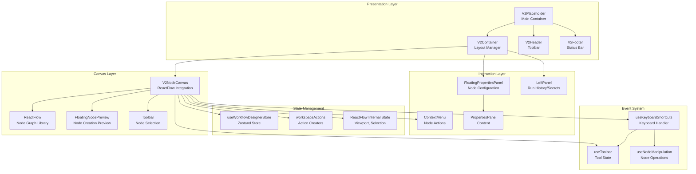

Sources: [internal-packages/workflow-designer-ui/src/editor/v2/components/v2-container.tsx:1-491](), [internal-packages/workflow-designer-ui/src/editor/v2/v2-placeholder.tsx:1-107](), [internal-packages/workflow-designer-ui/src/editor/hooks/use-keyboard-shortcuts.ts:1-139]()

## State Management Architecture

### Zustand Store Structure

The editor uses a centralized Zustand store accessed through `useWorkflowDesignerStore`. The store maintains workspace state including nodes, connections, and UI state:

**Store State Schema**

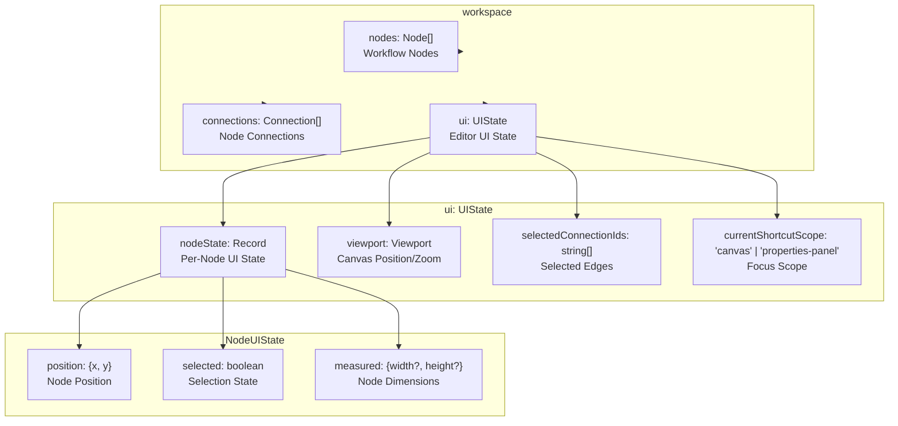

Sources: [internal-packages/workflow-designer-ui/src/editor/v2/components/v2-container.tsx:54-62]()

### ReactFlow State Integration

The editor transforms Zustand state into ReactFlow's node and edge formats using memoized transformations with caching for performance:

**Node Transformation**

The `V2NodeCanvas` component converts workspace nodes to ReactFlow nodes [internal-packages/workflow-designer-ui/src/editor/v2/components/v2-container.tsx:89-125]():

- Retrieves nodes and UI state from Zustand store
- Uses `cacheNodesRef` to prevent unnecessary re-renders by comparing previous state
- Creates `RFNode` objects with position, selection state, and measured dimensions
- Triggers `updateNodeInternals` when node structure changes

**Edge Transformation**

Connections are transformed to ReactFlow edges [internal-packages/workflow-designer-ui/src/editor/v2/components/v2-container.tsx:127-151]():

- Maps connection objects to edge format with source/target handles
- Uses `cacheEdgesRef` for caching and comparison
- Includes selection state and connection metadata

### State Synchronization

State flows bidirectionally between Zustand and ReactFlow:

**Zustand → ReactFlow**

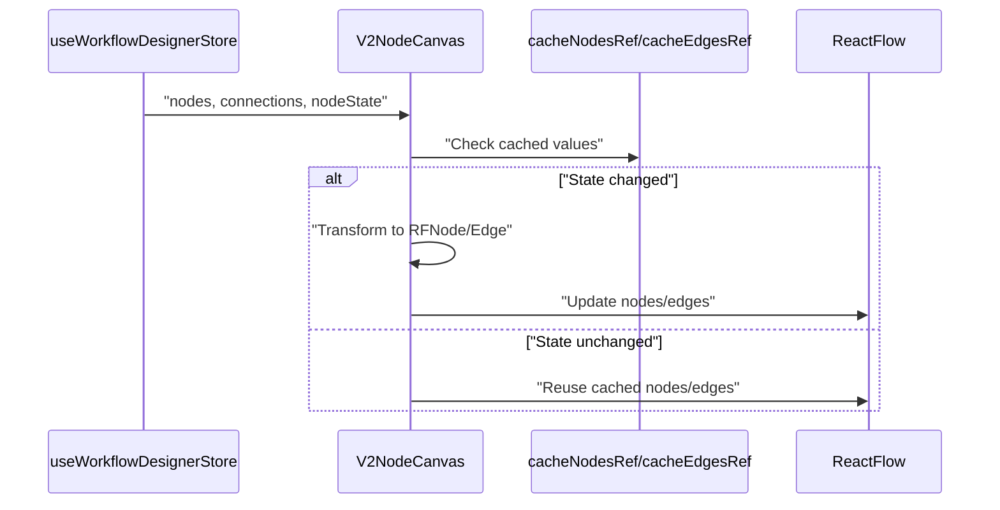

**ReactFlow → Zustand**

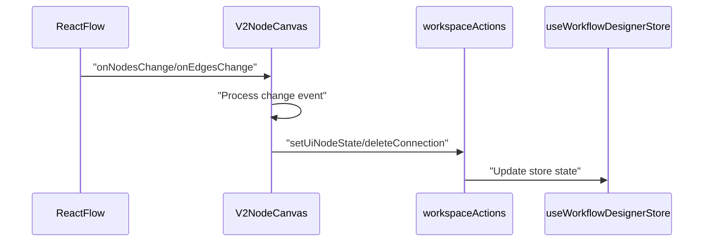

Sources: [internal-packages/workflow-designer-ui/src/editor/v2/components/v2-container.tsx:233-295](), [internal-packages/workflow-designer-ui/src/editor/v2/components/v2-container.tsx:297-316]()

## Component Hierarchy

The V2 editor is organized into a hierarchical component structure:

**Component Tree**

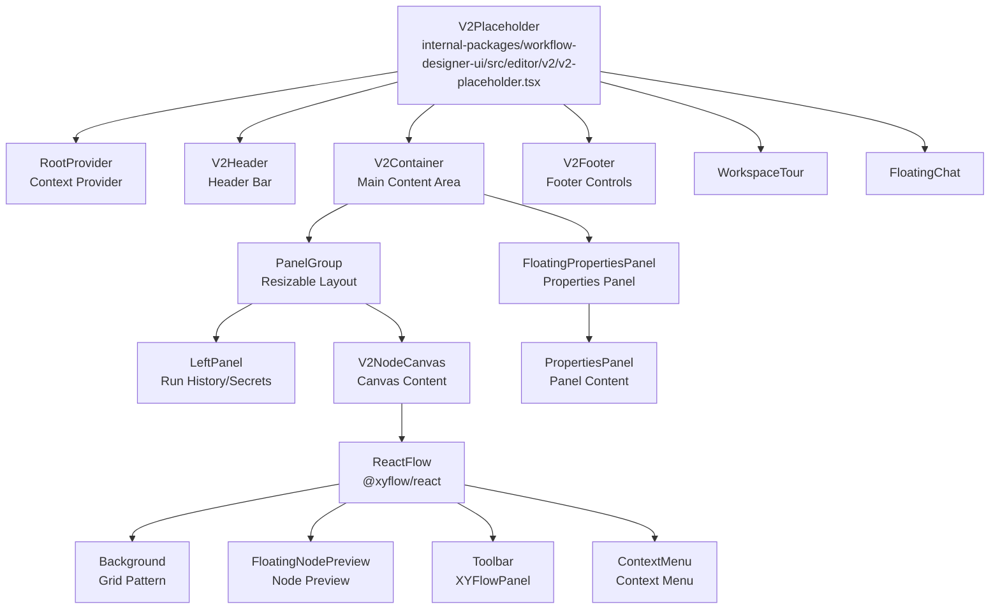

Sources: [internal-packages/workflow-designer-ui/src/editor/v2/v2-placeholder.tsx:16-106](), [internal-packages/workflow-designer-ui/src/editor/v2/components/v2-container.tsx:400-490]()

### V2Placeholder

The root component that manages top-level layout state [internal-packages/workflow-designer-ui/src/editor/v2/v2-placeholder.tsx:16-106]():

**State Management:**
- `layoutState: V2LayoutState` - Controls left panel visibility
- `isTourOpen: boolean` - Workspace tour state
- `isChatOpen: boolean` - Chat panel state
- `showReadOnlyBanner: boolean` - Read-only mode indicator

**Responsibilities:**
- Feature flag integration for layout variants
- Read-only mode handling
- Left panel toggle coordination
- Chat panel coordination

### V2Container

The main content container that orchestrates the canvas and panels [internal-packages/workflow-designer-ui/src/editor/v2/components/v2-container.tsx:400-490]():

**Layout Structure:**
- Uses `react-resizable-panels` for resizable layout
- Left panel (optional): Run History or Secrets
- Main panel: Node canvas
- Floating properties panel (right): Node configuration

**Panel Selection Logic:**
```typescript
const isPropertiesPanelOpen = selectedNodes.length === 1;
const isTextGenerationPanel = isPropertiesPanelOpen && 
  selectedNodes[0]?.content.type === "textGeneration";
```

The properties panel automatically opens when a single node is selected and adapts its size based on node type.

Sources: [internal-packages/workflow-designer-ui/src/editor/v2/components/v2-container.tsx:400-490]()

### V2NodeCanvas

The core canvas component that integrates ReactFlow [internal-packages/workflow-designer-ui/src/editor/v2/components/v2-container.tsx:53-398]():

**Key Features:**
- Node and edge transformation from Zustand state
- Connection validation and creation
- Node selection and manipulation
- Context menu handling
- Tool-based node creation
- Keyboard event handling

**ReactFlow Configuration:**
```typescript
<ReactFlow
  className="giselle-workflow-editor-v3"
  colorMode="dark"
  nodes={nodes}
  edges={edges}
  nodeTypes={nodeTypes}
  edgeTypes={edgeTypes}
  panOnScroll={true}
  zoomOnScroll={false}
  zoomOnPinch={true}
  onConnect={handleConnect}
  isValidConnection={isValidConnection}
  onNodesChange={handleNodesChange}
  onEdgesChange={handleEdgesChange}
  onNodeClick={handleNodeClick}
  onPaneClick={handlePanelClick}
  onKeyDown={handleKeyDown}
  onNodeContextMenu={handleNodeContextMenu}
/>
```

Sources: [internal-packages/workflow-designer-ui/src/editor/v2/components/v2-container.tsx:364-397]()

## Layout State Management

The editor uses a simple state type to manage layout configuration:

**Layout State Type** [internal-packages/workflow-designer-ui/src/editor/v2/state.ts:1-5]():

```typescript
export type LeftPanelValue = "run-history" | "secret";
export interface V2LayoutState {
  leftPanel: LeftPanelValue | null;
}
```

**Layout State Flow:**

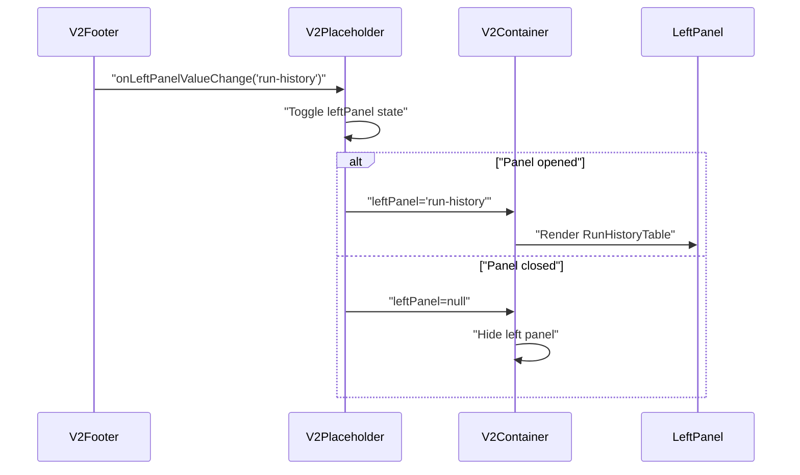

The footer provides toggle buttons that cycle through panel states:
- Clicking an active panel closes it
- Clicking an inactive panel opens it and closes any other open panel

Sources: [internal-packages/workflow-designer-ui/src/editor/v2/state.ts:1-5](), [internal-packages/workflow-designer-ui/src/editor/v2/v2-placeholder.tsx:39-59](), [internal-packages/workflow-designer-ui/src/editor/v2/components/v2-footer.tsx:1-118]()

## Floating Properties Panel

The `FloatingPropertiesPanel` is a resizable, non-modal dialog that displays node configuration:

**Panel Configuration** [internal-packages/workflow-designer-ui/src/editor/v2/components/floating-properties-panel.tsx:9-35]():

| Property | Type | Description |
|----------|------|-------------|
| `isOpen` | boolean | Panel visibility state |
| `defaultWidth` | number | Initial width (default: 400px) |
| `minWidth` | number | Minimum width (default: 400px) |
| `maxWidth` | number | Maximum width (default: 1200px) |
| `autoHeight` | boolean | Auto-height mode for simple panels |
| `container` | Element | Portal container for positioning |

**Resize Implementation:**

The panel uses a custom resize handle with throttled mouse move events [internal-packages/workflow-designer-ui/src/editor/v2/components/floating-properties-panel.tsx:66-101]():

1. Mouse down on resize handle captures start position
2. Mouse move calculates delta and updates width
3. Throttling (~60fps) prevents excessive re-renders
4. Mouse up cleanup removes event listeners

**Visual Layers:**

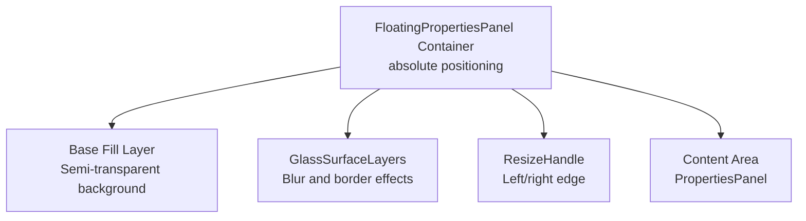

Sources: [internal-packages/workflow-designer-ui/src/editor/v2/components/floating-properties-panel.tsx:1-179]()

## Event Handling

### Connection Management

The editor validates and creates connections between nodes [internal-packages/workflow-designer-ui/src/editor/v2/components/v2-container.tsx:153-204]():

**Connection Validation Flow:**

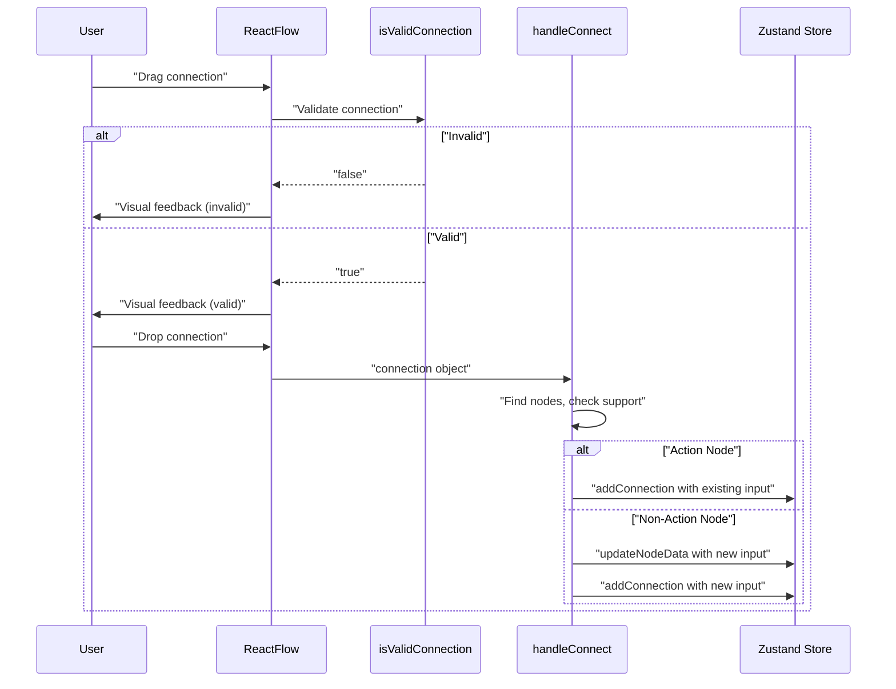

**Validation Rules:**
- Source and target must have valid handles
- Self-connections are not allowed
- Duplicate connections are prevented
- Node type compatibility is checked via `isSupportedConnection`

Sources: [internal-packages/workflow-designer-ui/src/editor/v2/components/v2-container.tsx:153-221]()

### Node Manipulation

Node changes flow through the `handleNodesChange` callback [internal-packages/workflow-designer-ui/src/editor/v2/components/v2-container.tsx:233-295]():

**Change Types:**

| Type | Action | State Update |
|------|--------|--------------|
| `position` | Node dragged | Update `nodeState[id].position` |
| `dimensions` | Node measured | Update `nodeState[id].measured` |
| `select` | Selection changed | Update `nodeState[id].selected` |
| `remove` | Node deleted | Delete connections, clean up inputs, call `deleteNode` |

**Node Removal Flow:**

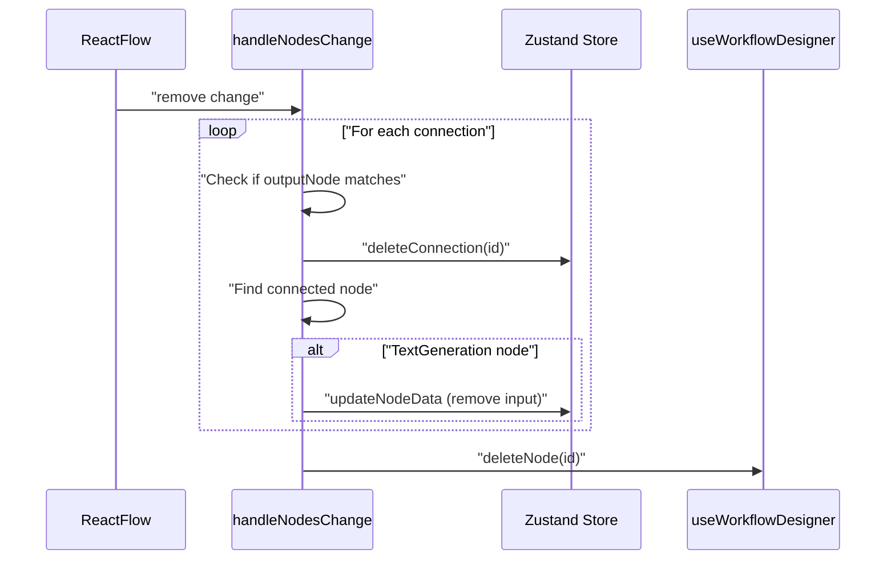

Sources: [internal-packages/workflow-designer-ui/src/editor/v2/components/v2-container.tsx:233-295]()

### Edge Selection

Edge selection is managed through `handleEdgesChange` [internal-packages/workflow-designer-ui/src/editor/v2/components/v2-container.tsx:297-316]():

```typescript
const handleEdgesChange: OnEdgesChange = useCallback(
  (changes) => {
    for (const change of changes) {
      switch (change.type) {
        case "select":
          if (change.selected) {
            selectConnection(change.id);
          } else {
            deselectConnection(change.id);
          }
          break;
        case "remove":
          deleteConnection(change.id);
          break;
      }
    }
  },
  [selectConnection, deleteConnection, deselectConnection],
);
```

Sources: [internal-packages/workflow-designer-ui/src/editor/v2/components/v2-container.tsx:297-316]()

### Canvas Interaction

The canvas click handler manages multiple interaction modes [internal-packages/workflow-designer-ui/src/editor/v2/components/v2-container.tsx:317-344]():

**Canvas Click Behavior:**

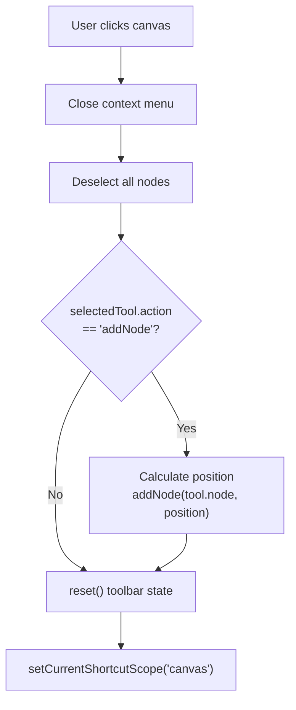

When a tool is active (e.g., user clicked "Text Generation" in toolbar), clicking the canvas places a new node at that position.

Sources: [internal-packages/workflow-designer-ui/src/editor/v2/components/v2-container.tsx:317-344]()

### Context Menu

Right-click on nodes shows a context menu [internal-packages/workflow-designer-ui/src/editor/v2/components/v2-container.tsx:345-362](), [internal-packages/workflow-designer-ui/src/editor/context-menu/index.tsx:1-59]():

**Menu Position Calculation:**

The context menu position is calculated to keep it within viewport bounds:

```typescript
const handleNodeContextMenu: NodeMouseHandler = useCallback((event, node) => {
  event.preventDefault();
  const pane = reactFlowRef.current?.getBoundingClientRect();
  if (!pane) return;
  setMenu({
    id: node.id,
    top: event.clientY < pane.height - 200 ? event.clientY : undefined,
    left: event.clientX < pane.width - 200 ? event.clientX : undefined,
    right: event.clientX >= pane.width - 200 ? pane.width - event.clientX : undefined,
    bottom: event.clientY >= pane.height - 200 ? pane.height - event.clientY : undefined,
  });
}, []);
```

**Menu Actions:**
- Duplicate: Uses `useNodeManipulation().duplicate()`
- Delete: Uses `useWorkflowDesigner().deleteNode()`

Sources: [internal-packages/workflow-designer-ui/src/editor/v2/components/v2-container.tsx:345-362](), [internal-packages/workflow-designer-ui/src/editor/context-menu/index.tsx:9-58]()

## Keyboard Shortcuts System

The editor implements a comprehensive keyboard shortcut system with focus scope awareness.

### Shortcut Architecture

**Keyboard Shortcut Flow:**

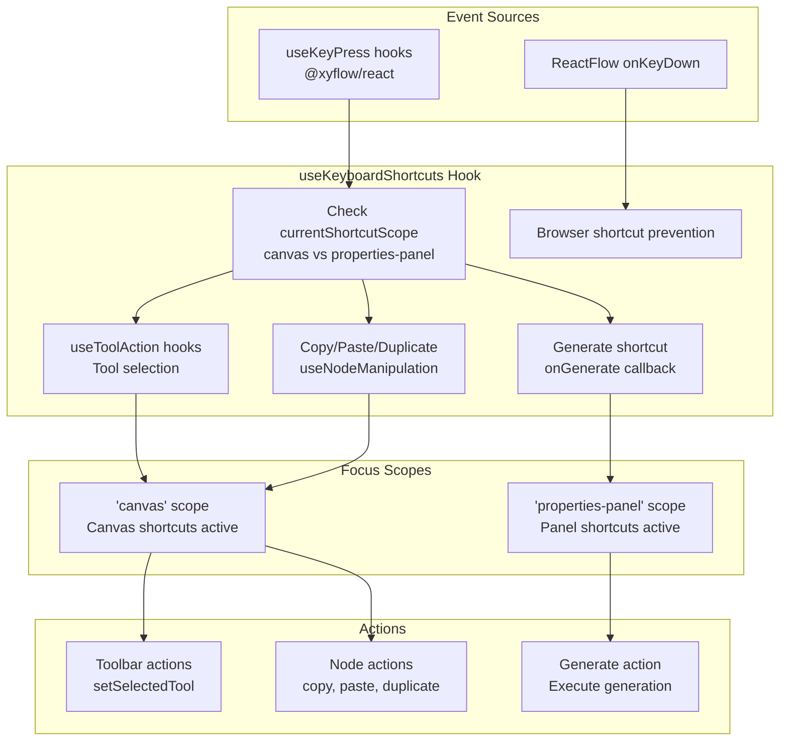

Sources: [internal-packages/workflow-designer-ui/src/editor/hooks/use-keyboard-shortcuts.ts:1-139]()

### Shortcut Definitions

**Canvas Shortcuts** (active when `currentShortcutScope === "canvas"`):

| Key | Action | Implementation |
|-----|--------|----------------|
| `t` | Select Trigger tool | `selectTriggerTool()` |
| `i` | Select Source/Input tool | `selectSourceCategoryTool()` |
| `g` | Select Language Model tool | `selectLanguageModelTool()` |
| `r` | Select Retrieval tool | `selectRetrievalCategoryTool()` |
| `d` | Select Action tool | `selectActionTool()` |
| `Escape` | Reset to Move tool | `moveTool()` |
| `Cmd/Ctrl+C` | Copy selected nodes | `handleCopy()` |
| `Cmd/Ctrl+V` | Paste copied nodes | `handlePaste()` |
| `Cmd/Ctrl+D` | Duplicate selected nodes | `handleDuplicate()` |

**Properties Panel Shortcuts** (active when `currentShortcutScope === "properties-panel"`):

| Key | Action | Implementation |
|-----|--------|----------------|
| `Cmd/Ctrl+Enter` | Execute generation | `onGenerate()` |

Sources: [internal-packages/workflow-designer-ui/src/editor/hooks/use-keyboard-shortcuts.ts:72-112]()

### useKeyAction Hook

Custom hook for handling keyboard shortcuts with repeat prevention [internal-packages/workflow-designer-ui/src/editor/hooks/use-keyboard-shortcuts.ts:26-53]():

```typescript
function useKeyAction(
  key: string | string[],
  action: () => void,
  enabled: boolean = false,
  options: {
    inputShortcutPolicy?: InputShortcutPolicy;
    preventDefault?: boolean;
  } = { inputShortcutPolicy: "ignore" },
)
```

**Input Shortcut Policies:**
- `"ignore"`: Shortcuts disabled in input fields (default)
- `"modifierOnly"`: Shortcuts work in inputs only with modifier keys
- `"always"`: Shortcuts always active

**Repeat Prevention:**

Uses a ref to track key press state and only triggers on initial press:

```typescript
const wasPressed = useRef(false);
useEffect(() => {
  if (isPressed && !wasPressed.current && enabled) {
    action();
  }
  wasPressed.current = isPressed;
}, [isPressed, enabled, action]);
```

Sources: [internal-packages/workflow-designer-ui/src/editor/hooks/use-keyboard-shortcuts.ts:26-53]()

### Browser Shortcut Prevention

The system prevents specific browser shortcuts when canvas is focused [internal-packages/workflow-designer-ui/src/editor/hooks/use-keyboard-shortcuts.ts:18-24](), [internal-packages/workflow-designer-ui/src/editor/hooks/use-keyboard-shortcuts.ts:114-133]():

```typescript
const BROWSER_SHORTCUTS_TO_PREVENT = [
  { key: "d", modifiers: ["meta", "ctrl"] }, // Bookmark
];

const handleKeyDown = useCallback((event: React.KeyboardEvent) => {
  if (!isCanvasFocused) return;
  
  const shouldPrevent = BROWSER_SHORTCUTS_TO_PREVENT.some((shortcut) => {
    const keyMatches = event.key.toLowerCase() === shortcut.key;
    const modifierMatches = shortcut.modifiers.some((mod) => {
      if (mod === "meta") return event.metaKey;
      if (mod === "ctrl") return event.ctrlKey;
      return false;
    });
    return keyMatches && modifierMatches;
  });
  
  if (shouldPrevent) {
    event.preventDefault();
  }
}, [isCanvasFocused]);
```

This is necessary because `Cmd/Ctrl+D` is used for node duplication but would normally trigger browser bookmark functionality.

Sources: [internal-packages/workflow-designer-ui/src/editor/hooks/use-keyboard-shortcuts.ts:18-24](), [internal-packages/workflow-designer-ui/src/editor/hooks/use-keyboard-shortcuts.ts:114-133]()

## Focus and Scope Management

The editor uses a `currentShortcutScope` state to manage which shortcuts are active:

**Focus Scope Values:**
- `"canvas"`: Canvas-related shortcuts (tool selection, copy/paste)
- `"properties-panel"`: Panel-related shortcuts (generate)

**Scope Transitions:**

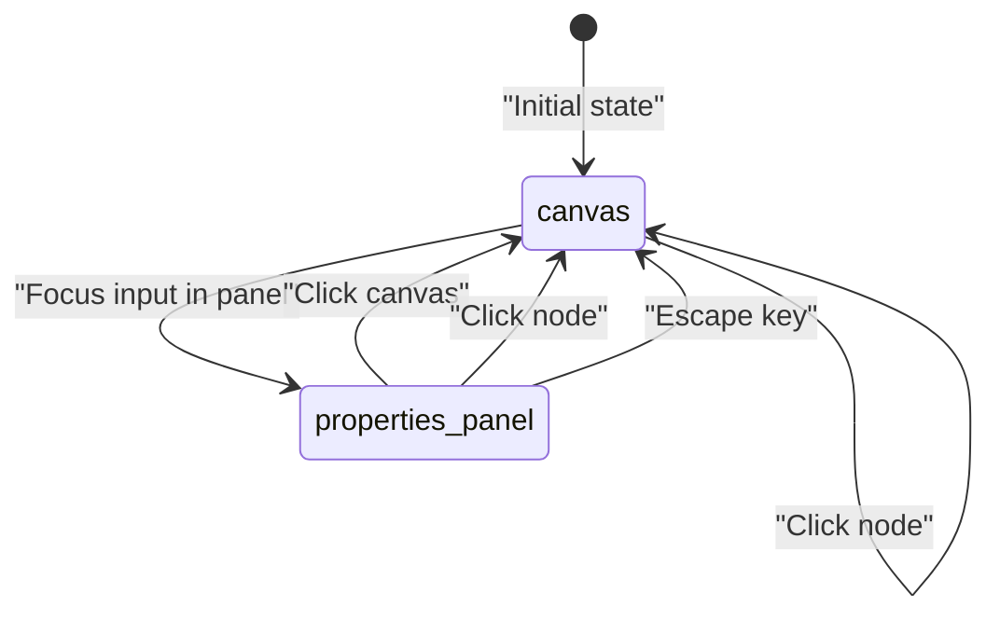

**Scope Setting Locations:**

| Location | Code | New Scope |
|----------|------|-----------|
| Node click | [internal-packages/workflow-designer-ui/src/editor/v2/components/v2-container.tsx:228]() | `"canvas"` |
| Canvas click | [internal-packages/workflow-designer-ui/src/editor/v2/components/v2-container.tsx:332]() | `"canvas"` |

This ensures that keyboard shortcuts don't interfere with text input in the properties panel while still allowing quick access to canvas operations.

Sources: [internal-packages/workflow-designer-ui/src/editor/v2/components/v2-container.tsx:69](), [internal-packages/workflow-designer-ui/src/editor/v2/components/v2-container.tsx:228](), [internal-packages/workflow-designer-ui/src/editor/v2/components/v2-container.tsx:332](), [internal-packages/workflow-designer-ui/src/editor/hooks/use-keyboard-shortcuts.ts:83-86]()

## Complete Data Flow

**End-to-End Editor Data Flow:**

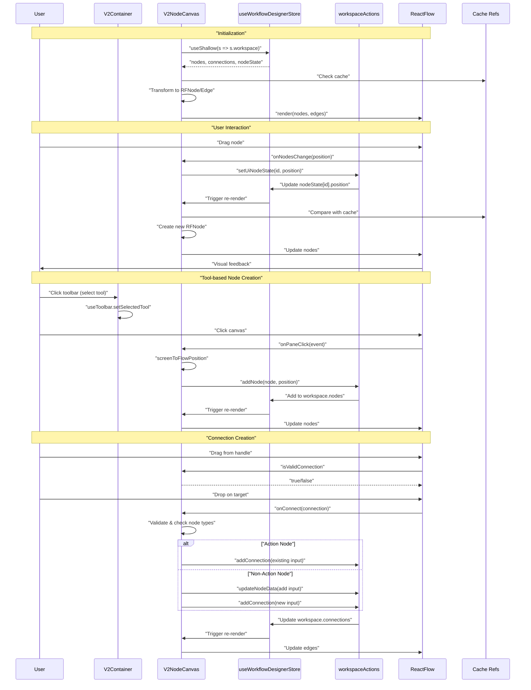

Sources: [internal-packages/workflow-designer-ui/src/editor/v2/components/v2-container.tsx:53-398]()

## Styling and Visual Presentation

The editor uses custom CSS classes and styles for visual presentation:

**Editor Class:** `giselle-workflow-editor-v3` [internal-packages/workflow-designer-ui/src/editor/v2/components/v2-container.tsx:367]()

**Pane Styling** [internal-packages/workflow-designer-ui/src/app/globals.css:14-17]():
```css
.giselle-workflow-editor-v3 .react-flow__pane {
  border: 0.5px solid rgba(235, 235, 235, 0.15);
  box-shadow: inset 0 0 40px rgba(200, 200, 200, 0.15);
}
```

This creates a subtle border and inner glow effect on the canvas.

**Cursor States** [internal-packages/workflow-designer-ui/src/app/globals.css:25-40]():
- Default cursor for selection mode
- Crosshair cursor when a floating node is active
- Default cursor for node dragging (prevents grabbing cursor)

Sources: [internal-packages/workflow-designer-ui/src/app/globals.css:1-240](), [internal-packages/workflow-designer-ui/src/editor/v2/components/v2-container.tsx:367]()

## Performance Optimizations

The editor implements several performance optimizations:

### Memoization and Caching

**Node Cache** [internal-packages/workflow-designer-ui/src/editor/v2/components/v2-container.tsx:89-125]():
- Uses `cacheNodesRef` to store previous RFNode objects
- Compares position, selection, and dimensions before creating new objects
- Only creates new RFNode when actual changes are detected
- Reuses cached objects for unchanged nodes

**Edge Cache** [internal-packages/workflow-designer-ui/src/editor/v2/components/v2-container.tsx:127-151]():
- Uses `cacheEdgesRef` for edge objects
- Compares selection state before creating new edges
- Prevents unnecessary edge re-renders

### Shallow Equality Checks

Uses `useShallow` from Zustand to prevent re-renders when nested objects haven't changed [internal-packages/workflow-designer-ui/src/editor/v2/components/v2-container.tsx:54-62]():

```typescript
const data = useWorkflowDesignerStore(
  useShallow((s) => ({
    nodes: s.workspace.nodes,
    connections: s.workspace.connections,
    nodeState: s.workspace.ui.nodeState,
    viewport: s.workspace.ui.viewport,
    selectedConnectionIds: s.workspace.ui.selectedConnectionIds,
  })),
);
```

### Throttled Resize

The properties panel resize handler uses throttling to limit updates [internal-packages/workflow-designer-ui/src/editor/v2/components/floating-properties-panel.tsx:42-64]():

```typescript
const throttle = useCallback((func: (e: MouseEvent) => void, delay: number) => {
  let timeoutId: ReturnType<typeof setTimeout> | null = null;
  let lastExecTime = 0;
  return (e: MouseEvent) => {
    const currentTime = Date.now();
    if (currentTime - lastExecTime > delay) {
      func(e);
      lastExecTime = currentTime;
    } else {
      // Delayed execution
    }
  };
}, []);

const throttledMouseMove = throttle(handleMouseMove, 16); // ~60fps
```

Sources: [internal-packages/workflow-designer-ui/src/editor/v2/components/v2-container.tsx:89-151](), [internal-packages/workflow-designer-ui/src/editor/v2/components/floating-properties-panel.tsx:42-88]()

---

