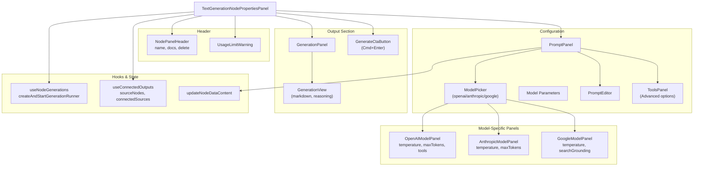
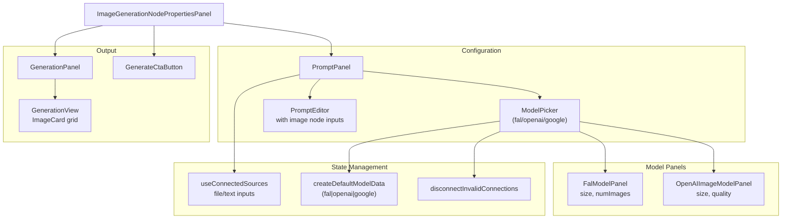
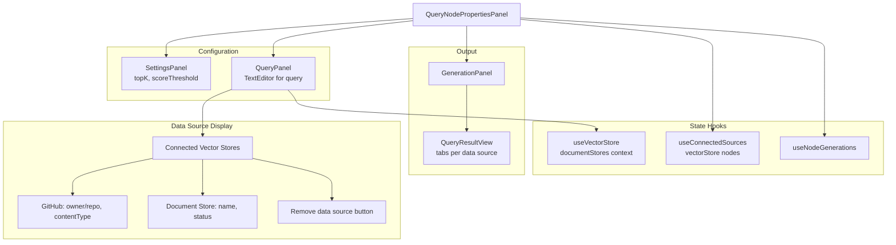
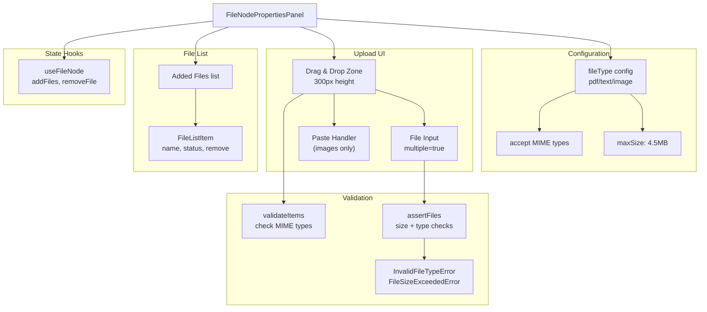
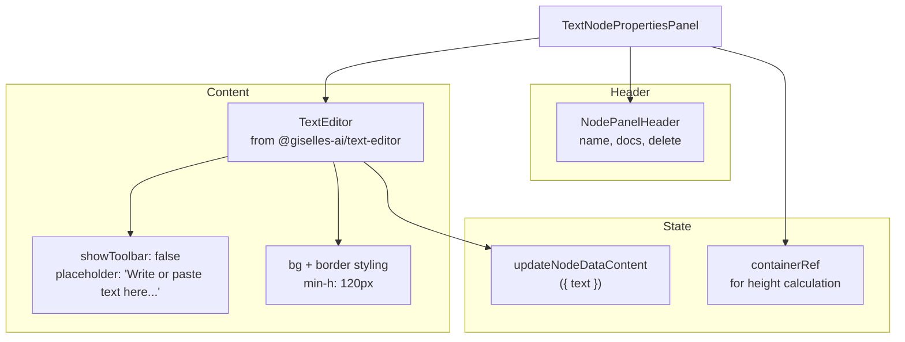
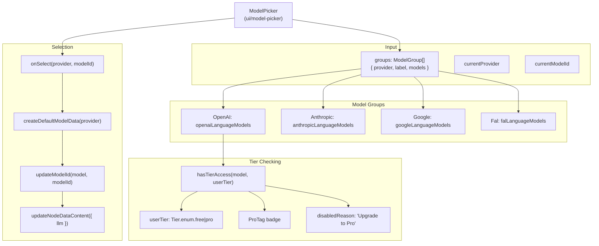
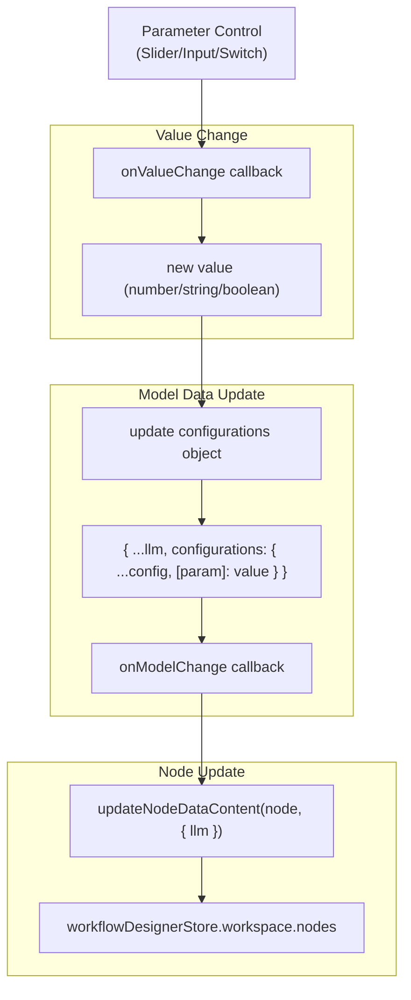
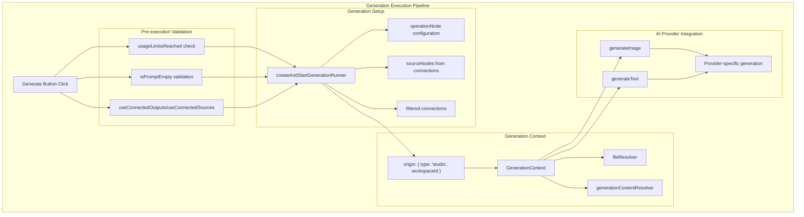

<!-- source: DeepWiki mcp.deepwiki.com · repo giselles-ai/giselle · page 5.3 Properties Panels and Node Configuration · fetched 2026-10-26 -->

# Properties Panels and Node Configuration

<details>
<summary>Relevant source files</summary>

The following files were used as context for generating this wiki page:

- [internal-packages/ui/components/prompt-editor.tsx](internal-packages/ui/components/prompt-editor.tsx)
- [internal-packages/workflow-designer-ui/src/editor/index.tsx](internal-packages/workflow-designer-ui/src/editor/index.tsx)
- [internal-packages/workflow-designer-ui/src/editor/properties-panel/app-entry-node-properties-panel/index.ts](internal-packages/workflow-designer-ui/src/editor/properties-panel/app-entry-node-properties-panel/index.ts)
- [internal-packages/workflow-designer-ui/src/editor/properties-panel/file-node-properties-panel/file-panel.tsx](internal-packages/workflow-designer-ui/src/editor/properties-panel/file-node-properties-panel/file-panel.tsx)
- [internal-packages/workflow-designer-ui/src/editor/properties-panel/file-node-properties-panel/index.tsx](internal-packages/workflow-designer-ui/src/editor/properties-panel/file-node-properties-panel/index.tsx)
- [internal-packages/workflow-designer-ui/src/editor/properties-panel/image-generation-node-properties-panel/generation-panel.tsx](internal-packages/workflow-designer-ui/src/editor/properties-panel/image-generation-node-properties-panel/generation-panel.tsx)
- [internal-packages/workflow-designer-ui/src/editor/properties-panel/image-generation-node-properties-panel/index.tsx](internal-packages/workflow-designer-ui/src/editor/properties-panel/image-generation-node-properties-panel/index.tsx)
- [internal-packages/workflow-designer-ui/src/editor/properties-panel/image-generation-node-properties-panel/prompt-panel.tsx](internal-packages/workflow-designer-ui/src/editor/properties-panel/image-generation-node-properties-panel/prompt-panel.tsx)
- [internal-packages/workflow-designer-ui/src/editor/properties-panel/index.tsx](internal-packages/workflow-designer-ui/src/editor/properties-panel/index.tsx)
- [internal-packages/workflow-designer-ui/src/editor/properties-panel/query-node-properties-panel/generation-panel.tsx](internal-packages/workflow-designer-ui/src/editor/properties-panel/query-node-properties-panel/generation-panel.tsx)
- [internal-packages/workflow-designer-ui/src/editor/properties-panel/query-node-properties-panel/index.tsx](internal-packages/workflow-designer-ui/src/editor/properties-panel/query-node-properties-panel/index.tsx)
- [internal-packages/workflow-designer-ui/src/editor/properties-panel/query-node-properties-panel/query-panel.tsx](internal-packages/workflow-designer-ui/src/editor/properties-panel/query-node-properties-panel/query-panel.tsx)
- [internal-packages/workflow-designer-ui/src/editor/properties-panel/text-generation-node-properties-panel/generation-panel.tsx](internal-packages/workflow-designer-ui/src/editor/properties-panel/text-generation-node-properties-panel/generation-panel.tsx)
- [internal-packages/workflow-designer-ui/src/editor/properties-panel/text-generation-node-properties-panel/index.tsx](internal-packages/workflow-designer-ui/src/editor/properties-panel/text-generation-node-properties-panel/index.tsx)
- [internal-packages/workflow-designer-ui/src/editor/properties-panel/text-generation-node-properties-panel/prompt-panel.tsx](internal-packages/workflow-designer-ui/src/editor/properties-panel/text-generation-node-properties-panel/prompt-panel.tsx)
- [internal-packages/workflow-designer-ui/src/editor/properties-panel/text-node-properties-panel/index.tsx](internal-packages/workflow-designer-ui/src/editor/properties-panel/text-node-properties-panel/index.tsx)
- [internal-packages/workflow-designer-ui/src/editor/properties-panel/ui/index.ts](internal-packages/workflow-designer-ui/src/editor/properties-panel/ui/index.ts)
- [internal-packages/workflow-designer-ui/src/editor/properties-panel/ui/panel-spacing.ts](internal-packages/workflow-designer-ui/src/editor/properties-panel/ui/panel-spacing.ts)
- [internal-packages/workflow-designer-ui/src/editor/properties-panel/ui/properties-panel.tsx](internal-packages/workflow-designer-ui/src/editor/properties-panel/ui/properties-panel.tsx)
- [internal-packages/workflow-designer-ui/src/editor/properties-panel/ui/resizable-section.tsx](internal-packages/workflow-designer-ui/src/editor/properties-panel/ui/resizable-section.tsx)
- [internal-packages/workflow-designer-ui/src/ui/generation-view.tsx](internal-packages/workflow-designer-ui/src/ui/generation-view.tsx)
- [internal-packages/workflow-designer-ui/src/ui/image-generation-loading.tsx](internal-packages/workflow-designer-ui/src/ui/image-generation-loading.tsx)
- [internal-packages/workflow-designer-ui/src/ui/query-result-view.tsx](internal-packages/workflow-designer-ui/src/ui/query-result-view.tsx)
- [packages/text-editor/src/react/component.tsx](packages/text-editor/src/react/component.tsx)

</details>


This document covers the properties panel system in the workflow designer that allows users to configure node behavior, select AI models, adjust parameters, and execute generations. The properties panel system provides specialized interfaces for TextGeneration, ImageGeneration, Query, File, and Text nodes, each with node-type-specific configuration options.

For information about the visual node rendering system, see page 5.2. For details about generation execution and results display, see page 5.5.

## Properties Panel Architecture

The properties panel system is built around a modular architecture that dynamically renders different configuration interfaces based on the selected node type. The main entry point is the `PropertiesPanel` component in [internal-packages/workflow-designer-ui/src/editor/properties-panel/index.tsx](), which uses type guards to determine which specialized panel to render.

### Panel Component Structure

```mermaid
graph TD
    PropertiesPanel["PropertiesPanel<br/>(index.tsx)"]
    
    subgraph "Base Components"
        PropertiesPanelRoot["PropertiesPanelRoot"]
        NodePanelHeader["NodePanelHeader"]
        PropertiesPanelContent["PropertiesPanelContent"]
    end
    
    subgraph "Node-Specific Panels"
        TextGenPanel["TextGenerationNodePropertiesPanel"]
        ImageGenPanel["ImageGenerationNodePropertiesPanel"]
        QueryPanel["QueryNodePropertiesPanel"]
        FilePanel["FileNodePropertiesPanel"]
        TextPanel["TextNodePropertiesPanel"]
        VectorStorePanel["VectorStoreNodePropertiesPanel"]
        ActionPanel["ActionNodePropertiesPanel"]
        TriggerPanel["TriggerNodePropertiesPanel"]
    end
    
    subgraph "State Hooks"
        useWorkflowDesigner["useWorkflowDesigner()"]
        useNodeGenerations["useNodeGenerations()"]
        useWorkflowDesignerStore["useWorkflowDesignerStore"]
    end
    
    PropertiesPanel --> |"isTextGenerationNode()"|TextGenPanel
    PropertiesPanel --> |"isImageGenerationNode()"|ImageGenPanel
    PropertiesPanel --> |"isQueryNode()"|QueryPanel
    PropertiesPanel --> |"isFileNode()"|FilePanel
    PropertiesPanel --> |"isTextNode()"|TextPanel
    PropertiesPanel --> |"isVectorStoreNode()"|VectorStorePanel
    PropertiesPanel --> |"isActionNode()"|ActionPanel
    PropertiesPanel --> |"isTriggerNode()"|TriggerPanel
    
    TextGenPanel --> PropertiesPanelRoot
    ImageGenPanel --> PropertiesPanelRoot
    QueryPanel --> PropertiesPanelRoot
    FilePanel --> PropertiesPanelRoot
    TextPanel --> PropertiesPanelRoot
    
    PropertiesPanelRoot --> NodePanelHeader
    PropertiesPanelRoot --> PropertiesPanelContent
    
    TextGenPanel --> useWorkflowDesigner
    TextGenPanel --> useNodeGenerations
    ImageGenPanel --> useWorkflowDesigner
    ImageGenPanel --> useNodeGenerations
    QueryPanel --> useWorkflowDesigner
    QueryPanel --> useNodeGenerations
    
    useWorkflowDesigner --> useWorkflowDesignerStore
```



Each specialized panel component follows a consistent structure:
- `NodePanelHeader` with node name, documentation link, and delete action
- `PropertiesPanelContent` containing configuration sections
- Generation/execution controls at the bottom

**Sources:** [internal-packages/workflow-designer-ui/src/editor/properties-panel/index.tsx:27-112](), [internal-packages/workflow-designer-ui/src/editor/properties-panel/ui/properties-panel.tsx:49-156](), [internal-packages/workflow-designer-ui/src/editor/properties-panel/ui/node-panel-header.tsx]()

## Text Generation Node Configuration

The `TextGenerationNodePropertiesPanel` provides configuration for LLM-based text generation nodes, supporting OpenAI, Anthropic, and Google providers. The panel is located at [internal-packages/workflow-designer-ui/src/editor/properties-panel/text-generation-node-properties-panel/index.tsx]().

### Component Structure



### Key Features

**Expandable Editors**: The prompt editor and generation output both support expansion to full-screen overlays (lines 184-285). The expanded state uses `isPromptExpanded` and `isGenerationExpanded` flags with animated transitions.

**Keyboard Shortcuts**: `useKeyboardShortcuts` hook (line 80-86) enables Cmd/Ctrl+Enter to trigger generation.

**Connected Sources**: The `useConnectedOutputs` hook (line 47-59) retrieves nodes connected to this node's inputs, making them available for insertion into the prompt via `@` mentions.

**Generation Execution**: The `generateText` callback (lines 88-117):
1. Checks usage limits via `usageLimitsReached`
2. Validates prompt is not empty using `isPromptEmpty`
3. Calls `createAndStartGenerationRunner` with operation node, source nodes, and connections
4. Passes workspace ID as origin for tracking

**Sources:** [internal-packages/workflow-designer-ui/src/editor/properties-panel/text-generation-node-properties-panel/index.tsx:28-290](), [internal-packages/workflow-designer-ui/src/editor/properties-panel/text-generation-node-properties-panel/prompt-panel.tsx:89-397]()

## Image Generation Node Configuration

The `ImageGenerationNodePropertiesPanel` handles configuration for AI image generation nodes, supporting Fal, OpenAI, and Google providers with provider-specific parameters. The panel is located at [internal-packages/workflow-designer-ui/src/editor/properties-panel/image-generation-node-properties-panel/index.tsx]().

### Component Architecture



### Provider-Specific Configuration

| Provider | Models | Configuration Parameters |
|----------|--------|-------------------------|
| `fal` | `fal-ai/flux/schnell`, `fal-ai/flux-pro` | `size`: "1024x1024" \| "1152x864" \| "1312x736" \| "512x512"<br/>`numImages`: 1-4 |
| `openai` | `dall-e-3` | `size`: "1024x1024" \| "1024x1792" \| "1792x1024"<br/>`quality`: "standard" \| "hd" |
| `google` | `imagen-3.0-generate-001` | (uses default configurations) |

### Key Implementation Details

**Model Selection**: The `ModelPicker` component (lines 133-164) displays provider groups with model options. When a model is selected, `createDefaultModelData` creates provider-specific configuration with default values.

**Connection Validation**: The `disconnectInvalidConnections` function (lines 102-123) checks if existing connections remain valid after a model change. For example, switching from OpenAI to Fal may invalidate connections if the new model doesn't support certain input types.

**Expandable Overlays**: Both prompt editor and generation panel support full-screen expansion (lines 144-243) with animated transitions and backdrop clicks to minimize.

**Image-Specific Inputs**: The prompt editor supports connecting to File nodes (category: "image") to use reference images in the generation. The `useConnectedSources` hook (line 39) filters for compatible source nodes.

**Sources:** [internal-packages/workflow-designer-ui/src/editor/properties-panel/image-generation-node-properties-panel/index.tsx:27-248](), [internal-packages/workflow-designer-ui/src/editor/properties-panel/image-generation-node-properties-panel/prompt-panel.tsx:32-205](), [internal-packages/workflow-designer-ui/src/editor/properties-panel/image-generation-node-properties-panel/models/fal.tsx](), [internal-packages/workflow-designer-ui/src/editor/properties-panel/image-generation-node-properties-panel/models/openai.tsx]()

## Query Node Configuration

The `QueryNodePropertiesPanel` provides configuration for semantic search across vector stores (GitHub repositories and document stores). The panel is located at [internal-packages/workflow-designer-ui/src/editor/properties-panel/query-node-properties-panel/index.tsx]().

### Component Structure



### Settings and Parameters

The `SettingsPanel` component provides:
- **topK**: Number of results to return (default: 5, range: 1-20)
- **scoreThreshold**: Minimum similarity score (default: 0.7, range: 0-1)

### Query Input

The `QueryPanel` component (lines 144-275) uses `TextEditor` to create semantic search queries. It displays connected vector store nodes with metadata:

**GitHub Sources**: Shows `owner/repo` and content type (Code or Pull Requests)
**Document Sources**: Shows document store name and ingestion status (e.g., "3/5 ready", "processing")

Each connected source has a remove button (X icon) that calls `deleteConnection` and removes the corresponding input from the node.

### Generation and Results

Query execution (lines 51-77):
1. Validates query is not empty using `isJsonContent` check
2. Calls `createAndStartGenerationRunner` with source nodes (vector stores)
3. Results displayed in `QueryResultView` with tabs for each data source
4. Each result shows chunk content, similarity score, and metadata

**Sources:** [internal-packages/workflow-designer-ui/src/editor/properties-panel/query-node-properties-panel/index.tsx:25-128](), [internal-packages/workflow-designer-ui/src/editor/properties-panel/query-node-properties-panel/query-panel.tsx:144-275](), [internal-packages/workflow-designer-ui/src/editor/properties-panel/query-node-properties-panel/settings-panel.tsx](), [internal-packages/workflow-designer-ui/src/ui/query-result-view.tsx:435-530]()

## File Node Configuration

The `FileNodePropertiesPanel` provides file upload and management for PDF, text, and image files. The panel is located at [internal-packages/workflow-designer-ui/src/editor/properties-panel/file-node-properties-panel/index.tsx]().

### Component Structure



### File Type Configurations

Defined in `fileType` object (lines 8-21):

| Category | Accept MIME Types | Label |
|----------|------------------|-------|
| `pdf` | `application/pdf` | PDF |
| `text` | `text/plain`, `text/markdown` | Text |
| `image` | `image/png`, `image/jpeg`, `image/gif`, `image/svg` | Image |

### Upload Methods

**Drag & Drop**: The drag zone (lines 303-390) validates file types on `dragover` and shows appropriate indicators (valid/invalid file type).

**File Input**: Standard file input with `multiple` attribute for batch uploads.

**Paste (Images Only)**: Image nodes support pasting from clipboard (lines 226-272). The paste handler extracts image items from `ClipboardEvent` and creates a `FileList` for validation.

### Validation and Error Handling

**File Size**: Hard limit of 4.5MB per file due to Vercel Serverless Functions body size limit (line 23).

**MIME Type Validation**:
- Uses regex to match MIME types against `accept` list
- Falls back to file extension for markdown files (`.md` → `text/markdown`)
- Throws `InvalidFileTypeError` with provider-specific suggestions

**Duplicate Handling**: For image nodes, `generateIncrementalUniqueName` (lines 84-104) appends numbers to duplicate filenames (e.g., "image.png" → "image 1.png").

**Sources:** [internal-packages/workflow-designer-ui/src/editor/properties-panel/file-node-properties-panel/index.tsx:23-39](), [internal-packages/workflow-designer-ui/src/editor/properties-panel/file-node-properties-panel/file-panel.tsx:106-408]()

## Text Node Configuration

The `TextNodePropertiesPanel` provides a simple text editor for static text content. The panel is located at [internal-packages/workflow-designer-ui/src/editor/properties-panel/text-node-properties-panel/index.tsx]().

### Component Structure



### Implementation Details

The Text node is the simplest properties panel, containing only:
1. `NodePanelHeader` with editable name and delete button (lines 16-21)
2. `TextEditor` component with minimal styling (lines 24-30)

The editor:
- Uses TipTap-based editor from `@giselles-ai/text-editor/react`
- No toolbar or advanced formatting
- Updates node content via `updateNodeDataContent` callback
- Styled with transparent background and minimal padding

This node serves as a static text source that can be connected to other nodes (e.g., text generation prompts or query inputs).

**Sources:** [internal-packages/workflow-designer-ui/src/editor/properties-panel/text-node-properties-panel/index.tsx:8-35](), [packages/text-editor/src/react/component.tsx:129-208]()

## Model Selection and Eligibility System

The properties panels use the `ModelPicker` component to handle model selection across providers, with tier-based access control.

### Model Picker Architecture



### Model Registry and Tier Access

Models are defined in `@giselles-ai/language-model` package:

**Text Generation Models**:
- `openaiLanguageModels`: GPT-4o, GPT-4o-mini, o1-preview, o1-mini
- `anthropicLanguageModels`: Claude 3.5 Sonnet, Claude 3.5 Haiku, Claude 3 Opus
- `googleLanguageModels`: Gemini 1.5 Pro, Gemini 1.5 Flash, Gemini 2.0 Flash

**Image Generation Models**:
- `falLanguageModels`: FLUX Schnell, FLUX Pro
- `openaiImageModels`: DALL-E 3
- `googleImageLanguageModels`: Imagen 3.0

Each model has a `tier` property (Tier.enum.free or Tier.enum.pro). The `hasTierAccess` function checks if the user's subscription tier allows access to the model.

### Model Group Construction

In `PromptPanel` components, `useModelGroups` hook (text generation) or inline `groups` useMemo (image generation) constructs model groups:

```typescript
const groups = [
  {
    provider: "openai",
    label: "OpenAI",
    models: openaiLanguageModels.map(m => ({
      id: m.id,
      badge: m.tier === Tier.enum.pro ? <ProTag /> : undefined,
      disabled: !hasTierAccess(m, userTier),
      disabledReason: !hasTierAccess(m, userTier) ? "Upgrade to Pro" : undefined
    }))
  },
  // ... other providers
]
```

**Sources:** [internal-packages/workflow-designer-ui/src/editor/properties-panel/text-generation-node-properties-panel/prompt-panel.tsx:53-87](), [internal-packages/workflow-designer-ui/src/editor/properties-panel/image-generation-node-properties-panel/prompt-panel.tsx:63-100](), [internal-packages/ui/components/model-picker.tsx](), [packages/language-model/src/index.ts]()

## Model Parameter Controls

The properties panels use specialized UI components from `@giselle-internal/ui` for parameter adjustment, with provider-specific panels for different model types.

### OpenAI Model Parameters (Text Generation)

The `OpenAIModelPanel` component provides:

| Parameter | Component | Range/Options | Default |
|-----------|-----------|---------------|---------|
| `temperature` | `Slider` | 0.0 - 2.0 | 1.0 |
| `maxTokens` | `Input` (number) | 1 - model max | 4096 |
| `topP` | `Slider` | 0.0 - 1.0 | 1.0 |
| Web Search | `Switch` | on/off | off |
| Structured Output | `Switch` | on/off | off |

When Web Search is enabled, the panel adds a "Source" output to the node for citation data.

### Anthropic Model Parameters

The `AnthropicModelPanel` provides:

| Parameter | Component | Range/Options | Default |
|-----------|-----------|---------------|---------|
| `temperature` | `Slider` | 0.0 - 1.0 | 1.0 |
| `maxTokens` | `Input` (number) | 1 - 8192 | 4096 |
| `topP` | `Slider` | 0.0 - 1.0 | N/A |
| `topK` | `Slider` | 1 - 500 | N/A |

### Google Model Parameters

The `GoogleModelPanel` provides:

| Parameter | Component | Range/Options | Default |
|-----------|-----------|---------------|---------|
| `temperature` | `Slider` | 0.0 - 2.0 | 1.0 |
| `topP` | `Slider` | 0.0 - 1.0 | N/A |
| `topK` | `Slider` | 1 - 500 | N/A |
| `maxOutputTokens` | `Input` (number) | 1 - model max | 8192 |
| Search Grounding | `Switch` | on/off | off |
| URL Context | `Switch` (feature flag) | on/off | off |

Search Grounding and URL Context are mutually exclusive. When either is enabled, a "Source" output is added to the node.

### Parameter Update Flow



Each model panel receives `languageModel` (current config) and `onModelChange` callback. The callback merges the updated parameter into the `configurations` object and calls `updateNodeDataContent` to persist the change to the node.

**Sources:** [internal-packages/workflow-designer-ui/src/editor/properties-panel/text-generation-node-properties-panel/model/openai.tsx](), [internal-packages/workflow-designer-ui/src/editor/properties-panel/text-generation-node-properties-panel/model/anthropic.tsx](), [internal-packages/workflow-designer-ui/src/editor/properties-panel/text-generation-node-properties-panel/model/google.tsx](), [internal-packages/ui/components/slider.tsx]()

## Configuration Validation and Generation Execution

The properties panels implement comprehensive validation before allowing generation execution, including prompt validation, usage limit checks, and model eligibility verification.

### Validation and Execution Flow



The validation system prevents execution when usage limits are reached, prompts are empty, or required configurations are missing, providing appropriate user feedback through toast notifications.

**Sources:** [internal-packages/workflow-designer-ui/src/editor/properties-panel/text-generation-node-properties-panel/index.tsx:57-88](), [internal-packages/workflow-designer-ui/src/editor/properties-panel/image-generation-node-properties-panel/index.tsx:97-128](), [packages/giselle/src/engine/generations/generate-image.ts:34-133](), [internal-packages/workflow-designer-ui/src/editor/lib/validate-prompt:14]()

---

