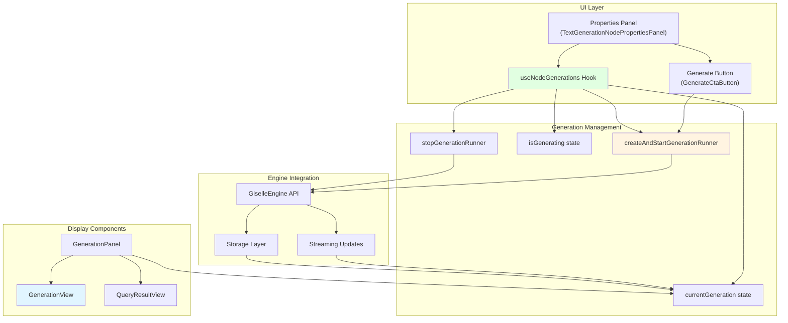
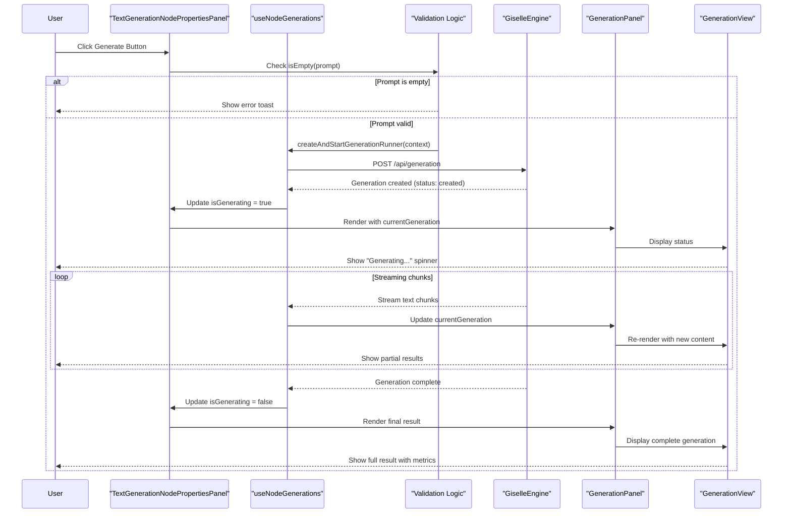
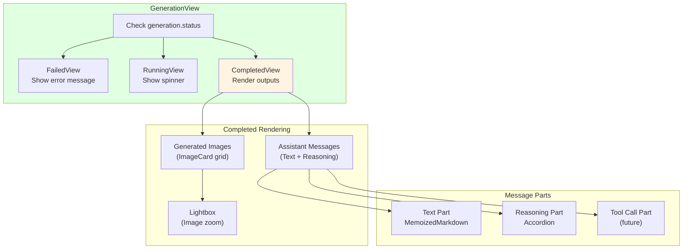
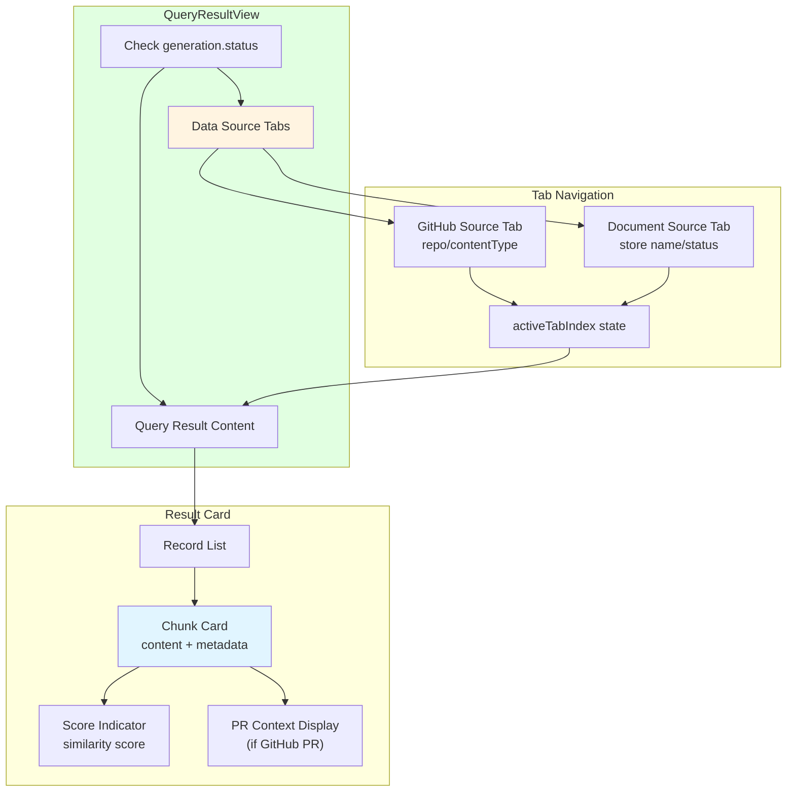
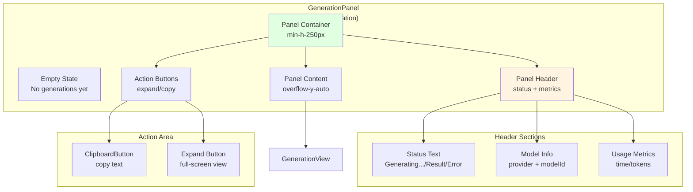
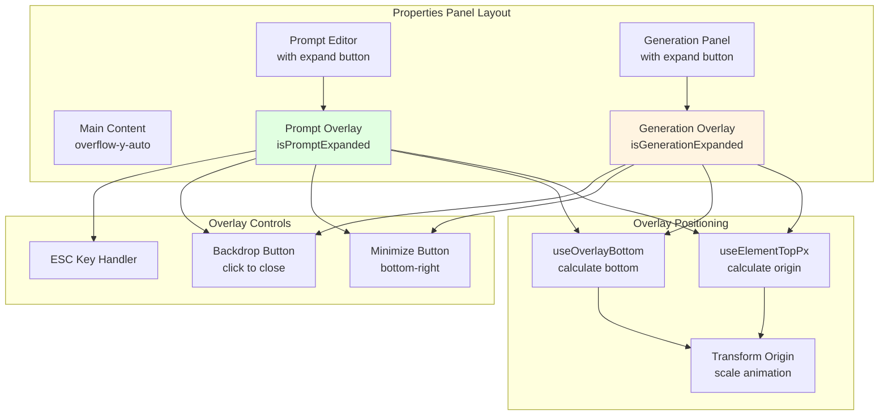

<!-- source: DeepWiki mcp.deepwiki.com · repo giselles-ai/giselle · page 5.5 Generation Execution and Results Display · fetched 2026-10-26 -->

# Generation Execution and Results Display

<details>
<summary>Relevant source files</summary>

The following files were used as context for generating this wiki page:

- [internal-packages/ui/components/prompt-editor.tsx](internal-packages/ui/components/prompt-editor.tsx)
- [internal-packages/workflow-designer-ui/src/editor/index.tsx](internal-packages/workflow-designer-ui/src/editor/index.tsx)
- [internal-packages/workflow-designer-ui/src/editor/properties-panel/app-entry-node-properties-panel/index.ts](internal-packages/workflow-designer-ui/src/editor/properties-panel/app-entry-node-properties-panel/index.ts)
- [internal-packages/workflow-designer-ui/src/editor/properties-panel/file-node-properties-panel/file-panel.tsx](internal-packages/workflow-designer-ui/src/editor/properties-panel/file-node-properties-panel/file-panel.tsx)
- [internal-packages/workflow-designer-ui/src/editor/properties-panel/file-node-properties-panel/index.tsx](internal-packages/workflow-designer-ui/src/editor/properties-panel/file-node-properties-panel/index.tsx)
- [internal-packages/workflow-designer-ui/src/editor/properties-panel/image-generation-node-properties-panel/generation-panel.tsx](internal-packages/workflow-designer-ui/src/editor/properties-panel/image-generation-node-properties-panel/generation-panel.tsx)
- [internal-packages/workflow-designer-ui/src/editor/properties-panel/image-generation-node-properties-panel/index.tsx](internal-packages/workflow-designer-ui/src/editor/properties-panel/image-generation-node-properties-panel/index.tsx)
- [internal-packages/workflow-designer-ui/src/editor/properties-panel/image-generation-node-properties-panel/prompt-panel.tsx](internal-packages/workflow-designer-ui/src/editor/properties-panel/image-generation-node-properties-panel/prompt-panel.tsx)
- [internal-packages/workflow-designer-ui/src/editor/properties-panel/index.tsx](internal-packages/workflow-designer-ui/src/editor/properties-panel/index.tsx)
- [internal-packages/workflow-designer-ui/src/editor/properties-panel/query-node-properties-panel/generation-panel.tsx](internal-packages/workflow-designer-ui/src/editor/properties-panel/query-node-properties-panel/generation-panel.tsx)
- [internal-packages/workflow-designer-ui/src/editor/properties-panel/query-node-properties-panel/index.tsx](internal-packages/workflow-designer-ui/src/editor/properties-panel/query-node-properties-panel/index.tsx)
- [internal-packages/workflow-designer-ui/src/editor/properties-panel/query-node-properties-panel/query-panel.tsx](internal-packages/workflow-designer-ui/src/editor/properties-panel/query-node-properties-panel/query-panel.tsx)
- [internal-packages/workflow-designer-ui/src/editor/properties-panel/text-generation-node-properties-panel/generation-panel.tsx](internal-packages/workflow-designer-ui/src/editor/properties-panel/text-generation-node-properties-panel/generation-panel.tsx)
- [internal-packages/workflow-designer-ui/src/editor/properties-panel/text-generation-node-properties-panel/index.tsx](internal-packages/workflow-designer-ui/src/editor/properties-panel/text-generation-node-properties-panel/index.tsx)
- [internal-packages/workflow-designer-ui/src/editor/properties-panel/text-generation-node-properties-panel/prompt-panel.tsx](internal-packages/workflow-designer-ui/src/editor/properties-panel/text-generation-node-properties-panel/prompt-panel.tsx)
- [internal-packages/workflow-designer-ui/src/editor/properties-panel/text-node-properties-panel/index.tsx](internal-packages/workflow-designer-ui/src/editor/properties-panel/text-node-properties-panel/index.tsx)
- [internal-packages/workflow-designer-ui/src/editor/properties-panel/ui/index.ts](internal-packages/workflow-designer-ui/src/editor/properties-panel/ui/index.ts)
- [internal-packages/workflow-designer-ui/src/editor/properties-panel/ui/panel-spacing.ts](internal-packages/workflow-designer-ui/src/editor/properties-panel/ui/panel-spacing.ts)
- [internal-packages/workflow-designer-ui/src/editor/properties-panel/ui/properties-panel.tsx](internal-packages/workflow-designer-ui/src/editor/properties-panel/ui/properties-panel.tsx)
- [internal-packages/workflow-designer-ui/src/editor/properties-panel/ui/resizable-section.tsx](internal-packages/workflow-designer-ui/src/editor/properties-panel/ui/resizable-section.tsx)
- [internal-packages/workflow-designer-ui/src/ui/generation-view.tsx](internal-packages/workflow-designer-ui/src/ui/generation-view.tsx)
- [internal-packages/workflow-designer-ui/src/ui/image-generation-loading.tsx](internal-packages/workflow-designer-ui/src/ui/image-generation-loading.tsx)
- [internal-packages/workflow-designer-ui/src/ui/query-result-view.tsx](internal-packages/workflow-designer-ui/src/ui/query-result-view.tsx)
- [packages/text-editor/src/react/component.tsx](packages/text-editor/src/react/component.tsx)

</details>


## Purpose and Scope

This document describes how generations are triggered from the Workflow Designer UI and how their results are displayed to users. It covers the client-side execution flow, the `useNodeGenerations` hook that manages generation lifecycle, and the display components that render text, image, and query results in real-time.

For information about the server-side generation execution and engine orchestration, see [Generation Pipeline and Lifecycle](#2.2). For details on Act execution in production, see [Stage System and Act Execution](#6.1.2).

## Generation Execution Architecture

The generation execution system follows a client-initiated, server-executed model where the UI triggers generation requests and subscribes to real-time updates.



**Sources:**
- [internal-packages/workflow-designer-ui/src/editor/properties-panel/text-generation-node-properties-panel/index.tsx:1-290]()
- [internal-packages/workflow-designer-ui/src/editor/properties-panel/image-generation-node-properties-panel/index.tsx:1-248]()

## useNodeGenerations Hook

The `useNodeGenerations` hook is the primary interface for managing generation execution from the UI. It provides methods to create, start, stop generations and track their state.

### Hook Interface

```typescript
const {
    createAndStartGenerationRunner,
    isGenerating,
    stopGenerationRunner,
    currentGeneration,
} = useNodeGenerations({
    nodeId: node.id,
    origin: { type: "studio", workspaceId: data.id },
});
```

### Hook Return Values

| Property | Type | Description |
|----------|------|-------------|
| `createAndStartGenerationRunner` | Function | Initiates a new generation with context |
| `isGenerating` | boolean | Whether a generation is currently running |
| `stopGenerationRunner` | Function | Cancels the current generation |
| `currentGeneration` | Generation \| undefined | The most recent generation object |

### Generation Context

When calling `createAndStartGenerationRunner`, the UI must provide:

```typescript
{
    origin: {
        type: "studio",
        workspaceId: data.id,
    },
    operationNode: node,           // The node being executed
    sourceNodes,                   // Connected input nodes
    connections: data.connections  // Relevant connections
}
```

**Sources:**
- [internal-packages/workflow-designer-ui/src/editor/properties-panel/text-generation-node-properties-panel/index.tsx:38-46]()
- [internal-packages/workflow-designer-ui/src/editor/properties-panel/text-generation-node-properties-panel/index.tsx:98-108]()

## Execution Flow

### Text Generation Execution



### Execution Steps

1. **Validation Phase** - [internal-packages/workflow-designer-ui/src/editor/properties-panel/text-generation-node-properties-panel/index.tsx:88-96]()
   - Check if prompt is empty using `isPromptEmpty`
   - Verify usage limits not reached
   - Show error toasts if validation fails

2. **Context Building** - [internal-packages/workflow-designer-ui/src/editor/properties-panel/text-generation-node-properties-panel/index.tsx:98-108]()
   - Gather operation node configuration
   - Collect connected source nodes
   - Filter relevant connections

3. **Execution Initiation** - Hook invokes `createAndStartGenerationRunner`
   - Sends request to engine
   - Receives generation ID
   - Begins streaming subscription

4. **Real-time Updates** - Generation state flows back through hook
   - `currentGeneration` updates with each chunk
   - React re-renders display components
   - User sees progressive results

**Sources:**
- [internal-packages/workflow-designer-ui/src/editor/properties-panel/text-generation-node-properties-panel/index.tsx:88-117]()
- [internal-packages/workflow-designer-ui/src/editor/properties-panel/query-node-properties-panel/index.tsx:51-77]()

## Results Display System

### Generation View Component

The `GenerationView` component renders the output of text generations, handling multiple message types and streaming states.



### Status-Based Rendering

The component adapts its display based on `generation.status`:

| Status | Display Behavior |
|--------|------------------|
| `failed` | Shows error message and generation ID |
| `created`, `queued` | Shows animated spinner |
| `running` | Shows spinner (previously showed per-image placeholders) |
| `completed` | Renders full outputs and messages |
| `cancelled` | Renders partial results |

**Sources:**
- [internal-packages/workflow-designer-ui/src/ui/generation-view.tsx:85-268]()
- [internal-packages/workflow-designer-ui/src/ui/generation-view.tsx:115-143]()

### Message Part Rendering

Text generations produce messages with different part types that require specialized rendering:

#### Text Parts
Plain text content rendered with Markdown support:
```typescript
case "text":
    return (
        <div className="markdown-renderer">
            <MemoizedMarkdown content={part.text} />
        </div>
    );
```

#### Reasoning Parts
Collapsible reasoning process display using Radix UI Accordion:
- Shows shimmer animation while active (last part)
- Collapsed by default when complete
- Displays thinking process in italic text
- Includes left border for visual distinction

**Sources:**
- [internal-packages/workflow-designer-ui/src/ui/generation-view.tsx:175-248]()
- [internal-packages/workflow-designer-ui/src/ui/generation-view.tsx:180-232]()

### Image Generation Display

Image outputs are rendered in a horizontal scrollable grid with interaction capabilities:

```typescript
{generation.outputs.map((output) => {
    if (output.type !== "generated-image") return null;
    return (
        <div className="flex gap-[12px] pt-[8px] overflow-x-auto">
            {output.contents.map((content) => (
                <ImageCard
                    src={`${client.basePath}${content.pathname}`}
                    onDownload={() => { /* download logic */ }}
                    onZoom={() => setLightboxImage(pathname)}
                />
            ))}
        </div>
    );
})}
```

The `ImageCard` component provides:
- Thumbnail display with fixed height
- Download button overlay
- Zoom button for lightbox view
- Responsive hover states

**Sources:**
- [internal-packages/workflow-designer-ui/src/ui/generation-view.tsx:146-174]()
- [internal-packages/workflow-designer-ui/src/ui/generation-view.tsx:262-265]()

## Query Results Display

Query nodes produce specialized output that requires a different display component: `QueryResultView`.

### Query Result Structure



### Data Source Tabs

Each vector store source that contributed results gets its own tab:

```typescript
function DataSourceTab({
    result,
    isActive,
    onClick,
    documentStoreMap,
}) {
    const displayInfo = getDataSourceDisplayInfo(result, documentStoreMap);
    const recordCount = result.records?.length || 0;
    
    return (
        <button onClick={onClick} className={isActive ? "active" : ""}>
            <Icon /> {/* GitHubIcon or DocumentVectorStoreIcon */}
            <div>
                <span>{displayInfo.line1}</span>
                <span>{displayInfo.line2}</span>
            </div>
            <span>{recordCount}</span>
        </button>
    );
}
```

The display information is computed based on source type:
- **GitHub sources**: Shows `owner/repo` and content type (Pull Requests/Code)
- **Document stores**: Shows store name and ingestion status

**Sources:**
- [internal-packages/workflow-designer-ui/src/ui/query-result-view.tsx:279-332]()
- [internal-packages/workflow-designer-ui/src/ui/query-result-view.tsx:240-277]()

### Chunk Display

Each retrieved chunk is rendered in a card with expandable content:

```typescript
<div className="space-y-[12px]">
    {records.map((record, recordIndex) => (
        <div className="bg-surface/5 rounded-[8px] p-[12px]">
            <div className="flex items-center justify-between">
                <span>Chunk #{record.chunkIndex}</span>
                <ScoreIndicator score={record.score} />
            </div>
            
            <ContentPreview
                content={record.chunkContent}
                isExpanded={expandedRecords.has(recordIndex)}
                onToggle={() => toggleRecord(recordIndex)}
            />
            
            <PRContextDisplay metadata={record.metadata} />
            <details>Metadata</details>
        </div>
    ))}
</div>
```

#### Score Indicator

Visual representation of similarity score with color coding:
- **> 0.8**: Green (high relevance)
- **> 0.5**: Yellow (medium relevance)
- **≤ 0.5**: Gray (low relevance)

**Sources:**
- [internal-packages/workflow-designer-ui/src/ui/query-result-view.tsx:334-433]()
- [internal-packages/workflow-designer-ui/src/ui/query-result-view.tsx:31-60]()

### Pull Request Context

For GitHub PR results, additional context is displayed:

```typescript
function PRContextDisplay({ metadata, additional }) {
    const prNumber = metadata.prNumber;
    const contentType = metadata.contentType; // comment | diff | title_body
    const prContext = additional?.prContext;
    
    const [title, ...bodyParts] = prContext.split("\n\n");
    
    return (
        <div className="bg-blue-500/10 rounded-[6px] border border-blue-500/20">
            <GitPullRequestIcon />
            <span>PR #{prNumber}</span>
            <span>{contentTypeLabel}</span>
            <p>{title}</p>
            {/* Expandable body */}
        </div>
    );
}
```

**Sources:**
- [internal-packages/workflow-designer-ui/src/ui/query-result-view.tsx:105-198]()
- [internal-packages/workflow-designer-ui/src/ui/query-result-view.tsx:17-19]()

## Generation Panel Containers

Each node type has a dedicated `GenerationPanel` component that wraps the appropriate view component and provides consistent UI chrome.

### Text Generation Panel



### Panel Header Display

The header adapts based on generation status and shows contextual information:

```typescript
// Status-based header text
{currentGeneration.status === "running" && <p>Generating...</p>}
{currentGeneration.status === "completed" && (
    <p>Result <span>from {provider} {modelId}</span></p>
)}
{currentGeneration.status === "failed" && <p>Error</p>}

// Metrics display (completed only)
{currentGeneration.status === "completed" && currentGeneration.usage && (
    <div className="flex items-center gap-[10px]">
        <span>
            <TimerIcon />
            {formatExecutionTime(startedAt, completedAt)}
        </span>
        <span>
            <ArrowUpIcon />
            {inputTokens.toLocaleString()}t
        </span>
        <span>
            <ArrowDownIcon />
            {outputTokens.toLocaleString()}t
        </span>
    </div>
)}
```

**Sources:**
- [internal-packages/workflow-designer-ui/src/editor/properties-panel/text-generation-node-properties-panel/generation-panel.tsx:118-245]()
- [internal-packages/workflow-designer-ui/src/editor/properties-panel/text-generation-node-properties-panel/generation-panel.tsx:163-222]()

### Execution Time Formatting

```typescript
function formatExecutionTime(startedAt: number, completedAt: number): string {
    const durationMs = completedAt - startedAt;
    if (durationMs < 60000) {
        return `${durationMs.toLocaleString()}ms`;
    }
    const minutes = Math.floor(durationMs / 60000);
    const seconds = Math.floor((durationMs % 60000) / 1000);
    return `${minutes}m ${seconds}s`;
}
```

**Sources:**
- [internal-packages/workflow-designer-ui/src/editor/properties-panel/text-generation-node-properties-panel/generation-panel.tsx:36-44]()

### Text Content Extraction

For clipboard functionality, text content is extracted from generation outputs:

```typescript
function getGenerationTextContent(generation: Generation): string {
    if (generation.status === "completed") {
        const textOutputs = generation.outputs
            .filter((output) => output.type === "generated-text")
            .map((output) => output.content)
            .join("\n\n");
        
        if (textOutputs) return textOutputs;
    }
    
    // Fallback to extracting from messages
    const generatedMessages = generation.messages
        ?.filter((m) => m.role === "assistant") ?? [];
    
    return generatedMessages
        .map((message) => 
            message.parts
                ?.filter((part) => part.type === "text")
                .map((part) => part.text)
                .join("\n")
        )
        .join("\n");
}
```

**Sources:**
- [internal-packages/workflow-designer-ui/src/editor/properties-panel/text-generation-node-properties-panel/generation-panel.tsx:46-76]()

## Expanded View System

Properties panels support expanding the prompt editor and generation results to full-screen overlays for better visibility.

### Expansion Architecture



### Overlay Implementation

Overlays are absolutely positioned dialogs that scale from the original component position:

```typescript
const [isPromptExpanded, setIsPromptExpanded] = useState(false);
const [isGenerationExpanded, setIsGenerationExpanded] = useState(false);

const generateCtaRef = useRef<HTMLDivElement | null>(null);
const promptEditorRef = useRef<HTMLDivElement | null>(null);
const generationPanelRef = useRef<HTMLDivElement | null>(null);

const overlayBottomPx = useOverlayBottom(generateCtaRef);
const promptTopPx = useElementTopPx(promptEditorRef);
const generationTopPx = useElementTopPx(generationPanelRef);

<div
    role="dialog"
    aria-modal="true"
    className={`absolute left-0 right-0 z-20 flex flex-col transition-all ${
        isPromptExpanded ? "opacity-100 scale-y-100" : "opacity-0 scale-y-0"
    }`}
    style={{
        top: 0,
        bottom: overlayBottomPx,
        transformOrigin: `center ${promptTopPx}px`,
    }}
>
    {/* Expanded content */}
</div>
```

**Sources:**
- [internal-packages/workflow-designer-ui/src/editor/properties-panel/text-generation-node-properties-panel/index.tsx:60-74]()
- [internal-packages/workflow-designer-ui/src/editor/properties-panel/text-generation-node-properties-panel/index.tsx:184-241]()

### Keyboard Navigation

The expanded views support keyboard shortcuts for better UX:

```typescript
useEffect(() => {
    const onKeydown = (e: KeyboardEvent) => {
        if (isPromptExpanded && e.key === "Escape") {
            e.stopPropagation();
            setIsPromptExpanded(false);
            setEditorVersion((v) => v + 1); // Remount editor
        }
        if ((e.metaKey || e.ctrlKey) && e.key === "Enter") {
            generateText();
        }
    };
    window.addEventListener("keydown", onKeydown, { capture: true });
    return () => window.removeEventListener("keydown", onKeydown);
}, [isPromptExpanded, generateText]);
```

**Sources:**
- [internal-packages/workflow-designer-ui/src/editor/properties-panel/text-generation-node-properties-panel/index.tsx:119-132]()

### Live Prompt Synchronization

When expanding the prompt editor, the latest prompt value is synchronized using `useLivePrompt`:

```typescript
const livePrompt = useLivePrompt(node.id);

<PromptEditor
    key={`expanded-${editorVersion}-${node.id}`}
    value={livePrompt ?? node.content.prompt}
    onValueChange={(value) => {
        updateNodeDataContent(node, { prompt: value });
    }}
    // ...
/>
```

This ensures the expanded editor always shows the current content, even if the user was typing in the collapsed view before expanding.

**Sources:**
- [internal-packages/workflow-designer-ui/src/editor/properties-panel/text-generation-node-properties-panel/index.tsx:77]()
- [internal-packages/workflow-designer-ui/src/editor/properties-panel/text-generation-node-properties-panel/index.tsx:201-217]()

## Spinner and Loading States

### Text Generation Spinner

A consistent spinner component uses animated ghost icons:

```typescript
function Spinner() {
    return (
        <div className="flex gap-[12px] text-text-muted">
            <WilliIcon className="w-[20px] h-[20px] animate-pop-pop-1" />
            <WilliIcon className="w-[20px] h-[20px] animate-pop-pop-2" />
            <WilliIcon className="w-[20px] h-[20px] animate-pop-pop-3" />
        </div>
    );
}
```

The spinner is shown when:
- Generation status is `created`, `queued`, or `running`
- There are no reasoning parts being streamed yet

**Sources:**
- [internal-packages/workflow-designer-ui/src/ui/generation-view.tsx:45-53]()
- [internal-packages/workflow-designer-ui/src/ui/generation-view.tsx:251-260]()

### Image Generation Loading

Image generation shows a more sophisticated loading state with aspect ratio preservation:

```typescript
function ImageGenerationLoading({ configuration }) {
    const aspectRatio = getAspectRatio(configuration);
    
    return (
        <div 
            className="bg-surface/10 rounded-[8px] relative overflow-hidden"
            style={{ aspectRatio, width: "auto" }}
        >
            <div className="absolute inset-0 opacity-30 animate-glare" />
            <div className="flex items-center gap-[4px] absolute top-[12px] left-[12px]">
                <p className="animate-shine">Generating...</p>
                <WilliIcon className="animate-ghost-glow" />
                <WilliIcon className="animate-ghost-glow delay-500" />
                <WilliIcon className="animate-ghost-glow delay-1000" />
            </div>
        </div>
    );
}
```

The aspect ratio is calculated based on the model and configuration:
- Fal models: Parse from size configuration (e.g., "1152x864")
- OpenAI models: Parse from WIDTHxHEIGHT format
- Google models: Default to 1:1

**Sources:**
- [internal-packages/workflow-designer-ui/src/ui/image-generation-loading.tsx:51-135]()
- [internal-packages/workflow-designer-ui/src/ui/image-generation-loading.tsx:11-49]()

## Generate CTA Button

The `GenerateCtaButton` component provides a consistent execution button across all node types:

```typescript
<GenerateCtaButton
    isGenerating={isGenerating}
    isEmpty={isPromptEmpty(node.content.prompt)}
    onClick={() => {
        if (isGenerating) stopGenerationRunner();
        else generateText();
    }}
    idleLabel="Generate"  // Optional custom label
    emptyLabel="Start Writing Your Prompt"  // Optional custom label
/>
```

### Button States

| State | Label | Action | Styling |
|-------|-------|--------|---------|
| Empty | "Start Writing Your Prompt" | No-op | Disabled appearance |
| Idle | "Generate" / custom | Trigger generation | Primary button |
| Generating | "Stop" | Cancel generation | Secondary button |

The button automatically handles:
- Visual state transitions
- Keyboard shortcuts (Cmd/Ctrl + Enter)
- Accessibility labels
- Loading indicators

**Sources:**
- [internal-packages/workflow-designer-ui/src/editor/properties-panel/text-generation-node-properties-panel/index.tsx:175-182]()
- [internal-packages/workflow-designer-ui/src/editor/properties-panel/query-node-properties-panel/index.tsx:110-122]()

## Node-Specific Implementations

### Text Generation Node

Text generation panels integrate all components into a cohesive workflow:

```typescript
export function TextGenerationNodePropertiesPanel({ node }) {
    const { createAndStartGenerationRunner, isGenerating, stopGenerationRunner, currentGeneration } 
        = useNodeGenerations({ nodeId: node.id, origin: { type: "studio", workspaceId: data.id } });
    
    const generateText = useCallback(() => {
        if (usageLimitsReached) {
            error("Please upgrade your plan to continue using this feature.");
            return;
        }
        if (isPromptEmpty(node.content.prompt)) {
            error("Please fill in the prompt to run.");
            return;
        }
        
        createAndStartGenerationRunner({
            origin: { type: "studio", workspaceId: data.id },
            operationNode: node,
            sourceNodes,
            connections: data.connections.filter((c) => c.inputNode.id === node.id),
        });
    }, [/* deps */]);
    
    return (
        <PropertiesPanelRoot>
            <NodePanelHeader node={node} onChangeName={...} onDelete={...} />
            <PropertiesPanelContent>
                <TextGenerationTabContent node={node} onPromptExpand={...} />
                <GenerationPanel node={node} onClickGenerateButton={generateText} />
                <GenerateCtaButton isGenerating={isGenerating} onClick={...} />
                {/* Expanded overlays */}
            </PropertiesPanelContent>
        </PropertiesPanelRoot>
    );
}
```

**Sources:**
- [internal-packages/workflow-designer-ui/src/editor/properties-panel/text-generation-node-properties-panel/index.tsx:28-290]()

### Image Generation Node

Image generation follows a similar pattern but with model-specific configuration:

```typescript
export function ImageGenerationNodePropertiesPanel({ node }) {
    const { createAndStartGenerationRunner, isGenerating, stopGenerationRunner }
        = useNodeGenerations({ nodeId: node.id, origin: { type: "studio", workspaceId: data.id } });
    
    const generateImage = useCallback(() => {
        if (usageLimitsReached) {
            error("Please upgrade your plan to continue using this feature.");
            return;
        }
        if (isPromptEmpty(node.content.prompt)) {
            error("Please fill in the prompt to run.");
            return;
        }
        
        createAndStartGenerationRunner({
            origin: { type: "studio", workspaceId: data.id },
            operationNode: node,
            sourceNodes: connectedSources.map((cs) => cs.node),
            connections: data.connections.filter((c) => c.inputNode.id === node.id),
        });
    }, [/* deps */]);
    
    return (
        <PropertiesPanelRoot>
            <NodePanelHeader node={node} onChangeName={...} onDelete={...} />
            <PropertiesPanelContent>
                <PromptPanel node={node} onExpand={...} />
                <GenerationPanel node={node} onClickGenerateButton={generateImage} onExpand={...} />
                <GenerateCtaButton isGenerating={isGenerating} onClick={...} />
                {/* Expanded overlays */}
            </PropertiesPanelContent>
        </PropertiesPanelRoot>
    );
}
```

**Sources:**
- [internal-packages/workflow-designer-ui/src/editor/properties-panel/image-generation-node-properties-panel/index.tsx:27-248]()
- [internal-packages/workflow-designer-ui/src/editor/properties-panel/image-generation-node-properties-panel/index.tsx:63-94]()

### Query Node

Query nodes use `QueryResultView` instead of `GenerationView`:

```typescript
export function QueryNodePropertiesPanel({ node }) {
    const { createAndStartGenerationRunner, isGenerating, stopGenerationRunner }
        = useNodeGenerations({ nodeId: node.id, origin: { type: "studio", workspaceId: data.id } });
    
    const query = useMemo(() => {
        const rawQuery = node.content.query.trim();
        if (isJsonContent(rawQuery)) {
            return jsonContentToText(JSON.parse(rawQuery));
        }
        return rawQuery;
    }, [node.content.query]);
    
    const generate = useCallback(() => {
        if (query.length === 0) {
            error("Query is empty");
            return;
        }
        createAndStartGenerationRunner({
            origin: { type: "studio", workspaceId: data.id },
            operationNode: node,
            sourceNodes: connectedSources.map((cs) => cs.node),
            connections: data.connections.filter((c) => c.inputNode.id === node.id),
        });
    }, [/* deps */]);
    
    return (
        <PropertiesPanelRoot>
            <NodePanelHeader node={node} onChangeName={...} onDelete={...} />
            <PropertiesPanelContent>
                <SettingsPanel node={node} />
                <QueryPanel node={node} />
                <GenerationPanel node={node} /> {/* Uses QueryResultView */}
                <GenerateCtaButton 
                    isGenerating={isGenerating} 
                    isEmpty={query.length === 0}
                    onClick={...}
                    idleLabel="Run Query"
                    emptyLabel="Start Writing Your Query"
                />
            </PropertiesPanelContent>
        </PropertiesPanelRoot>
    );
}
```

**Sources:**
- [internal-packages/workflow-designer-ui/src/editor/properties-panel/query-node-properties-panel/index.tsx:25-128]()
- [internal-packages/workflow-designer-ui/src/editor/properties-panel/query-node-properties-panel/index.tsx:35-77]()

## Summary

The Generation Execution and Results Display system provides a unified interface for triggering and monitoring AI operations across different node types. Key components include:

- **useNodeGenerations hook** - Central state management for generation lifecycle
- **GenerationView** - Text/reasoning display with streaming support
- **QueryResultView** - Vector search result display with tabs and metadata
- **GenerationPanel** - Node-specific result containers with metrics
- **Expanded overlays** - Full-screen views for prompts and results
- **Loading states** - Animated spinners and image placeholders

The system maintains real-time synchronization between the engine and UI, providing immediate feedback to users as generations progress from creation through completion.

---

