<!-- source: DeepWiki mcp.deepwiki.com · repo giselles-ai/giselle · page 6 Applications and User Interfaces · fetched 2026-10-26 -->

# Applications and User Interfaces

<details>
<summary>Relevant source files</summary>

The following files were used as context for generating this wiki page:

- [apps/playground/package.json](apps/playground/package.json)
- [apps/studio.giselles.ai/package.json](apps/studio.giselles.ai/package.json)
- [internal-packages/workflow-designer-ui/package.json](internal-packages/workflow-designer-ui/package.json)
- [package.json](package.json)
- [packages/giselle/package.json](packages/giselle/package.json)
- [pnpm-lock.yaml](pnpm-lock.yaml)
- [pnpm-workspace.yaml](pnpm-workspace.yaml)

</details>


This document covers the user-facing applications in the Giselle AI platform, including the Studio production application, the Playground development environment, and the UI component showcase. It explains the application architecture, routing structure, workspace context system, and key user interfaces for workflow execution (Stage) and knowledge management (Vector Stores).

For information about the Workflow Designer UI components and visual editing system, see [Workflow Designer UI](#5). For details about the underlying engine and execution system, see [Core Engine and SDK](#2).

## Overview

The Giselle AI platform provides three Next.js applications serving different purposes:

| Application | Location | Purpose | Key Dependencies |
|------------|----------|---------|------------------|
| **Studio** | `apps/studio.giselles.ai` | Production application for building and executing AI workflows | workflow-designer-ui, giselle engine, full integration suite |
| **Playground** | `apps/playground` | Development and testing environment with simplified configuration | workflow-designer-ui, giselle engine, minimal integrations |
| **UI Showcase** | `apps/ui.giselles.ai` | Component library showcase and documentation | @giselle-internal/ui only |

All applications are built with Next.js 15.5.2 and use React 19.1.1. The Studio application contains the complete feature set for production deployment, while Playground provides a minimal environment for development and testing.

**Sources:** [apps/studio.giselles.ai/package.json:1-133](), [apps/playground/package.json:1-43](), [apps/ui.giselles.ai/package.json]()

## Application Architecture

```mermaid
graph TB
    subgraph "Studio Application"
        StudioApp["Studio App<br/>apps/studio.giselles.ai"]
        StudioRoutes["Route Structure<br/>/flow, /stage, /settings"]
        WorkspaceProvider["WorkspaceProvider<br/>Central Context"]
        FeatureFlags["Feature Flag System<br/>flags.ts + Edge Config"]
    end
    
    subgraph "Playground Application"
        PlaygroundApp["Playground App<br/>apps/playground"]
        PlaygroundRoutes["Simplified Routes<br/>/flow only"]
        MinimalConfig["Minimal Configuration<br/>Local-only"]
    end
    
    subgraph "UI Showcase"
        UIApp["UI Showcase<br/>apps/ui.giselles.ai"]
        ComponentDocs["Component Documentation<br/>Visual Examples"]
    end
    
    subgraph "Shared Dependencies"
        WorkflowDesigner["@giselle-internal/workflow-designer-ui<br/>Visual Editor Components"]
        UILib["@giselle-internal/ui<br/>Shared UI Components"]
        GiselleEngine["@giselles-ai/giselle<br/>Orchestration Engine"]
    end
    
    subgraph "Studio-Specific Infrastructure"
        Database["Database Layer<br/>Drizzle ORM + Supabase"]
        Auth["Authentication<br/>@supabase/ssr"]
        Integrations["Integration Layer<br/>GitHub, RAG, Vector Stores"]
        Observability["Observability<br/>Sentry, OpenTelemetry"]
    end
    
    StudioApp --> WorkspaceProvider
    StudioApp --> FeatureFlags
    StudioApp --> StudioRoutes
    StudioApp --> WorkflowDesigner
    StudioApp --> UILib
    StudioApp --> GiselleEngine
    
    PlaygroundApp --> PlaygroundRoutes
    PlaygroundApp --> WorkflowDesigner
    PlaygroundApp --> UILib
    PlaygroundApp --> GiselleEngine
    PlaygroundApp --> MinimalConfig
    
    UIApp --> ComponentDocs
    UIApp --> UILib
    
    StudioApp --> Database
    StudioApp --> Auth
    StudioApp --> Integrations
    StudioApp --> Observability
    
    WorkspaceProvider -.provides context to.-> WorkflowDesigner
    WorkspaceProvider -.provides context to.-> StudioRoutes
```

**Sources:** [apps/studio.giselles.ai/package.json:25-106](), [apps/playground/package.json:19-31]()

## Studio Application

The Studio application (`apps/studio.giselles.ai`) is the production deployment of the Giselle AI platform. It provides a complete environment for designing workflows, managing knowledge bases, configuring integrations, and executing AI applications.

### Application Structure

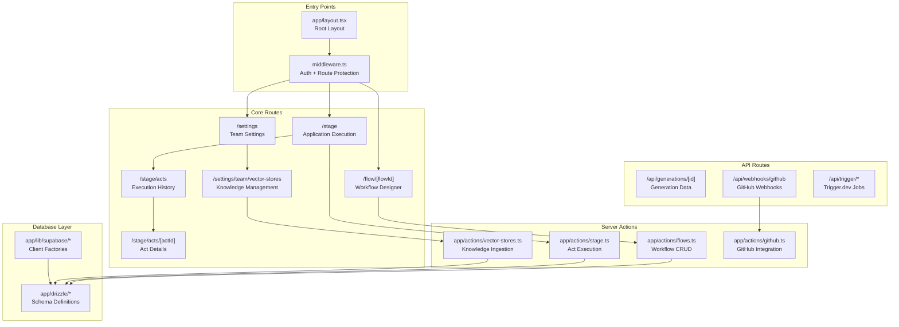

The Studio application uses Next.js App Router with server-side rendering and server actions for data mutations. All routes are protected by authentication middleware that validates Supabase sessions.

**Sources:** [apps/studio.giselles.ai/package.json:1-133]()

### Technology Stack

The Studio application leverages the following core technologies:

| Technology | Purpose | Key Packages |
|-----------|---------|--------------|
| **Framework** | Next.js with App Router, React Server Components | next@15.5.2, react@19.1.1 |
| **Authentication** | Supabase Auth with SSR support | @supabase/ssr@0.6.1, @supabase/auth-js@2.70.0 |
| **Database** | PostgreSQL with Drizzle ORM | drizzle-orm@0.44.2, @vercel/postgres@0.9.0 |
| **Styling** | Tailwind CSS v4 with custom theme system | tailwindcss@4.1.10, @tailwindcss/postcss@4.1.10 |
| **UI Components** | Radix UI primitives with custom theming | @radix-ui/* packages, @giselle-internal/ui |
| **Observability** | Sentry error tracking, OpenTelemetry tracing | @sentry/nextjs@9.30.0, @vercel/otel@1.10.0 |
| **Async Processing** | Trigger.dev for background jobs | @trigger.dev/sdk@4.0.5 |

**Sources:** [apps/studio.giselles.ai/package.json:25-106]()

### Key Dependencies

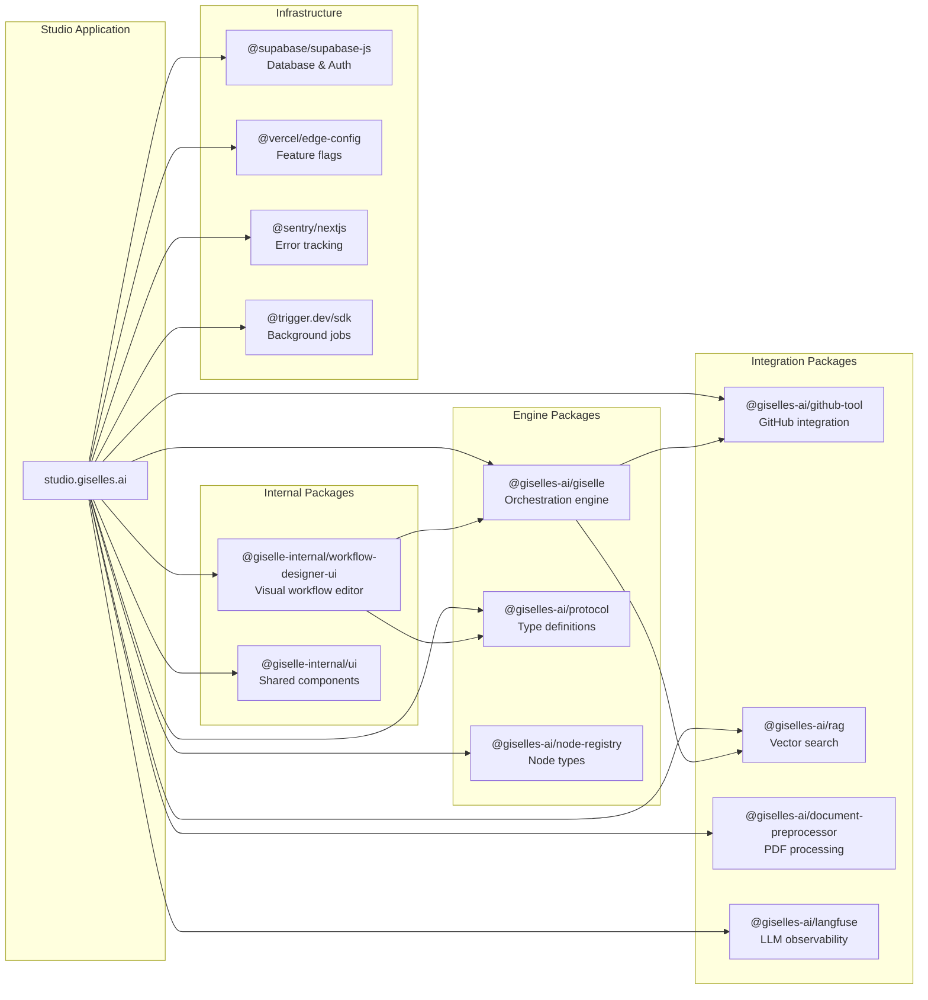

**Sources:** [apps/studio.giselles.ai/package.json:25-106]()

## Workspace Context and Feature Flags

The Studio application uses a centralized context system to provide configuration, feature flags, and integration settings throughout the application. This system enables environment-specific behavior and gradual feature rollouts.

### WorkspaceProvider Architecture

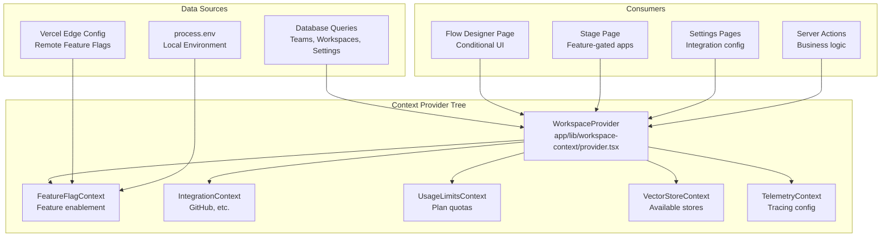

The `WorkspaceProvider` is initialized at the root layout level and fetches workspace-specific data including team information, integration configurations, and usage quotas. It provides this data to all child components through React Context.

**Sources:** [apps/studio.giselles.ai/package.json:77-77]()

### Feature Flag System

The feature flag system uses a two-tier resolution strategy:

| Environment | Source | Priority | Use Case |
|------------|--------|----------|----------|
| **Local Development** | `process.env` variables | High | Developer overrides, local testing |
| **Production** | Vercel Edge Config | Medium | Remote flag management, gradual rollouts |
| **Default** | Flag definition file | Low | Fallback values |

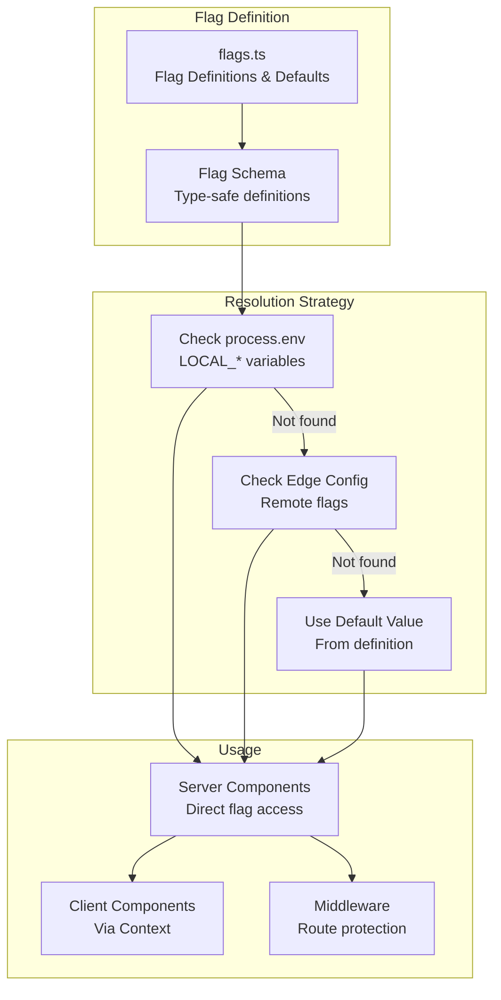

Flags control features such as:
- Stage system availability (`stage`)
- GitHub integration enablement (`github`)
- Vector store features (`vectorStore`)
- Experimental node types (`experimentalNodes`)
- Telemetry and observability (`telemetry`)

**Sources:** [apps/studio.giselles.ai/package.json:66-67](), [apps/studio.giselles.ai/package.json:77-77]()

### Context Data Flow

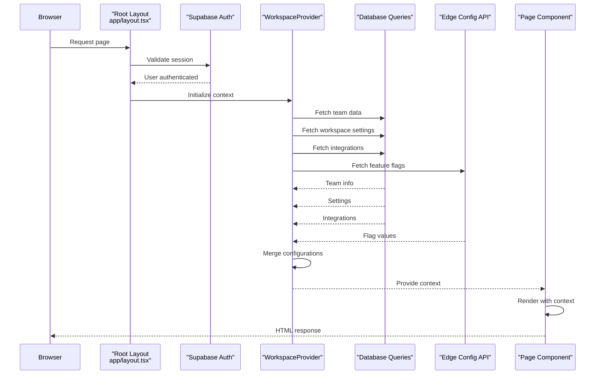

The WorkspaceProvider fetches all necessary data during server-side rendering, ensuring that page components have immediate access to configuration without additional client-side requests.

**Sources:** [apps/studio.giselles.ai/package.json:63-67]()

## Stage System and Act Execution

The Stage system provides a production-ready interface for executing published workflows (applications). It separates the execution environment from the workflow designer, allowing end-users to run applications without access to the design interface.

### Stage Interface Architecture

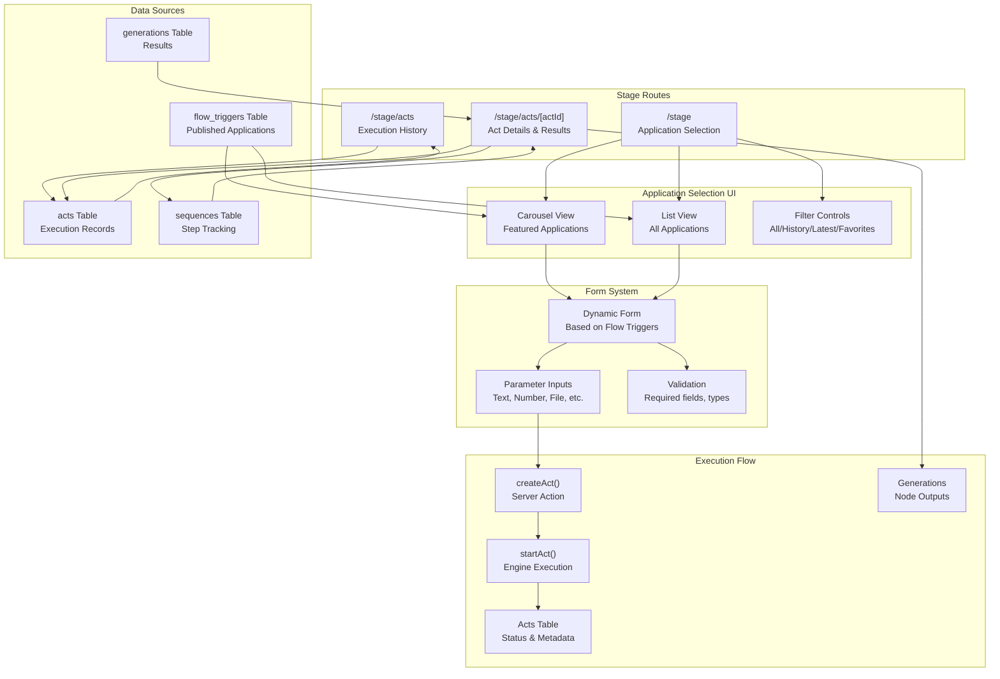

**Sources:** [apps/studio.giselles.ai/package.json:1-133]()

### Application Selection and Filtering

The Stage page queries the `flow_triggers` table to retrieve published applications. Applications can be filtered by type:

| Filter Type | Description | Query Logic |
|------------|-------------|-------------|
| **All** | All published applications | No filter, ordered by creation date |
| **History** | Applications user has executed | Filter by `acts.user_id = current_user` |
| **Latest** | Recently published applications | Order by `created_at DESC`, limit 10 |
| **Favorites** | User-favorited applications | Filter by `user_favorites.user_id = current_user` |

Each application displays:
- Application name and description
- Required parameters (from trigger configuration)
- Execution count (number of acts created)
- Last execution timestamp
- Thumbnail or icon

**Sources:** [apps/studio.giselles.ai/package.json:1-133]()

### Dynamic Form Generation

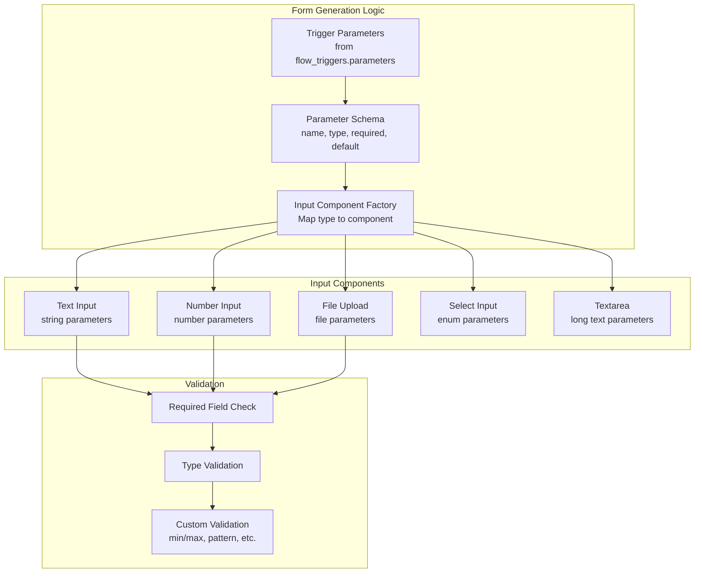

The form system introspects the trigger's parameter definitions and generates appropriate input components. This allows applications to have custom input requirements without UI code changes.

**Sources:** [apps/studio.giselles.ai/package.json:1-133]()

### Act Execution Lifecycle

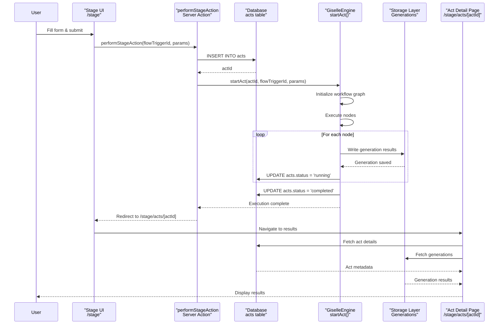

The act execution creates a record in the `acts` table with status `'created'`, then invokes the Giselle Engine to execute the workflow. The engine updates the act status to `'running'` during execution and `'completed'` or `'failed'` upon completion.

**Sources:** [apps/studio.giselles.ai/package.json:1-133]()

### Act Detail Page Structure

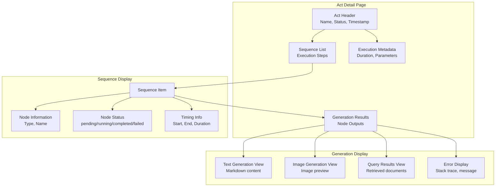

The Act Detail page provides comprehensive visibility into the execution, showing each node's execution status, timing information, and output results. Users can inspect the entire workflow execution trace.

**Sources:** [apps/studio.giselles.ai/package.json:1-133]()

### Database Schema for Stage System

| Table | Purpose | Key Columns |
|-------|---------|-------------|
| `flow_triggers` | Published applications | `id`, `flow_id`, `name`, `description`, `parameters`, `is_published` |
| `acts` | Execution records | `id`, `flow_trigger_id`, `user_id`, `status`, `created_at`, `completed_at` |
| `sequences` | Execution step tracking | `id`, `act_id`, `node_id`, `status`, `started_at`, `completed_at` |
| `generations` | Node output results | `id`, `act_id`, `node_id`, `type`, `content`, `metadata` |
| `user_favorites` | User-favorited apps | `user_id`, `flow_trigger_id`, `created_at` |

The schema supports multi-tenancy through team/workspace associations and tracks complete execution history with timing information.

**Sources:** [apps/studio.giselles.ai/package.json:76-76]()

## Vector Store Management Interface

The Vector Store Management Interface provides users with tools to configure and manage knowledge sources for retrieval-augmented generation (RAG). It supports both GitHub repositories and uploaded documents as vector store sources.

### Vector Store Settings UI Structure

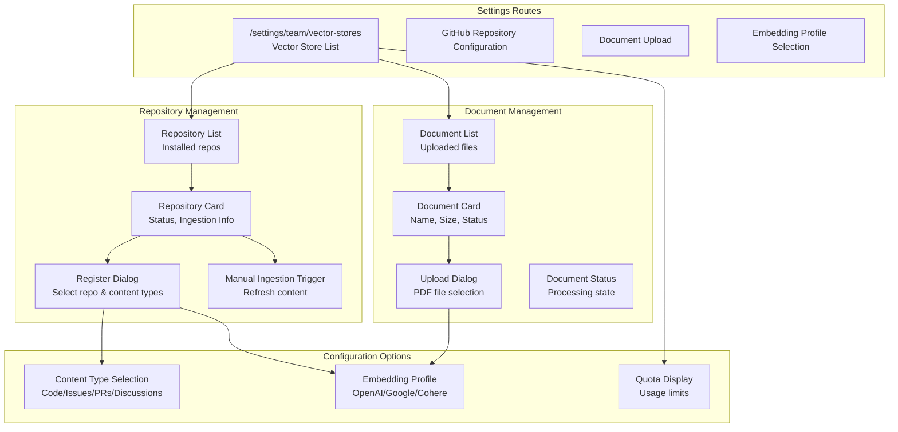

**Sources:** [apps/studio.giselles.ai/package.json:30-38]()

### GitHub Repository Integration

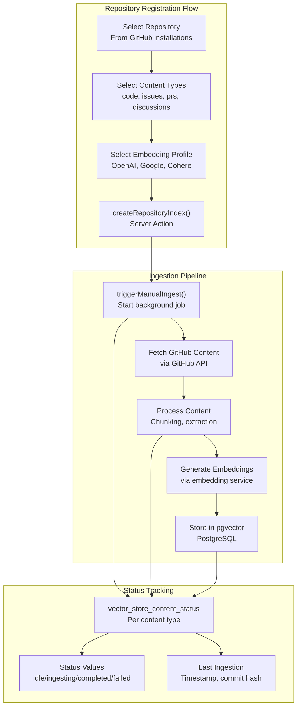

The GitHub integration uses Octokit to fetch repository content and the GitHub GraphQL API for issues, pull requests, and discussions. Content is processed asynchronously using Trigger.dev jobs.

**Sources:** [apps/studio.giselles.ai/package.json:43-44](), [apps/studio.giselles.ai/package.json:32-32]()

### Document Upload and Processing

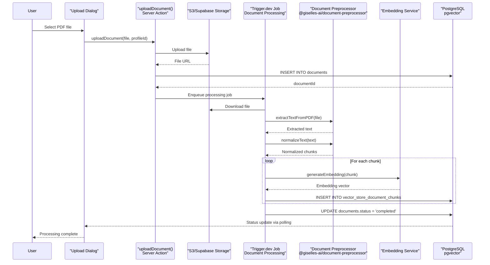

Document processing extracts text from PDFs using `@embedpdf/pdfium`, normalizes the text, chunks it into manageable segments, and generates embeddings using the selected profile's embedding model.

**Sources:** [apps/studio.giselles.ai/package.json:30-30](), [apps/studio.giselles.ai/package.json:26-27]()

### Vector Store Database Schema

| Table | Purpose | Key Columns |
|-------|---------|-------------|
| `vector_store_github` | GitHub repository configuration | `id`, `workspace_id`, `repo_owner`, `repo_name`, `embedding_profile_id` |
| `vector_store_content_status` | Ingestion status per content type | `vector_store_id`, `content_type`, `status`, `last_ingested_at` |
| `vector_store_github_files` | File-level vector storage | `id`, `vector_store_id`, `file_path`, `content_hash`, `embedding` (vector) |
| `vector_store_github_issues` | Issue-level vector storage | `id`, `vector_store_id`, `issue_number`, `title`, `body`, `embedding` (vector) |
| `vector_store_documents` | Uploaded document metadata | `id`, `workspace_id`, `filename`, `status`, `embedding_profile_id` |
| `vector_store_document_chunks` | Document chunk vectors | `id`, `document_id`, `chunk_index`, `content`, `embedding` (vector) |
| `embedding_profiles` | Embedding model configurations | `id`, `provider`, `model`, `dimensions` |

All embedding columns use the `vector` type from the pgvector extension, enabling efficient similarity searches.

**Sources:** [apps/studio.giselles.ai/package.json:76-76](), [apps/studio.giselles.ai/package.json:38-38]()

### Quota Management

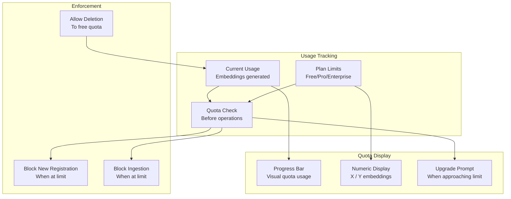

Quota enforcement prevents users from exceeding their plan limits. The system tracks the total number of embeddings (vectors) stored and blocks new operations when limits are reached.

**Sources:** [apps/studio.giselles.ai/package.json:1-133]()

### Content Type Configuration

When registering a GitHub repository, users can select which content types to index:

| Content Type | Source | API Used | Indexing Granularity |
|-------------|--------|----------|---------------------|
| **Code** | Repository files | REST API + tarball download | Per-file embeddings |
| **Issues** | GitHub Issues | GraphQL API | Per-issue embeddings (title + body) |
| **Pull Requests** | GitHub PRs | GraphQL API | Per-PR embeddings (title + description) |
| **Discussions** | GitHub Discussions | GraphQL API | Per-discussion embeddings |

Each content type has independent ingestion status tracking, allowing partial updates (e.g., re-ingest issues without re-processing code).

**Sources:** [apps/studio.giselles.ai/package.json:32-32](), [apps/studio.giselles.ai/package.json:43-44]()

## Playground Application

The Playground application (`apps/playground`) provides a minimal development environment for testing workflow functionality without the full production infrastructure. It serves as a rapid prototyping tool for developers.

### Key Differences from Studio

| Aspect | Studio | Playground |
|--------|--------|-----------|
| **Authentication** | Full Supabase Auth with sessions | No authentication |
| **Database** | PostgreSQL with Drizzle ORM | In-memory or file-based storage |
| **Feature Flags** | Edge Config + environment variables | Environment variables only |
| **Integrations** | GitHub, RAG, Vector Stores, all tools | Minimal integrations |
| **Observability** | Sentry, OpenTelemetry, Langfuse | Langfuse only (optional) |
| **Deployment** | Vercel production | Local development only |
| **Routes** | Multiple routes (flow, stage, settings) | Single flow route |

**Sources:** [apps/playground/package.json:1-43](), [apps/studio.giselles.ai/package.json:1-133]()

### Playground Architecture

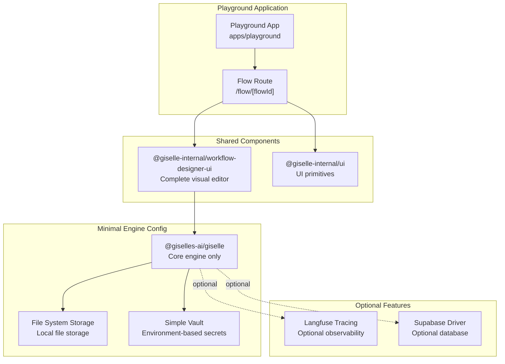

**Sources:** [apps/playground/package.json:19-31]()

### Simplified Configuration

The Playground uses minimal configuration in `next.config.js`:

```typescript
// Simplified feature flag resolution
const flags = {
  stage: false,  // No Stage system
  github: false, // No GitHub integration
  vectorStore: false, // No vector stores
  telemetry: process.env.LANGFUSE_PUBLIC_KEY ? true : false
}

// Simple engine configuration
const engineConfig = {
  storage: new FileSystemStorage('./storage'),
  vault: new SimpleVault(),
  providers: [
    createOpenAI({ apiKey: process.env.OPENAI_API_KEY }),
    createAnthropic({ apiKey: process.env.ANTHROPIC_API_KEY })
  ]
}
```

This configuration allows developers to test workflow logic without setting up database infrastructure, authentication, or external integrations.

**Sources:** [apps/playground/package.json:19-31]()

### Development Workflow

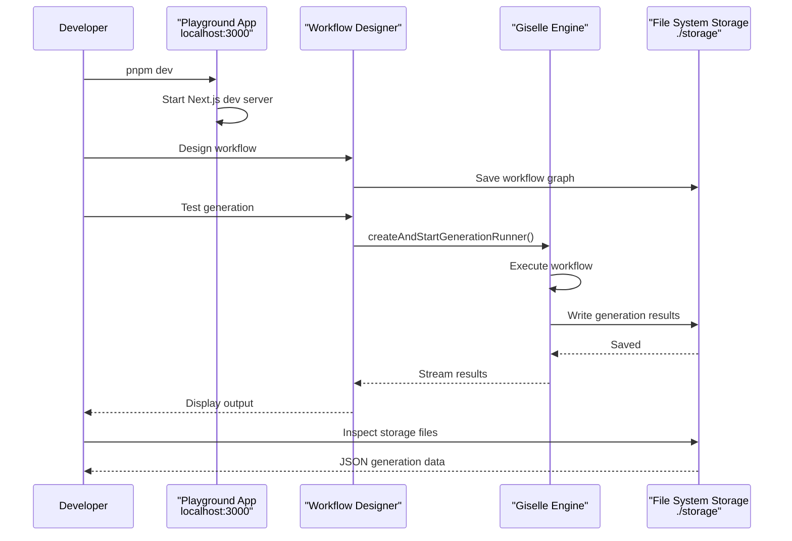

The Playground stores all data in local files under `./storage`, making it easy to inspect and debug workflow execution without database queries.

**Sources:** [apps/playground/package.json:10-10]()

### Use Cases

The Playground is ideal for:

1. **Rapid Prototyping**: Test new node types or workflow patterns without production setup
2. **Integration Testing**: Develop and test new integrations in isolation
3. **Documentation Examples**: Create reproducible examples for documentation
4. **Contributor Onboarding**: New contributors can explore the platform without complex setup
5. **Local Development**: Test engine changes without impacting production infrastructure

**Sources:** [apps/playground/package.json:1-43]()

## Routing and Navigation

### Studio Application Routes

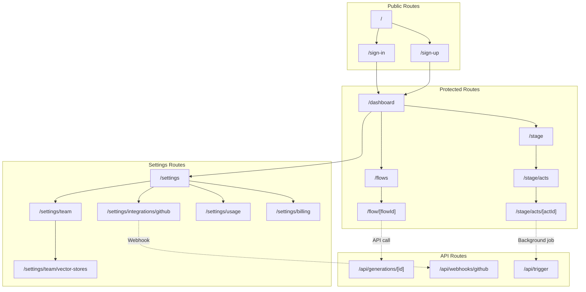

All protected routes require authentication via Supabase Auth. The middleware validates sessions and redirects unauthenticated users to `/sign-in`.

**Sources:** [apps/studio.giselles.ai/package.json:1-133]()

### Route Protection and Middleware

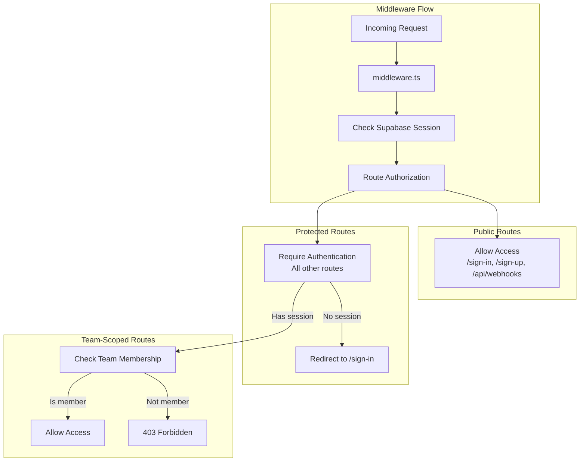

The middleware enforces both authentication (user logged in) and authorization (user has access to the requested team's resources).

**Sources:** [apps/studio.giselles.ai/package.json:63-65]()

## Build and Development Scripts

### Studio Application Scripts

| Script | Command | Purpose |
|--------|---------|---------|
| `dev` | `next dev --turbopack` | Start development server with Turbopack |
| `dev-debug` | `LOGLEVEL=debug pnpm run dev` | Development with verbose logging |
| `build` | `next build` | Production build |
| `build:analyze` | `ANALYZE=true next build` | Build with bundle analysis |
| `start` | `next start` | Start production server |
| `test` | `vitest run` | Run unit tests |
| `test:e2e` | `playwright test` | Run end-to-end tests |
| `email:dev` | `email dev --dir emails` | React Email preview server |
| `check-types` | `tsc --noEmit` | TypeScript type checking |

**Sources:** [apps/studio.giselles.ai/package.json:9-22]()

### Playground Application Scripts

| Script | Command | Purpose |
|--------|---------|---------|
| `dev` | `next dev --turbopack` | Start development server |
| `build` | `next build --turbopack` | Production build |
| `start` | `next start` | Start production server |
| `clean` | `rm -rf .next .turbo node_modules` | Clean build artifacts |
| `check-types` | `tsc --noEmit` | TypeScript type checking |

**Sources:** [apps/playground/package.json:9-17]()

### Environment Variables

Both applications require environment variables for configuration:

**Studio (Production)**:
```
# Required
DATABASE_URL=postgresql://...
NEXT_PUBLIC_SUPABASE_URL=https://...
NEXT_PUBLIC_SUPABASE_ANON_KEY=...
SUPABASE_SERVICE_ROLE_KEY=...

# Optional
OPENAI_API_KEY=...
ANTHROPIC_API_KEY=...
GOOGLE_AI_API_KEY=...
FAL_KEY=...
GITHUB_APP_ID=...
GITHUB_APP_PRIVATE_KEY=...
SENTRY_DSN=...
LANGFUSE_PUBLIC_KEY=...
VERCEL_EDGE_CONFIG=...
```

**Playground (Development)**:
```
# Minimal
OPENAI_API_KEY=...

# Optional
ANTHROPIC_API_KEY=...
LANGFUSE_PUBLIC_KEY=...
```

**Sources:** [apps/studio.giselles.ai/package.json:1-133](), [apps/playground/package.json:1-43]()

---

