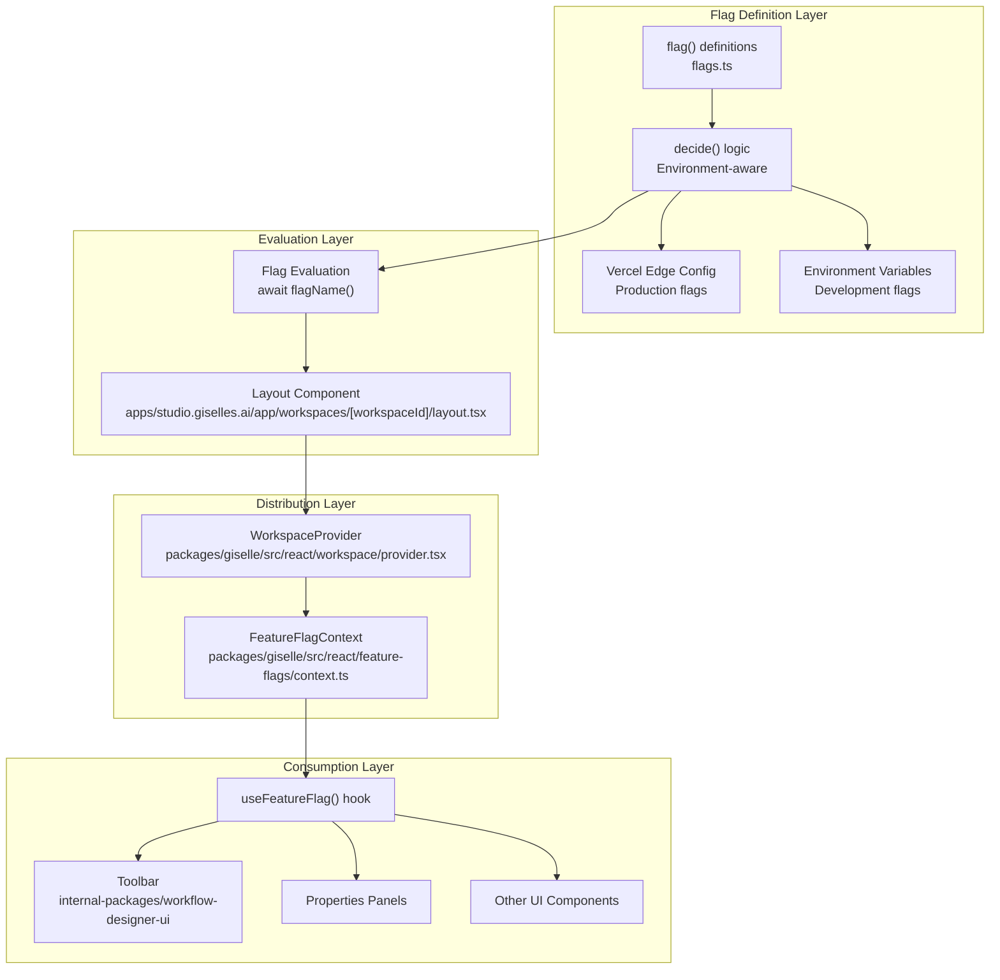
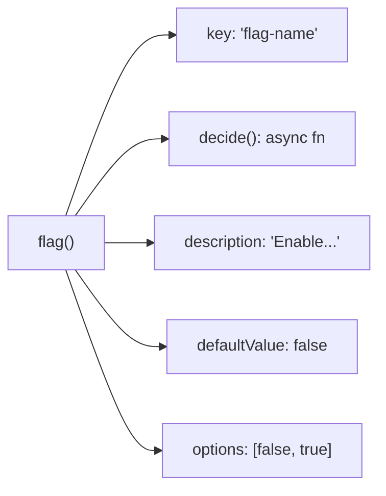
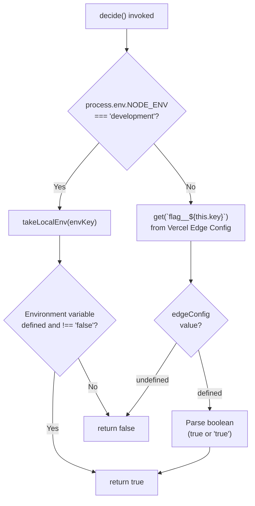
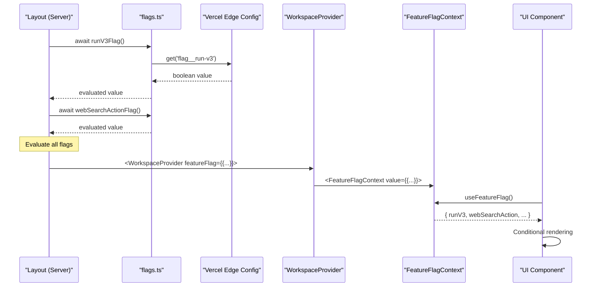
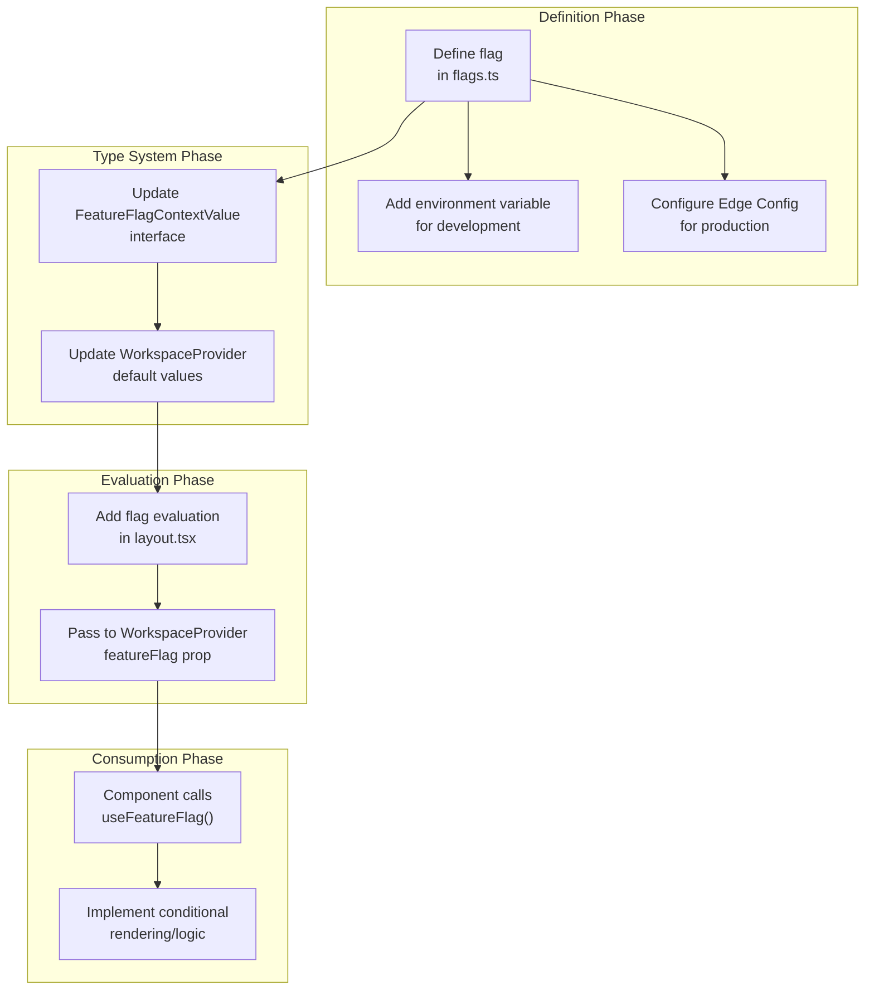

<!-- source: DeepWiki mcp.deepwiki.com · repo giselles-ai/giselle · page 7.1 Feature Flag System · fetched 2026-10-26 -->

# Feature Flag System

<details>
<summary>Relevant source files</summary>

The following files were used as context for generating this wiki page:

- [apps/playground/app/workspaces/[workspaceId]/layout.tsx](apps/playground/app/workspaces/[workspaceId]/layout.tsx)
- [apps/studio.giselles.ai/app/deprecated/workspaces/[workspaceId]/layout.tsx](apps/studio.giselles.ai/app/deprecated/workspaces/[workspaceId]/layout.tsx)
- [apps/studio.giselles.ai/app/workspaces/[workspaceId]/data-loader.ts](apps/studio.giselles.ai/app/workspaces/[workspaceId]/data-loader.ts)
- [apps/studio.giselles.ai/flags.ts](apps/studio.giselles.ai/flags.ts)
- [packages/giselle/src/react/feature-flags/context.ts](packages/giselle/src/react/feature-flags/context.ts)
- [packages/giselle/src/react/workspace/provider.tsx](packages/giselle/src/react/workspace/provider.tsx)

</details>


## Purpose and Scope

The Feature Flag System provides runtime control over feature availability in the Giselle AI platform. It enables conditional feature enablement based on environment (development vs production) and supports gradual rollouts via Vercel Edge Config in production. This document covers flag definition, environment-aware decision logic, distribution through React Context, and consumption patterns in UI components.

For information about how feature flags control Stage workflow execution, see [Stage System and Task Execution](#3.1.2). For usage limits and tier-based feature access, see [Language Models and AI Integration](#2.3).

---

## Architecture Overview

The feature flag system follows a server-side evaluation pattern with client-side distribution through React Context:



**Sources:** [apps/studio.giselles.ai/flags.ts:1-196](), [apps/studio.giselles.ai/app/workspaces/[workspaceId]/layout.tsx:1-146](), [packages/giselle/src/react/workspace/provider.tsx:1-72](), [packages/giselle/src/react/feature-flags/context.ts:1-25]()

---

## Flag Definition System

Feature flags are defined using the `flag()` function from the `flags/next` package. Each flag follows a consistent structure:

| Component | Type | Purpose |
|-----------|------|---------|
| `key` | `string` | Unique identifier for the flag |
| `decide()` | `async function` | Evaluation logic (environment-aware) |
| `description` | `string` | Human-readable description |
| `defaultValue` | `boolean` | Fallback value if evaluation fails |
| `options` | `array` | Available values (typically `[false, true]`) |

### Flag Definition Pattern



### Example Flag Definition

The `runV3Flag` demonstrates the standard pattern:

[apps/studio.giselles.ai/flags.ts:43-60]()

```typescript
export const runV3Flag = flag<boolean>({
  key: "run-v3",
  async decide() {
    if (process.env.NODE_ENV === "development") {
      return takeLocalEnv("RUN_V3_FLAG");
    }
    const edgeConfig = await get(`flag__${this.key}`);
    if (edgeConfig === undefined) {
      return false;
    }
    return edgeConfig === true || edgeConfig === "true";
  },
  description: "Enable Run v3",
  options: [
    { value: false, label: "disable" },
    { value: true, label: "Enable" },
  ],
});
```

**Sources:** [apps/studio.giselles.ai/flags.ts:43-60]()

---

## Environment-Aware Decision Logic

The `decide()` function implements environment-specific evaluation strategies:



### Local Development Helper

The `takeLocalEnv()` function handles development environment flags:

[apps/studio.giselles.ai/flags.ts:4-15]()

```typescript
function takeLocalEnv(localEnvironmentKey: string) {
  if (process.env.NODE_ENV !== "development") {
    return false;
  }
  if (
    process.env[localEnvironmentKey] === undefined ||
    process.env[localEnvironmentKey] === "false"
  ) {
    return false;
  }
  return true;
}
```

### Development Environment Variables

| Flag | Environment Variable | Example |
|------|---------------------|---------|
| `developerFlag` | `DEVELOPER_FLAG` | `DEVELOPER_FLAG=true` |
| `webSearchActionFlag` | `WEB_SEARCH_ACTION_FLAG` | `WEB_SEARCH_ACTION_FLAG=true` |
| `runV3Flag` | `RUN_V3_FLAG` | `RUN_V3_FLAG=true` |
| `layoutV3Flag` | `LAYOUT_V3_FLAG` | `LAYOUT_V3_FLAG=true` |
| `experimental_storageFlag` | `EXPERIMENTAL_STORAGE_FLAG` | `EXPERIMENTAL_STORAGE_FLAG=true` |
| `stageFlag` | `STAGE_FLAG` | `STAGE_FLAG=true` |
| `aiGatewayFlag` | `AI_GATEWAY_FLAG` | `AI_GATEWAY_FLAG=true` |
| `resumableGenerationFlag` | `RESUMABLE_GENERATION_FLAG` | `RESUMABLE_GENERATION_FLAG=true` |
| `newEditorFlag` | `NEW_EDITOR_FLAG` | `NEW_EDITOR_FLAG=true` |
| `docVectorStoreFlag` | `DOC_VECTOR_STORE_FLAG` | `DOC_VECTOR_STORE_FLAG=true` |

### Production Vercel Edge Config

In production, flags are retrieved from Vercel Edge Config with keys prefixed by `flag__`:

[apps/studio.giselles.ai/flags.ts:49]()

```typescript
const edgeConfig = await get(`flag__${this.key}`);
```

For a flag with `key: "run-v3"`, the Edge Config key is `flag__run-v3`.

**Sources:** [apps/studio.giselles.ai/flags.ts:1-196]()

---

## Flag Distribution Pattern

Feature flags are evaluated server-side in Next.js layouts and distributed to client components via React Context:



### Server-Side Evaluation

Flags are evaluated in the workspace layout component:

[apps/studio.giselles.ai/app/workspaces/[workspaceId]/layout.tsx:71-77]()

```typescript
const runV3 = await runV3Flag();
const webSearchAction = await webSearchActionFlag();
const layoutV3 = await layoutV3Flag();
const experimental_storage = await experimental_storageFlag();
const stage = await stageFlag();
const aiGateway = await aiGatewayFlag();
const resumableGeneration = await resumableGenerationFlag();
```

### Context Provider Initialization

Evaluated flags are passed to the `WorkspaceProvider`:

[apps/studio.giselles.ai/app/workspaces/[workspaceId]/layout.tsx:107-115]()

```typescript
<WorkspaceProvider
  featureFlag={{
    runV3,
    webSearchAction,
    layoutV3,
    experimental_storage,
    stage,
    aiGateway,
    resumableGeneration,
  }}
  {/* other props */}
>
```

### WorkspaceProvider Implementation

The `WorkspaceProvider` wraps children with `FeatureFlagContext`:

[packages/giselle/src/react/workspace/provider.tsx:44-55]()

```typescript
return (
  <FeatureFlagContext
    value={{
      runV3: featureFlag?.runV3 ?? false,
      webSearchAction: featureFlag?.webSearchAction ?? false,
      layoutV3: featureFlag?.layoutV3 ?? false,
      experimental_storage: featureFlag?.experimental_storage ?? false,
      stage: featureFlag?.stage ?? false,
      aiGateway: featureFlag?.aiGateway ?? false,
      resumableGeneration: featureFlag?.resumableGeneration ?? false,
    }}
  >
    {/* nested providers */}
  </FeatureFlagContext>
);
```

**Sources:** [apps/studio.giselles.ai/app/workspaces/[workspaceId]/layout.tsx:71-115](), [packages/giselle/src/react/workspace/provider.tsx:44-72](), [packages/giselle/src/react/feature-flags/context.ts:1-25]()

---

## Flag Consumption in UI Components

UI components access feature flags through the `useFeatureFlag()` hook:

### Hook Interface

[packages/giselle/src/react/feature-flags/context.ts:3-24]()

```typescript
export interface FeatureFlagContextValue {
  runV3: boolean;
  webSearchAction: boolean;
  layoutV3: boolean;
  experimental_storage: boolean;
  stage: boolean;
  aiGateway: boolean;
  resumableGeneration: boolean;
}

export function useFeatureFlag(): FeatureFlagContextValue {
  const context = useContext(FeatureFlagContext);
  if (!context) {
    throw new Error(
      "useFeatureFlagContext must be used within a FeatureFlagProvider"
    );
  }
  return context;
}
```

### Conditional Rendering Pattern

The Toolbar component demonstrates feature-gated UI rendering:

[internal-packages/workflow-designer-ui/src/editor/tool/toolbar/toolbar.tsx:93]()

```typescript
const { webSearchAction } = useFeatureFlag();
```

[internal-packages/workflow-designer-ui/src/editor/tool/toolbar/toolbar.tsx:856-863]()

```typescript
{actionProviders
  .filter((actionProvider) => {
    // Filter based on feature flags
    if (actionProvider === "web-search") {
      return webSearchAction;
    }
    return true; // Show other providers by default
  })
  .map((actionProvider) => (
    // render action node button
  ))}
```

### Conditional Feature Availability

The Manual Trigger properties panel uses the `stage` flag:

[internal-packages/workflow-designer-ui/src/editor/properties-panel/trigger-node-properties-panel/providers/manual-trigger/manual-trigger-properties-panel.tsx:39]()

```typescript
const { experimental_storage, stage } = useFeatureFlag();
```

[internal-packages/workflow-designer-ui/src/editor/properties-panel/trigger-node-properties-panel/providers/manual-trigger/manual-trigger-properties-panel.tsx:235-251]()

```typescript
{stage && (
  <div className="mt-[8px]">
    <Toggle
      name="staged"
      checked={staged}
      onCheckedChange={setStaged}
    >
      <label className="text-[12px]" htmlFor="staged">
        Enable this trigger to run in Stage
        <span className="text-text-muted ml-[8px]">
          (This can be changed later)
        </span>
      </label>
      <div className="flex-grow mx-[12px] h-[1px] bg-element-background" />
    </Toggle>
  </div>
)}
```

**Sources:** [packages/giselle/src/react/feature-flags/context.ts:3-24](), [internal-packages/workflow-designer-ui/src/editor/tool/toolbar/toolbar.tsx:93](), [internal-packages/workflow-designer-ui/src/editor/tool/toolbar/toolbar.tsx:856-863](), [internal-packages/workflow-designer-ui/src/editor/properties-panel/trigger-node-properties-panel/providers/manual-trigger/manual-trigger-properties-panel.tsx:39-251]()

---

## Available Feature Flags

| Flag | Key | Purpose |
|------|-----|---------|
| `developerFlag` | `developer` | Enables developer-only features and debug tools |
| `webSearchActionFlag` | `web-search-action` | Enables web search action nodes in workflows |
| `runV3Flag` | `run-v3` | Enables version 3 of the workflow execution engine |
| `layoutV3Flag` | `layout-v3` | Enables version 3 of the application layout |
| `experimental_storageFlag` | `experimental-storage` | Enables experimental GiselleStorage instead of legacy storage |
| `stageFlag` | `stage` | Enables the Stage system for workflow execution and monitoring |
| `aiGatewayFlag` | `ai-gateway` | Enables AI Gateway for LLM request routing |
| `resumableGenerationFlag` | `resumable-generation` | Enables resumable generation with chunk-based writing |
| `newEditorFlag` | `new-editor` | Enables the new workflow editor implementation |
| `docVectorStoreFlag` | `doc-vector-store` | Enables document vector store ingestion (PDF text and image) |

### Flag Definitions by Category

**Workflow Execution:**
- [apps/studio.giselles.ai/flags.ts:43-60]() - `runV3Flag`
- [apps/studio.giselles.ai/flags.ts:138-155]() - `resumableGenerationFlag`

**UI/Layout:**
- [apps/studio.giselles.ai/flags.ts:62-79]() - `layoutV3Flag`
- [apps/studio.giselles.ai/flags.ts:157-174]() - `newEditorFlag`

**Storage:**
- [apps/studio.giselles.ai/flags.ts:81-98]() - `experimental_storageFlag`

**Feature Access:**
- [apps/studio.giselles.ai/flags.ts:30-41]() - `webSearchActionFlag`
- [apps/studio.giselles.ai/flags.ts:100-117]() - `stageFlag`
- [apps/studio.giselles.ai/flags.ts:178-195]() - `docVectorStoreFlag`

**Infrastructure:**
- [apps/studio.giselles.ai/flags.ts:119-136]() - `aiGatewayFlag`
- [apps/studio.giselles.ai/flags.ts:17-28]() - `developerFlag`

**Sources:** [apps/studio.giselles.ai/flags.ts:1-196]()

---

## Development vs Production Configuration

The system supports different configuration patterns for development and production environments:

```mermaid
graph TB
    subgraph "Development Environment"
        DevEnv["NODE_ENV === 'development'"]
        EnvVars["Environment Variables<br/>FEATURE_FLAG=true/false"]
        LocalCheck["takeLocalEnv() check"]
        DevResult["Immediate boolean result"]
    end
    
    subgraph "Production Environment"
        ProdEnv["NODE_ENV === 'production'"]
        EdgeConfigAPI["@vercel/edge-config<br/>get() API"]
        RemoteCheck["await get(`flag__key`)"]
        EdgeParse["Parse boolean/string"]
        ProdResult["Boolean result"]
    end
    
    subgraph "Playground Application"
        PlaygroundLayout["apps/playground/app/workspaces/[workspaceId]/layout.tsx"]
        HardcodedFlags["Hardcoded flag values"]
        PlaygroundResult["Static configuration"]
    end
    
    DevEnv --> EnvVars
    EnvVars --> LocalCheck
    LocalCheck --> DevResult
    
    ProdEnv --> EdgeConfigAPI
    EdgeConfigAPI --> RemoteCheck
    RemoteCheck --> EdgeParse
    EdgeParse --> ProdResult
    
    PlaygroundLayout --> HardcodedFlags
    HardcodedFlags --> PlaygroundResult
```



### Playground Static Configuration

The playground application uses hardcoded feature flags for simplified local development:

[apps/playground/app/workspaces/[workspaceId]/layout.tsx:5-19]()

```typescript
export default function Layout({ children }: { children: ReactNode }) {
  return (
    <WorkspaceProvider
      featureFlag={{
        runV3: true,
        webSearchAction: false,
        layoutV3: true,
        experimental_storage: true,
        stage: true,
        aiGateway: false,
        resumableGeneration: false,
      }}
    >
      {children}
    </WorkspaceProvider>
  );
}
```

### Development Configuration Example

For local development of the Studio app:

```bash
# .env.local
DEVELOPER_FLAG=true
WEB_SEARCH_ACTION_FLAG=true
RUN_V3_FLAG=true
LAYOUT_V3_FLAG=false
EXPERIMENTAL_STORAGE_FLAG=true
STAGE_FLAG=true
AI_GATEWAY_FLAG=false
RESUMABLE_GENERATION_FLAG=true
DOC_VECTOR_STORE_FLAG=true
```

### Production Edge Config Example

Production flags are managed in Vercel Edge Config with these keys:

```json
{
  "flag__developer": false,
  "flag__web-search-action": true,
  "flag__run-v3": true,
  "flag__layout-v3": false,
  "flag__experimental-storage": true,
  "flag__stage": true,
  "flag__ai-gateway": false,
  "flag__resumable-generation": false,
  "flag__doc-vector-store": false
}
```

**Sources:** [apps/studio.giselles.ai/flags.ts:4-15](), [apps/studio.giselles.ai/flags.ts:45-53](), [apps/playground/app/workspaces/[workspaceId]/layout.tsx:5-19]()

---

## Flag Lifecycle and Dependencies



### Adding a New Feature Flag

**Step 1:** Define the flag in [apps/studio.giselles.ai/flags.ts]():

```typescript
export const myNewFlag = flag<boolean>({
  key: "my-new-feature",
  async decide() {
    if (process.env.NODE_ENV === "development") {
      return takeLocalEnv("MY_NEW_FEATURE_FLAG");
    }
    const edgeConfig = await get(`flag__${this.key}`);
    if (edgeConfig === undefined) {
      return false;
    }
    return edgeConfig === true || edgeConfig === "true";
  },
  description: "Enable my new feature",
  defaultValue: false,
  options: [
    { value: false, label: "disable" },
    { value: true, label: "Enable" },
  ],
});
```

**Step 2:** Update the `FeatureFlagContextValue` interface in [packages/giselle/src/react/feature-flags/context.ts:3-11]():

```typescript
export interface FeatureFlagContextValue {
  // ... existing flags
  myNewFeature: boolean;
}
```

**Step 3:** Update `WorkspaceProvider` default values in [packages/giselle/src/react/workspace/provider.tsx:45-54]():

```typescript
<FeatureFlagContext
  value={{
    // ... existing flags
    myNewFeature: featureFlag?.myNewFeature ?? false,
  }}
>
```

**Step 4:** Evaluate and pass the flag in [apps/studio.giselles.ai/app/workspaces/[workspaceId]/layout.tsx]():

```typescript
const myNewFeature = await myNewFlag();

// Later in JSX:
<WorkspaceProvider
  featureFlag={{
    // ... existing flags
    myNewFeature,
  }}
>
```

**Step 5:** Consume in components:

```typescript
const { myNewFeature } = useFeatureFlag();

if (myNewFeature) {
  // Render new feature
}
```

**Sources:** [apps/studio.giselles.ai/flags.ts:1-196](), [packages/giselle/src/react/feature-flags/context.ts:3-11](), [packages/giselle/src/react/workspace/provider.tsx:45-54](), [apps/studio.giselles.ai/app/workspaces/[workspaceId]/layout.tsx:71-115]()

---

