<!-- source: DeepWiki mcp.deepwiki.com · repo giselles-ai/giselle · page 7.3 Observability and Telemetry · fetched 2026-10-26 -->

# Observability and Telemetry

<details>
<summary>Relevant source files</summary>

The following files were used as context for generating this wiki page:

- [apps/playground/giselle-engine.ts](apps/playground/giselle-engine.ts)
- [apps/playground/package.json](apps/playground/package.json)
- [apps/studio.giselles.ai/app/giselle-engine.ts](apps/studio.giselles.ai/app/giselle-engine.ts)
- [apps/studio.giselles.ai/package.json](apps/studio.giselles.ai/package.json)
- [internal-packages/workflow-designer-ui/package.json](internal-packages/workflow-designer-ui/package.json)
- [package.json](package.json)
- [packages/giselle/package.json](packages/giselle/package.json)
- [packages/giselle/src/engine/acts/run-act.ts](packages/giselle/src/engine/acts/run-act.ts)
- [packages/giselle/src/engine/generations/generate-content.ts](packages/giselle/src/engine/generations/generate-content.ts)
- [packages/giselle/src/engine/generations/generate-image.ts](packages/giselle/src/engine/generations/generate-image.ts)
- [packages/giselle/src/engine/generations/internal/use-generation-executor.ts](packages/giselle/src/engine/generations/internal/use-generation-executor.ts)
- [packages/giselle/src/engine/generations/types.ts](packages/giselle/src/engine/generations/types.ts)
- [packages/giselle/src/engine/generations/utils.ts](packages/giselle/src/engine/generations/utils.ts)
- [packages/giselle/src/engine/operations/execute-query.ts](packages/giselle/src/engine/operations/execute-query.ts)
- [packages/giselle/src/engine/telemetry/index.ts](packages/giselle/src/engine/telemetry/index.ts)
- [packages/giselle/src/engine/telemetry/types.ts](packages/giselle/src/engine/telemetry/types.ts)
- [packages/giselle/src/engine/triggers/resolve-trigger.ts](packages/giselle/src/engine/triggers/resolve-trigger.ts)
- [packages/giselle/src/engine/types.ts](packages/giselle/src/engine/types.ts)
- [packages/giselle/src/react/generations/generation-runner.tsx](packages/giselle/src/react/generations/generation-runner.tsx)
- [pnpm-lock.yaml](pnpm-lock.yaml)
- [pnpm-workspace.yaml](pnpm-workspace.yaml)

</details>


This document describes the observability and telemetry infrastructure in the Giselle AI platform, including the callback system for generation lifecycle events, Langfuse integration for LLM tracing, metadata enrichment, and error tracking mechanisms.

For information about error handling and error types, see the Error Handling section (not yet documented). For usage limit tracking and agent time consumption, see [Usage Limits and Tier Management](#2.3).

## Overview

The observability system provides comprehensive monitoring of AI operations through:
- **Callback-based event system** for generation lifecycle tracking
- **Langfuse integration** for LLM and embedding operation tracing
- **Metadata enrichment** with team, plan, and user context
- **Request correlation** via request ID tracking
- **Asynchronous telemetry** to avoid blocking generation pipelines

The system operates through callbacks registered in the `GiselleEngineContext` and executed at specific lifecycle points during generation execution.

## Callback System Architecture

### Callback Registration and Types

The engine supports four primary callback types defined in the `GiselleEngineContext`:

| Callback Type | Trigger Point | Purpose |
|---------------|---------------|---------|
| `generationComplete` | Generation completes successfully | Trace successful operations, record usage |
| `generationFailed` | Generation fails with error | Trace failures, log error details |
| `embeddingComplete` | Embedding operation completes | Trace vector query embeddings, track costs |
| `flowTriggerUpdate` | Flow trigger configuration changes | Persist trigger state changes |

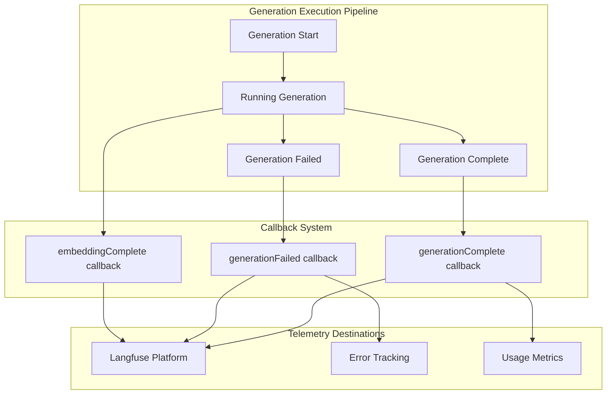

**Sources:** [packages/giselle/src/engine/types.ts:40-91](), [apps/studio.giselles.ai/app/giselle-engine.ts:240-265]()

### Callback Execution Flow

Callbacks are executed asynchronously using Next.js's `after()` function to ensure they don't block generation responses. The execution follows this pattern:

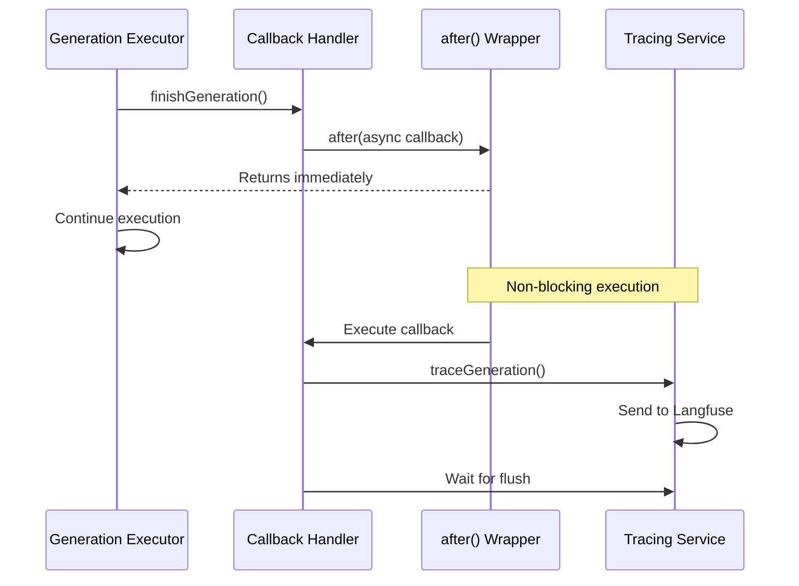

**Sources:** [apps/studio.giselles.ai/app/giselle-engine.ts:185-232](), [packages/giselle/src/engine/generations/internal/use-generation-executor.ts:365-374]()

## Langfuse Integration

### Generation Tracing

The `traceGeneration()` function from `@giselle-sdk/langfuse` sends comprehensive telemetry data to Langfuse for LLM operations:

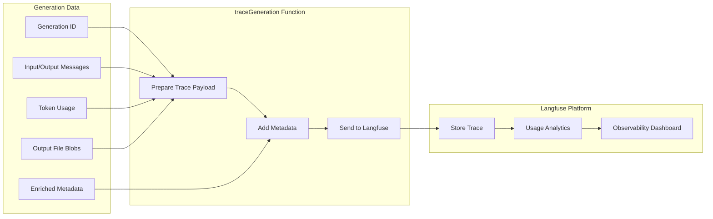

The tracing payload includes:

| Field | Source | Purpose |
|-------|--------|---------|
| `generation` | Completed/Failed generation object | Full generation state |
| `inputMessages` | ModelMessage[] | LLM input messages |
| `outputFileBlobs` | OutputFileBlob[] | Generated images/files |
| `userId` | User context or "github-app" | User attribution |
| `sessionId` | Act ID | Session grouping |
| `tags` | Plan and team type | Filtering and analytics |
| `metadata` | Enriched context | Detailed attribution |
| `providerMetadata` | Provider-specific data | Model-specific info |

**Sources:** [apps/studio.giselles.ai/app/giselle-engine.ts:108-139](), [apps/studio.giselles.ai/trigger/generate-content-task.ts:17-48]()

### Embedding Tracing

Embedding operations (vector queries) are traced separately via `traceEmbedding()`:

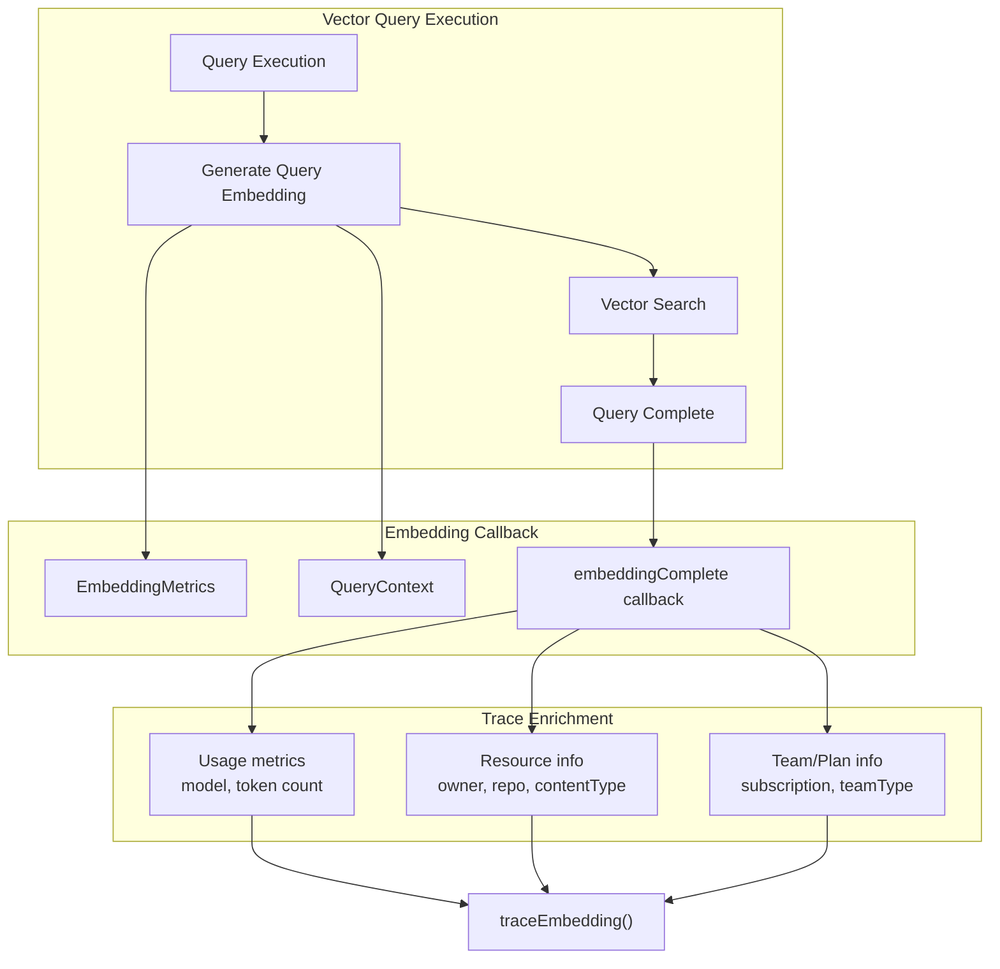

**Sources:** [apps/studio.giselles.ai/app/giselle-engine.ts:141-175](), [packages/giselle/src/engine/operations/execute-query.ts:44-58](), [packages/giselle/src/engine/operations/execute-query.ts:356-368]()

## Metadata Enrichment Pipeline

### Team and Plan Context

Each trace is enriched with team and plan information for cost attribution and analytics:

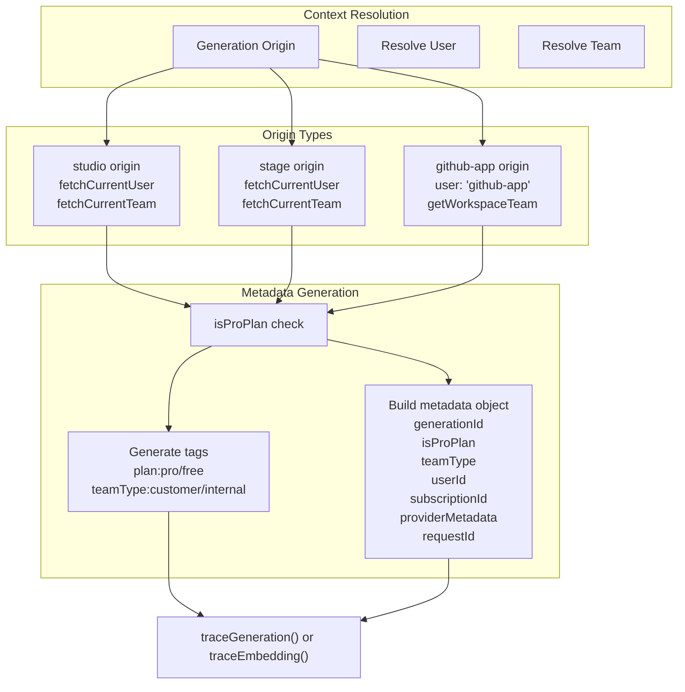

**Sources:** [apps/studio.giselles.ai/app/giselle-engine.ts:185-232](), [apps/studio.giselles.ai/app/giselle-engine.ts:108-139]()

### Request ID Tracking

Request IDs provide correlation across distributed traces and async operations:

| Context | Request ID Source | Purpose |
|---------|-------------------|---------|
| HTTP Requests | `getRequestId()` from request context | Correlate API call with generation |
| Trigger.dev Tasks | Passed as task payload | Correlate async task with originating request |
| Callback Execution | Captured at callback creation | Link trace to original request |

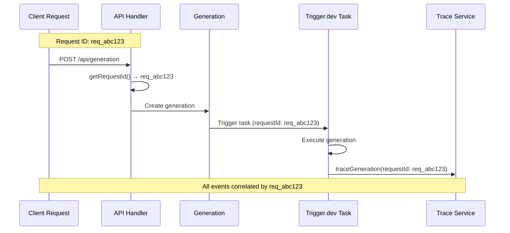

**Sources:** [apps/studio.giselles.ai/app/giselle-engine.ts:250-251](), [apps/studio.giselles.ai/trigger/generate-content-task.ts:52-54](), [apps/studio.giselles.ai/trigger/generate-content-task.ts:84]()

## Telemetry Configuration

### Engine Configuration

Telemetry is configured at engine initialization via the `telemetry` config object:

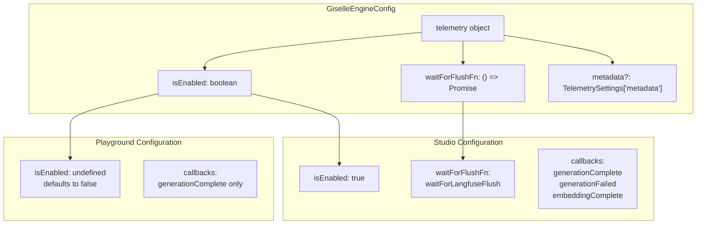

**Studio Configuration:**
```typescript
telemetry: {
  isEnabled: true,
  waitForFlushFn: waitForLangfuseFlush,
}
```

**Playground Configuration:**
```typescript
callbacks: {
  generationComplete: async (args) => {
    try {
      await traceGeneration(args);
    } catch (error) {
      console.error("Trace generation failed:", error);
    }
  },
}
```

**Sources:** [apps/studio.giselles.ai/app/giselle-engine.ts:273-276](), [apps/playground/giselle-engine.ts:148-156](), [packages/giselle/src/engine/types.ts:77-81]()

## Execution Context Handling

### Origin-Based Context Resolution

The system handles three execution contexts with different context resolution strategies:

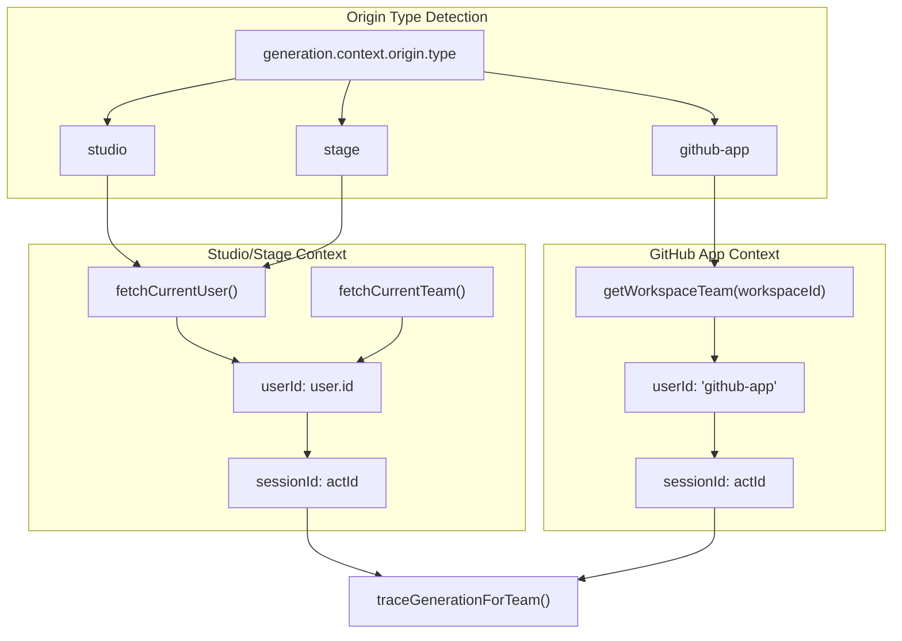

**Sources:** [apps/studio.giselles.ai/app/giselle-engine.ts:188-227](), [apps/studio.giselles.ai/app/giselle-engine.ts:309-348]()

### Conditional Tracing in Studio Context

Studio generation with Trigger.dev delegation has special handling to avoid duplicate traces:

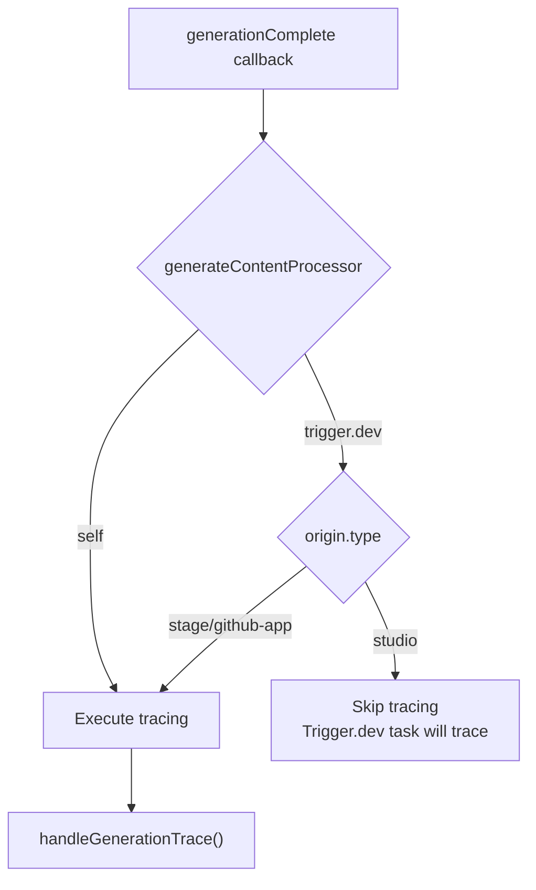

**Rationale:** Studio generations delegated to Trigger.dev are traced by the task itself to ensure proper metadata context. Act executions (stage/github-app) are traced immediately because they don't support Trigger.dev delegation yet.

**Sources:** [apps/studio.giselles.ai/app/giselle-engine.ts:240-264](), [apps/studio.giselles.ai/app/giselle-engine.ts:234-238]()

## Trigger.dev Task Telemetry

### Task-Based Tracing

Long-running generations delegated to Trigger.dev tasks perform tracing within the task execution:

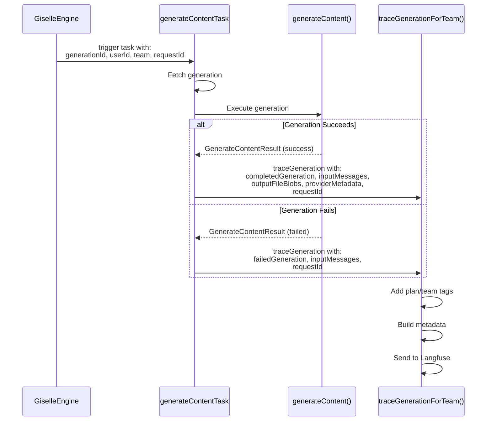

The task receives pre-resolved context to avoid authentication issues in background execution:
- `userId`: Already resolved user ID
- `team`: Team object with `id`, `type`, `subscriptionId`
- `requestId`: Correlation ID from originating request

**Sources:** [apps/studio.giselles.ai/trigger/generate-content-task.ts:50-104](), [apps/studio.giselles.ai/app/giselle-engine.ts:367-409]()

## Callback Implementation Details

### Generation Complete Callback Structure

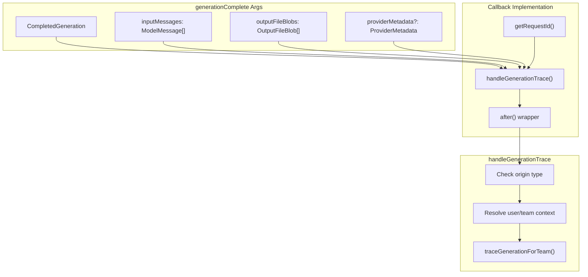

**Sources:** [apps/studio.giselles.ai/app/giselle-engine.ts:240-252](), [apps/studio.giselles.ai/app/giselle-engine.ts:185-232]()

### Embedding Complete Callback Structure

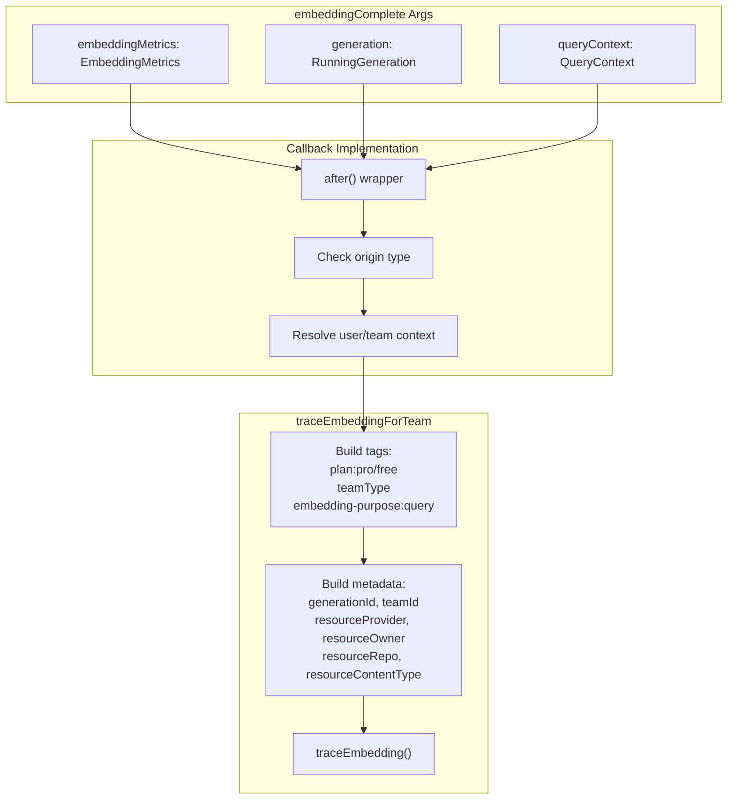

**Sources:** [apps/studio.giselles.ai/app/giselle-engine.ts:306-349](), [apps/studio.giselles.ai/app/giselle-engine.ts:141-175]()

## Batch Writing for Streaming Data

The `generateContent()` function uses a batch writer for efficiently persisting streaming UI message chunks:

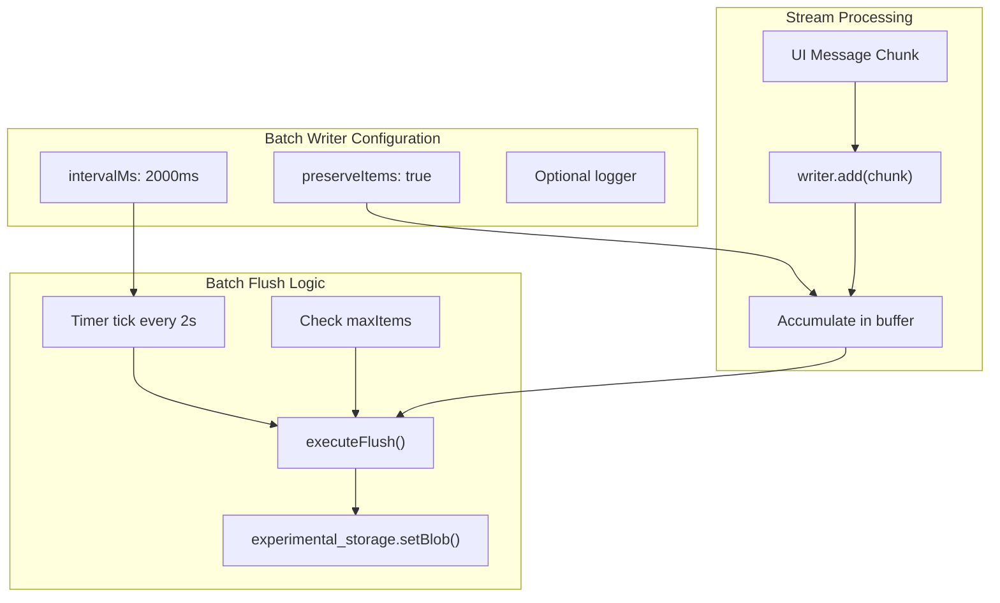

The batch writer ensures:
- **Periodic flushing** every 2 seconds to reduce write operations
- **Item preservation** (`preserveItems: true`) maintains all chunks in buffer until successfully written
- **Error recovery** restores items to buffer on write failure
- **Graceful shutdown** via `writer.close()` ensures all buffered items are flushed

**Sources:** [packages/giselle/src/engine/generations/generate-content.ts:392-416](), [packages/giselle/src/utils/batch.ts:1-123]()

## Error Tracking Integration

### Generation Failure Handling

Failed generations trigger the `generationFailed` callback with error details:

```mermaid
graph TB
    subgraph "Generation Failure"
        GenError["Generation error"]
        BuildFailed["Build FailedGeneration object"]
        ErrorInfo["error: {<br/>name, message, dump<br/>}"]
    end
    
    subgraph "Callback Execution"
        FailedCB["generationFailed callback"]
        TraceFunc["handleGenerationTrace()"]
        ResolveContext["Resolve user/team context"]
    end
    
    subgraph "Trace Data"
        FailedGen["FailedGeneration"]
        InputMsg["inputMessages"]
        NoOutputs["No outputFileBlobs"]
        RequestID["requestId"]
    end
    
    GenError --> BuildFailed
    BuildFailed --> ErrorInfo
    ErrorInfo --> FailedCB
    
    FailedCB --> TraceFunc
    TraceFunc --> ResolveContext
    
    FailedGen --> TraceLangfuse["Send to Langfuse"]
    InputMsg --> TraceLangfuse
    NoOutputs --> TraceLangfuse
    RequestID --> TraceLangfuse
```

Error information includes:
- **Error name**: Exception class or "UnknownError"
- **Error message**: Human-readable error description
- **Error dump**: Full error object for debugging
- **Context preservation**: Input messages and generation state retained

**Sources:** [packages/giselle/src/engine/generations/generate-text.ts:265-279](), [packages/giselle/src/engine/generations/generate-content.ts:298-317](), [apps/studio.giselles.ai/app/giselle-engine.ts:253-264]()

## Telemetry Flush Coordination

The `waitForFlushFn` ensures traces are fully transmitted before serverless function termination:

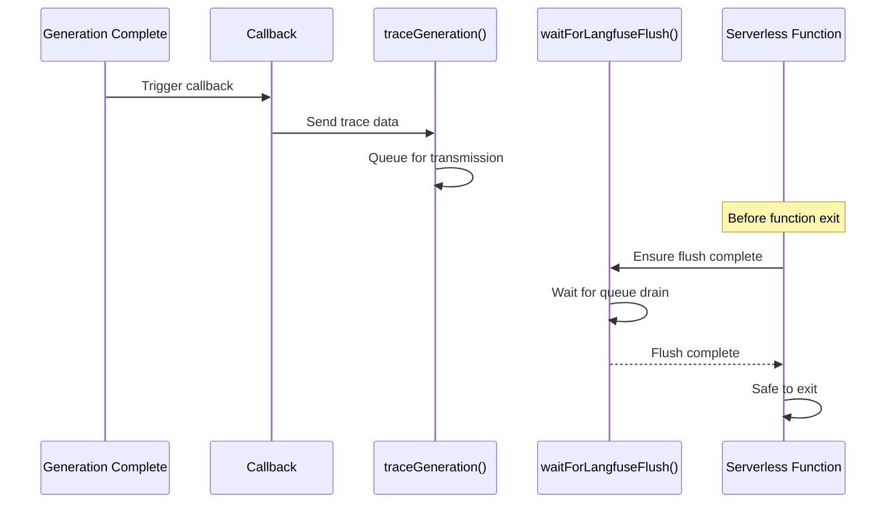

This coordination is critical in serverless environments where premature function termination can lose telemetry data.

**Sources:** [apps/studio.giselles.ai/app/giselle-engine.ts:273-276](), [apps/studio.giselles.ai/instrumentation.node.ts]()

## Summary of Telemetry Data Flow

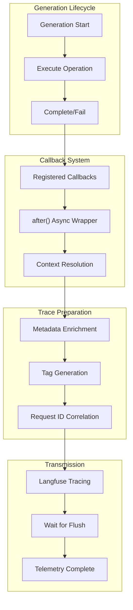

The observability system provides comprehensive tracking of all AI operations while maintaining non-blocking execution through asynchronous callbacks, ensuring production performance is not impacted by telemetry overhead.

---

