<!-- source: DeepWiki mcp.deepwiki.com · repo gobii-ai/gobii-platform · page 1 Platform Overview · fetched 2026-10-26 -->

# Platform Overview

Relevant source files

The following files were used as context for generating this wiki page:

- [api/admin.py](api/admin.py)
- [api/agent/core/event_processing.py](api/agent/core/event_processing.py)
- [api/models.py](api/models.py)
- [config/settings.py](config/settings.py)
- [console/views.py](console/views.py)
- [util/subscription_helper.py](util/subscription_helper.py)

## Purpose and Scope

This document provides a high-level introduction to the gobii-platform architecture, deployment modes, core components, and operational flow. It is intended for developers and system administrators who need to understand how the platform functions as a whole.

For detailed information about specific subsystems:
- Agent lifecycle and configuration: see [Agent Management](#4)
- Credit consumption and billing: see [Credit & Billing System](#5)
- Tool integration and MCP: see [Tool Integration](#6)
- Communication channels: see [Communication Systems](#7)

---

## Architecture Overview

The gobii-platform is a **Django-based multi-agent orchestration system** that enables users to create persistent AI agents capable of browser automation, tool integration, and multi-channel communication. The platform supports both individual users and organizations, with a sophisticated credit-based billing system and subscription management.

### High-Level Component Architecture

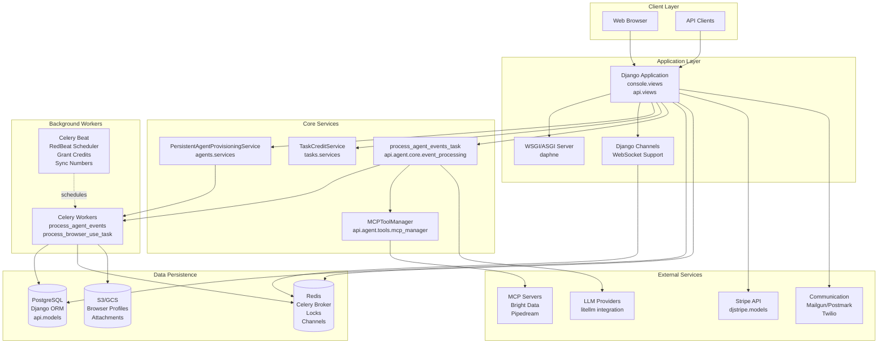

**Sources:** [config/settings.py:1-878](), [console/views.py:1-100](), [api/agent/core/event_processing.py:1-200](), [api/models.py:1-500]()

---

## Deployment Modes

The platform supports two deployment modes controlled by the `GOBII_PROPRIETARY_MODE` setting, with distinct feature sets and licensing requirements.

### Community Edition

**Default mode** (`GOBII_PROPRIETARY_MODE=False`) providing core agent functionality without external service dependencies:

| Feature | Configuration |
|---------|---------------|
| **Turnstile CAPTCHA** | Disabled (`TURNSTILE_ENABLED=False`) |
| **Email Verification** | Disabled (`ACCOUNT_EMAIL_VERIFICATION=none`) |
| **Email Backend** | Console (`django.core.mail.backends.console.EmailBackend`) |
| **Stripe Billing** | Disabled unless explicitly configured |
| **Agent/Task Limits** | Effectively unlimited when `GOBII_ENABLE_COMMUNITY_UNLIMITED=True` |

Community Edition is designed for self-hosting and development, removing barriers to local deployment while preserving full agent orchestration capabilities.

**Sources:** [config/settings.py:56-74](), [config/settings.py:457-462](), [config/settings.py:488-496](), [config/settings.py:729-741]()

### Proprietary Mode

**Licensed mode** (`GOBII_PROPRIETARY_MODE=True`) enabling production features with external service integrations:

| Feature | Configuration |
|---------|---------------|
| **Turnstile CAPTCHA** | Enabled on signup/login forms |
| **Email Verification** | Mandatory when `MAILGUN_API_KEY` present |
| **Email Backend** | Mailgun/Postmark via Anymail |
| **Stripe Billing** | Enabled when credentials present |
| **Agent/Task Limits** | Plan-based quotas enforced |
| **Analytics** | Segment, Mixpanel, Meta Pixel, LinkedIn |
| **SMS** | Twilio integration |

Proprietary Mode requires a valid license from Gobii, Inc. and is intended for hosted/commercial deployments.

**Sources:** [config/settings.py:66](), [config/settings.py:451-456](), [config/settings.py:679-723](), [config/settings.py:837-856]()

### Configuration Toggle Pattern

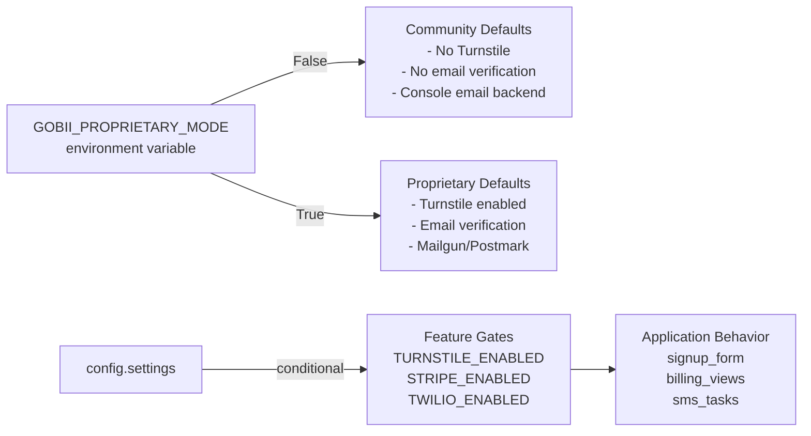

**Sources:** [config/settings.py:56-99](), [config/settings.py:488-512]()

---

## Core Subsystems

### Agent Management

The platform manages two types of agents that work together:

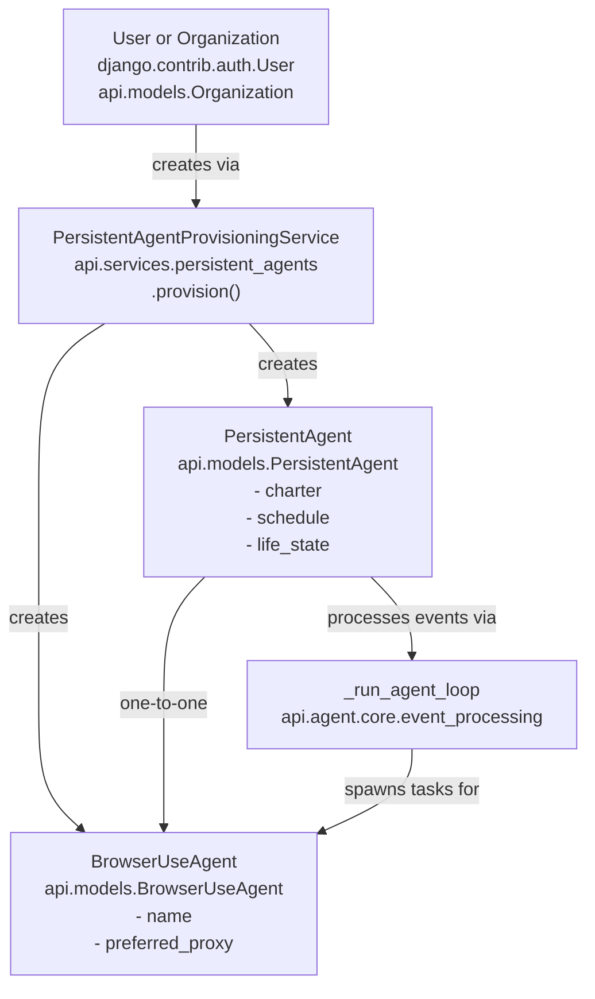

- **`PersistentAgent`**: High-level agent with charter, schedule, communication endpoints, and lifecycle state
- **`BrowserUseAgent`**: Low-level browser automation executor with proxy configuration and profile persistence
- **Provisioning**: Atomic creation via `PersistentAgentProvisioningService.provision()` with quota enforcement

**Sources:** [api/models.py:472-611](), [api/models.py:1186-1579](), [api/services/persistent_agents.py:1-200]()

### Event Processing Pipeline

Agent execution follows a credit-gated loop with LLM reasoning and tool execution:

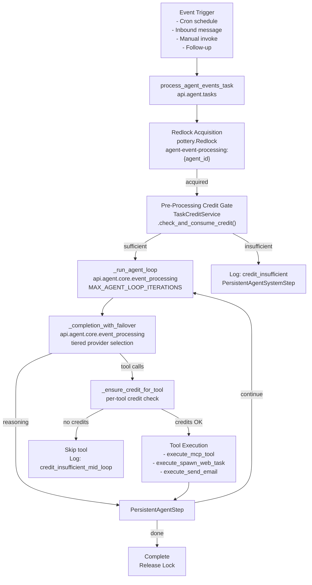

**Sources:** [api/agent/core/event_processing.py:716-1050](), [api/agent/core/event_processing.py:510-711](), [api/agent/core/event_processing.py:289-419]()

### Credit and Billing System

The platform uses a dual-ownership credit system supporting both users and organizations:

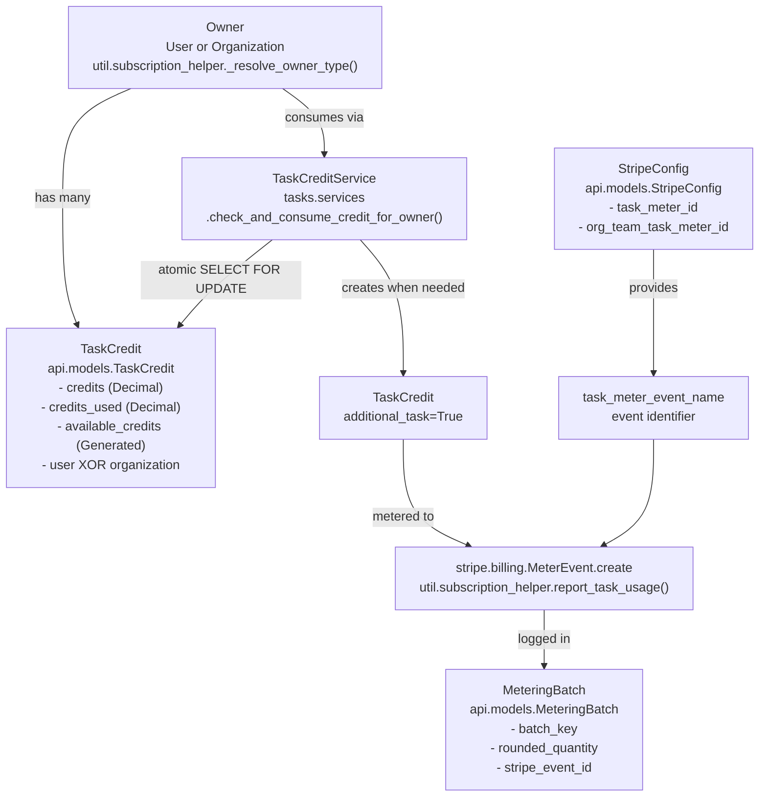

**Credits are consumed atomically** within database transactions using `SELECT FOR UPDATE` to prevent race conditions. When standard credits are exhausted, the system can auto-provision `additional_task=True` credits (if the plan allows), which are immediately reported to Stripe for billing.

**Sources:** [tasks/services.py:1-400](), [api/models.py:290-471](), [util/subscription_helper.py:327-479]()

### Tool Integration

Tools are discovered and executed via the Model Context Protocol (MCP):

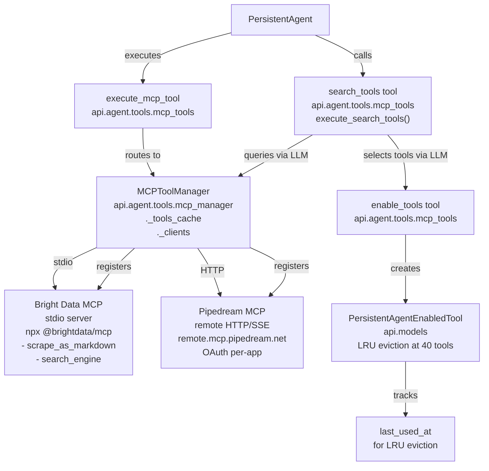

The MCP system enables dynamic tool discovery where agents use natural language to search for capabilities (e.g., "send a message to Slack") and the LLM selects appropriate tools from the catalog. Tools are limited to 40 per agent with automatic LRU eviction.

**Sources:** [api/agent/tools/mcp_manager.py:1-600](), [api/agent/tools/mcp_tools.py:1-400](), [api/models.py:2444-2527]()

---

## Data Models

### Key Model Relationships

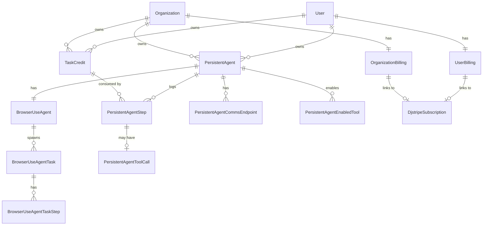

**Owner Types**: The platform uses a dual-ownership pattern where both `User` and `Organization` can own agents and task credits. This is enforced via database check constraints requiring exactly one owner (XOR constraint).

**Sources:** [api/models.py:122-277](), [api/models.py:290-391](), [api/models.py:472-611](), [api/models.py:1186-1579]()

### Critical Model Classes

| Model | Location | Purpose |
|-------|----------|---------|
| `ApiKey` | [api/models.py:122-277]() | API authentication with dual ownership (user/org) |
| `TaskCredit` | [api/models.py:290-391]() | Credit blocks with generated `available_credits` column |
| `TaskCreditConfig` | [api/models.py:393-427]() | Singleton for default credit costs |
| `ToolCreditCost` | [api/models.py:429-471]() | Per-tool credit overrides |
| `BrowserUseAgent` | [api/models.py:472-611]() | Low-level browser automation agent |
| `BrowserUseAgentTask` | [api/models.py:618-832]() | Browser automation task with metering |
| `PersistentAgent` | [api/models.py:1186-1579]() | High-level agent with charter and schedule |
| `PersistentAgentStep` | [api/models.py:1771-1929]() | Agent execution step log with credit linkage |
| `PersistentAgentEnabledTool` | [api/models.py:2444-2527]() | LRU-evicted tool enablement (40 max) |
| `Organization` | [api/models.py:3246-3427]() | Multi-user organization with seat billing |
| `OrganizationBilling` | [api/models.py:3674-3857]() | Org subscription and seat management |

**Sources:** [api/models.py:1-4000]()

---

## Request Flow

### Web Request: Create Agent

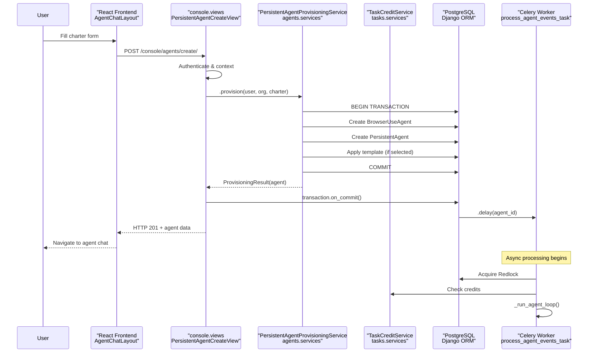

**Sources:** [console/views.py:351-577](), [api/services/persistent_agents.py:1-300](), [api/agent/tasks.py:1-100]()

### API Request: Browser Task

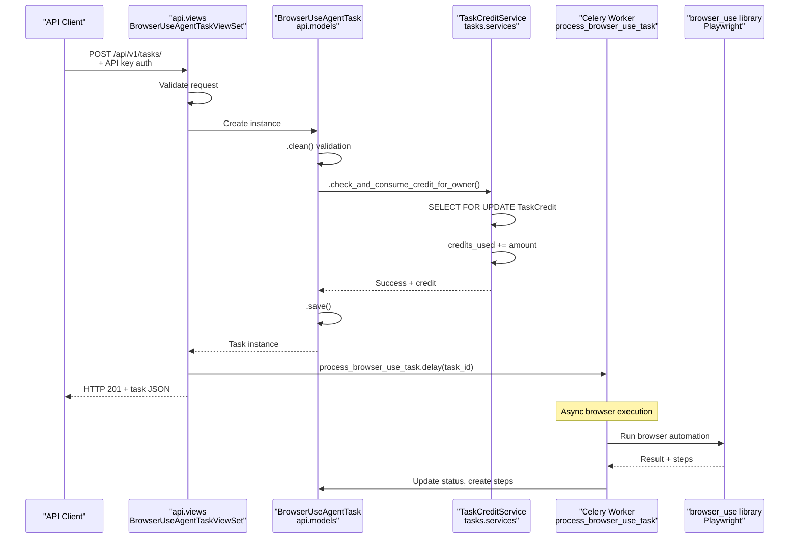

**Sources:** [api/views.py:1-500](), [api/models.py:618-832](), [tasks/services.py:1-400]()

---

## Technology Stack

### Core Framework

| Component | Technology | Configuration |
|-----------|-----------|---------------|
| **Web Framework** | Django 4.2+ | [config/settings.py:187-229]() |
| **ASGI Server** | Daphne | [config/settings.py:195](), [config/settings.py:285]() |
| **ORM** | Django ORM with PostgreSQL | [config/settings.py:288-316]() |
| **Task Queue** | Celery with Redis broker | [config/settings.py:561-602]() |
| **Scheduler** | Celery Beat (RedBeat) | [config/settings.py:599]() |
| **WebSocket** | Django Channels with Redis layer | [config/settings.py:554-559]() |

### External Integrations

| Integration | Library | Purpose |
|-------------|---------|---------|
| **LLM Providers** | LiteLLM | Multi-provider failover (OpenAI, Anthropic, Google, GLM) |
| **Stripe** | dj-stripe | Subscription billing and metering |
| **Email** | Anymail (Mailgun/Postmark) | Transactional email delivery |
| **SMS** | Twilio SDK | Phone verification and agent messaging |
| **Storage** | django-storages (S3/GCS) | Browser profiles and file attachments |
| **MCP** | Custom clients (stdio/HTTP) | Tool integration protocol |

**Sources:** [config/settings.py:1-878](), [api/agent/core/llm_config.py:1-200](), [api/agent/tools/mcp_manager.py:1-100]()

### Database Features

The platform leverages PostgreSQL-specific features:

- **Generated Columns**: `TaskCredit.available_credits` and `TaskCredit.grant_month` for query optimization
- **Partial Unique Constraints**: Conditional uniqueness for free plan credits per month
- **Check Constraints**: XOR enforcement for dual-ownership patterns
- **Connection Pooling**: `CONN_MAX_AGE=600` with health checks via `CONN_HEALTH_CHECKS=True`

**Sources:** [api/models.py:326-336](), [config/settings.py:288-316]()

---

## Bootstrap and First-Run Setup

The platform requires LLM configuration before agents can execute. This is handled via a first-run setup flow:

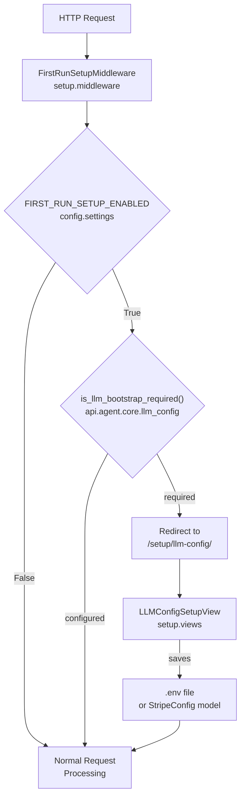

The bootstrap process configures the default LLM provider and model used by `_run_agent_loop()`. In Community Edition, this can be skipped via `LLM_BOOTSTRAP_OPTIONAL=True` for testing purposes.

**Sources:** [setup/middleware.py:1-100](), [api/agent/core/llm_config.py:60-120](), [config/settings.py:70-73]()

---

## Observability

The platform integrates OpenTelemetry tracing throughout critical paths:

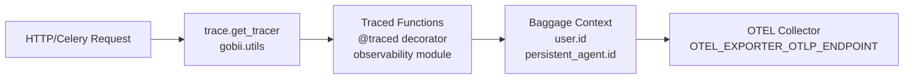

Key traced operations include:
- Agent provisioning: `@traced("INITIALIZE User")`
- Credit operations: `@traced("CREDITS Get User Task Credit Limit")`
- Event processing: `tracer.start_as_current_span("LLM Completion")`
- Database queries: `@traced("SELECT BrowserUseAgent Random Proxy")`

**Sources:** [observability/__init__.py:1-50](), [api/agent/core/event_processing.py:324-362](), [util/subscription_helper.py:1-200]()

---

