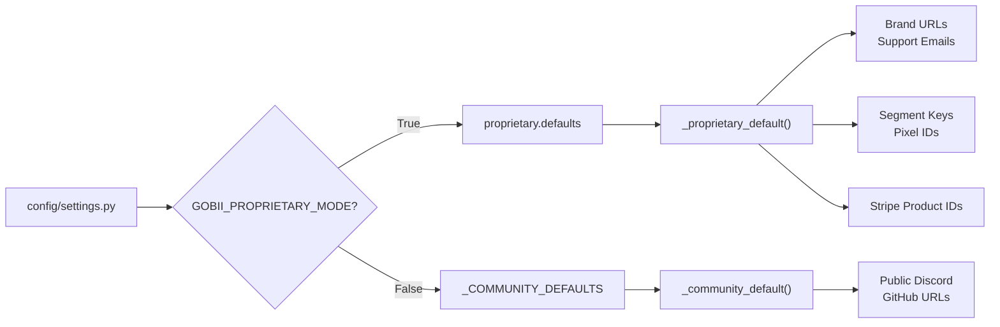
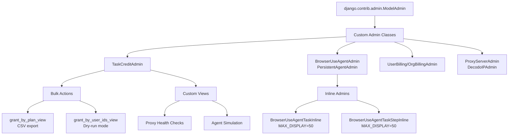
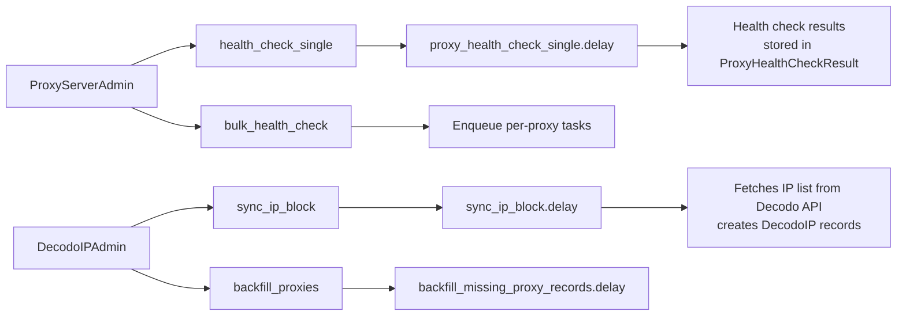
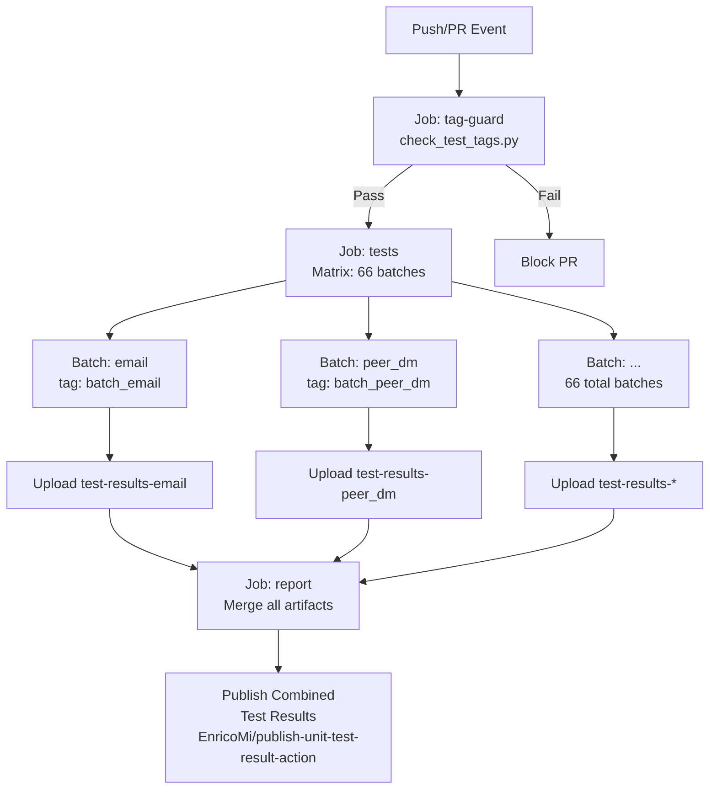

<!-- source: DeepWiki mcp.deepwiki.com · repo gobii-ai/gobii-platform · page 10 Development & Administration · fetched 2026-10-26 -->

# Development & Administration

<details>
<summary>Relevant source files</summary>

The following files were used as context for generating this wiki page:

- [.github/workflows/ci.yml](.github/workflows/ci.yml)
- [api/admin.py](api/admin.py)
- [api/agent/peer_comm.py](api/agent/peer_comm.py)
- [api/agent/peer_link_signals.py](api/agent/peer_link_signals.py)
- [api/agent/tools/peer_dm.py](api/agent/tools/peer_dm.py)
- [api/apps.py](api/apps.py)
- [api/migrations/0151_agentcommpeerstate_agentpeerlink_and_more.py](api/migrations/0151_agentcommpeerstate_agentpeerlink_and_more.py)
- [config/settings.py](config/settings.py)
- [tests/unit/test_agent_short_description.py](tests/unit/test_agent_short_description.py)
- [tests/unit/test_peer_agent_messaging.py](tests/unit/test_peer_agent_messaging.py)
- [util/subscription_helper.py](util/subscription_helper.py)

</details>


This document covers development tools, administrative interfaces, and operational infrastructure for the gobii-platform. It includes Django admin customizations, testing methodology, CI/CD pipelines, and configuration management for both community and proprietary deployment modes.

For platform architecture and core concepts, see [Platform Overview](#1). For deployment configuration details, see [Configuration & Deployment](#2.1).

---

## Configuration Management

### Settings Architecture

The platform uses a layered configuration system centered on [config/settings.py:1-937](), with a distinction between **Community Edition** (open-source, minimal dependencies) and **Proprietary Mode** (licensed deployment with full external integrations).

**Key Configuration Constructs:**

| Setting | Purpose | Default (Community) | Default (Proprietary) |
|---------|---------|---------------------|----------------------|
| `GOBII_PROPRIETARY_MODE` | Enables proprietary features | `False` | `True` |
| `GOBII_ENABLE_COMMUNITY_UNLIMITED` | Removes agent/task limits | `True` | `False` |
| `TURNSTILE_ENABLED` | Cloudflare bot protection | `False` | `True` |
| `ACCOUNT_EMAIL_VERIFICATION` | Email verification requirement | `"none"` | `"mandatory"` |
| `STRIPE_ENABLED` | Billing integration | `False` | `True` (if keys present) |

The configuration system uses `django-environ` to parse `.env` files and applies smart defaults for local development [config/settings.py:36-54]():

```python
if RELEASE_ENV == "local" and not IN_DOCKER:
    os.environ.setdefault("DEBUG", "1")
    os.environ.setdefault("POSTGRES_HOST", "localhost")
    os.environ.setdefault("REDIS_URL", "redis://localhost:6379/0")
```

### Proprietary Defaults System

Proprietary-specific defaults are loaded from a separate `proprietary` package [config/settings.py:75-98](). This allows clean separation of licensed configuration while maintaining a functional community build:



**Sources:** [config/settings.py:75-108]()

### Environment Variable Categories

The platform organizes environment variables into functional groups:

1. **Core Django Settings** [config/settings.py:111-186]()
   - `DJANGO_SECRET_KEY`: Session encryption
   - `DEBUG`: Development mode toggle
   - `CSRF_TRUSTED_ORIGINS`: Security whitelist
   - `PUBLIC_BRAND_NAME`: Deployment branding

2. **Database & Cache** [config/settings.py:288-316]()
   - `POSTGRES_*`: Database connection parameters
   - `REDIS_URL`: Cache and message broker
   - `CONN_MAX_AGE`: Connection pooling (default: 600s)

3. **Celery Task Queue** [config/settings.py:561-601]()
   - `CELERY_BROKER_URL`: Task broker
   - `CELERY_TASK_TIME_LIMIT`: Hard timeout (14400s/4 hours)
   - `CELERY_BEAT_SCHEDULER`: RedBeat for distributed scheduling

4. **External Integrations** [config/settings.py:686-927]()
   - `MAILGUN_API_KEY`, `POSTMARK_SERVER_TOKEN`: Email delivery
   - `TWILIO_*`: SMS provisioning
   - `PIPEDREAM_*`: MCP remote tool servers
   - `STRIPE_*`: Billing and subscriptions

**Sources:** [config/settings.py:1-937]()

---

## Django Admin Interface

### Custom Admin Architecture

The platform extensively customizes Django's admin interface to provide operational tools beyond standard CRUD. The admin system is organized into domain-specific admin classes with specialized actions and views.



**Sources:** [api/admin.py:1-2687]()

### Bulk Credit Granting

The `TaskCreditAdmin` provides two custom views for bulk credit operations:

#### Grant by Plan

Located at `/admin/api/taskcredit/grant-by-plan/`, this view grants credits to all users on a specific subscription plan [api/admin.py:263-389]():

**Form Parameters:**
- `plan`: Target plan (Free, Startup, Team, etc.)
- `credits`: Amount to grant
- `grant_type`: Classification (PLAN, PROMOTIONAL, etc.)
- `expiration_date`: When credits expire
- `only_if_out_of_credits`: Filter to users with zero available credits
- `dry_run`: Preview mode without database changes
- `export_csv`: Download affected user list

**Implementation Detail:** The system iterates active users, calls `get_user_plan()` for each, and matches against the target plan [api/admin.py:299-309](). When `only_if_out_of_credits=True`, a subquery aggregates available credits and filters to users with `SUM(available_credits) <= 0` [api/admin.py:311-337]().

#### Grant by User IDs

Located at `/admin/api/taskcredit/grant-by-user-ids/`, accepts comma or newline-separated user IDs [api/admin.py:391-512]():

```python
# Parse input: "123,456\n789" -> [123, 456, 789]
ids = [s for s in re.split(r"[\s,]+", raw.strip()) if s]
users = list(User.objects.filter(id__in=ids, is_active=True))
```

Both views support dry-run CSV export for audit trails before executing bulk operations.

**Sources:** [api/admin.py:245-512]()

### Proxy Management Actions

The `ProxyServerAdmin` and `DecodoIPAdmin` classes expose operational actions for proxy infrastructure:



These actions trigger Celery tasks and provide admin feedback via Django messages [api/admin.py:1583-1648]().

**Sources:** [api/admin.py:1465-1648](), [api/tasks.py:various]()

### Inline Admin Optimizations

To avoid performance issues when displaying related objects, the platform limits inline admins with custom `get_queryset()` methods:

**BrowserUseAgentTaskInline** [api/admin.py:599-656]():
- Displays the 50 most recent tasks per agent
- Extracts `object_id` from URL to filter tasks
- Returns unsliced queryset filtered by PK list (Django admin requirement)

```python
def get_queryset(self, request):
    qs = super().get_queryset(request)
    object_id = request.resolver_match.kwargs.get("object_id")
    if not object_id:
        return qs.none()
    qs = qs.filter(agent__pk=object_id).order_by('-created_at')
    recent_pks = list(qs.values_list('pk', flat=True)[:self.MAX_DISPLAY])
    return self.model.objects.filter(pk__in=recent_pks).order_by('-created_at')
```

This pattern prevents Django from attempting to render thousands of inline rows, which can cause browser crashes.

**Sources:** [api/admin.py:599-774]()

### Custom Admin Forms

**StripeConfigAdmin** [api/admin.py:99-148]() uses a custom form to handle encrypted secrets:

- `webhook_secret`: Write-only field with encryption via `set_value()`
- `clear_webhook_secret`: Checkbox to delete stored secret
- `webhook_secret_status`: Read-only display of encryption status

**AgentEmailAccountForm** [api/admin_forms.py:various]() provides OAuth flow initiation for agent email configuration.

**Sources:** [api/admin.py:99-148](), [api/admin_forms.py:1-198]()

---

## Testing Infrastructure

### Tag-Based Test Organization

The platform uses Django's test tagging system to organize tests into parallelizable batches. Each test class/method is decorated with a `@tag()` marker:

```python
@tag("batch_peer_dm")
class PeerMessagingServiceTests(TestCase):
    # Tests for peer messaging
```

All tests **must** be tagged, enforced by a pre-test guard script [.github/workflows/ci.yml:20-34]():

```yaml
- name: Verify all tests are tagged and tags are in CI
  run: python3 scripts/check_test_tags.py
```

This script parses all test files, extracts tags, and ensures:
1. Every test has at least one tag
2. Every tag referenced in tests appears in the CI workflow matrix

**Benefits:**
- **Parallelization:** Each batch runs in a separate CI job
- **Isolation:** Batch failures don't block unrelated tests
- **Debuggability:** Failed tests can be re-run by tag locally
- **Consistency:** Tag guard prevents untagged/orphaned tests

**Sources:** [.github/workflows/ci.yml:20-34](), test files with `@tag()` decorators

### Test Batching Strategy

The CI workflow defines 66+ test batches in a matrix [.github/workflows/ci.yml:44-194]():

```yaml
strategy:
  fail-fast: false
  matrix:
    include:
      - batch: email
        tag: batch_email
      - batch: peer_dm
        tag: batch_peer_dm
      - batch: agent_lifecycle
        tag: batch_agent_lifecycle
      # ... 60+ more batches
```

**Batch Design Principles:**
1. **Functional isolation:** Each batch covers a cohesive feature area
2. **Runtime balance:** Batches target ~2-5 minute execution time
3. **Dependency grouping:** Related tests run together (e.g., all email tests)
4. **Smoke test separation:** Core path tests in dedicated batches

### Test Settings

Tests use a separate settings module [.github/workflows/ci.yml:197]():

```yaml
env:
  DJANGO_SETTINGS_MODULE: config.test_settings
```

**Key Test Overrides:**
- Database: SQLite in-memory for speed
- Redis: Fakeredis for zero infrastructure
- Celery: `CELERY_TASK_ALWAYS_EAGER=True` for synchronous execution
- LLM: Mock providers to avoid external API calls
- Email: Console backend for no-op delivery

**Satisfying Settings Import:** Because `manage.py` imports `config.settings` before Django loads test settings, CI must provide all required environment variables [.github/workflows/ci.yml:202-214]():

```yaml
DJANGO_SECRET_KEY: test-secret
POSTGRES_DB: test  # Not used, but settings.py requires it
REDIS_URL: redis://localhost:6379/0
OPENAI_API_KEY: dummy  # Satisfies LLM fail-fast check
```

**Sources:** [.github/workflows/ci.yml:195-216]()

### Running Tests Locally

**Run a specific batch:**
```bash
python manage.py test --tag batch_peer_dm --settings=config.test_settings
```

**Run with XML output for debugging:**
```bash
python manage.py test --tag batch_email \
  --settings=config.test_settings \
  --testrunner=xmlrunner.extra.djangotestrunner.XMLTestRunner
```

**Run all untagged tests (finds missing tags):**
```bash
python manage.py test --exclude-tag batch_* --settings=config.test_settings
```

**Sources:** [.github/workflows/ci.yml:264-276]()

---

## CI/CD Pipeline

### GitHub Actions Workflow

The platform uses a single workflow file [.github/workflows/ci.yml:1-308]() with multiple jobs:



**Sources:** [.github/workflows/ci.yml:1-308]()

### Dependency Caching

The workflow uses multiple cache layers to optimize build time:

#### UV Cache

The `setup-uv` action provides automatic caching for the UV package manager [.github/workflows/ci.yml:226-230]():

```yaml
- name: Set up uv (with cache)
  uses: astral-sh/setup-uv@v6
  with:
    enable-cache: true
    ignore-nothing-to-cache: true
```

#### Venv Cache

A separate cache stores the Python virtual environment [.github/workflows/ci.yml:232-262]():

```yaml
- name: Restore venv cache
  id: restore-venv
  uses: actions/cache/restore@v4
  with:
    path: .venv
    key: venv-${{ runner.os }}-py3.12-${{ hashFiles('uv.lock') }}
    restore-keys: |
      venv-${{ runner.os }}-py3.12-
```

**Cache Strategy:**
1. Restore cached venv if `uv.lock` matches
2. Run `uv sync --frozen` to install dependencies
3. Save updated venv for future runs (if cache miss)

This reduces dependency installation from ~2 minutes to ~10 seconds on cache hits.

**Sources:** [.github/workflows/ci.yml:226-262]()

### Test Execution

Each batch job runs tests with specific tags [.github/workflows/ci.yml:264-276]():

```bash
uv run python manage.py test --tag "$TAG" \
  --settings=config.test_settings \
  --parallel 1 \
  --testrunner=xmlrunner.extra.djangotestrunner.XMLTestRunner
```

**Parallelization:** `--parallel 1` disables Django's built-in parallelization because parallelism occurs at the batch level (66 concurrent CI jobs).

**XML Output:** The `xmlrunner` generates JUnit XML files for each batch, uploaded as artifacts [.github/workflows/ci.yml:278-286]():

```yaml
- name: Upload test results artifact
  if: always()  # Upload even if tests fail
  uses: actions/upload-artifact@v4
  with:
    name: test-results-${{ matrix.batch }}
    path: test-results/**
    retention-days: 7
```

**Sources:** [.github/workflows/ci.yml:264-286]()

### Combined Test Reporting

The `report` job runs after all batches complete (`needs: [tests]`) and aggregates results [.github/workflows/ci.yml:289-307]():

```yaml
- name: Download all test result artifacts
  uses: actions/download-artifact@v4
  with:
    pattern: test-results-*
    merge-multiple: true
    path: all-results

- name: Publish combined test results
  uses: EnricoMi/publish-unit-test-result-action@v2
  with:
    files: all-results/**/*.xml
    check_name: "Combined Test Results"
    comment_mode: off  # Reduce PR noise
```

This creates a single "Combined Test Results" check on PRs showing overall pass/fail status and detailed failure reports.

**Sources:** [.github/workflows/ci.yml:289-307]()

### Concurrency Control

The workflow includes auto-cancellation of outdated runs [.github/workflows/ci.yml:9-11]():

```yaml
concurrency:
  group: ${{ github.workflow }}-${{ github.event.pull_request.number || github.ref }}
  cancel-in-progress: true
```

This ensures that pushing a new commit to a PR immediately cancels the previous CI run, saving compute resources and reducing feedback latency.

**Sources:** [.github/workflows/ci.yml:8-11]()

---

## Development Workflows

### Local Development Setup

**Prerequisites:**
1. Python 3.12+
2. PostgreSQL (or use Docker Compose)
3. Redis (or use Docker Compose)
4. UV package manager (`pip install uv`)

**Bootstrap Steps:**

```bash
# Clone repository
git clone https://github.com/gobii-ai/gobii-platform.git
cd gobii-platform

# Install dependencies
uv sync --all-extras --dev

# Create local environment file
cp infra/platform/local/.env.example infra/platform/local/.env
# Edit .env to add API keys (OPENAI_API_KEY, etc.)

# Run migrations
uv run python manage.py migrate

# Create superuser
uv run python manage.py createsuperuser

# Start services
uv run python manage.py runserver  # Django
uv run celery -A config worker -l info  # Celery worker
uv run celery -A config beat -l info  # Celery beat
```

**LLM Bootstrap Requirement:** The platform enforces at least one LLM provider key on startup [config/settings.py:73](). Set `LLM_BOOTSTRAP_OPTIONAL=1` to bypass in non-interactive environments.

**Sources:** [config/settings.py:36-73]()

### Admin Access Patterns

Common admin workflows:

**Grant credits to specific users:**
1. Navigate to `/admin/api/taskcredit/grant-by-user-ids/`
2. Paste user IDs (comma or newline separated)
3. Set credit amount and expiration
4. Enable "Dry run" + "Export CSV" to preview
5. Submit to execute

**Check proxy health:**
1. Navigate to `/admin/api/proxyserver/`
2. Select proxies
3. Choose "Run health check on selected proxies"
4. View results in `/admin/api/proxyhealthcheckresult/`

**Simulate agent execution:**
1. Navigate to agent detail page in admin
2. Click "Simulate Agent" custom action
3. Review generated steps in test mode

**Sources:** [api/admin.py:various]()

### Test Development Guidelines

**When adding new tests:**

1. **Tag immediately:** Add `@tag("batch_<feature>")` decorator
2. **Choose/create batch:** Group related tests under same tag
3. **Update CI matrix:** Add batch to [.github/workflows/ci.yml:44-194]() if new
4. **Run tag guard:** `python3 scripts/check_test_tags.py` before committing

**Example:**

```python
from django.test import TestCase, tag

@tag("batch_new_feature")
class NewFeatureTests(TestCase):
    def test_something(self):
        # Test implementation
```

**Then update CI:**
```yaml
- batch: new_feature
  tag: batch_new_feature
```

**Sources:** [.github/workflows/ci.yml:20-34](), test files

---

## Configuration Reference

### Critical Environment Variables

| Variable | Required | Default | Purpose |
|----------|----------|---------|---------|
| `DJANGO_SECRET_KEY` | Yes | `"dev-insecure"` (local) | Session encryption |
| `GOBII_ENCRYPTION_KEY` | Yes | `"dev-insecure"` (local) | Field-level encryption |
| `POSTGRES_*` | Yes | `localhost:5432/gobii` | Database connection |
| `REDIS_URL` | Yes | `redis://localhost:6379/0` | Cache and broker |
| `OPENAI_API_KEY` | Yes* | None | LLM provider (*or other LLM key) |
| `GOBII_PROPRIETARY_MODE` | No | `False` | Feature mode toggle |
| `STRIPE_LIVE_SECRET_KEY` | No* | None | Billing (*if STRIPE_ENABLED) |
| `MAILGUN_API_KEY` | No* | None | Email delivery (*if proprietary) |

### Feature Flags

The platform uses Waffle for runtime feature flags managed via admin:

- **Storage:** Database-backed (`waffle_flag` table)
- **Default behavior:** `WAFFLE_FLAG_DEFAULT=False` (explicit management required)
- **Admin URL:** `/admin/waffle/flag/`

**Usage in code:**
```python
from waffle import flag_is_active

if flag_is_active(request, 'new_feature'):
    # Feature-gated logic
```

**Sources:** [config/settings.py:617-620]()

### Deployment Modes

The `GOBII_RELEASE_ENV` variable controls environment-specific behavior:

- `"local"`: Development mode, smart defaults, debug enabled
- `"preview"`: Staging environment with production-like config
- `"prod"`: Production mode, strict security, external services required

**Sources:** [config/settings.py:29-36]()

---

## Troubleshooting

### Common Development Issues

**Issue: "LLM bootstrap check failed"**
- **Cause:** No LLM API keys configured
- **Fix:** Set at least one of `OPENAI_API_KEY`, `ANTHROPIC_API_KEY`, `GOOGLE_API_KEY`, `GLM_API_KEY` in `.env`
- **Bypass:** Set `LLM_BOOTSTRAP_OPTIONAL=1` for tests

**Issue: "Database connection refused"**
- **Cause:** PostgreSQL not running or wrong host
- **Fix:** Start PostgreSQL locally or adjust `POSTGRES_HOST` in `.env`
- **Alternative:** Use Docker Compose: `docker-compose up -d db redis`

**Issue: "Celery worker not processing tasks"**
- **Cause:** Redis connection failure or worker not started
- **Fix:** Verify `REDIS_URL` and run `celery -A config worker`

**Issue: "Tests fail with 'Tag not in CI matrix'"**
- **Cause:** Tag guard detected missing batch
- **Fix:** Add batch to [.github/workflows/ci.yml:44-194]() matrix

**Sources:** Various configuration and troubleshooting patterns

### Admin Performance Issues

**Symptom:** Admin page times out loading agent with many tasks

**Cause:** Inline admin rendering too many related objects

**Fix:** The platform limits inlines to 50 records [api/admin.py:607](). If still slow, the query optimization may need adjustment. Check `list_select_related` and `get_queryset()` overrides.

**Symptom:** Bulk credit grant hangs

**Cause:** Iterating too many users without batch processing

**Fix:** Use "Dry run" mode with CSV export to identify scale, then batch manually or increase timeout.

**Sources:** [api/admin.py:599-774]()

---

