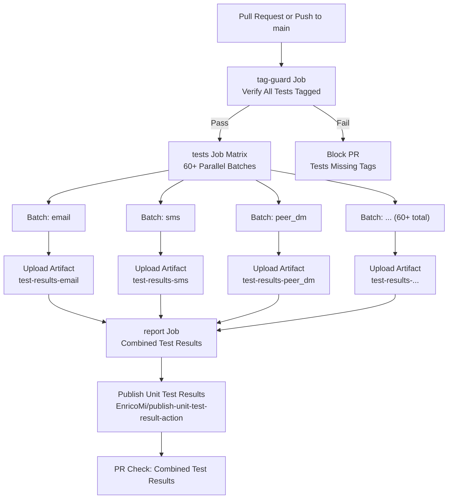
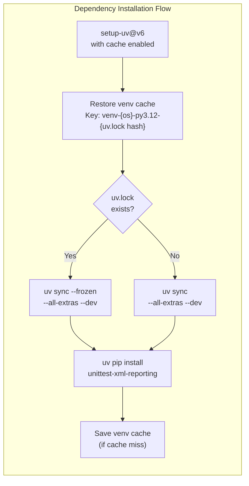
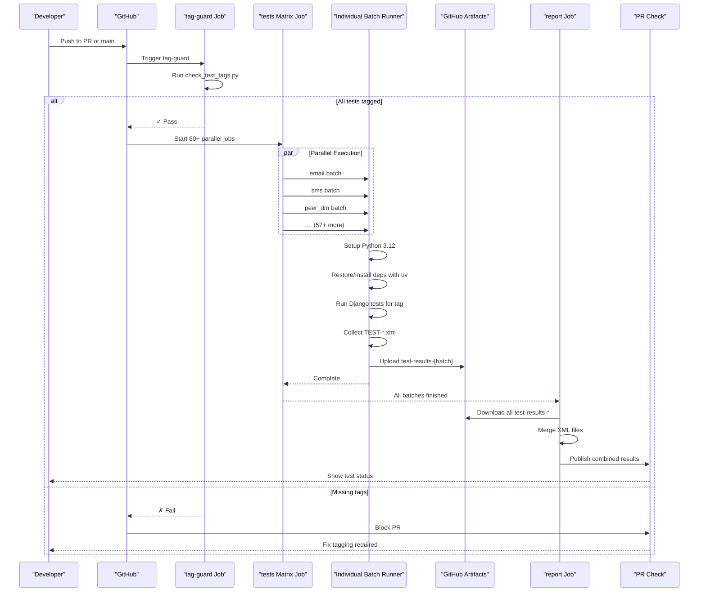

<!-- source: DeepWiki mcp.deepwiki.com · repo gobii-ai/gobii-platform · page 10.2 Testing & CI/CD · fetched 2026-10-26 -->

# Testing & CI/CD

<details>
<summary>Relevant source files</summary>

The following files were used as context for generating this wiki page:

- [.github/workflows/ci.yml](.github/workflows/ci.yml)
- [api/agent/peer_comm.py](api/agent/peer_comm.py)
- [api/agent/peer_link_signals.py](api/agent/peer_link_signals.py)
- [api/agent/tools/peer_dm.py](api/agent/tools/peer_dm.py)
- [api/apps.py](api/apps.py)
- [api/migrations/0151_agentcommpeerstate_agentpeerlink_and_more.py](api/migrations/0151_agentcommpeerstate_agentpeerlink_and_more.py)
- [tests/unit/test_agent_short_description.py](tests/unit/test_agent_short_description.py)
- [tests/unit/test_peer_agent_messaging.py](tests/unit/test_peer_agent_messaging.py)

</details>


This document describes the testing infrastructure and continuous integration/continuous deployment (CI/CD) pipeline for the gobii-platform. It covers the tag-based test batching system, GitHub Actions workflow configuration, test execution, and reporting mechanisms.

For information about the Django admin interface and simulation tools, see [Django Admin Interface](#10.1).

---

## Purpose and Scope

The gobii-platform uses a **tag-based test batching system** to enable parallel test execution in CI. All tests must be tagged with a batch identifier, and the CI pipeline enforces this requirement through an automated guard job. The system supports over 60 parallel test batches, significantly reducing total CI runtime compared to sequential execution.

Key aspects covered:
- Test tagging requirements and conventions
- GitHub Actions CI workflow structure
- Test parallelization strategy
- Environment configuration for tests
- Test result aggregation and reporting

---

## Test Structure and Tagging

### Tag-Based Batching

Every test in the codebase **must** be tagged with a batch identifier using Django's `@tag()` decorator. This is enforced by the `tag-guard` job in CI, which runs `scripts/check_test_tags.py` to verify compliance.

```python
@tag("batch_peer_dm")
class PeerMessagingServiceTests(TestCase):
    # Test implementation
```

[tests/unit/test_peer_agent_messaging.py:20-21]()

The tagging system serves two purposes:
1. **Parallel Execution**: Tests are grouped into batches that can run simultaneously in separate CI jobs
2. **Organizational Clarity**: Related tests are grouped together (e.g., all email tests, all agent lifecycle tests)

### Tag Naming Conventions

Tags follow the pattern `batch_<feature_area>` or `<specific_feature>` for specialized tests:

| Tag Pattern | Example | Purpose |
|-------------|---------|---------|
| `batch_<feature>` | `batch_peer_dm` | Feature-specific test batches |
| `batch_<area>_<detail>` | `batch_email_allowlist` | Subdivided feature areas |
| `<special>` | `smtp`, `xvfb` | Environment-specific or infrastructure tests |
| `<area>_batch` | `oss_readiness_batch` | Special validation suites |

**Sources:** [.github/workflows/ci.yml:44-194](), [tests/unit/test_peer_agent_messaging.py:20](), [tests/unit/test_agent_short_description.py:15]()

---

## Test Batch Categories

The platform organizes tests into the following major categories:

### Communication and Messaging
- `batch_email`, `batch_smtp`, `batch_sms`
- `batch_email_body`, `batch_email_allowlist`, `batch_outbound_email`
- `batch_agent_chat`, `batch_peer_dm`, `batch_peer_intro`
- `batch_allowlist_direction`, `batch_allowlist_rules`

### Agent Lifecycle and Processing
- `batch_agent_lifecycle`, `batch_agent_limits`, `batch_soft_expiration`
- `batch_event_processing`, `batch_event_llm`, `batch_event_parallel`
- `batch_spawn_depth`, `batch_pa_shutdown_triggers`

### API and Serialization
- `batch_api_agents`, `batch_api_tasks`, `batch_api_persistent_agents`
- `batch_api_serializer`, `batch_api_decodo`, `batch_api_org_keys`

### Billing and Credits
- `batch_billing`, `batch_subscription`, `batch_task_credits`
- `batch_org_billing`, `batch_owner_billing`, `batch_billing_rollup`
- `batch_pa_step_credits`, `batch_tool_costs`

### Browser Automation
- `batch_browser_profile`, `batch_browser_task_db`, `batch_browser_task_followup`
- `batch_proxy_selection`, `xvfb`

### Tool Integration
- `batch_mcp_tools`, `pipedream_connect`, `batch_charter_tools`

### Infrastructure and Utilities
- `batch_periodic`, `batch_celery_redbeat`, `batch_redis_leaks`, `batch_redis_budget_cleanup`
- `batch_websocket`, `batch_sqlite`, `batch_compaction`, `batch_step_compaction`

### Console and UI
- `batch_console_agents`, `batch_console_allowlist`, `batch_console_api_keys`, `batch_console_context`
- `batch_pages`, `batch_contact_requests`

### Other Features
- `batch_secrets`, `batch_agent_secrets_ctx`, `batch_agent_invite`
- `batch_organizations`, `batch_agent_transfer`, `batch_usage_api`
- `batch_forward_detection`, `batch_link_shortener`, `batch_output_schema`
- `batch_promptree`, `batch_token_usage`, `batch_text_sanitization`
- `batch_agent_short_description`, `batch_schedule`, `batch_stripe_config`
- `batch_email_blocklist`, `batch_email_sender_db`, `batch_outbound_delivery`
- `batch_agent_filesystem`, `oss_readiness_batch`

**Sources:** [.github/workflows/ci.yml:44-194]()

---

## CI/CD Pipeline Architecture

### Workflow Overview

The CI pipeline is defined in `.github/workflows/ci.yml` and consists of three main jobs:



**Sources:** [.github/workflows/ci.yml:1-307]()

### Job Definitions

#### 1. Tag Guard Job

The `tag-guard` job ensures all tests are properly tagged before any test execution begins:

[.github/workflows/ci.yml:20-34]()

This job runs `scripts/check_test_tags.py`, which verifies:
- Every test class has at least one `@tag()` decorator
- All tags used in tests are defined in the CI matrix
- No orphaned or undefined tags exist

#### 2. Test Matrix Job

The `tests` job runs in parallel with a matrix strategy, executing one batch per job:

```yaml
strategy:
  fail-fast: false
  matrix:
    include:
      - batch: email
        tag: batch_email
      - batch: smtp
        tag: smtp
      # ... 60+ more batches
```

[.github/workflows/ci.yml:36-194]()

Each batch job executes:
1. **Checkout code**
2. **Set up Python 3.12**
3. **Install dependencies** using `uv` with venv caching
4. **Run tagged tests** using Django's test runner with XML output
5. **Upload test results** as artifacts

#### 3. Combined Report Job

The `report` job aggregates all test results and publishes a single PR check:

[.github/workflows/ci.yml:289-307]()

This job:
- Downloads all test result artifacts
- Merges XML files
- Uses `EnricoMi/publish-unit-test-result-action` to create a combined check
- Does not post individual PR comments (to reduce noise)

**Sources:** [.github/workflows/ci.yml:1-307]()

---

## Environment Configuration

### Test Settings Override

Tests use a dedicated settings module that overrides production configuration:

```
DJANGO_SETTINGS_MODULE: config.test_settings
```

[.github/workflows/ci.yml:197]()

The test settings module (`config/test_settings.py`) typically:
- Uses **SQLite** instead of PostgreSQL for faster test execution
- Disables external service integrations
- Uses in-memory storage where possible
- Configures faster password hashing

### Environment Variables

The CI workflow sets minimal environment variables to satisfy Django's settings import:

```yaml
env:
  DJANGO_SECRET_KEY: test-secret
  GOBII_ENCRYPTION_KEY: dummy-encryption-key-for-testing
  POSTGRES_DB: test
  POSTGRES_USER: test
  POSTGRES_PASSWORD: test
  POSTGRES_HOST: localhost
  POSTGRES_PORT: "5432"
  REDIS_URL: redis://localhost:6379/0
  OPENAI_API_KEY: dummy
  BROWSER_USE_TASK_MAX_COUNT: "0"
```

[.github/workflows/ci.yml:202-215]()

Key configuration notes:
- **OPENAI_API_KEY** is set to a dummy value to pass LLM provider validation (the actual value is unused in tests)
- **BROWSER_USE_TASK_MAX_COUNT** is set to `0` to disable Celery worker self-shutdown logic
- PostgreSQL credentials are provided but typically unused (SQLite is preferred in tests)

**Sources:** [.github/workflows/ci.yml:195-215]()

---

## Dependency Management with uv

The pipeline uses **uv** (Astral's Python package installer) for fast, reliable dependency installation:



**Cache Strategy:**
- Cache key includes OS, Python version, and `uv.lock` hash
- Cached `.venv` directories are restored to skip dependency resolution
- `--frozen` flag ensures reproducible builds when lockfile exists
- `unittest-xml-reporting` is added separately for JUnit XML output

**Sources:** [.github/workflows/ci.yml:226-262]()

---

## Test Execution

### Running Tests in CI

Each batch runs with the following command:

```bash
uv run python manage.py test --tag "$TAG" \
  --settings=config.test_settings \
  --parallel 1 \
  --testrunner=xmlrunner.extra.djangotestrunner.XMLTestRunner
```

[.github/workflows/ci.yml:270-273]()

**Command Options:**
- `--tag "$TAG"`: Filters tests to only those with the specified tag
- `--settings=config.test_settings`: Uses test-specific settings
- `--parallel 1`: Runs tests serially within each batch (parallelism is at the job level, not within batches)
- `--testrunner=...XMLTestRunner`: Generates JUnit XML output for reporting

### XML Output Collection

After test execution, any stray XML files are collected:

```bash
for f in TEST-*.xml; do mv "$f" "$TEST_OUTPUT_DIR/"; done || true
```

[.github/workflows/ci.yml:275-276]()

The XML files are then uploaded as artifacts with a batch-specific name:

```yaml
name: test-results-${{ matrix.batch }}
path: test-results/**
```

[.github/workflows/ci.yml:282-283]()

**Sources:** [.github/workflows/ci.yml:264-286]()

---

## Test Examples and Patterns

### Example: Peer Messaging Tests

The `batch_peer_dm` tests demonstrate common patterns:

```python
@tag("batch_peer_dm")
class PeerMessagingServiceTests(TestCase):
    @classmethod
    def setUpTestData(cls):
        # Create shared test data
        User = get_user_model()
        cls.user = User.objects.create_user(...)
        cls.agent_a = PersistentAgent.objects.create(...)
        cls.agent_b = PersistentAgent.objects.create(...)
    
    def setUp(self):
        # Clear per-test data
        AgentPeerLink.objects.all().delete()
        # Create fresh link for each test
        self.link = AgentPeerLink.objects.create(...)
        self.service = PeerMessagingService(self.agent_a, self.agent_b)
```

[tests/unit/test_peer_agent_messaging.py:20-65]()

**Common Patterns:**
- Use `setUpTestData()` for immutable fixtures (runs once per test class)
- Use `setUp()` for per-test state reset
- Mock external dependencies with `unittest.mock.patch`
- Use `transaction.on_commit` patches when testing async task queueing

### Mocking Celery Tasks

When testing code that enqueues Celery tasks:

```python
def test_send_message_creates_records_and_triggers_processing(self):
    with patch('api.agent.tasks.process_agent_events_task') as task_mock, patch(
        'api.agent.peer_comm.transaction.on_commit', lambda cb: cb()
    ):
        task_mock.delay = MagicMock()
        result = self.service.send_message("Hello Beta")
    
    task_mock.delay.assert_called_once_with(str(self.agent_b.id))
```

[tests/unit/test_peer_agent_messaging.py:67-93]()

This pattern:
1. Patches the task to prevent actual Celery execution
2. Patches `transaction.on_commit` to execute callbacks immediately
3. Asserts the task was called with expected arguments

### Testing Error Conditions

Tests verify error handling and edge cases:

```python
def test_throttle_when_quota_exhausted(self):
    # Exhaust quota
    self.service.send_message("First")
    
    state = AgentCommPeerState.objects.get(...)
    self.assertEqual(state.credits_remaining, 0)
    
    # Verify throttling
    with self.assertRaises(PeerMessagingError) as err_ctx:
        self.service.send_message("Second")
    
    self.assertEqual(err_ctx.exception.status, "throttled")
```

[tests/unit/test_peer_agent_messaging.py:115-150]()

**Sources:** [tests/unit/test_peer_agent_messaging.py:1-235](), [tests/unit/test_agent_short_description.py:1-84]()

---

## CI Workflow Execution Diagram



**Sources:** [.github/workflows/ci.yml:1-307]()

---

## Concurrency Control

The workflow uses concurrency groups to auto-cancel previous runs when new commits are pushed:

```yaml
concurrency:
  group: ${{ github.workflow }}-${{ github.event.pull_request.number || github.ref }}
  cancel-in-progress: true
```

[.github/workflows/ci.yml:9-11]()

This prevents resource waste from running outdated test suites when developers push rapid iterations.

**Sources:** [.github/workflows/ci.yml:9-11]()

---

## Permissions

The workflow requires specific permissions to post test results:

```yaml
permissions:
  contents: read
  checks: write
  pull-requests: write
```

[.github/workflows/ci.yml:14-17]()

- **contents: read** - Access repository code
- **checks: write** - Create check runs for test results
- **pull-requests: write** - Post comments on PRs (though currently disabled via `comment_mode: off`)

**Sources:** [.github/workflows/ci.yml:14-17]()

---

## Test Result Reporting

### Artifact Storage

Test results are stored as artifacts with a 7-day retention:

```yaml
- name: Upload test results artifact
  if: always()
  uses: actions/upload-artifact@v4
  with:
    name: test-results-${{ matrix.batch }}
    path: test-results/**
    if-no-files-found: warn
    retention-days: 7
```

[.github/workflows/ci.yml:278-285]()

The `if: always()` condition ensures artifacts are uploaded even if tests fail.

### Combined Reporting

The `report` job uses `EnricoMi/publish-unit-test-result-action@v2` to aggregate results:

```yaml
- name: Publish combined test results
  uses: EnricoMi/publish-unit-test-result-action@v2
  with:
    files: all-results/**/*.xml
    check_name: "Combined Test Results"
    comment_mode: off
```

[.github/workflows/ci.yml:302-307]()

**Configuration:**
- `files`: Pattern matching all downloaded XML files
- `check_name`: Name displayed in PR checks
- `comment_mode: off`: Disables individual PR comments (reduces noise)

**Sources:** [.github/workflows/ci.yml:289-307]()

---

## Running Tests Locally

### Running All Tests

To run all tests locally (not recommended due to time):

```bash
python manage.py test --settings=config.test_settings
```

### Running a Specific Batch

To run a single batch locally:

```bash
python manage.py test --tag batch_peer_dm --settings=config.test_settings
```

### Running a Specific Test

To run an individual test class or method:

```bash
python manage.py test tests.unit.test_peer_agent_messaging.PeerMessagingServiceTests \
  --settings=config.test_settings
```

Or a specific method:

```bash
python manage.py test tests.unit.test_peer_agent_messaging.PeerMessagingServiceTests.test_send_message_creates_records_and_triggers_processing \
  --settings=config.test_settings
```

### Running with Coverage

To generate coverage reports:

```bash
coverage run --source='.' manage.py test --settings=config.test_settings
coverage report
coverage html  # Generate HTML report
```

---

## Test Infrastructure Components

### Key Testing Files and Modules

| Component | Purpose |
|-----------|---------|
| `config/test_settings.py` | Test-specific Django settings (SQLite, mocked services) |
| `scripts/check_test_tags.py` | Tag validation script run by CI |
| `.github/workflows/ci.yml` | CI pipeline definition |
| `tests/unit/` | Unit test directory |
| `tests/integration/` | Integration test directory (if exists) |

### Test Runner Configuration

The platform uses `xmlrunner.extra.djangotestrunner.XMLTestRunner` for JUnit XML output:

[.github/workflows/ci.yml:273]()

This test runner:
- Extends Django's default test runner
- Generates XML files compatible with CI reporting tools
- Outputs to `TEST-*.xml` files in the test output directory

**Sources:** [.github/workflows/ci.yml:1-307](), [tests/unit/test_peer_agent_messaging.py:1-235]()

---

## Summary

The gobii-platform's testing and CI/CD infrastructure achieves:

1. **Fast Feedback**: 60+ parallel test batches reduce CI time from hours to minutes
2. **Enforced Quality**: Tag guard prevents untagged tests from entering the codebase
3. **Reproducibility**: Locked dependencies (`uv.lock`) and caching ensure consistent test environments
4. **Comprehensive Reporting**: Combined test results provide a single source of truth for PR health
5. **Developer Efficiency**: Auto-cancellation prevents wasted resources on stale commits

The tag-based batching system is central to the platform's testing strategy, enabling both organizational clarity and CI parallelism.