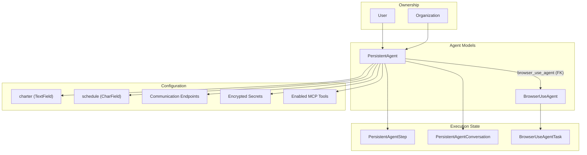
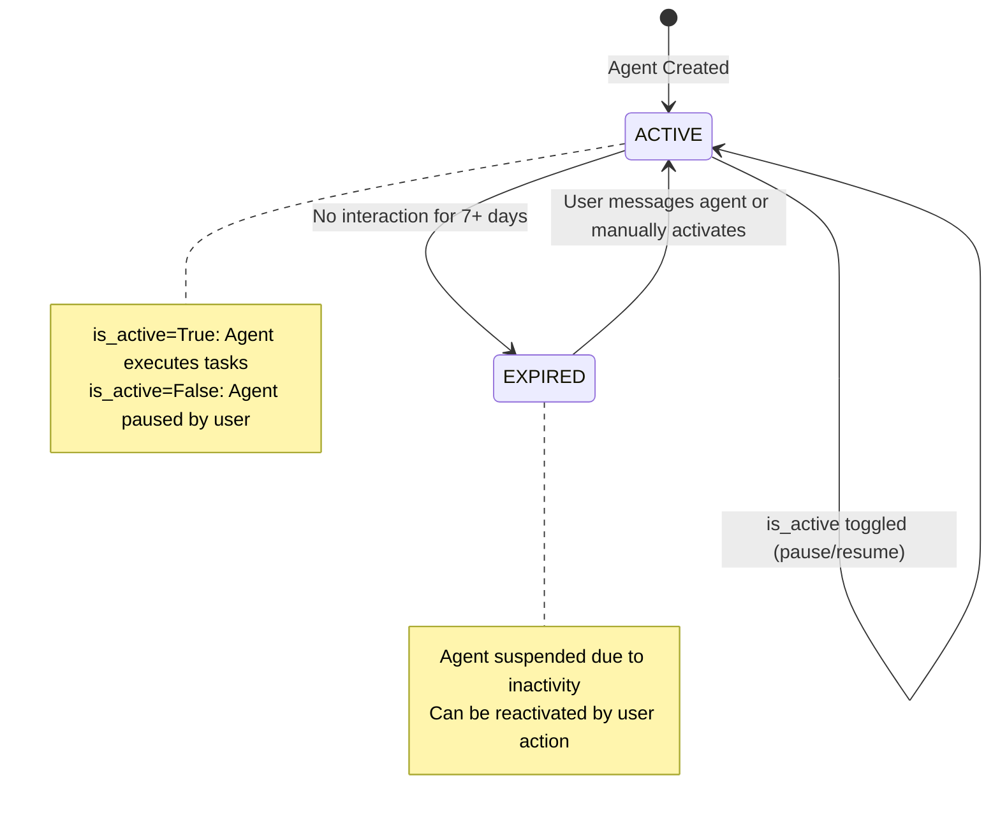
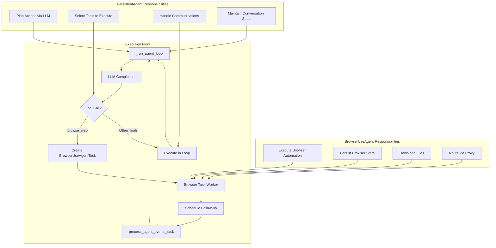
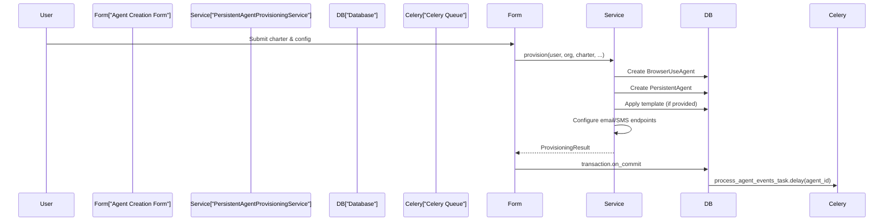
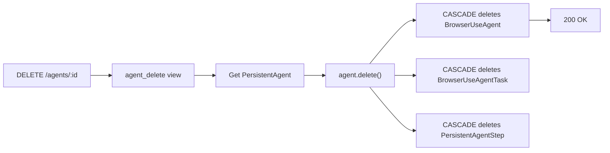
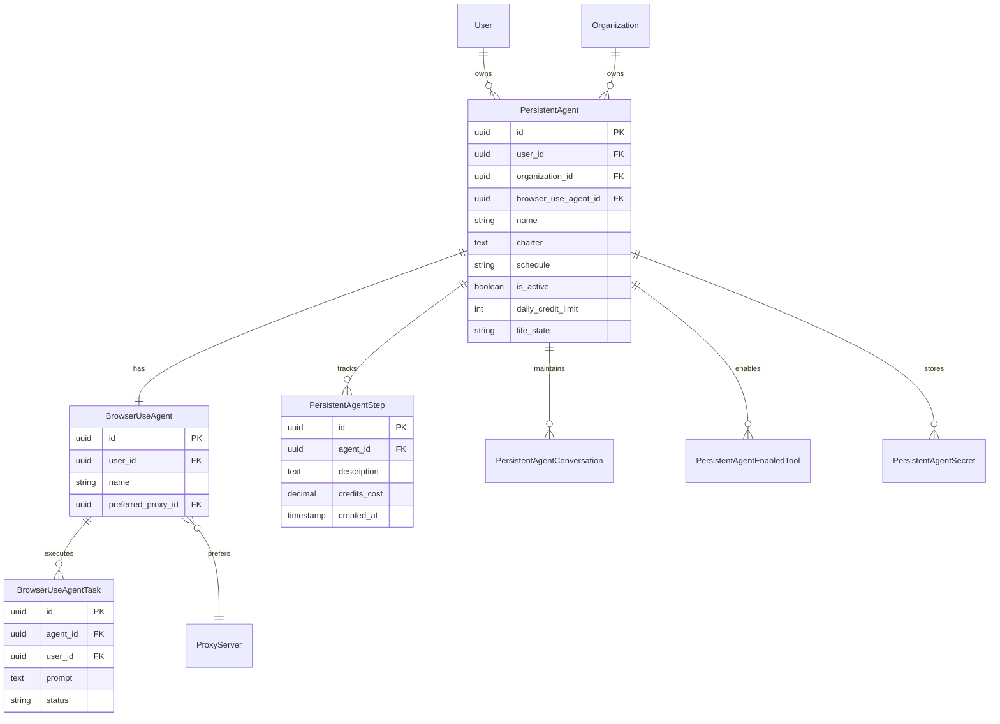

<!-- source: DeepWiki mcp.deepwiki.com · repo gobii-ai/gobii-platform · page 3.1 Agents · fetched 2026-10-26 -->

# Agents

<details>
<summary>Relevant source files</summary>

The following files were used as context for generating this wiki page:

- [api/agent/core/llm_config.py](api/agent/core/llm_config.py)
- [api/agent/tools/mcp_tools.py](api/agent/tools/mcp_tools.py)
- [api/migrations/0155_persistentagent_daily_credit_limit_and_more.py](api/migrations/0155_persistentagent_daily_credit_limit_and_more.py)
- [api/tasks/browser_agent_tasks.py](api/tasks/browser_agent_tasks.py)
- [console/templates/console/agent_detail.html](console/templates/console/agent_detail.html)
- [console/templates/partials/_agent_list.html](console/templates/partials/_agent_list.html)
- [tests/unit/test_agent_event_processing_credits.py](tests/unit/test_agent_event_processing_credits.py)
- [tests/unit/test_browser_task_follow_up.py](tests/unit/test_browser_task_follow_up.py)
- [tests/unit/test_console.py](tests/unit/test_console.py)
- [tests/unit/test_event_processing_llm_selection.py](tests/unit/test_event_processing_llm_selection.py)
- [tests/unit/test_llm_failover.py](tests/unit/test_llm_failover.py)
- [tests/unit/test_mcp_tools.py](tests/unit/test_mcp_tools.py)
- [tests/utils/llm_seed.py](tests/utils/llm_seed.py)

</details>


## Purpose and Scope

This document describes the core agent models in the gobii-platform: `PersistentAgent` and `BrowserUseAgent`. These models form the foundation of the platform's multi-agent orchestration capabilities. An agent is an autonomous AI entity that can execute tasks, use tools, communicate via multiple channels, and operate on a schedule.

For information about creating agents via the provisioning service, see [Creating Agents](#4.1). For details on agent event processing and execution flow, see [Agent Event Processing](#4.3). For agent communication channels, see [Communication Systems](#7).

---

## Agent Architecture Overview

The platform uses a dual-model architecture where each autonomous agent consists of two linked database records:



**Sources:** [api/models.py](), [console/templates/console/agent_detail.html:1-550]()

---

## PersistentAgent Model

The `PersistentAgent` model represents the high-level autonomous agent. It handles:

- **Reasoning and decision-making** via LLM interactions
- **Tool orchestration** including MCP tools and browser automation
- **Communication** via email, SMS, web chat, and peer messaging
- **Scheduling** via cron expressions for recurring execution
- **Credit management** including daily limits and consumption tracking

### Key Fields

| Field | Type | Purpose |
|-------|------|---------|
| `user` | ForeignKey | Owner (can be null if org-owned) |
| `organization` | ForeignKey | Organization owner (can be null if user-owned) |
| `browser_use_agent` | OneToOneField | Linked browser automation agent |
| `name` | CharField | Display name |
| `charter` | TextField | Agent's purpose and instructions |
| `schedule` | CharField | Cron expression for scheduled execution |
| `is_active` | BooleanField | Whether agent can execute |
| `daily_credit_limit` | PositiveIntegerField | Max task credits per day (null = unlimited) |
| `life_state` | CharField | ACTIVE or EXPIRED (lifecycle state) |

### Lifecycle States

Agents have both an `is_active` flag (user-controlled pause/resume) and a `life_state` (system-managed expiration):



**Sources:** [api/models.py](), [api/agent/core/event_processing.py](), [console/templates/console/agent_detail.html:160-199]()

### Daily Credit Limits

Each agent can have a `daily_credit_limit` that constrains how many task credits it can consume in a 24-hour window:

- **Null value** = unlimited credits (common for Pro plans)
- **Integer value** = maximum credits per day
- **Tracking** = sum of `credits_cost` from `PersistentAgentStep` records for the current day
- **Reset** = daily at midnight in the agent owner's timezone
- **Enforcement** = checked both pre-processing and mid-loop during tool execution

When the limit is reached, event processing exits early with a `daily_credit_limit_exhausted` system step.

**Sources:** [api/migrations/0155_persistentagent_daily_credit_limit_and_more.py:1-51](), [tests/unit/test_agent_event_processing_credits.py:148-182](), [console/templates/console/agent_detail.html:201-253]()

---

## BrowserUseAgent Model

The `BrowserUseAgent` model represents the browser automation component. It handles:

- **Browser profile persistence** via compressed archives in object storage
- **Proxy selection** for routing browser traffic
- **Browser task execution** using the `browser-use` library
- **File uploads and downloads** via the agent filespace

### Key Fields

| Field | Type | Purpose |
|-------|------|---------|
| `user` | ForeignKey | Owner of the browser agent |
| `name` | CharField | Display name |
| `preferred_proxy` | ForeignKey | Preferred proxy server for browser tasks |

### Browser Profile Management

Browser profiles are persisted to enable stateful browsing (cookies, local storage, etc.):

```mermaid
graph LR
    Task["BrowserUseAgentTask Created"] --> CheckProfile["Check for Profile in Storage"]
    CheckProfile -->|Exists| Download["Download & Decompress Profile"]
    CheckProfile -->|"Does Not Exist"| CreateTemp["Create Fresh Profile"]
    Download --> TempDir["Temporary Profile Directory"]
    CreateTemp --> TempDir
    
    TempDir --> Execute["Execute Browser Task"]
    Execute --> Prune["Prune Cache Directories"]
    Prune --> CheckSize{"Size > 500MB?"}
    CheckSize -->|Yes| Reset["Reset Profile"]
    CheckSize -->|No| Compress["Compress Profile"]
    
    Reset --> Upload["Upload to Storage"]
    Compress --> Upload
    Upload --> Cleanup["Delete Temporary Directory"]
```



Profile storage uses a sharded key structure: `browser_profiles/{uuid[:2]}/{uuid[2:4]}/{uuid}.tar.zst` to distribute millions of profiles across object storage prefixes.

**Sources:** [api/tasks/browser_agent_tasks.py:495-538](), [api/tasks/browser_agent_tasks.py:586-680]()

### Proxy Selection

Browser agents can use a `preferred_proxy` or fall back to the proxy selection algorithm. The `select_proxy_for_task()` function in [api/tasks/browser_agent_tasks.py:408-447]() handles:

1. **Override proxy** (if provided explicitly)
2. **Agent preferred proxy** (if configured)
3. **Health-checked proxy** (from the pool)
4. **No proxy** (in debug mode or when pool is exhausted)

**Sources:** [api/tasks/browser_agent_tasks.py:408-447](), [api/proxy_selection.py]()

---

## Agent Relationship and Responsibilities

The two models work together in a coordinated manner:



**Key Integration Points:**

1. **Task Creation**: `PersistentAgent` creates `BrowserUseAgentTask` records when the LLM calls `browse_web`
2. **Async Processing**: Browser tasks execute in separate Celery workers
3. **Follow-up Scheduling**: After browser tasks complete, `_schedule_agent_follow_up()` triggers the persistent agent to continue its reasoning loop
4. **Budget Cycle Continuity**: The follow-up can preserve the original budget cycle context or start fresh

**Sources:** [api/tasks/browser_agent_tasks.py:72-153](), [api/agent/core/event_processing.py](), [tests/unit/test_browser_task_follow_up.py:1-88]()

---

## Agent Creation and Deletion

### Creation Flow

Agents are created via the `PersistentAgentProvisioningService`:



**Sources:** [api/agent/provisioning/service.py](), [console/views.py]()

### Deletion Flow

Deleting a `PersistentAgent` also deletes the linked `BrowserUseAgent`:



The deletion is protected by foreign key cascades, and the view handles edge cases where the `BrowserUseAgent` might be missing.

**Sources:** [console/views.py](), [tests/unit/test_console.py:23-148]()

---

## Agent Configuration

### Charter

The `charter` field is a free-form text description of the agent's purpose. It is injected into every LLM prompt as context:

```
You are an AI agent with the following charter:
{agent.charter}

Your task is to...
```

**Sources:** [api/agent/core/event_processing.py](), [console/templates/console/agent_detail.html:256-276]()

### Schedule

Agents can have a `schedule` field containing a cron expression. The Celery Beat scheduler triggers `process_agent_events_task` at the specified intervals.

**Example cron expressions:**
- `0 9 * * *` = daily at 9:00 AM
- `0 */6 * * *` = every 6 hours
- `0 0 * * 1` = weekly on Monday at midnight

**Sources:** [api/agent/core/event_processing.py](), [celery_app/tasks.py]()

### Communication Endpoints

Agents can have multiple communication endpoints:

- **Email**: `AgentEmailAccount` with IMAP/SMTP credentials
- **SMS**: `SmsNumber` provisioned via Twilio
- **Web Chat**: Built-in WebSocket-based chat interface
- **Peer Links**: Direct messaging to other agents

**Sources:** [api/models.py](), [console/templates/console/agent_detail.html:106-158]()

### Secrets

Agents can store encrypted secrets (API keys, passwords, etc.) as `PersistentAgentSecret` records. These are accessible during browser automation via the `sensitive_data` parameter.

**Sources:** [api/models.py](), [api/encryption.py](), [api/tasks/browser_agent_tasks.py:842-856]()

### MCP Tools

Agents can dynamically enable MCP tools via the `search_tools` function. Enabled tools are tracked in `PersistentAgentEnabledTool` with LRU eviction when the limit of 40 is reached.

**Sources:** [api/agent/tools/mcp_manager.py](), [api/agent/tools/mcp_tools.py:1-84](), [tests/unit/test_mcp_tools.py:1-553]()

---

## Agent Execution Context

### LLM Selection

Agents use a tiered LLM failover system with token-based selection. The `get_llm_config_with_failover()` function returns a prioritized list of LLM endpoints based on:

1. **Token count** of the current prompt
2. **Database-configured tiers** (via `PersistentTokenRange` and `PersistentLLMTier`)
3. **Weighted random selection** within each tier
4. **Availability** of API keys (admin-encrypted or environment variable)

**Token ranges:**
- **Small** (0-7,500 tokens): GPT-5/Google primary, Anthropic/GLM-4.5 fallback
- **Medium** (7,500-20,000 tokens): GLM-4.5 primary with mixed fallbacks
- **Large** (20,000+ tokens): GLM-4.5/Google primary, GPT-5/Anthropic fallback

**Sources:** [api/agent/core/llm_config.py:1-478](), [tests/unit/test_llm_failover.py:1-185]()

### Credit Gating

Agent execution is protected by two levels of credit checks:

1. **Pre-processing gate**: Before `_run_agent_loop()` begins, `TaskCreditService.get_user_task_credits_available()` checks for sufficient credits
2. **Mid-loop gate**: Before each tool execution, `_ensure_credit_for_tool()` verifies that the tool's cost can be covered

If either check fails in proprietary mode, a system step is created and execution halts:

- `credit_insufficient` (pre-processing)
- `credit_insufficient_mid_loop` (tool execution)
- `daily_credit_limit_exhausted` (daily limit reached)
- `daily_credit_limit_mid_loop` (daily limit reached during tool)

**Sources:** [api/agent/core/event_processing.py](), [tests/unit/test_agent_event_processing_credits.py:1-346]()

### Vision Support

LLM endpoints can declare `supports_vision` capability. When enabled, the agent can include screenshots in LLM prompts during browser automation. This is controlled at the endpoint level and passed as a hint to the execution layer.

**Sources:** [api/agent/core/llm_config.py:381-382](), [api/tasks/browser_agent_tasks.py:836-838]()

### Parallel Tool Calls

Some LLM endpoints support parallel tool calling (executing multiple tools in one turn). This is tracked via the `use_parallel_tool_calls` hint on endpoint configurations and passed to `litellm.completion()` when supported.

**Sources:** [api/agent/core/llm_config.py:384-387](), [tests/unit/test_event_processing_llm_selection.py:46-84]()

---

## Data Model Relationships



**Sources:** [api/models.py](), [api/migrations/]()

---

## Summary

The agent architecture separates concerns between high-level orchestration (`PersistentAgent`) and browser automation (`BrowserUseAgent`). This design enables:

- **Persistent state** across multiple execution cycles
- **Asynchronous browser tasks** that don't block the reasoning loop
- **Flexible ownership** (user or organization)
- **Resource control** via credit limits and daily caps
- **Multi-channel communication** with unified conversation tracking
- **Dynamic tool discovery** with LRU eviction

For implementation details on how agents process events and execute tools, see [Agent Event Processing](#4.3). For provisioning logic, see [Creating Agents](#4.1).

---

