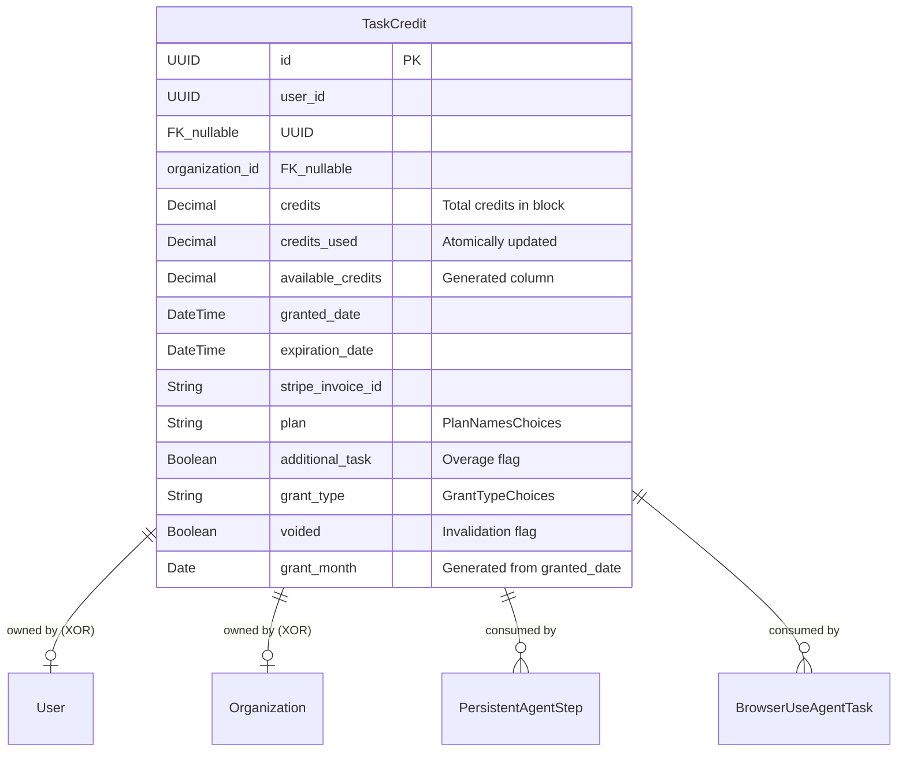
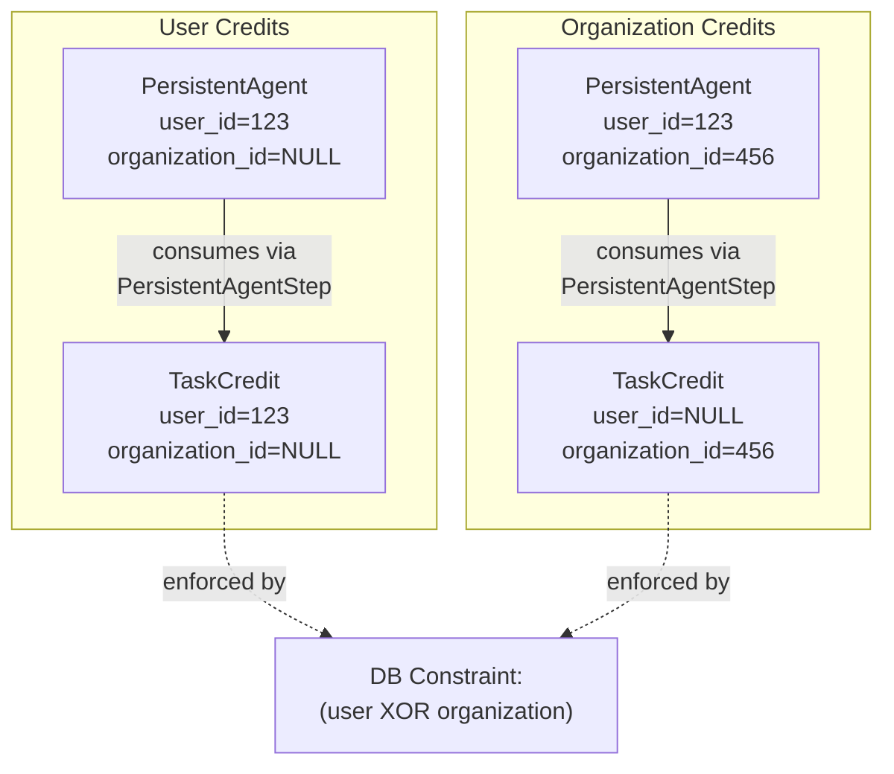
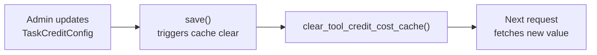
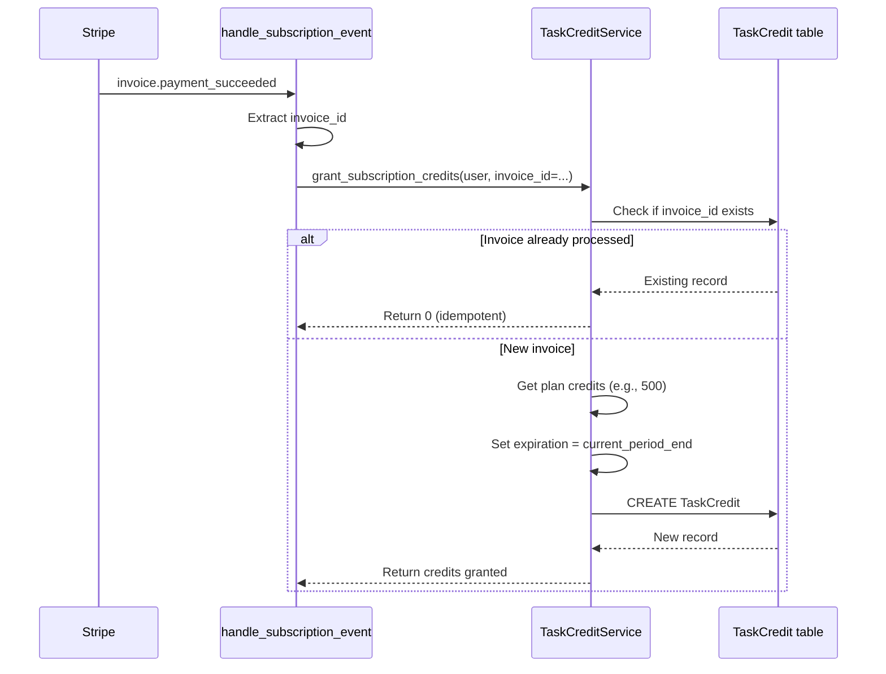
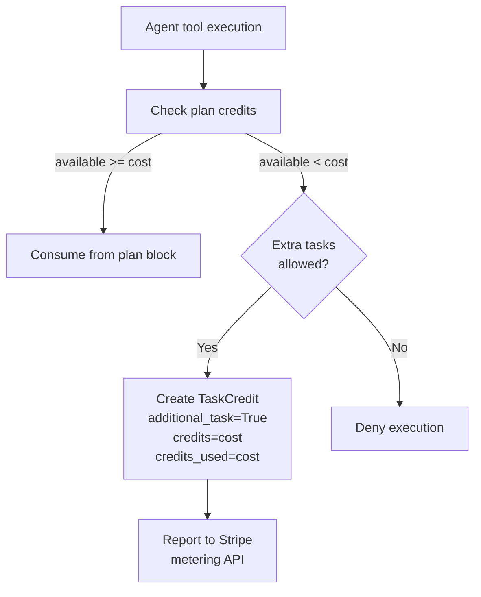
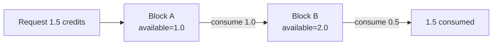
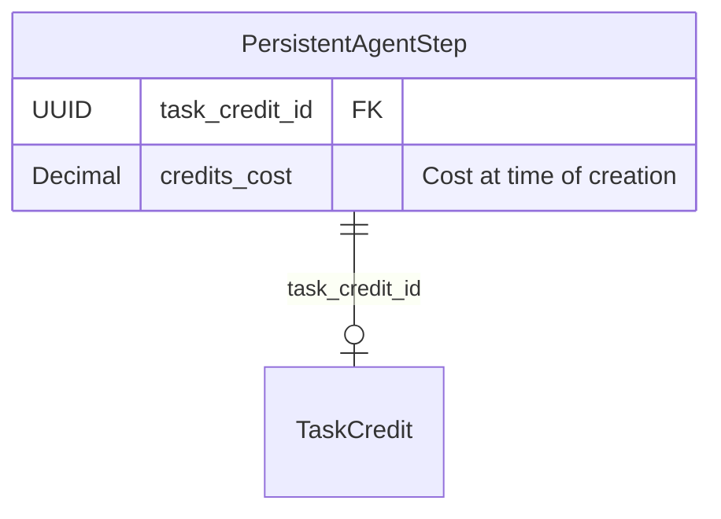
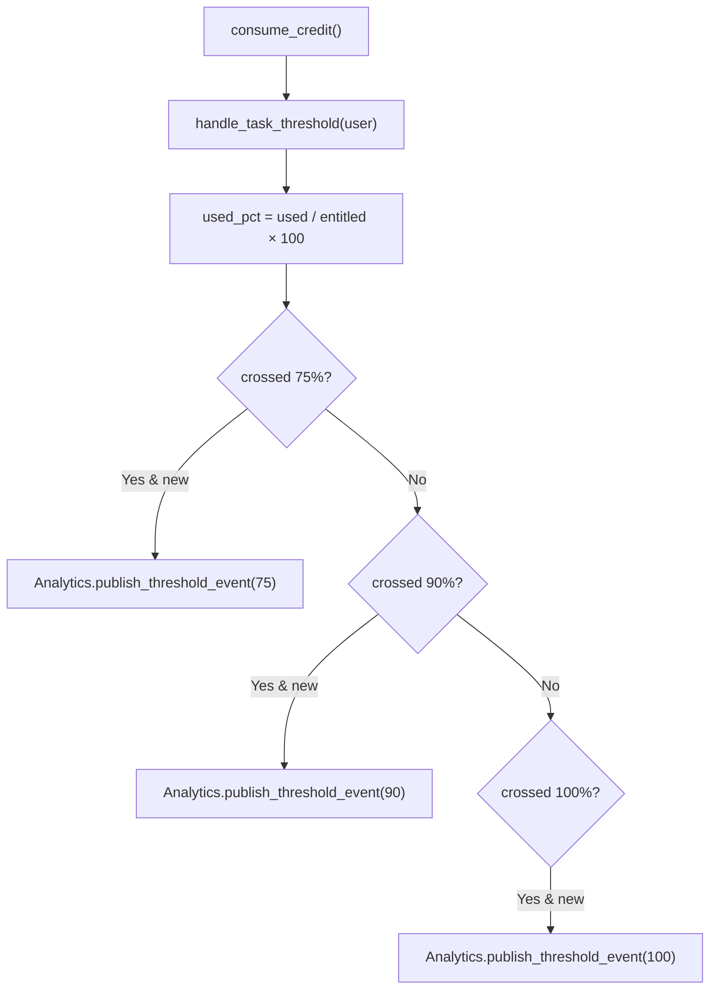

<!-- source: DeepWiki mcp.deepwiki.com · repo gobii-ai/gobii-platform · page 3.2 Task Credits · fetched 2026-10-26 -->

# Task Credits

<details>
<summary>Relevant source files</summary>

The following files were used as context for generating this wiki page:

- [api/agent/core/event_processing.py](api/agent/core/event_processing.py)
- [api/migrations/0115_persistentagentstep_credits_fields.py](api/migrations/0115_persistentagentstep_credits_fields.py)
- [api/models.py](api/models.py)
- [console/views.py](console/views.py)
- [tasks/services.py](tasks/services.py)
- [tests/unit/test_persistent_agent_step_credits.py](tests/unit/test_persistent_agent_step_credits.py)
- [tests/unit/test_task_credit_service.py](tests/unit/test_task_credit_service.py)
- [tests/unit/test_tool_costs.py](tests/unit/test_tool_costs.py)
- [util/tool_costs.py](util/tool_costs.py)

</details>


## Purpose and Scope

This document describes the **task credit system**, which is the platform's primary resource control and monetization mechanism. Task credits gate all agent operations that consume compute resources (LLM calls, browser automation, tool execution, etc.). The system supports fractional credits, dual ownership (users and organizations), expiring credit blocks, and per-tool cost configuration.

For information about billing and subscription integration, see [Subscription Management](#5.2). For organization-specific billing and seat management, see [Organization Billing](#5.3). For usage analytics and reporting, see [Usage Analytics](#5.4).

---

## Credit Data Model

### TaskCredit Model

The `TaskCredit` model represents discrete blocks of credits granted to users or organizations. Each block has a grant date, expiration date, and tracks usage atomically.



**Sources:** [api/models.py:290-391]()

### Dual Ownership: Users vs Organizations

Credits can be owned by **either** a user **or** an organization, enforced by a database constraint. This enables both personal and team-based billing models.



The ownership model is validated at the database level via `CHECK` constraint and at the application level via `TaskCredit.clean()`.

**Sources:** [api/models.py:375-385](), [tasks/services.py:158-198]()

### Credit Block Lifecycle

Credits are provisioned as blocks that expire on a specific date (typically aligned with subscription billing cycles). Blocks are consumed in **expiration order** (FIFO) to minimize waste.

| Phase | Description | Key Fields |
|-------|-------------|------------|
| **Provisioning** | Created when subscription starts/renews | `granted_date`, `expiration_date`, `stripe_invoice_id` |
| **Active** | Available for consumption | `granted_date <= now < expiration_date`, `voided=False` |
| **Consumption** | Atomically decremented via `SELECT FOR UPDATE` | `credits_used` incremented |
| **Expiration** | No longer consumable | `expiration_date < now` |
| **Voiding** | Administratively invalidated | `voided=True` |

**Sources:** [api/models.py:290-391](), [tasks/services.py:418-534]()

---

## Credit Configuration

### TaskCreditConfig

The `TaskCreditConfig` singleton model stores the **default credit cost** applied when no tool-specific override exists. Updating this record automatically invalidates the cache.



**Sources:** [api/models.py:393-427](), [util/tool_costs.py:21-23]()

### ToolCreditCost

Per-tool cost overrides are stored in the `ToolCreditCost` model. Tool names are **case-insensitive** and normalized on save.

| Tool Name | Credit Cost | Usage |
|-----------|-------------|-------|
| `send_email` | 0.90 | Outbound email via SMTP |
| `send_sms` | 0.35 | Outbound SMS via Twilio |
| `search_web` | 0.10 | Web search via MCP |
| `browse_web` | 0.50 | Browser automation task |
| *(default)* | 0.40 | All other tools |

**Sources:** [api/models.py:429-471](), [util/tool_costs.py:106-121]()

### TASKS_UNLIMITED Constant

The special value `-1` (defined as `TASKS_UNLIMITED`) indicates unlimited credits. This is used for:
- Community Edition when `GOBII_ENABLE_COMMUNITY_UNLIMITED=True`
- Organizations with `max_extra_tasks=-1`
- Users with unlimited overage plans

```python
# util/constants/task_constants.py
TASKS_UNLIMITED = -1
```

When `calculate_available_tasks()` returns `TASKS_UNLIMITED`, all credit checks pass without consumption.

**Sources:** [tasks/services.py:19](), [tasks/services.py:136-143]()

---

## Credit Provisioning

### Subscription-Based Granting

When a user subscribes (or their subscription renews), credits are granted via `TaskCreditService.grant_subscription_credits()`.



**Key Parameters:**
- `credit_override`: Override default plan credits (for manual grants)
- `invoice_id`: Stripe invoice ID for idempotency
- `grant_date`: Defaults to `timezone.now()`
- `expiration_date`: Defaults to subscription `current_period_end`

**Sources:** [tasks/services.py:201-306]()

### Organization Seat-Based Credits

Organizations receive credits based on purchased seats: `credits_per_seat × purchased_seats`.

When seats change mid-cycle, the `replace_current=True` flag **refreshes** the existing credit block instead of creating a duplicate:

```python
# Renewal flow: reset usage on existing block
grant_subscription_credits_for_organization(
    org,
    seats=3,
    invoice_id="inv_renewal",
    replace_current=True,  # Resets credits_used to 0
)
```

**Sources:** [tasks/services.py:308-416]()

### Additional Tasks

When a user/organization exhausts their plan credits but has `allow_extra_tasks=True`, the system creates **additional task credits** on-demand:



Additional task credits are:
1. Created with `additional_task=True`
2. Immediately consumed (`credits_used = credits`)
3. Reported to Stripe's metering API for overage billing

**Sources:** [tasks/services.py:456-473](), [api/agent/core/event_processing.py:510-711]()

---

## Credit Consumption

### Atomic Consumption with SELECT FOR UPDATE

Credit consumption uses **database-level locking** to prevent race conditions when multiple workers consume credits concurrently.

```python
# tasks/services.py:476-511
with transaction.atomic():
    remaining = Decimal(plan_amount)
    while remaining > 0:
        credit = (
            TaskCredit.objects.select_for_update()
            .filter(
                user_id=user.id,
                expiration_date__gt=now,
                credits_used__lt=F("credits"),
                voided=False,
            )
            .order_by("expiration_date")  # FIFO by expiration
            .first()
        )
        
        if credit is None:
            raise ValidationError({"credits": "Insufficient task credits"})
        
        available_here = credit.credits - credit.credits_used
        consume_now = min(available_here, remaining)
        
        credit.credits_used = F("credits_used") + consume_now
        credit.save(update_fields=["credits_used"])
        credit.refresh_from_db()
        remaining -= consume_now
```

**Sources:** [tasks/services.py:476-511]()

### Fractional Credits

Credits are stored as `DecimalField(max_digits=12, decimal_places=3)`, enabling **fractional consumption** (e.g., 0.100 credits per tool call).

| Tool | Cost | Precision |
|------|------|-----------|
| `send_chat_message` | 0.000 | Free |
| `search_web` | 0.100 | One-tenth |
| `send_email` | 0.900 | Nine-tenths |
| `browse_web` | 0.500 | Half |

This allows fine-grained resource control and reduces waste.

**Sources:** [api/models.py:310-311](), [tests/unit/test_persistent_agent_step_credits.py:58-77]()

### Multi-Block Consumption

When a single operation costs more than the remaining balance in the current block, the system **spans multiple blocks**:



**Sources:** [tasks/services.py:476-511]()

### Credit-Step Linking

Each `PersistentAgentStep` and `BrowserUseAgentTask` is linked to the `TaskCredit` block it consumed from, enabling **audit trails** and usage analytics.



The `credits_cost` field is set at creation time and **never changes**, preserving historical pricing even if tool costs are later updated.

**Sources:** [api/models.py:1831-1845](), [api/migrations/0115_persistentagentstep_credits_fields.py]()

---

## Credit Gating in Agent Execution

Agent event processing has **two credit gates** to prevent runaway costs:

### Pre-Processing Gate

Before starting the agent loop, `process_agent_events()` checks if the owner has sufficient credits for at least one iteration:

```python
# api/agent/core/event_processing.py:891-933
available = TaskCreditService.get_user_task_credits_available(owner_user)
if available is not None and available != TASKS_UNLIMITED and available <= 0:
    step = PersistentAgentStep.objects.create(
        agent=agent,
        description="Processing skipped: insufficient task credits.",
    )
    PersistentAgentSystemStep.objects.create(
        step=step,
        code=PersistentAgentSystemStep.Code.PROCESS_EVENTS,
        notes="credit_insufficient",
    )
    return  # Exit early
```

**Sources:** [api/agent/core/event_processing.py:891-933]()

### Per-Tool Mid-Loop Gate

Before each tool execution, `_ensure_credit_for_tool()` performs a **just-in-time** credit check and consumption:

```mermaid
sequenceDiagram
    participant Loop as Agent Loop
    participant Gate as _ensure_credit_for_tool
    participant Service as TaskCreditService
    participant DB
    
    Loop->>Gate: tool_name="browse_web"
    Gate->>Gate: Get tool cost (0.5)
    Gate->>Gate: Check daily limit
    alt Daily limit exceeded
        Gate->>DB: Create SystemStep (daily_credit_limit_mid_loop)
        Gate-->>Loop: Return False (skip tool)
    else Daily limit OK
        Gate->>Service: check_and_consume_credit(user, amount=0.5)
        Service->>DB: SELECT FOR UPDATE + consume
        alt Consumption successful
            DB-->>Service: Credit consumed
            Service-->>Gate: {success: True, credit: ...}
            Gate-->>Loop: Return 0.5 (proceed)
        else Insufficient credits
            Service-->>Gate: {success: False}
            Gate->>DB: Create SystemStep (credit_insufficient_mid_loop)
            Gate-->>Loop: Return False (skip tool)
        end
    end
```

**Sources:** [api/agent/core/event_processing.py:510-711]()

### Daily Credit Limits

Each `PersistentAgent` can have a `daily_credit_limit`, which restricts how many credits it can consume per calendar day:

```python
# api/agent/core/event_processing.py:451-489
def _get_agent_daily_credit_state(agent: PersistentAgent) -> dict:
    today = dj_timezone.localdate()
    limit = agent.get_daily_credit_limit_value()  # e.g., Decimal("10.0")
    used = agent.get_daily_credit_usage(usage_date=today)
    remaining = limit - used if limit else None
    
    return {
        "limit": limit,
        "used": used,
        "remaining": remaining,
        "next_reset": (today + timedelta(days=1)).replace(hour=0, minute=0),
    }
```

Daily limits **do not consume credits** from the owner's balance; they merely gate execution until the next day.

**Sources:** [api/agent/core/event_processing.py:451-489](), [api/models.py:2089-2143]()

---

## Owner-Aware Operations

The `TaskCreditService` provides **owner-aware methods** that work identically for both `User` and `Organization` owners:

| Method | User Variant | Organization Variant |
|--------|--------------|---------------------|
| `get_owner_task_credits_granted(owner)` | `get_user_task_credits_granted(user)` | Aggregates `TaskCredit.filter(organization=org)` |
| `get_owner_task_credits_used(owner)` | `get_user_task_credits_used(user)` | Aggregates `credits_used` for org |
| `calculate_available_tasks_for_owner(owner)` | `calculate_available_tasks(user)` | `entitled - used` for org |
| `get_tasks_entitled_for_owner(owner)` | `get_tasks_entitled(user)` | `credits_per_seat × seats + extra` |

Internal helper `_is_organization_owner(owner)` determines routing:

```python
# tasks/services.py:588-594
def _is_organization_owner(owner) -> bool:
    return isinstance(owner, get_model("api", "Organization"))
```

**Sources:** [tasks/services.py:158-198](), [tasks/services.py:588-625]()

---

## Usage Tracking and Thresholds

The system monitors credit usage and publishes **threshold events** when users cross 75%, 90%, or 100% usage:



Threshold crossings are tracked via `TaskCreditUsageThreshold` model to avoid duplicate notifications within the same billing period.

**Sources:** [tasks/services.py:753-819]()

---

## Tool Cost Configuration

### Default Cost

The default cost is retrieved from `TaskCreditConfig.default_task_cost` and cached for 5 minutes:

```python
# util/tool_costs.py:101-103
def get_default_task_credit_cost() -> Decimal:
    default_cost, _ = _get_tool_cost_config()
    return default_cost
```

**Sources:** [util/tool_costs.py:101-103]()

### Per-Tool Overrides

Tool-specific costs are retrieved via case-insensitive lookup:

```python
# util/tool_costs.py:106-121
def get_tool_credit_cost(tool_name: str | None) -> Decimal:
    default_cost, overrides = _get_tool_cost_config()
    key = _normalize_tool_name(tool_name)  # Strip and lowercase
    
    if key in overrides:
        return overrides[key]
    
    return default_cost
```

**Sources:** [util/tool_costs.py:106-121]()

### Channel-Specific Costs

Communication channels map to specific tools:

```python
# util/tool_costs.py:15-19
_CHANNEL_TOOL_NAMES: Dict[str, str] = {
    "email": "send_email",
    "sms": "send_sms",
    "web": "send_chat_message",
}
```

This enables credit gating on outbound messages via:

```python
cost = get_tool_credit_cost_for_channel(CommsChannel.EMAIL)
```

**Sources:** [util/tool_costs.py:141-152]()

---

## Code Entity Reference

### Key Classes and Functions

| Entity | Location | Purpose |
|--------|----------|---------|
| `TaskCredit` | [api/models.py:290-391]() | Credit block model |
| `TaskCreditConfig` | [api/models.py:393-427]() | Default cost singleton |
| `ToolCreditCost` | [api/models.py:429-471]() | Per-tool cost overrides |
| `TaskCreditService` | [tasks/services.py:107-819]() | Credit management service |
| `grant_subscription_credits()` | [tasks/services.py:201-306]() | User credit provisioning |
| `grant_subscription_credits_for_organization()` | [tasks/services.py:308-416]() | Org credit provisioning |
| `consume_credit()` | [tasks/services.py:418-534]() | Atomic consumption |
| `check_and_consume_credit()` | [tasks/services.py:536-567]() | Check + consume wrapper |
| `_ensure_credit_for_tool()` | [api/agent/core/event_processing.py:510-711]() | Mid-loop credit gate |
| `get_default_task_credit_cost()` | [util/tool_costs.py:101-103]() | Default cost retrieval |
| `get_tool_credit_cost()` | [util/tool_costs.py:106-121]() | Tool-specific cost lookup |
| `TASKS_UNLIMITED` | [util/constants/task_constants.py]() | Unlimited constant (-1) |

**Sources:** All file references above.

---

