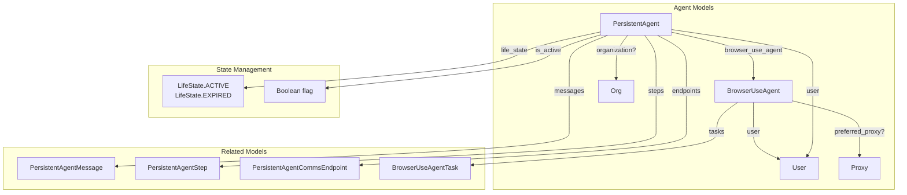
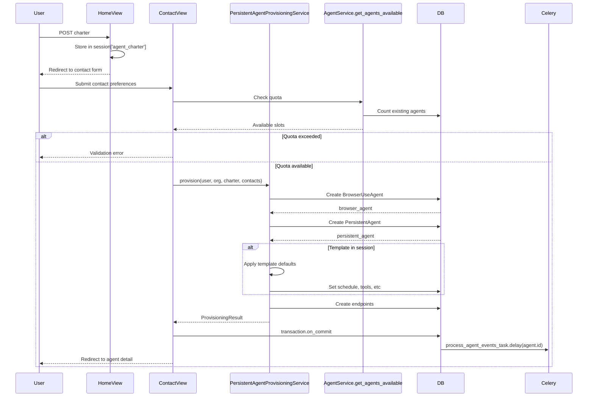
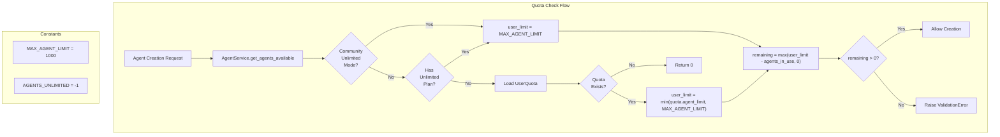
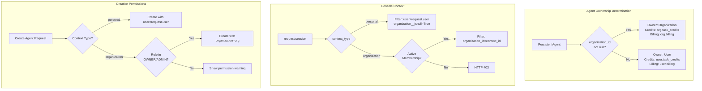
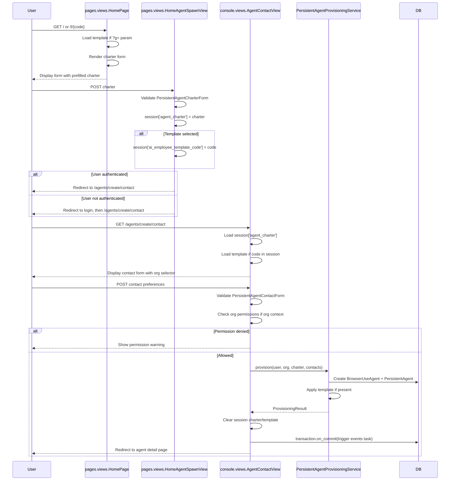
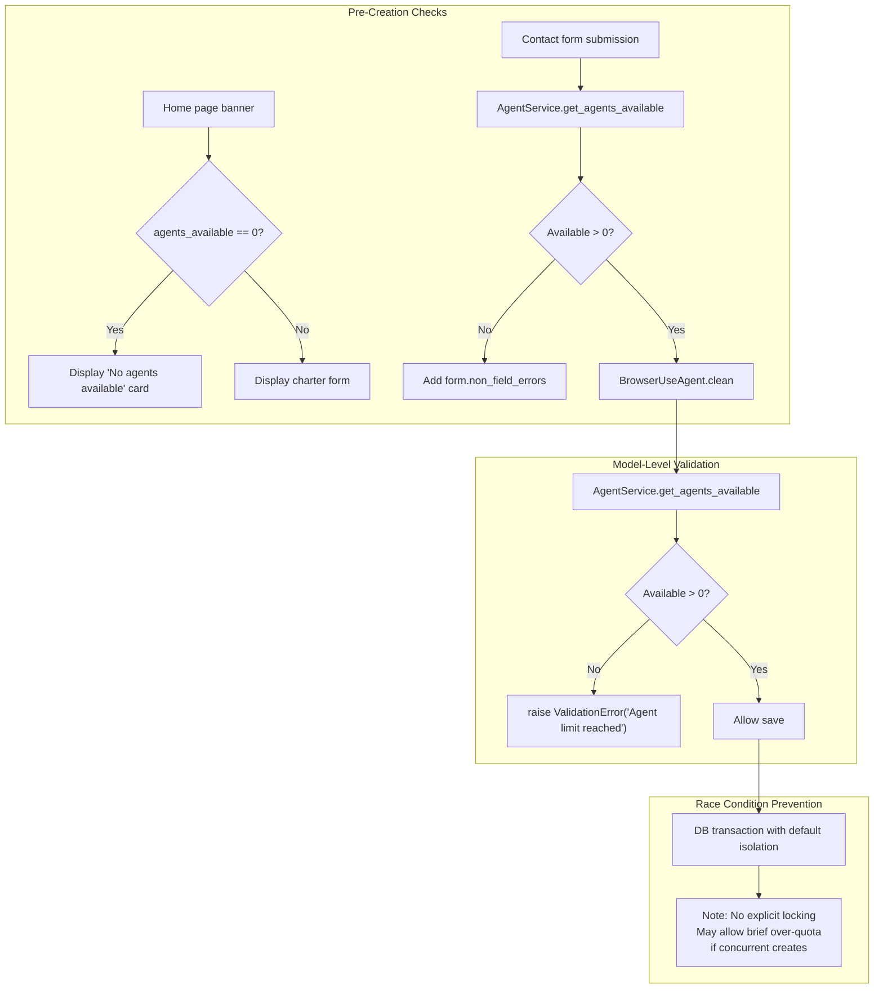
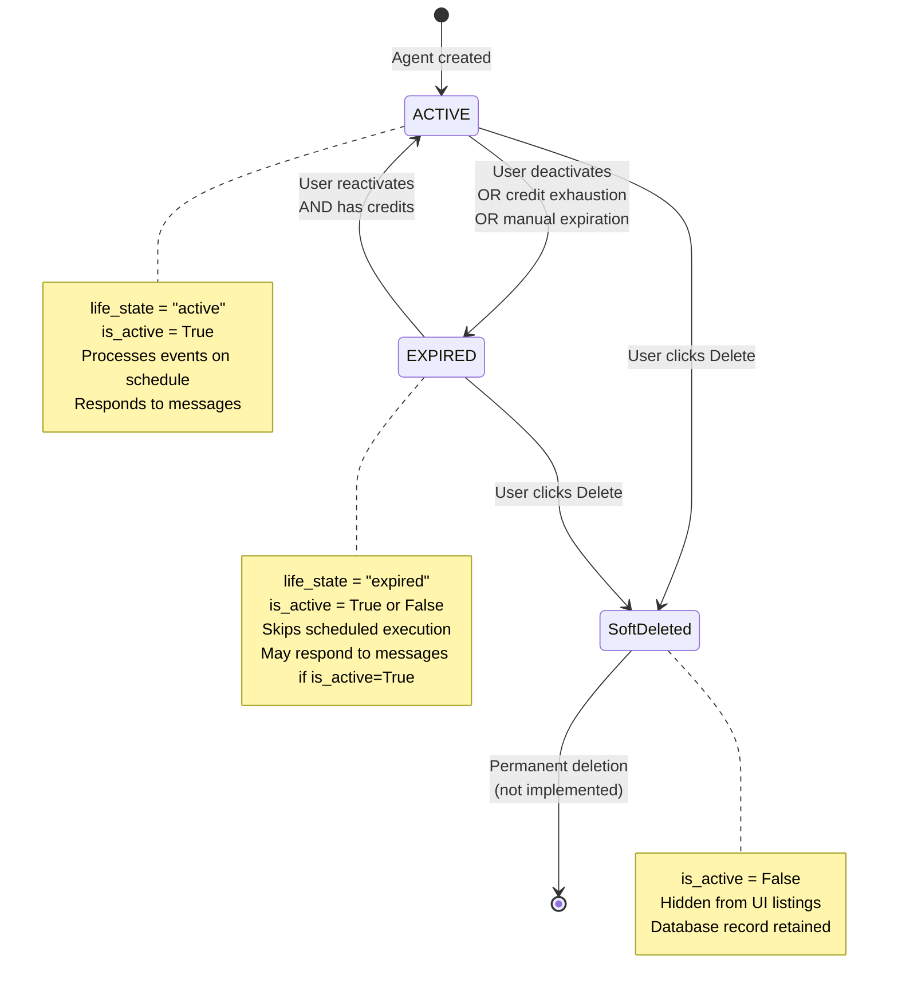

<!-- source: DeepWiki mcp.deepwiki.com · repo gobii-ai/gobii-platform · page 4 Agent Management · fetched 2026-10-26 -->

# Agent Management

<details>
<summary>Relevant source files</summary>

The following files were used as context for generating this wiki page:

- [agents/services.py](agents/services.py)
- [api/agent/core/event_processing.py](api/agent/core/event_processing.py)
- [api/models.py](api/models.py)
- [console/templates/partials/_agent_contact_form.html](console/templates/partials/_agent_contact_form.html)
- [console/views.py](console/views.py)
- [pages/templates/ai_directory/detail.html](pages/templates/ai_directory/detail.html)
- [pages/templates/ai_directory/index.html](pages/templates/ai_directory/index.html)
- [pages/templates/home.html](pages/templates/home.html)
- [pages/views.py](pages/views.py)
- [tests/unit/test_agent_limits.py](tests/unit/test_agent_limits.py)
- [tests/unit/test_ai_employee_directory.py](tests/unit/test_ai_employee_directory.py)
- [tests/unit/test_console_context.py](tests/unit/test_console_context.py)

</details>


## Purpose and Scope

This document covers the creation, configuration, and lifecycle management of persistent agents in the gobii-platform. Agent management encompasses quota enforcement, provisioning workflows, ownership models (personal vs organization), and template-based agent creation.

For details on how agents execute tasks and process events, see [Agent Event Processing](#4.3). For credit consumption and billing integration, see [TaskCreditService](#5.1). For organization-level agent ownership, see [Organizations](#3.3).

---

## Core Data Models

The platform uses a dual-agent architecture where every `PersistentAgent` wraps a `BrowserUseAgent`. This separation allows the persistent agent to manage long-running state, schedules, and communication endpoints, while the browser agent handles task execution and browser profile management.

### Dual-Agent Architecture



**Sources:** [api/models.py:1095-1223](), [api/models.py:472-611]()

### PersistentAgent Fields

| Field | Type | Purpose |
|-------|------|---------|
| `id` | UUID | Primary key |
| `user` | ForeignKey | Owner (always set) |
| `organization` | ForeignKey | Org ownership (optional) |
| `browser_use_agent` | ForeignKey | Wrapped browser agent |
| `name` | CharField | Display name |
| `charter` | TextField | Agent instructions/mission |
| `schedule` | CharField | Cron expression for execution |
| `life_state` | CharField | ACTIVE or EXPIRED |
| `is_active` | Boolean | Soft deletion flag |
| `last_interaction_at` | DateTimeField | Last activity timestamp |
| `daily_credit_limit` | DecimalField | Per-agent daily cap |

**Sources:** [api/models.py:1095-1223]()

### BrowserUseAgent Fields

| Field | Type | Purpose |
|-------|------|---------|
| `id` | UUID | Primary key |
| `user` | ForeignKey | Owner |
| `name` | CharField | Display name |
| `preferred_proxy` | ForeignKey | Proxy server selection |
| `created_at` | DateTimeField | Creation timestamp |

**Sources:** [api/models.py:472-611]()

---

## Agent Provisioning Flow

Agent creation follows a multi-step workflow involving quota validation, dual-model creation, and optional template application. The `PersistentAgentProvisioningService` orchestrates this process.

### Provisioning Sequence



**Sources:** [pages/views.py:198-244](), [console/views.py:1490-1691](), [api/services/persistent_agents.py:1-200]()

### Provisioning Service Methods

The `PersistentAgentProvisioningService` exposes a single `provision` method that handles the entire creation process:

```python
# api/services/persistent_agents.py
def provision(
    user: User,
    organization: Organization | None,
    charter: str,
    contacts: dict,
    template_code: str | None = None,
) -> ProvisioningResult
```

**Key responsibilities:**
1. Validate quota availability via `AgentService.get_agents_available`
2. Create `BrowserUseAgent` with random proxy assignment
3. Create `PersistentAgent` linked to browser agent
4. Apply template defaults if `template_code` provided
5. Create communication endpoints based on `contacts` dict
6. Return `ProvisioningResult` with success/error status

**Sources:** [api/services/persistent_agents.py:50-150](), [console/views.py:1490-1691]()

---

## Agent Quota System

The platform enforces multi-level quota constraints to prevent runaway agent creation. The quota system operates at three levels: per-user quotas, plan-based limits, and a global safety cap.

### Quota Enforcement Layers



**Sources:** [agents/services.py:44-97](), [api/models.py:278-288](), [config/plans.py:10-15]()

### UserQuota Model

```python
# api/models.py
class UserQuota(models.Model):
    user = models.OneToOneField(User, on_delete=models.CASCADE)
    agent_limit = models.PositiveIntegerField(default=5)
    max_agent_contacts = models.PositiveIntegerField(null=True, blank=True)
```

**Quota sources:**
- **Default plan limits**: Defined in `PLAN_CONFIG` (e.g., Free = 5, Startup = 20)
- **Per-user overrides**: `UserQuota.agent_limit` takes precedence
- **Safety cap**: `MAX_AGENT_LIMIT = 1000` applied to all users
- **Community mode**: `GOBII_ENABLE_COMMUNITY_UNLIMITED=True` bypasses limits

**Sources:** [api/models.py:278-288](), [agents/services.py:44-97](), [tests/unit/test_agent_limits.py:1-284]()

### Validation Hooks

Agent creation enforces quotas via model-level `clean()` validation:

```python
# api/models.py:503-513
def clean(self):
    super().clean()
    if self._state.adding and getattr(self, 'user_id', None):
        agents_available = AgentService.get_agents_available(self.user)
        if agents_available <= 0:
            raise ValidationError("Agent limit reached for this user.")
```

**Sources:** [api/models.py:503-513]()

---

## Ownership Models: Personal vs Organization

Agents can be owned either by individual users (personal) or by organizations (shared). Ownership determines access control, credit consumption, and billing scope.

### Ownership Resolution



**Sources:** [console/context_helpers.py:1-150](), [console/views.py:1490-1691](), [tests/unit/test_console_context.py:1-314]()

### Context Switching

Users with organization memberships can switch their console context to view and manage organization-owned agents:

**Session keys:**
- `context_type`: `"personal"` or `"organization"`
- `context_id`: User ID or Organization UUID
- `context_name`: Display name for UI

**Agent filtering by context:**
- **Personal context**: `PersistentAgent.objects.filter(user=user, organization__isnull=True)`
- **Organization context**: `PersistentAgent.objects.filter(organization_id=org_id)`

**Creation permissions:**
- Personal agents: All authenticated users
- Organization agents: `OWNER` or `ADMIN` roles only

**Sources:** [console/context_helpers.py:50-120](), [console/templates/partials/_agent_contact_form.html:23-48](), [tests/unit/test_console_context.py:215-268]()

---

## AI Employee Templates

The platform provides a curated directory of pre-configured agent templates (AI Employees) that users can hire with one click. Templates define charter, schedule, tools, and communication preferences.

### Template Data Model

```mermaid
graph TB
    subgraph "Template System"
        Template[PersistentAgentTemplate]
        Template --> Fields["code: unique slug<br/>display_name: UI name<br/>charter: instructions<br/>base_schedule: cron<br/>schedule_jitter_minutes: randomization<br/>default_tools: JSON array<br/>recommended_contact_channel: enum<br/>event_triggers: JSON array<br/>is_active: visibility flag<br/>show_on_homepage: featured flag<br/>priority: sort order"]
    end
    
    subgraph "Template Application Flow"
        User[User clicks 'Hire']
        User --> StoreSession["session['agent_charter'] = template.charter<br/>session['ai_employee_template_code'] = code"]
        StoreSession --> ContactForm[Redirect to contact form]
        ContactForm --> Provision[PersistentAgentProvisioningService.provision]
        Provision --> LoadTemplate[AIEmployeeTemplateService.get_template_by_code]
        LoadTemplate --> ApplyDefaults["Set schedule with jitter<br/>Enable default_tools<br/>Set contact preferences"]
    end
    
    subgraph "Template Discovery"
        Directory[AI Employee Directory]
        Directory --> FilterCategory[Filter by category]
        Directory --> Search[Search name/tagline/description]
        Directory --> DisplayCards[Show templates grid]
        DisplayCards --> Detail[Detail page with full charter]
    end
```



**Sources:** [api/models.py:1650-1750](), [agents/services.py:119-265](), [pages/views.py:247-374]()

### AIEmployeeTemplateService

Key utility methods for working with templates:

| Method | Purpose |
|--------|---------|
| `get_active_templates()` | Returns queryset of visible templates |
| `get_template_by_code(code)` | Lookup by unique code slug |
| `compute_schedule_with_jitter(base, jitter_minutes)` | Apply random offset to cron schedule |
| `describe_schedule(cron)` | Human-readable cron description |
| `get_tool_display_map(tool_names)` | Lookup friendly names for tools |
| `describe_contact_channel(channel)` | Human-readable contact method |

**Sources:** [agents/services.py:119-265]()

### Schedule Jitter

Templates support schedule randomization to prevent thundering herd problems when many users hire the same template:

```python
# agents/services.py:149-180
def compute_schedule_with_jitter(base_schedule: str, jitter_minutes: int):
    # Parse "M H * * *" format
    minute_val = int(minute)
    hour_val = int(hour)
    total_minutes = hour_val * 60 + minute_val
    
    # Apply random offset
    offset = random.randint(-jitter_minutes, jitter_minutes)
    total_minutes = (total_minutes + offset) % (24 * 60)
    
    # Return adjusted schedule
    return f"{jittered_minute} {jittered_hour} {day} {month} {dow}"
```

**Example:** Template with `base_schedule="0 9 * * *"` and `schedule_jitter_minutes=30` creates agents that run between 8:30 AM and 9:30 AM.

**Sources:** [agents/services.py:149-180](), [tests/unit/test_ai_employee_directory.py:8-19]()

---

## Agent Creation UI Flow

The user-facing agent creation process spans three views: home charter submission, contact configuration, and provisioning confirmation.

### Creation Workflow



**Sources:** [pages/views.py:50-244](), [console/views.py:1490-1691](), [pages/templates/home.html:100-160](), [console/templates/partials/_agent_contact_form.html:1-400]()

### Session State Management

The creation flow stores intermediate state in the user session:

| Session Key | Type | Purpose |
|-------------|------|---------|
| `agent_charter` | str | User-entered or template charter |
| `agent_charter_source` | str | `"user"` or `"template"` |
| `ai_employee_template_code` | str | Template code for applying defaults |
| `context_type` | str | `"personal"` or `"organization"` |
| `context_id` | str | User ID or Organization UUID |

**Session cleanup:** All agent creation keys are cleared after successful provisioning to prevent accidental reuse.

**Sources:** [pages/views.py:209-212](), [console/views.py:1580-1591]()

---

## Agent Limit Enforcement

Agent limits are enforced at multiple checkpoints to prevent quota violations while maintaining a good user experience.

### Enforcement Points



**Sources:** [agents/services.py:44-97](), [api/models.py:503-513](), [pages/templates/home.html:211-289]()

### Quota Calculation Logic

```python
# agents/services.py:44-97
@staticmethod
def get_agents_available(user) -> int:
    in_use = AgentService.get_agents_in_use(user)
    
    community_unlimited = is_community_unlimited_mode()
    plan_unlimited = has_unlimited_agents(user)
    
    if community_unlimited or plan_unlimited:
        user_limit = MAX_AGENT_LIMIT
    else:
        try:
            user_quota = UserQuota.objects.get(user_id=user.id)
            user_limit = min(user_quota.agent_limit, MAX_AGENT_LIMIT)
        except UserQuota.DoesNotExist:
            return 0  # No quota = no capacity
    
    remaining = max(user_limit - in_use, 0)
    return remaining
```

**Safety guarantees:**
1. Always returns non-negative integers
2. Caps unlimited users at `MAX_AGENT_LIMIT = 1000`
3. Returns 0 if `UserQuota` not found (fail-safe)
4. Uses `max()` to prevent negative results if over-quota

**Sources:** [agents/services.py:44-97](), [tests/unit/test_agent_limits.py:63-155]()

---

## Organization Agent Management

Organization-owned agents differ from personal agents in ownership, credit consumption, and access control. All active organization members can view org agents, but only `OWNER` and `ADMIN` roles can create or modify them.

### Organization Context Flow

```mermaid
graph TB
    subgraph "Context Selection"
        User[User with org membership]
        User --> Dropdown["Agent owner selector<br/>(contact form & console)"]
        Dropdown --> SelectPersonal["Personal - {username}"]
        Dropdown --> SelectOrg["Organization - {org.name}"]
        
        SelectPersonal --> PostSwitch1[POST /switch_context]
        SelectOrg --> PostSwitch2[POST /switch_context]
        
        PostSwitch1 --> SetSession1["session['context_type'] = 'personal'<br/>session['context_id'] = user.id"]
        PostSwitch2 --> SetSession2["session['context_type'] = 'organization'<br/>session['context_id'] = org.id"]
        
        SetSession1 --> Reload[Reload page]
        SetSession2 --> Reload
    end
    
    subgraph "Permission Enforcement"
        CreateAttempt[POST to create agent]
        CreateAttempt --> LoadContext[build_console_context]
        LoadContext --> CheckOrgCtx{context_type ==<br/>'organization'?}
        
        CheckOrgCtx -->|No| AllowPersonalCreate[Create as personal agent]
        CheckOrgCtx -->|Yes| CheckMembership{Active membership<br/>with OWNER/ADMIN?}
        
        CheckMembership -->|No| ShowWarning["show_org_permission_warning = True<br/>Disable submit button"]
        CheckMembership -->|Yes| AllowOrgCreate["Create with organization=org<br/>can_manage_org_agents = True"]
    end
    
    subgraph "Credit Resolution"
        EventProcess[process_agent_events_task]
        EventProcess --> LoadAgent[Load PersistentAgent]
        LoadAgent --> CheckOwner{organization_id<br/>not null?}
        
        CheckOwner -->|Yes| OrgCredits["TaskCreditService.get_org_credits(org)<br/>Consume from organization.task_credits"]
        CheckOwner -->|No| UserCredits["TaskCreditService.get_user_credits(user)<br/>Consume from user.task_credits"]
    end
```



**Sources:** [console/context_helpers.py:1-150](), [console/templates/partials/_agent_contact_form.html:23-48](), [tests/unit/test_console_context.py:215-268]()

### Agent Filtering by Context

Console views filter agents based on the active context to prevent leaking organization data:

```python
# Pseudo-code from console views
resolved = build_console_context(request)

if resolved.current_context.type == 'organization':
    # Verify membership is active
    if not resolved.current_membership:
        raise PermissionDenied()
    
    agents = PersistentAgent.objects.filter(
        organization_id=resolved.current_context.id
    )
else:
    # Personal context: exclude org-owned agents
    agents = PersistentAgent.objects.filter(
        user=request.user,
        organization__isnull=True
    )
```

**Sources:** [console/views.py:1245-1280](), [console/context_helpers.py:80-120]()

### Role-Based Access Control

| Action | MEMBER | ADMIN | OWNER | BILLING |
|--------|--------|-------|-------|---------|
| View org agents | ✓ | ✓ | ✓ | ✓ |
| Create org agents | ✗ | ✓ | ✓ | ✗ |
| Modify org agents | ✗ | ✓ | ✓ | ✗ |
| Delete org agents | ✗ | ✓ | ✓ | ✗ |
| View billing | ✗ | ✓ | ✓ | ✓ |

**Constants:**
- `MEMBER_MANAGE_ROLES = {OWNER, ADMIN}` - Can create/edit agents
- `BILLING_MANAGE_ROLES = {OWNER, ADMIN, BILLING}` - Can view/edit billing

**Sources:** [console/views.py:128-147](), [tests/unit/test_console_context.py:228-268]()

---

## Agent Lifecycle States

Agents transition between `ACTIVE` and `EXPIRED` lifecycle states. The `life_state` field tracks this independently from the `is_active` soft-deletion flag.

### State Definitions



**Sources:** [api/models.py:1060-1068](), [api/agent/core/event_processing.py:850-920]()

### State Transitions

| Trigger | From State | To State | Code Path |
|---------|-----------|----------|-----------|
| Agent creation | N/A | ACTIVE | `PersistentAgentProvisioningService.provision` |
| User deactivation | ACTIVE | EXPIRED | `AgentDetailView.post` (deactivate action) |
| User reactivation | EXPIRED | ACTIVE | `AgentDetailView.post` (reactivate action) |
| Credit exhaustion | ACTIVE | EXPIRED | `process_agent_events` auto-sleep logic |
| Soft deletion | Any | is_active=False | `AgentDetailView.post` (delete action) |

**Note on auto-sleep:** When an agent exhausts credits and has no pending work, `process_agent_events` may set `life_state=EXPIRED` to prevent further scheduled executions. This behavior is controlled by the `AUTO_SLEEP_FLAG` context variable.

**Sources:** [console/views.py:1745-1850](), [api/agent/core/event_processing.py:178-208]()

### Soft Deletion

Agents use `is_active=False` for soft deletion rather than hard deletes:

```python
# api/models.py:1185-1190
def soft_delete(self):
    self.is_active = False
    self.save(update_fields=['is_active'])
```

**Benefits:**
- Preserves audit trail of agent history
- Retains associated steps, messages, and tasks
- Allows potential future restoration
- Prevents foreign key constraint violations

**UI behavior:** Soft-deleted agents are excluded from console listings via `.filter(is_active=True)`.

**Sources:** [api/models.py:1185-1190](), [console/views.py:1245-1280]()

---

## Agent-to-Agent Communication

Agents can send direct messages to other agents via peer links. This enables multi-agent collaboration with quota enforcement and debouncing.

### Peer Link Architecture

```mermaid
graph TB
    subgraph "Peer Link Setup"
        AgentA[PersistentAgent A]
        AgentB[PersistentAgent B]
        
        AgentA --> Link[AgentPeerLink]
        AgentB --> Link
        
        Link --> State[AgentCommPeerState]
        State --> Fields["messages_per_window: quota<br/>window_hours: reset period<br/>credits_remaining: current quota<br/>window_start: quota window start<br/>last_reset: last quota reset<br/>last_message_at: debounce tracking"]
    end
    
    subgraph "Message Send Flow"
        SendAttempt[Agent calls send_agent_message tool]
        SendAttempt --> LoadLink[Load AgentPeerLink]
        LoadLink --> LinkEnabled{Link enabled?}
        
        LinkEnabled -->|No| Error1[Return error: No link]
        LinkEnabled -->|Yes| LoadState[Get/Create AgentCommPeerState]
        
        LoadState --> DebounceCheck{last_message_at<br/>< 5s ago?}
        DebounceCheck -->|Yes| Error2["Return error: Debounced<br/>Include retry_at timestamp"]
        
        DebounceCheck -->|No| QuotaCheck{credits_remaining<br/>> 0?}
        QuotaCheck -->|No| Error3["Return error: Throttled<br/>Schedule wake at window_reset"]
        
        QuotaCheck -->|Yes| DeductCredit["credits_remaining -= 1<br/>last_message_at = now"]
        DeductCredit --> CreateMsgs[Create 2 PersistentAgentMessage records]
        CreateMsgs --> UpdateReceiver["receiver.last_interaction_at = now"]
        UpdateReceiver --> TriggerEvent[process_agent_events_task.delay(receiver.id)]
    end
```

**Sources:** [api/models.py:1930-2050](), [api/agent/tools/peer_dm.py:1-150](), [api/agent/comms/peer_messaging.py:1-200]()

### Quota Enforcement

Peer messaging implements per-link quotas to prevent spam and runaway message loops:

| Field | Default | Purpose |
|-------|---------|---------|
| `messages_per_window` | 10 | Max messages sender can send per window |
| `window_hours` | 24 | Duration of quota window in hours |
| `credits_remaining` | 10 | Current available quota |
| `window_start` | Now | Start of current quota window |
| `debounce_seconds` | 5 | Minimum time between messages |

**Quota reset logic:**
```python
# api/agent/comms/peer_messaging.py
if now >= state.window_start + timedelta(hours=state.window_hours):
    state.credits_remaining = link.messages_per_window
    state.window_start = now
    state.last_reset = now
```

**Sources:** [api/models.py:1980-2010](), [api/agent/comms/peer_messaging.py:80-120]()

---

## Summary

The Agent Management system provides:

1. **Dual-model architecture**: `PersistentAgent` wraps `BrowserUseAgent` for separation of concerns
2. **Multi-level quotas**: Per-user limits, plan-based caps, and global safety ceiling at 1000 agents
3. **Ownership models**: Personal and organization agents with role-based access control
4. **Template system**: Pre-configured AI Employees with schedule jitter and default tool sets
5. **Lifecycle states**: ACTIVE/EXPIRED states with soft deletion support
6. **Peer communication**: Agent-to-agent messaging with quota enforcement and debouncing

Key code entry points:
- Agent creation: `PersistentAgentProvisioningService.provision` [api/services/persistent_agents.py:50-150]()
- Quota checking: `AgentService.get_agents_available` [agents/services.py:44-97]()
- Template application: `AIEmployeeTemplateService` [agents/services.py:119-265]()
- Ownership resolution: `build_console_context` [console/context_helpers.py:50-120]()

---

