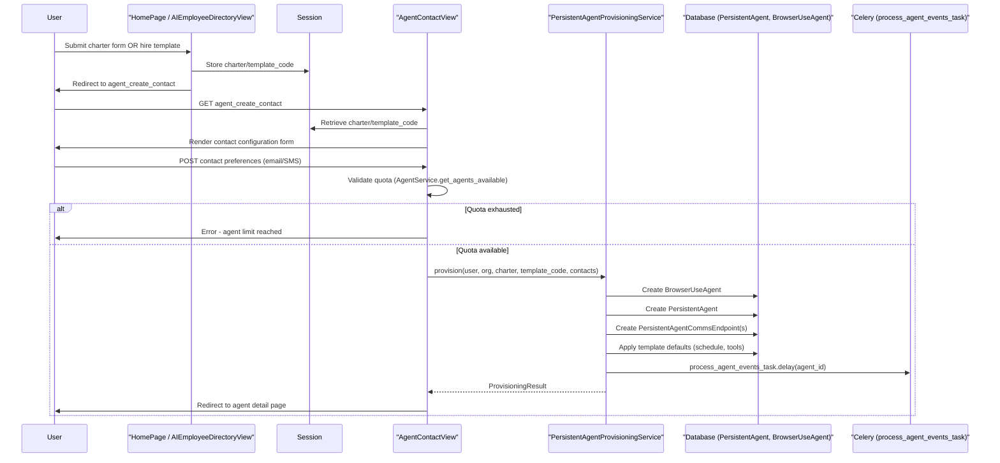
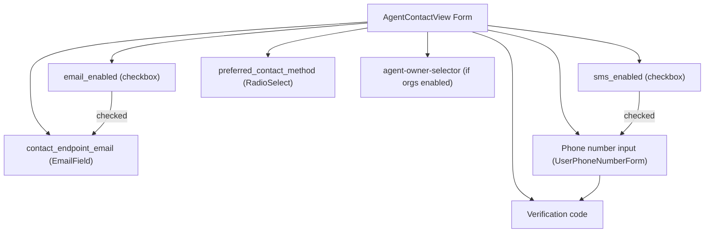
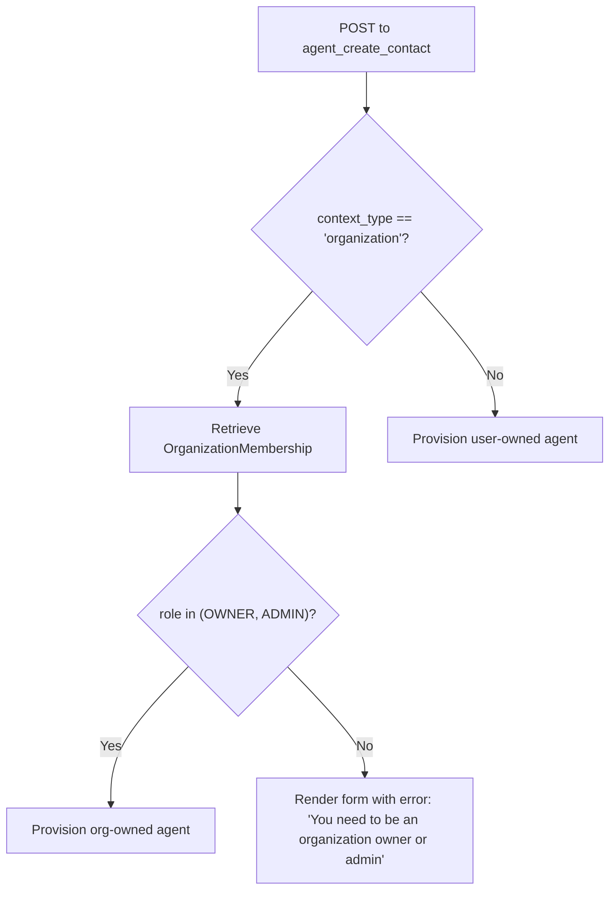
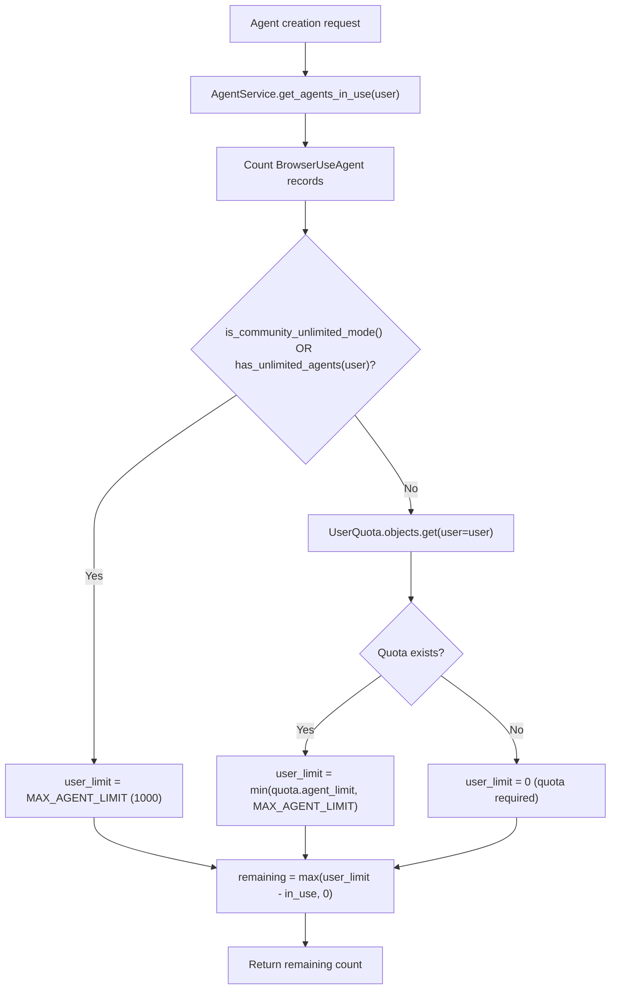
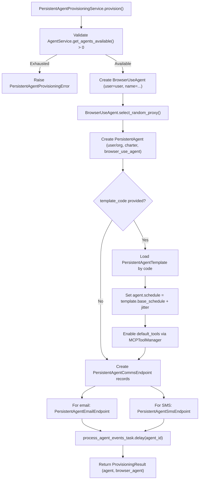

<!-- source: DeepWiki mcp.deepwiki.com · repo gobii-ai/gobii-platform · page 4.1 Creating Agents · fetched 2026-10-26 -->

# Creating Agents

<details>
<summary>Relevant source files</summary>

The following files were used as context for generating this wiki page:

- [agents/services.py](agents/services.py)
- [api/agent/core/event_processing.py](api/agent/core/event_processing.py)
- [api/models.py](api/models.py)
- [console/templates/partials/_agent_contact_form.html](console/templates/partials/_agent_contact_form.html)
- [console/views.py](console/views.py)
- [pages/templates/ai_directory/detail.html](pages/templates/ai_directory/detail.html)
- [pages/templates/ai_directory/index.html](pages/templates/ai_directory/index.html)
- [pages/templates/home.html](pages/templates/home.html)
- [pages/views.py](pages/views.py)
- [tests/unit/test_agent_limits.py](tests/unit/test_agent_limits.py)
- [tests/unit/test_ai_employee_directory.py](tests/unit/test_ai_employee_directory.py)
- [tests/unit/test_console_context.py](tests/unit/test_console_context.py)

</details>


## Purpose and Scope

This page documents the complete agent creation workflow, from initial user interaction through final provisioning and database persistence. It covers:

- Entry points for agent creation (homepage form and AI employee directory)
- The two-step creation flow (charter submission → contact configuration)
- Quota enforcement and agent limit validation
- Organization vs personal ownership mechanics
- The role of `PersistentAgentProvisioningService`

For information about agent lifecycle states and activation/deactivation, see [Agent Lifecycle](#4.4). For post-creation configuration (schedules, secrets, allowlists), see [Configuring Agents](#4.2). For the event processing loop that executes agent tasks, see [Agent Event Processing](#4.3).

---

## Agent Creation Flow Overview

Agent creation follows a two-step flow: charter definition followed by contact configuration. The system supports two entry points that converge on the same provisioning pipeline.

### High-Level Creation Sequence



**Sources:** [pages/views.py:198-244](), [console/templates/partials/_agent_contact_form.html:6-234](), [agents/services.py:44-97]()

---

## Entry Points

### Homepage Charter Form

The primary entry point is the homepage charter form where users define an agent's purpose in natural language.

**Form Location:** [pages/templates/home.html:107-160]()

**Handler:** `HomeAgentSpawnView.post()` at [pages/views.py:202-238]()

**Flow:**
1. User submits `charter` field via POST to `/spawn/`
2. `PersistentAgentCharterForm` validates charter (non-empty, max length)
3. Charter stored in session: `request.session['agent_charter']`, `request.session['agent_charter_source'] = 'user'`
4. Analytics event tracked: `PERSISTENT_AGENT_CHARTER_SUBMIT` (if authenticated)
5. Redirect to `agent_create_contact` (via login flow if unauthenticated)

**Session Keys:**
- `agent_charter`: The charter text
- `agent_charter_source`: Either `'user'` (custom) or `'template'` (from directory)

**Sources:** [pages/views.py:198-244](), [pages/templates/home.html:107-160]()

---

### AI Employee Directory (Template-Based Creation)

The AI employee directory provides pre-configured agent templates with curated charters, schedules, and tool configurations.

**Directory View:** `AIEmployeeDirectoryView` at [pages/views.py:247-299]()

**Template Detail View:** `AIEmployeeDetailView` at [pages/views.py:302-326]()

**Hire Handler:** `AIEmployeeHireView.post()` at [pages/views.py:329-373]()

**Flow:**
1. User clicks "Hire" button on template card (POST to `/ai-employees/{slug}/hire/`)
2. Template retrieved via `AIEmployeeTemplateService.get_template_by_code(code)` at [agents/services.py:139-146]()
3. Template charter and code stored in session:
   - `request.session['agent_charter'] = template.charter`
   - `request.session[AIEmployeeTemplateService.TEMPLATE_SESSION_KEY] = template.code` (key is `"ai_employee_template_code"`)
   - `request.session['agent_charter_source'] = 'template'`
4. Analytics event tracked: `PERSISTENT_AGENT_CHARTER_SUBMIT` with `template_code` property
5. Redirect to `agent_create_contact` (via login flow if unauthenticated)

**Template Data Model:**

| Field | Type | Description |
|-------|------|-------------|
| `code` | CharField | Unique identifier for template |
| `charter` | TextField | Pre-written agent instructions |
| `base_schedule` | CharField | Cron expression for execution cadence |
| `schedule_jitter_minutes` | IntegerField | Random offset applied to schedule |
| `default_tools` | JSONField | List of tool names to enable |
| `event_triggers` | JSONField | Event-based trigger configurations |
| `recommended_contact_channel` | CharField | Suggested communication method |

**Sources:** [pages/views.py:329-373](), [agents/services.py:119-264](), [pages/templates/ai_directory/index.html:97-103]()

---

## Contact Configuration Step

After charter submission, users configure how the agent will communicate with them. This is the second and final step before provisioning.

**View Handler:** `AgentContactView` (not fully shown in provided files, but referenced in templates and tests)

**Template:** [console/templates/partials/_agent_contact_form.html:1-235]()

### Contact Configuration Form Fields



**Form Fields:**

| Field | Type | Required | Description |
|-------|------|----------|-------------|
| `email_enabled` | BooleanField | No | Toggle email communication |
| `contact_endpoint_email` | EmailField | If email enabled | Email address for agent contact |
| `sms_enabled` | BooleanField | No | Toggle SMS communication |
| `phone_number` | CharField | If SMS enabled | Phone number (E.164 format) |
| `verification_code` | CharField | If SMS new | OTP for phone verification |
| `preferred_contact_method` | ChoiceField | Yes | Primary communication channel (email/sms/web) |

**Validation Logic:**
- At least one contact method must be enabled
- If `preferred_contact_method` is `'email'`, email must be enabled
- If `preferred_contact_method` is `'sms'`, SMS must be enabled and phone verified
- Phone numbers must be verified before agent creation (OTP flow)

**Sources:** [console/templates/partials/_agent_contact_form.html:89-210]()

---

### Organization Context and Ownership

Agents can be owned by either a **User** OR an **Organization** (mutually exclusive). The ownership is determined by the console context at creation time.

**Context Selection:** [console/templates/partials/_agent_contact_form.html:23-48]()

**Context Storage:**

Session keys set by `build_console_context()` and context switch endpoint:
- `context_type`: `"personal"` or `"organization"`
- `context_id`: User ID (string) or Organization ID (UUID string)
- `context_name`: User display name or organization name

**Organization Agent Creation Requirements:**

| Role | Can Create Org Agents | Notes |
|------|----------------------|-------|
| OWNER | ✓ | Full permissions |
| ADMIN | ✓ | Full permissions |
| MEMBER | ✗ | Blocked by permission check |
| BILLING | ✗ | Blocked by permission check |

**Permission Enforcement:**



**Data Model Constraints:**

From [api/models.py:168-175]():
```python
models.CheckConstraint(
    check=(
        (models.Q(user__isnull=False, organization__isnull=True))
        | (models.Q(user__isnull=True, organization__isnull=False))
    ),
    name="api_key_exactly_one_owner",
)
```

This pattern applies to `PersistentAgent`, `BrowserUseAgent`, and `BrowserUseAgentTask` models.

**Sources:** [console/templates/partials/_agent_contact_form.html:23-48](), [tests/unit/test_console_context.py:228-267]()

---

## Quota Enforcement

Agent creation is gated by quota limits to prevent runaway usage. Quotas are enforced at multiple layers.

### Quota Calculation Flow



**Key Functions:**

**`AgentService.get_agents_in_use(user)`** at [agents/services.py:26-42]()
- Returns count of `BrowserUseAgent` records for user
- Simple: `BrowserUseAgent.objects.filter(user_id=user.id).count()`

**`AgentService.get_agents_available(user)`** at [agents/services.py:44-97]()
- Calculates remaining agent slots
- Enforces `MAX_AGENT_LIMIT` constant (1000) as absolute ceiling
- Checks `UserQuota.agent_limit` for per-user limits
- Returns 0 if no `UserQuota` record exists
- Never returns negative values

**Constants:**

| Constant | Value | Location | Description |
|----------|-------|----------|-------------|
| `MAX_AGENT_LIMIT` | 1000 | `config/plans.py` | Absolute safety ceiling |
| `AGENTS_UNLIMITED` | -1 | `config/plans.py` | Sentinel for unlimited plans |

**Sources:** [agents/services.py:19-117](), [tests/unit/test_agent_limits.py:1-284]()

---

### Validation in BrowserUseAgent.clean()

Pre-save validation occurs in `BrowserUseAgent.clean()` method at [api/models.py:503-513]():

```python
def clean(self):
    super().clean()
    if self._state.adding and getattr(self, 'user_id', None):
        agents_available = AgentService.get_agents_available(self.user)
        
        if agents_available <= 0:
            raise ValidationError(
                "Agent limit reached for this user."
            )
```

**Validation Flow:**
1. Only validates on creation (`self._state.adding`)
2. Calls `AgentService.get_agents_available()`
3. Raises `ValidationError` if `agents_available <= 0`
4. Validation called automatically by `BrowserUseAgent.save()`

**Sources:** [api/models.py:503-513](), [tests/unit/test_agent_limits.py:169-193]()

---

## Agent Provisioning Service

The `PersistentAgentProvisioningService` is the authoritative component for agent creation. While the full implementation isn't in the provided files, we can infer its interface and responsibilities.

### Provisioning Service Interface

**Import:** [console/views.py:97-100]()
```python
from api.services.persistent_agents import (
    PersistentAgentProvisioningError,
    PersistentAgentProvisioningService,
)
```

**Expected Method Signature:**
```python
def provision(
    user: User,
    organization: Optional[Organization],
    charter: str,
    template_code: Optional[str] = None,
    contacts: Dict[str, Any] = None,
    **kwargs
) -> ProvisioningResult
```

### Provisioning Steps (Inferred)



### Data Models Created

**BrowserUseAgent** (primary agent record):
- `id`: UUID primary key
- `user`: ForeignKey to User
- `name`: Agent name (defaults to charter prefix or template name)
- `preferred_proxy`: ForeignKey to ProxyServer (auto-assigned via `select_random_proxy()`)

**PersistentAgent** (always-on agent wrapper):
- `id`: UUID primary key
- `user`: ForeignKey to User (nullable)
- `organization`: ForeignKey to Organization (nullable, XOR with user)
- `charter`: TextField (agent instructions)
- `browser_use_agent`: OneToOneField to BrowserUseAgent
- `schedule`: CharField (cron expression, nullable)
- `life_state`: CharField (defaults to ACTIVE)
- `is_active`: BooleanField (defaults to True)

**PersistentAgentCommsEndpoint** (abstract base):
- `agent`: ForeignKey to PersistentAgent
- `channel`: CharField (email/sms/web)
- `is_primary`: BooleanField

**PersistentAgentEmailEndpoint** (concrete):
- Inherits from PersistentAgentCommsEndpoint
- `email_address`: EmailField
- `allow_inbound`: BooleanField
- `allow_outbound`: BooleanField

**PersistentAgentSmsEndpoint** (concrete):
- Inherits from PersistentAgentCommsEndpoint
- `phone_number`: ForeignKey to UserPhoneNumber
- `allow_inbound`: BooleanField
- `allow_outbound`: BooleanField

**Sources:** [console/views.py:97-100](), [api/models.py:472-611]() (BrowserUseAgent), [tests/unit/test_console_context.py:58-74]()

---

## Template Application

When `template_code` is provided (from AI employee directory), the provisioning service applies template defaults.

### Template Default Application

**Schedule with Jitter:**

`AIEmployeeTemplateService.compute_schedule_with_jitter()` at [agents/services.py:149-180]()

```python
jitter = max(int(jitter_minutes or 0), 0)
if jitter == 0:
    return base_schedule

# Parse cron expression: "minute hour day month weekday"
parts = base_schedule.split()
minute_val = int(parts[0])
hour_val = int(parts[1])

total_minutes = hour_val * 60 + minute_val
offset = random.randint(-jitter, jitter)
total_minutes = (total_minutes + offset) % (24 * 60)

jittered_hour, jittered_minute = divmod(total_minutes, 60)
return f"{jittered_minute} {jittered_hour} {day_of_month} {month} {day_of_week}"
```

**Example:**
- Template: `base_schedule = "0 9 * * *"` (9:00 AM daily), `schedule_jitter_minutes = 30`
- Applied: `"17 8 * * *"` (8:17 AM, offset by -43 minutes)

**Tool Enablement:**

Templates specify `default_tools` as a list of tool names. These are enabled via `enable_mcp_tool()` (referenced at [console/views.py:95]()).

**Event Triggers:**

Templates can specify `event_triggers` (JSONField) to configure automatic agent wakeup on specific events (e.g., incoming emails, specific times).

**Sources:** [agents/services.py:149-180](), [pages/views.py:329-373](), [pages/templates/ai_directory/detail.html:42-47]()

---

## Post-Creation Event Queue

Immediately after provisioning, the agent is queued for initial event processing.

**Task Dispatch:**

```python
from api.agent.tasks import process_agent_events_task

transaction.on_commit(lambda: process_agent_events_task.delay(agent.id))
```

**Task Entry Point:** [api/agent/core/event_processing.py:716-862]()

This initial task execution:
1. Establishes budget cycle via `AgentBudgetManager`
2. Acquires Redis distributed lock (`Redlock`)
3. Runs initial agent loop with empty conversation history
4. Processes any initial messages or triggers
5. Sets `last_interaction_at` timestamp

**Sources:** [api/agent/core/event_processing.py:716-862](), [console/views.py:96]()

---

## Summary: Key Code Entities

| Entity | Type | Location | Role |
|--------|------|----------|------|
| `HomeAgentSpawnView` | View | [pages/views.py:198-244]() | Handles charter form submission |
| `AIEmployeeHireView` | View | [pages/views.py:329-373]() | Handles template hire |
| `AgentContactView` | View | (Referenced in templates/tests) | Handles contact configuration |
| `PersistentAgentProvisioningService` | Service | [console/views.py:97-100]() | Orchestrates agent creation |
| `AgentService` | Service | [agents/services.py:19-117]() | Quota calculations and validation |
| `AIEmployeeTemplateService` | Service | [agents/services.py:119-264]() | Template management and application |
| `BrowserUseAgent` | Model | [api/models.py:472-611]() | Core agent record |
| `PersistentAgent` | Model | [api/models.py]() | Always-on agent wrapper |
| `UserQuota` | Model | [api/models.py:278-288]() | Per-user agent limits |
| `process_agent_events_task` | Celery Task | [api/agent/core/event_processing.py:716-862]() | Initial agent execution |
| `build_console_context()` | Helper | (Referenced in views) | Determines user/org ownership context |

**Sources:** All files referenced in this document.

---

