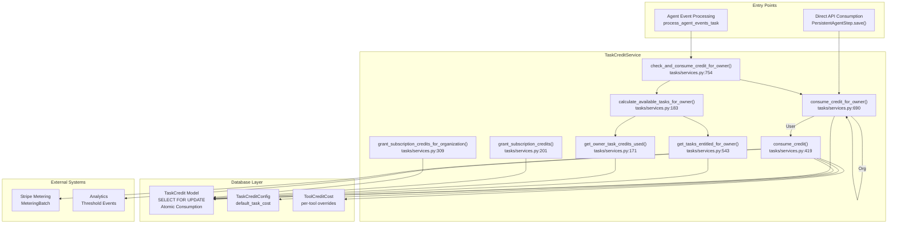
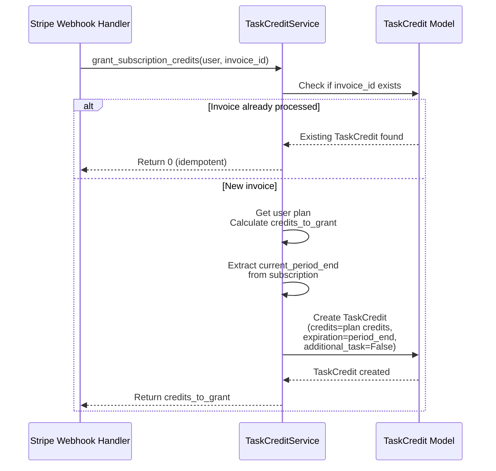
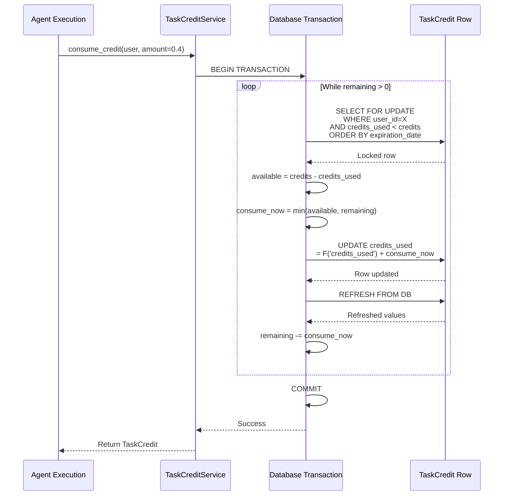
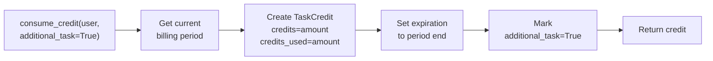
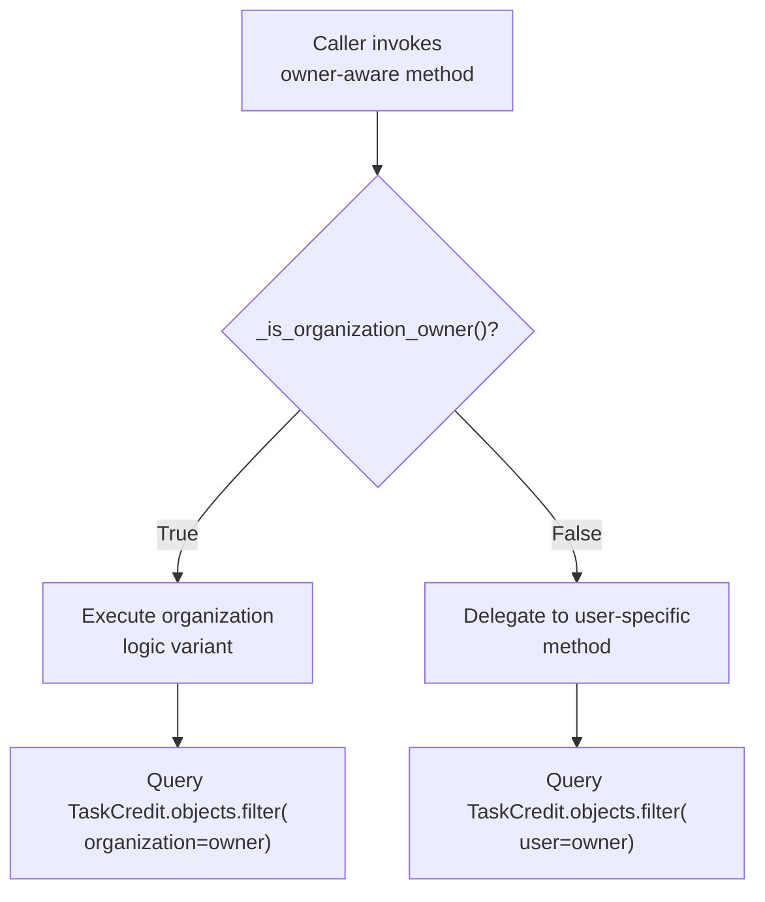
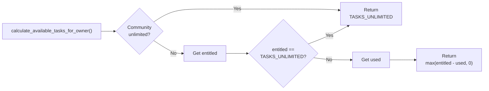
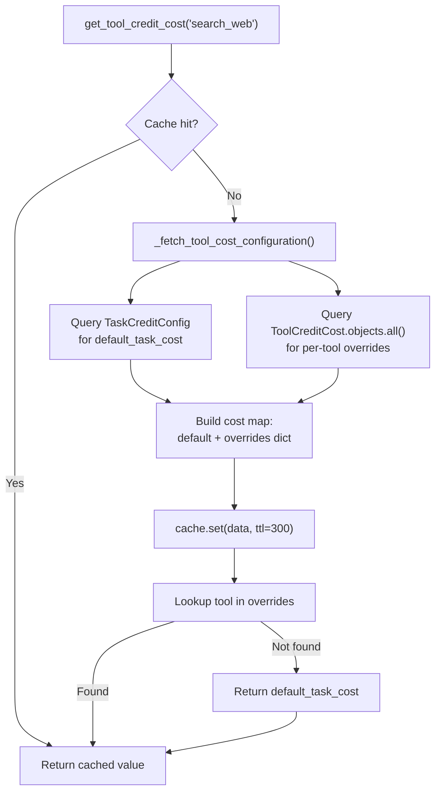
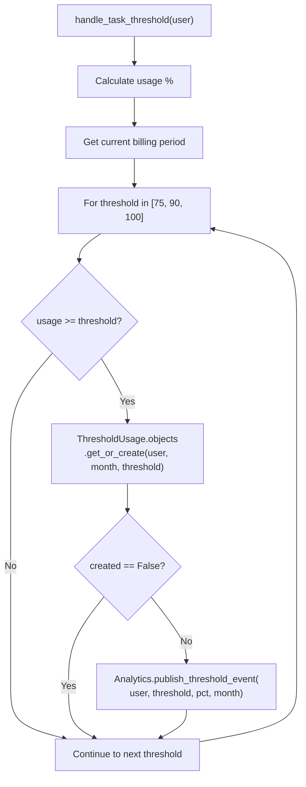
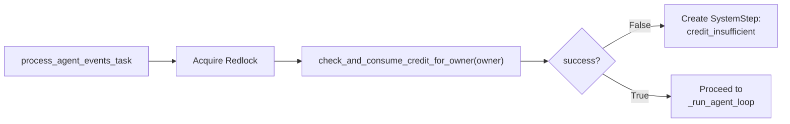
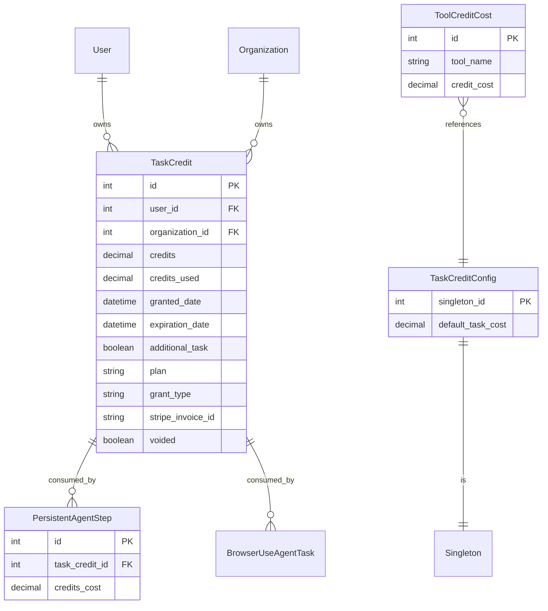

<!-- source: DeepWiki mcp.deepwiki.com · repo gobii-ai/gobii-platform · page 5.1 TaskCreditService · fetched 2026-10-26 -->

# TaskCreditService

<details>
<summary>Relevant source files</summary>

The following files were used as context for generating this wiki page:

- [api/migrations/0115_persistentagentstep_credits_fields.py](api/migrations/0115_persistentagentstep_credits_fields.py)
- [tasks/services.py](tasks/services.py)
- [tests/unit/test_persistent_agent_step_credits.py](tests/unit/test_persistent_agent_step_credits.py)
- [tests/unit/test_task_credit_service.py](tests/unit/test_task_credit_service.py)
- [tests/unit/test_tool_costs.py](tests/unit/test_tool_costs.py)
- [util/tool_costs.py](util/tool_costs.py)

</details>


## Purpose and Scope

The `TaskCreditService` is the authoritative service for all task credit operations in the gobii-platform. It provides a centralized API for granting, consuming, and calculating task credits for both individual users and organizations. This service acts as the primary resource control mechanism, gating agent execution and tool usage based on subscription plans and credit availability.

For subscription lifecycle management and Stripe webhook handling, see [Subscription Management](#5.2). For organization-specific billing operations including seat management, see [Organization Billing](#5.3). For usage analytics and reporting, see [Usage Analytics](#5.4).

**Sources:** [tasks/services.py:107-1430]()

---

## Core Concepts

### TaskCredit Model

The `TaskCredit` model represents a block of credits granted to either a User or Organization. Key attributes:

| Field | Type | Description |
|-------|------|-------------|
| `user` | ForeignKey | Owner if user-owned (mutually exclusive with `organization`) |
| `organization` | ForeignKey | Owner if org-owned (mutually exclusive with `user`) |
| `credits` | Decimal | Total credits in this block |
| `credits_used` | Decimal | Credits consumed from this block |
| `granted_date` | DateTime | When credits became available |
| `expiration_date` | DateTime | When credits expire |
| `additional_task` | Boolean | `True` for overage credits, `False` for plan credits |
| `plan` | Choice | Plan type (FREE, STARTUP, PRO, etc.) |
| `grant_type` | Choice | PLAN, MANUAL, BONUS, etc. |
| `stripe_invoice_id` | String | Associated Stripe invoice for idempotency |
| `voided` | Boolean | Whether this credit block is invalidated |

### Owner Model

The service supports dual ownership through a polymorphic owner pattern:
- **User-owned credits**: Individual user subscriptions with `max_extra_tasks` limit
- **Organization-owned credits**: Multi-seat subscriptions with per-seat credit allocation

The service detects owner type via `_is_organization_owner()` which checks the model's metadata rather than using `isinstance()` to avoid circular imports.

### Credit Types

**Plan Credits**: Regular credits granted as part of subscription provisioning. Created with `additional_task=False` and `grant_type=PLAN`. These credits are the primary entitlement from the user's plan.

**Additional Task Credits**: Overage credits created when plan credits are exhausted but the plan allows extra tasks. Created with `additional_task=True` and immediately consumed (`credits_used == credits`). These are metered to Stripe for billing.

### Fractional Credits

Credits are stored and consumed as `Decimal` values, not integers. This allows tools to have fractional costs (e.g., 0.1 credits for a lightweight API call, 0.8 for browser automation). The default task cost is configurable via `TaskCreditConfig.default_task_cost`.

**Sources:** [tasks/services.py:1-61](), [util/tool_costs.py:1-153]()

---

## Architecture Overview



**Sources:** [tasks/services.py:107-1430](), Diagram 3 from high-level architecture

---

## Credit Granting

### Subscription-Based Granting for Users

The `grant_subscription_credits()` method provisions credits when a user subscribes or renews:



**Key Logic:**
- **Idempotency**: Checks for existing `stripe_invoice_id` to prevent duplicate grants ([tasks/services.py:247-255]())
- **Expiration alignment**: Sets `expiration_date` to subscription's `current_period_end` ([tasks/services.py:278-287]())
- **Fallback expiration**: If no subscription, defaults to `grant_date + 30 days`
- **Plan-based allocation**: Uses `plan["monthly_task_credits"]` for credit amount ([tasks/services.py:266]())

**Sources:** [tasks/services.py:201-306](), [tests/unit/test_task_credit_service.py:50-89]()

### Subscription-Based Granting for Organizations

Organizations receive credits based on purchased seats via `grant_subscription_credits_for_organization()`:

**Calculation Formula:**
```
credits_to_grant = plan.credits_per_seat × organization.billing.purchased_seats
```

**Replace Current Cycle Mode:**

When `replace_current=True` (used during billing cycle renewal), the service updates an existing PLAN credit block instead of creating a new one. This prevents double-counting entitlements:

1. Finds the most recent non-voided PLAN credit for the organization
2. Updates its `credits`, `credits_used` (reset to 0), `granted_date`, `expiration_date`, and `stripe_invoice_id`
3. Returns without creating a duplicate block

This ensures organizations have exactly one active PLAN credit block per billing cycle.

**Sources:** [tasks/services.py:309-416](), [tests/unit/test_task_credit_service.py:328-359]()

---

## Credit Consumption

### Atomic Consumption with SELECT FOR UPDATE

Credit consumption uses database-level locking to prevent race conditions when multiple workers attempt to consume credits simultaneously:



**Critical Implementation Details:**

1. **Row-level locking**: `select_for_update()` prevents concurrent consumption of the same credit block ([tasks/services.py:481-491]())

2. **F-expressions**: Uses `F('credits_used')` to ensure the database performs atomic increment, avoiding lost updates ([tasks/services.py:505-507]())

3. **Refresh after save**: Calls `refresh_from_db()` to get the actual updated value after the F-expression update ([tasks/services.py:508]())

4. **Multi-block consumption**: Loops across multiple credit blocks if a single block has insufficient credits ([tasks/services.py:478-510]())

5. **Expiration ordering**: Consumes from blocks closest to expiration first to minimize waste ([tasks/services.py:489]())

**Sources:** [tasks/services.py:419-534](), [tasks/services.py:690-751]()

### Fractional Consumption

The service supports sub-unit credit consumption for cost-effective tool execution:

```python
# Example: Lightweight tool costs 0.1 credits
consume_credit(user, amount=Decimal("0.1"))

# Heavier tool costs 0.8 credits  
consume_credit(user, amount=Decimal("0.8"))
```

Credit blocks can be partially consumed across multiple operations. For instance, a 1.0 credit block can service ten 0.1-credit operations.

**Default Cost Retrieval:**

When `amount` is not specified, the service fetches the default from `get_default_task_credit_cost()` which queries `TaskCreditConfig.default_task_cost` with a 5-minute cache ([util/tool_costs.py:101-103]()).

**Sources:** [tasks/services.py:453](), [util/tool_costs.py:55-103](), [tests/unit/test_persistent_agent_step_credits.py:58-78]()

### Additional Tasks (Overage Credits)

When plan credits are exhausted but the user/organization plan allows additional tasks, the service creates on-demand overage credits:

**User Additional Tasks:**



**Characteristics:**
- Immediately consumed: `credits == credits_used` ([tasks/services.py:466]())
- Expires at billing period end ([tasks/services.py:461-467]())
- Metered to Stripe via periodic rollup task (not per-task reporting as of current implementation)
- Counts against `max_extra_tasks` limit

**Organization Additional Tasks:**

Similar flow but uses `get_current_billing_period_for_owner()` and creates credit with `organization_id` instead of `user_id` ([tasks/services.py:701-714]()).

**Sources:** [tasks/services.py:456-473](), [tasks/services.py:701-714](), [tests/unit/test_task_credit_service.py:119-142]()

### Check-and-Consume Pattern

The `check_and_consume_credit_for_owner()` method implements a two-tier fallback strategy:

1. **Attempt plan credit consumption**: Try to consume from regular credit blocks
2. **If insufficient, try additional task**: If allowed by plan, create an overage credit
3. **Return result dict**: Contains `success`, `credit`, and `error_message`

This pattern is used throughout agent event processing to gracefully handle credit exhaustion without raising exceptions in the main execution path.

**Sources:** [tasks/services.py:754-786](), [tests/unit/test_task_credit_service.py:145-203]()

---

## Owner-Aware Operations

### Dual Ownership Detection

The service uses model metadata inspection to distinguish between User and Organization owners:

```python
@staticmethod
def _is_organization_owner(owner) -> bool:
    meta = getattr(owner, "_meta", None)
    return bool(meta and meta.app_label == "api" and meta.model_name == "organization")
```

This approach avoids circular imports that would occur with `isinstance(owner, Organization)` checks.

**Sources:** [tasks/services.py:666-669]()

### Owner-Polymorphic Methods

The service provides parallel method sets for user-specific and owner-agnostic operations:

| User-Specific Method | Owner-Aware Method | Purpose |
|---------------------|-------------------|---------|
| `calculate_available_tasks()` | `calculate_available_tasks_for_owner()` | Remaining credits |
| `get_user_task_credits_granted()` | `get_owner_task_credits_granted()` | Total granted |
| `get_user_task_credits_used()` | `get_owner_task_credits_used()` | Total consumed |
| `consume_credit()` | `consume_credit_for_owner()` | Consume credits |
| `get_tasks_entitled()` | `get_tasks_entitled_for_owner()` | Calculate entitlement |

**Internal Routing Logic:**



**Sources:** [tasks/services.py:157-198](), [tasks/services.py:665-787]()

### Organization-Specific Differences

**Credit Entitlement Calculation:**

Organizations require `purchased_seats > 0` to have any entitlement. The formula is:
```
entitled = (plan.credits_per_seat × purchased_seats) + max_extra_tasks
```

If `purchased_seats == 0`, the organization receives 0 entitlement regardless of plan ([tasks/services.py:580-607]()).

**Additional Task Restrictions:**

Organizations can only create additional task credits if:
1. `allow_organization_extra_tasks(org)` returns `True` (checks subscription status)
2. `allow_and_has_extra_tasks_for_organization(org)` returns `True` (checks quota availability)

**Sources:** [tasks/services.py:580-607](), [tasks/services.py:754-786]()

---

## Credit Calculations

### Available Tasks Calculation



**Entitlement Calculation:**

For **users** ([tasks/services.py:554-578]()):
```
tasks_granted = SUM(TaskCredit.credits WHERE user=X AND in_range AND NOT additional_task)
if tasks_granted == 0:
    tasks_granted = plan.monthly_task_credits
extra_tasks = get_user_extra_task_limit(user)
entitled = tasks_granted + extra_tasks
```

For **organizations** ([tasks/services.py:580-607]()):
```
if purchased_seats == 0:
    return 0
tasks_granted = SUM(TaskCredit.credits WHERE organization=X AND in_range AND NOT additional_task)
if tasks_granted == 0:
    tasks_granted = get_organization_task_credit_limit(org)
extra_tasks = get_organization_extra_task_limit(org)
entitled = tasks_granted + extra_tasks
```

**Usage Calculation:**

Sums `credits_used` across all current TaskCredit blocks (both plan and additional task credits):
```sql
SELECT SUM(credits_used) 
FROM task_credit 
WHERE (user_id=X OR organization_id=X)
  AND granted_date <= NOW()
  AND expiration_date >= NOW()
  AND NOT voided
```

**Sources:** [tasks/services.py:128-155](), [tasks/services.py:183-198](), [tasks/services.py:537-607]()

### Percentage Used Calculation

The `calculate_used_pct()` method calculates usage as a percentage with special handling:

```python
def calculate_used_pct(user: User):
    total_credits = get_tasks_entitled(user)
    if total_credits == 0:
        return 0.0
    used_credits = get_user_total_tasks_used(user)
    pct = (used_credits / total_credits) * 100
    if pct > 100:
        pct = 100.0
    return pct
```

This is used by the threshold notification system to determine when to alert users.

**Sources:** [tasks/services.py:611-636]()

---

## Tool Credit Costs

### Configurable Cost System

The platform supports per-tool credit cost overrides via the `ToolCreditCost` model:



**Default Cost Configuration:**

Stored in `TaskCreditConfig.default_task_cost` (singleton row with `singleton_id=1`). Falls back to `settings.CREDITS_PER_TASK` if the table doesn't exist (during migrations).

**Per-Tool Overrides:**

Stored in `ToolCreditCost` table with columns:
- `tool_name` (String): Case-insensitive tool identifier
- `credit_cost` (Decimal): Override cost for this tool

**Lookup Logic:**

1. Normalize tool name to lowercase with `.strip().lower()`
2. Check overrides dictionary
3. If found, return override cost
4. Otherwise, return default cost

**Sources:** [util/tool_costs.py:55-122](), [tests/unit/test_tool_costs.py:14-79]()

### Channel-Based Cost Lookup

Communication channels have implicit tool name mappings:

| Channel | Tool Name |
|---------|-----------|
| `email` | `send_email` |
| `sms` | `send_sms` |
| `web` | `send_chat_message` |

The `get_tool_credit_cost_for_channel()` function maps channel enums to tool names and performs the cost lookup:

```python
_CHANNEL_TOOL_NAMES = {
    "email": "send_email",
    "sms": "send_sms", 
    "web": "send_chat_message",
}

def get_tool_credit_cost_for_channel(channel: str) -> Decimal:
    normalized = channel.strip().lower()
    tool_name = _CHANNEL_TOOL_NAMES.get(normalized)
    return get_tool_credit_cost(tool_name)
```

This is used when agents send messages to consume credits based on the communication medium.

**Sources:** [util/tool_costs.py:141-153](), [tests/unit/test_tool_costs.py:58-78]()

### Most Expensive Tool Cost

The `get_most_expensive_tool_cost()` function returns the maximum configured cost across all tools (including the default). This is used for pre-flight credit checks when the exact tool is unknown:

```python
max_cost = default_cost
for value in overrides.values():
    if value > max_cost:
        max_cost = value
return max_cost
```

This ensures that credit gate checks are conservative and don't falsely allow execution when only an expensive tool would be used.

**Sources:** [util/tool_costs.py:124-138](), [tests/unit/test_tool_costs.py:80-99]()

---

## Threshold Notifications

The `handle_task_threshold()` method monitors credit usage and publishes analytics events when users cross 75%, 90%, or 100% usage thresholds:



**Threshold Logic:**

1. Calculates percentage used via `calculate_used_pct(user)`
2. Treats usage within 0.05 credits of entitled as 100% to handle floating-point imprecision
3. For each threshold (75, 90, 100), checks if usage >= threshold
4. Uses `get_or_create()` to ensure notification is sent only once per month per threshold
5. Publishes event to Analytics if this is the first time crossing this threshold

**De-duplication:**

The `ThresholdUsage` model has a unique constraint on `(user, month, threshold)`, preventing duplicate notifications. The `month` is derived from the billing cycle anchor, not the calendar month.

**Sources:** [tasks/services.py:1237-1318](), [tests/unit/test_task_credit_service.py:361-408]()

---

## Community Edition Mode

### Unlimited Credits Flag

When running in Community Edition mode with unlimited credits enabled, all credit checks return `TASKS_UNLIMITED`:

```python
@staticmethod
def _is_community_unlimited() -> bool:
    """Return True when running Community Edition with unlimited credits enabled."""
    try:
        # Never enable unlimited mode during test runs
        if 'test_settings' in os.environ.get('DJANGO_SETTINGS_MODULE', ''):
            return False
        return (not getattr(settings, "GOBII_PROPRIETARY_MODE", False)) and bool(
            getattr(settings, "GOBII_ENABLE_COMMUNITY_UNLIMITED", False)
        )
    except Exception:
        return False
```

**Settings Required:**
- `GOBII_PROPRIETARY_MODE = False` (default)
- `GOBII_ENABLE_COMMUNITY_UNLIMITED = True` (default in `config/settings.py`)

**Impact:**

When this mode is active:
- `calculate_available_tasks()` returns `TASKS_UNLIMITED` immediately ([tasks/services.py:136-137]())
- `calculate_available_tasks_for_owner()` returns `TASKS_UNLIMITED` immediately ([tasks/services.py:186-187]())
- `get_user_task_credits_available()` returns `TASKS_UNLIMITED` immediately ([tasks/services.py:807-808]())

This allows self-hosted deployments to run without credit restrictions while maintaining the credit infrastructure for proprietary cloud deployments.

**Test Exclusion:**

The function explicitly checks for test settings modules and returns `False` to ensure tests run with realistic credit limits and don't inadvertently pass due to unlimited mode.

**Sources:** [tasks/services.py:109-125](), [tasks/services.py:136-137](), [tasks/services.py:186-187]()

---

## Integration Points

### Agent Event Processing

The agent event processing pipeline calls `check_and_consume_credit_for_owner()` before starting the LLM reasoning loop:



This prevents agent execution when credits are exhausted, creating a system step with type `credit_insufficient` for observability.

**Sources:** High-level Diagram 2 (Agent Lifecycle), [tasks/services.py:754-786]()

### PersistentAgentStep Credit Linking

When a `PersistentAgentStep` is created, its `save()` method automatically consumes credits and links to the consumed `TaskCredit` block:

```python
# In PersistentAgentStep.save()
if not self.pk:  # New step
    owner = self.agent.organization or self.agent.user
    cost = self.credits_cost or get_default_task_credit_cost()
    credit = TaskCreditService.consume_credit_for_owner(owner, amount=cost)
    self.task_credit = credit
    self.credits_cost = cost
```

This creates an audit trail linking each agent step to its consumed credit, enabling detailed usage analysis.

**Sources:** [tests/unit/test_persistent_agent_step_credits.py:42-89](), [api/migrations/0115_persistentagentstep_credits_fields.py:1-34]()

### Stripe Metering Integration

While the service creates `MeteringBatch` records when additional task credits are consumed, the actual reporting to Stripe is handled by a periodic rollup task (not per-task immediate reporting). This batching approach reduces API calls and costs.

The metering logic uses the billing cycle anchor to aggregate usage into monthly buckets for accurate overage billing.

**Sources:** [tasks/services.py:456-473](), Diagram 3 from high-level architecture

---

## Database Schema Relationships



**Sources:** [tasks/services.py:1-1430](), [util/tool_costs.py:1-153](), [api/migrations/0115_persistentagentstep_credits_fields.py:1-34]()

---

