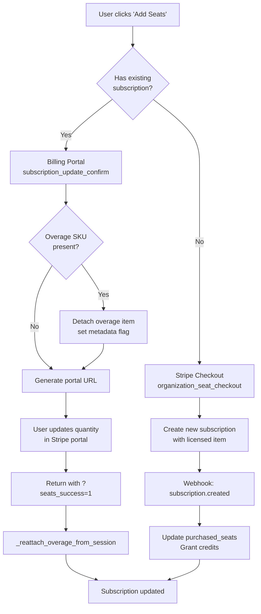
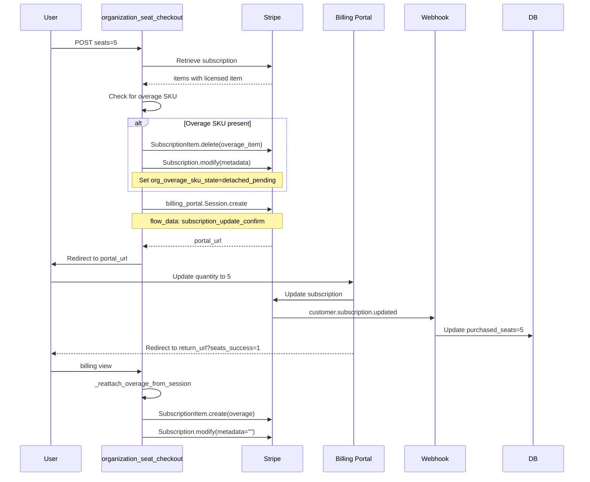
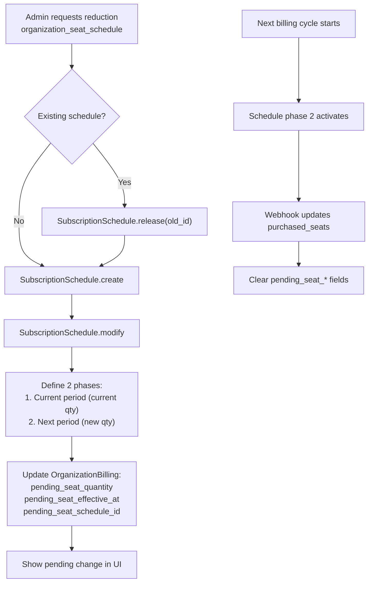
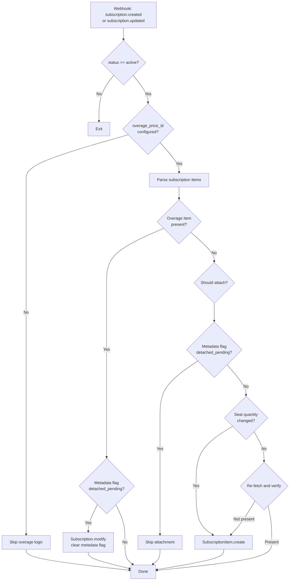
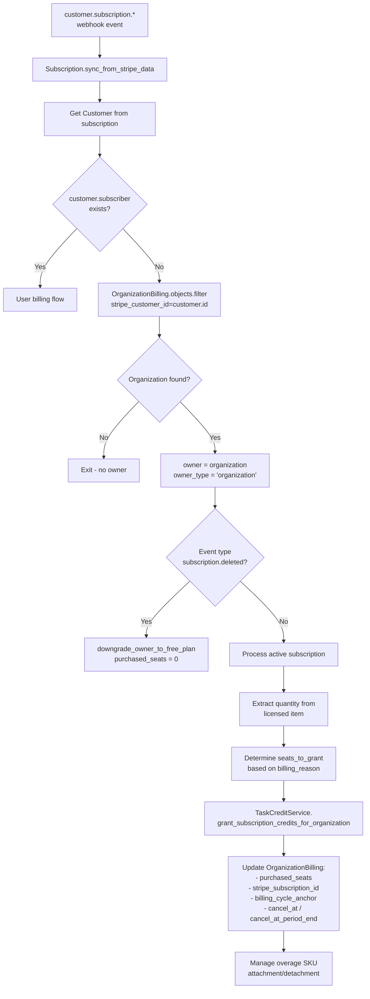

<!-- source: DeepWiki mcp.deepwiki.com · repo gobii-ai/gobii-platform · page 5.3 Organization Billing · fetched 2026-10-26 -->

# Organization Billing

<details>
<summary>Relevant source files</summary>

The following files were used as context for generating this wiki page:

- [console/forms.py](console/forms.py)
- [console/templates/console/organization_detail.html](console/templates/console/organization_detail.html)
- [console/templates/partials/_org_invite_modal.html](console/templates/partials/_org_invite_modal.html)
- [constants/stripe.py](constants/stripe.py)
- [pages/signals.py](pages/signals.py)
- [tests/unit/test_organizations.py](tests/unit/test_organizations.py)
- [tests/unit/test_pages_signals.py](tests/unit/test_pages_signals.py)

</details>


## Purpose and Scope

This document covers the seat-based billing system for multi-user organizations, including seat purchase flows, seat modifications (increases and reductions), overage SKU management, and Stripe integration patterns specific to organizations.

For individual user billing and subscription management, see [Subscription Management](#5.2). For how purchased seats translate into task credits, see [TaskCreditService](#5.1). For general organization concepts and membership management, see [Organizations](#3.3).

**Sources:** [console/templates/console/organization_detail.html:1-203](), [tests/unit/test_organizations.py:1-30]()

---

## Seat-Based Billing Model

Organizations use a **seat-based billing model** where each purchased seat grants a monthly allocation of task credits. The organization owner or admins purchase seats via Stripe, and each active or pending member consumes one seat.

### Key Concepts

| Concept | Description |
|---------|-------------|
| **Purchased Seats** | Total number of seats currently paid for on the Stripe subscription |
| **Seats Reserved** | Seats consumed by active members + pending invitations |
| **Seats Available** | `purchased_seats - seats_reserved` - can invite new members if > 0 |
| **Credits per Seat** | Defined in plan configuration (e.g., 500 credits/seat/month for Team plan) |

Organizations cannot invite new members when `seats_available <= 0`, enforced at the form validation level.

**Sources:** [console/templates/console/organization_detail.html:22-39](), [console/forms.py:96-109]()

---

## OrganizationBilling Model

The `OrganizationBilling` model tracks all billing state for an organization:

### Core Fields

```python
# From api/models.py (OrganizationBilling)
purchased_seats: int              # Current seat count on Stripe subscription
stripe_customer_id: str           # Stripe Customer ID
stripe_subscription_id: str       # Stripe Subscription ID
billing_cycle_anchor: int         # Day of month (1-31) when billing renews
subscription: str                 # Plan name (e.g., "org_team")
cancel_at: datetime               # Scheduled cancellation timestamp
cancel_at_period_end: bool        # Whether subscription cancels at period end
```

### Pending Seat Changes

For seat reductions (which use Stripe Subscription Schedules to apply changes at the next billing cycle):

```python
pending_seat_quantity: int        # Future seat count (after schedule takes effect)
pending_seat_effective_at: datetime  # When the change will apply
pending_seat_schedule_id: str     # Stripe Schedule ID for cancellation
```

These fields allow the UI to display upcoming changes before they take effect.

**Sources:** [pages/signals.py:595-619](), [tests/unit/test_organizations.py:625-629]()

---

## Seat Purchase Flows

### Diagram: Seat Checkout Decision Tree



**Sources:** [tests/unit/test_organizations.py:152-177](), [tests/unit/test_organizations.py:189-240]()

### Initial Purchase (No Existing Subscription)

When an organization has no active subscription, adding seats triggers a **Stripe Checkout** flow:

1. View: `organization_seat_checkout` creates a Checkout Session with the org team price ID
2. Line items include the licensed seat price (e.g., `org_team_price_id`) with requested quantity
3. Upon completion, Stripe creates a subscription and sends a webhook
4. Webhook handler updates `purchased_seats` and grants credits

**Sources:** [tests/unit/test_organizations.py:152-178]()

### Adding Seats to Existing Subscription

When an organization already has a subscription, the flow uses **Stripe Billing Portal** with `subscription_update_confirm`:



**Sources:** [tests/unit/test_organizations.py:325-393](), [tests/unit/test_organizations.py:404-497]()

### Overage SKU Detachment During Portal Updates

**Problem:** Stripe Billing Portal does not support subscriptions with multiple items when using `subscription_update_confirm` flow.

**Solution:** Temporarily detach the overage SKU before opening the portal, then reattach it upon return.

The detachment process:
1. View calls `stripe.SubscriptionItem.delete(overage_item_id)`
2. View sets `metadata[org_overage_sku_state] = "detached_pending"` on subscription
3. Store detachment info in Django session: `org_overage_detach[org_id]`
4. When user returns from portal, `_reattach_overage_from_session` restores the SKU

**Sources:** [tests/unit/test_organizations.py:325-393](), [constants/stripe.py:1-5]()

---

## Seat Reduction with Subscription Schedules

Organizations cannot immediately reduce seats (to prevent disruption mid-cycle). Instead, seat reductions use **Stripe Subscription Schedules** to apply changes at the next billing period.

### Diagram: Seat Reduction Flow



**Sources:** [tests/unit/test_organizations.py:569-629](), [tests/unit/test_organizations.py:636-689]()

### Schedule Creation Process

The view `organization_seat_schedule` creates a two-phase schedule:

**Phase 1 (Current Period):**
- `start_date`: Current `current_period_start` timestamp
- `end_date`: Current `current_period_end` timestamp  
- `items[0].quantity`: Current seat count (unchanged)

**Phase 2 (Next Period):**
- `start_date`: Current `current_period_end` timestamp (when phase 1 ends)
- `items[0].quantity`: New reduced seat count

The schedule is set to `end_behavior="release"`, meaning it releases control back to the subscription after applying the change.

**Sources:** [tests/unit/test_organizations.py:612-623]()

### Replacing Existing Schedules

If a pending reduction already exists, the flow:
1. Calls `SubscriptionSchedule.release(existing_schedule_id)` to cancel the old schedule
2. Creates a new schedule with updated quantities
3. Updates the local `pending_seat_schedule_id` reference

This allows admins to change their mind about the future seat count before it takes effect.

**Sources:** [tests/unit/test_organizations.py:636-689]()

### Canceling Pending Reductions

The view `organization_seat_schedule_cancel`:
1. Calls `SubscriptionSchedule.release(schedule_id)`
2. Clears `pending_seat_quantity`, `pending_seat_effective_at`, and `pending_seat_schedule_id`

**Sources:** [tests/unit/test_organizations.py:694-718]()

---

## Overage SKU Management

The **overage SKU** is a metered Stripe Price that bills for additional tasks consumed beyond the base credits included with purchased seats.

### Configuration

The overage price ID is configured in Stripe settings:
- `org_team_additional_task_price_id` - Metered price for overage tasks

### Automatic Attachment on Subscription Creation/Update

The webhook handler `handle_subscription_event` ensures the overage SKU is attached to all active organization subscriptions:



**Sources:** [pages/signals.py:472-575](), [tests/unit/test_pages_signals.py:407-426]()

### Attachment Logic

The webhook attaches the overage SKU when:
1. The subscription is `active`
2. Overage price ID is configured
3. Overage item is not already present
4. Metadata does **not** have `org_overage_sku_state = "detached_pending"`
5. Either:
   - Seat quantity changed (delta != 0), OR
   - Metadata previously had `detached_pending` flag set

This logic prevents duplicate attachment while ensuring the SKU is restored after portal flows.

**Sources:** [pages/signals.py:488-550]()

### Detached Pending State

The metadata key `org_overage_sku_state` with value `detached_pending` signals:
- The overage SKU was deliberately detached for a portal update
- Do **not** automatically reattach it during webhook processing
- The reattachment will happen via `_reattach_overage_from_session` when user returns

When the webhook sees this flag and the overage item is **present**, it clears the flag.

**Sources:** [pages/signals.py:552-575](), [constants/stripe.py:1-5]()

---

## Webhook Processing for Organizations

The `handle_subscription_event` function in `pages/signals.py` processes organization subscriptions differently from user subscriptions.

### Diagram: Webhook Flow for Organizations



**Sources:** [pages/signals.py:234-651]()

### Organization Identification

Organizations are identified when:
1. `customer.subscriber` is `None` (no linked User)
2. `OrganizationBilling.stripe_customer_id` matches the customer ID

**Sources:** [pages/signals.py:299-311]()

### Billing Reason and Credit Granting

The webhook uses `billing_reason` to determine how many seats to grant credits for:

| Billing Reason | Seats to Grant | Invoice ID Passed | Replace Current |
|----------------|----------------|-------------------|-----------------|
| `subscription_create` | All seats (or delta if prev_seats > 0) | Yes (if prev_seats == 0) | Yes |
| `subscription_cycle` | All seats | Yes | Yes |
| `subscription_update` | Delta (if seats increased) | No | No |
| Other/None | 0 (no grant) | No | No |

The `replace_current` flag tells `TaskCreditService` whether to reset the active monthly credit block or add a new one.

**Sources:** [pages/signals.py:621-650](), [tests/unit/test_pages_signals.py:371-402]()

### Billing Reason Resolution

The webhook tries to find `billing_reason` in this order:
1. `source_data.billing_reason` (from subscription payload)
2. `subscription.billing_reason` attribute
3. Fetch latest invoice and check `invoice.billing_reason`

This fallback ensures the correct grant logic even when the subscription object doesn't include the reason.

**Sources:** [pages/signals.py:380-399]()

### Subscription Field Updates

The webhook updates `OrganizationBilling` fields atomically:

```python
# From pages/signals.py:577-619
updates = []
if current_period_start_dt:
    new_day = current_period_start_dt.day
    if billing.billing_cycle_anchor != new_day:
        billing.billing_cycle_anchor = new_day
        updates.append("billing_cycle_anchor")

if seats and billing.purchased_seats != seats:
    billing.purchased_seats = seats
    updates.append("purchased_seats")

# Clear pending seat changes if quantity changed
if pending_schedule_id and seats != prev_seats:
    billing.pending_seat_quantity = None
    billing.pending_seat_effective_at = None
    billing.pending_seat_schedule_id = ""
    updates.extend([...])

if billing.cancel_at != cancel_at_dt:
    billing.cancel_at = cancel_at_dt
    updates.append("cancel_at")

if updates:
    billing.save(update_fields=updates)
```

This ensures only changed fields are saved, minimizing database writes.

**Sources:** [pages/signals.py:577-619]()

### Pending Seat Change Clearance

When a webhook updates `purchased_seats` and the new quantity differs from the old quantity, any pending seat schedule is assumed to have taken effect. The webhook clears:
- `pending_seat_quantity`
- `pending_seat_effective_at`
- `pending_seat_schedule_id`

This prevents stale pending change info from displaying in the UI after the schedule applies.

**Sources:** [pages/signals.py:595-607]()

---

## UI Integration

### Organization Detail Page

The organization detail template displays billing information:

```django
<!-- From console/templates/console/organization_detail.html:22-39 -->
<dl class="grid gap-4 sm:grid-cols-3">
  <div>
    <dt>Seats Purchased</dt>
    <dd>{{ org_billing.purchased_seats }}</dd>
  </div>
  <div>
    <dt>In Use</dt>
    <dd>{{ org_billing.seats_reserved }}</dd>
  </div>
  <div>
    <dt>Available</dt>
    <dd>{{ org_billing.seats_available }}</dd>
  </div>
</dl>
```

**Computed Properties:**
- `seats_reserved`: Active members + pending invitations
- `seats_available`: `purchased_seats - seats_reserved`

**Sources:** [console/templates/console/organization_detail.html:22-39]()

### Seat Availability Checks

Invite forms check seat availability and disable invitations when none remain:

```django
<!-- From console/templates/console/organization_detail.html:51-58 -->

  <span class="warning-badge">No seats available</span>

```

Form validation also enforces this:

**Sources:** [console/forms.py:96-109](), [console/templates/partials/_org_invite_modal.html:39-51]()

---

## Integration with TaskCreditService

Seat purchases flow to credit grants via `TaskCreditService.grant_subscription_credits_for_organization`:

```python
# Simplified from pages/signals.py:643-650
TaskCreditService.grant_subscription_credits_for_organization(
    owner=organization,
    seats=seats_to_grant,
    plan=plan,
    invoice_id=grant_invoice_id,
    subscription=sub,
    replace_current=True,  # For cycle/create events
)
```

For details on how this service creates `TaskCredit` records with seat-based quantities, see [TaskCreditService](#5.1).

**Sources:** [pages/signals.py:643-650]()

---

## Error Handling and Edge Cases

### Missing Billing Record

If webhook processing cannot find either a user or organization owner, it logs and exits without error:

```python
# From pages/signals.py:308-311
if not owner:
    logger.info("Subscription %s has no linked billing owner; nothing to do.", sub.id)
    return
```

**Sources:** [pages/signals.py:308-311]()

### Portal Failure Fallback

When the Billing Portal fails with `InvalidRequestError` (often due to multiple items), the view falls back to **direct subscription modification**:

1. View catches `stripe.error.InvalidRequestError`
2. Retrieves subscription again
3. Modifies subscription item quantity directly via `stripe.SubscriptionItem.modify`
4. Reattaches overage SKU immediately
5. Displays success message: "Stripe portal seat updates are disabled, so we applied the seat change immediately."

This ensures seat changes complete even when the portal flow is unavailable.

**Sources:** [tests/unit/test_organizations.py:404-497]()

### Auto-Paging Iterator Errors

Stripe's Python SDK sometimes returns iterators in `subscription.items` instead of lists. The webhook handles this:

```python
# From pages/signals.py:264-280
try:
    sub = Subscription.sync_from_stripe_data(payload)
except Exception as exc:
    if "auto_paging_iter" in str(exc):
        stripe_sub = stripe.Subscription.retrieve(
            payload["id"],
            expand=["items"],
        )
        sub = Subscription.sync_from_stripe_data(stripe_sub)
    else:
        raise
```

**Sources:** [pages/signals.py:264-280]()

---

## Summary

Organization billing uses a seat-based model where:
- Organizations purchase seats via Stripe (Checkout for new, Billing Portal for existing)
- Each seat grants monthly credits (`plan.credits_per_seat × purchased_seats`)
- Seat increases take effect immediately via webhook
- Seat reductions use Subscription Schedules to apply at next billing period
- An overage SKU (metered price) tracks additional task consumption
- Overage SKU is temporarily detached for portal flows, then reattached
- All state synchronization happens via Stripe webhooks

**Sources:** [pages/signals.py:234-651](), [tests/unit/test_organizations.py:1-800](), [console/templates/console/organization_detail.html:1-203]()

---

