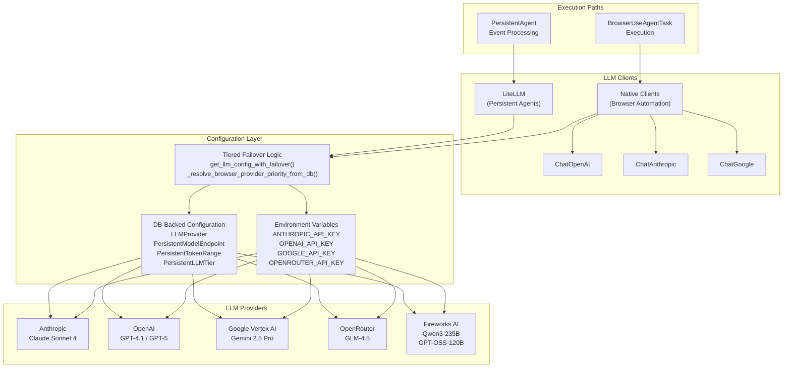
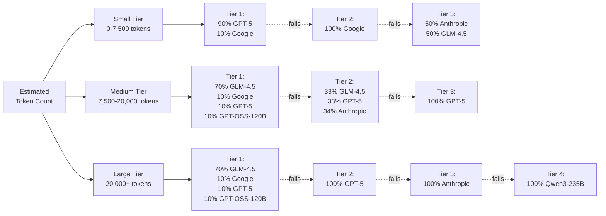
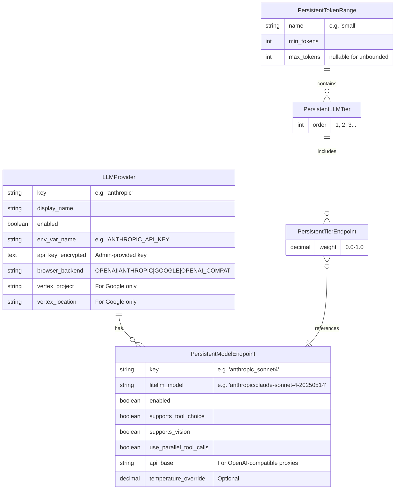
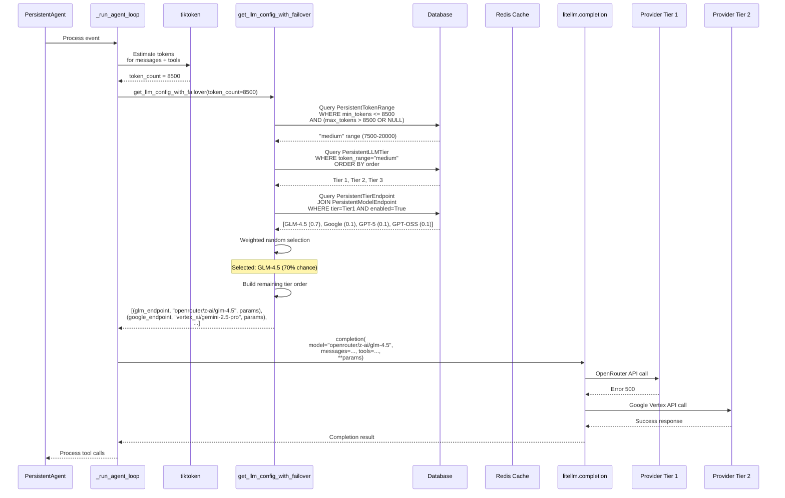

<!-- source: DeepWiki mcp.deepwiki.com · repo gobii-ai/gobii-platform · page 6.3 LLM Integration · fetched 2026-10-26 -->

# LLM Integration

<details>
<summary>Relevant source files</summary>

The following files were used as context for generating this wiki page:

- [api/agent/core/llm_config.py](api/agent/core/llm_config.py)
- [api/agent/tools/mcp_tools.py](api/agent/tools/mcp_tools.py)
- [api/tasks/browser_agent_tasks.py](api/tasks/browser_agent_tasks.py)
- [tests/unit/test_browser_task_follow_up.py](tests/unit/test_browser_task_follow_up.py)
- [tests/unit/test_event_processing_llm_selection.py](tests/unit/test_event_processing_llm_selection.py)
- [tests/unit/test_llm_failover.py](tests/unit/test_llm_failover.py)
- [tests/unit/test_mcp_tools.py](tests/unit/test_mcp_tools.py)
- [tests/utils/llm_seed.py](tests/utils/llm_seed.py)

</details>


## Purpose and Scope

This document describes the platform's LLM (Large Language Model) provider integration system, which enables both persistent agents and browser automation tasks to interact with multiple LLM providers through a unified, fault-tolerant architecture. The system supports tiered failover with weighted distribution, token-based tier selection, and dynamic database-backed configuration.

For information about how agents use LLM reasoning during task execution, see [Agent Event Processing](#4.3). For browser automation configuration specifically, see [Browser Automation](#6.2). For MCP tool integration that uses LLMs for tool discovery, see [MCP Tools](#6.1).

---

## Architecture Overview

The platform integrates LLMs through two distinct execution paths with unified failover logic:



**Sources:** [api/agent/core/llm_config.py:1-477](), [api/tasks/browser_agent_tasks.py:278-365]()

---

## Provider Configuration

### PROVIDER_CONFIG Structure

The platform maintains a centralized provider configuration mapping that defines supported LLM providers, their authentication requirements, and model identifiers:

| Provider Key | Environment Variable | Model Path | Use Case |
|-------------|---------------------|------------|----------|
| `anthropic` | `ANTHROPIC_API_KEY` | `anthropic/claude-sonnet-4-20250514` | High-quality reasoning, vision support |
| `google` | `GOOGLE_API_KEY` | `vertex_ai/gemini-2.5-pro` | Large context, vision support |
| `openai` | `OPENAI_API_KEY` | `openai/gpt-4.1` | General purpose |
| `openai_gpt5` | `OPENAI_API_KEY` | `openai/gpt-5` | Latest frontier model |
| `openrouter_glm` | `OPENROUTER_API_KEY` | `openrouter/z-ai/glm-4.5` | Long context, cost-effective |
| `fireworks_qwen3_235b_a22b` | `FIREWORKS_AI_API_KEY` | `fireworks_ai/accounts/fireworks/models/qwen3-235b-a22b-instruct-2507` | Large parameter model |
| `fireworks_gpt_oss_120b` | `FIREWORKS_AI_API_KEY` | `fireworks_ai/accounts/fireworks/models/gpt-oss-120b` | Tested for persistent agents |

**Sources:** [api/agent/core/llm_config.py:40-77](), [api/tasks/browser_agent_tasks.py:278-284]()

### Vision Support Metadata

The system tracks which providers support vision capabilities (image understanding) for browser automation tasks. This metadata is stored both in code defaults and in the database `PersistentModelEndpoint.supports_vision` field:

```python
DEFAULT_PROVIDER_VISION_SUPPORT = {
    "openai": True,
    "anthropic": True,
    "google": True,
    "openrouter": False,
    "fireworks": False,
}
```

**Sources:** [api/tasks/browser_agent_tasks.py:40-46](), [api/agent/core/llm_config.py:381-382]()

---

## Tiered Failover System

### Token-Based Tier Selection

The system automatically selects different provider configurations based on the estimated token count of the request. This optimizes for both cost and performance across different context sizes:



The function `get_tier_config_for_tokens()` maps token counts to tier configurations:

**Sources:** [api/agent/core/llm_config.py:84-140]()

### Weighted Provider Distribution

Within each tier, providers are selected using weighted random distribution. The `get_llm_config_with_failover()` function implements this by:

1. Selecting a tier based on token count (or custom override)
2. Within the tier, randomly selecting an endpoint based on weight
3. Removing the selected endpoint from the pool
4. Repeating until all endpoints are ordered for failover

This ensures load distribution while maintaining failover priority.

**Sources:** [api/agent/core/llm_config.py:235-401](), [api/tasks/browser_agent_tasks.py:303-365]()

---

## Database-Backed Configuration

### Schema Overview

The platform supports dynamic LLM configuration through the following database models:



**Sources:** [api/agent/core/llm_config.py:259-392](), [tests/utils/llm_seed.py:18-86]()

### OpenAI-Compatible Endpoint Support

The system supports custom OpenAI-compatible endpoints (e.g., vLLM, Ollama) through the `api_base` field. When an endpoint has:
- `litellm_model` starting with `openai/`
- `api_base` configured

The system automatically routes requests to the custom base URL, enabling deployment of local or private models.

**Sources:** [api/agent/core/llm_config.py:290-310](), [api/agent/core/llm_config.py:365-377]()

### API Key Resolution

The system resolves API keys in the following priority order:

1. **Admin-provided encrypted key** (`LLMProvider.api_key_encrypted`) - Decrypted using `SecretsEncryption`
2. **Environment variable** (`LLMProvider.env_var_name`) - Fallback if admin key not present
3. **Dummy key for proxies** - For OpenAI-compatible endpoints with `api_base`, uses `"sk-noauth"` if no key available

**Sources:** [api/agent/core/llm_config.py:336-353]()

---

## Browser Automation LLM Integration

### Native Client Instantiation

Browser automation tasks use native LLM clients from the `browser_use` library rather than LiteLLM. The `_run_agent()` function instantiates clients based on the `provider_backend_override` parameter:

| Backend | Client Class | Default Model |
|---------|--------------|---------------|
| `OPENAI` | `ChatOpenAI` | `gpt-5-mini` |
| `ANTHROPIC` | `ChatAnthropic` | `claude-sonnet-4-20250514` |
| `GOOGLE` | `ChatGoogle` | `gemini-2.5-pro` (configurable) |
| `OPENAI_COMPAT` | `ChatOpenAI` with `base_url` | Provider-specific |

**Sources:** [api/tasks/browser_agent_tasks.py:740-781]()

### Browser LLM Policy

Browser tasks use a separate configuration system via `BrowserLLMPolicy`, `BrowserLLMTier`, and `BrowserTierEndpoint` models. The function `_resolve_browser_provider_priority_from_db()` builds tiered configurations specifically for browser automation:

```python
# Example resolved structure:
[
    [  # Tier 1
        {
            'provider_key': 'openai',
            'endpoint_key': 'openai_gpt41',
            'weight': 0.8,
            'browser_model': 'gpt-4.1',
            'base_url': '',
            'backend': 'OPENAI',
            'supports_vision': True,
            'api_key': '...',
            'has_key': True,
        },
        # ... more tier 1 endpoints
    ],
    # ... more tiers
]
```

**Sources:** [api/tasks/browser_agent_tasks.py:303-365]()

---

## Persistent Agent LLM Integration

### LiteLLM Wrapper

Persistent agents use LiteLLM for unified provider access. The function `get_llm_config_with_failover()` returns configurations in LiteLLM format:

```python
# Returns: List[Tuple[endpoint_key, model, params]]
# Example:
[
    ("anthropic_sonnet4", "anthropic/claude-sonnet-4-20250514", {
        "temperature": 0.1,
        "api_key": "...",
        "supports_tool_choice": True,
        "use_parallel_tool_calls": True,
        "supports_vision": True,
    }),
    # ... failover configurations
]
```

The calling code passes these to `litellm.completion()` with failover handling.

**Sources:** [api/agent/core/llm_config.py:143-167](), [api/agent/core/llm_config.py:235-401]()

### Tool Choice and Parallel Calls

The system tracks two important capabilities per endpoint:

- **`supports_tool_choice`**: Whether the model supports the `tool_choice` parameter to force specific tool usage
- **`use_parallel_tool_calls`**: Whether to enable parallel tool calling (some models perform better with sequential calls)

These are passed as hints in the parameter dict but filtered before sending to LiteLLM to avoid provider rejections.

**Sources:** [api/agent/core/llm_config.py:380-387](), [tests/unit/test_mcp_tools.py:403-440]()

### Reference Tokenizer

Token counting uses a consistent reference model before provider selection:

```python
REFERENCE_TOKENIZER_MODEL = "openai/gpt-4o"
```

This ensures consistent tier selection regardless of which provider is ultimately chosen.

**Sources:** [api/agent/core/llm_config.py:80]()

---

## Failover Execution Flow

The following sequence shows how a persistent agent request flows through the failover system:



**Sources:** [api/agent/core/llm_config.py:235-401](), [api/agent/core/event_processing.py:1-1000]() (inferred from test references)

---

## Configuration Management

### Bootstrap Flow

When no LLM configuration exists, the platform enters bootstrap mode. The function `is_llm_bootstrap_required()` checks whether any usable configuration is available:

```python
def is_llm_bootstrap_required(*, force_refresh: bool = False) -> bool:
    """Return True when the platform lacks any usable LLM configuration."""
    if getattr(settings, "LLM_BOOTSTRAP_OPTIONAL", False):
        return False
    if not force_refresh:
        cached = cache.get(_LLM_BOOTSTRAP_CACHE_KEY)
        if cached is not None:
            return bool(cached)
    
    try:
        configs = get_llm_config_with_failover(token_count=0, allow_unconfigured=True)
        required = not bool(configs)
    except Exception:
        required = True
    
    _cache_bootstrap_status(required)
    return required
```

The bootstrap status is cached in Redis for 30 seconds to avoid repeated database queries during UI checks.

**Sources:** [api/agent/core/llm_config.py:450-466](), [api/agent/core/llm_config.py:28-30]()

### LLMNotConfiguredError

When configuration is required but unavailable, the system raises `LLMNotConfiguredError` to trigger the setup wizard rather than crashing:

```python
class LLMNotConfiguredError(RuntimeError):
    """Raised when no LLM providers/endpoints are available for use."""
```

This allows the platform to gracefully handle first-run scenarios.

**Sources:** [api/agent/core/llm_config.py:24-25]()

### Cache Invalidation

Configuration changes must invalidate the bootstrap cache to ensure UI reflects current state:

```python
def invalidate_llm_bootstrap_cache() -> None:
    """Invalidate cached bootstrap status after config changes."""
    try:
        cache.delete(_LLM_BOOTSTRAP_CACHE_KEY)
    except Exception:
        logger.debug("Unable to invalidate LLM bootstrap cache", exc_info=True)
```

This function should be called after:
- Creating/updating `LLMProvider` records
- Enabling/disabling endpoints
- Adding API keys

**Sources:** [api/agent/core/llm_config.py:442-447]()

---

## Integration Points Summary

The LLM integration system serves as the foundation for multiple platform capabilities:

| Component | Integration Path | Key Function |
|-----------|-----------------|--------------|
| Persistent Agent Reasoning | `_run_agent_loop` → `_completion_with_failover` | `get_llm_config_with_failover()` |
| Browser Automation | `_run_agent()` in Celery worker | `_resolve_browser_provider_priority_from_db()` |
| MCP Tool Discovery | `search_tools()` → `litellm.completion()` | `get_llm_config_with_failover()` |
| Message Summarization | `_get_conversation_summary()` | `get_summarization_llm_config()` |

The unified failover architecture ensures consistent behavior across all agent operations while allowing specialization for browser automation's unique requirements (native clients, vision support, proxy endpoints).

**Sources:** [api/agent/core/llm_config.py:1-477](), [api/tasks/browser_agent_tasks.py:1-1895](), [api/agent/tools/mcp_manager.py:1-800]() (inferred from test references)

---

