<!-- source: DeepWiki mcp.deepwiki.com · repo gobii-ai/gobii-platform · page 7.2 Email & SMS · fetched 2026-10-26 -->

# Email & SMS

<details>
<summary>Relevant source files</summary>

The following files were used as context for generating this wiki page:

- [api/admin.py](api/admin.py)
- [api/agent/core/event_processing.py](api/agent/core/event_processing.py)
- [api/models.py](api/models.py)
- [config/settings.py](config/settings.py)
- [console/views.py](console/views.py)
- [util/subscription_helper.py](util/subscription_helper.py)

</details>


This document describes the email and SMS communication systems that enable persistent agents to interact with external contacts via traditional messaging channels. These systems handle provisioning communication endpoints, processing inbound messages, sending outbound messages, and enforcing allowlist-based permissions.

For real-time web-based chat, see [Agent Web Chat](#7.1). For agent-to-agent direct messaging, see [Peer Messaging](#7.3).

---

## Overview

The platform supports two traditional communication channels for agents:

- **Email**: Agents can send and receive emails via dedicated email accounts (IMAP/SMTP) or transactional email providers (Mailgun, Postmark)
- **SMS**: Agents can send and receive SMS messages via provisioned phone numbers through Twilio

Both systems follow a similar architecture:
1. **Endpoint Provisioning**: Agents are assigned dedicated email addresses or phone numbers
2. **Inbound Processing**: External messages arrive via webhooks or polling and trigger agent event processing
3. **Outbound Sending**: Agents use LLM-powered tools to compose and send messages
4. **Allowlist Enforcement**: Directional permissions control who can contact agents and whom agents can contact

---

## Email System Architecture

### Email Account Model

The `AgentEmailAccount` model represents a dedicated email account for agent communication. Each account stores IMAP/SMTP credentials and provider configuration.

**Core Data Model**

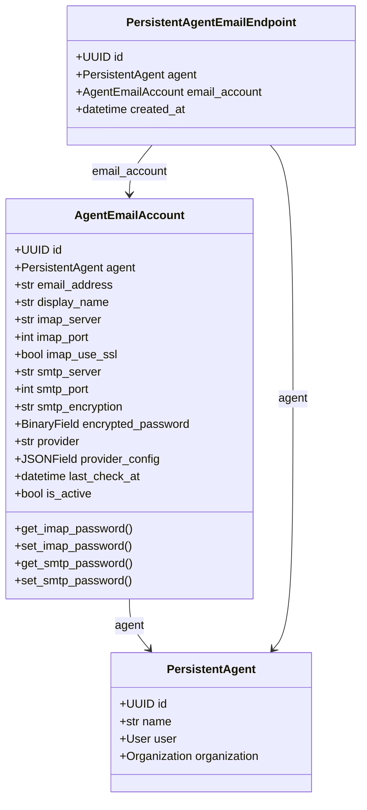

Sources: [api/models.py:2400-2600]()

**Key Fields:**
- **IMAP Configuration**: Server, port, SSL settings for receiving mail
- **SMTP Configuration**: Server, port, encryption (STARTTLS/SSL) for sending mail  
- **Encrypted Credentials**: Password stored using `GOBII_ENCRYPTION_KEY` via `encrypt_value()`/`decrypt_value()`
- **Provider**: `"smtp"` for custom IMAP/SMTP or `"postmark"` for transactional email
- **Provider Config**: JSON field for provider-specific settings (e.g., Postmark server token)

### Email Delivery Modes

The platform supports three email delivery modes, selected per account:

| Mode | Configuration | Use Case |
|------|--------------|----------|
| **IMAP/SMTP** | Custom mail server credentials | Self-hosted or ISP email accounts |
| **Postmark** | Postmark server token + inbound hash | Transactional email with tracking |
| **Simulated** | `SIMULATE_EMAIL_DELIVERY=True` | Local development without external providers |

Sources: [config/settings.py:829-834]()

**Simulated Delivery**

When `SIMULATE_EMAIL_DELIVERY=True` (default in non-production environments), outbound emails are logged but not actually sent. This allows agent testing without configuring real email providers.

Sources: [config/settings.py:832-834]()

### Inbound Email Processing

Inbound emails are processed through two mechanisms:

#### 1. IMAP IDLE Watcher (Optional)

When `IMAP_IDLE_ENABLED=True`, a management command runs dedicated IMAP IDLE watchers for agent email accounts:

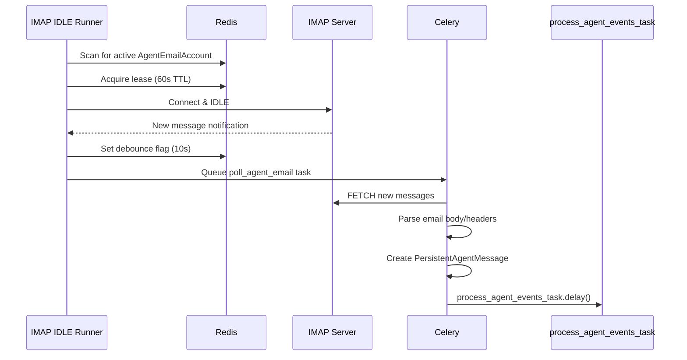

Sources: [config/settings.py:808-820]()

**Configuration Variables:**
- `IMAP_IDLE_ENABLED`: Enable/disable IDLE watcher (default: `False`)
- `IMAP_IDLE_MAX_CONNECTIONS`: Max watchers per runner process (default: 200)
- `IMAP_IDLE_SCAN_INTERVAL_SEC`: Account rescan interval (default: 30s)
- `IMAP_IDLE_REISSUE_SEC`: Re-issue IDLE command interval (default: 1500s)
- `IMAP_IDLE_DEBOUNCE_SEC`: Debounce window for duplicate polls (default: 10s)
- `IMAP_IDLE_LEASE_TTL_SEC`: Cross-runner lease TTL (default: 60s)

#### 2. Webhook Delivery (Postmark/Mailgun)

For provider-based accounts, inbound emails arrive via HTTP webhooks:

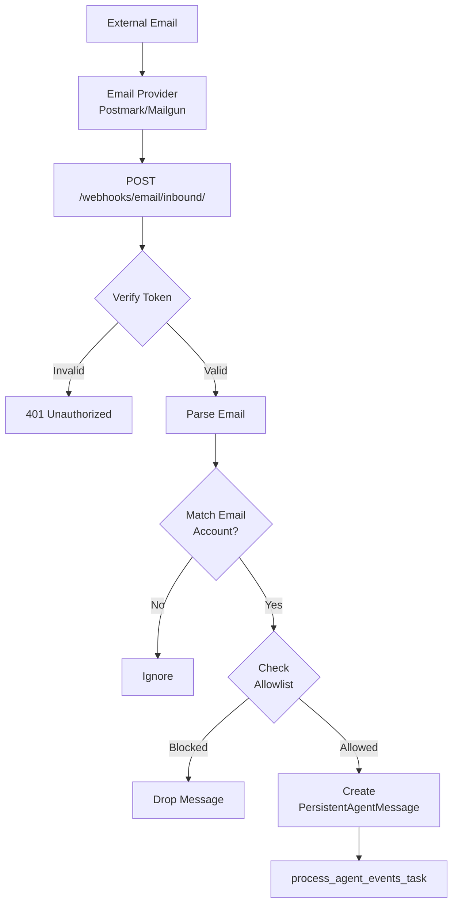

Sources: [config/settings.py:822-823]()

**Webhook Tokens:**
- `POSTMARK_INCOMING_WEBHOOK_TOKEN`: Token for Postmark inbound webhook auth
- `MAILGUN_INCOMING_WEBHOOK_TOKEN`: Token for Mailgun inbound webhook auth

### Outbound Email Sending

Agents send emails using the `send_email` tool exposed during agent event processing.

**Tool Execution Flow**

```mermaid
sequenceDiagram
    participant Loop as _run_agent_loop
    participant LLM
    participant Tool as execute_send_email
    participant Check as Allowlist Check
    participant Send as Email Sender
    participant DB
    
    Loop->>LLM: Completion with send_email tool
    LLM-->>Loop: Tool call: send_email(to, subject, body)
    Loop->>Tool: Execute tool
    Tool->>Check: Verify recipient in allowlist
    Check-->>Tool: Allowed
    Tool->>DB: Create PersistentAgentMessage (outbound)
    Tool->>Send: Send via SMTP/Provider
    Send-->>Tool: Delivery status
    Tool->>DB: Update message status
    Tool-->>Loop: Result: message_id
```

Sources: [api/agent/core/event_processing.py:63]()

**Tool Schema** (send_email):
- `to`: Email address (string, required)
- `subject`: Subject line (string, required)
- `body`: Message body (string, required)
- `cc`: CC recipients (array of strings, optional)
- `bcc`: BCC recipients (array of strings, optional)

**Delivery Status Tracking**

Messages track delivery through the `DeliveryStatus` enum:

| Status | Meaning |
|--------|---------|
| `QUEUED` | Created but not yet sent |
| `SENDING` | Transmission in progress |
| `SENT` | Successfully delivered to provider |
| `DELIVERED` | Provider confirmed delivery (webhooks) |
| `FAILED` | Delivery failed |

Sources: [api/models.py:112-117]()

---

## SMS System Architecture

### SMS Number Provisioning

The `SmsNumber` model represents a Twilio phone number provisioned for agent communication.

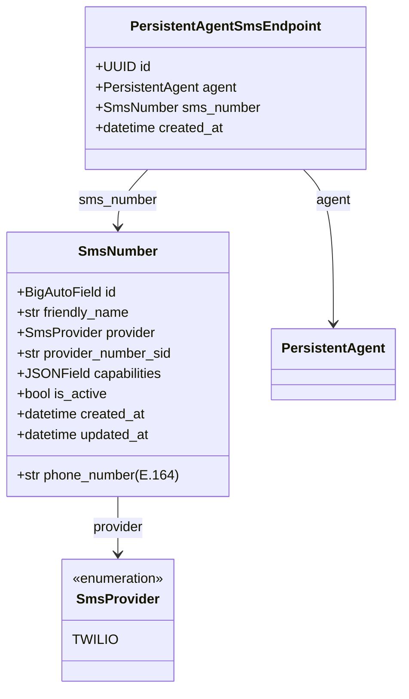

Sources: [api/models.py:2100-2200]()

**Key Fields:**
- **phone_number**: E.164 format (e.g., `+12025551234`)
- **provider_number_sid**: Twilio SID for the number
- **capabilities**: JSON field storing SMS/MMS/Voice flags
- **is_active**: Whether the number is currently available for use

**Number Sync Task**

The `sync_twilio_numbers` Celery Beat task periodically synchronizes available numbers from Twilio:

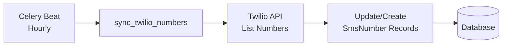

Sources: [config/settings.py:591-596](), [api/tasks/sms_tasks.py]()

**Configuration:**
- `TWILIO_ENABLED`: Feature flag (default: `False` in community mode)
- `TWILIO_ACCOUNT_SID`: Twilio account identifier
- `TWILIO_AUTH_TOKEN`: Twilio authentication token
- `TWILIO_MESSAGING_SERVICE_SID`: Messaging service for outbound SMS

Sources: [config/settings.py:837-849]()

### Inbound SMS Processing

Inbound SMS messages arrive via Twilio webhooks:

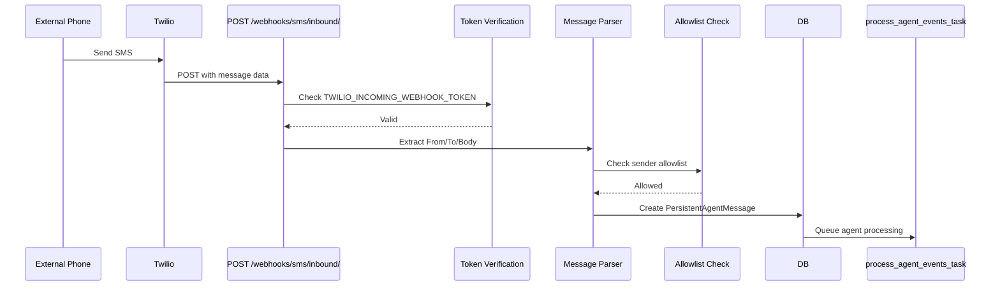

Sources: [config/settings.py:863]()

**Webhook Security:**
- `TWILIO_INCOMING_WEBHOOK_TOKEN`: Token appended to webhook URL for verification
- Webhook URL format: `/webhooks/sms/inbound/?token={TWILIO_INCOMING_WEBHOOK_TOKEN}`

**Message Parsing:**
- Body length limit: `SMS_MAX_BODY_LENGTH` (default: 1450 characters)
- Reply stripping: `EMAIL_STRIP_REPLIES` controls whether to strip quoted replies (default: `False`)

Sources: [config/settings.py:866-870]()

### Outbound SMS Sending

Agents send SMS messages using the `send_sms` tool.

**Tool Execution Flow**

```mermaid
sequenceDiagram
    participant Loop as _run_agent_loop
    participant LLM
    participant Tool as execute_send_sms
    participant Allow as Allowlist Check
    participant Twilio
    participant DB
    
    Loop->>LLM: Completion with send_sms tool
    LLM-->>Loop: Tool call: send_sms(to, body)
    Loop->>Tool: Execute tool
    Tool->>Allow: Verify recipient in allowlist
    Allow-->>Tool: Allowed
    Tool->>DB: Create PersistentAgentMessage
    Tool->>Twilio: Send via Messaging Service
    Twilio-->>Tool: Message SID
    Tool->>DB: Update with provider message ID
    Tool-->>Loop: Result: message_id
```

Sources: [api/agent/core/event_processing.py:64]()

**Tool Schema** (send_sms):
- `to`: Phone number in E.164 format (string, required)
- `body`: Message text (string, required, max length from config)

**Twilio Messaging Service**

Outbound SMS uses Twilio's Messaging Service for:
- Automatic number selection from available pool
- Delivery optimization and fallback
- Compliance with carrier regulations

Configuration: `TWILIO_MESSAGING_SERVICE_SID`

Sources: [config/settings.py:841]()

---

## Communication Endpoints

### Endpoint Hierarchy

Communication endpoints link agents to their email accounts or phone numbers:

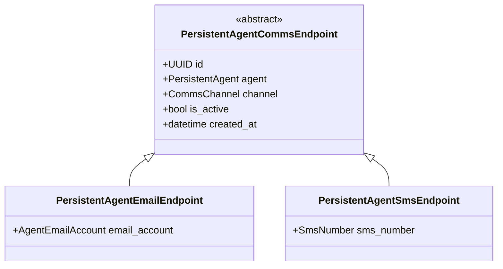

Sources: [api/models.py:2650-2750]()

**Channel Types** (CommsChannel enum):
- `EMAIL`: Email communication
- `SMS`: SMS messaging
- `WEB`: Web chat (see [Agent Web Chat](#7.1))
- `SLACK`: Slack integration (future)
- `DISCORD`: Discord integration (future)
- `OTHER`: Custom/unknown channels

Sources: [api/models.py:103-109]()

### Endpoint Lifecycle

**Creation:**
1. Agent provisioned with contact preferences
2. Email account or SMS number assigned
3. Endpoint record created linking agent to communication method
4. Allowlist entries populated with initial contacts

**Activation/Deactivation:**
- Endpoints have `is_active` flag controlling whether they process messages
- Deactivated endpoints ignore inbound messages and prevent outbound sends
- Useful for temporarily disabling communication without deletion

**Deletion:**
- Soft delete: Set `is_active=False`
- Hard delete: Remove endpoint record (orphans messages, not recommended)

Sources: [api/models.py:2650-2850]()

---

## Allowlist System

The allowlist controls which external contacts can send messages to agents and which contacts agents can message.

### CommsAllowlistEntry Model

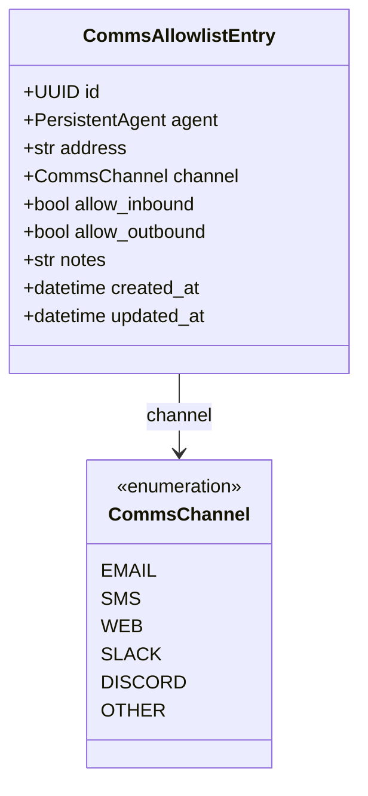

Sources: [api/models.py:3200-3300]()

**Key Fields:**
- **address**: Email address or phone number (E.164)
- **channel**: Communication channel type
- **allow_inbound**: Whether this contact can send messages to the agent
- **allow_outbound**: Whether the agent can send messages to this contact
- **notes**: Optional description of why contact is allowed

### Directional Permissions

Allowlist entries support **asymmetric permissions**, enabling fine-grained control:

| Configuration | Use Case |
|--------------|----------|
| `allow_inbound=True`<br/>`allow_outbound=True` | Full bidirectional communication |
| `allow_inbound=True`<br/>`allow_outbound=False` | Agent can receive but not initiate |
| `allow_inbound=False`<br/>`allow_outbound=True` | Agent can notify but user can't reply |
| `allow_inbound=False`<br/>`allow_outbound=False` | Blocked (entry can be kept for audit) |

**Example:** An agent monitoring customer support might have:
- Customers: `allow_inbound=True, allow_outbound=True` (bidirectional)
- Admin dashboard: `allow_inbound=False, allow_outbound=True` (notifications only)

### Allowlist Policies

Agents can operate under two allowlist policies:

**1. Default Policy** (implicit allow):
- Owner email/phone automatically allowed
- Organization member contacts automatically allowed
- No explicit `CommsAllowlistEntry` required

**2. Manual Policy** (explicit allow):
- Only addresses in `CommsAllowlistEntry` permitted
- Stricter security for sensitive use cases
- Must explicitly add each contact

Policy selection is configured per-agent during provisioning.

Sources: From high-level architecture diagrams in prompt

### Allowlist Enforcement

**Inbound Message Processing:**

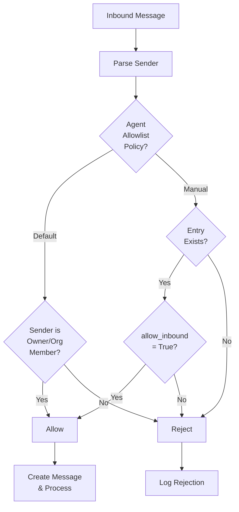

**Outbound Message Sending:**

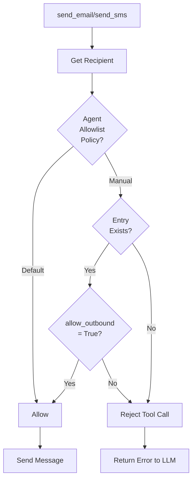

Sources: Inferred from allowlist system description in high-level diagrams

---

## Message Processing

### PersistentAgentMessage Model

All inbound and outbound messages are stored in `PersistentAgentMessage`:

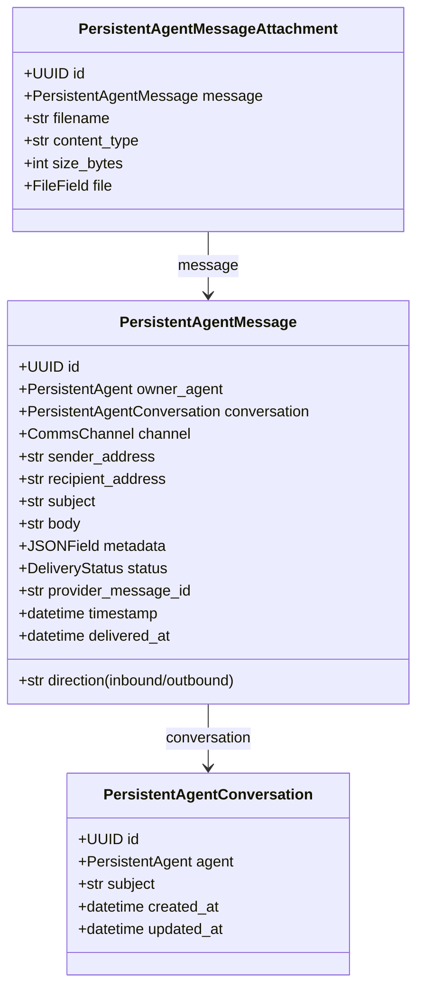

Sources: [api/models.py:2900-3100]()

**Key Fields:**
- **direction**: `"inbound"` or `"outbound"`
- **channel**: CommsChannel enum (EMAIL, SMS, etc.)
- **sender_address/recipient_address**: Email or phone in canonical format
- **subject**: Email subject (null for SMS)
- **body**: Message content
- **metadata**: Provider-specific data (headers, timestamps, etc.)
- **status**: DeliveryStatus tracking
- **provider_message_id**: Twilio SID or email message ID for tracking

### Conversation Threading

Messages are grouped into `PersistentAgentConversation` threads for context:

**Email Threading:**
- Messages with same subject (normalized) linked to conversation
- References/In-Reply-To headers used when available
- Fallback: sender address + time proximity

**SMS Threading:**
- Messages with same sender grouped into conversation
- Each phone number creates separate conversation thread

Sources: [api/agent/comms/message_service.py]() referenced in [console/views.py:103]()

### Message Compaction

To manage prompt token limits, message history is compacted:

1. **Recent Messages**: Last N messages kept verbatim
2. **Older Messages**: Summarized via `llm_summarise_comms()`
3. **Snapshots**: Compressed summaries stored in `PersistentAgentCommsSnapshot`

Configuration in event processing:
- `MESSAGE_HISTORY_LIMIT = 20`: Recent messages to keep

Sources: [api/agent/core/event_processing.py:48,108]()

---

## Agent Communication Tools

### send_email Tool

**Function:** `execute_send_email()` in [api/agent/tools/email_sender.py]()

**LLM Schema:**
```json
{
  "name": "send_email",
  "description": "Send an email message to a contact",
  "parameters": {
    "to": {"type": "string", "description": "Recipient email address"},
    "subject": {"type": "string", "description": "Email subject line"},
    "body": {"type": "string", "description": "Email body content"},
    "cc": {"type": "array", "items": {"type": "string"}, "description": "CC recipients (optional)"},
    "bcc": {"type": "array", "items": {"type": "string"}, "description": "BCC recipients (optional)"}
  }
}
```

**Tool Registration:**
- Registered in `get_send_email_tool()` 
- Exposed to LLM during `_run_agent_loop()`
- Credit cost: Configurable per-tool override or default task cost

**Execution Steps:**
1. Validate recipient against allowlist
2. Create outbound `PersistentAgentMessage`
3. Select email account (agent's `AgentEmailAccount`)
4. Send via SMTP or provider API
5. Update message delivery status
6. Return message ID to LLM

Sources: [api/agent/core/event_processing.py:63]()

### send_sms Tool

**Function:** `execute_send_sms()` in [api/agent/tools/sms_sender.py]()

**LLM Schema:**
```json
{
  "name": "send_sms",
  "description": "Send an SMS text message to a phone number",
  "parameters": {
    "to": {"type": "string", "description": "Recipient phone number (E.164 format)"},
    "body": {"type": "string", "description": "Message text (max length configured)"}
  }
}
```

**Tool Registration:**
- Registered in `get_send_sms_tool()`
- Exposed to LLM during `_run_agent_loop()`
- Credit cost: Configurable per-tool override or default task cost

**Execution Steps:**
1. Validate phone number format (E.164)
2. Check recipient against allowlist
3. Create outbound `PersistentAgentMessage`
4. Select SMS number (agent's `SmsNumber`)
5. Send via Twilio Messaging Service
6. Update message with Twilio SID
7. Return message ID to LLM

Sources: [api/agent/core/event_processing.py:64]()

---

## Configuration Reference

### Email Provider Settings

| Variable | Purpose | Default |
|----------|---------|---------|
| `MAILGUN_ENABLED` | Enable Mailgun provider | `False` (community), depends on API key (proprietary) |
| `MAILGUN_API_KEY` | Mailgun API key | `""` |
| `MAILGUN_SENDER_DOMAIN` | Mailgun verified domain | From proprietary defaults |
| `MAILGUN_INCOMING_WEBHOOK_TOKEN` | Inbound webhook auth token | `"dummy-mailgun-incoming-token"` |
| `POSTMARK_ENABLED` | Enable Postmark provider | `False` (community), depends on token (proprietary) |
| `POSTMARK_SERVER_TOKEN` | Postmark server token | `""` |
| `POSTMARK_INCOMING_WEBHOOK_TOKEN` | Inbound webhook auth token | `"dummy-postmark-incoming-token"` |
| `SIMULATE_EMAIL_DELIVERY` | Skip actual email sending (dev) | `True` (non-prod), `False` (prod) |

Sources: [config/settings.py:451-456,691-708,822-823,829-834]()

### IMAP/SMTP Settings

Configured per `AgentEmailAccount`, not global environment variables:
- **IMAP Server/Port/SSL**: Agent-specific connection details
- **SMTP Server/Port/Encryption**: Agent-specific sending configuration
- **Password**: Encrypted with `GOBII_ENCRYPTION_KEY`

### IMAP IDLE Watcher Settings

| Variable | Purpose | Default |
|----------|---------|---------|
| `IMAP_IDLE_ENABLED` | Enable IDLE watcher | `False` |
| `IMAP_IDLE_MAX_CONNECTIONS` | Max watchers per runner | 200 |
| `IMAP_IDLE_SCAN_INTERVAL_SEC` | Account rescan interval | 30 |
| `IMAP_IDLE_REISSUE_SEC` | Re-issue IDLE interval | 1500 |
| `IMAP_IDLE_DEBOUNCE_SEC` | Debounce duplicate polls | 10 |
| `IMAP_IDLE_LEASE_TTL_SEC` | Cross-runner lease TTL | 60 |

Sources: [config/settings.py:808-820]()

### SMS/Twilio Settings

| Variable | Purpose | Default |
|----------|---------|---------|
| `TWILIO_ENABLED` | Enable Twilio SMS | `False` |
| `TWILIO_ACCOUNT_SID` | Twilio account ID | `""` |
| `TWILIO_AUTH_TOKEN` | Twilio auth token | `""` |
| `TWILIO_MESSAGING_SERVICE_SID` | Messaging service for sends | `""` |
| `TWILIO_VERIFY_SERVICE_SID` | Verify service for phone verification | `""` |
| `TWILIO_INCOMING_WEBHOOK_TOKEN` | Inbound webhook auth token | `"dummy-twilio-incoming-webhook-token"` |
| `SMS_MAX_BODY_LENGTH` | Max SMS body length | 1450 |

Sources: [config/settings.py:837-866]()

### Email Parsing Settings

| Variable | Purpose | Default |
|----------|---------|---------|
| `EMAIL_STRIP_REPLIES` | Strip quoted replies from email body | `False` |

Sources: [config/settings.py:870]()

---

## Admin Interface

### AgentEmailAccount Admin

**Location:** Django admin at `/admin/api/agentemailaccount/`

**Features:**
- Create/edit email accounts with IMAP/SMTP settings
- Test email sending via admin action
- View last check timestamp for IMAP polling
- Activate/deactivate accounts
- Password fields use custom widget for encryption

**Form:** `AgentEmailAccountForm` in [api/admin.py:13]()

Sources: [api/admin.py:1950-2050]()

### SMS Number Admin

**Location:** Django admin at `/admin/api/smsnumber/`

**Features:**
- View provisioned Twilio numbers
- Sync numbers from Twilio (admin action)
- Test SMS sending (admin action via `send_test_sms`)
- View number capabilities (SMS/MMS/Voice)
- Activate/deactivate numbers

**Test SMS Form:** `TestSmsForm` in [api/admin.py:13]()

Sources: [api/admin.py:1850-1950]()

### CommsAllowlistEntry Admin

**Location:** Django admin at `/admin/api/commsallowlistentry/`

**Features:**
- Add/edit allowlist entries
- Filter by agent, channel, inbound/outbound permissions
- Search by address
- Bulk enable/disable entries
- Notes field for documentation

Sources: [api/admin.py:3100-3200]()

---

## Integration Examples

### Email Account Setup Flow

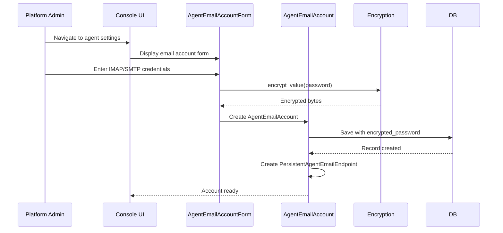

**Console View:** Agent email configuration at `/console/agents/{id}/contacts/`

Sources: [console/views.py:106](), [api/models.py:2400-2600]()

### SMS Number Provisioning Flow

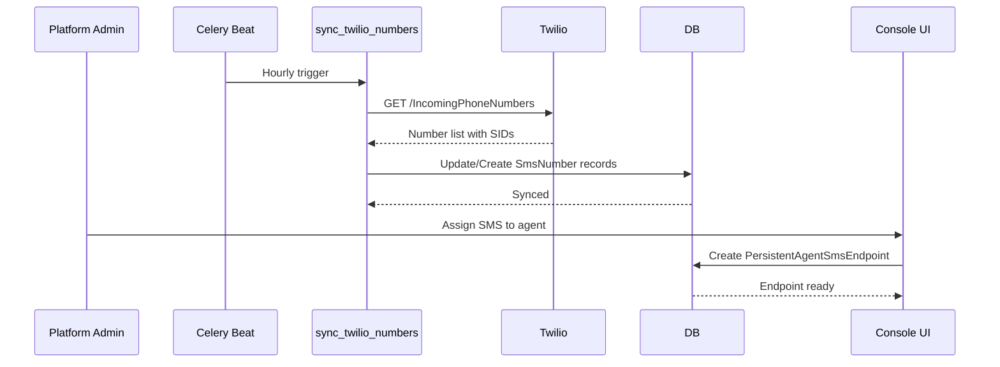

Sources: [config/settings.py:591-596](), [api/models.py:2100-2300]()

### Message Webhook Processing Flow

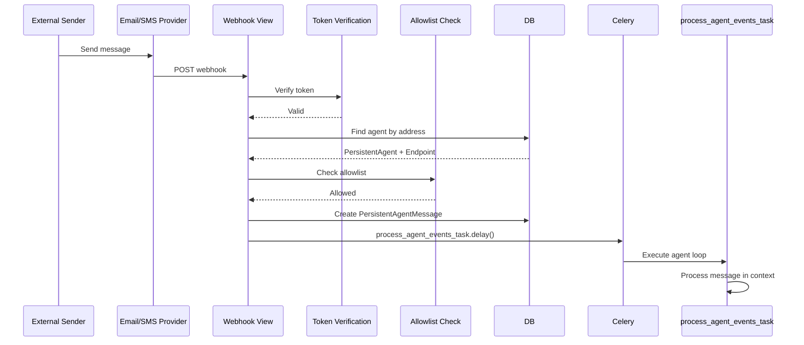

Sources: High-level architecture diagram and inferred webhook flow

---

## Security Considerations

### Credential Storage

- **Email Passwords**: Encrypted with `GOBII_ENCRYPTION_KEY` using `encrypt_value()`/`decrypt_value()` from `util.encryption`
- **Provider Tokens**: Stored in `provider_config` JSON field, also encrypted
- **Webhook Tokens**: Environment variables, not stored in database

**Key Rotation:** Changing `GOBII_ENCRYPTION_KEY` requires re-encrypting all stored credentials.

Sources: [api/models.py:2400-2600]()

### Webhook Authentication

All inbound webhooks require token verification:
- Email: `POSTMARK_INCOMING_WEBHOOK_TOKEN` or `MAILGUN_INCOMING_WEBHOOK_TOKEN`
- SMS: `TWILIO_INCOMING_WEBHOOK_TOKEN`

Tokens appended as query parameters or headers depending on provider.

Sources: [config/settings.py:822-823,863]()

### Allowlist Enforcement

- **Default Policy:** Implicit allow for owner/org members (configurable)
- **Manual Policy:** Explicit allow required (stricter)
- **Directional Permissions:** Separate inbound/outbound controls
- **Rejection Logging:** Blocked messages logged but not processed

Sources: Inferred from allowlist system architecture

### Rate Limiting

Currently not enforced at the email/SMS layer. Plan-level rate limits apply to overall agent task execution but not per-channel message sending.

**Future Consideration:** Per-channel rate limits to prevent abuse.

---

## Troubleshooting

### Email Not Sending

**Symptoms:** Outbound emails created but status stuck in `QUEUED` or `SENDING`

**Checks:**
1. Verify `SIMULATE_EMAIL_DELIVERY=False` in production
2. Check SMTP credentials in `AgentEmailAccount`
3. Review SMTP server logs for connection errors
4. Confirm recipient in allowlist (`allow_outbound=True`)
5. Check `AgentEmailAccount.is_active=True`

### Email Not Received

**Symptoms:** External emails sent but agent not processing

**Checks:**
1. Verify IMAP credentials if using IDLE watcher
2. Check `IMAP_IDLE_ENABLED=True` if relying on IDLE
3. Confirm webhook URL configured in provider (Postmark/Mailgun)
4. Verify webhook token matches environment variable
5. Check sender in allowlist (`allow_inbound=True`)
6. Review `AgentEmailAccount.last_check_at` timestamp

### SMS Not Sending

**Symptoms:** Outbound SMS created but not delivered

**Checks:**
1. Verify `TWILIO_ENABLED=True`
2. Confirm `TWILIO_MESSAGING_SERVICE_SID` configured
3. Check recipient phone in E.164 format
4. Verify recipient in allowlist (`allow_outbound=True`)
5. Review Twilio console for delivery failures
6. Confirm `SmsNumber.is_active=True`

### SMS Not Received

**Symptoms:** External SMS sent but agent not processing

**Checks:**
1. Verify webhook URL configured in Twilio console
2. Check `TWILIO_INCOMING_WEBHOOK_TOKEN` matches webhook URL
3. Confirm sender in allowlist (`allow_inbound=True`)
4. Review Twilio webhook logs for errors
5. Check `PersistentAgentSmsEndpoint` exists and is active

Sources: General troubleshooting patterns inferred from architecture

---

## Related Systems

- **Agent Web Chat** ([#7.1](#7.1)): Real-time browser-based messaging
- **Peer Messaging** ([#7.3](#7.3)): Agent-to-agent direct communication
- **Agent Event Processing** ([#4.3](#4.3)): Core loop that processes inbound messages
- **Communication Systems** ([#7](#7)): Parent section covering all communication channels

---

