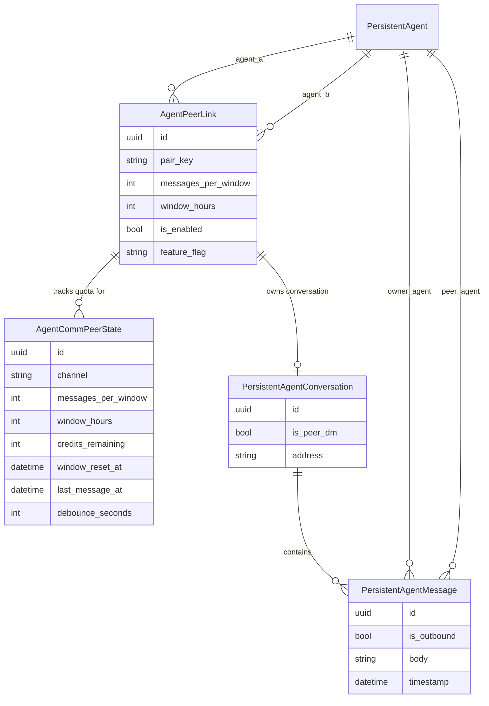
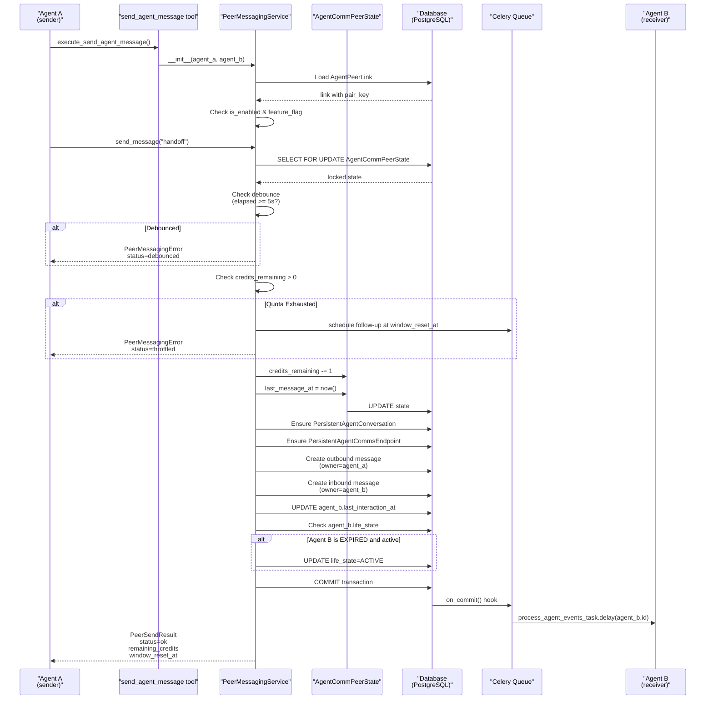
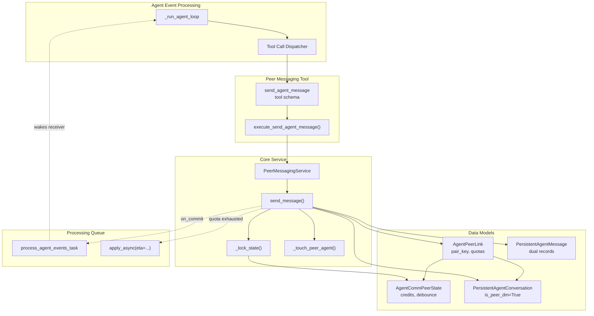

<!-- source: DeepWiki mcp.deepwiki.com · repo gobii-ai/gobii-platform · page 7.3 Peer Messaging · fetched 2026-10-26 -->

# Peer Messaging

<details>
<summary>Relevant source files</summary>

The following files were used as context for generating this wiki page:

- [.github/workflows/ci.yml](.github/workflows/ci.yml)
- [api/agent/peer_comm.py](api/agent/peer_comm.py)
- [api/agent/peer_link_signals.py](api/agent/peer_link_signals.py)
- [api/agent/tools/peer_dm.py](api/agent/tools/peer_dm.py)
- [api/apps.py](api/apps.py)
- [api/migrations/0151_agentcommpeerstate_agentpeerlink_and_more.py](api/migrations/0151_agentcommpeerstate_agentpeerlink_and_more.py)
- [tests/unit/test_agent_short_description.py](tests/unit/test_agent_short_description.py)
- [tests/unit/test_peer_agent_messaging.py](tests/unit/test_peer_agent_messaging.py)

</details>


## Purpose and Scope

This document describes the **Peer Messaging** subsystem, which enables direct agent-to-agent communication within the gobii-platform. This system allows `PersistentAgent` instances to send messages to each other through a quota-enforced, debounced messaging channel.

For web-based user-to-agent chat, see [Agent Web Chat](#7.1). For external communication via email and SMS, see [Email & SMS](#7.2).

**Sources:** [api/agent/peer_comm.py:1-329]()

---

## Overview

The Peer Messaging system provides a structured communication channel for agents to coordinate tasks without external communication overhead. Unlike email or SMS channels, peer messaging operates entirely within the platform's internal data model and enforces strict quotas to prevent message loops and runaway costs.

Key characteristics:
- **Bidirectional Links**: Two agents are connected via an `AgentPeerLink` with symmetric quota policies
- **Quota Enforcement**: Rate limiting via rolling windows (e.g., 30 messages per 6 hours)
- **Debouncing**: 5-second minimum interval between messages to prevent rapid loops
- **Automatic Wake-up**: Receiving agents are automatically triggered for event processing
- **Lifecycle Integration**: Messages can wake `EXPIRED` agents if they remain active

**Sources:** [api/agent/peer_comm.py:50-102](), [tests/unit/test_peer_agent_messaging.py:1-235]()

---

## Core Data Models

The peer messaging system uses three primary models to manage links, state, and message records.

### Model Relationship Diagram



**Sources:** [api/migrations/0151_agentcommpeerstate_agentpeerlink_and_more.py:1-120]()

### AgentPeerLink

The `AgentPeerLink` model establishes a bidirectional relationship between two agents. It uses a deterministic `pair_key` constructed from sorted agent IDs to ensure uniqueness regardless of creation order.

| Field | Type | Description |
|-------|------|-------------|
| `agent_a` | ForeignKey | First agent in the sorted pair |
| `agent_b` | ForeignKey | Second agent in the sorted pair |
| `pair_key` | CharField(96) | Unique key: `{sorted_ids[0]},{sorted_ids[1]}` |
| `messages_per_window` | PositiveInteger | Quota limit (1-500, default 30) |
| `window_hours` | PositiveInteger | Rolling window duration (1-168, default 6) |
| `is_enabled` | Boolean | Global enable/disable toggle |
| `feature_flag` | CharField(64) | Optional Waffle flag name |
| `conversation` | OneToOne | Associated `PersistentAgentConversation` |

**Sources:** [api/migrations/0151_agentcommpeerstate_agentpeerlink_and_more.py:34-45](), [api/agent/peer_comm.py:60-102]()

### AgentCommPeerState

Tracks quota consumption and enforces rate limits for a specific `AgentPeerLink`. One state record exists per link per channel (peer messaging uses `CommsChannel.OTHER`).

| Field | Type | Description |
|-------|------|-------------|
| `link` | ForeignKey | Associated `AgentPeerLink` |
| `channel` | CharField | Channel type (always `OTHER` for peer DMs) |
| `credits_remaining` | PositiveInteger | Messages left in current window |
| `window_reset_at` | DateTimeField | When quota resets |
| `last_message_at` | DateTimeField | Timestamp of last send (for debouncing) |
| `debounce_seconds` | PositiveInteger | Minimum interval between sends (default 5) |

The state is locked via `select_for_update()` during message sends to prevent race conditions.

**Sources:** [api/migrations/0151_agentcommpeerstate_agentpeerlink_and_more.py:18-32](), [api/agent/peer_comm.py:214-251]()

### PersistentAgentMessage Extensions

Peer messages extend the existing `PersistentAgentMessage` model with two fields:

- `peer_agent`: ForeignKey to the other agent in the conversation
- New index: `pa_msg_peer_agent_idx` on `(peer_agent, -timestamp)`

Each peer DM creates **two** message records:
1. **Outbound** record owned by the sending agent (with `is_outbound=True`)
2. **Inbound** record owned by the receiving agent (with `is_outbound=False`)

Both messages link to the same `PersistentAgentConversation` (where `is_peer_dm=True`).

**Sources:** [api/migrations/0151_agentcommpeerstate_agentpeerlink_and_more.py:52-59](), [api/agent/peer_comm.py:169-189]()

---

## Message Flow

### Sequence Diagram: Sending a Peer Message



**Sources:** [api/agent/peer_comm.py:103-213](), [api/agent/tools/peer_dm.py:42-110]()

### PeerMessagingService._lock_state() Logic

The `_lock_state()` method acquires an exclusive lock on the `AgentCommPeerState` record and performs several normalization steps:

1. **Get or Create**: Acquires state with `select_for_update().get_or_create()`
2. **Sync Quota Config**: Copies `messages_per_window` and `window_hours` from the link if changed
3. **Reset Window**: If `window_reset_at <= now`, resets `credits_remaining` and advances `window_reset_at`
4. **Cap Credits**: If `credits_remaining > messages_per_window`, clamps to the max
5. **Debounce Default**: Ensures `debounce_seconds >= 5`

This ensures quota configuration changes on the link are reflected in the state before consumption.

**Sources:** [api/agent/peer_comm.py:214-251]()

---

## Quota and Rate Limiting

### Rolling Window Quota

The quota system uses a **rolling window** approach:
- Each link defines `messages_per_window` (e.g., 30) and `window_hours` (e.g., 6)
- When the window expires (`window_reset_at <= now`), credits fully replenish
- Credits decrement with each send; sends fail when `credits_remaining == 0`

### Debouncing

To prevent rapid message loops, the system enforces a **minimum 5-second interval** between consecutive sends:

```python
if state.last_message_at is not None:
    elapsed = (now - state.last_message_at).total_seconds()
    if elapsed < state.debounce_seconds:
        retry_at = state.last_message_at + timedelta(seconds=state.debounce_seconds)
        raise PeerMessagingError(
            "Peer messaging suppressed to avoid a rapid loop.",
            status="debounced",
            retry_at=retry_at,
        )
```

This prevents agents from immediately replying to each other in tight loops.

**Sources:** [api/agent/peer_comm.py:115-129]()

### Quota Exhaustion Handling

When quota is exhausted (`credits_remaining <= 0`), the service:
1. Raises `PeerMessagingError` with `status="throttled"`
2. Schedules a follow-up task at `window_reset_at` via `apply_async(eta=...)`
3. Returns `retry_at` in the exception so the tool can inform the LLM

The scheduled follow-up ensures the sending agent resumes processing when quota replenishes.

**Sources:** [api/agent/peer_comm.py:131-143](), [api/agent/peer_comm.py:314-328]()

### Quota Configuration Table

| Parameter | Min | Max | Default | Purpose |
|-----------|-----|-----|---------|---------|
| `messages_per_window` | 1 | 500 | 30 | Maximum messages per window |
| `window_hours` | 1 | 168 | 6 | Window duration (168h = 1 week) |
| `debounce_seconds` | 5 | N/A | 5 | Minimum send interval |

**Sources:** [api/migrations/0151_agentcommpeerstate_agentpeerlink_and_more.py:23-24]()

---

## Tool Integration

### send_agent_message Tool Schema

Agents discover peer messaging via the `send_agent_message` tool, which is exposed to the LLM with this schema:

```json
{
  "type": "function",
  "function": {
    "name": "send_agent_message",
    "description": "Send a concise direct message to another agent that shares a peer link with you. Use this to coordinate tasks with partner agents. Keep messages focused and avoid loops.",
    "parameters": {
      "type": "object",
      "properties": {
        "peer_agent_id": {
          "type": "string",
          "description": "UUID of the linked agent you want to contact."
        },
        "message": {
          "type": "string",
          "description": "The body of the message to send. Keep it brief and actionable."
        }
      },
      "required": ["peer_agent_id", "message"]
    }
  }
}
```

**Sources:** [api/agent/tools/peer_dm.py:14-39]()

### execute_send_agent_message() Function

The tool executor validates parameters, constructs a `PeerMessagingService`, and calls `send_message()`:

**Input Validation:**
- Ensures `peer_agent_id` and `message` are provided
- Parses `peer_agent_id` as UUID (raises error if invalid)
- Prevents self-messaging (`peer_agent_uuid == agent.id`)
- Verifies target agent exists in database

**Success Response:**
```python
{
    "status": "ok",
    "message": "Peer message delivered.",
    "remaining_credits": 29,
    "window_reset_at_iso": "2025-01-15T12:00:00Z",
    "auto_sleep_ok": True
}
```

The `auto_sleep_ok` flag signals the event processor that the agent can safely sleep after sending a handoff message.

**Error Responses:**
- `status="error"`: Invalid parameters, missing link, or unexpected failure
- `status="debounced"`: Message sent too soon (includes `retry_at_iso`)
- `status="throttled"`: Quota exhausted (includes `retry_at_iso`)
- `status="disabled"`: Link disabled or feature flag inactive

**Sources:** [api/agent/tools/peer_dm.py:42-110]()

---

## Lifecycle Integration

### Waking Expired Agents

When a peer message arrives, the `PeerMessagingService._touch_peer_agent()` method performs lifecycle checks on the receiving agent:

```python
def _touch_peer_agent(self, now) -> None:
    locked = PersistentAgent.objects.select_for_update().get(id=self.peer_agent.id)
    
    updates = ["last_interaction_at"]
    locked.last_interaction_at = now
    
    if (locked.life_state == PersistentAgent.LifeState.EXPIRED
        and locked.is_active):
        if locked.schedule_snapshot:
            locked.schedule = locked.schedule_snapshot
            updates.append("schedule")
        locked.life_state = PersistentAgent.LifeState.ACTIVE
        updates.append("life_state")
    
    locked.save(update_fields=updates)
```

This means **peer messages can revive expired agents** if they remain active, restoring their schedule and transitioning them back to `ACTIVE` state.

**Sources:** [api/agent/peer_comm.py:285-306]()

### Automatic Event Processing

After creating the inbound message, the service triggers processing on the receiver:

```python
transaction.on_commit(
    lambda: self._enqueue_processing(self.peer_agent.id)
)
```

This queues `process_agent_events_task.delay(agent_b.id)`, ensuring the receiving agent processes the new message immediately after transaction commit.

**Sources:** [api/agent/peer_comm.py:195-197](), [api/agent/peer_comm.py:308-312]()

---

## Conversation Threading

### PersistentAgentConversation for Peer DMs

Each `AgentPeerLink` has an associated `PersistentAgentConversation` with these properties:
- `is_peer_dm=True` to distinguish from external channels
- `peer_link` references back to the `AgentPeerLink`
- `channel=CommsChannel.OTHER`
- `address` format: `peer://{pair_key}`
- `display_name` format: `"{agent_a.name} <-> {agent_b.name}"`

The conversation is lazily created on first message send via `_ensure_conversation()`.

**Sources:** [api/agent/peer_comm.py:253-270]()

### PersistentAgentCommsEndpoint

Each agent in a peer link gets a synthetic endpoint with:
- `channel=CommsChannel.OTHER`
- `address=f"peer://agent/{agent.id}"`
- `is_primary=False`

This endpoint is used as the `from_endpoint` on both outbound and inbound message records.

**Sources:** [api/agent/peer_comm.py:272-283]()

---

## Error Handling

### PeerMessagingError Exception

Custom exception class with three attributes:

| Attribute | Type | Description |
|-----------|------|-------------|
| `message` | str | Human-readable error description |
| `status` | str | Machine-readable status code |
| `retry_at` | datetime | Optional timestamp when retry is allowed |

**Sources:** [api/agent/peer_comm.py:30-36]()

### Status Codes

| Status | Trigger Condition | Retry Behavior |
|--------|------------------|----------------|
| `ok` | Message sent successfully | N/A |
| `error` | Validation failure, missing link, self-send | Manual correction needed |
| `disabled` | `is_enabled=False` or feature flag inactive | Admin must enable link |
| `debounced` | Message sent within `debounce_seconds` | Automatic retry after `retry_at` |
| `throttled` | `credits_remaining == 0` | Automatic retry at `window_reset_at` |

**Sources:** [api/agent/tools/peer_dm.py:84-91](), [api/agent/peer_comm.py:71-99]()

---

## Signal Handlers

### AgentPeerLink Post-Save Signal

The `handle_peer_link_created` signal receiver was originally designed to send introduction messages when links were created but is currently disabled:

```python
@receiver(post_save, sender=AgentPeerLink)
def handle_peer_link_created(sender, instance, created, raw, **kwargs):
    if raw or not created:
        return
    
    # Intro automation disabled
    logger.info(
        "Peer link %s connects agent %s with agent %s; intro automation disabled.",
        instance.id,
        agent_a.id,
        agent_b.id,
    )
```

The signal is registered in `api/apps.py:ready()` but performs no actions, allowing future extension for automated introductions.

**Sources:** [api/agent/peer_link_signals.py:1-35](), [api/apps.py:25-30]()

---

## Testing Strategy

### Test Batches

Peer messaging tests are split across two CI batches:

| Batch | Tag | Tests |
|-------|-----|-------|
| `peer_dm` | `batch_peer_dm` | Core `PeerMessagingService` functionality |
| `peer_intro` | `batch_peer_intro` | Signal handler behavior (intro automation) |

**Sources:** [.github/workflows/ci.yml:147-150]()

### Key Test Cases

**PeerMessagingServiceTests** (`batch_peer_dm`):
- `test_send_message_creates_records_and_triggers_processing`: Verifies dual message creation and Celery task triggering
- `test_debounce_prevents_rapid_repeat`: Confirms 5-second debounce enforcement
- `test_throttle_when_quota_exhausted`: Tests quota exhaustion and follow-up scheduling
- `test_execute_tool_handles_errors`: Validates error responses for invalid inputs
- `test_execute_tool_success_sets_auto_sleep_flag`: Checks `auto_sleep_ok` flag behavior

**AgentPeerLinkSignalTests** (`batch_peer_intro`):
- `test_peer_link_creation_skips_intro_steps_and_processing`: Confirms signal fires but doesn't create steps

**Sources:** [tests/unit/test_peer_agent_messaging.py:20-235]()

---

## Configuration and Setup

### Creating a Peer Link

Peer links are created via Django ORM:

```python
link = AgentPeerLink.objects.create(
    agent_a=agent_alpha,
    agent_b=agent_beta,
    messages_per_window=30,
    window_hours=6,
    created_by=user,
    is_enabled=True,
)
```

The `pair_key` is automatically generated using `AgentPeerLink.build_pair_key(agent_a.id, agent_b.id)`.

**Sources:** [tests/unit/test_peer_agent_messaging.py:58-64]()

### Feature Flags

Optional rollout control via Waffle:

```python
link = AgentPeerLink.objects.create(
    agent_a=agent_alpha,
    agent_b=agent_beta,
    feature_flag="peer_messaging_v2",
    ...
)
```

The service checks `flag_is_active(None, link.feature_flag)` before allowing sends.

**Sources:** [api/agent/peer_comm.py:82-99]()

### Disabling a Link

Set `is_enabled=False` to prevent all peer messaging on a link:

```python
link.is_enabled = False
link.save()
```

Attempts to send will raise `PeerMessagingError` with `status="disabled"`.

**Sources:** [api/agent/peer_comm.py:76-80]()

---

## Architecture Summary Diagram



**Sources:** [api/agent/peer_comm.py:1-329](), [api/agent/tools/peer_dm.py:1-111](), [api/models.py (implied)]()

---

