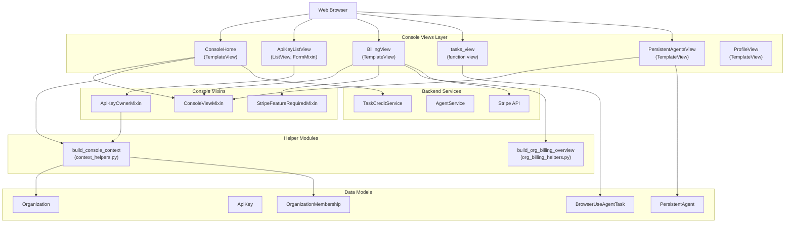
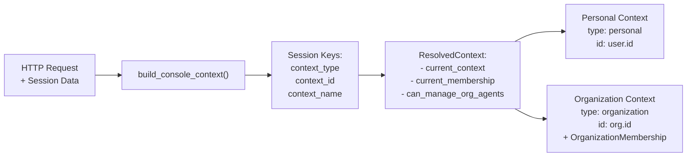
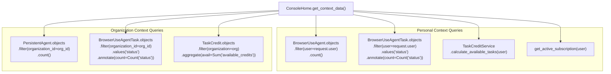
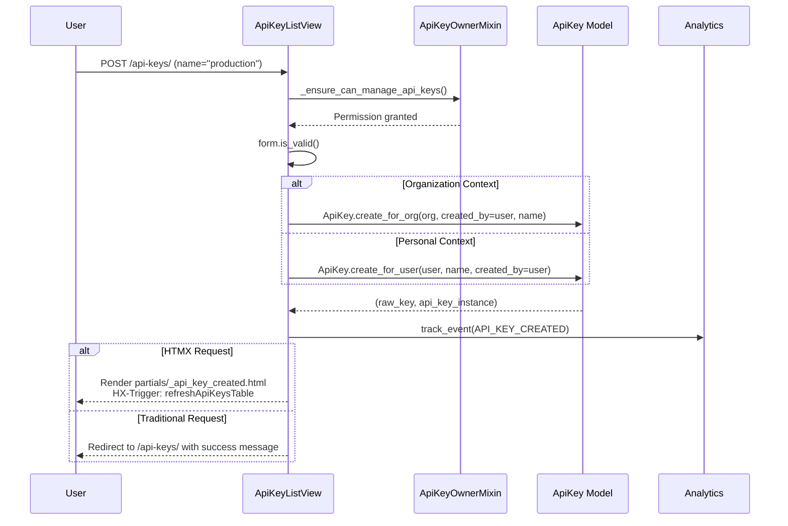
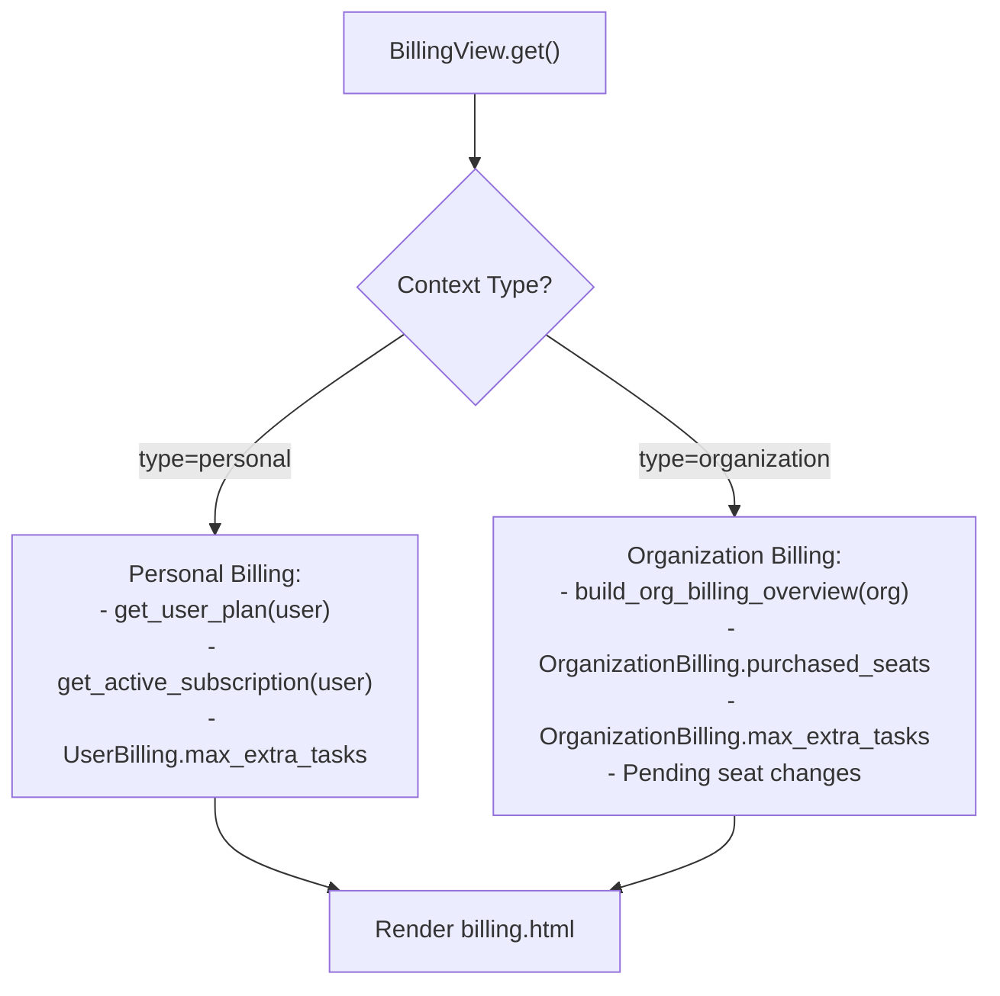
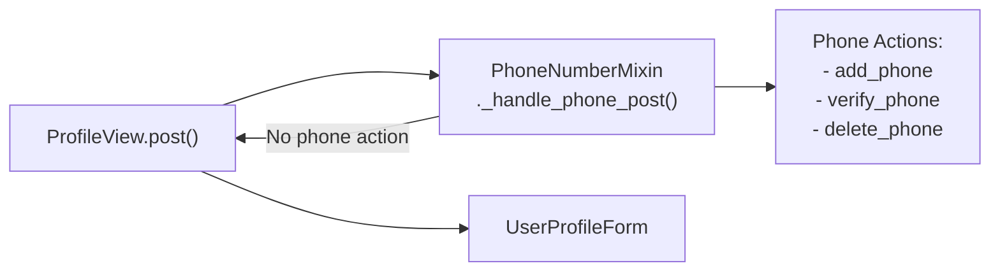
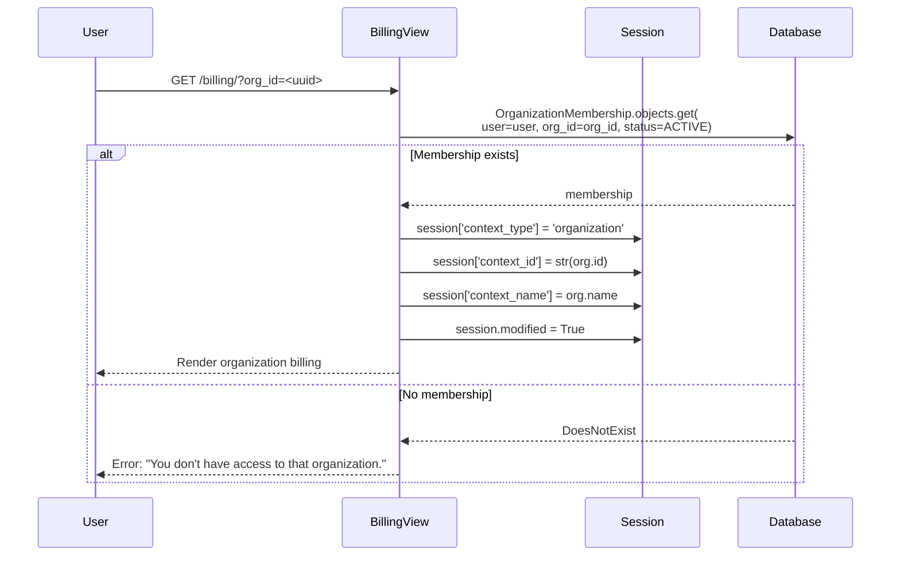

<!-- source: DeepWiki mcp.deepwiki.com · repo gobii-ai/gobii-platform · page 8.1 Console Interface · fetched 2026-10-26 -->

# Console Interface

<details>
<summary>Relevant source files</summary>

The following files were used as context for generating this wiki page:

- [api/agent/core/event_processing.py](api/agent/core/event_processing.py)
- [api/models.py](api/models.py)
- [console/views.py](console/views.py)

</details>


The Console Interface provides the primary web-based management dashboard for users and organizations to manage agents, API keys, billing, and tasks. It implements Django class-based views that render server-side templates, supplemented by HTMX for interactive components and WebSocket connections for real-time updates.

For REST API endpoints and programmatic access, see [REST API](#9.1). For the agent chat user interface, see [Agent Chat Interface](#8.3). For the public-facing homepage and template directory, see [Homepage & AI Employee Directory](#8.2).

---

## Architecture Overview

The console is implemented as a collection of Django views in [console/views.py](). These views handle authentication, context resolution (personal vs organization), credit enforcement, and integration with Stripe for billing operations. The views leverage mixins for common behaviors:

- **ConsoleViewMixin**: Provides context resolution and organization switching
- **StripeFeatureRequiredMixin**: Guards billing features behind Stripe availability
- **ApiKeyOwnerMixin**: Resolves API key ownership (user vs organization)
- **PhoneNumberMixin**: Handles phone verification workflows



**Sources:** [console/views.py:1-2800](), [console/mixins.py](), [console/context_helpers.py](), [console/org_billing_helpers.py]()

---

## Console Context Resolution

The console operates in two modes: **personal context** (user-owned resources) or **organization context** (organization-owned resources). The `build_console_context()` function resolves the active context from session data and enforces membership permissions.



The resolved context determines:
- Which agents/tasks are visible
- Which API keys are accessible
- Billing information displayed
- Permission levels for administrative actions

**Sources:** [console/context_helpers.py](), [console/views.py:154-195]()

---

## ConsoleHome Dashboard

The `ConsoleHome` view ([console/views.py:351-577]()) provides the main landing page after login. It aggregates:

| Metric | Personal Context | Organization Context |
|--------|------------------|----------------------|
| **Agent Count** | `BrowserUseAgent.objects.filter(user=user)` | `PersistentAgent.objects.filter(organization_id=org_id)` |
| **Task Stats** | User's `BrowserUseAgentTask` by status | Org's tasks via `organization_id` or agent ownership |
| **Credits Available** | `TaskCreditService.calculate_available_tasks(user)` | Org credits via `TaskCredit.objects.filter(organization=org)` |
| **Subscription** | User's `UserBilling` record | Org's `OrganizationBilling` record |
| **API Keys** | Oldest non-revoked personal key | Hidden (org keys managed separately) |

### Dashboard Metrics Query



**Task Status Breakdown:** The dashboard displays task counts grouped by status:
- `completed`: Successfully finished tasks
- `in_progress`: Currently executing
- `pending`: Queued for execution
- `failed`: Encountered errors
- `cancelled`: User-cancelled tasks

**Sources:** [console/views.py:351-577](), [tasks/services.py:TaskCreditService.calculate_available_tasks]()

---

## API Key Management

API keys are managed through a set of views that support both personal and organization-owned keys. The `ApiKeyOwnerMixin` ([console/views.py:149-182]()) resolves ownership context and enforces role-based permissions.

### API Key Views

| View Class | HTTP Methods | Purpose |
|------------|--------------|---------|
| `ApiKeyListView` | GET, POST | List all keys + create new keys |
| `ApiKeyDetailView` | GET, PATCH, DELETE | Refresh row, revoke key, delete key |
| `ApiKeyTableView` | GET | HTMX partial for table body refresh |
| `ApiKeyBlankFormView` | GET | HTMX partial for blank form |
| `ApiKeyCreateModalView` | GET | HTMX partial for modal dialog |

### Role-Based Permissions

For **organization-owned API keys**, permissions are role-scoped:

```python
API_KEY_MANAGE_ROLES = {
    OrganizationMembership.OrgRole.OWNER,
    OrganizationMembership.OrgRole.ADMIN,
}

API_KEY_VIEW_ROLES = API_KEY_MANAGE_ROLES | {
    OrganizationMembership.OrgRole.BILLING,
}
```

Members with BILLING role can view keys but cannot create/revoke/delete.

### API Key Creation Flow



**Key Validation:** The `ApiKey.clean()` method ([api/models.py:213-257]()) enforces:
- Maximum 50 keys per user
- Maximum 50 keys per organization
- Unique name per owner
- Exactly one owner (user XOR organization)

**Sources:** [console/views.py:583-906](), [api/models.py:122-276]()

---

## Billing & Subscription Management

The `BillingView` ([console/views.py:918-1089]()) provides a unified interface for personal and organization billing, with context-specific rendering.

### Personal Billing

For personal context, displays:
- Subscription plan (Free, Startup, etc.)
- Current billing period (start/end dates)
- Cancellation status (`cancel_at`, `cancel_at_period_end`)
- Extra task limits and usage
- Stripe portal redirect for plan changes

### Organization Billing

For organization context, displays:
- Purchased seats and seat utilization
- Per-seat credit allocation
- Extra task auto-purchase settings
- Pending seat changes (scheduled via Stripe Subscription Schedules)
- Overage SKU management



### Organization Seat Management

Organizations must purchase seats to accommodate members beyond the founder. The system enforces:

**Seat Requirement Calculation:**
```python
founder_allowance = 1
active_members = OrganizationMembership.objects.filter(
    org_id=org_id, 
    status=ACTIVE
).count()
pending_invites = OrganizationInvite.objects.filter(
    org_id=org_id,
    accepted_at__isnull=True,
    revoked_at__isnull=True,
    expires_at__gte=now
).count()

seats_required = max(active_members - founder_allowance, 0) + pending_invites
```

**Seat Purchase Flow:**
1. Admin initiates seat purchase via `OrganizationSeatPurchaseForm`
2. If overage SKU exists, it's temporarily detached and stored in session
3. Stripe checkout session created for seat subscription
4. On success redirect, overage SKU is reattached
5. Credits provisioned based on `purchased_seats * credits_per_seat`

**Seat Reduction Flow:**
1. Admin initiates reduction via `OrganizationSeatReductionForm`
2. System validates `new_quantity >= seats_reserved`
3. Stripe Subscription Schedule created for end-of-period reduction
4. `pending_seat_quantity` and `pending_seat_effective_at` recorded
5. Schedule applied automatically at period end

**Sources:** [console/views.py:918-1089](), [console/org_billing_helpers.py](), [api/models.py:1398-1545]()

---

## Task Management Views

The console provides views for browsing and managing browser automation tasks.

### tasks_view

Function-based view ([console/views.py:1297-1371]()) that lists tasks with:
- Context-aware filtering (personal vs organization)
- Status filtering via `?status=pending`
- Text search via `?search=keyword`
- Pagination (10 tasks per page)

**Query Construction:**

```python
# Organization context
tasks_queryset = BrowserUseAgentTask.objects.filter(
    models.Q(organization_id=context_id) |
    models.Q(agent__persistent_agent__organization_id=context_id),
    is_deleted=False,
).distinct().order_by('-created_at')

# Personal context
tasks_queryset = BrowserUseAgentTask.objects.filter(
    user=request.user,
    is_deleted=False,
    organization__isnull=True,
).exclude(
    agent__persistent_agent__organization__isnull=False
).order_by('-created_at')
```

### task_detail_view

Displays a single task ([console/views.py:1374-1386]()) with related steps via `prefetch_related('steps')`.

### task_result_view

Handles result viewing and downloading ([console/views.py:1427-1493]()):
- HTML rendering of task results
- JSON download via `?format=json`
- Analytics tracking for downloads

**Sources:** [console/views.py:1297-1493]()

---

## Agent Management Views

### PersistentAgentsView

The `PersistentAgentsView` ([console/views.py:1496-1620]()) lists all persistent agents for the current context with optimizations:

**Prefetch Optimization:**
```python
primary_email_prefetch = models.Prefetch(
    'comms_endpoints',
    queryset=PersistentAgentCommsEndpoint.objects.filter(
        channel=CommsChannel.EMAIL, 
        is_primary=True
    ),
    to_attr='primary_email_endpoints'
)

persistent_agents = PersistentAgent.objects.filter(
    organization_id=current_context.get('id')
).select_related('browser_use_agent').prefetch_related(
    primary_email_prefetch
).order_by('-created_at')
```

This prevents N+1 queries when displaying agent contact information.

### Agent Lifecycle Actions

The console provides HTMX-powered actions for agent management:

| View Function | Action | HTTP Method |
|---------------|--------|-------------|
| `agent_toggle_active` | Pause/resume agent | PATCH |
| `agent_delete` | Soft-delete agent | DELETE |
| `agent_restore` | Restore deleted agent | POST |
| `agent_expire` | Mark agent as expired | POST |
| `agent_wake` | Wake expired agent | POST |

**Agent Expiration:** The platform implements soft-expiration ([console/views.py:1775-1866]()):
- Agents inactive >30 days transition to `life_state=EXPIRED`
- Schedule is cleared; `is_active` remains True
- User receives email notification
- Waking restores previous schedule from `schedule_snapshot`

**Sources:** [console/views.py:1496-1866](), [api/models.py:2067-2261]()

---

## HTMX Integration

Many console views support HTMX for interactive updates without full page refreshes. HTMX requests are detected via `request.htmx`.

### HTMX Response Patterns

**Pattern 1: Partial Swap**
```python
if request.htmx:
    response = render(request, "partials/_api_key_row.html", context)
    response["HX-Retarget"] = "#api-key-row-123"
    response["HX-Reswap"] = "outerHTML"
    return response
```

**Pattern 2: Trigger Events**
```python
response = render(request, "partials/_api_key_created.html", context)
response["HX-Trigger"] = json.dumps({
    "refreshApiKeysTable": None,
    "close-modal": {"id": "create-api-key-modal"},
})
return response
```

**Pattern 3: Form Validation**
```python
if form.is_valid():
    # Process form
    return redirect(success_url)
else:
    if request.htmx:
        response = render(request, "partials/_form.html", {"form": form})
        response["HX-Retarget"] = "#form-container"
        return response
```

**Sources:** [console/views.py:626-745]() (API key creation), [console/views.py:810-822]() (API key revocation)

---

## Analytics Integration

The console tracks user actions via the `Analytics` service. Events are tracked using `transaction.on_commit()` to ensure they fire only after successful database writes.

### Organization Event Tracking

Helper functions wrap organization context into analytics properties:

```python
def _org_event_properties(request, properties: dict | None = None, *, organization=None) -> dict:
    """Attach organization metadata to analytics properties."""
    org = organization or _resolve_org_from_request(request)
    return Analytics.with_org_properties(properties, organization=org)

def _track_org_event_for_console(request, event: AnalyticsEvent, extra_props: dict | None = None, *, organization=None) -> dict:
    """Track event with organization context."""
    props = _org_event_properties(request, extra_props or {}, organization=organization)
    transaction.on_commit(lambda: Analytics.track_event(
        user_id=request.user.id,
        event=event,
        source=AnalyticsSource.WEB,
        properties=props.copy(),
    ))
    return props
```

### Tracked Events

| Event | Triggered By | Properties |
|-------|--------------|------------|
| `API_KEY_CREATED` | API key creation | `key_id`, `key_name`, `organization_id` |
| `API_KEY_REVOKED` | API key revocation | `key_id`, `key_name` |
| `API_KEY_DELETED` | API key deletion | `key_id`, `key_name` |
| `BILLING_UPDATED` | Extra task settings change | `max_extra_tasks`, `auto_purchase`, `infinite` |
| `BILLING_CANCELLATION` | Subscription cancellation | None |
| `WEB_TASK_CANCELLED` | Task cancellation | `task_id`, `task_status` |
| `WEB_TASK_RESULT_DOWNLOADED` | Result download | `task_id`, `result_step_id` |
| `ORGANIZATION_BILLING_VIEWED` | Org billing page view | `has_stripe_subscription`, `organization_id` |

**Sources:** [console/views.py:197-221]() (helper functions), [console/views.py:712-724]() (API key events), [console/views.py:1475-1480]() (result download)

---

## Billing Update Endpoints

### update_billing_settings

JSON endpoint ([console/views.py:1132-1215]()) for toggling extra task auto-purchase:

**Request Body:**
```json
{
  "enabled": true,
  "infinite": false,
  "maxTasks": 100
}
```

**Behavior:**
- `enabled=false`: Sets `max_extra_tasks=0`
- `enabled=true, infinite=true`: Sets `max_extra_tasks=-1`
- `enabled=true, infinite=false`: Sets `max_extra_tasks=maxTasks`

**Persistence:**
- Personal: `UserBilling.max_extra_tasks`
- Organization: `OrganizationBilling.max_extra_tasks`

### get_billing_settings

JSON endpoint ([console/views.py:1218-1257]()) returns current settings:

```json
{
  "max_extra_tasks": 100,
  "owner_type": "organization",
  "can_modify": true
}
```

**Sources:** [console/views.py:1132-1257]()

---

## Profile Management

The `ProfileView` ([console/views.py:1092-1127]()) allows users to update basic profile information and manage phone numbers. It delegates phone number operations to `PhoneNumberMixin`:



**Phone Verification Flow:**
1. User submits `PhoneAddForm` with E.164 phone number
2. Twilio verification request sent
3. User receives SMS with code
4. User submits `PhoneVerifyForm` with code
5. On success, `UserPhoneNumber.is_verified=True`

**Sources:** [console/views.py:1092-1127](), [pages/mixins.py:PhoneNumberMixin]()

---

## Context Switching Flow

Users can switch between personal and organization contexts via session updates:



**Session Keys:**
- `context_type`: "personal" or "organization"
- `context_id`: User ID or Organization UUID (as string)
- `context_name`: Display name for UI breadcrumbs

**Sources:** [console/views.py:982-1006]()

---

## Security & Permission Enforcement

### Organization Role Hierarchy

Different features require different role levels:

```python
BILLING_MANAGE_ROLES = {
    OrganizationMembership.OrgRole.OWNER,
    OrganizationMembership.OrgRole.ADMIN,
    OrganizationMembership.OrgRole.BILLING,
}

MEMBER_MANAGE_ROLES = {
    OrganizationMembership.OrgRole.OWNER,
    OrganizationMembership.OrgRole.ADMIN,
}

API_KEY_MANAGE_ROLES = {
    OrganizationMembership.OrgRole.OWNER,
    OrganizationMembership.OrgRole.ADMIN,
}
```

### Permission Denial Patterns

Views raise `PermissionDenied` when authorization fails:

```python
def _ensure_can_manage_api_keys(self):
    ctx = self.api_key_context
    if not ctx.get("can_manage"):
        raise PermissionDenied(
            "You do not have permission to manage API keys for this organization."
        )
    return ctx
```

**Sources:** [console/views.py:128-147]() (role definitions), [console/views.py:177-181]() (permission enforcement)

---

## Stripe Integration Points

The console integrates directly with Stripe for seat management and overage SKU handling:

### Overage SKU Detachment

When purchasing additional seats, the overage SKU must be temporarily removed to avoid subscription item conflicts:

```python
def _detach_org_overage_item(subscription: dict, overage_price_id: str | None, org_id: str, request) -> bool:
    """Remove overage SKU from subscription and store detach state in session."""
    # Find overage item
    items = subscription.get("items", {}).get("data", [])
    overage_item = next((i for i in items if i.get("price", {}).get("id") == overage_price_id), None)
    
    if overage_item:
        stripe.SubscriptionItem.delete(overage_item.get("id"))
        # Mark detach state in subscription metadata
        stripe.Subscription.modify(subscription.get("id"), metadata={
            ORG_OVERAGE_STATE_META_KEY: ORG_OVERAGE_STATE_DETACHED_PENDING
        })
        # Store for reattachment
        _set_overage_detach_session(request, org_id, subscription.get("id"), overage_price_id)
        return True
```

### Overage SKU Reattachment

After seat purchase completes, the overage SKU is restored:

```python
def _reattach_org_overage_subscription(subscription_id: str | None, price_id: str | None) -> bool:
    """Reattach overage SKU if missing and clear detach flag."""
    subscription = stripe.Subscription.retrieve(subscription_id, expand=["items.data.price"])
    items = subscription.get("items", {}).get("data", [])
    has_overage = any(item.get("price", {}).get("id") == price_id for item in items)
    
    if not has_overage:
        stripe.SubscriptionItem.create(subscription=subscription_id, price=price_id)
    
    stripe.Subscription.modify(subscription_id, metadata={ORG_OVERAGE_STATE_META_KEY: ""})
```

**Sources:** [console/views.py:252-350]()

---

