<!-- source: DeepWiki mcp.deepwiki.com · repo gobii-ai/gobii-platform · page 8.3 Agent Chat Interface · fetched 2026-10-26 -->

# Agent Chat Interface

<details>
<summary>Relevant source files</summary>

The following files were used as context for generating this wiki page:

- [frontend/src/components/agentChat/AgentChatLayout.tsx](frontend/src/components/agentChat/AgentChatLayout.tsx)
- [frontend/src/screens/AgentChatPage.tsx](frontend/src/screens/AgentChatPage.tsx)
- [frontend/src/stores/agentChatStore.ts](frontend/src/stores/agentChatStore.ts)
- [frontend/src/styles/agentChatLegacy.css](frontend/src/styles/agentChatLegacy.css)

</details>


## Purpose and Scope

The Agent Chat Interface provides a real-time, interactive web chat experience for communicating with persistent agents. This interface enables users to send messages to agents, view agent responses and tool executions in a timeline format, and monitor ongoing processing activities. For information about agent event processing and tool execution, see [Agent Event Processing](#4.3). For details about the underlying chat communication system, see [Agent Web Chat](#7.1).

**Sources:**
- [frontend/src/screens/AgentChatPage.tsx:1-204]()
- [frontend/src/components/agentChat/AgentChatLayout.tsx:1-148]()

---

## Architecture Overview

The chat interface follows a layered architecture with clear separation between presentation, state management, and data synchronization:

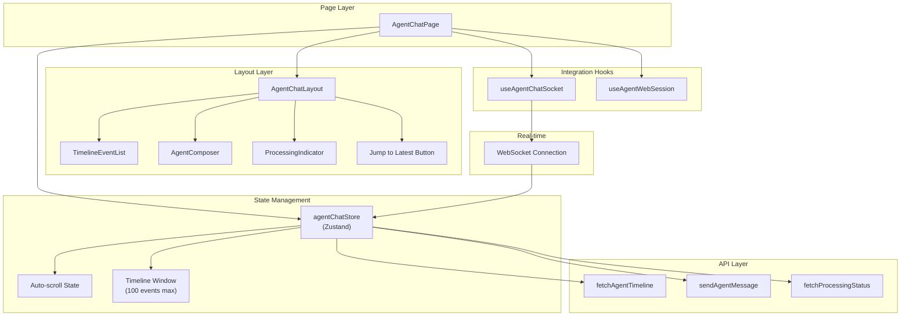

**Sources:**
- [frontend/src/screens/AgentChatPage.tsx:1-204]()
- [frontend/src/stores/agentChatStore.ts:1-473]()

---

## State Management with agentChatStore

The chat interface uses a Zustand store (`agentChatStore`) to manage all state, including timeline events, pagination, processing status, and auto-scroll behavior.

### Store Structure

| State Property | Type | Purpose |
|----------------|------|---------|
| `agentId` | `string \| null` | Currently active agent identifier |
| `events` | `TimelineEvent[]` | Current timeline window (sorted by cursor) |
| `oldestCursor` | `string \| null` | Cursor of oldest event in window |
| `newestCursor` | `string \| null` | Cursor of newest event in window |
| `hasMoreOlder` | `boolean` | Whether more older events exist |
| `hasMoreNewer` | `boolean` | Whether more newer events exist |
| `hasUnseenActivity` | `boolean` | Whether new events arrived while unpinned |
| `processingActive` | `boolean` | Whether agent is currently processing |
| `processingWebTasks` | `ProcessingWebTask[]` | Active browser automation tasks |
| `autoScrollPinned` | `boolean` | Whether auto-scroll is enabled |
| `autoScrollPinSuppressedUntil` | `number \| null` | Timestamp until which re-pinning is suppressed |
| `pendingEvents` | `TimelineEvent[]` | Events queued while auto-scroll is off |

### Timeline Window Management

The store maintains a sliding window of **100 events** maximum (`TIMELINE_WINDOW_SIZE`). When loading older or newer events, the window automatically trims from the opposite end:

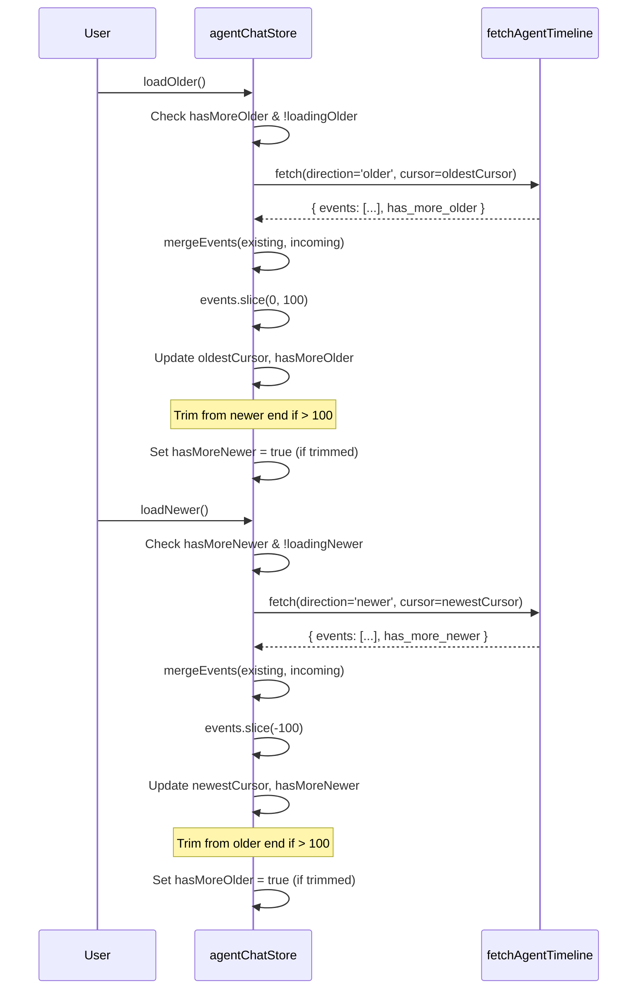

**Sources:**
- [frontend/src/stores/agentChatStore.ts:131-131]()
- [frontend/src/stores/agentChatStore.ts:265-299]()
- [frontend/src/stores/agentChatStore.ts:301-340]()

### Event Normalization and Merging

Events are normalized before insertion to ensure consistent HTML rendering and to handle tool cluster aggregation:

**Event Normalization Flow:**
1. **HTML Sanitization**: `normalizeEvent()` detects HTML content in message bodies and sanitizes it via `sanitizeHtml()` [frontend/src/stores/agentChatStore.ts:34-65]()
2. **Cursor-based Deduplication**: Events are stored in a `Map<cursor, event>` to prevent duplicates [frontend/src/stores/agentChatStore.ts:113-129]()
3. **Tool Cluster Merging**: When a `ToolClusterEvent` arrives with the same cursor as an existing cluster, their entries are merged and re-sorted [frontend/src/stores/agentChatStore.ts:81-111]()

**Tool Cluster Merging Logic:**

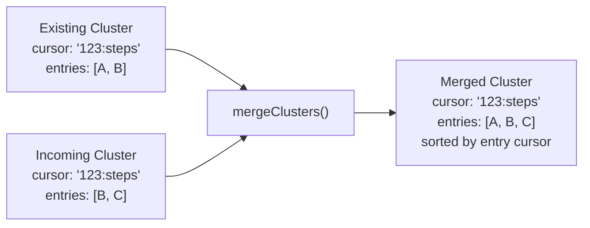

This ensures that tool execution steps appearing incrementally via WebSocket are aggregated into a single collapsible cluster rather than fragmented across multiple timeline entries.

**Sources:**
- [frontend/src/stores/agentChatStore.ts:14-69]()
- [frontend/src/stores/agentChatStore.ts:71-79]()
- [frontend/src/stores/agentChatStore.ts:81-111]()
- [frontend/src/stores/agentChatStore.ts:113-129]()

### Cursor Format and Sorting

Timeline events use cursors in the format `{timestamp}:{type}` (e.g., `"1640000000000:message"`). The `parseCursorValue()` function extracts the numeric timestamp prefix for sorting [frontend/src/stores/agentChatStore.ts:71-75]().

**Sources:**
- [frontend/src/stores/agentChatStore.ts:71-79]()

---

## Layout Components

### AgentChatLayout

The `AgentChatLayout` component is the main presentational shell that orchestrates the visual structure of the chat interface.

**Component Props:**

| Prop | Type | Purpose |
|------|------|---------|
| `agentName` | `string` | Full agent name for display |
| `agentFirstName` | `string` | Agent first name (derived from full name) |
| `events` | `TimelineEvent[]` | Events to render in timeline |
| `hasMoreOlder` | `boolean` | Controls "Load older" button visibility |
| `hasMoreNewer` | `boolean` | Controls "Load newer" button visibility |
| `processingActive` | `boolean` | Controls processing indicator visibility |
| `processingWebTasks` | `ProcessingWebTask[]` | Active browser tasks to display |
| `onLoadOlder` | `() => void` | Callback for loading older events |
| `onLoadNewer` | `() => void` | Callback for loading newer events |
| `onJumpToLatest` | `() => void` | Callback for jump-to-latest button |
| `onSendMessage` | `(body: string) => Promise<void>` | Callback for sending messages |
| `autoScrollPinned` | `boolean` | Whether auto-scroll is active |
| `hasUnseenActivity` | `boolean` | Whether to show activity indicator on jump button |

**Layout Structure:**

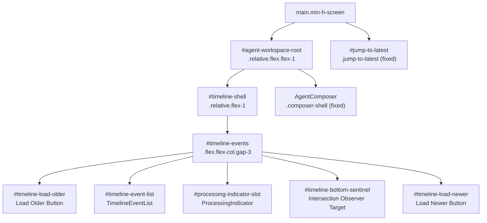

**Key Element IDs:**
- `#timeline-events`: Main scrollable timeline container with dynamic padding based on `data-has-jump-button` attribute [frontend/src/styles/agentChatLegacy.css:15-22]()
- `#timeline-bottom-sentinel`: 1px-height element used by IntersectionObserver to detect scroll position [frontend/src/components/agentChat/AgentChatLayout.tsx:101-103]()
- `#jump-to-latest`: Fixed-position button that appears when `hasMoreNewer || hasUnseenActivity || !autoScrollPinned` [frontend/src/components/agentChat/AgentChatLayout.tsx:52-143]()

**Sources:**
- [frontend/src/components/agentChat/AgentChatLayout.tsx:27-147]()
- [frontend/src/styles/agentChatLegacy.css:1-26]()
- [frontend/src/styles/agentChatLegacy.css:373-424]()

### AgentComposer

The message input component, rendered in a fixed position at the bottom of the viewport with `.composer-shell` styling [frontend/src/styles/agentChatLegacy.css:309-328](). The composer:
- Floats above the timeline via `z-index: 40`
- Has a CSS custom property `--composer-height: 6.5rem` used for timeline padding calculations
- Triggers `onSubmit` callback with trimmed message text

**Sources:**
- [frontend/src/components/agentChat/AgentChatLayout.tsx:126-126]()
- [frontend/src/styles/agentChatLegacy.css:11-13]()
- [frontend/src/styles/agentChatLegacy.css:309-363]()

### ProcessingIndicator

Displays when `processingActive` is true and there are no newer events to load. The indicator:
- Shows a pulsing pip with the agent's first name
- Expands to show individual browser tasks when multiple tasks are active
- Each task card shows status, duration, and prompt preview
- Supports click-to-expand for viewing full task details

The indicator is wrapped in `#processing-indicator-slot` with `data-visible` attribute controlling display via CSS [frontend/src/styles/agentChatLegacy.css:37-49]().

**Processing Web Tasks Display:**

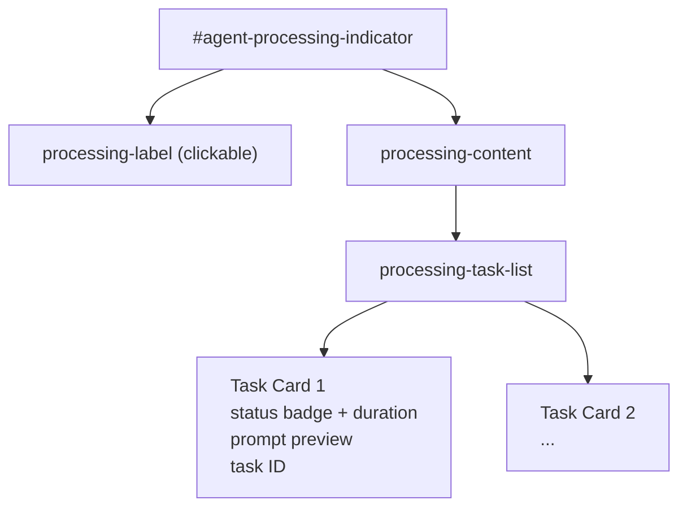

**Sources:**
- [frontend/src/components/agentChat/AgentChatLayout.tsx:93-99]()
- [frontend/src/styles/agentChatLegacy.css:37-307]()

---

## Auto-Scroll System

The auto-scroll system manages whether the timeline automatically scrolls to show new events or allows the user to browse history without interruption.

### Pinned vs Unpinned States

| State | Behavior |
|-------|----------|
| **Pinned** | New events immediately appear; timeline scrolls to bottom; jump button hidden |
| **Unpinned** | New events go to `pendingEvents` queue; jump button shows with activity indicator; user controls scroll position |

### IntersectionObserver Integration

The `AgentChatPage` uses an IntersectionObserver to detect when the bottom sentinel element becomes visible:

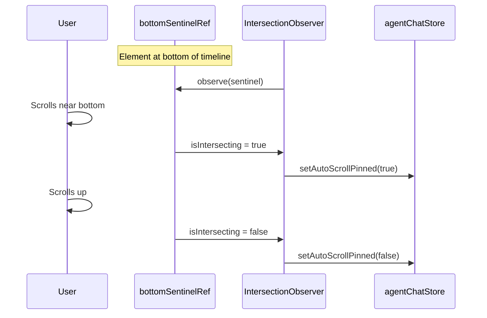

The observer is configured with `threshold: 0.75`, meaning the sentinel must be 75% visible before triggering [frontend/src/screens/AgentChatPage.tsx:134-154]().

**Sources:**
- [frontend/src/screens/AgentChatPage.tsx:133-154]()

### Scroll Position Tracking

In addition to IntersectionObserver, the page also monitors scroll distance from bottom:

**Scroll Event Handler Logic:**
1. Calculate `distanceToBottom = scrollHeight - clientHeight - scrollTop`
2. If `distanceToBottom <= 12px` and currently unpinned and no suppression active → pin
3. If `distanceToBottom > 160px` and currently pinned → unpin

The dual system (IntersectionObserver + scroll distance) ensures reliable auto-scroll toggling across different viewport sizes and scrolling behaviors [frontend/src/screens/AgentChatPage.tsx:69-117]().

**Sources:**
- [frontend/src/screens/AgentChatPage.tsx:69-117]()

### Auto-Scroll Suppression

The store provides `suppressAutoScrollPin(durationMs)` to prevent immediate re-pinning after certain actions. This is used to avoid jarring behavior when the user intentionally scrolls or when layout shifts occur [frontend/src/stores/agentChatStore.ts:462-471]().

When `autoScrollPinSuppressedUntil` is set to a future timestamp, the scroll handler skips re-pinning even if scroll position meets the criteria [frontend/src/screens/AgentChatPage.tsx:89-96]().

**Sources:**
- [frontend/src/stores/agentChatStore.ts:462-471]()
- [frontend/src/screens/AgentChatPage.tsx:89-96]()

### Pending Events Queue

When unpinned, incoming real-time events are added to `pendingEvents` rather than the main `events` array:

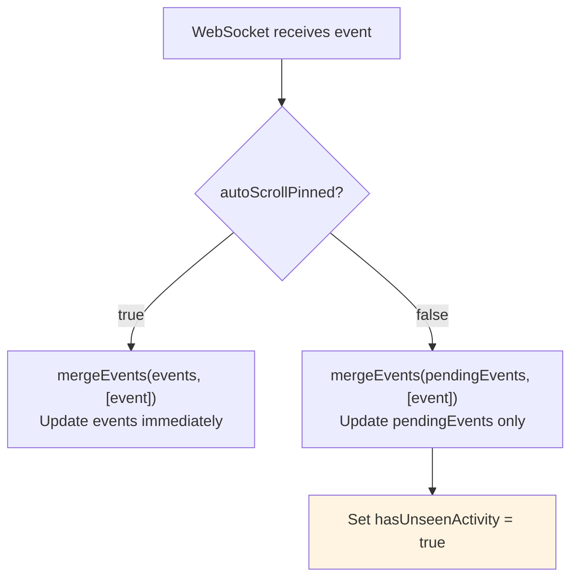

When the user re-pins (via jump button or scrolling to bottom), pending events are merged into the main timeline [frontend/src/stores/agentChatStore.ts:438-461]().

**Sources:**
- [frontend/src/stores/agentChatStore.ts:396-427]()
- [frontend/src/stores/agentChatStore.ts:438-461]()

---

## Timeline Event Processing

### Event Types

The chat interface handles multiple event kinds defined in the `TimelineEvent` union type:

| Event Kind | Description | Rendering |
|------------|-------------|-----------|
| `message` | User or agent text messages | Chat bubble with author label |
| `steps` | Tool execution cluster | Collapsible tool chips |
| `schedule` | Schedule configuration event | Schedule card with cron details |

### Real-Time Event Reception

The `receiveRealtimeEvent(event)` method handles incoming WebSocket events with special logic for tool clusters:

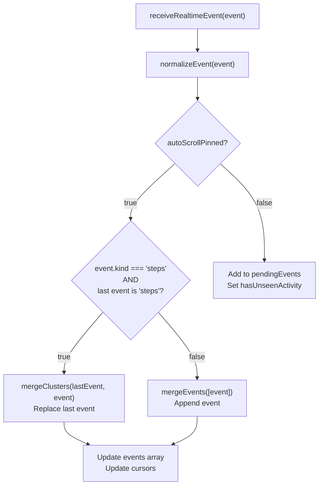

The special handling for consecutive tool clusters prevents timeline fragmentation when an agent executes multiple tools in succession [frontend/src/stores/agentChatStore.ts:396-427]().

**Sources:**
- [frontend/src/stores/agentChatStore.ts:396-427]()

### Message Sending Flow

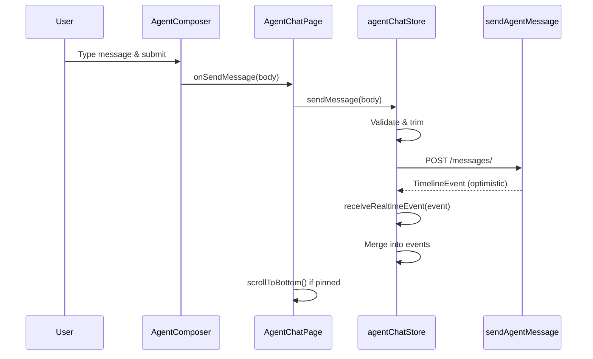

After sending, if auto-scroll is pinned, the page explicitly scrolls to bottom to ensure the user's message is visible [frontend/src/screens/AgentChatPage.tsx:165-172]().

**Sources:**
- [frontend/src/stores/agentChatStore.ts:376-394]()
- [frontend/src/screens/AgentChatPage.tsx:165-172]()

---

## Real-Time Integration

### WebSocket Connection

The `useAgentChatSocket` hook (referenced but not provided in files) establishes a WebSocket connection for the agent. Based on the store integration, it must call:
- `receiveRealtimeEvent(event)` when timeline events arrive
- `updateProcessing(snapshot)` when processing status changes

### Processing Status Polling

The store provides `refreshProcessing()` to manually fetch current processing status via `fetchProcessingStatus()` API [frontend/src/stores/agentChatStore.ts:251-263]().

Processing snapshots include:
- `active`: Boolean indicating if any processing is occurring
- `webTasks`: Array of `ProcessingWebTask` objects with status, prompt, timestamps

**Processing Snapshot Normalization:**

The `normalizeProcessingUpdate()` function coerces various input formats (boolean, partial snapshot, null) into a consistent `ProcessingSnapshot` structure [frontend/src/stores/agentChatStore.ts:135-168]().

**Sources:**
- [frontend/src/stores/agentChatStore.ts:251-263]()
- [frontend/src/stores/agentChatStore.ts:135-168]()
- [frontend/src/stores/agentChatStore.ts:429-436]()

---

## Processing Indicator Display

### Task Card Structure

Each processing web task is rendered as a card showing:

| Field | Display |
|-------|---------|
| `status` | Badge with color-coded status (pending/completed/failed) |
| `elapsedSeconds` | Duration in human-readable format |
| `promptPreview` | Truncated task prompt |
| `prompt` | Full prompt (when expanded) |
| `id` | Task UUID in monospace font |

**Task Status Color Mapping:**

```css
.processing-task-status[data-status='pending'] { color: #6366f1; }
.processing-task-status[data-status='completed'] { color: #0f766e; }
.processing-task-status[data-status='failed'] { color: #dc2626; }
```

**Sources:**
- [frontend/src/styles/agentChatLegacy.css:163-292]()

### Expandable Behavior

The processing indicator supports two states:
1. **Collapsed**: Shows count badge (e.g., "2 tasks") with pulsing pip
2. **Expanded** (via `data-expanded='true'`): Shows full task list with individual cards

When expanded, the pulsing pip is hidden via `.processing-pip { display: none; }` [frontend/src/styles/agentChatLegacy.css:75-77]().

**Sources:**
- [frontend/src/styles/agentChatLegacy.css:67-77]()
- [frontend/src/styles/agentChatLegacy.css:144-156]()

---

## CSS Architecture

### ID-Based Styling

The chat interface relies heavily on ID-based selectors for predictable styling of singleton elements:

| Element ID | Purpose |
|------------|---------|
| `#agent-workspace-root` | Main container with min-height |
| `#timeline-shell` | Centered, max-width container |
| `#timeline-events` | Scrollable timeline with dynamic padding |
| `#processing-indicator-slot` | Conditional processing indicator wrapper |
| `#timeline-bottom-sentinel` | IntersectionObserver target |
| `#jump-to-latest` | Fixed-position navigation button |

**Sources:**
- [frontend/src/styles/agentChatLegacy.css:1-26]()

### Data Attributes for State

The layout uses data attributes to control visibility and styling without JavaScript DOM manipulation:

```css
#timeline-events[data-has-jump-button="true"] {
  padding-bottom: calc(var(--composer-height, 6.5rem) + 2rem);
}

#processing-indicator-slot[data-visible="true"] {
  display: flex;
}

.jump-to-latest[data-visible='false'] {
  opacity: 0;
  visibility: hidden;
  pointer-events: none;
}
```

**Sources:**
- [frontend/src/styles/agentChatLegacy.css:20-22]()
- [frontend/src/styles/agentChatLegacy.css:45-49]()
- [frontend/src/styles/agentChatLegacy.css:392-397]()

### Animation System

The interface includes several CSS animations:

| Animation | Applied To | Effect |
|-----------|-----------|--------|
| `processingPulse` | `.processing-pip`, `.loading-pip` | Pulsing scale + shadow effect |
| `timelineLoadPulse` | `.timeline-load-indicator[data-loading='true']` | Pulsing opacity during loading |
| `timelineEventIncoming` | `.timeline-event--incoming` | Slide-up fade-in for new events |
| `timelineEventBubbleHighlight` | `.timeline-event--incoming .chat-bubble` | Shadow emphasis on new messages |

All animations respect `prefers-reduced-motion` media query [frontend/src/styles/agentChatLegacy.css:567-579]().

**Sources:**
- [frontend/src/styles/agentChatLegacy.css:294-307]()
- [frontend/src/styles/agentChatLegacy.css:490-503]()
- [frontend/src/styles/agentChatLegacy.css:547-579]()

---

## Responsive Behavior

The chat interface adapts to mobile viewports with specific breakpoint adjustments:

**Mobile Optimizations (`@media (max-width: 768px)`):**

| Element | Desktop | Mobile |
|---------|---------|--------|
| Composer bottom margin | `1.25rem` | `1rem` |
| Timeline padding-bottom | `calc(var(--composer-height) - 0.5rem)` | `calc(var(--composer-height) - 0.75rem)` |
| Jump button size | `3.25rem × 3.25rem` | `2.85rem × 2.85rem` |
| Chat bubble max-width | `min(60rem, 100%)` | `95%` |
| Chat bubble font-size | `0.9375rem` | `0.9rem` |

**Sources:**
- [frontend/src/styles/agentChatLegacy.css:1290-1316]()

---

## Initialization and Lifecycle

### Page Initialization Flow

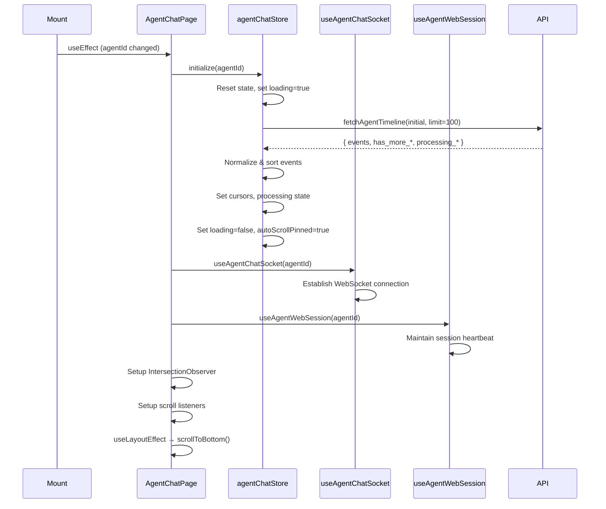

The initialization sequence ensures:
1. State is reset before fetching to prevent stale data
2. Auto-scroll starts pinned to show latest events
3. Real-time connection establishes after initial load
4. Scroll observers activate to track user navigation

**Sources:**
- [frontend/src/screens/AgentChatPage.tsx:29-65]()
- [frontend/src/stores/agentChatStore.ts:217-249]()

### Cleanup and Unmount

The page registers cleanup functions for:
- Scroll event listeners (window, document, scrollingElement) [frontend/src/screens/AgentChatPage.tsx:112-116]()
- IntersectionObserver disconnection [frontend/src/screens/AgentChatPage.tsx:151-153]()

**Sources:**
- [frontend/src/screens/AgentChatPage.tsx:69-117]()
- [frontend/src/screens/AgentChatPage.tsx:133-154]()

---

## Jump to Latest Functionality

The jump-to-latest button provides a mechanism to quickly return to the most recent events:

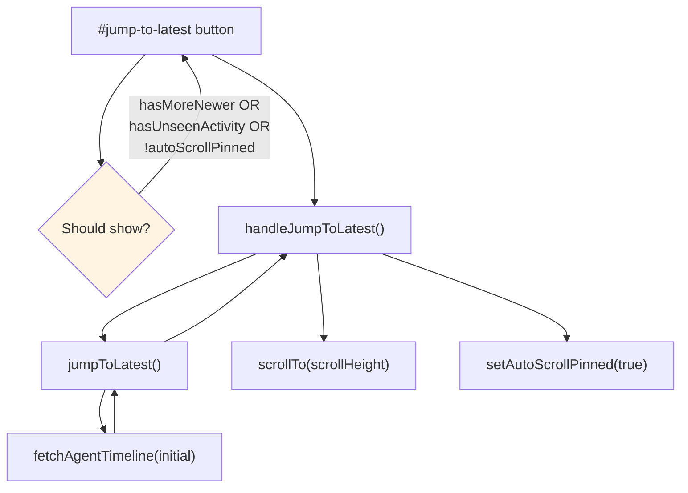

The button visibility logic [frontend/src/components/agentChat/AgentChatLayout.tsx:52-52]():
- `hasMoreNewer`: User scrolled into history
- `hasUnseenActivity`: New events arrived while unpinned
- `!autoScrollPinned`: User manually disabled auto-scroll

When clicked, the button:
1. Calls `store.jumpToLatest()` which re-fetches initial timeline window
2. Clears `pendingEvents` and `hasUnseenActivity`
3. Scrolls viewport to bottom
4. Forcibly re-enables auto-scroll pinning

**Sources:**
- [frontend/src/components/agentChat/AgentChatLayout.tsx:52-143]()
- [frontend/src/screens/AgentChatPage.tsx:156-163]()
- [frontend/src/stores/agentChatStore.ts:342-374]()

---

## Timeline Navigation Controls

### Load Older Button

Appears at the top of the timeline when `hasMoreOlder === true`. The button:
- Shows loading state via `data-loading` attribute
- Disabled while `loadingOlder === true`
- Triggers `onLoadOlder` callback which invokes `store.loadOlder()`

When exhausted (`!hasMoreOlder && !initialLoading`), displays "Beginning of history" label instead [frontend/src/components/agentChat/AgentChatLayout.tsx:80-82]().

**Sources:**
- [frontend/src/components/agentChat/AgentChatLayout.tsx:64-83]()

### Load Newer Button

Appears at the bottom of the timeline (above the bottom sentinel) when `hasMoreNewer === true`. Mirrors the "Load older" behavior but fetches in the opposite direction [frontend/src/components/agentChat/AgentChatLayout.tsx:105-122]().

**Sources:**
- [frontend/src/components/agentChat/AgentChatLayout.tsx:105-122]()

### Loading States

Both buttons use a shared `.timeline-load-button` class with pulsing indicator:

```css
.timeline-load-indicator[data-loading='true'] {
  animation: timelineLoadPulse 0.9s linear infinite;
}
```

The indicator pulses between 30% and 90% opacity with scale transforms [frontend/src/styles/agentChatLegacy.css:486-503]().

**Sources:**
- [frontend/src/styles/agentChatLegacy.css:443-503]()

---

