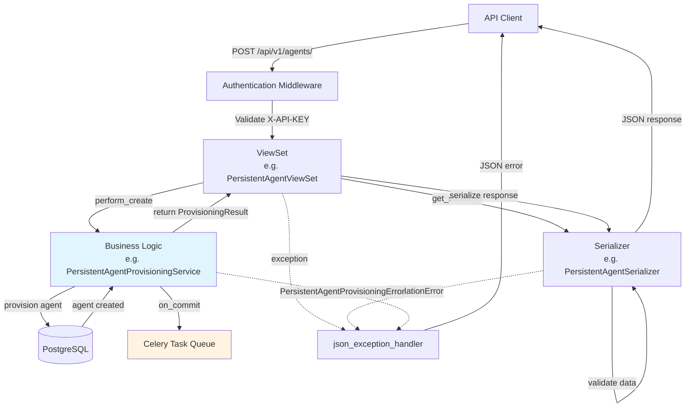
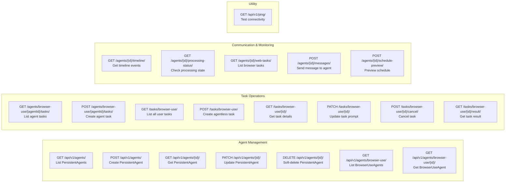
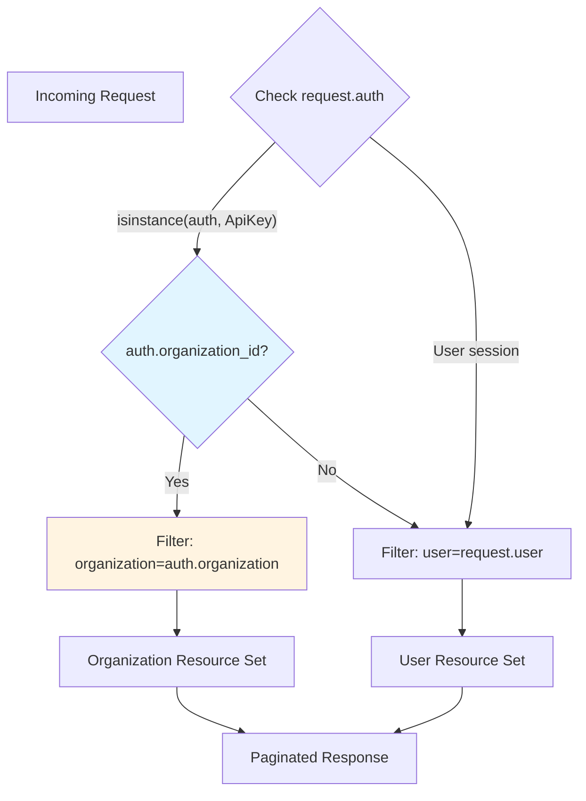

<!-- source: DeepWiki mcp.deepwiki.com · repo gobii-ai/gobii-platform · page 9 API Reference · fetched 2026-10-26 -->

# API Reference

<details>
<summary>Relevant source files</summary>

The following files were used as context for generating this wiki page:

- [AGENTS.md](AGENTS.md)
- [api/exceptions.py](api/exceptions.py)
- [api/migrations/0145_browseruseagenttask_organization_and_more.py](api/migrations/0145_browseruseagenttask_organization_and_more.py)
- [api/serializers.py](api/serializers.py)
- [api/services/persistent_agents.py](api/services/persistent_agents.py)
- [api/urls.py](api/urls.py)
- [api/views.py](api/views.py)
- [tests/unit/test_api.py](tests/unit/test_api.py)
- [tests/unit/test_api_persistent_agents.py](tests/unit/test_api_persistent_agents.py)

</details>


## Purpose and Scope

This page provides a technical overview of the gobii-platform REST API, including endpoint structure, request/response patterns, and authentication mechanisms. For detailed endpoint specifications and request/response formats, see [REST API](#9.1). For authentication and authorization implementation details, see [Authentication & Authorization](#9.2).

The API exposes programmatic access to agent creation, task management, timeline events, and communication endpoints. All API interactions require authentication via API keys and follow standard REST conventions with JSON payloads.

---

## API Overview

### Base Configuration

The API is exposed under the `/api/v1/` prefix and is implemented using Django REST Framework. All endpoints return JSON responses and accept JSON request bodies.

**Key Characteristics:**
- **Content Type:** `application/json`
- **Authentication:** API Key via `X-API-KEY` header
- **Pagination:** Page-based with configurable page size (default 10, max 100)
- **Error Format:** JSON with `detail` field and HTTP status codes
- **Timestamp Format:** ISO 8601 with UTC timezone

**Sources:** [api/urls.py:1-87](), [api/views.py:64-68]()

### Error Handling

The platform uses a custom exception handler that ensures all API errors return JSON, even for unexpected exceptions. Each unhandled error receives a unique `error_id` for tracking.

```python
# Example error response
{
  "detail": "Internal server error.",
  "error_id": "550e8400-e29b-41d4-a716-446655440000"
}
```

**Sources:** [api/exceptions.py:12-42]()

---

## Authentication Model

The platform supports two types of API keys:

| Type | Owner | Scope | Agent Access |
|------|-------|-------|-------------|
| **Personal** | User | User's resources only | User's agents and tasks |
| **Organization** | Organization | Organization resources only | Organization agents and tasks |

Organization API keys have additional restrictions:
- Cannot create `BrowserUseAgent` instances directly (must use `PersistentAgent`)
- Automatically set `organization` field on created resources
- Cannot access personal resources of organization members

For implementation details, see [Authentication & Authorization](#9.2).

**Sources:** [api/views.py:100-104](), [api/views.py:198-202](), [tests/unit/test_api.py:262-381]()

---

## API Request Flow

The following diagram illustrates how API requests flow through the platform components:

**Diagram: API Request Processing Pipeline**



**Sources:** [api/views.py:664-702](), [api/serializers.py:370-433](), [api/services/persistent_agents.py:51-169](), [api/exceptions.py:12-42]()

---

## Endpoint Architecture

The API organizes endpoints into three primary categories: agent management, task operations, and agent communication/monitoring.

**Diagram: Endpoint Category Map**



**Sources:** [api/urls.py:23-86](), [api/views.py:149-156]()

### Dual-Scoped Task Endpoints

The platform provides both **agent-scoped** and **user-scoped** task endpoints to support different workflows:

```
# Agent-scoped: tasks must belong to specified agent
POST /api/v1/agents/browser-use/{agentId}/tasks/

# User-scoped: tasks can be agentless or specify agent in payload
POST /api/v1/tasks/browser-use/
```

When creating tasks through the user-scoped endpoint, the `agent` field is optional in the request body. Organization API keys automatically set the `organization` field on created tasks.

**Sources:** [api/views.py:301-343](), [api/views.py:354-367](), [api/urls.py:38-74]()

---

## Resource Ownership and Filtering

All API endpoints enforce ownership-based filtering to ensure users only access their own resources or resources within their organization.

**Diagram: Ownership Resolution Flow**



**Key Implementation Points:**

| ViewSet | Filter Logic | Code Reference |
|---------|-------------|----------------|
| `PersistentAgentViewSet` | `organization=org` or `user=user, organization__isnull=True` | [api/views.py:703-714]() |
| `BrowserUseAgentViewSet` | `persistent_agent__organization=org` or `user=user` | [api/views.py:106-129]() |
| `BrowserUseAgentTaskViewSet` | `organization=org` or `agent__persistent_agent__organization=org` or `user=user, organization__isnull=True` | [api/views.py:221-268]() |

**Sources:** [api/views.py:100-105](), [api/views.py:671-676]()

---

## Request Validation and Serialization

The platform uses Django REST Framework serializers for all request validation and response serialization. Each resource type has both detail and list serializers.

### Serializer Pairs

| Resource | List Serializer | Detail Serializer | Purpose |
|----------|----------------|-------------------|---------|
| `PersistentAgent` | `PersistentAgentListSerializer` | `PersistentAgentSerializer` | Agent CRUD with template support |
| `BrowserUseAgent` | `BrowserUseAgentListSerializer` | `BrowserUseAgentSerializer` | Browser agent metadata |
| `BrowserUseAgentTask` | `BrowserUseAgentTaskListSerializer` | `BrowserUseAgentTaskSerializer` | Task lifecycle management |

List serializers provide read-only fields for efficient listing, while detail serializers support write operations with full validation.

**Sources:** [api/serializers.py:198-230](), [api/serializers.py:259-310](), [api/views.py:131-135]()

### Field Validation Examples

**Schedule Validation:**
The `PersistentAgent` model validates schedule strings using `ScheduleParser` which supports cron expressions, `@daily`, and `@every` syntax:

```python
# Valid schedules
"@daily"
"0 0 * * *"
"@every 30m"
"@every 1h 30m"

# Invalid schedules
"@reboot"  # Not supported
"@every 5x"  # Invalid format
```

**Sources:** [api/serializers.py:276-298](), [tests/unit/test_api_persistent_agents.py:67-111]()

**Secrets Validation:**
Task secrets must follow domain-specific format and are encrypted before storage:

```json
{
  "https://example.com": {
    "x_api_key": "value",
    "x_username": "user"
  }
}
```

**Sources:** [api/serializers.py:122-145](), [api/views.py:340-362]()

---

## Wait Parameter and Synchronous Results

The task creation endpoint supports an optional `wait` parameter (0-1350 seconds) that allows clients to synchronously wait for task completion:

```json
POST /api/v1/agents/browser-use/{agentId}/tasks/
{
  "prompt": "Navigate to example.com",
  "wait": 600
}

Response (if completed):
{
  "id": "...",
  "status": "completed",
  "result": { /* task result data */ }
}

Response (if still running):
{
  "id": "...",
  "status": "in_progress"
}
```

The implementation uses Celery's `wait()` method on the AsyncResult object to block until completion or timeout.

**Sources:** [api/serializers.py:81-87](), [api/views.py:372-436](), [api/views.py:502-532]()

---

## Credit Gating

All task creation endpoints check credit availability before accepting requests. If the user has insufficient credits, the API returns HTTP 402 (Payment Required):

```json
{
  "message": "User does not have enough task credits to create a new task. Please upgrade your plan or enable extra task purchases."
}
```

Credit checks happen in the `create()` method before serializer validation to fail fast.

**Sources:** [api/views.py:505-512](), [util/constants/task_constants.py]()

---

## Pagination

All list endpoints use `StandardResultsSetPagination` with the following configuration:

| Parameter | Default | Maximum | Query Param |
|-----------|---------|---------|-------------|
| Page Size | 10 | 100 | `page_size` |
| Page Number | 1 | N/A | `page` |

Example paginated response:

```json
{
  "count": 42,
  "next": "http://api.example.com/api/v1/agents/?page=2",
  "previous": null,
  "results": [ /* array of resources */ ]
}
```

**Sources:** [api/views.py:65-68](), [api/views.py:98]()

---

## Soft Deletion

The `BrowserUseAgentTask` model implements soft deletion. When a task is deleted via the API, it is marked as deleted but retained in the database:

```python
# DELETE /api/v1/tasks/browser-use/{id}/
# Sets: is_deleted=True, deleted_at=<timestamp>
```

Soft-deleted tasks are filtered from all list queries using the `alive()` queryset manager.

**Sources:** [api/views.py:534-560](), [tests/unit/test_api.py:837-865]()

---

## OpenAPI Schema Generation

The API uses `drf-spectacular` for automatic OpenAPI schema generation. All ViewSets and actions are decorated with `@extend_schema` to provide operation IDs and tags:

```python
@extend_schema_view(
    list=extend_schema(operation_id='listPersistentAgents', tags=['persistent-agents']),
    create=extend_schema(operation_id='createPersistentAgent', tags=['persistent-agents']),
    # ...
)
class PersistentAgentViewSet(viewsets.ModelViewSet):
    # ...
```

This enables automatic generation of client libraries and interactive API documentation.

**Sources:** [api/views.py:83-90](), [api/views.py:158-181](), [api/views.py:656-663]()

---

## Webhook Endpoints

The platform exposes several webhook endpoints for external integrations:

| Endpoint | Purpose | Authentication |
|----------|---------|----------------|
| `/api/v1/webhooks/inbound/sms/` | Twilio SMS delivery | Twilio signature validation |
| `/api/v1/webhooks/status/sms/` | Twilio delivery status | Twilio signature validation |
| `/api/v1/webhooks/inbound/email/` | Postmark email delivery | Postmark token validation |
| `/api/v1/webhooks/inbound/email/mg/` | Mailgun email delivery | Mailgun signature validation |
| `/api/v1/webhooks/pipedream/connect/{session_id}/` | Pipedream OAuth completion | Session ID validation |
| `/api/v1/webhooks/bi/email/` | Email open/click tracking | Open tracking pixel |

These endpoints do not require API key authentication but use provider-specific validation mechanisms.

**Sources:** [api/urls.py:76-86](), [api/webhooks.py]()

---

## Common Response Patterns

### Success Responses

| Status | Meaning | Example Operations |
|--------|---------|-------------------|
| 200 OK | Resource retrieved/updated | GET, PATCH |
| 201 Created | Resource created | POST (create agent, task) |
| 204 No Content | Resource deleted | DELETE |

### Error Responses

| Status | Meaning | Common Causes |
|--------|---------|---------------|
| 400 Bad Request | Validation error | Invalid schedule, missing required fields |
| 401 Unauthorized | Missing API key | No `X-API-KEY` header |
| 402 Payment Required | Insufficient credits | Credit quota exhausted |
| 403 Forbidden | Invalid API key | Malformed or expired key |
| 404 Not Found | Resource not found or access denied | Agent doesn't exist or belongs to another user |
| 409 Conflict | Resource state conflict | Cancelling a completed task |
| 500 Internal Server Error | Unexpected error | Includes `error_id` for tracking |

**Sources:** [api/views.py:505-512](), [api/views.py:647-653](), [api/exceptions.py:35-39]()

---

## Analytics Tracking

All API operations emit analytics events for monitoring and billing purposes. The `Analytics` service tracks:

- `AGENTS_LISTED`, `AGENT_CREATED`
- `TASKS_LISTED`, `TASK_CREATED`, `TASK_DELETED`, `TASK_CANCELLED`, `TASK_RESULT_VIEWED`
- Organization-specific variants (e.g., `ORGANIZATION_TASK_CREATED`)

Events include properties like `agent_id`, `task_id`, `organization_id`, and operation metadata.

**Sources:** [api/views.py:115-128](), [api/views.py:144](), [api/views.py:476-492]()

---

For detailed endpoint specifications, request/response schemas, and example payloads, see [REST API](#9.1). For API key creation, permissions, and the dual-ownership model, see [Authentication & Authorization](#9.2).

---

