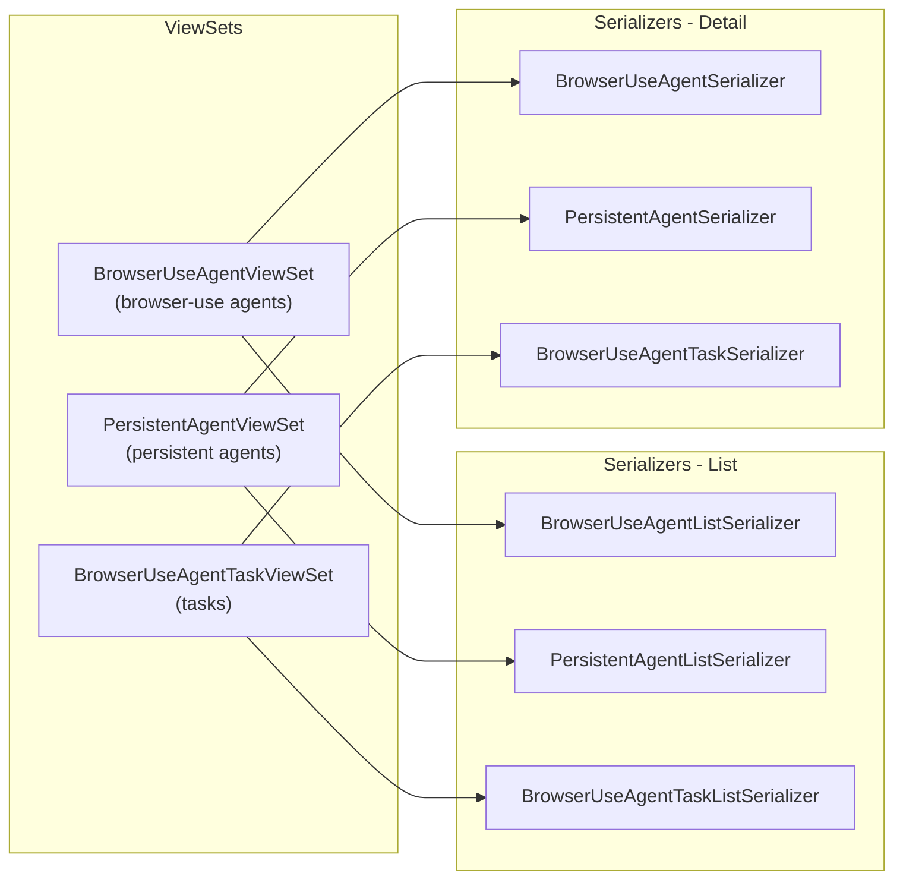
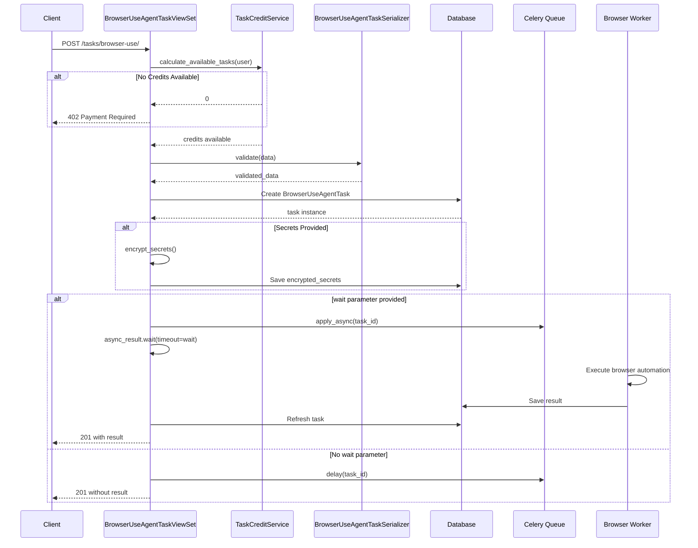
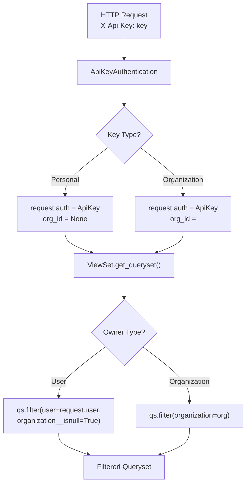

<!-- source: DeepWiki mcp.deepwiki.com · repo gobii-ai/gobii-platform · page 9.1 REST API · fetched 2026-10-26 -->

# REST API

<details>
<summary>Relevant source files</summary>

The following files were used as context for generating this wiki page:

- [AGENTS.md](AGENTS.md)
- [api/exceptions.py](api/exceptions.py)
- [api/migrations/0145_browseruseagenttask_organization_and_more.py](api/migrations/0145_browseruseagenttask_organization_and_more.py)
- [api/serializers.py](api/serializers.py)
- [api/services/persistent_agents.py](api/services/persistent_agents.py)
- [api/urls.py](api/urls.py)
- [api/views.py](api/views.py)
- [tests/unit/test_api.py](tests/unit/test_api.py)
- [tests/unit/test_api_persistent_agents.py](tests/unit/test_api_persistent_agents.py)

</details>


This document describes the HTTP REST API endpoints for managing agents, tasks, timelines, and messages. The API follows RESTful conventions and returns JSON responses. For authentication mechanisms including API keys, see [Authentication & Authorization](#9.2). For WebSocket-based real-time communication, that is covered separately.

---

## Purpose and Scope

The REST API provides programmatic access to the gobii-platform's core functionality:
- Creating and managing agents (both `BrowserUseAgent` and `PersistentAgent`)
- Submitting and monitoring browser automation tasks
- Sending messages to agents
- Retrieving execution timelines and processing status
- Managing agent configurations (schedules, contacts, secrets)

The API supports both user-owned and organization-owned resources via a dual-ownership authentication model detailed in [Authentication & Authorization](#9.2).

---

## Base URL and Versioning

All API endpoints are prefixed with `/api/v1/`. The current implementation does not use explicit versioning beyond this prefix.

**Example Base URL:**
```
https://app.gobii.ai/api/v1/
```

Sources: [api/urls.py:1-86]()

---

## Authentication

The API uses custom API key authentication via the `X-Api-Key` HTTP header. All endpoints require authentication except for webhooks.

**Request Header:**
```
X-Api-Key: <your-api-key>
```

API keys can be scoped to either:
- **Personal Keys**: Access user-owned resources
- **Organization Keys**: Access organization-owned resources

The authentication layer automatically determines ownership context and filters querysets accordingly. See [Authentication & Authorization](#9.2) for detailed implementation.

Sources: [api/views.py:100-104](), [api/views.py:198-202](), [api/views.py:671-675]()

---

## URL Routing Architecture

The following diagram shows the complete URL structure and how routes map to ViewSets:

```mermaid
graph TD
    subgraph "Utility Endpoints"
        ping["/ping/"]
    end
    
    subgraph "Agent Resources"
        agents["/agents/"]
        browserAgents["/agents/browser-use/"]
        
        agents --> agentDetail["/agents/{id}/"]
        browserAgents --> browserDetail["/agents/browser-use/{id}/"]
        
        agentDetail --> timeline["/agents/{id}/timeline/"]
        agentDetail --> messages["/agents/{id}/messages/"]
        agentDetail --> status["/agents/{id}/processing-status/"]
        agentDetail --> webTasks["/agents/{id}/web-tasks/"]
        agentDetail --> schedulePreview["/agents/{id}/preview-schedule/"]
    end
    
    subgraph "Task Resources - Agent Scoped"
        browserAgentTasks["/agents/browser-use/{agentId}/tasks/"]
        browserAgentTasks --> agentTaskDetail["/agents/browser-use/{agentId}/tasks/{id}/"]
        agentTaskDetail --> agentTaskResult["/agents/browser-use/{agentId}/tasks/{id}/result/"]
        agentTaskDetail --> agentTaskCancel["/agents/browser-use/{agentId}/tasks/{id}/cancel/"]
    end
    
    subgraph "Task Resources - User Scoped"
        userTasks["/tasks/browser-use/"]
        userTasks --> userTaskDetail["/tasks/browser-use/{id}/"]
        userTaskDetail --> userTaskResult["/tasks/browser-use/{id}/result/"]
        userTaskDetail --> userTaskCancel["/tasks/browser-use/{id}/cancel/"]
    end
    
    subgraph "Webhook Endpoints"
        webhooks["/webhooks/..."]
        webhooks --> smsWebhook["/webhooks/inbound/sms/"]
        webhooks --> emailWebhook["/webhooks/inbound/email/"]
        webhooks --> pipedreamWebhook["/webhooks/pipedream/connect/{session_id}/"]
    end
    
    ping -.-> PingView["ping()"]
    agents -.-> PersistentAgentViewSet
    browserAgents -.-> BrowserUseAgentViewSet
    browserAgentTasks -.-> BrowserUseAgentTaskViewSet
    userTasks -.-> BrowserUseAgentTaskViewSet
```



**URL Pattern Summary:**

| Pattern | ViewSet | Purpose |
|---------|---------|---------|
| `/agents/` | `PersistentAgentViewSet` | CRUD for persistent agents |
| `/agents/browser-use/` | `BrowserUseAgentViewSet` | CRUD for browser-use agents |
| `/agents/browser-use/{agentId}/tasks/` | `BrowserUseAgentTaskViewSet` | Agent-specific tasks |
| `/tasks/browser-use/` | `BrowserUseAgentTaskViewSet` | User-level tasks (optional agent) |
| `/webhooks/...` | Various webhook handlers | Inbound message ingestion |

Sources: [api/urls.py:29-86]()

---

## Core ViewSets and Serializers

The API uses Django REST Framework's ViewSet pattern. Each ViewSet handles CRUD operations and custom actions for a specific resource.



**ViewSet-Serializer Mapping:**

The API uses different serializers for list vs. detail operations to optimize payload size:

- **List operations** return minimal fields (id, name, timestamps)
- **Detail operations** return full resource representations

Sources: [api/views.py:91-147](), [api/views.py:183-561](), [api/views.py:664-1062](), [api/serializers.py:19-466]()

---

## Resource: Browser-Use Agents

Browser-use agents represent the underlying browser automation engine. Most users interact with persistent agents instead, but this resource is exposed for direct task submission.

### Endpoints

| Method | Path | Description |
|--------|------|-------------|
| GET | `/agents/browser-use/` | List all browser agents |
| POST | `/agents/browser-use/` | Create a new browser agent |
| GET | `/agents/browser-use/{id}/` | Get agent details |
| PATCH | `/agents/browser-use/{id}/` | Update agent |
| DELETE | `/agents/browser-use/{id}/` | Delete agent |

### List Browser Agents

**Request:**
```http
GET /api/v1/agents/browser-use/
X-Api-Key: <key>
```

**Response:**
```json
{
  "count": 2,
  "next": null,
  "previous": null,
  "results": [
    {
      "id": "550e8400-e29b-41d4-a716-446655440000",
      "name": "Agent 1",
      "created_at": "2024-01-15T10:30:00Z",
      "listing_description": "Automates product updates",
      "listing_description_source": "charter"
    }
  ]
}
```

### Create Browser Agent

**Request:**
```http
POST /api/v1/agents/browser-use/
X-Api-Key: <key>
Content-Type: application/json

{
  "name": "My Agent"
}
```

**Response:**
```json
{
  "id": "550e8400-e29b-41d4-a716-446655440000",
  "user_email": "user@example.com",
  "name": "My Agent",
  "created_at": "2024-01-15T10:30:00Z",
  "updated_at": "2024-01-15T10:30:00Z",
  "listing_description": "Agent is initializing…",
  "listing_description_source": "placeholder"
}
```

**Important:** Organization API keys cannot create browser agents directly (returns 400). Organizations must create persistent agents instead, which automatically provision a browser agent.

Sources: [api/views.py:91-147](), [api/serializers.py:19-67](), [tests/unit/test_api.py:64-231]()

---

## Resource: Persistent Agents

Persistent agents are the primary interface for scheduled, stateful automation. They wrap a browser-use agent and add scheduling, communication channels, and lifecycle management.

### Endpoints

| Method | Path | Description |
|--------|------|-------------|
| GET | `/agents/` | List all persistent agents |
| POST | `/agents/` | Create a new persistent agent |
| GET | `/agents/{id}/` | Get agent details |
| PATCH | `/agents/{id}/` | Update agent configuration |
| DELETE | `/agents/{id}/` | Soft-delete agent (sets expired) |
| GET | `/agents/{id}/timeline/` | Get event timeline |
| POST | `/agents/{id}/messages/` | Send message to agent |
| GET | `/agents/{id}/processing-status/` | Check if agent is processing |
| GET | `/agents/{id}/web-tasks/` | List browser tasks for agent |
| POST | `/agents/{id}/preview-schedule/` | Preview schedule execution times |

### Create Persistent Agent

The provisioning process creates both a `PersistentAgent` and underlying `BrowserUseAgent` atomically.

**Request:**
```http
POST /api/v1/agents/
X-Api-Key: <key>
Content-Type: application/json

{
  "name": "Sales Assistant",
  "charter": "Monitor CRM for new leads and send welcome emails",
  "schedule": "0 9 * * 1-5",
  "is_active": true,
  "preferred_contact_endpoint": "email"
}
```

**Response:**
```json
{
  "id": "660e8400-e29b-41d4-a716-446655440001",
  "name": "Sales Assistant",
  "charter": "Monitor CRM for new leads and send welcome emails",
  "short_description": "Monitor CRM for new leads and send welcome emails",
  "schedule": "0 9 * * 1-5",
  "schedule_snapshot": null,
  "is_active": true,
  "life_state": "active",
  "whitelist_policy": "default",
  "last_interaction_at": null,
  "created_at": "2024-01-15T10:30:00Z",
  "updated_at": "2024-01-15T10:30:00Z",
  "user_id": "770e8400-e29b-41d4-a716-446655440002",
  "organization_id": null,
  "browser_use_agent_id": "880e8400-e29b-41d4-a716-446655440003",
  "preferred_contact_endpoint_id": "990e8400-e29b-41d4-a716-446655440004"
}
```

**Fields:**

| Field | Type | Required | Description |
|-------|------|----------|-------------|
| `name` | string | Yes | Unique agent name for owner |
| `charter` | string | No | Agent's purpose and instructions |
| `schedule` | string | No | Cron expression or `@every` syntax |
| `is_active` | boolean | No | Whether agent can execute (default: true) |
| `preferred_contact_endpoint` | string/uuid | No | `"email"`, `"sms"`, or endpoint ID |
| `template_code` | string | No | AI employee template to apply |

**Provisioning Behavior:**

1. Validates agent quota via `AgentService.has_agents_available()`
2. Creates `BrowserUseAgent` with unique name
3. Creates `PersistentAgent` linked to browser agent
4. Applies template if `template_code` provided (overwrites charter/schedule)
5. Sets default `daily_credit_limit` for free plans
6. Enqueues `process_agent_events_task` on transaction commit

Sources: [api/views.py:664-754](), [api/serializers.py:259-466](), [api/services/persistent_agents.py:27-180](), [tests/unit/test_api_persistent_agents.py:262-339]()

---

### Update Persistent Agent

**Request:**
```http
PATCH /api/v1/agents/{id}/
X-Api-Key: <key>
Content-Type: application/json

{
  "charter": "Updated instructions",
  "is_active": false
}
```

**Response:**
```json
{
  "id": "660e8400-e29b-41d4-a716-446655440001",
  "name": "Sales Assistant",
  "charter": "Updated instructions",
  "is_active": false,
  ...
}
```

**Updatable Fields:**
- `name`, `charter`, `short_description`, `schedule`
- `is_active`, `life_state`, `whitelist_policy`
- `preferred_contact_endpoint`

All other fields are read-only.

Sources: [api/serializers.py:435-465](), [tests/unit/test_api_persistent_agents.py:340-374]()

---

### Soft Delete Agent

Deleting an agent sets `life_state=EXPIRED`, `is_active=False`, and clears `schedule`.

**Request:**
```http
DELETE /api/v1/agents/{id}/
X-Api-Key: <key>
```

**Response:**
```
204 No Content
```

The agent record remains in the database but will not execute.

Sources: [api/views.py:755-779](), [tests/unit/test_api_persistent_agents.py:376-387]()

---

### Timeline Endpoint

The timeline provides a chronological view of agent activity including messages, steps, and reasoning.

**Request:**
```http
GET /api/v1/agents/{id}/timeline/?cursor=<cursor>&limit=50
X-Api-Key: <key>
```

**Response:**
```json
{
  "events": [
    {
      "kind": "message",
      "id": "msg-123",
      "timestamp": "2024-01-15T10:30:00Z",
      "conversation_id": "conv-456",
      "direction": "inbound",
      "channel": "email",
      "sender": "user@example.com",
      "subject": "Question about reports",
      "body": "Can you send me the latest report?",
      "metadata": {}
    },
    {
      "kind": "step",
      "id": "step-789",
      "timestamp": "2024-01-15T10:31:00Z",
      "step_number": 1,
      "model_output": "I'll retrieve the latest report.",
      "tool_calls": [],
      "is_result": false,
      "hidden": false
    }
  ],
  "next_cursor": "eyJvZmZzZXQiOjUwfQ==",
  "has_more": true
}
```

**Query Parameters:**
- `cursor`: Pagination cursor (opaque string)
- `limit`: Events per page (default: 25, max: 100)

Sources: [api/views.py:815-866](), [console/agent_chat/timeline.py:1-305]()

---

### Messages Endpoint

Submit messages to trigger agent processing. The agent will receive the message and respond based on its charter.

**Request:**
```http
POST /api/v1/agents/{id}/messages/
X-Api-Key: <key>
Content-Type: application/json

{
  "channel": "email",
  "sender": "user@example.com",
  "recipient": "agent@example.com",
  "subject": "Status update",
  "body": "Please provide the daily summary"
}
```

**Response:**
```json
{
  "message": {
    "id": "msg-123",
    "conversation_id": "conv-456",
    "direction": "inbound",
    "channel": "email",
    "sender": "user@example.com",
    "recipient": "agent@example.com",
    "subject": "Status update",
    "body": "Please provide the daily summary",
    "created_at": "2024-01-15T10:30:00Z"
  },
  "event": {
    "kind": "message",
    "id": "msg-123",
    "timestamp": "2024-01-15T10:30:00Z",
    ...
  }
}
```

**Behavior:**
1. Validates sender against agent's allowlist
2. Creates `PersistentAgentMessage` linked to conversation
3. Enqueues `process_agent_events_task`
4. Returns message and timeline event representation

Sources: [api/views.py:868-941](), [tests/unit/test_api_persistent_agents.py:388-418]()

---

### Processing Status Endpoint

Check whether the agent is currently executing and view the active processing snapshot.

**Request:**
```http
GET /api/v1/agents/{id}/processing-status/
X-Api-Key: <key>
```

**Response:**
```json
{
  "processing_active": true,
  "processing_snapshot": {
    "agent_id": "660e8400-e29b-41d4-a716-446655440001",
    "agent_name": "Sales Assistant",
    "current_cycle_id": "cycle-123",
    "started_at": "2024-01-15T10:30:00Z",
    "last_step_at": "2024-01-15T10:31:45Z",
    "iteration_count": 3,
    "pending_tasks": 1,
    "recent_steps": [
      {
        "step_number": 3,
        "timestamp": "2024-01-15T10:31:45Z",
        "model_output": "Sending welcome email...",
        "tool_calls": ["send_email"]
      }
    ]
  }
}
```

Returns `processing_active: false` with `processing_snapshot: null` if agent is idle.

Sources: [api/views.py:943-984](), [console/agent_chat/timeline.py:175-238]()

---

## Resource: Browser-Use Tasks

Tasks represent discrete browser automation jobs. They can be agent-scoped (submitted to a specific agent) or agentless (submitted directly by a user).

### Endpoints

**Agent-Scoped:**
| Method | Path | Description |
|--------|------|-------------|
| GET | `/agents/browser-use/{agentId}/tasks/` | List agent's tasks |
| POST | `/agents/browser-use/{agentId}/tasks/` | Create task for agent |
| GET | `/agents/browser-use/{agentId}/tasks/{id}/` | Get task details |
| PATCH | `/agents/browser-use/{agentId}/tasks/{id}/` | Update pending task |
| DELETE | `/agents/browser-use/{agentId}/tasks/{id}/` | Soft-delete task |
| GET | `/agents/browser-use/{agentId}/tasks/{id}/result/` | Get task result |
| POST | `/agents/browser-use/{agentId}/tasks/{id}/cancel/` | Cancel running task |

**User-Scoped (Agentless):**
| Method | Path | Description |
|--------|------|-------------|
| GET | `/tasks/browser-use/` | List user's tasks |
| POST | `/tasks/browser-use/` | Create agentless task |
| GET | `/tasks/browser-use/{id}/` | Get task details |
| ... | ... | (same detail operations) |

---

### Create Task Flow

The following diagram shows the complete task creation and execution pipeline:



Sources: [api/views.py:301-532]()

---

### Create Task (Synchronous)

Submit a task and wait for its completion.

**Request:**
```http
POST /api/v1/agents/browser-use/{agentId}/tasks/
X-Api-Key: <key>
Content-Type: application/json

{
  "prompt": "Navigate to example.com and extract the page title",
  "output_schema": {
    "type": "object",
    "properties": {
      "title": {"type": "string"}
    },
    "required": ["title"]
  },
  "wait": 120,
  "secrets": {
    "https://example.com": {
      "api_key": "secret-value"
    }
  }
}
```

**Response (if completed within wait time):**
```json
{
  "id": "task-123",
  "agent_id": "agent-456",
  "status": "completed",
  "result": {
    "title": "Example Domain"
  },
  "created_at": "2024-01-15T10:30:00Z",
  "updated_at": "2024-01-15T10:32:15Z"
}
```

**Response (if still running after wait time):**
```json
{
  "id": "task-123",
  "agent_id": "agent-456",
  "status": "in_progress",
  "created_at": "2024-01-15T10:30:00Z"
}
```

**Fields:**

| Field | Type | Required | Description |
|-------|------|----------|-------------|
| `prompt` | string/object | Yes | Task instructions or structured input |
| `output_schema` | object | No | JSON Schema for structured output |
| `wait` | integer | No | Seconds to wait (0-1350) |
| `secrets` | object | No | Domain-specific secrets for task |
| `credits_cost` | decimal | No | Custom credit cost override |

**Credit Gating:**

Before task creation, the system checks available credits:
- If `available <= 0` and not `TASKS_UNLIMITED`, returns `402 Payment Required`
- Credits are deducted during task execution by `TaskCreditService`

Sources: [api/views.py:301-532](), [api/serializers.py:69-161](), [tests/unit/test_api.py:383-529]()

---

### Secrets Encryption

The `secrets` field allows domain-specific authentication. Secrets are encrypted at rest using `SecretsEncryption`.

**Format:**
```json
{
  "secrets": {
    "https://example.com": {
      "x_api_key": "secret-value",
      "x_username": "user"
    },
    "https://another.com": {
      "authorization": "Bearer token"
    }
  }
}
```

**Validation:**
- Each key must be a valid domain pattern
- Secret values must be strings
- Total serialized size cannot exceed `MAX_TOTAL_SECRETS_SIZE_BYTES`
- Keys are logged for audit, values are never logged

Secrets are decrypted during task execution and injected as placeholders in the browser automation prompt.

Sources: [api/serializers.py:122-145](), [api/views.py:325-362]()

---

### Get Task Result

Retrieve the final output of a completed task.

**Request:**
```http
GET /api/v1/tasks/browser-use/{id}/result/
X-Api-Key: <key>
```

**Response (Completed):**
```json
{
  "id": "task-123",
  "agent_id": "agent-456",
  "status": "completed",
  "result": {
    "title": "Example Domain",
    "description": "This domain is for use in examples"
  }
}
```

**Response (Failed):**
```json
{
  "id": "task-123",
  "agent_id": "agent-456",
  "status": "failed",
  "result": null,
  "error_message": "Navigation timeout after 30 seconds"
}
```

**Response (Pending/Running):**
```json
{
  "id": "task-123",
  "agent_id": "agent-456",
  "status": "in_progress",
  "message": "Task is not yet completed."
}
```

Sources: [api/views.py:562-601](), [tests/unit/test_api.py:531-555]()

---

### Cancel Task

Cancel a pending or running task.

**Request:**
```http
POST /api/v1/tasks/browser-use/{id}/cancel/
X-Api-Key: <key>
```

**Response (Success):**
```json
{
  "status": "cancelled",
  "message": "Task has been cancelled."
}
```

**Response (Already Completed):**
```json
{
  "detail": "Task is already completed and cannot be cancelled."
}
```

Only tasks with status `PENDING` or `IN_PROGRESS` can be cancelled. Returns `409 Conflict` for other statuses.

Sources: [api/views.py:603-653](), [tests/unit/test_api.py:596-689]()

---

### Update Task (Pending Only)

Modify the prompt or output schema of a pending task.

**Request:**
```http
PATCH /api/v1/tasks/browser-use/{id}/
X-Api-Key: <key>
Content-Type: application/json

{
  "prompt": "Updated task instructions"
}
```

**Response:**
```json
{
  "id": "task-123",
  "agent_id": "agent-456",
  "prompt": "Updated task instructions",
  "status": "pending",
  ...
}
```

**Validation:**
- Task must have `status=PENDING`
- Returns `400 Bad Request` if task is `IN_PROGRESS`, `COMPLETED`, `FAILED`, or `CANCELLED`

Sources: [api/serializers.py:162-185](), [tests/unit/test_api.py:690-836]()

---

## Pagination

All list endpoints support cursor-based pagination via query parameters.

**Standard Pagination (Tasks/Agents):**
- `page`: Page number (default: 1)
- `page_size`: Results per page (default: 10, max: 100)

**Response Format:**
```json
{
  "count": 42,
  "next": "https://app.gobii.ai/api/v1/agents/?page=2",
  "previous": null,
  "results": [...]
}
```

**Timeline Pagination (Cursor-Based):**
- `cursor`: Opaque pagination token
- `limit`: Events per page (default: 25, max: 100)

**Response Format:**
```json
{
  "events": [...],
  "next_cursor": "eyJvZmZzZXQiOjI1fQ==",
  "has_more": true
}
```

Sources: [api/views.py:65-68](), [console/agent_chat/timeline.py:45-62]()

---

## Error Handling

The API returns structured error responses with consistent formatting.

### Error Response Format

```json
{
  "detail": "Error message",
  "field_name": ["Field-specific error"],
  "non_field_errors": ["General validation error"]
}
```

### HTTP Status Codes

| Code | Meaning | When Used |
|------|---------|-----------|
| 200 | OK | Successful GET/PATCH |
| 201 | Created | Successful POST |
| 204 | No Content | Successful DELETE |
| 400 | Bad Request | Validation errors |
| 401 | Unauthorized | Missing/invalid API key |
| 402 | Payment Required | Insufficient credits |
| 403 | Forbidden | Permission denied |
| 404 | Not Found | Resource doesn't exist or not owned |
| 409 | Conflict | State conflict (e.g., cancel completed task) |
| 500 | Internal Server Error | Unhandled exception |

### Validation Error Example

**Request:**
```http
POST /api/v1/agents/
X-Api-Key: <key>
Content-Type: application/json

{
  "name": "",
  "schedule": "invalid-cron"
}
```

**Response:**
```json
{
  "name": ["This field may not be blank."],
  "schedule": ["Invalid schedule format: 'invalid-cron' is not a valid cron expression or @every syntax."]
}
```

### Unhandled Exception Format

For unexpected errors, the system returns:

```json
{
  "detail": "Internal server error.",
  "error_id": "550e8400-e29b-41d4-a716-446655440000"
}
```

The `error_id` can be used to locate the exception in server logs.

Sources: [api/exceptions.py:12-42](), [api/serializers.py:422-426](), [api/serializers.py:458-461]()

---

## Ownership Filtering

The API automatically filters resources based on authentication context:



**Implementation:**

Each ViewSet implements `_request_organization()` to detect the ownership context:

```python
def _request_organization(self):
    auth = getattr(self.request, 'auth', None)
    if isinstance(auth, ApiKey) and getattr(auth, 'organization_id', None):
        return auth.organization
    return None
```

When organization is detected:
- Agents: `qs.filter(organization=org)`
- Tasks: `qs.filter(Q(organization=org) | Q(agent__persistent_agent__organization=org))`

When organization is None (personal key):
- Agents: `qs.filter(user=request.user)`
- Tasks: `qs.filter(user=request.user, organization__isnull=True)`

Sources: [api/views.py:100-129](), [api/views.py:198-270](), [api/views.py:671-702](), [tests/unit/test_api.py:262-381]()

---

## Special Endpoints

### Ping

Simple connectivity test.

**Request:**
```http
GET /api/v1/ping/
X-Api-Key: <key>
```

**Response:**
```json
{
  "pong": true,
  "user": "user@example.com"
}
```

Sources: [api/views.py:149-155]()

---

### Schedule Preview

Preview when an agent's schedule will execute.

**Request:**
```http
POST /api/v1/agents/{id}/preview-schedule/
X-Api-Key: <key>
Content-Type: application/json

{
  "schedule": "0 9 * * 1-5"
}
```

**Response:**
```json
{
  "next_runs": [
    "2024-01-15T09:00:00Z",
    "2024-01-16T09:00:00Z",
    "2024-01-17T09:00:00Z"
  ],
  "description": "Every weekday at 9:00 AM"
}
```

Uses `ScheduleParser.parse()` to validate and compute execution times.

Sources: [api/views.py:1023-1062]()

---

## Rate Limiting and Quotas

### Credit Gating

All task creation is gated by credit availability:

1. **Pre-Creation Check**: `TaskCreditService.calculate_available_tasks(user)` in [api/views.py:506-512]()
2. Returns `402 Payment Required` if credits exhausted
3. **Runtime Consumption**: Credits deducted during task execution by [api/agent/core/event_processing.py]()

### Agent Quotas

Agent creation enforces `UserQuota.agent_limit`:

1. `AgentService.has_agents_available(user)` called during provisioning
2. Returns `PersistentAgentProvisioningError` if limit reached
3. Default limits defined in `constants/plans.py`

No explicit rate limiting exists beyond credit/quota enforcement.

Sources: [api/views.py:506-512](), [api/services/persistent_agents.py:71-72]()

---

## Common Request Patterns

### Create Agent + Submit Task

```python
import requests

headers = {"X-Api-Key": "your-key"}
base = "https://app.gobii.ai/api/v1"

# Create agent
agent_resp = requests.post(
    f"{base}/agents/",
    json={
        "name": "Data Extractor",
        "charter": "Extract product data from e-commerce sites",
        "schedule": "@daily"
    },
    headers=headers
)
agent_id = agent_resp.json()["browser_use_agent_id"]

# Submit task
task_resp = requests.post(
    f"{base}/agents/browser-use/{agent_id}/tasks/",
    json={
        "prompt": "Navigate to example.com and extract all product names",
        "wait": 120
    },
    headers=headers
)
print(task_resp.json())
```

### Poll Task Status

```python
task_id = "task-123"
agent_id = "agent-456"

while True:
    resp = requests.get(
        f"{base}/agents/browser-use/{agent_id}/tasks/{task_id}/result/",
        headers=headers
    )
    data = resp.json()
    
    if data["status"] == "completed":
        print(data["result"])
        break
    elif data["status"] == "failed":
        print(data["error_message"])
        break
    
    time.sleep(5)
```

### Send Message to Agent

```python
agent_id = "agent-789"

resp = requests.post(
    f"{base}/agents/{agent_id}/messages/",
    json={
        "channel": "email",
        "sender": "user@example.com",
        "recipient": "agent@example.com",
        "body": "Please provide the weekly report"
    },
    headers=headers
)
print(resp.json())
```

---

## Testing

The API includes comprehensive test coverage demonstrating usage patterns:

| Test File | Coverage Area |
|-----------|---------------|
| `tests/unit/test_api.py` | Browser agents, tasks, pagination, org keys |
| `tests/unit/test_api_persistent_agents.py` | Persistent agents, messages, timeline |

**Key Test Scenarios:**
- Agent CRUD with ownership validation [tests/unit/test_api.py:64-231]()
- Task creation with wait parameter [tests/unit/test_api.py:511-529]()
- Organization API key scoping [tests/unit/test_api.py:262-381]()
- Soft deletion [tests/unit/test_api.py:837-879]()
- Timeline pagination [tests/unit/test_api_persistent_agents.py:388-418]()

Run tests:
```bash
uv run python manage.py test tests.unit.test_api tests.unit.test_api_persistent_agents --settings=config.test_settings
```

Sources: [tests/unit/test_api.py:1-1053](), [tests/unit/test_api_persistent_agents.py:1-440]()

---

## Related Documentation

- [Authentication & Authorization](#9.2) - API key management and permission model
- [Agent Management](#4) - Agent lifecycle and configuration
- [Credit & Billing System](#5) - Credit consumption and quotas
- [Task Credits](#3.2) - How the credit system works

---

