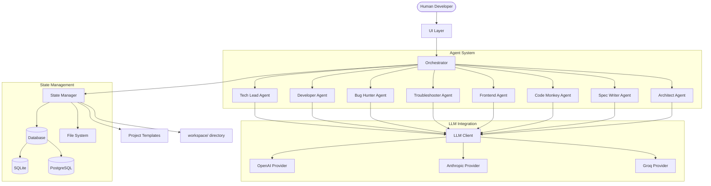
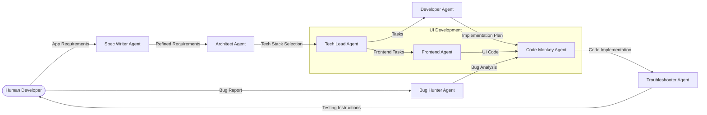

<!-- source: DeepWiki mcp.deepwiki.com · repo Pythagora-io/gpt-pilot · page 1 Overview · fetched 2026-10-26 -->

# Overview

Relevant source files

The following files were used as context for generating this wiki page:

- [CHANGELOG.md](CHANGELOG.md)
- [README.md](README.md)
- [pyproject.toml](pyproject.toml)
- [requirements.txt](requirements.txt)

GPT Pilot is an AI-powered system that automates software development by generating and implementing code for full applications while collaborating with human developers. Unlike code completion tools or simple helpers for PR messages, GPT Pilot aims to be a comprehensive AI developer companion that can write complete features, debug code, and engage in meaningful development conversations.

## Purpose and Scope

This document provides a high-level introduction to the GPT Pilot system, its architecture, and its core functionality. For detailed information on specific components, please refer to the corresponding wiki pages linked throughout this document.

## Core Philosophy

GPT Pilot operates on the principle that AI can handle approximately 95% of application code, while human oversight remains essential for the remaining 5%. As stated in the project README:

> "The main idea is that AI can write most of the code for an app (maybe 95%), but for the rest, 5%, a developer is and will be needed until we get full AGI."

This human-in-the-loop approach enables GPT Pilot to scale to complex applications while maintaining high code quality through developer feedback and collaboration.

## System Architecture

### High-Level Architecture Diagram

Sources: [README.md:76-191]()

The system consists of several core components:

1. **UI Layer**: Provides interfaces for developer interaction, including a VS Code extension, console interface, and virtual UI for automated testing.

2. **Orchestrator**: Coordinates the activities of different agents and manages project state.

3. **Agent System**: A collection of specialized AI agents that handle different aspects of the development process.

4. **State Management**: Maintains project state through databases (SQLite or PostgreSQL) and the file system.

5. **LLM Integration**: Connects agents to various LLM providers (OpenAI, Anthropic, Groq).

6. **Project Templates**: Provides starting points for different project types.

For more detailed information on the system architecture, see [System Architecture](#2).

## Development Workflow

### Agent Workflow Diagram

Sources: [README.md:178-191]()

The development process follows these steps:

1. The human developer provides initial application requirements
2. The **Spec Writer Agent** asks clarifying questions to refine requirements
3. The **Architect Agent** determines the technology stack
4. The **Tech Lead Agent** breaks down the project into manageable tasks
5. The **Developer Agent** creates detailed implementation plans
6. The **Code Monkey Agent** writes actual code based on these plans
7. The **Troubleshooter Agent** helps identify and fix issues
8. The **Bug Hunter Agent** analyzes bugs reported by the developer
9. The **Frontend Agent** handles UI-specific implementation

Throughout this process, the human developer provides feedback, reviews code, and helps overcome obstacles when needed.

## Agent Roles and Responsibilities

GPT Pilot employs a team of specialized AI agents that mirror roles in a real development team:

| Agent | Role |
|-------|------|
| Spec Writer | Asks clarifying questions to understand requirements better |
| Architect | Determines technologies to be used and ensures they're installed |
| Tech Lead | Breaks down projects into development tasks |
| Developer | Creates implementation plans for each task in human-readable form |
| Code Monkey | Implements code changes based on the Developer's description |
| Reviewer | Reviews task implementation and provides feedback |
| Troubleshooter | Helps identify issues and suggests solutions |
| Bug Hunter | Analyzes and resolves bugs reported by users |
| Frontend | Handles UI implementation |
| Technical Writer | Creates documentation for the project |

Sources: [README.md:178-191]()

For more detailed information on specific agents, see [Core Agents](#3).

## Key Capabilities and Differentiators

GPT Pilot distinguishes itself from similar tools like Smol Developer and GPT Engineer in several key ways:

1. **Step-by-Step Development**: Rather than generating an entire codebase at once, GPT Pilot codes incrementally, making debugging easier.

2. **Scalability**: Uses intelligent code filtering to present only relevant portions to the LLM, allowing it to handle larger projects without context limitations.

3. **Human Collaboration**: Designed to work with developers rather than replace them, creating a collaborative development process.

4. **Multi-Agent Architecture**: Utilizes specialized agents that work together, mimicking a development team structure.

5. **Continuous Development**: Supports adding new features to existing applications through natural language instructions.

Sources: [README.md:194-199]()

## Using GPT Pilot

GPT Pilot can be used either through its VS Code extension or via the command-line interface. The system writes all generated code to a workspace directory inside the project folder.

Basic installation steps include:

1. Clone the repository
2. Install dependencies
3. Configure LLM provider API keys
4. Run GPT Pilot

For detailed setup instructions, see [Configuration and LLM Integration](#5).

For information on commands and usage options, see [Development Workflow](#6).

Sources: [README.md:97-120](), [README.md:137-176]()

---

