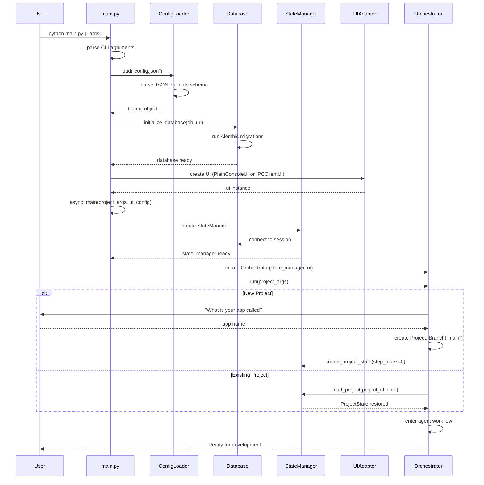
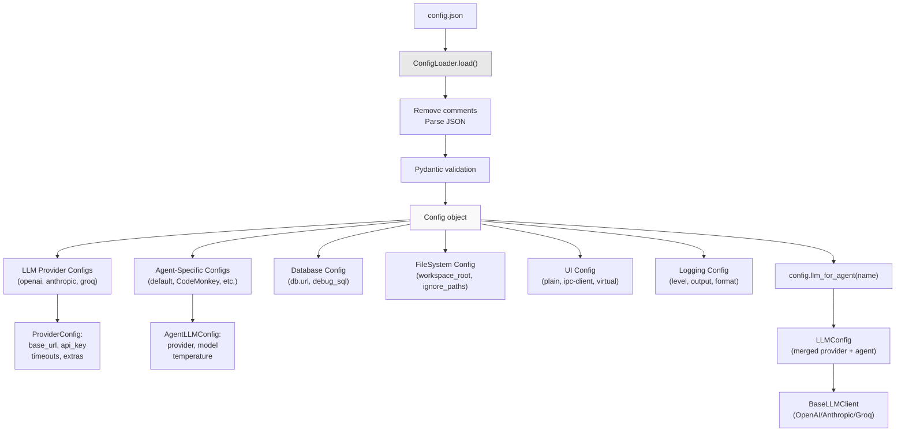
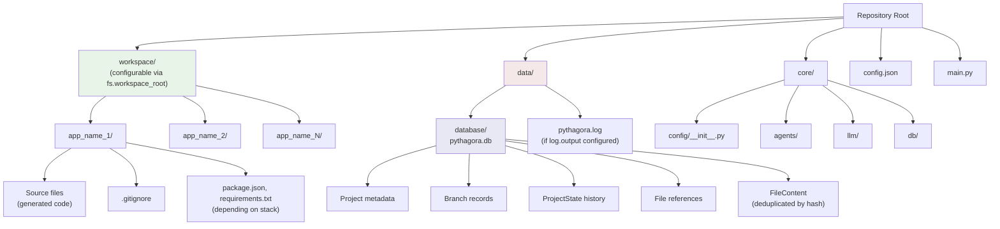
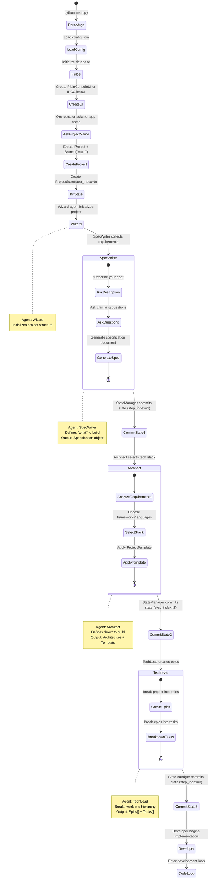
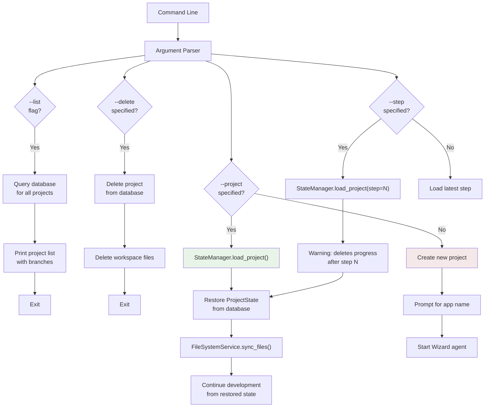

<!-- source: DeepWiki mcp.deepwiki.com · repo Pythagora-io/gpt-pilot · page 2 Getting Started · fetched 2026-10-26 -->

# Getting Started

<details>
<summary>Relevant source files</summary>

The following files were used as context for generating this wiki page:

- [CHANGELOG.md](CHANGELOG.md)
- [README.md](README.md)
- [core/config/__init__.py](core/config/__init__.py)
- [core/llm/anthropic_client.py](core/llm/anthropic_client.py)
- [data/database/.gitkeep](data/database/.gitkeep)
- [example-config.json](example-config.json)
- [pyproject.toml](pyproject.toml)
- [requirements.txt](requirements.txt)
- [tests/config/test_config.py](tests/config/test_config.py)
- [tests/config/test_env_importer.py](tests/config/test_env_importer.py)

</details>


This section provides an overview of how to install, configure, and begin using GPT Pilot. It covers the essential steps to get the system running and explains the basic workflow for creating your first AI-generated application.

For detailed installation instructions, see [Installation and Setup](#2.1). For comprehensive configuration options, see [Configuration Guide](#2.2). For complete CLI command reference, see [CLI Usage and Commands](#2.3).

---

## Prerequisites

GPT Pilot requires:
- **Python 3.9 or higher** - The minimum version specified in [pyproject.toml:27]()
- **LLM API access** - At least one of: OpenAI, Anthropic, Groq, or Azure OpenAI
- **Poetry or pip** - For dependency management
- **Git** (optional) - For cloning the repository
- **PostgreSQL** (optional) - SQLite is used by default

**Sources:** [pyproject.toml:27](), [README.md:105]()

---

## System Initialization Flow

Understanding how GPT Pilot starts up helps contextualize the installation and configuration steps. The following diagram shows the initialization sequence from command invocation to ready state.

### Startup Sequence Diagram



**Key Components:**

- **`main.py`**: Entry point that orchestrates initialization
- **`ConfigLoader`** ([core/config/__init__.py:444-502]()): Loads and validates `config.json`
- **`Database`**: SQLite (default) or PostgreSQL with async support
- **`UIAdapter`**: Either `PlainConsoleUI` (terminal) or `IPCClientUI` (VSCode extension)
- **`StateManager`**: Transaction-based state persistence system
- **`Orchestrator`**: Central control flow coordinator

**Sources:** [README.md:116-128](), [core/config/__init__.py:444-502]()

---

## Quick Start Overview

The basic workflow to get started with GPT Pilot:

### 1. Clone and Setup

```bash
git clone https://github.com/Pythagora-io/gpt-pilot.git
cd gpt-pilot
python3 -m venv venv
source venv/bin/activate  # Windows: venv\Scripts\activate
pip install -r requirements.txt
```

### 2. Configure API Access

```bash
cp example-config.json config.json
# Edit config.json to add your API keys
```

### 3. Start GPT Pilot

```bash
python main.py
```

The system will prompt you for your application name and description, then begin the development workflow through specialized AI agents.

**Sources:** [README.md:116-128]()

---

## Configuration Loading Process

GPT Pilot uses a structured configuration system that loads settings from `config.json` and applies them across all components. Understanding this process is essential for customization.

### Configuration Flow Diagram



**Key Configuration Classes:**

| Class | Purpose | File Location |
|-------|---------|---------------|
| `ConfigLoader` | Loads and parses config.json | [core/config/__init__.py:444-502]() |
| `Config` | Root configuration model | [core/config/__init__.py:325-442]() |
| `ProviderConfig` | LLM provider settings | [core/config/__init__.py:93-120]() |
| `AgentLLMConfig` | Agent-specific LLM settings | [core/config/__init__.py:122-138]() |
| `LLMConfig` | Complete merged LLM config | [core/config/__init__.py:140-188]() |
| `DBConfig` | Database connection settings | [core/config/__init__.py:233-261]() |
| `FileSystemConfig` | Workspace configuration | [core/config/__init__.py:305-323]() |

**Configuration Resolution:**

1. `ConfigLoader` reads `config.json` and strips comments ([core/config/__init__.py:462-471]())
2. Pydantic validates structure and applies defaults
3. For each agent, `config.llm_for_agent(agent_name)` merges provider and agent configs ([core/config/__init__.py:423-434]())
4. If agent-specific config doesn't exist, falls back to `"default"` agent

**Sources:** [core/config/__init__.py:93-442](), [example-config.json:1-89]()

---

## Project Workspace Structure

GPT Pilot organizes all generated code and metadata in a structured workspace. Understanding this layout helps with project management and debugging.

### Workspace Directory Tree



**Workspace Defaults:**

- **Root Location**: `workspace/` ([core/config/__init__.py:312]())
- **Ignored Patterns**: `.git`, `node_modules`, `venv`, `*.min.js`, etc. ([core/config/__init__.py:11-34]())
- **Size Threshold**: Files >50KB are ignored by default ([core/config/__init__.py:35]())

**Database Schema:**

The SQLite database (default location: `data/database/pythagora.db`) stores:
- **Projects**: High-level project records with metadata
- **Branches**: Currently only `"main"` branch is supported (multi-branch planned)
- **ProjectStates**: Immutable snapshots at each development step
- **Files**: References to file paths within projects
- **FileContent**: Deduplicated file content (keyed by SHA-256 hash)
- **LLM Requests**: Optional logging of all LLM interactions (if `db.save_llm_requests: true`)

**Sources:** [core/config/__init__.py:11-35, 305-323](), [example-config.json:58-88](), [README.md:129]()

---

## First Project Workflow

When you run `python main.py` without arguments, GPT Pilot initiates a new project workflow. This sequence demonstrates how the system progresses from user input to generated code.

### New Project Initialization Flow



**Project State Progression:**

Each successful agent completion increments `step_index` and commits a new `ProjectState`. This creates an immutable history that can be:
- **Replayed**: Using `--project <id> --step <N>` to restore any historical state
- **Audited**: All LLM requests, user inputs, and command executions are logged
- **Branched**: Future feature to create alternative development paths (currently single branch only)

**Agent Sequence:**

1. **Wizard** ([core/agents/wizard.py]()): Initializes project structure, validates environment
2. **SpecWriter** ([core/agents/spec_writer.py]()): Gathers requirements through interactive Q&A
3. **Architect** ([core/agents/architect.py]()): Selects technology stack, applies project template
4. **TechLead** ([core/agents/tech_lead.py]()): Creates epic hierarchy, breaks into implementable tasks
5. **Developer** ([core/agents/developer.py]()): Converts tasks into step-by-step implementation plans
6. **CodeMonkey** ([core/agents/code_monkey.py]()): Generates actual code using `<pythagoracode>` tags

**Sources:** [README.md:186-198]()

---

## CLI Command Patterns

GPT Pilot provides several command-line operations for project management. The basic patterns are:

### Common CLI Operations

| Command | Purpose | Key Files |
|---------|---------|-----------|
| `python main.py` | Start new project | [main.py]() |
| `python main.py --list` | List all projects and branches | [README.md:150-153]() |
| `python main.py --project <id>` | Continue from latest step | [README.md:157-159]() |
| `python main.py --project <id> --step <N>` | Load specific historical state | [README.md:162-167]() |
| `python main.py --delete <id>` | Delete project (permanent) | [README.md:170-175]() |
| `python main.py --help` | Show all available options | [README.md:179-183]() |

### CLI Argument Processing Flow



**State Loading Behavior:**

When using `--project <id> --step <N>`:
1. All `ProjectState` records after step N are **deleted** from database
2. All file modifications after step N are **reverted**
3. The workspace is restored to exact state at step N
4. Development continues from that point (destructive operation)

**Project Listing Output:**

The `--list` command shows:
- Project ID (for use with `--project`)
- App name
- Branch name (currently always `"main"`)
- Current step index
- Last modified timestamp

**Sources:** [README.md:146-183]()

---

## Environment and Dependencies

GPT Pilot uses modern Python async/await patterns and requires specific package versions for compatibility.

### Core Dependencies

| Package | Version | Purpose |
|---------|---------|---------|
| `python` | ^3.9 | Minimum Python version |
| `openai` | ^1.40.6 | OpenAI API client |
| `anthropic` | ^0.39.0 | Anthropic/Claude API client |
| `groq` | ^0.6.0 | Groq API client |
| `jinja2` | ^3.1.4 | Prompt template engine |
| `tiktoken` | ^0.8.0 | Token counting for OpenAI models |
| `sqlalchemy[asyncio]` | ^2.0.32 | Async ORM for database |
| `aiosqlite` | ^0.20.0 | Async SQLite driver |
| `pydantic` | ^2.8.2 | Configuration validation |
| `alembic` | ^1.13.2 | Database migrations |
| `tenacity` | 9.0.0 | Retry logic for LLM requests |
| `prompt-toolkit` | ^3.0.48 | CLI input handling |

### Optional Dependencies

- **PostgreSQL Support**: `asyncpg` + `psycopg2` (install separately)
- **Development**: `pytest`, `ruff`, `pytest-cov` (in dev group)

**Virtual Environment Isolation:**

GPT Pilot should always be run in a virtual environment to avoid dependency conflicts:

```bash
python3 -m venv venv
source venv/bin/activate  # or venv\Scripts\activate on Windows
pip install -r requirements.txt
```

**Sources:** [pyproject.toml:26-42](), [requirements.txt:1-38](), [README.md:136-143]()

---

## Next Steps

Now that you understand the basic concepts and workflow, proceed to:

- **[Installation and Setup](#2.1)**: Detailed installation instructions for various platforms
- **[Configuration Guide](#2.2)**: Comprehensive configuration reference for `config.json`
- **[CLI Usage and Commands](#2.3)**: Complete CLI command reference with examples

For understanding the system architecture after setup, see:

- **[System Architecture](#3)**: Deep dive into core components and design patterns
- **[Agent System](#4)**: How specialized AI agents coordinate to build applications
- **[LLM Integration](#5)**: Configuration and usage of different LLM providers

**Sources:** [README.md:1-221]()

---

