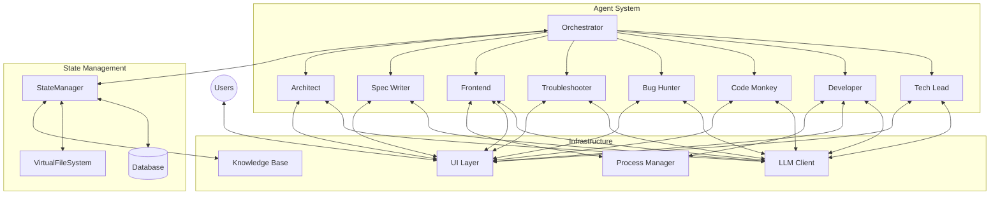
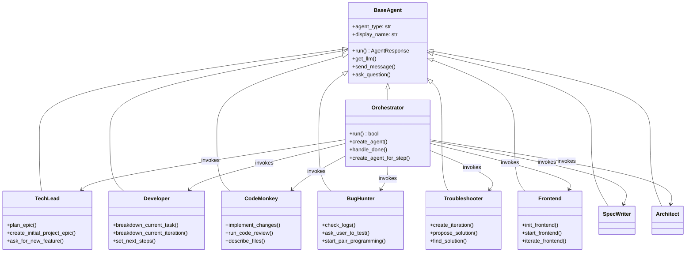
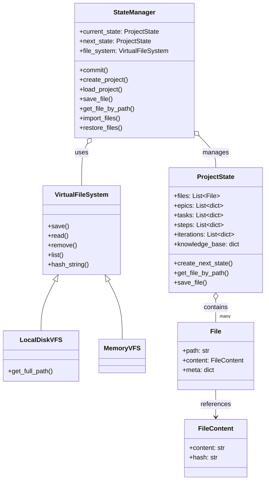
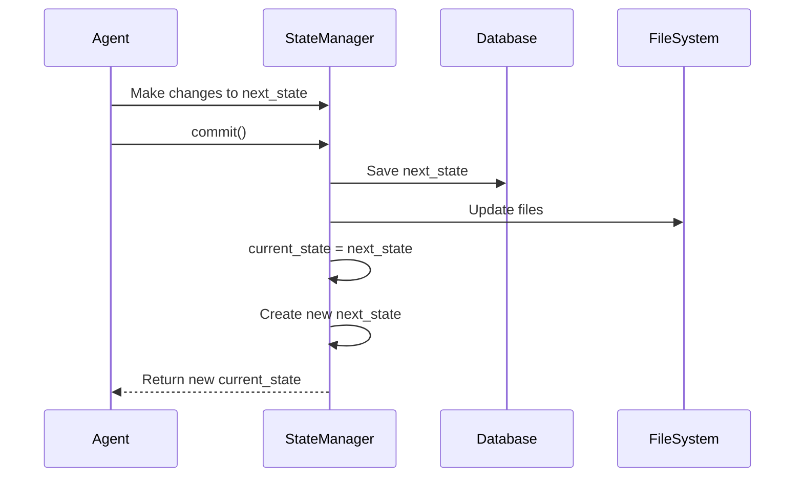
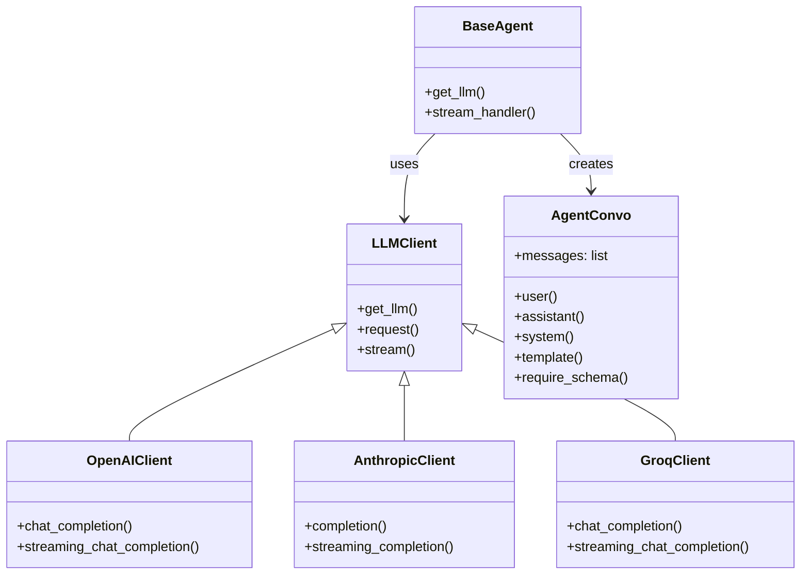
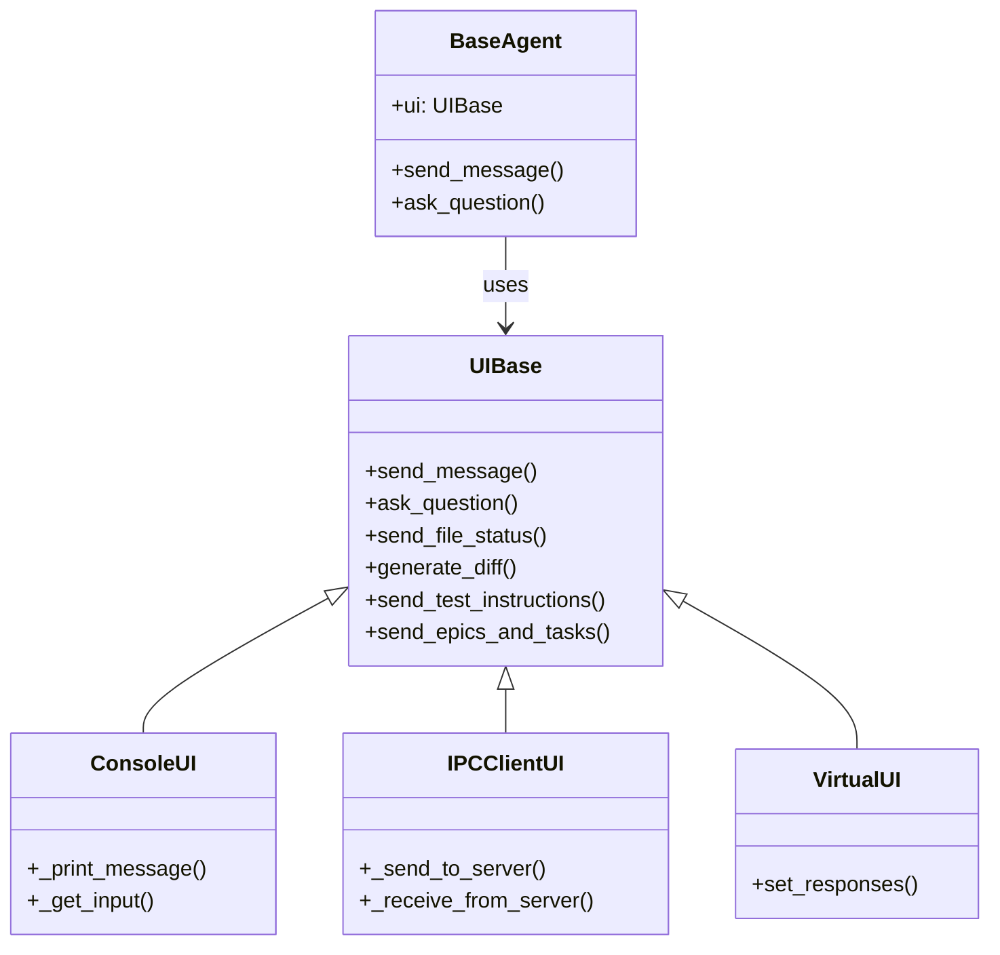
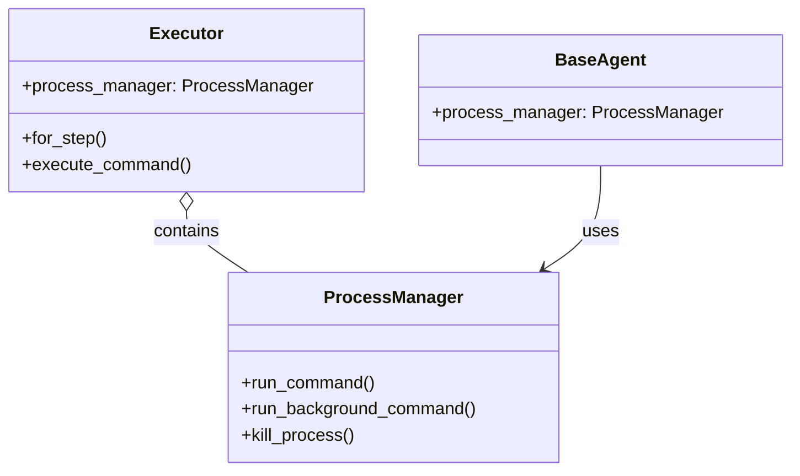
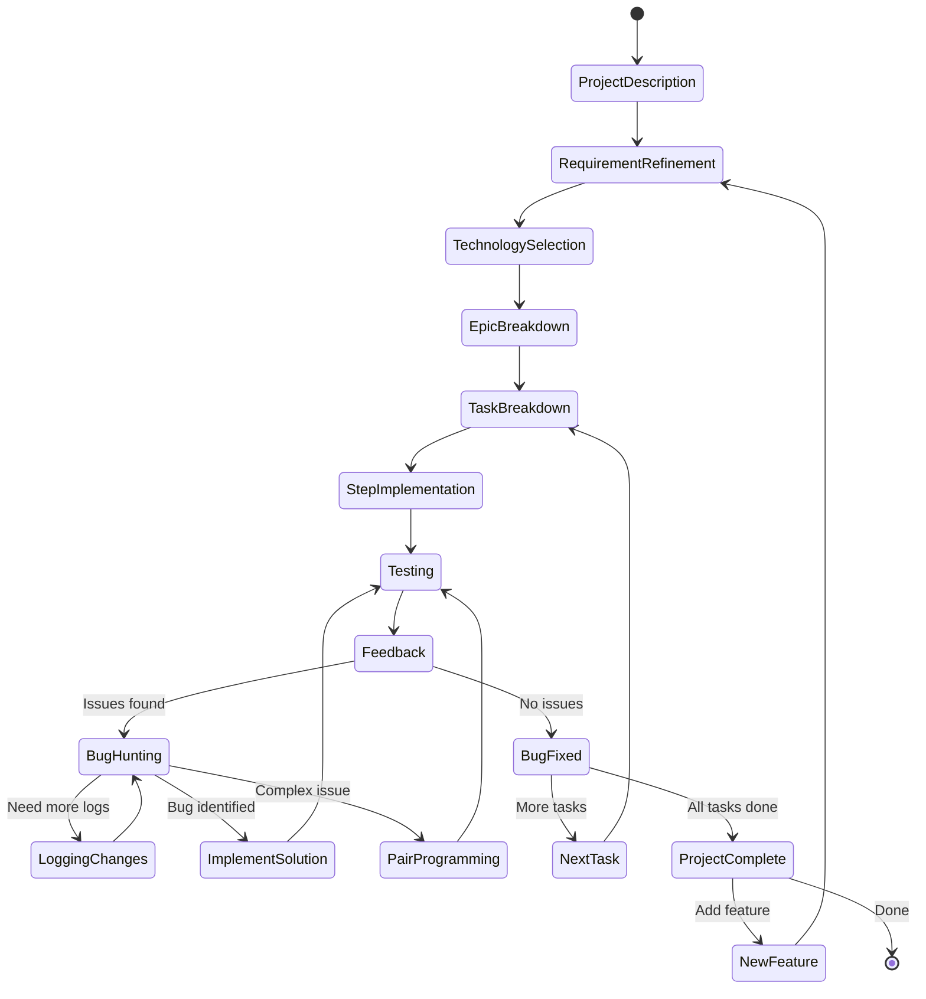

<!-- source: DeepWiki mcp.deepwiki.com · repo Pythagora-io/gpt-pilot · page 3 System Architecture · fetched 2026-10-26 -->

# System Architecture

<details>
<summary>Relevant source files</summary>

The following files were used as context for generating this wiki page:

- [core/agents/architect.py](core/agents/architect.py)
- [core/agents/frontend.py](core/agents/frontend.py)
- [core/agents/orchestrator.py](core/agents/orchestrator.py)
- [core/agents/spec_writer.py](core/agents/spec_writer.py)
- [core/cli/helpers.py](core/cli/helpers.py)
- [core/cli/main.py](core/cli/main.py)
- [core/db/models/project.py](core/db/models/project.py)
- [core/db/models/project_state.py](core/db/models/project_state.py)
- [core/db/v0importer.py](core/db/v0importer.py)
- [core/state/state_manager.py](core/state/state_manager.py)
- [core/ui/api_server.py](core/ui/api_server.py)
- [tests/cli/test_cli.py](tests/cli/test_cli.py)
- [tests/db/test_project.py](tests/db/test_project.py)

</details>


This document describes the high-level architecture of GPT Pilot, detailing the major components and their interactions. It explains how the system is organized to support automated software development through a team of AI agents. For information about specific agents and their implementation details, see [Core Agents](#3).

## Overview

GPT Pilot is built as a multi-agent system that mimics a software development team, with different agents specializing in various aspects of the development process. The architecture follows a modular design with three primary layers:

1. **Agent System** - A team of specialized AI agents that handle different aspects of software development
2. **State Management** - Core mechanisms for managing and persisting project state
3. **Infrastructure Layer** - Support systems including LLM integration, UI abstraction, and file management



Sources:
- [core/agents/orchestrator.py]()
- [core/state/state_manager.py]()
- [README.md:177-191]()

## Agent System

The agent system is the core of GPT Pilot, consisting of specialized agents designed to mimic the roles in a software development team. Each agent has a specific responsibility in the development process and interacts with other agents through the Orchestrator.



Sources:
- [core/agents/orchestrator.py:32-410]()
- [core/agents/base.py]()
- [core/agents/tech_lead.py:48-320]()
- [core/agents/developer.py:76-367]()
- [core/agents/bug_hunter.py:46-364]()
- [core/agents/troubleshooter.py:34-396]()
- [core/agents/frontend.py:17-298]()
- [core/agents/code_monkey.py:58-461]()

### Orchestrator

The Orchestrator (`Orchestrator` class) is the central coordinator of all agents. It determines which agent should be executed based on the current project state, manages the sequence of operations, and handles the responses from agents.

Key responsibilities:
- Determining which agent to run next based on the current state
- Creating and invoking agents
- Handling agent responses and updating project state
- Managing the overall workflow of the development process
- Coordinating file operations and user interactions

Sources:
- [core/agents/orchestrator.py:32-410]()

### Agent Roles and Workflow

GPT Pilot implements a development team workflow through specialized agents:

1. **Spec Writer** - Refines project requirements and creates a detailed specification
2. **Architect** - Selects technologies and designs the high-level system architecture
3. **Tech Lead** - Breaks down the project into epics and tasks
4. **Developer** - Creates detailed implementation plans for tasks
5. **Code Monkey** - Implements code changes and files
6. **Bug Hunter** - Identifies and analyzes bugs in the code
7. **Troubleshooter** - Tests implementations and gathers user feedback
8. **Frontend** - Specializes in UI implementation

```mermaid
flowchart LR
    User((User)) --> SpecWriter
    SpecWriter["Spec Writer"] --> Architect
    Architect --> TechLead["Tech Lead"]
    TechLead --> Developer
    Developer --> CodeMonkey["Code Monkey"]
    CodeMonkey --> Troubleshooter
    Troubleshooter -- "Bug Detected" --> BugHunter["Bug Hunter"]
    BugHunter --> Developer
    TechLead -- "UI Tasks" --> Frontend
    Frontend --> CodeMonkey
    Troubleshooter -- "Success" --> NextTask["Next Task"]
```

Sources:
- [README.md:177-191]()
- [core/agents/orchestrator.py:242-329]()

## State Management

The state management system is responsible for maintaining, persisting, and updating the project state throughout the development lifecycle. The `StateManager` class is the central component that orchestrates all state-related operations.



Key components:

1. **StateManager** - Manages loading, updating, and saving project states
2. **ProjectState** - Represents a snapshot of the project at a particular point
3. **VirtualFileSystem** - Abstraction for file operations (implementations: LocalDiskVFS, MemoryVFS)
4. **File/FileContent** - Models representing files and their content

Sources:
- [core/state/state_manager.py:30-759]()

### State Persistence Flow

The state management system uses a dual-state approach with `current_state` and `next_state`:

1. `current_state` - The committed project state loaded from the database
2. `next_state` - A working copy of the state that accumulates changes before committing

When changes are ready to be committed:
1. The `commit()` method is called
2. `next_state` becomes the new `current_state`
3. A new `next_state` is created for future changes



Sources:
- [core/state/state_manager.py:238-284]()

### Project Structure

The project state includes:

1. **Epics** - High-level features or major components
2. **Tasks** - Specific implementation tasks within epics
3. **Steps** - Detailed implementation steps within tasks
4. **Iterations** - Cycles of implementation, testing, and bug fixing
5. **Files** - Source code and other project files
6. **Knowledge Base** - Accumulated project knowledge (implemented APIs, pages, etc.)

Sources:
- [core/state/state_manager.py:610-736]()

## Infrastructure Layer

### LLM Integration

GPT Pilot integrates with multiple LLM providers including OpenAI, Anthropic, and Groq. The integration is handled through a provider-agnostic interface that allows seamless switching between different LLM providers.



Sources:
- [core/agents/base.py]()
- [core/llm/providers]()
- [core/agents/convo.py]()

### UI Abstraction

The UI layer provides an abstraction that allows GPT Pilot to interact with users through different interfaces, such as VS Code extension, console, or automated tests.



Sources:
- [core/ui/base.py]()
- [core/agents/base.py]()

### Process Management

The Process Manager handles execution of shell commands and processes, allowing agents like the Developer and Frontend to interact with the file system, run builds, and execute tests.



Sources:
- [core/proc/process_manager.py]()
- [core/agents/executor.py]()

## Development Workflow

The complete development workflow in GPT Pilot follows these stages:

1. **Project Initialization**
   - User provides app description
   - Spec Writer refines requirements
   - Architect selects technologies

2. **Project Planning**
   - Tech Lead breaks down project into epics and tasks
   - Developer breaks down tasks into implementation steps

3. **Implementation**
   - Code Monkey implements files and changes
   - Frontend builds UI components
   - Developer coordinates implementation steps

4. **Testing and Debugging**
   - Troubleshooter generates testing instructions
   - User tests implementation
   - Bug Hunter identifies and fixes issues

5. **Iteration**
   - Cycle repeats for each task until project is complete
   - New features can be added when initial project is complete



Sources:
- [core/agents/orchestrator.py:44-116]()
- [README.md:177-191]()

## Conclusion

GPT Pilot's architecture is designed to mimic a human development team, with specialized agents handling different aspects of the development process. The system is built on a robust state management framework that maintains project state throughout the development lifecycle and ensures persistence across sessions.

The modular design allows for flexibility and extensibility, while the agent-based approach enables complex reasoning and problem-solving capabilities. Together, these components create a system capable of generating complete, working applications with minimal human intervention.

Sources:
- [README.md]()
- [core/agents/orchestrator.py]()
- [core/state/state_manager.py]()

---

