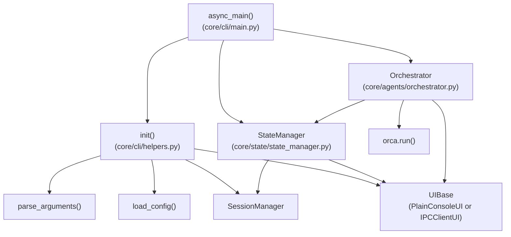
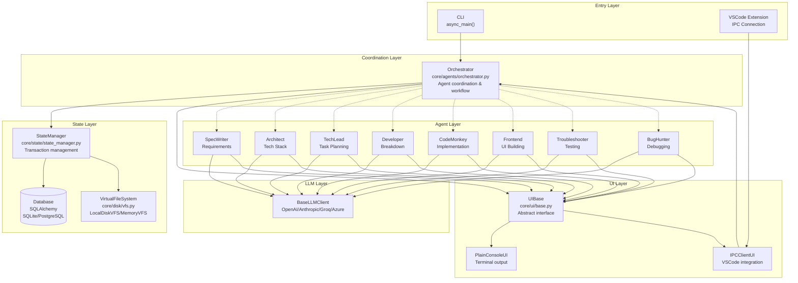
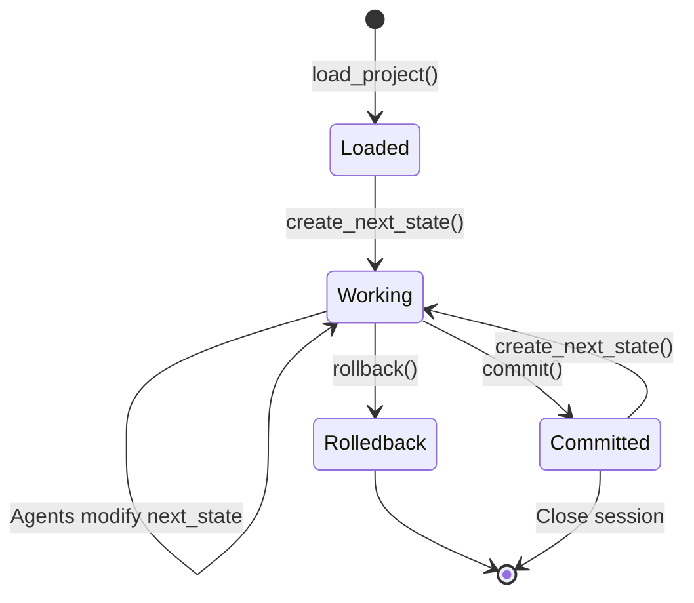
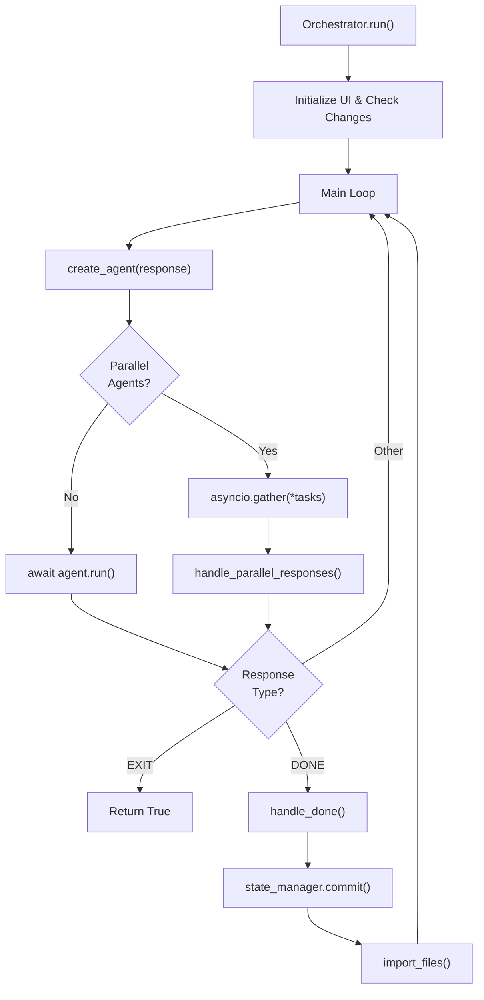
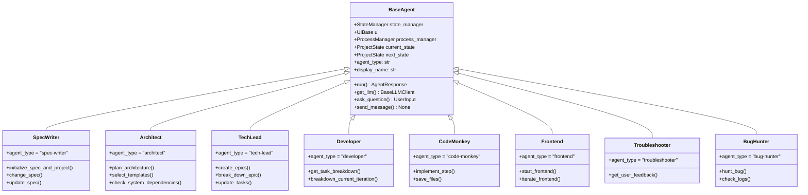
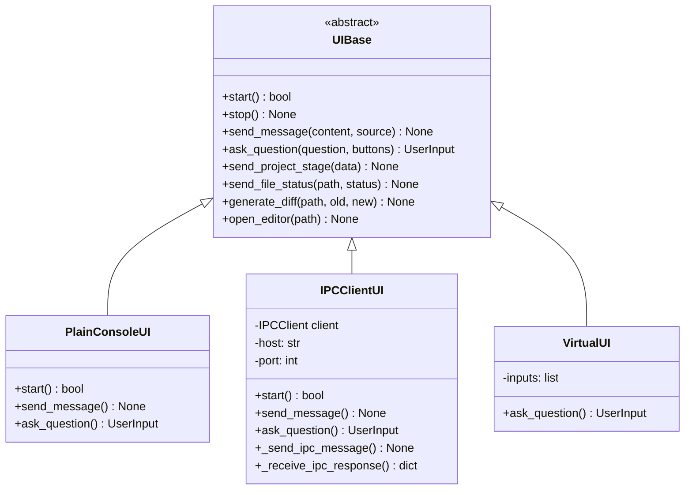
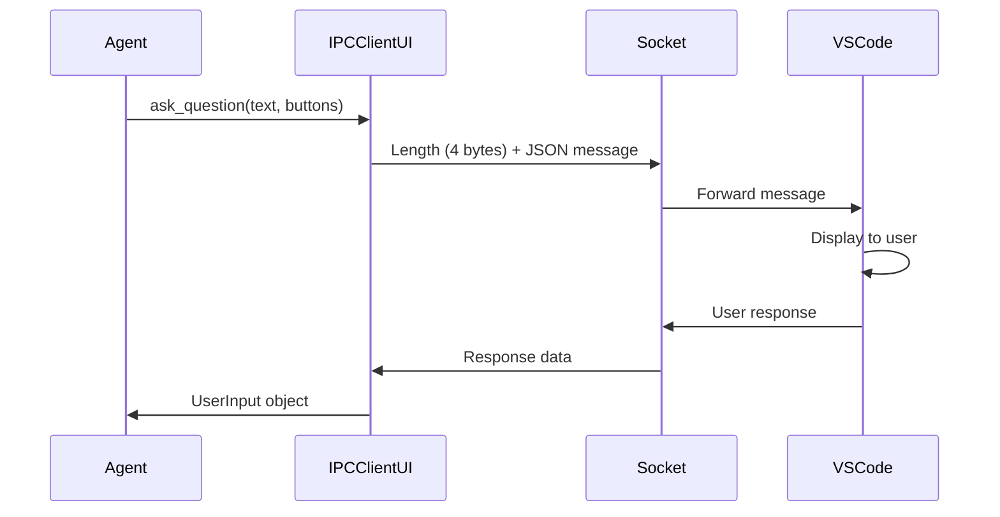
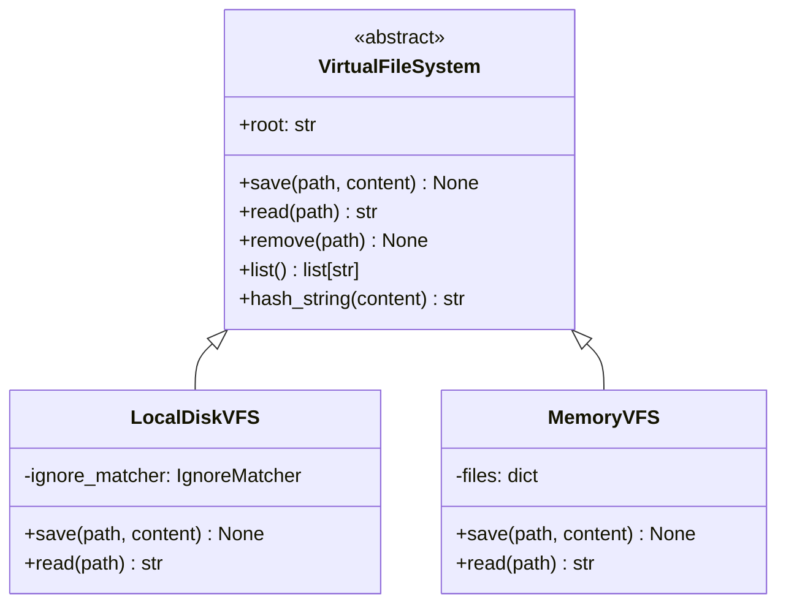
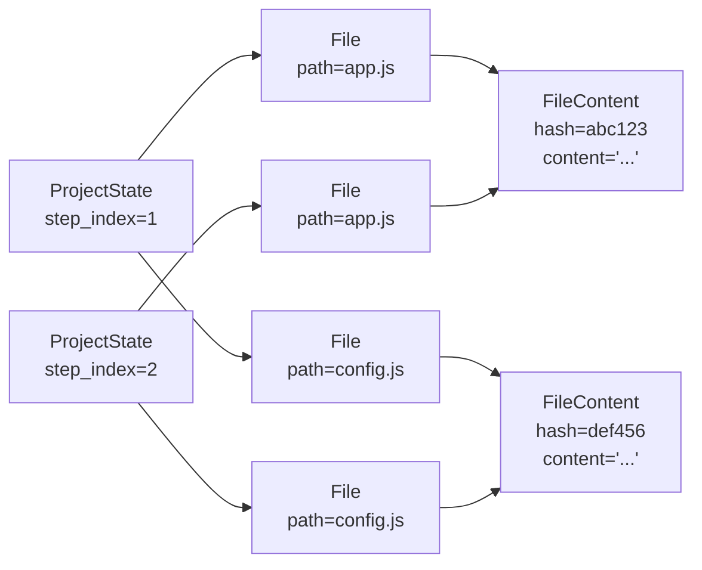

<!-- source: DeepWiki mcp.deepwiki.com · repo Pythagora-io/gpt-pilot · page 3.1 Core Components Overview · fetched 2026-10-26 -->

# Core Components Overview

Relevant source files

The following files were used as context for generating this wiki page:

- [core/agents/architect.py](core/agents/architect.py)
- [core/agents/frontend.py](core/agents/frontend.py)
- [core/agents/orchestrator.py](core/agents/orchestrator.py)
- [core/agents/spec_writer.py](core/agents/spec_writer.py)
- [core/cli/helpers.py](core/cli/helpers.py)
- [core/cli/main.py](core/cli/main.py)
- [core/db/models/project.py](core/db/models/project.py)
- [core/db/models/project_state.py](core/db/models/project_state.py)
- [core/db/v0importer.py](core/db/v0importer.py)
- [core/state/state_manager.py](core/state/state_manager.py)
- [core/ui/api_server.py](core/ui/api_server.py)
- [tests/cli/test_cli.py](tests/cli/test_cli.py)
- [tests/db/test_project.py](tests/db/test_project.py)

This document provides an overview of GPT Pilot's core architectural components and how they interact to enable AI-driven software development. The system consists of four primary layers: the **StateManager** (state persistence and transaction management), the **Orchestrator** (workflow coordination), the **Agent System** (specialized AI agents), and the **UI Layer** (user interaction interfaces).

For detailed information about specific subsystems:
- State management internals and transaction model: see [State Management System](#3.2)
- Orchestrator workflow coordination: see [Orchestrator and Control Flow](#3.3)  
- UI protocols and VSCode extension: see [UI and Communication Layer](#3.4)
- Individual agent implementations: see [Agent System](#4)

---

## System Entry Point and Initialization

The application starts through `core.cli.main.async_main()`, which initializes the database, UI, and state manager before creating the Orchestrator.

**Sources:** [core/cli/main.py:324-426](), [core/cli/helpers.py:180-330]()

---

## Component Architecture

The system follows a layered architecture where each component has a clear responsibility:

**Sources:** [core/cli/main.py:1-438](), [core/agents/orchestrator.py:1-673](), [core/state/state_manager.py:47-1163]()

---

## StateManager: Project State and Persistence

The `StateManager` class manages the project's state lifecycle, providing transaction semantics for all state changes. It maintains two state references:

| Attribute | Type | Purpose |
|-----------|------|---------|
| `current_state` | `ProjectState` | Read-only committed state |
| `next_state` | `ProjectState` | Writable working copy |
| `project` | `Project` | Current project metadata |
| `branch` | `Branch` | Current branch |
| `file_system` | `VirtualFileSystem` | File I/O abstraction |

**Transaction Model**

The transaction pattern ensures atomicity:
1. Agents read from `current_state` (immutable)
2. Agents write to `next_state` (mutable)
3. `commit()` makes `next_state` the new `current_state`
4. A new `next_state` is created for further modifications

**Key Methods**

| Method | Purpose | File Reference |
|--------|---------|----------------|
| `load_project()` | Load existing project state | [core/state/state_manager.py:272-415]() |
| `create_project()` | Initialize new project | [core/state/state_manager.py:172-246]() |
| `commit()` | Commit state changes | [core/state/state_manager.py:433-478]() |
| `rollback()` | Abandon uncommitted changes | [core/state/state_manager.py:480-489]() |
| `save_file()` | Save file to state and disk | [core/state/state_manager.py:589-627]() |
| `import_files()` | Import external file changes | [core/state/state_manager.py:703-738]() |

**Sources:** [core/state/state_manager.py:47-1163](), [core/db/models/project_state.py:59-850]()

---

## Orchestrator: Central Control Flow

The `Orchestrator` class (inheriting from `BaseAgent`) coordinates the entire development workflow by selecting and running agents based on the current project state.

**Agent Selection Logic**

The `create_agent()` method examines the current project state to determine which agent should run next:

| State Condition | Agent Selected | File Reference |
|-----------------|----------------|----------------|
| No specification | `SpecWriter` | [core/agents/orchestrator.py:505-507]() |
| No architecture | `Architect` | [core/agents/orchestrator.py:508-510]() |
| No tasks | `TechLead` | [core/agents/orchestrator.py:511-513]() |
| Has unfinished tasks | `Developer` | [core/agents/orchestrator.py:533-535]() |
| Task has steps | `CodeMonkey` | [core/agents/orchestrator.py:536-539]() |
| Has iterations | `Troubleshooter` or `BugHunter` | [core/agents/orchestrator.py:540-547]() |

**Sources:** [core/agents/orchestrator.py:36-673](), [core/agents/base.py:1-468]()

---

## Agent System: Specialized AI Workers

All agents inherit from `BaseAgent`, which provides common functionality for LLM interaction, state access, and user communication.

**BaseAgent Interface**

**Agent Responsibilities**

| Agent | Primary Function | State Modifications | File Reference |
|-------|------------------|---------------------|----------------|
| `SpecWriter` | Capture user requirements | `specification.description` | [core/agents/spec_writer.py:19-357]() |
| `Architect` | Select tech stack | `specification.architecture`, `system_dependencies` | [core/agents/architect.py:95-295]() |
| `TechLead` | Create epics and tasks | `epics[]`, `tasks[]` | [core/agents/tech_lead.py]() |
| `Developer` | Break tasks into steps | `steps[]` | [core/agents/developer.py]() |
| `CodeMonkey` | Generate code | `files[]`, file content | [core/agents/code_monkey.py]() |
| `Frontend` | Build UI | Frontend-specific files | [core/agents/frontend.py:40-603]() |
| `Troubleshooter` | Collect user feedback | `iterations[]` | [core/agents/troubleshooter.py]() |
| `BugHunter` | Debug issues | Log analysis, fix implementation | [core/agents/bug_hunter.py]() |

**Sources:** [core/agents/base.py:42-468](), [core/agents/spec_writer.py:19-357](), [core/agents/architect.py:95-295](), [core/agents/frontend.py:40-603]()

---

## UI Layer: User Interaction Abstraction

The UI system uses the `UIBase` abstract class to support multiple interfaces without changing agent code.

**UI Architecture**

**UI Implementations**

| Class | Use Case | Communication | File Reference |
|-------|----------|---------------|----------------|
| `PlainConsoleUI` | CLI usage | Direct terminal I/O | [core/ui/console.py]() |
| `IPCClientUI` | VSCode extension | TCP socket (localhost:8125) | [core/ui/ipc_client.py]() |
| `VirtualUI` | Testing | Predefined input queue | [core/ui/virtual.py]() |

**Message Flow for IPCClientUI**

The IPC protocol uses length-prefixed JSON messages. Each message contains:
- `type`: Message type enum (`MessageType.USER_INPUT_REQUEST`, etc.)
- `content`: Message payload (dict)
- `request_id`: Optional UUID for request/response matching

**Sources:** [core/ui/base.py:44-1085](), [core/ui/console.py](), [core/ui/ipc_client.py:30-485]()

---

## File System and Database Integration

**Virtual File System**

The `VirtualFileSystem` interface abstracts file operations, enabling both production (disk) and testing (memory) scenarios:

**Database Models**

The database schema centers around `ProjectState`, which contains snapshots of the project at each step:

| Model | Purpose | Key Fields | File Reference |
|-------|---------|------------|----------------|
| `Project` | Project metadata | `id`, `name`, `folder_name` | [core/db/models/project.py:18-178]() |
| `Branch` | Version branches | `id`, `name`, `project_id` | [core/db/models/branch.py]() |
| `ProjectState` | State snapshot | `step_index`, `epics`, `tasks`, `files` | [core/db/models/project_state.py:59-850]() |
| `File` | File reference | `path`, `project_state_id`, `content_id` | [core/db/models/file.py]() |
| `FileContent` | Deduplicated content | `id`, `content`, `hash` | [core/db/models/file_content.py]() |
| `Specification` | Project spec | `description`, `architecture` | [core/db/models/specification.py]() |

**Content Deduplication**

Files are content-addressable using SHA-256 hashes. Multiple `File` records can reference the same `FileContent` record, minimizing storage:

**Sources:** [core/disk/vfs.py](), [core/db/models/project.py:18-178](), [core/db/models/project_state.py:59-850](), [core/db/models/file_content.py]()

---

## Execution Flow Summary

A typical development session follows this sequence:

1. **Initialization**: `async_main()` loads configuration, creates `SessionManager`, initializes UI
2. **Project Setup**: `StateManager.create_project()` or `StateManager.load_project()`
3. **Orchestration**: `Orchestrator.run()` enters main loop
4. **Agent Execution**: Orchestrator selects and runs agents based on state
5. **State Commit**: After each agent completes, `StateManager.commit()` persists changes
6. **Iteration**: Loop continues until all work complete or user exits

Each agent run follows this pattern:
1. Agent reads `current_state` (immutable)
2. Agent modifies `next_state` (mutable)
3. Agent calls LLM via `get_llm()` and `AgentConvo`
4. Agent updates files via `state_manager.save_file()`
5. Agent returns `AgentResponse` (DONE, EXIT, etc.)
6. Orchestrator handles response and commits state

**Sources:** [core/cli/main.py:194-321](), [core/agents/orchestrator.py:48-167](), [core/state/state_manager.py:433-478]()

---

