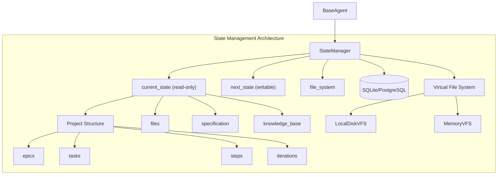
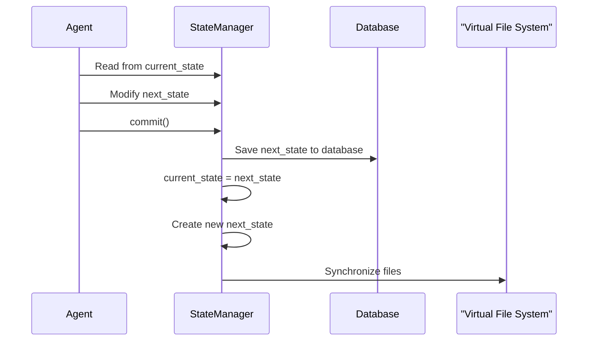
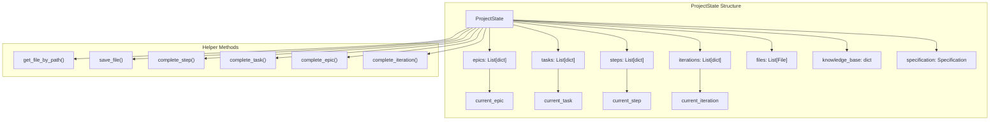
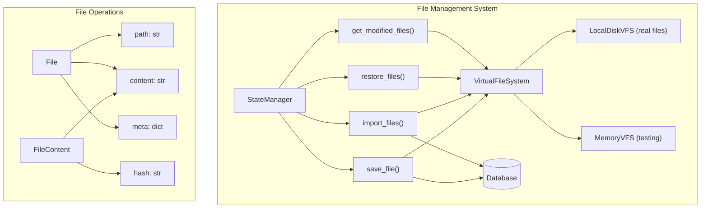
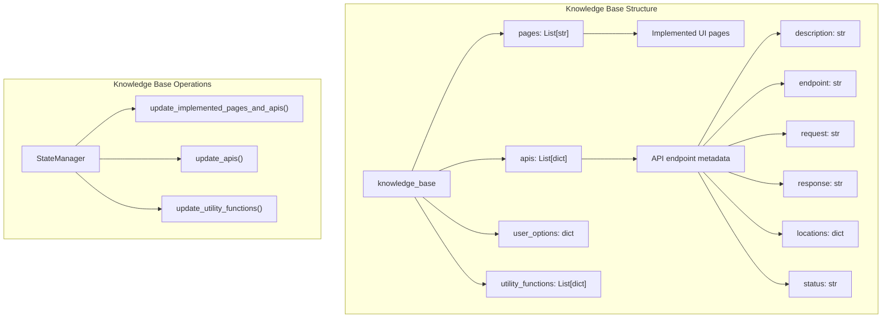
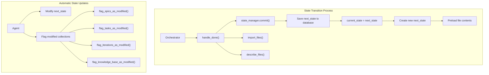
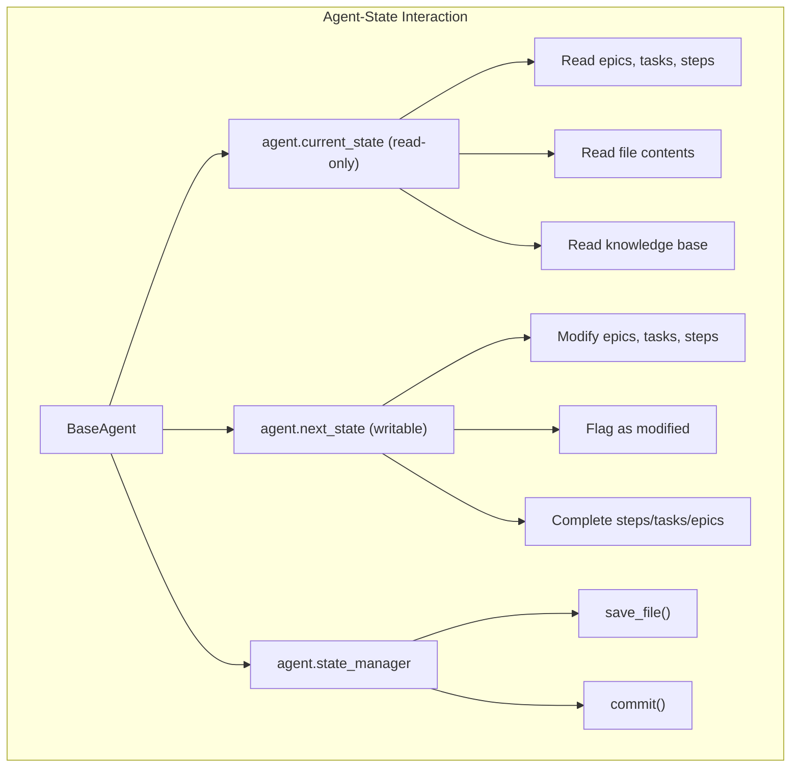
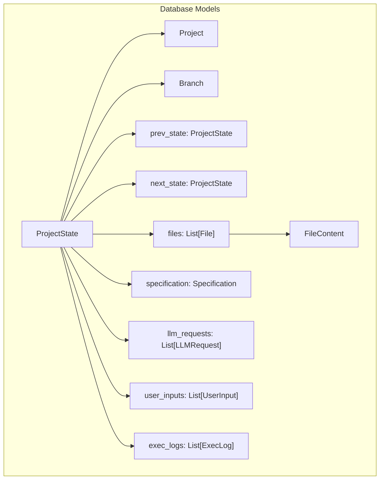
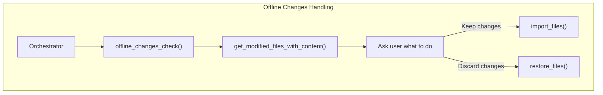

<!-- source: DeepWiki mcp.deepwiki.com · repo Pythagora-io/gpt-pilot · page 3.2 State Management System · fetched 2026-10-26 -->

# State Management

Relevant source files

The following files were used as context for generating this wiki page:

- [core/cli/helpers.py](core/cli/helpers.py)
- [core/cli/main.py](core/cli/main.py)
- [core/db/models/project.py](core/db/models/project.py)
- [core/db/models/project_state.py](core/db/models/project_state.py)
- [core/db/v0importer.py](core/db/v0importer.py)
- [core/state/state_manager.py](core/state/state_manager.py)
- [core/ui/api_server.py](core/ui/api_server.py)
- [tests/cli/test_cli.py](tests/cli/test_cli.py)
- [tests/db/test_project.py](tests/db/test_project.py)

The State Management system in GPT Pilot is responsible for tracking, persisting, and synchronizing the state of development projects throughout their lifecycle. This documentation explains how GPT Pilot manages project state, including the project structure, state transitions, file management, and the knowledge base.

For information about the agent system that uses this state management, see [Agent System](#2.1).

## Overview

The state management architecture uses a dual-state approach where the current state is considered immutable (read-only), while a next state is used to accumulate changes. When changes are committed, the next state becomes the current state, and a new next state is created for future modifications. This approach ensures that the system always has a consistent view of the project at any point in time.

Sources: [core/state/state_manager.py:30-108](core/state/state_manager.py:30-108), [core/db/models/project_state.py:49-102](core/db/models/project_state.py:49-102)

## State Manager

The `StateManager` class is the core of the state management system. It provides methods for:

1. Creating and loading projects
2. Managing state transitions
3. Persisting state to the database
4. Synchronizing files between the database and file system
5. Tracking LLM requests, user inputs, and command executions

The state manager maintains two key state objects:
- `current_state`: The immutable, current state of the project (read-only)
- `next_state`: The mutable state where changes are made (writable)

Sources: [core/state/state_manager.py:239-269](core/state/state_manager.py:239-269), [core/agents/orchestrator.py:199-225](core/agents/orchestrator.py:199-225)

## Project State Structure

The `ProjectState` model represents the state of a project at a specific point in time. It contains the following key components:

### Epics

Epics represent high-level features or project components. Each epic is a dictionary containing:
- `id`: Unique identifier
- `name`: Epic name
- `description`: Epic description
- `completed`: Boolean indicating completion status
- `source`: Origin of the epic (e.g., "frontend", "feature")

### Tasks

Tasks represent specific work items within an epic. Each task contains:
- `description`: Task description
- `status`: Current status (todo, in_progress, reviewed, documented, done, skipped)
- `instructions`: Detailed implementation instructions
- `related_api_endpoints`: References to related API endpoints

### Steps

Steps are atomic units of work created by the Developer agent. Each step has:
- `type`: Step type (save_file, command, human_intervention, etc.)
- Action-specific data (e.g., file path and content for save_file)
- `completed`: Boolean indicating completion status

### Iterations

Iterations track troubleshooting or problem-solving cycles. Each iteration includes:
- `description`: Issue description
- `user_feedback`: Feedback from the user
- `status`: Current status of the iteration

Sources: [core/db/models/project_state.py:97-179](core/db/models/project_state.py:97-179), [core/db/models/project_state.py:287-352](core/db/models/project_state.py:287-352)

## File Management

GPT Pilot uses a virtual file system (VFS) abstraction to manage files, with implementations for local disk storage (`LocalDiskVFS`) and in-memory storage (`MemoryVFS`). The state manager provides methods for:

1. Saving files to both the database and file system
2. Importing files from the file system into the database
3. Restoring files from the database to the file system
4. Tracking modified files

Sources: [core/state/state_manager.py:386-435](core/state/state_manager.py:386-435), [core/state/state_manager.py:476-532](core/state/state_manager.py:476-532)

## Knowledge Base

The knowledge base is a dictionary in the `ProjectState` that stores contextual information about the project. It includes:

1. Implemented pages and their locations
2. API endpoints and their implementation status
3. User options and preferences
4. Utility functions and their status

The knowledge base helps agents understand the current state of implementation and make informed decisions.

Sources: [core/state/state_manager.py:620-664](core/state/state_manager.py:620-664), [core/agents/frontend.py:144-146](core/agents/frontend.py:144-146)

## State Transitions

State transitions happen when agents commit their changes to the database. The process involves:

1. Saving the next state to the database
2. Setting the current state to the next state
3. Creating a new next state for future modifications
4. Preloading file contents to ensure they're available

Sources: [core/state/state_manager.py:239-276](core/state/state_manager.py:239-276), [core/agents/orchestrator.py:199-239](core/agents/orchestrator.py:199-239)

## Agent Interaction with State Management

Agents interact with the state management system through their access to the `StateManager` instance. They:

1. Read from `current_state` to understand the project context
2. Modify `next_state` to make changes
3. Use helper methods like `save_file()` to update files
4. Call `commit()` (via the Orchestrator) to persist changes

Sources: [core/agents/orchestrator.py:199-225](core/agents/orchestrator.py:199-225), [core/agents/code_monkey.py:207-225](core/agents/code_monkey.py:207-225)

## Persistence 

Project state is stored in a SQLite or PostgreSQL database using SQLAlchemy. The state includes:

1. Project metadata
2. Branch information
3. State history (steps)
4. File contents (with content-addressable storage)
5. LLM requests and responses
6. User inputs
7. Command execution logs

Sources: [core/db/models/project_state.py:49-96](core/db/models/project_state.py:49-96), [core/state/state_manager.py:307-348](core/state/state_manager.py:307-348)

## Offline Changes Management

The state manager provides mechanisms to handle changes made outside of GPT Pilot, including:

1. Detecting modified files in the workspace
2. Importing external changes into the project state
3. Restoring files from the database to the workspace

This allows users to make changes to files directly and have GPT Pilot recognize and incorporate those changes.

Sources: [core/agents/orchestrator.py:157-198](core/agents/orchestrator.py:157-198), [core/state/state_manager.py:536-608](core/state/state_manager.py:536-608)

## Conclusion

The state management system in GPT Pilot provides a robust foundation for tracking project development, managing files, and maintaining a consistent view of the project state. The dual-state approach with current (read-only) and next (writable) states ensures that changes are applied atomically, while the virtual file system abstraction allows for flexible file management across different environments.

---

