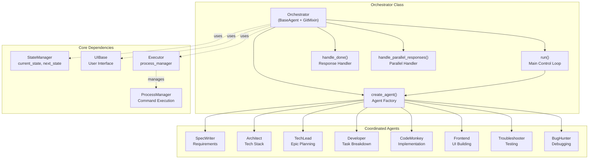
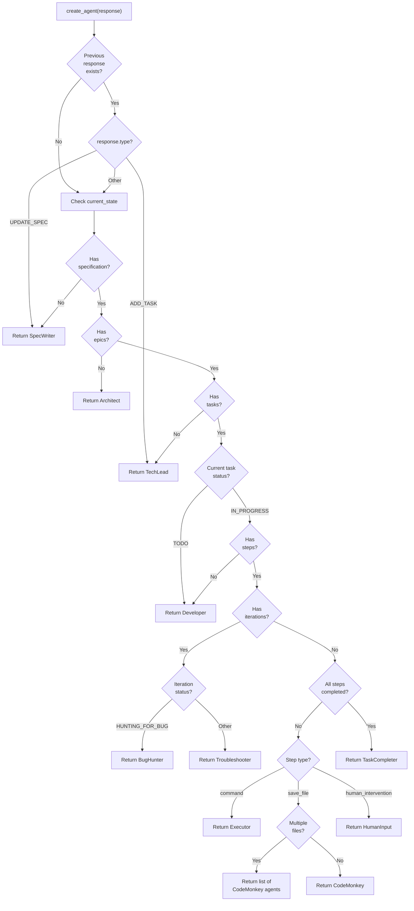
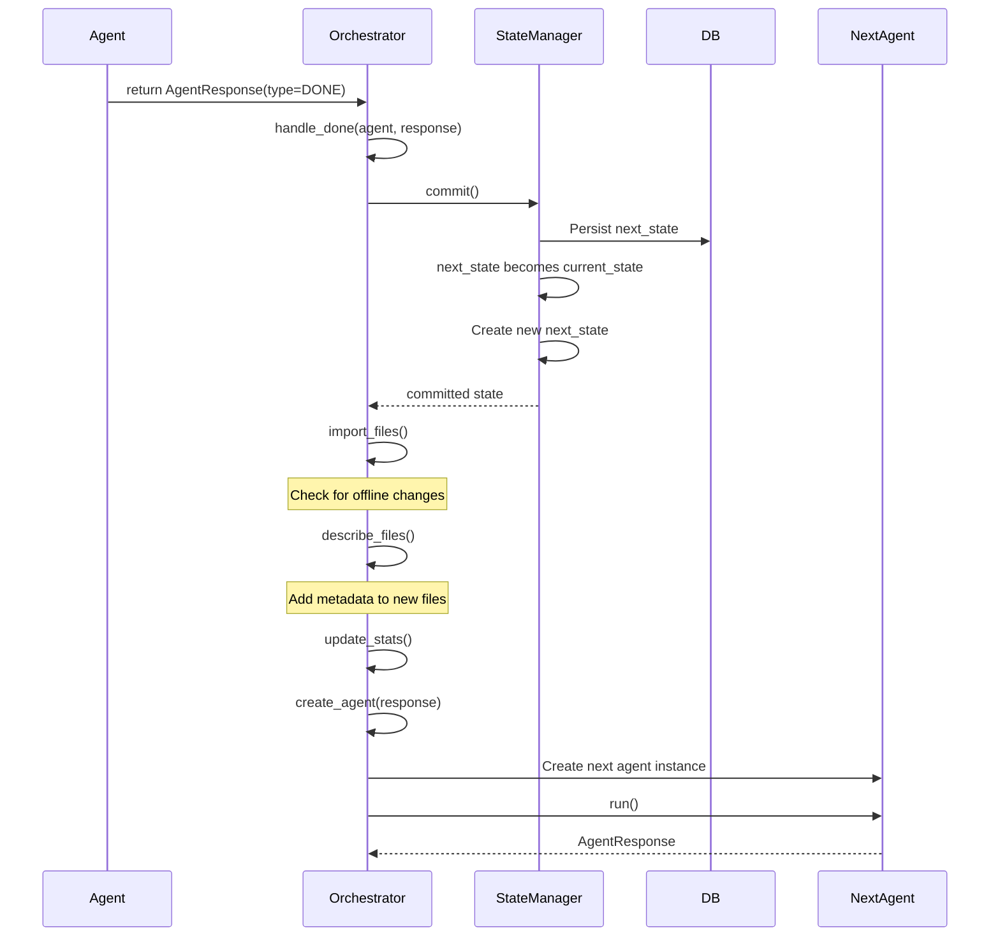
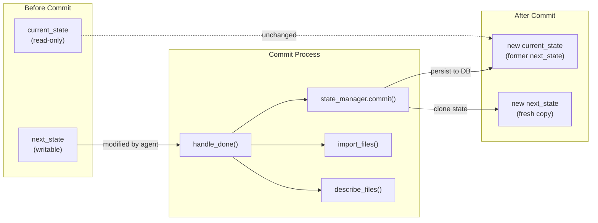
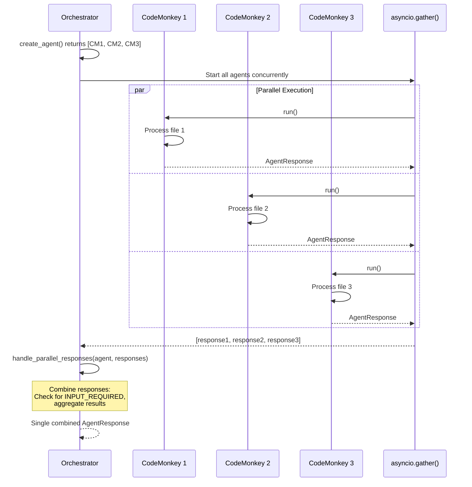
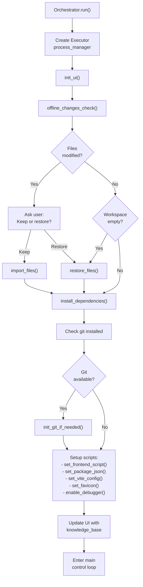
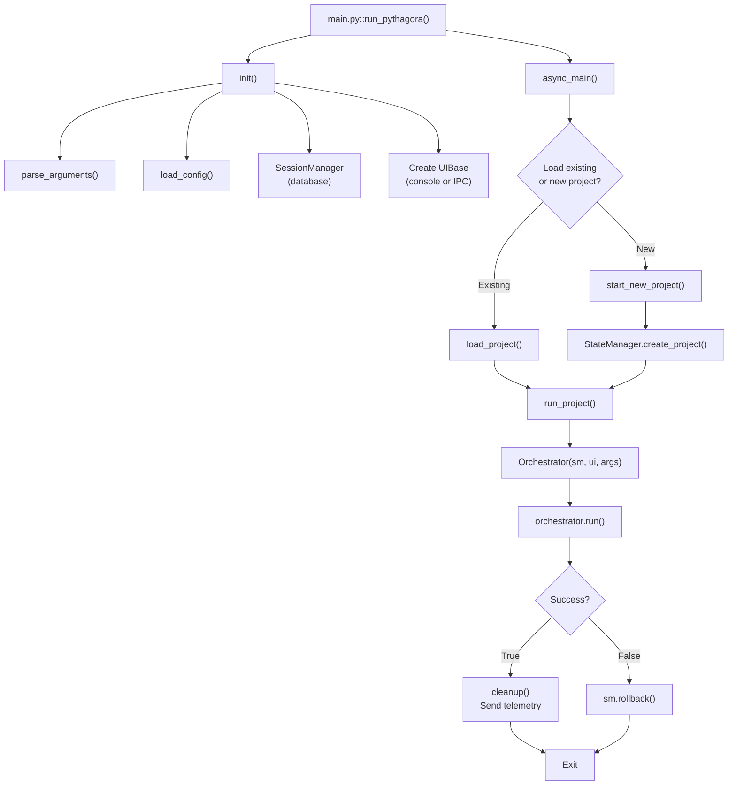
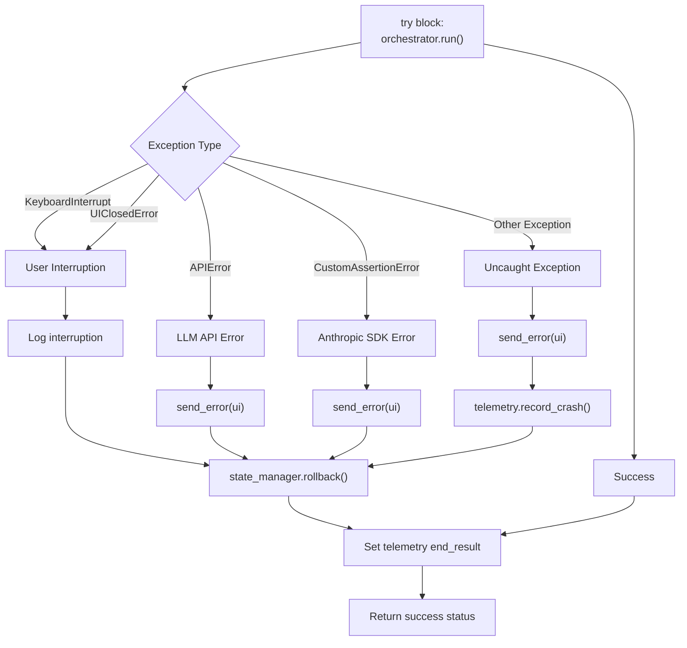
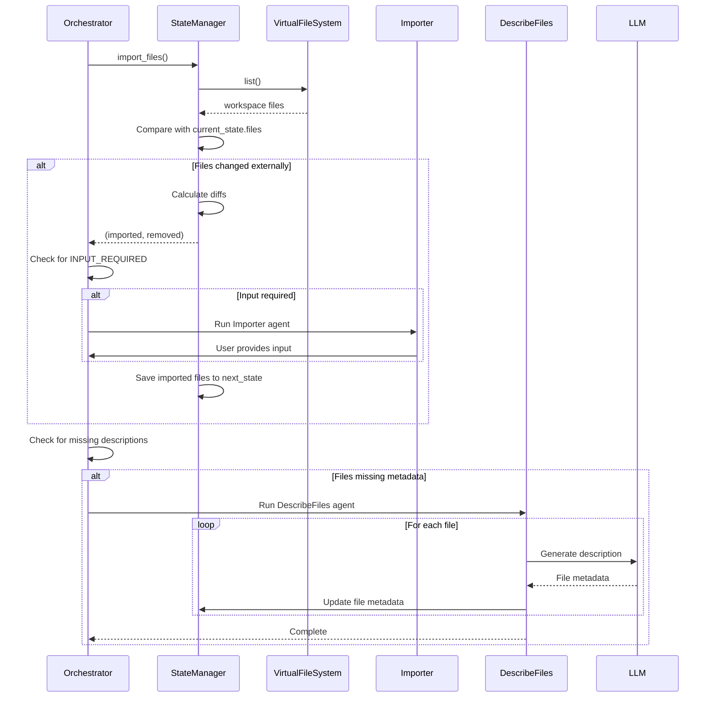
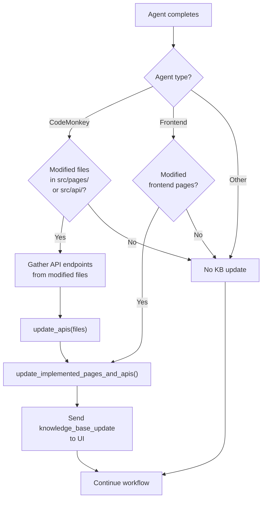

<!-- source: DeepWiki mcp.deepwiki.com · repo Pythagora-io/gpt-pilot · page 3.3 Orchestrator and Control Flow · fetched 2026-10-26 -->

# Orchestrator and Control Flow

<details>
<summary>Relevant source files</summary>

The following files were used as context for generating this wiki page:

- [core/agents/architect.py](core/agents/architect.py)
- [core/agents/frontend.py](core/agents/frontend.py)
- [core/agents/orchestrator.py](core/agents/orchestrator.py)
- [core/agents/spec_writer.py](core/agents/spec_writer.py)
- [core/cli/helpers.py](core/cli/helpers.py)
- [core/cli/main.py](core/cli/main.py)
- [core/db/models/project.py](core/db/models/project.py)
- [core/db/models/project_state.py](core/db/models/project_state.py)
- [core/db/v0importer.py](core/db/v0importer.py)
- [core/state/state_manager.py](core/state/state_manager.py)
- [core/ui/api_server.py](core/ui/api_server.py)
- [tests/cli/test_cli.py](tests/cli/test_cli.py)
- [tests/db/test_project.py](tests/db/test_project.py)

</details>


The Orchestrator is the central control system in GPT Pilot that coordinates all specialized AI agents and manages the development workflow. It implements a state machine that determines which agent should execute at each step based on the current project state, handles agent responses, and manages state persistence through commits to the database.

For information about the individual agents that the Orchestrator coordinates, see [Agent System](#4). For details about state persistence and transactions, see [State Management System](#3.2).

---

## Orchestrator Architecture

The `Orchestrator` class in [core/agents/orchestrator.py:36-167]() serves as both an agent itself and a coordinator for other agents. It inherits from `BaseAgent` and `GitMixin`, giving it both agent capabilities and Git integration.

### Class Structure



**Sources:** [core/agents/orchestrator.py:36-62](), [core/agents/base.py:1-50]()

---

## Main Control Loop

The `Orchestrator.run()` method implements the core control flow as an infinite loop that continues until an agent requests an exit.

### Control Flow State Machine

```mermaid
stateDiagram-v2
    [*] --> Initialize
    
    Initialize --> CheckRedoTask: Check redo_human_instructions
    
    CheckRedoTask --> UpdateStats: No redo needed
    CheckRedoTask --> ReloadProject: Redo requested
    ReloadProject --> UpdateStats
    
    UpdateStats --> CreateAgent: Get agent for current state
    
    CreateAgent --> IsList{Agent is list?}
    
    IsList --> RunParallel: Yes - Multiple agents
    IsList --> RunSingle: No - Single agent
    
    RunParallel --> GatherResponses: asyncio.gather()
    GatherResponses --> HandleParallel: handle_parallel_responses()
    
    RunSingle --> RunAgent: agent.run()
    RunAgent --> CheckUserInterrupt{UserInterruptError?}
    CheckUserInterrupt --> ForceExit: Yes
    CheckUserInterrupt --> HandleResponse: No
    
    HandleParallel --> CheckType
    ForceExit --> CheckType
    HandleResponse --> CheckType
    
    CheckType --> ResponseType{response.type?}
    
    ResponseType --> Exit: EXIT
    ResponseType --> HandleDone: DONE
    ResponseType --> UpdateStats: Other types
    
    HandleDone --> Commit: handle_done()
    Commit --> UpdateStats
    
    Exit --> [*]
    
    note right of CreateAgent
        create_agent() uses
        current_state to determine
        which agent to run next
    end note
    
    note right of HandleDone
        Commits next_state to DB,
        imports files, describes files,
        creates new next_state
    end note
```

**Sources:** [core/agents/orchestrator.py:48-167](), [core/cli/main.py:63-105]()

### Loop Implementation Details

The main loop at [core/agents/orchestrator.py:87-167]() performs these key operations:

1. **Check for task redo**: Lines 89-104 handle cases where a task needs to be restarted with new instructions
2. **Update statistics**: Line 105 updates telemetry metrics
3. **Create agent(s)**: Line 106 determines which agent(s) to run based on current state
4. **Handle parallel execution**: Lines 109-140 process multiple agents running concurrently
5. **Handle single execution**: Lines 142-148 run a single agent
6. **Process response**: Lines 149-164 handle different response types

**Sources:** [core/agents/orchestrator.py:87-167]()

---

## Agent Creation and Selection

The `create_agent()` method acts as a factory that instantiates the appropriate agent based on the current project state. This method is not shown in the provided files but is referenced and its behavior can be inferred.

### Agent Selection Logic



**Sources:** Based on agent workflow patterns from [core/agents/orchestrator.py:106](), [core/db/models/project_state.py:32-57](), [core/agents/response.py:1-30]()

---

## Response Type System

Agents return `AgentResponse` objects that signal to the Orchestrator what action to take next. The response type determines the control flow.

### Response Type Enumeration

| Response Type | Purpose | Handling |
|--------------|---------|----------|
| `ResponseType.DONE` | Agent completed successfully | Commit state, continue to next agent |
| `ResponseType.EXIT` | Stop execution | Exit main loop |
| `ResponseType.INPUT_REQUIRED` | User input needed | Route to HumanInput agent |
| `ResponseType.UPDATE_SPECIFICATION` | Spec needs updating | Route to SpecWriter |
| `ResponseType.DESCRIBE_FILES` | Files need descriptions | Describe files before continuing |
| `ResponseType.IMPORT_PROJECT` | Import external changes | Run Importer agent |

### Response Handling Flow



**Sources:** [core/agents/orchestrator.py:418-479](), [core/state/state_manager.py:433-479](), [core/agents/response.py:1-30]()

---

## State Commitment Process

When an agent completes with `ResponseType.DONE`, the `handle_done()` method manages the transaction commit and prepares for the next step.

### Commit Transaction Flow



**Key Operations in `handle_done()`:**

1. **Log progress** [core/agents/orchestrator.py:427-444](): Count finished epics, tasks, iterations, and steps
2. **Commit to database** [core/agents/orchestrator.py:446](): Call `state_manager.commit()`
3. **Import external files** [core/agents/orchestrator.py:451](): Detect and import files changed outside GPT Pilot
4. **Describe new files** [core/agents/orchestrator.py:454-462](): Add metadata to files missing descriptions
5. **Update knowledge base** [core/agents/orchestrator.py:465-474](): Update pages and APIs if needed

**Sources:** [core/agents/orchestrator.py:418-479](), [core/state/state_manager.py:433-479]()

---

## Parallel Agent Execution

The Orchestrator supports running multiple instances of the same agent type in parallel, currently only implemented for `CodeMonkey` agents when multiple files need to be saved.

### Parallel Execution Architecture



### Implementation Details

The parallel execution logic at [core/agents/orchestrator.py:109-140]():

1. **Detection**: Check if `create_agent()` returns a list
2. **Execution**: Use `asyncio.gather(*tasks)` to run agents concurrently
3. **Combination**: Call `handle_parallel_responses()` to merge results
4. **Knowledge base update**: Check if any agent modified pages or APIs

The `handle_parallel_responses()` method at [core/agents/orchestrator.py:345-368]() handles merging:

- For `CodeMonkey` agents: Aggregates files that require user input
- Returns a single `AgentResponse` representing the combined result
- Raises error for unsupported parallel agent types

**Sources:** [core/agents/orchestrator.py:109-140](), [core/agents/orchestrator.py:345-368]()

---

## Initialization and Setup

Before entering the main control loop, the Orchestrator performs several initialization tasks.

### Initialization Sequence



### Key Initialization Methods

| Method | Purpose | Location |
|--------|---------|----------|
| `init_ui()` | Initialize user interface | [core/agents/base.py]() |
| `offline_changes_check()` | Detect external file modifications | [core/agents/orchestrator.py:370-417]() |
| `install_dependencies()` | Run `npm install` if needed | [core/agents/orchestrator.py:169-181]() |
| `init_git_if_needed()` | Initialize Git repository | [core/agents/git.py]() |
| `set_frontend_script()` | Inject Pythagora utilities script | [core/agents/orchestrator.py:182-221]() |
| `enable_debugger()` | Add debug script to package.json | [core/agents/orchestrator.py:222-251]() |

**Sources:** [core/agents/orchestrator.py:48-86](), [core/agents/orchestrator.py:169-344](), [core/agents/orchestrator.py:370-417]()

---

## Entry Point Integration

The Orchestrator is instantiated and started from the CLI entry point.

### Application Startup Flow



### Main Entry Points

1. **CLI Entry**: [core/cli/main.py:429-438]() - `run_pythagora()` function
2. **Async Main**: [core/cli/main.py:324-426]() - `async_main()` coroutine
3. **Session Runner**: [core/cli/main.py:194-321]() - `run_pythagora_session()`
4. **Project Runner**: [core/cli/main.py:63-105]() - `run_project()` creates and runs Orchestrator

**Sources:** [core/cli/main.py:63-105](), [core/cli/main.py:194-321](), [core/cli/main.py:324-438]()

---

## Error Handling and Recovery

The Orchestrator implements several error handling strategies to recover from failures and user interruptions.

### Exception Handling Strategy



### Error Types and Handling

| Exception Type | Source | Handling | Telemetry |
|----------------|--------|----------|-----------|
| `KeyboardInterrupt` | User presses Ctrl+C | Rollback state, clean exit | `end_result: interrupt` |
| `UIClosedError` | UI connection lost | Rollback state, clean exit | `end_result: interrupt` |
| `APIError` | LLM API failure | Show error, rollback state | `end_result: failure:api-error` |
| `CustomAssertionError` | Anthropic SDK issue | Show error, rollback state | `end_result: failure:assertion-error` |
| `UserInterruptError` | User cancels agent action | Force DONE response | Continue workflow |
| Generic `Exception` | Unknown error | Send fatal error, crash report | `end_result: crash` |

**Sources:** [core/cli/main.py:80-104](), [core/cli/main.py:108-118](), [core/agents/orchestrator.py:143-148]()

---

## File Import and Description Pipeline

After committing state, the Orchestrator checks for external file changes and ensures all files have metadata descriptions.

### File Processing Pipeline



### Implementation Details

**Import Process** [core/agents/orchestrator.py:451]():
- Calls `state_manager.import_files()` to scan workspace
- Compares current files with database state
- Detects new, modified, and deleted files
- Returns `AgentResponse.import_project()` if input required

**Description Process** [core/agents/orchestrator.py:454-462]():
- Identifies files without `metadata.description`
- Returns `AgentResponse.describe_files()` with file list
- Routes to `DescribeFiles` agent to add metadata
- Ensures all files have searchable descriptions

**Sources:** [core/agents/orchestrator.py:418-479](), [core/state/state_manager.py:703-738](), [core/agents/importer.py]()

---

## Knowledge Base Updates

The Orchestrator tracks when agents modify pages or API endpoints and updates the knowledge base accordingly.

### Knowledge Base Update Logic



### Implementation References

**Parallel Agent KB Check** [core/agents/orchestrator.py:117-140]():
- After parallel CodeMonkey execution
- Checks if any agent modified `src/pages/` or `src/api/`
- Aggregates `related_api_endpoints` from tasks
- Calls `state_manager.update_apis()` and `update_implemented_pages_and_apis()`

**Frontend Agent KB Update** [core/agents/frontend.py:164]():
- After frontend iteration completes
- Calls `state_manager.update_implemented_pages_and_apis()`
- Updates UI with current pages and APIs

**Sources:** [core/agents/orchestrator.py:117-140](), [core/agents/frontend.py:162-165](), [core/state/state_manager.py:840-920]()

---

## Orchestrator Lifecycle Summary

### Complete Workflow Diagram

```mermaid
stateDiagram-v2
    [*] --> Init: Start Orchestrator
    
    Init --> OfflineCheck: Initialize UI, DB, Executor
    OfflineCheck --> InstallDeps: Check/import external changes
    InstallDeps --> SetupScripts: npm install if needed
    SetupScripts --> MainLoop: Configure project files
    
    MainLoop --> CheckRedo: Begin control loop
    CheckRedo --> UpdateStats: Handle task redo if needed
    UpdateStats --> CreateAgent: Update telemetry
    
    CreateAgent --> IsParallel{Multiple agents?}
    IsParallel --> RunParallel: Yes
    IsParallel --> RunSingle: No
    
    RunParallel --> HandleParallel: asyncio.gather()
    RunSingle --> RunAgent: agent.run()
    
    HandleParallel --> CheckResponse
    RunAgent --> CheckResponse: AgentResponse
    
    CheckResponse --> ResponseType{response.type}
    
    ResponseType --> Exit: EXIT
    ResponseType --> HandleDone: DONE
    ResponseType --> MainLoop: Other
    
    HandleDone --> CommitState: Persist changes
    CommitState --> ImportFiles: Save to database
    ImportFiles --> DescribeFiles: Import external changes
    DescribeFiles --> UpdateKB: Add file metadata
    UpdateKB --> MainLoop: Update knowledge base
    
    Exit --> Cleanup: End orchestrator
    Cleanup --> [*]: Send telemetry
```

**Sources:** [core/agents/orchestrator.py:48-167](), [core/cli/main.py:63-105]()

---

