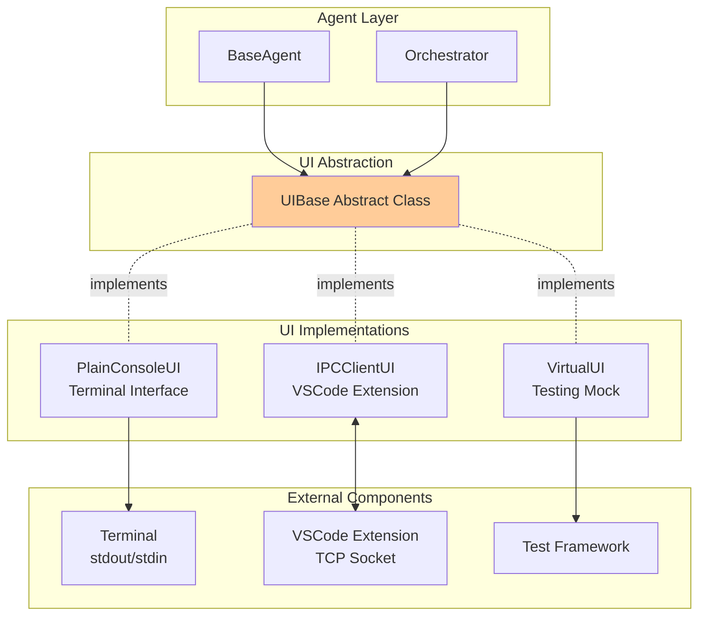
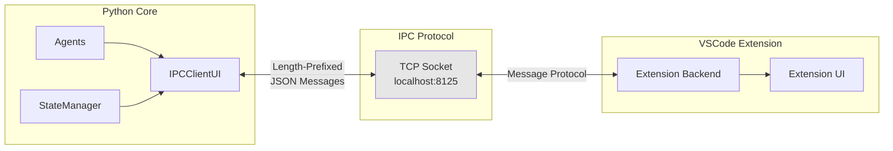
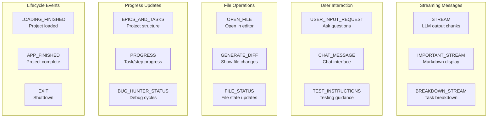
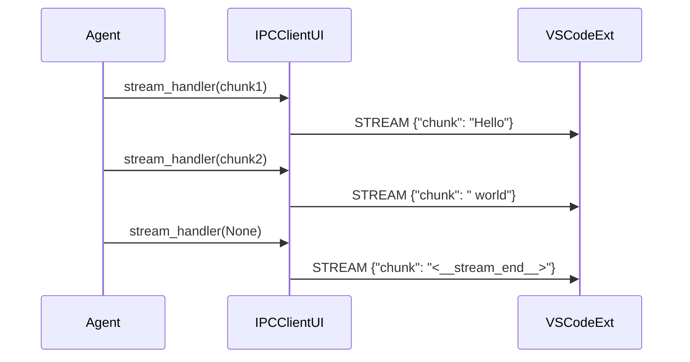
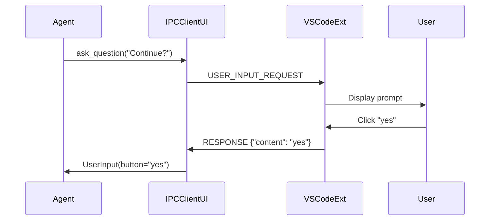
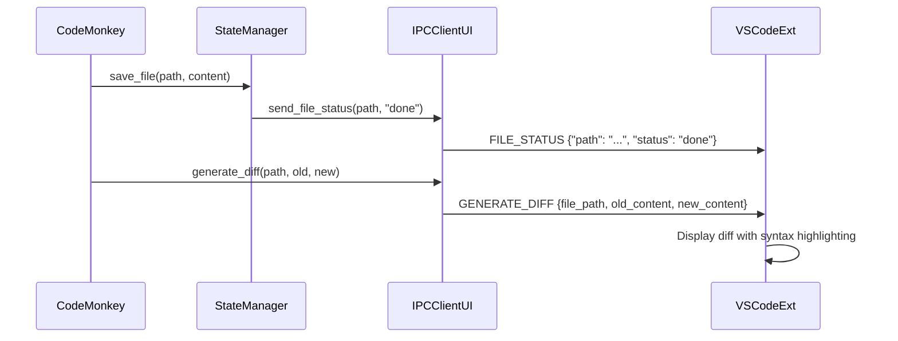
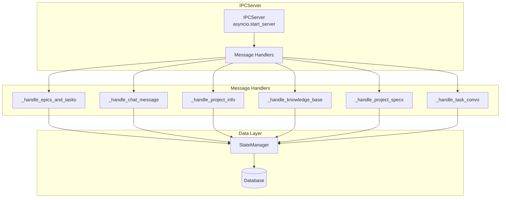

<!-- source: DeepWiki mcp.deepwiki.com · repo Pythagora-io/gpt-pilot · page 3.4 UI and Communication Layer · fetched 2026-10-26 -->

# UI and Communication Layer

<details>
<summary>Relevant source files</summary>

The following files were used as context for generating this wiki page:

- [core/cli/helpers.py](core/cli/helpers.py)
- [core/cli/main.py](core/cli/main.py)
- [core/db/models/project.py](core/db/models/project.py)
- [core/db/models/project_state.py](core/db/models/project_state.py)
- [core/db/v0importer.py](core/db/v0importer.py)
- [core/state/state_manager.py](core/state/state_manager.py)
- [core/ui/api_server.py](core/ui/api_server.py)
- [core/ui/base.py](core/ui/base.py)
- [core/ui/console.py](core/ui/console.py)
- [core/ui/ipc_client.py](core/ui/ipc_client.py)
- [core/ui/virtual.py](core/ui/virtual.py)
- [tests/cli/test_cli.py](tests/cli/test_cli.py)
- [tests/db/test_project.py](tests/db/test_project.py)

</details>


## Purpose and Scope

This document describes the UI and Communication Layer of GPT Pilot, which provides an abstraction for user interaction and real-time communication between the core system and external interfaces. The layer supports multiple UI adapters (terminal, VSCode extension, testing) through a unified interface, enabling the system to operate in different environments without modifying agent code.

For information about how the Orchestrator coordinates agents and manages workflow, see [Orchestrator and Control Flow](#3.3). For details on agent implementations, see [Agent System](#4).

---

## Architecture Overview

The UI and Communication Layer follows an adapter pattern with a common `UIBase` abstract class that defines the interface for all user interactions. This design allows agents to communicate with users without knowledge of the underlying UI implementation.

### UI Adapter Diagram



**Sources:** [core/ui/base.py:104-567](), [core/ui/console.py:11-273](), [core/ui/ipc_client.py:130-662](), [core/ui/virtual.py:9-254]()

---

## UIBase Abstract Class

The `UIBase` class at [core/ui/base.py:104-567]() defines the contract for all UI implementations. It provides over 40 methods for different types of user interactions and system notifications.

### Core Method Categories

| Category | Methods | Purpose |
|----------|---------|---------|
| **Lifecycle** | `start()`, `stop()` | Initialize and cleanup UI adapter |
| **Messaging** | `send_message()`, `send_stream_chunk()` | Display information to users |
| **User Input** | `ask_question()` | Request user responses with optional buttons |
| **File Operations** | `open_editor()`, `generate_diff()`, `send_file_status()` | Show file changes and diffs |
| **Progress** | `send_task_progress()`, `send_step_progress()`, `send_epics_and_tasks()` | Update project state |
| **Special Events** | `send_key_expired()`, `send_app_finished()`, `loading_finished()` | Handle lifecycle events |

### UISource and Message Attribution

The system uses `UISource` and `AgentSource` classes to attribute messages to their origin:

```python
# From core/ui/base.py:38-83
class UISource:
    display_name: str  # Human-readable name
    type_name: str     # Type identifier for IPC
    
class AgentSource(UISource):
    # type_name becomes "agent:{agent_type}"
```

This allows the UI to display which agent (Developer, CodeMonkey, etc.) is sending each message.

**Sources:** [core/ui/base.py:38-83](), [core/ui/base.py:104-567]()

---

## PlainConsoleUI Implementation

`PlainConsoleUI` at [core/ui/console.py:11-273]() provides a simple terminal-based interface using standard I/O streams. It's the default UI when no IPC connection is available.

### Key Implementation Details

```python
# From core/ui/console.py:86-132
async def ask_question(self, question: str, ...) -> UserInput:
    # Prints question to stdout
    # Uses prompt_toolkit for async input
    session = PromptSession("> ")
    choice = await session.prompt_async(default=initial_text or "")
```

**Features:**
- **Synchronous Output**: Messages printed directly to stdout
- **Async Input**: Uses `prompt_toolkit.PromptSession` for non-blocking input
- **Button Support**: Displays button options as text choices
- **Simplified Display**: Most visual features (diffs, progress bars) are no-ops

**Sources:** [core/ui/console.py:11-273]()

---

## IPCClientUI and VSCode Extension

The `IPCClientUI` class at [core/ui/ipc_client.py:130-662]() connects to the VSCode extension via TCP socket, enabling rich IDE integration with real-time updates, syntax highlighting, and interactive debugging.

### Connection Architecture



### Message Protocol

Messages are transmitted using a **length-prefixed JSON protocol**:

```
[4-byte length][JSON payload]
```

The `Message` class at [core/ui/ipc_client.py:75-128]() defines the structure:

```python
class Message(BaseModel):
    type: MessageType           # Message type enum
    category: Optional[str]      # Source agent type
    content: Union[str, dict]    # Message payload
    project_state_id: Optional[str]
    extra_info: Optional[dict]   # Additional metadata
    request_id: Optional[str]    # For request-response matching
```

**Wire Format Methods:**
- `to_bytes()` at [core/ui/ipc_client.py:101-105](): Serializes to JSON bytes
- `from_bytes()` at [core/ui/ipc_client.py:108-127](): Deserializes with error handling

**Sources:** [core/ui/ipc_client.py:75-128](), [core/ui/ipc_client.py:130-217]()

---

## Message Types

The `MessageType` enum at [core/ui/ipc_client.py:21-73]() defines over 50 message types for different communication scenarios:

### Message Type Categories



### Key Message Types

| Type | Direction | Purpose |
|------|-----------|---------|
| `STREAM` | Core → Extension | Stream LLM response chunks |
| `USER_INPUT_REQUEST` | Core → Extension | Request user input with optional buttons |
| `RESPONSE` | Extension → Core | User's answer to question |
| `GENERATE_DIFF` | Core → Extension | Show file diff with syntax highlighting |
| `OPEN_FILE` | Core → Extension | Open file at specific line |
| `EPICS_AND_TASKS` | Core → Extension | Update project structure view |
| `CHAT_MESSAGE` | Bidirectional | Chat interface for interactive debugging |
| `LOADING_FINISHED` | Core → Extension | Signal project load complete |

**Sources:** [core/ui/ipc_client.py:21-73]()

---

## IPCClientUI Send Methods

The `IPCClientUI` class implements all `UIBase` methods by sending appropriate messages over the socket:

### Streaming Messages

```python
# From core/ui/ipc_client.py:219-239
async def send_stream_chunk(self, chunk: Optional[str], ...):
    if chunk is None:
        chunk = "<__stream_end__>"  # End-of-stream marker
    await self._send(MessageType.STREAM, content=chunk, ...)
```

### User Questions

```python
# From core/ui/ipc_client.py:316-394
async def ask_question(self, question: str, ...) -> UserInput:
    # Send question
    await self._send(MessageType.USER_INPUT_REQUEST, content=question, ...)
    
    # Wait for response
    response = await self._receive()
    
    # Parse button or text answer
    if response.content == "exitPythagoraCore":
        raise KeyboardInterrupt()
    return UserInput(button=answer, text=answer, ...)
```

### File Diffs

```python
# From core/ui/ipc_client.py:587-608
async def generate_diff(self, file_path, old_content, new_content, ...):
    await self._send(
        MessageType.GENERATE_DIFF,
        content={
            "file_path": file_path,
            "old_content": old_content,
            "new_content": new_content,
            "n_new_lines": n_new_lines,
            "n_del_lines": n_del_lines,
        }
    )
```

**Sources:** [core/ui/ipc_client.py:156-608]()

---

## Message Flow Patterns

### Pattern 1: Streaming LLM Responses



### Pattern 2: User Input Request-Response



### Pattern 3: File Status Updates



**Sources:** [core/ui/ipc_client.py:219-608](), [core/agents/base.py]()

---

## IPCServer: API Server for External Clients

The `IPCServer` class at [core/ui/api_server.py:43-640]() provides a server-side IPC implementation that allows external clients (like VSCode extension chat interface) to query project state and interact with the system.

### Server Architecture



### Handler Registration

Handlers are registered in `_setup_handlers()` at [core/ui/api_server.py:64-78]():

```python
self.handlers[MessageType.EPICS_AND_TASKS] = self._handle_epics_and_tasks
self.handlers[MessageType.CHAT_MESSAGE] = self._handle_chat_message
self.handlers[MessageType.PROJECT_INFO] = self._handle_project_info
self.handlers[MessageType.KNOWLEDGE_BASE] = self._handle_knowledge_base
# ... more handlers
```

### Key Handler: Chat Message

The chat handler at [core/ui/api_server.py:246-377]() enables interactive debugging by:

1. **Creating a temporary ChatAgent** that can query project state
2. **Generating contextual prompts** with current task, bugs, and commands
3. **Streaming responses** back to the client
4. **Persisting chat history** in the database

```python
# Simplified from core/ui/api_server.py:246-377
async def _handle_chat_message(self, message: Message, writer):
    class ChatAgent(BaseAgent):
        async def stream_handler(self, content_chunk: str):
            await send_stream_chunk(writer, message_type, content_chunk, request_id)
        
        async def generate_prompt(self, convo_id, user_msg):
            # Load relevant project state
            state = await self.state_manager.get_project_state_for_convo_id(convo_id)
            
            # Build context with task description, bugs, commands
            return AgentConvo(self).template(
                "chat",
                initial_description=...,
                task_description=...,
                bug_hunt_cycle_user_feedback=...,
                # ... more context
            )
```

**Sources:** [core/ui/api_server.py:43-640]()

---

## UI Initialization and Selection

The UI adapter is selected during application startup in [core/cli/main.py:324-427]() and [core/cli/helpers.py:284-331]():

### Configuration-Based Selection

```python
# From core/cli/helpers.py:284-331
def load_config(args: Namespace) -> Optional[Config]:
    config = loader.load(args.config)
    
    # Override UI type if --local-ipc-port is provided
    if args.local_ipc_port:
        config.ui = LocalIPCConfig(port=args.local_ipc_port, host=args.local_ipc_host)
```

### UI Instantiation

```python
# From core/cli/helpers.py (not shown fully but referenced)
if config.ui.type == UIAdapter.PLAIN:
    ui = PlainConsoleUI()
elif config.ui.type == UIAdapter.IPC_CLIENT:
    ui = IPCClientUI(config.ui)
```

### StateManager Integration

The `StateManager` receives the UI instance at initialization [core/state/state_manager.py:60-62]():

```python
def __init__(self, session_manager: SessionManager, ui: Optional[UIBase] = None):
    self.ui = ui
    # ... other initialization
```

Agents then access the UI through their `StateManager` reference to send messages, ask questions, and display progress.

**Sources:** [core/cli/main.py:324-427](), [core/cli/helpers.py:284-331](), [core/state/state_manager.py:60-62]()

---

## Error Handling and Connection Management

### Connection Lifecycle

The `IPCClientUI` manages connection lifecycle at [core/ui/ipc_client.py:143-217]():

```python
async def start(self):
    self.reader, self.writer = await asyncio.open_connection(
        self.config.host,
        self.config.port,
        limit=MESSAGE_SIZE_LIMIT,  # 512KB
    )
    
async def stop(self):
    await self._send(MessageType.EXIT)
    self.writer.close()
    await self.writer.wait_closed()
```

### UIClosedError Handling

When the connection is lost or the user closes the extension, `UIClosedError` is raised at [core/ui/ipc_client.py:162-172]():

```python
if self.writer.is_closing():
    log.error("IPC connection closed, can't send the message")
    raise UIClosedError()
```

This exception is caught in the main loop at [core/cli/main.py:84-87]() to gracefully handle user interruptions:

```python
except (KeyboardInterrupt, UIClosedError):
    log.info("Interrupted by user")
    telemetry.set("end_result", "interrupt")
    await sm.rollback()
```

**Sources:** [core/ui/ipc_client.py:143-217](), [core/ui/base.py:30-36](), [core/cli/main.py:84-87]()

---

## VirtualUI for Testing

The `VirtualUI` class at [core/ui/virtual.py:9-254]() provides a mock implementation for automated testing:

```python
class VirtualUI(UIBase):
    def __init__(self, inputs: list[dict[str, str]]):
        self.virtual_inputs = [UserInput(**input) for input in inputs]
    
    async def ask_question(self, question: str, ...) -> UserInput:
        if self.virtual_inputs:
            ret = self.virtual_inputs[0]
            self.virtual_inputs = self.virtual_inputs[1:]
            return ret
        # ... fallback to default answers
```

This allows tests to pre-configure user responses without human interaction.

**Sources:** [core/ui/virtual.py:9-254]()

---

## Integration with StateManager

The `StateManager` uses the UI to:

1. **Notify project info** at [core/state/state_manager.py:388-402]()
2. **Send task progress** when loading projects [core/state/state_manager.py:388-402]()
3. **Request new access tokens** when expired [core/state/state_manager.py:232-240]()
4. **Display error messages** during failures [core/state/state_manager.py:239-245]()

### Example: Project Load Notification

```python
# From core/state/state_manager.py:388-402
if self.current_state.current_epic and self.current_state.current_task and self.ui:
    await self.ui.send_epics_and_tasks(
        self.current_state.current_epic.get("sub_epics"),
        self.current_state.tasks,
    )
    await self.ui.send_task_progress(
        self.current_state.tasks.index(self.current_state.current_task) + 1,
        len(self.current_state.tasks),
        self.current_state.current_task["description"],
        source,
        "in-progress",
        self.current_state.get_source_index(source),
        self.current_state.tasks,
    )
```

**Sources:** [core/state/state_manager.py:388-402](), [core/state/state_manager.py:232-245]()

---

## Summary

The UI and Communication Layer provides:

- **Abstraction**: `UIBase` allows agents to work with any UI implementation
- **Multiple Adapters**: Console, VSCode IPC, and testing UIs
- **Rich Protocol**: 50+ message types for comprehensive IDE integration
- **Bidirectional Communication**: Request-response and streaming patterns
- **Server Support**: `IPCServer` enables external client queries
- **Error Handling**: Graceful degradation on connection loss
- **Testing Support**: `VirtualUI` for automated testing

This architecture enables GPT Pilot to operate in different environments (CLI, IDE, tests) without modifying agent logic, while providing rich real-time feedback to users through the VSCode extension.

---

