<!-- source: DeepWiki mcp.deepwiki.com · repo Pythagora-io/gpt-pilot · page 4 Agent System · fetched 2026-10-26 -->

# Agent System

<details>
<summary>Relevant source files</summary>

The following files were used as context for generating this wiki page:

- [core/agents/architect.py](core/agents/architect.py)
- [core/agents/bug_hunter.py](core/agents/bug_hunter.py)
- [core/agents/developer.py](core/agents/developer.py)
- [core/agents/frontend.py](core/agents/frontend.py)
- [core/agents/mixins.py](core/agents/mixins.py)
- [core/agents/orchestrator.py](core/agents/orchestrator.py)
- [core/agents/spec_writer.py](core/agents/spec_writer.py)
- [core/agents/tech_lead.py](core/agents/tech_lead.py)
- [core/agents/troubleshooter.py](core/agents/troubleshooter.py)

</details>


GPT Pilot uses a multi-agent architecture where specialized AI agents collaborate to perform software development tasks. Each agent corresponds to a specific role in the development lifecycle (e.g., architect, developer, tester) and operates autonomously while coordinating through a shared state management system.

The agent system is orchestrated by the `Orchestrator` class, which determines execution flow based on project state and coordinates agent interactions. All agents inherit from `BaseAgent` and communicate with LLMs through a unified interface.

**Agent Execution Model:**

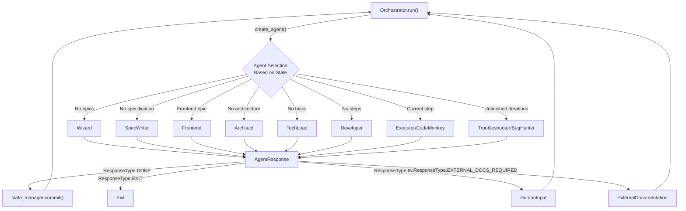

Sources: [core/agents/orchestrator.py:48-167](), [core/agents/orchestrator.py:463-573]()

## Agent Architecture and Base Classes

### BaseAgent Class

All agents inherit from `BaseAgent`, which provides the foundational interface for agent operations:

**Core Attributes:**
- `agent_type: str` - Identifier for the agent type
- `display_name: str` - Human-readable name
- `current_state: ProjectState` - Read-only access to current project state
- `next_state: ProjectState` - Writable state for modifications
- `state_manager: StateManager` - Interface to persistence layer
- `ui: UIBase` - User interface communication
- `process_manager: ProcessManager` - Command execution

**Key Methods:**
- `run() -> AgentResponse` - Main execution method (must be implemented by subclasses)
- `send_message(message: str)` - Send information to user
- `ask_question(question: str, buttons: dict) -> UserInput` - Get user input
- `get_llm(name: str, stream_output: bool) -> LLMClient` - Get configured LLM client

**Agent Class Hierarchy:**

```mermaid
classDiagram
    class BaseAgent {
        <<abstract>>
        +agent_type: str
        +display_name: str
        +current_state: ProjectState
        +next_state: ProjectState
        +state_manager: StateManager
        +ui: UIBase
        +process_manager: ProcessManager
        +run()* AgentResponse
        +send_message(msg: str)
        +ask_question(q: str) UserInput
        +get_llm(name: str) LLMClient
    }
    
    class Wizard {
        +agent_type = "wizard"
        +run() AgentResponse
    }
    
    class SpecWriter {
        +agent_type = "spec-writer"
        +initialize_spec_and_project()
        +change_spec()
        +update_spec()
    }
    
    class Architect {
        +agent_type = "architect"
        +plan_architecture()
        +select_templates()
        +check_system_dependencies()
    }
    
    class TechLead {
        +agent_type = "tech-lead"
        +plan_epic()
        +create_initial_project_epic()
        +ask_for_new_feature()
    }
    
    class Developer {
        +agent_type = "developer"
        +breakdown_current_task()
        +breakdown_current_iteration()
        +set_next_steps()
    }
    
    class CodeMonkey {
        +agent_type = "code-monkey"
        +implement_changes()
        +run_code_review()
        +describe_files()
    }
    
    class Frontend {
        +agent_type = "frontend"
        +start_frontend()
        +continue_frontend()
        +iterate_frontend()
    }
    
    class Troubleshooter {
        +agent_type = "troubleshooter"
        +create_iteration()
        +get_user_feedback()
        +propose_solution()
    }
    
    class BugHunter {
        +agent_type = "bug-hunter"
        +check_logs()
        +ask_user_to_test()
        +start_pair_programming()
    }
    
    class Orchestrator {
        +agent_type = "orchestrator"
        +create_agent()
        +handle_done()
    }
    
    BaseAgent <|-- Wizard
    BaseAgent <|-- SpecWriter
    BaseAgent <|-- Architect
    BaseAgent <|-- TechLead
    BaseAgent <|-- Developer
    BaseAgent <|-- CodeMonkey
    BaseAgent <|-- Frontend
    BaseAgent <|-- Troubleshooter
    BaseAgent <|-- BugHunter
    BaseAgent <|-- Orchestrator
```

Sources: [core/agents/base.py]()

### Agent Mixins

Agents use mixins to share common functionality without duplicating code:

**Mixin Classes:**

| Mixin | Purpose | Key Methods | Used By |
|-------|---------|-------------|---------|
| `RelevantFilesMixin` | Identifies files relevant to current task by filtering large codebases | `get_relevant_files_parallel()`, `get_relevant_files()` | TechLead, Developer, Troubleshooter |
| `ChatWithBreakdownMixin` | Enables interactive refinement of task breakdowns with user | `chat_with_breakdown(convo, breakdown)` | Developer, BugHunter, Troubleshooter |
| `IterationPromptMixin` | Generates solutions based on user feedback and problem analysis | `find_solution(user_feedback, ...)` | Troubleshooter, ProblemSolver |
| `FileDiffMixin` | Calculates line changes between file versions | `get_line_changes(old, new)` | Frontend, CodeMonkey |
| `GitMixin` | Git operations (commit, branch) | `git_commit(message)`, `init_git_if_needed()` | Orchestrator, Frontend |

**Mixin Implementation Pattern:**

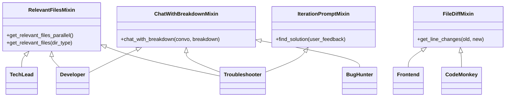

Sources: [core/agents/mixins.py:122-189](), [core/agents/mixins.py:37-80](), [core/agents/mixins.py:82-120](), [core/agents/mixins.py:191-209]()

### AgentResponse System

Agents return `AgentResponse` objects to communicate their completion status and next actions:

**Response Types:**

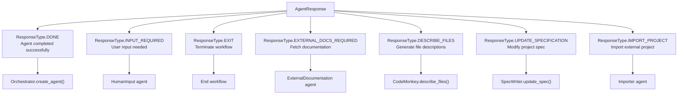

**Factory Methods:**
- `AgentResponse.done(agent)` - Standard completion
- `AgentResponse.input_required(agent, files)` - Requires user to fill in placeholders
- `AgentResponse.external_docs_required(agent)` - Needs external documentation
- `AgentResponse.describe_files(agent)` - Files need descriptions
- `AgentResponse.update_specification(agent, description)` - Spec needs updating
- `AgentResponse.exit(agent)` - End processing

Sources: [core/agents/response.py]()

### Orchestrator

The `Orchestrator` class coordinates all agent execution and manages the development workflow:

**Orchestration Logic:**

```python
# Simplified orchestrator logic from core/agents/orchestrator.py:463-552
def create_agent(self, prev_response):
    state = self.current_state
    
    if prev_response:
        # Handle special response types
        if prev_response.type == ResponseType.INPUT_REQUIRED:
            return HumanInput(...)
        if prev_response.type == ResponseType.EXTERNAL_DOCS_REQUIRED:
            return ExternalDocumentation(...)
        # ... other response type handlers
    
    # State-based agent selection
    if not state.epics:
        return Wizard(...)  # Initialize project
    elif not state.specification.description:
        return SpecWriter(...)  # Get requirements
    elif state.current_epic and state.current_epic.get("source") == "frontend":
        return Frontend(...)  # Build frontend
    elif not state.specification.architecture:
        return Architect(...)  # Design architecture
    elif not state.unfinished_tasks:
        return TechLead(...)  # Plan tasks
    elif not state.steps and not state.iterations:
        return Developer(...)  # Break down task
    elif state.current_step:
        return self.create_agent_for_step(state.current_step)
    elif state.unfinished_iterations:
        # Handle iteration statuses
        if state.current_iteration["status"] == IterationStatus.HUNTING_FOR_BUG:
            return BugHunter(...)
        # ... other iteration status handlers
    else:
        return Troubleshooter(...)  # Request user testing
```

Sources: [core/agents/orchestrator.py:463-552]()

## Planning Agents

Planning agents are responsible for project initialization, requirements gathering, architecture design, and task breakdown.

### SpecWriter

The `SpecWriter` agent refines project requirements and creates detailed specifications.

**Responsibilities:**
- Gathering initial project description from user
- Refining specifications through interactive Q&A
- Determining project complexity (`SIMPLE`, `MODERATE`, `HARD`)
- Updating specifications when new features are requested
- Determining authentication requirements

**Key Methods:**
- `initialize_spec_and_project()` - Gathers initial app description and creates specification
- `change_spec()` - Iteratively refines specification based on user feedback
- `update_spec()` - Updates specification when new features are added
- `check_prompt_complexity()` - Analyzes prompt to determine project complexity

**State Transitions:**

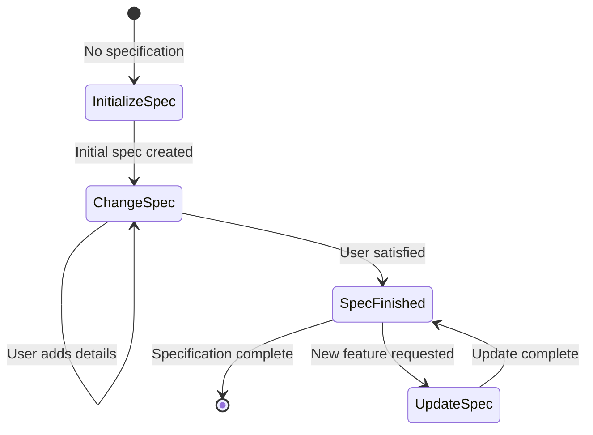

**Specification Flow:**

```python
# From core/agents/spec_writer.py:63-162
async def initialize_spec_and_project(self):
    # Get project description from user
    description = await self.ask_question("Please describe the app...")
    
    # Use LLM to expand description
    llm = self.get_llm(SPEC_WRITER_AGENT_NAME)
    convo = AgentConvo(self).template("build_full_specification", 
                                       initial_prompt=description)
    llm_assisted_description = await llm(convo)
    
    # Generate project name
    project_name = await self.generate_project_name(llm_assisted_description)
    
    # Store in state
    self.next_state.specification.description = llm_assisted_description
    self.next_state.specification.original_description = description
```

Sources: [core/agents/spec_writer.py:19-33](), [core/agents/spec_writer.py:63-162](), [core/agents/spec_writer.py:163-303]()

### Architect

The `Architect` agent designs the project architecture, selects technologies, and checks system dependencies.

**Responsibilities:**
- Selecting appropriate project templates
- Defining system dependencies (Node.js, Python, databases)
- Defining package dependencies (Express, React, etc.)
- Checking if required dependencies are installed
- Warning about unsupported technologies

**Key Methods:**
- `plan_architecture()` - Designs overall architecture and selects technologies
- `select_templates()` - Chooses appropriate project templates based on requirements
- `check_system_dependencies()` - Verifies required dependencies are installed
- `check_compatibility()` - Warns about unsupported frameworks/tools

**Architecture Definition:**

```python
# Pydantic models from core/agents/architect.py:69-82
class Architecture(BaseModel):
    app_type: AppType  # WEB, API, MOBILE, DESKTOP, CLI
    system_dependencies: list[SystemDependency]
    package_dependencies: list[PackageDependency]

class SystemDependency(BaseModel):
    name: str
    description: str
    test: str  # Command to test if installed
    required_locally: bool

class PackageDependency(BaseModel):
    name: str
    description: str
```

**Dependency Checking:**

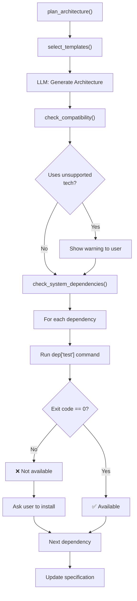

Sources: [core/agents/architect.py:95-122](), [core/agents/architect.py:173-198](), [core/agents/architect.py:237-267]()

### TechLead

The `TechLead` agent breaks down projects and features into manageable epics and tasks.

**Responsibilities:**
- Creating the initial project epic structure
- Breaking epics into sub-epics and tasks
- Creating task breakdowns with API endpoints
- Managing feature requests from users
- Creating quick implementation tasks

**Key Methods:**
- `create_initial_project_epic()` - Sets up the initial "Build frontend" and main project epic
- `plan_epic(epic)` - Breaks an epic into sub-epics and tasks using LLM
- `ask_for_new_feature()` - Prompts user for new feature or quick task
- `process_epic(sub_epic_number, sub_epic)` - Processes a single sub-epic into tasks
- `update_epics_and_tasks()` - Adds hardcoded tasks (e.g., authentication)

**Planning Models:**

```python
# From core/agents/tech_lead.py:37-52
class Epic(BaseModel):
    description: str

class Task(BaseModel):
    description: str
    related_api_endpoints: list[APIEndpoint]
    testing_instructions: str

class APIEndpoint(BaseModel):
    description: str
    method: str  # GET, POST, PUT, DELETE
    endpoint: str  # URL path
    request_body: dict
    response_body: dict
```

**Epic Planning Flow:**

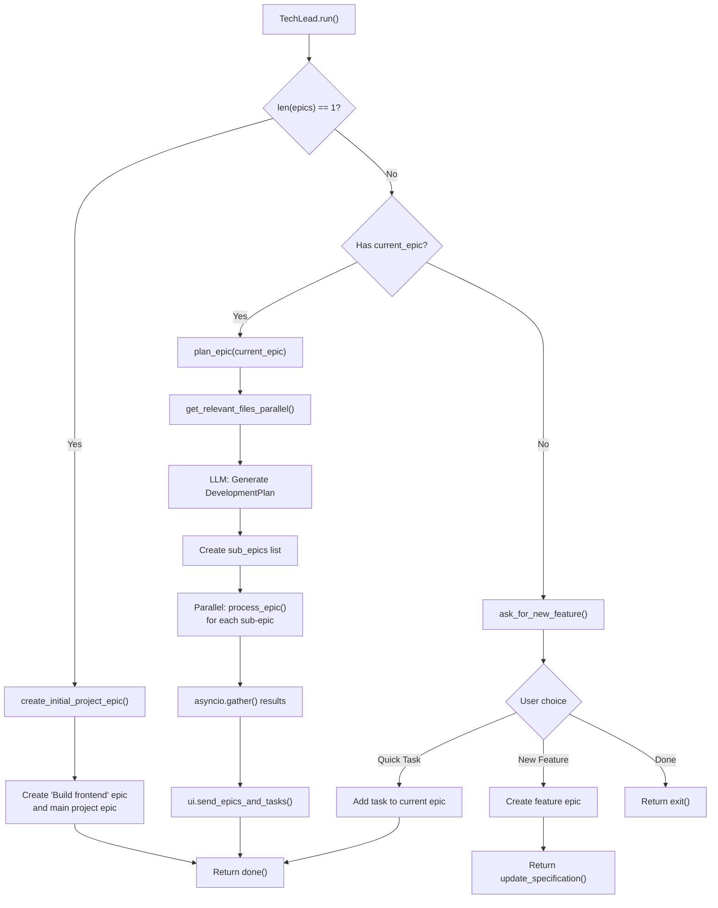

Sources: [core/agents/tech_lead.py:55-90](), [core/agents/tech_lead.py:92-108](), [core/agents/tech_lead.py:146-260](), [core/agents/tech_lead.py:296-368]()

## Implementation Agents

Implementation agents handle the actual code generation and task execution.

### Developer

The `Developer` agent breaks down tasks into executable implementation steps.

**Responsibilities:**
- Breaking down tasks into implementation steps with `<pythagoracode>` tags
- Breaking down iterations/bug fixes into steps
- Identifying relevant files for implementation
- Managing user approval for tasks
- Updating knowledge base with utility functions

**Key Methods:**
- `breakdown_current_task()` - Converts a task into detailed implementation steps
- `breakdown_current_iteration()` - Handles iteration/bug fix breakdowns
- `ask_to_execute_task()` - Gets user approval to execute, skip, or edit task
- `set_next_steps()` - Creates step objects from LLM response
- `update_knowledge_base()` - Registers utility functions

**Step Types:**

```python
# From core/agents/developer.py:32-77
class StepType(str, Enum):
    COMMAND = "command"
    SAVE_FILE = "save_file"
    HUMAN_INTERVENTION = "human_intervention"
    UTILITY_FUNCTION = "utility_function"

class SaveFileStep(BaseModel):
    type: Literal[StepType.SAVE_FILE]
    save_file: SaveFileOptions  # Contains path

class CommandStep(BaseModel):
    type: Literal[StepType.COMMAND]
    command: CommandOptions  # Contains command, timeout

class HumanInterventionStep(BaseModel):
    type: Literal[StepType.HUMAN_INTERVENTION]
    human_intervention_description: str

class UtilityFunction(BaseModel):
    type: Literal[StepType.UTILITY_FUNCTION]
    file: str
    function_name: str
    description: str
```

**Task Breakdown Flow:**

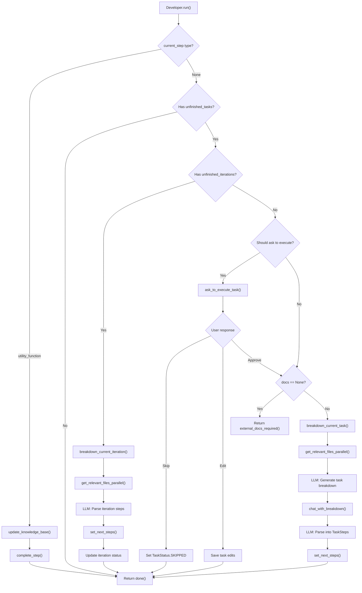

Sources: [core/agents/developer.py:91-120](), [core/agents/developer.py:204-311](), [core/agents/developer.py:121-202](), [core/agents/developer.py:313-348]()

### CodeMonkey

The `CodeMonkey` agent implements code changes by parsing `<pythagoracode>` tags and writing files.

**Responsibilities:**
- Parsing and implementing `<pythagoracode>` file changes
- Running code reviews on implemented changes
- Describing files for documentation
- Generating diffs for user review
- Handling Relace-based code merging

**Key Methods:**
- `implement_changes()` - Implements code from `<pythagoracode>` tags
- `run_code_review()` - Reviews changes for quality and correctness
- `describe_files()` - Generates file descriptions for missing metadata
- `accept_changes()` - Saves approved changes to file system

**Code Implementation Process:**

```python
# From core/agents/code_monkey.py:138-225
async def implement_changes(self):
    # Parse <pythagoracode> tags
    step = self.current_state.current_step
    file_path = step["save_file"]["path"]
    
    # Get instructions from task
    instructions = self.current_state.current_task["instructions"]
    
    # Extract code for this file
    code_blocks = self.parse_code_blocks(instructions, file_path)
    
    if not code_blocks:
        # Fallback to direct LLM generation
        new_content = await self.generate_file_with_llm(file_path)
    else:
        new_content = code_blocks[0]
    
    # Store in temporary location for review
    self.next_state.modified_files[file_path] = new_content
```

**CodeMonkey Workflow:**

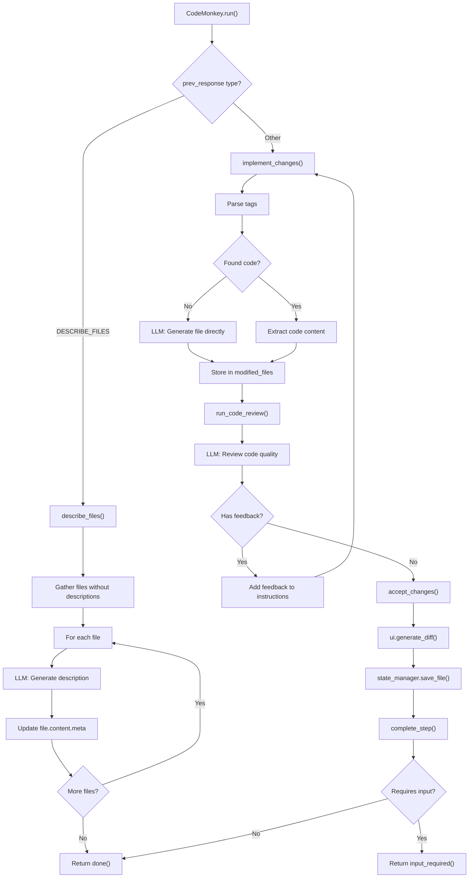

Sources: [core/agents/code_monkey.py:44-67](), [core/agents/code_monkey.py:138-281](), [core/agents/code_monkey.py:206-225]()

## Frontend Development Agent

### Frontend

The `Frontend` agent builds and iterates on the UI portion of the application.

**Responsibilities:**
- Building initial frontend from specification
- Applying Vite React or Vite React Swagger templates
- Implementing UI changes based on user feedback
- Removing mock API implementations when integrating real backends
- Auto-debugging frontend errors
- Managing frontend iteration cycles

**Key Methods:**
- `start_frontend()` - Builds initial frontend implementation
- `continue_frontend()` - Continues building when initial response is incomplete
- `iterate_frontend()` - Implements user-requested changes
- `remove_mock()` - Replaces mock API calls with real endpoints
- `try_auto_debug()` - Automatically detects and reports frontend errors
- `process_response()` - Processes LLM response blocks (files and commands)

**Frontend Workflow:**

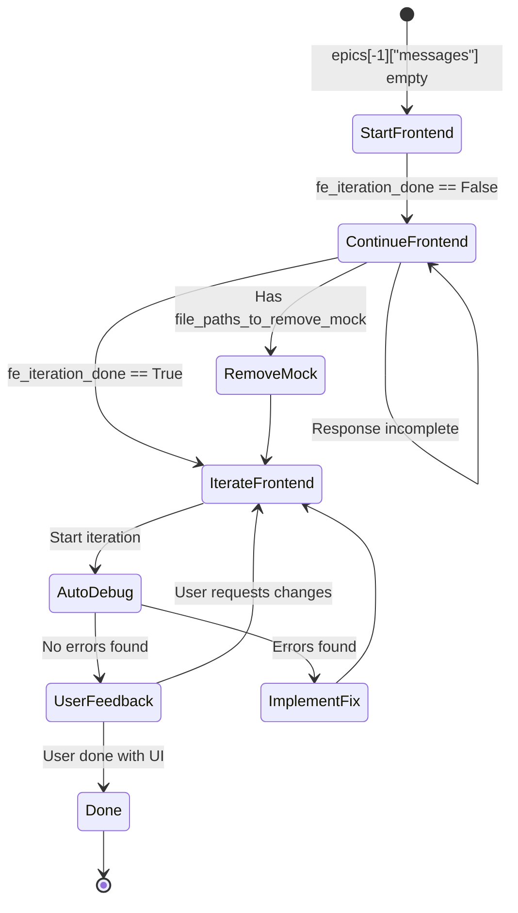

**Response Processing:**

```python
# From core/agents/frontend.py:356-449
async def process_response(self, response_blocks, removed_mock=False, relace=False):
    for block in response_blocks:
        description = block.description.strip()
        content = block.content.strip()
        
        last_line = description.split("\n")[-1].strip()
        
        if "file:" in last_line:
            # Extract file path
            file_path = last_line[last_line.index("file:") + 5:].strip()
            new_content = content
            old_content = self.current_state.get_file_content_by_path(file_path)
            
            if relace:
                # Use Relace for code merging
                new_content = await self.relace_merge(old_content, new_content)
            
            # Save file and generate diff
            await self.state_manager.save_file(file_path, new_content)
            await self.ui.generate_diff(file_path, old_content, new_content)
            
        elif "command:" in last_line:
            # Execute commands (npm install, etc.)
            commands = content.strip().split("\n")
            for command in commands:
                await self.process_manager.run_command(command)
```

**Auto-Debug Feature:**

The Frontend agent includes automatic error detection:

```python
# From core/agents/frontend.py:554-602
async def try_auto_debug(self):
    # Start frontend server
    npm_proc = await self.process_manager.start_process("npm run start &")
    
    # Wait for output
    await asyncio.sleep(5)
    diff_stdout, diff_stderr = await npm_proc.read_output()
    
    # Test the app
    await self.process_manager.run_command("curl http://localhost:5173")
    
    # Check for errors
    if diff_stdout or diff_stderr:
        return f"I got an error. Here are the logs:\n{diff_stdout}\n{diff_stderr}"
    
    return ""  # No errors found
```

Sources: [core/agents/frontend.py:40-60](), [core/agents/frontend.py:61-110](), [core/agents/frontend.py:112-150](), [core/agents/frontend.py:151-318](), [core/agents/frontend.py:356-449](), [core/agents/frontend.py:554-602]()

## Quality Assurance Agents

Quality assurance agents handle testing, user feedback collection, and bug fixing.

### Troubleshooter

The `Troubleshooter` agent coordinates testing and gathers user feedback.

**Responsibilities:**
- Generating test instructions for tasks
- Collecting user feedback on implementations
- Detecting iteration loops (when stuck in bug fixing cycles)
- Proposing solutions to reported issues
- Routing bugs to BugHunter or changes to SpecWriter
- Marking tasks as reviewed when complete

**Key Methods:**
- `create_iteration()` - Creates iteration based on user feedback
- `get_user_instructions()` - Generates test steps using LLM
- `get_user_feedback()` - Prompts user to test and provide feedback
- `propose_solution()` - Generates solution for reported issue
- `complete_task()` - Marks task as `TaskStatus.REVIEWED`
- `trace_loop()` - Sends telemetry when iteration loops detected

**Iteration Status Management:**

```python
# From core/agents/troubleshooter.py:127-145
# Create new iteration based on feedback type
if is_loop:
    iteration_status = IterationStatus.PROBLEM_SOLVER
elif bug_report is not None:
    iteration_status = IterationStatus.HUNTING_FOR_BUG
else:  # change_description is not None
    iteration_status = IterationStatus.NEW_FEATURE_REQUESTED

self.next_state.iterations.append({
    "id": uuid4().hex,
    "user_feedback": user_feedback,
    "user_feedback_qa": user_feedback_qa,
    "description": None,
    "alternative_solutions": [],
    "attempts": 1,
    "status": iteration_status,
    "bug_hunting_cycles": [],
})
```

**Testing Flow:**

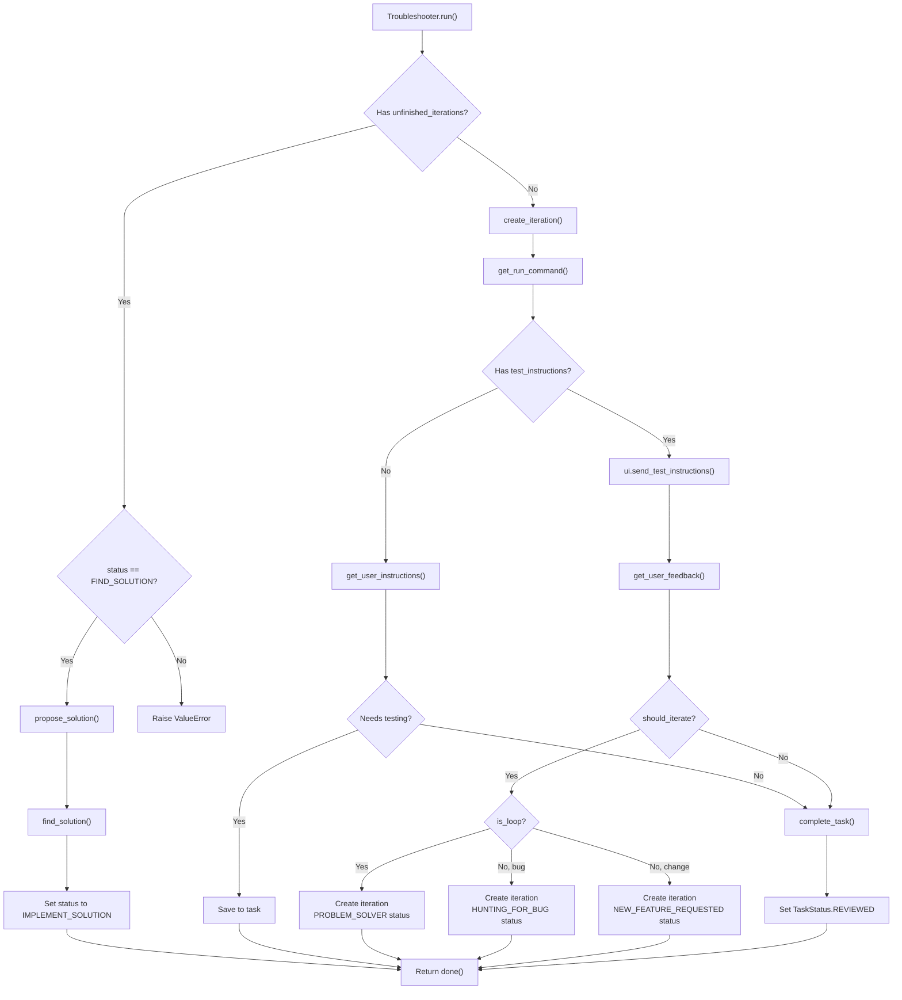

**Loop Detection:**

The Troubleshooter detects when the system is stuck in a loop (defined as `LOOP_THRESHOLD = 3` iterations) and triggers the ProblemSolver agent:

```python
# From core/agents/troubleshooter.py:22-23, 112-119, 143-145
LOOP_THRESHOLD = 3

# In create_iteration()
last_iteration = self.current_state.iterations[-1] if len(self.current_state.iterations) >= 3 else None

if is_loop:
    if last_iteration is not None and last_iteration.get("alternative_solutions"):
        return self.try_next_alternative_solution(user_feedback, user_feedback_qa)
    else:
        iteration_status = IterationStatus.PROBLEM_SOLVER
        await self.trace_loop("loop-feedback")
        
if len(self.next_state.iterations) == LOOP_THRESHOLD:
    await self.trace_loop("loop-start")
```

Sources: [core/agents/troubleshooter.py:35-46](), [core/agents/troubleshooter.py:63-146](), [core/agents/troubleshooter.py:148-159](), [core/agents/troubleshooter.py:203-231](), [core/agents/troubleshooter.py:244-346]()

### BugHunter

The `BugHunter` agent identifies and resolves bugs through log analysis and user interaction.

**Responsibilities:**
- Generating bug reproduction instructions
- Analyzing logs to identify bug sources
- Determining whether to add logs or implement fixes
- Guiding users through testing bug fixes
- Facilitating pair programming for complex bugs
- Managing bug hunting cycles

**Key Methods:**
- `get_bug_reproduction_instructions()` - Creates steps to reproduce bug
- `check_logs()` - Analyzes logs to identify bug cause
- `ask_user_to_test()` - Prompts user to test fix or reproduce bug
- `start_pair_programming()` - Initiates interactive debugging session
- `set_data_for_next_hunting_cycle()` - Prepares next debugging attempt

**Bug Hunting Cycle:**

```python
# From core/agents/bug_hunter.py:400-411
def set_data_for_next_hunting_cycle(self, human_readable_instructions, new_status):
    self.next_state.current_iteration["description"] = human_readable_instructions
    self.next_state.current_iteration["bug_hunting_cycles"] += [{
        "human_readable_instructions": human_readable_instructions,
        "fix_attempted": any(
            c["fix_attempted"] for c in self.current_state.current_iteration["bug_hunting_cycles"]
        ),
    }]
    self.next_state.current_iteration["status"] = new_status
```

**BugHunter Workflow:**

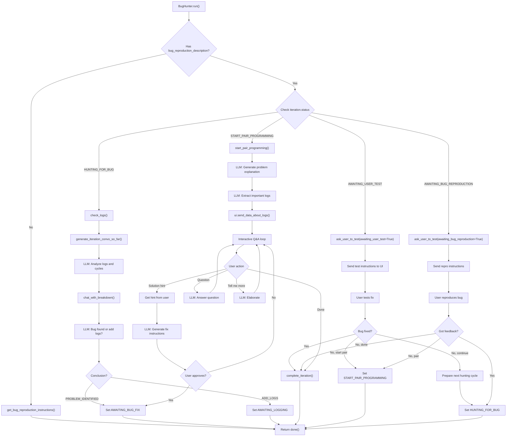

**Iteration Status Transitions:**

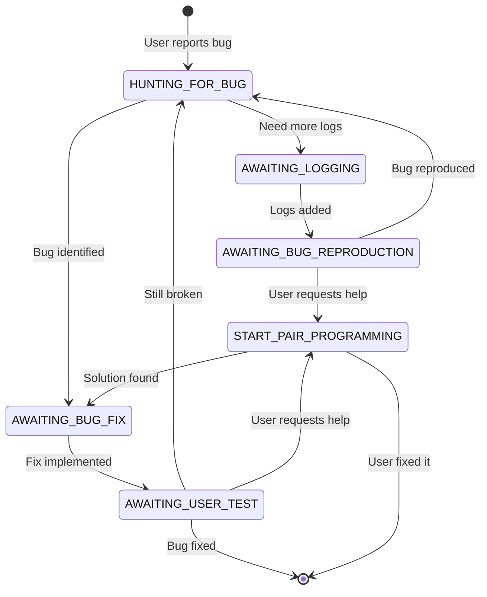

Sources: [core/agents/bug_hunter.py:57-80](), [core/agents/bug_hunter.py:82-101](), [core/agents/bug_hunter.py:103-142](), [core/agents/bug_hunter.py:144-239](), [core/agents/bug_hunter.py:241-361](), [core/agents/bug_hunter.py:363-411]()

### Frontend

The Frontend agent builds and iterates on the user interface portion of the application, applying UI templates and implementing frontend features.

**Key responsibilities:**
- Building the initial frontend of the app
- Applying frontend templates
- Implementing UI changes based on user feedback
- Managing frontend iterations

**Key methods:**
- `init_frontend()`: Gets the initial app description and sets up the project
- `start_frontend()`: Builds the initial frontend implementation
- `continue_frontend()`: Continues building the frontend after the initial setup
- `iterate_frontend()`: Implements changes requested by the user

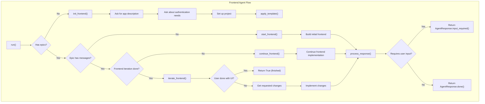

Sources: [core/agents/frontend.py:17-32](), [core/agents/frontend.py:34-184]()

### Code Monkey

The Code Monkey agent implements and reviews code changes, creating or modifying files according to implementation plans.

**Key responsibilities:**
- Implementing code changes for tasks
- Reviewing code changes to ensure quality
- Describing files for documentation
- Generating diffs for code review

**Key methods:**
- `implement_changes()`: Implements code changes based on instructions
- `run_code_review()`: Reviews implemented changes for quality and correctness
- `describe_files()`: Generates descriptions for files
- `accept_changes()`: Accepts and applies code changes

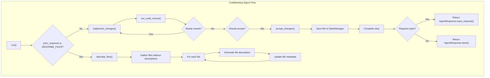

Sources: [core/agents/code_monkey.py:58-67](), [core/agents/code_monkey.py:74-136](), [core/agents/code_monkey.py:206-225]()

## Common Agent Mixins

Agents use various mixins to share common functionality:

| Mixin | Purpose | Key Methods | Used By |
|-------|---------|-------------|---------|
| `RelevantFilesMixin` | Find files relevant to the current task | `get_relevant_files()` | TechLead, Developer |
| `ChatWithBreakdownMixin` | Interact with users about task breakdowns | `chat_with_breakdown()` | BugHunter, Developer, Troubleshooter |
| `IterationPromptMixin` | Find solutions to problems based on feedback | `find_solution()` | Troubleshooter |
| `FileDiffMixin` | Generate and analyze code diffs | `get_line_changes()` | Frontend, CodeMonkey |

Sources: [core/agents/mixins.py:53-92](), [core/agents/mixins.py:95-132](), [core/agents/mixins.py:135-191](), [core/agents/mixins.py:194-225]()

## Agent Communication

Agents communicate through a standardized response system:

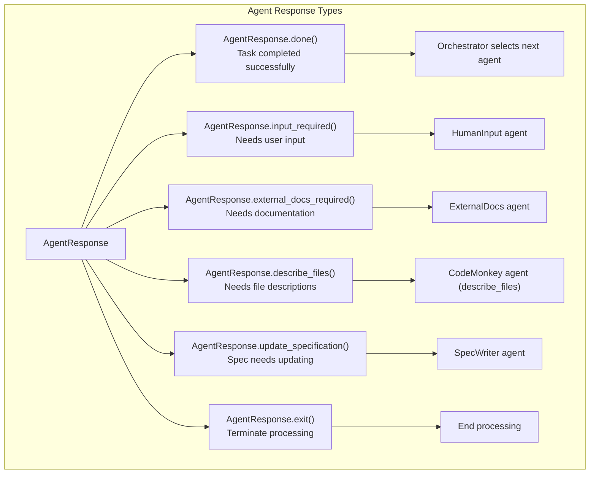

Sources: [core/agents/response.py]()

## State Management

All agents interact with a shared state through the `StateManager` class, which provides:

- Access to current project state (`current_state`)
- A way to make changes to that state (`next_state`)
- Persistence of state changes to database
- File system operations

The state contains information about:
- Epics
- Tasks
- Steps
- Iterations
- Files
- Knowledge base

Sources: [core/state/state_manager.py:30-47](), [core/state/state_manager.py:100-148]()

---

