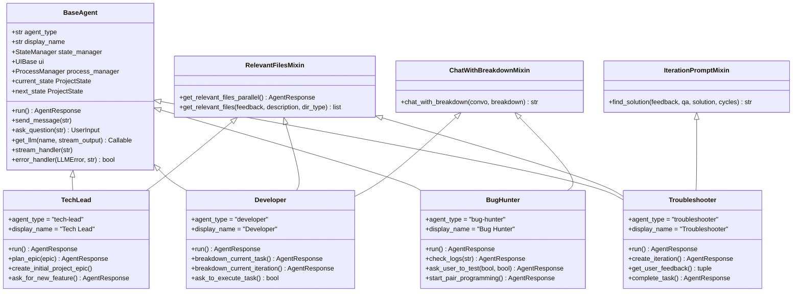
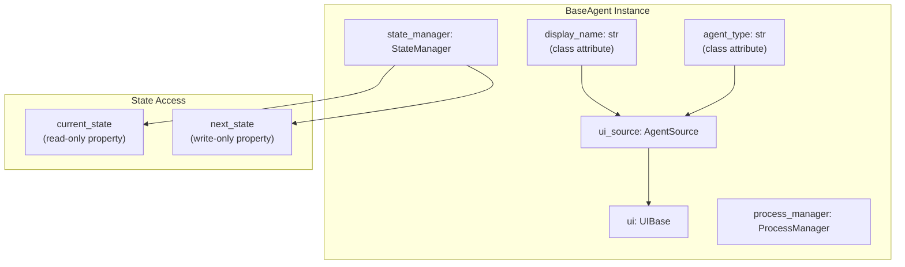
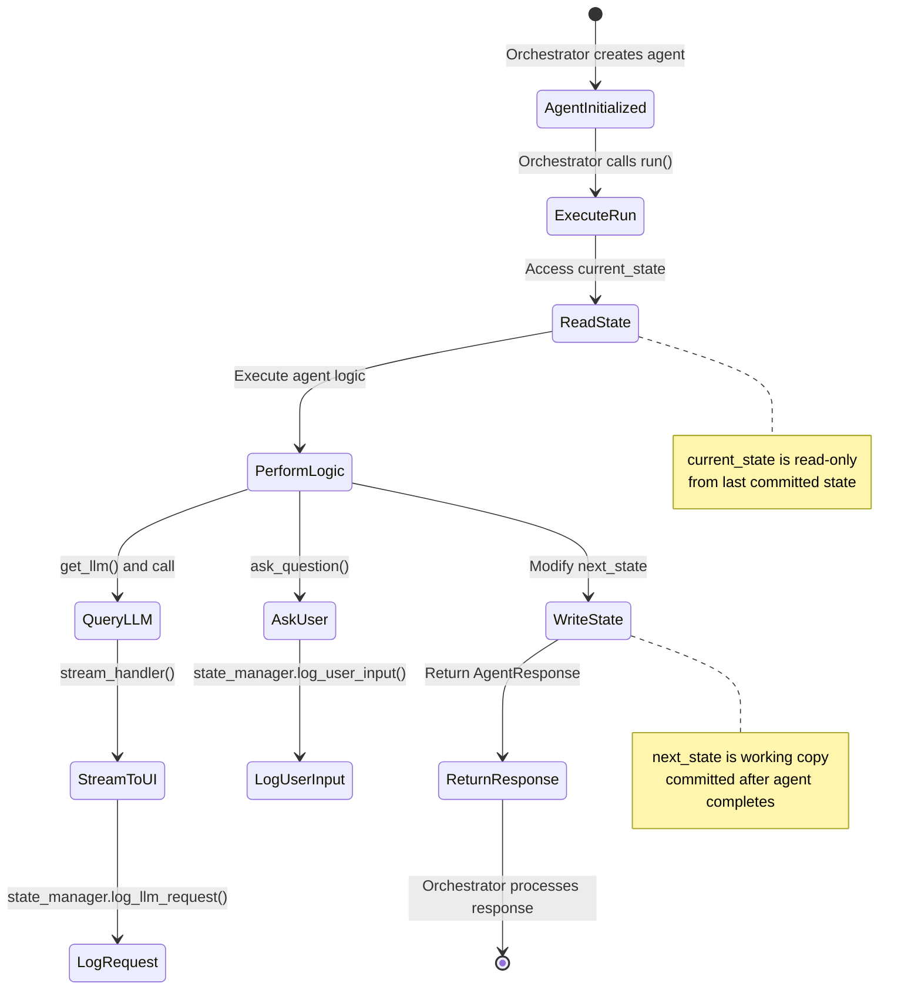
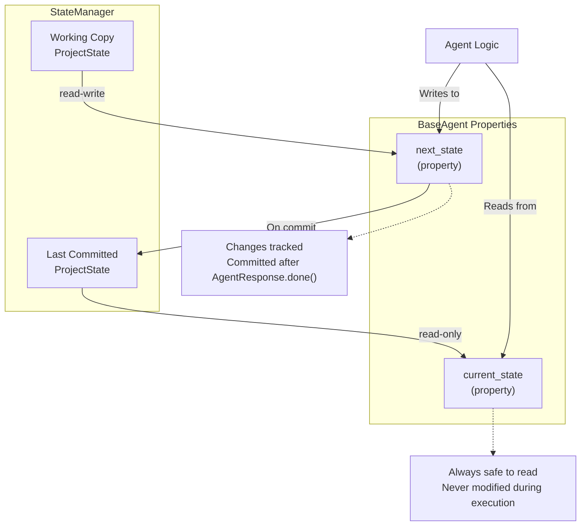
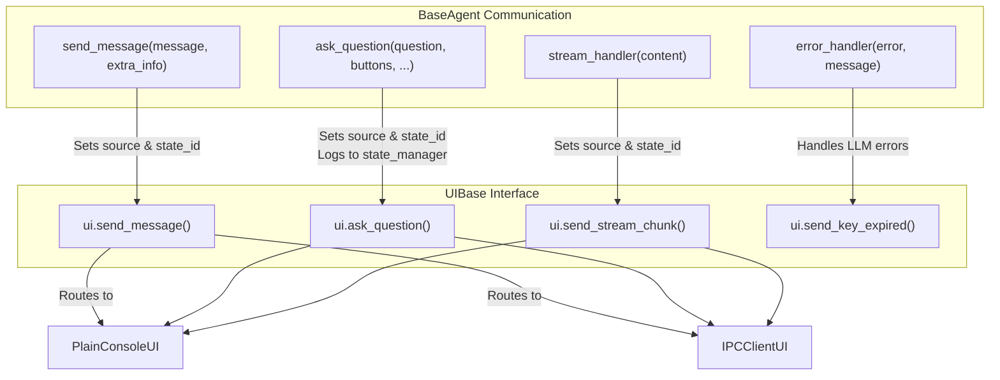
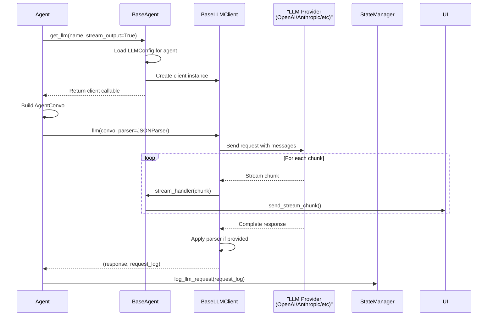
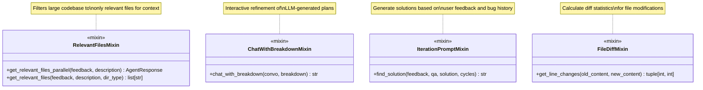

<!-- source: DeepWiki mcp.deepwiki.com · repo Pythagora-io/gpt-pilot · page 4.1 Agent Architecture and Base Classes · fetched 2026-10-26 -->

# Agent Architecture and Base Classes

<details>
<summary>Relevant source files</summary>

The following files were used as context for generating this wiki page:

- [core/agents/base.py](core/agents/base.py)
- [core/agents/bug_hunter.py](core/agents/bug_hunter.py)
- [core/agents/developer.py](core/agents/developer.py)
- [core/agents/mixins.py](core/agents/mixins.py)
- [core/agents/tech_lead.py](core/agents/tech_lead.py)
- [core/agents/troubleshooter.py](core/agents/troubleshooter.py)
- [core/llm/azure_client.py](core/llm/azure_client.py)
- [core/llm/base.py](core/llm/base.py)
- [core/llm/openai_client.py](core/llm/openai_client.py)
- [core/utils/__init__.py](core/utils/__init__.py)
- [core/utils/text.py](core/utils/text.py)
- [tests/agents/test_base.py](tests/agents/test_base.py)
- [tests/llm/test_openai.py](tests/llm/test_openai.py)
- [tests/ui/test_ipc_client.py](tests/ui/test_ipc_client.py)

</details>


This document describes the foundational architecture of the agent system in GPT Pilot, including the `BaseAgent` base class, agent lifecycle patterns, state management, and common reusable components (mixins). For information about specific agent implementations and their workflows, see [Planning Agents](#4.2), [Implementation Agents](#4.3), [Frontend Development Agent](#4.4), and [Quality Assurance Agents](#4.5). For details on LLM integration, see [LLM Client Architecture](#5.2).

---

## Overview of the Agent System

GPT Pilot uses a multi-agent architecture where each agent specializes in a specific phase of the software development lifecycle. All agents inherit from the `BaseAgent` base class, which provides a consistent interface for state management, UI communication, and LLM interaction.

### Agent Class Hierarchy



**Sources:** [core/agents/base.py:1-232](), [core/agents/tech_lead.py:1-464](), [core/agents/developer.py:1-485](), [core/agents/bug_hunter.py:1-412](), [core/agents/troubleshooter.py:1-435](), [core/agents/mixins.py:1-209]()

---

## BaseAgent Core Architecture

The `BaseAgent` class ([core/agents/base.py:15-232]()) serves as the foundation for all specialized agents. It provides essential infrastructure for state management, UI communication, and LLM interaction.

### Key Properties and Initialization



**Sources:** [core/agents/base.py:15-44]()

| Property | Type | Description |
|----------|------|-------------|
| `agent_type` | `str` | Machine-readable identifier (e.g., `"tech-lead"`, `"developer"`) |
| `display_name` | `str` | Human-readable name (e.g., `"Tech Lead"`, `"Developer"`) |
| `state_manager` | `StateManager` | Manages project state and persistence |
| `ui` | `UIBase` | Interface for user communication (CLI or IPC) |
| `process_manager` | `ProcessManager` | Manages external processes (optional) |
| `ui_source` | `AgentSource` | Combines display_name and agent_type for UI routing |

**Sources:** [core/agents/base.py:20-44]()

### Agent Initialization Pattern

```python
def __init__(
    self,
    state_manager: StateManager,
    ui: UIBase,
    *,
    step: Optional[Any] = None,
    prev_response: Optional["AgentResponse"] = None,
    process_manager: Optional["ProcessManager"] = None,
    data: Optional[Any] = None,
    args: Optional[Any] = None,
):
```

All agents receive:
- **state_manager**: Provides access to current/next state and logging
- **ui**: Handles all user interaction (messages, questions, streaming)
- **step** (optional): Current execution step data
- **prev_response** (optional): Response from previous agent in chain
- **process_manager** (optional): For running external commands
- **data** (optional): Agent-specific data
- **args** (optional): CLI arguments

**Sources:** [core/agents/base.py:23-44]()

---

## Agent Lifecycle and Execution

Every agent must implement the `run()` method, which defines the agent's core behavior. The Orchestrator calls this method to execute the agent's logic.

### Agent Execution Flow



**Sources:** [core/agents/base.py:46-54](), [core/agents/base.py:225-231]()

### The run() Method Contract

```python
async def run() -> AgentResponse:
    """
    Run the agent.
    
    :return: Response from the agent.
    """
    raise NotImplementedError()
```

The `run()` method must return an `AgentResponse` indicating the agent's completion status and next action. Common return types:

| Response Type | Description | Example Usage |
|---------------|-------------|---------------|
| `AgentResponse.done(self)` | Agent completed successfully | Most common case |
| `AgentResponse.exit(self)` | User requested exit | User cancels operation |
| `AgentResponse.external_docs_required(self)` | Need external documentation | Before complex task |
| `AgentResponse.update_specification(self, desc)` | Spec needs updating | Adding new feature |
| `AgentResponse.input_required(self, inputs)` | Template requires input | After applying template |

**Sources:** [core/agents/base.py:225-231](), [core/agents/tech_lead.py:59-90]()

---

## State Management: current_state vs next_state

GPT Pilot uses a **two-state transaction pattern** where agents read from `current_state` and write to `next_state`. This ensures atomic updates and enables rollback capabilities.

### State Access Pattern



**Sources:** [core/agents/base.py:46-54]()

### State Properties Implementation

```python
@property
def current_state(self) -> ProjectState:
    """Current state of the project (read-only)."""
    return self.state_manager.current_state

@property
def next_state(self) -> ProjectState:
    """Next state of the project (write-only)."""
    return self.state_manager.next_state
```

**Key Rules:**
1. **Never modify `current_state`** - It represents the last committed state
2. **Always write to `next_state`** - Changes are committed after agent completion
3. **Clone before modifying** - Use `.clone()` on nested objects if needed
4. **Flag modifications** - Call `.flag_tasks_as_modified()` or `.flag_epics_as_modified()` for SQLAlchemy tracking

**Sources:** [core/agents/base.py:46-54]()

### Common State Operations

```python
# Reading current task
current_task = self.current_state.current_task

# Modifying task status
self.next_state.current_task["status"] = TaskStatus.IN_PROGRESS
self.next_state.flag_tasks_as_modified()

# Adding new steps
self.next_state.steps = finished_steps + new_steps

# Setting action description
self.next_state.action = "Creating development plan"

# Completing iterations
self.next_state.complete_iteration()
```

**Sources:** [core/agents/developer.py:286-311](), [core/agents/tech_lead.py:92-110]()

---

## UI Communication Interface

Agents communicate with users through the `UIBase` abstraction, which supports both CLI and VSCode extension interfaces. The `BaseAgent` class provides convenience methods that automatically set the correct source and project state ID.

### Communication Methods



**Sources:** [core/agents/base.py:56-173]()

### send_message() Method

Used to display informational messages to the user:

```python
await self.send_message("Creating the development plan ...")
await self.send_message("Found the bug. I'm attempting to fix it ...")
```

**Implementation:**
```python
async def send_message(self, message: str, extra_info: Optional[dict] = None):
    await self.ui.send_message(
        message + "\n", 
        source=self.ui_source, 
        project_state_id=str(self.current_state.id), 
        extra_info=extra_info
    )
```

**Sources:** [core/agents/base.py:56-68](), [core/agents/tech_lead.py:299](), [core/agents/bug_hunter.py:132]()

### ask_question() Method

Used to request input from the user with optional buttons and validation:

```python
response = await self.ask_question(
    "Do you want to add a new feature or implement something quickly?",
    buttons={
        "task": "Implement new feature",
        "end": "No, I'm done",
    },
    buttons_only=True,
)
```

**Parameters:**

| Parameter | Type | Description |
|-----------|------|-------------|
| `question` | `str` | Question text to display |
| `buttons` | `dict[str, str]` | Button ID to label mapping |
| `default` | `str` | Default button ID if user presses enter |
| `buttons_only` | `bool` | Only show buttons, no text input |
| `allow_empty` | `bool` | Allow empty text response |
| `hint` | `str` | Additional context shown in popup |
| `initial_text` | `str` | Pre-filled text for editing |
| `extra_info` | `dict` | Extension-specific functionality flags |

**Returns:** `UserInput` object with:
- `.text` - User's text response
- `.button` - Button ID that was clicked
- `.cancelled` - Whether user cancelled the question

**Sources:** [core/agents/base.py:70-124](), [core/agents/tech_lead.py:171-180](), [core/agents/developer.py:438-445]()

---

## LLM Integration Pattern

Agents interact with LLMs through a unified client interface that handles streaming, error handling, and request logging automatically.

### LLM Request Flow



**Sources:** [core/agents/base.py:175-223](), [core/llm/base.py:124-413]()

### get_llm() Method

The `get_llm()` method creates an agent-specific LLM client configured with the appropriate model and settings:

```python
def get_llm(self, name=None, stream_output=False, route=None) -> Callable:
    """
    Get a new instance of the agent-specific LLM client.
    
    :param name: Name of the agent for configuration (default: class name).
    :param stream_output: Whether to enable streaming output.
    :param route: Route information for message routing.
    :return: LLM client for the agent.
    """
```

**Usage Examples:**

```python
# Use default model for agent
llm = self.get_llm()
response = await llm(convo, parser=JSONParser(DevelopmentPlan))

# Use specific agent's configuration
llm = self.get_llm(TASK_BREAKDOWN_AGENT_NAME, stream_output=True)
response = await llm(convo)

# Temperature override
llm = self.get_llm()
response = await llm(convo, temperature=0)
```

**Sources:** [core/agents/base.py:175-223](), [core/agents/tech_lead.py:274-275](), [core/agents/developer.py:164-172]()

### LLM Client Configuration by Agent

Different agents can use different LLM models optimized for their tasks. Configuration is defined in `config.json`:

```python
# In TechLead agent
llm = self.get_llm(TECH_LEAD_PLANNING)  # Uses "TechLead" config
llm = self.get_llm(TECH_LEAD_EPIC_BREAKDOWN)  # Uses "TechLead.epic_breakdown" config

# In Developer agent
llm = self.get_llm(TASK_BREAKDOWN_AGENT_NAME)  # Uses "Developer" config
llm = self.get_llm(PARSE_TASK_AGENT_NAME)  # Uses "Developer.parse_task" config
```

**Sources:** [core/agents/tech_lead.py:274-275](), [core/agents/tech_lead.py:304-318](), [core/agents/developer.py:164](), [core/agents/developer.py:233](), [core/agents/developer.py:292]()

### stream_handler() and Error Handling

The base class provides two handlers that agents can override or use as-is:

**stream_handler()** - Called for each LLM response chunk:
```python
async def stream_handler(self, content: str):
    """Handle streamed response from the LLM."""
    route = getattr(self, "_current_route", None)
    await self.ui.send_stream_chunk(
        content, 
        source=self.ui_source, 
        project_state_id=str(self.current_state.id), 
        route=route
    )
    
    if content is None:
        await self.ui.send_message("", source=self.ui_source, ...)
```

**error_handler()** - Called when LLM requests fail:
```python
async def error_handler(self, error: LLMError, message: Optional[str] = None) -> bool:
    """
    Handle error responses from the LLM.
    
    :param error: The error type (KEY_EXPIRED, RATE_LIMITED, GENERIC_API_ERROR)
    :param message: Optional message to show.
    :return: Whether the request should be retried.
    """
```

**Sources:** [core/agents/base.py:126-173]()

---

## Agent Mixins and Reusable Components

GPT Pilot uses mixins to share common functionality across multiple agents without duplicating code. Mixins use Python's multiple inheritance to add capabilities to agents.

### Available Mixins



**Sources:** [core/agents/mixins.py:1-209]()

### RelevantFilesMixin

**Purpose:** Filters the project's files to include only those relevant to the current task, preventing token limit issues with large codebases.

**Implementation:**
```python
class RelevantFilesMixin:
    async def get_relevant_files_parallel(
        self, 
        user_feedback: Optional[str] = None, 
        solution_description: Optional[str] = None
    ) -> AgentResponse:
        # Splits files into client/server and processes in parallel
        tasks = [
            self.get_relevant_files(..., dir_type="client"),
            self.get_relevant_files(..., dir_type="server"),
        ]
        responses = await asyncio.gather(*tasks)
        relevant_files = [item for sublist in responses for item in sublist]
        
        # Update both current and next state
        self.current_state.relevant_files = relevant_files
        self.next_state.relevant_files = relevant_files
```

**Used by:** `TechLead`, `Developer`, `Troubleshooter`

**Usage Example:**
```python
# In Developer.breakdown_current_task()
await self.get_relevant_files_parallel()

# In Troubleshooter with user feedback
await self.get_relevant_files_parallel(user_feedback=bug_report)
```

**Sources:** [core/agents/mixins.py:122-189](), [core/agents/developer.py:224](), [core/agents/tech_lead.py:302](), [core/agents/troubleshooter.py:321]()

### ChatWithBreakdownMixin

**Purpose:** Allows interactive refinement of LLM-generated implementation plans by letting users review and request changes before execution.

**Implementation:**
```python
class ChatWithBreakdownMixin:
    async def chat_with_breakdown(self, convo: AgentConvo, breakdown: str) -> str:
        llm = self.get_llm(TASK_BREAKDOWN_AGENT_NAME, stream_output=True)
        while True:
            await self.ui.send_project_stage({
                "stage": ProjectStage.BREAKDOWN_CHAT,
                "agent": self.agent_type,
            })
            
            if self.state_manager.auto_confirm_breakdown:
                break
            
            chat = await self.ask_question(
                MIX_BREAKDOWN_CHAT_PROMPT,
                buttons={"yes": "Yes, looks good!"},
                default="yes",
            )
            if chat.button == "yes":
                break
            
            # User provided feedback, regenerate
            convo.user(chat.text)
            breakdown = await llm(convo)
            convo.assistant(breakdown)
        
        return breakdown
```

**Used by:** `Developer`, `BugHunter`

**Usage Example:**
```python
# After LLM generates implementation steps
response = await llm(convo)
convo.assistant(response)

# Allow user to review and refine
response = await self.chat_with_breakdown(convo, response)
```

**Sources:** [core/agents/mixins.py:37-79](), [core/agents/developer.py:284](), [core/agents/bug_hunter.py:114]()

### IterationPromptMixin

**Purpose:** Generates implementation solutions for bug fixes and feature changes based on user feedback, previous attempts, and bug hunting cycles.

**Implementation:**
```python
class IterationPromptMixin:
    async def find_solution(
        self,
        user_feedback: str,
        *,
        user_feedback_qa: Optional[list[str]] = None,
        next_solution_to_try: Optional[str] = None,
        bug_hunting_cycles: Optional[dict] = None,
    ) -> str:
        llm = self.get_llm(TROUBLESHOOTER_BUG_REPORT, stream_output=True)
        convo = AgentConvo(self).template(
            "iteration",
            user_feedback=user_feedback,
            user_feedback_qa=user_feedback_qa,
            next_solution_to_try=next_solution_to_try,
            bug_hunting_cycles=bug_hunting_cycles,
            test_instructions=json.loads(self.current_state.current_task.get("test_instructions", "[]")),
        )
        llm_solution = await llm(convo)
        llm_solution = await self.chat_with_breakdown(convo, llm_solution)
        return llm_solution
```

**Used by:** `Troubleshooter`, `ProblemSolver`

**Sources:** [core/agents/mixins.py:82-119](), [core/agents/troubleshooter.py:48-61]()

---

## Agent Type Registration

Each agent must define two class attributes that identify it within the system:

```python
class TechLead(RelevantFilesMixin, BaseAgent):
    agent_type = "tech-lead"        # Machine-readable identifier
    display_name = "Tech Lead"       # Human-readable name
```

**Agent Type Registry:**

| Agent Class | agent_type | display_name | Primary Responsibility |
|-------------|------------|--------------|------------------------|
| `SpecWriter` | `"spec-writer"` | `"Spec Writer"` | Requirements gathering |
| `Architect` | `"architect"` | `"Architect"` | Tech stack selection |
| `TechLead` | `"tech-lead"` | `"Tech Lead"` | Epic and task planning |
| `Developer` | `"developer"` | `"Developer"` | Task breakdown into steps |
| `CodeMonkey` | `"code-monkey"` | `"Code Monkey"` | Code implementation |
| `Frontend` | `"frontend"` | `"Frontend"` | UI development |
| `Troubleshooter` | `"troubleshooter"` | `"Troubleshooter"` | Testing and user feedback |
| `BugHunter` | `"bug-hunter"` | `"Bug Hunter"` | Bug investigation and fixing |

**Sources:** [core/agents/tech_lead.py:55-57](), [core/agents/developer.py:91-93](), [core/agents/bug_hunter.py:57-59](), [core/agents/troubleshooter.py:35-37]()

---

## Common Agent Patterns

### Pattern 1: Conditional Logic in run()

Most agents use the `run()` method to route to different workflows based on state:

```python
async def run(self) -> AgentResponse:
    # Check for special cases first
    if self.current_state.current_step and self.current_state.current_step.get("type") == "utility_function":
        return await self.update_knowledge_base()
    
    # Check for incomplete work
    if not self.current_state.unfinished_tasks:
        return AgentResponse.done(self)
    
    # Route to appropriate workflow
    if self.current_state.unfinished_iterations:
        return await self.breakdown_current_iteration()
    else:
        return await self.breakdown_current_task()
```

**Sources:** [core/agents/developer.py:95-119](), [core/agents/troubleshooter.py:39-46](), [core/agents/bug_hunter.py:61-80]()

### Pattern 2: Progressive Message Updates

Agents typically inform users of their progress:

```python
async def plan_epic(self, epic) -> AgentResponse:
    await self.send_message("Creating the development plan ...")
    
    # ... LLM call to generate plan ...
    
    await self.send_message("Creating tasks ...")
    
    # ... Process tasks in parallel ...
    
    return AgentResponse.done(self)
```

**Sources:** [core/agents/tech_lead.py:296-368]()

### Pattern 3: Two-Phase Operations (LLM + Parse)

Many agents use a two-step pattern: first generate with streaming, then parse:

```python
# Phase 1: Generate with streaming for user feedback
llm = self.get_llm(TASK_BREAKDOWN_AGENT_NAME, stream_output=True)
await self.ui.start_breakdown_stream()
await self.ui.set_important_stream()

response: str = await llm(convo)  # Unstructured response
convo.assistant(response)

# Phase 2: Parse into structured format
llm = self.get_llm(PARSE_TASK_AGENT_NAME)
convo_parse = AgentConvo(self).template("parse_task", ...).require_schema(TaskSteps)
parsed_response: TaskSteps = await llm(convo_parse, parser=JSONParser(TaskSteps), temperature=0)
```

**Sources:** [core/agents/developer.py:228-296]()

### Pattern 4: Flag Modifications for Persistence

After modifying state collections, agents must flag them for SQLAlchemy:

```python
# Modify tasks
self.next_state.tasks[current_task_index] = {
    **current_task,
    "instructions": response,
}
# MUST flag as modified
self.next_state.flag_tasks_as_modified()

# Modify epics
self.next_state.epics = self.current_state.epics + [new_epic]
# MUST flag as modified
self.next_state.flag_epics_as_modified()
```

**Sources:** [core/agents/developer.py:286-291](), [core/agents/tech_lead.py:438-439]()

### Pattern 5: Async Task Management

Some agents need to run background tasks while executing:

```python
async def run(self) -> AgentResponse:
    current_iteration = self.current_state.current_iteration
    
    # Start async task if not already running
    if "bug_reproduction_description" not in current_iteration:
        if not self.state_manager.async_tasks:
            self.state_manager.async_tasks = []
            self.state_manager.async_tasks.append(
                asyncio.create_task(self.get_bug_reproduction_instructions())
            )
    
    # ... continue with main logic ...

async def async_task_finish(self):
    """Wait for async tasks to complete before proceeding."""
    if self.state_manager.async_tasks:
        if not self.state_manager.async_tasks[-1].done():
            await self.send_message("Waiting for the bug reproduction instructions...")
            await self.state_manager.async_tasks[-1]
        self.state_manager.async_tasks = []
```

**Sources:** [core/agents/bug_hunter.py:61-68](), [core/agents/bug_hunter.py:393-399]()

---

## Testing Agent Implementations

### Unit Testing Pattern

Agent tests typically mock the `StateManager` and `UIBase` dependencies:

```python
class AgentUnderTest(BaseAgent):
    agent_type = "test-agent"
    display_name = "Test Agent"

@pytest.mark.asyncio
async def test_send_message():
    ui = MagicMock(spec=UIBase)
    sm = AsyncMock()
    agent = AgentUnderTest(sm, ui)
    
    await agent.send_message("Hello, world!")
    ui.send_message.assert_called_once_with(
        "Hello, world!\n",
        source=agent.ui_source,
        project_state_id=str(agent.current_state.id),
        extra_info=None,
    )
```

**Key Testing Considerations:**
1. Mock `state_manager.current_state` and `state_manager.next_state`
2. Mock `ui.send_message()`, `ui.ask_question()`, `ui.send_stream_chunk()`
3. Verify LLM requests are logged with `state_manager.log_llm_request()`
4. Verify user inputs are logged with `state_manager.log_user_input()`

**Sources:** [tests/agents/test_base.py:1-93]()

---

## Summary

The agent architecture in GPT Pilot provides a robust foundation for building specialized AI agents with:

1. **Consistent Interface** - `BaseAgent` provides uniform patterns for state access, UI communication, and LLM interaction
2. **State Transaction Safety** - Two-state pattern (`current_state`/`next_state`) ensures atomic updates
3. **Flexible LLM Integration** - Per-agent model configuration with automatic streaming and error handling
4. **Reusable Components** - Mixins enable code sharing across agents without duplication
5. **Type-Safe Responses** - `AgentResponse` enum provides clear agent completion states
6. **Comprehensive Logging** - All LLM requests and user interactions are automatically persisted

Agents follow a simple lifecycle: receive state, perform work (possibly with LLM/user interaction), update state, and return a response. The Orchestrator handles state commits and determines which agent to run next based on the response.

**Sources:** [core/agents/base.py:1-232](), [core/agents/mixins.py:1-209](), [core/agents/tech_lead.py:1-464](), [core/agents/developer.py:1-485]()

---

