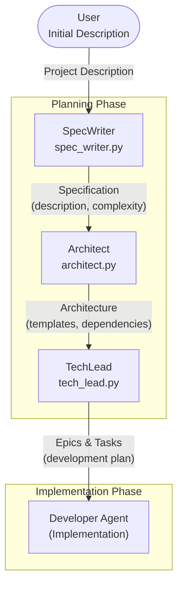
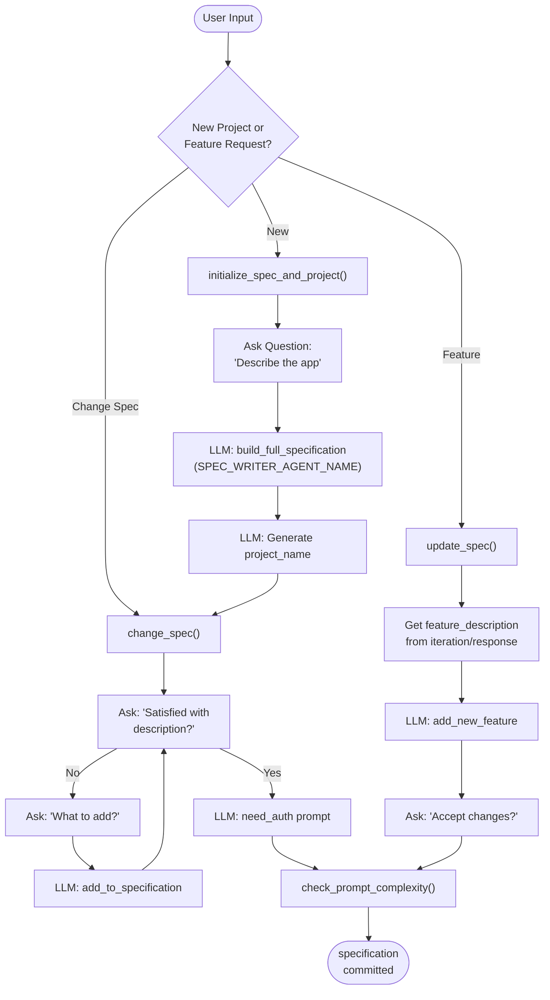
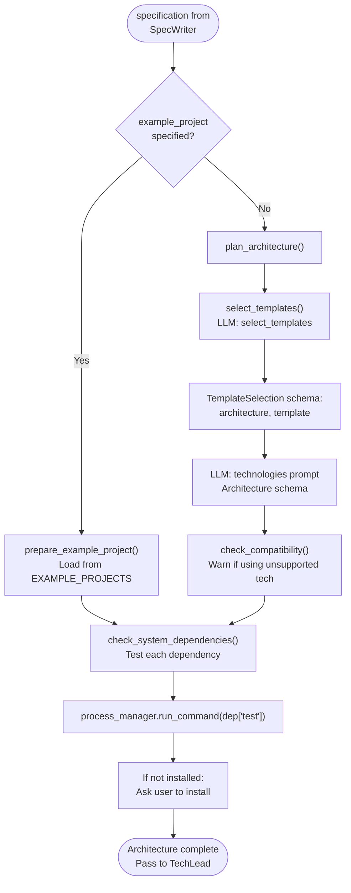
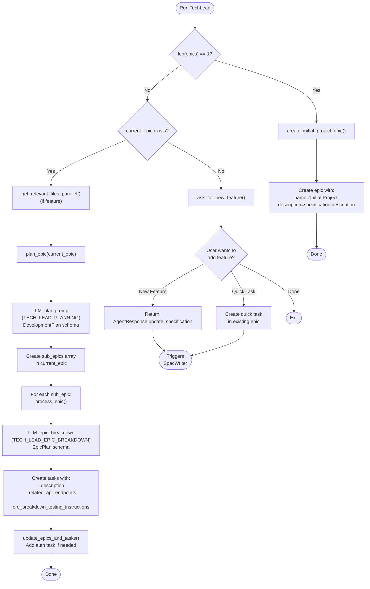
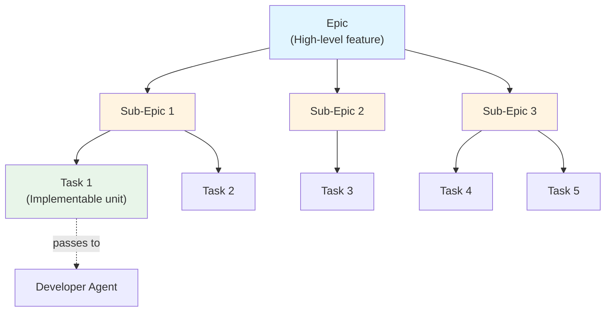
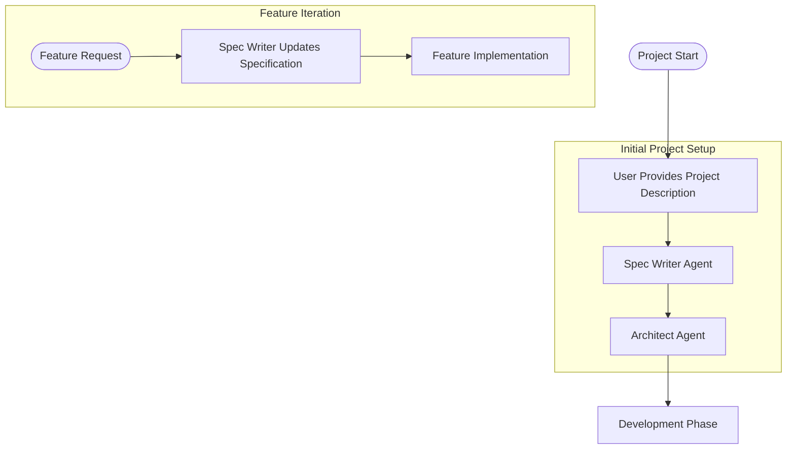

<!-- source: DeepWiki mcp.deepwiki.com · repo Pythagora-io/gpt-pilot · page 4.2 Planning Agents · fetched 2026-10-26 -->

# Planning Agents

<details>
<summary>Relevant source files</summary>

The following files were used as context for generating this wiki page:

- [core/agents/architect.py](core/agents/architect.py)
- [core/agents/bug_hunter.py](core/agents/bug_hunter.py)
- [core/agents/developer.py](core/agents/developer.py)
- [core/agents/frontend.py](core/agents/frontend.py)
- [core/agents/mixins.py](core/agents/mixins.py)
- [core/agents/orchestrator.py](core/agents/orchestrator.py)
- [core/agents/spec_writer.py](core/agents/spec_writer.py)
- [core/agents/tech_lead.py](core/agents/tech_lead.py)
- [core/agents/troubleshooter.py](core/agents/troubleshooter.py)
- [core/prompts/developer/parse_task.prompt](core/prompts/developer/parse_task.prompt)
- [core/prompts/partials/project_tasks.prompt](core/prompts/partials/project_tasks.prompt)
- [core/prompts/tech-lead/epic_breakdown.prompt](core/prompts/tech-lead/epic_breakdown.prompt)
- [core/prompts/tech-lead/plan.prompt](core/prompts/tech-lead/plan.prompt)

</details>


## Purpose and Scope

This document describes the three planning agents in GPT Pilot: **SpecWriter**, **Architect**, and **TechLead**. These agents work sequentially during the planning phase to transform user requirements into a detailed development plan:

1. **SpecWriter** - Gathers and refines project requirements
2. **Architect** - Determines technical architecture and technology stack
3. **TechLead** - Creates epics and breaks them down into implementable tasks

Together, these agents establish a comprehensive development plan before implementation begins.

For information about implementation agents, see [Implementation Agents](#4.3). For the overall agent system architecture, see [Agent Architecture](#4.1).

## Overview

**Planning Phase Architecture**



Sources: [core/agents/spec_writer.py:19-33](), [core/agents/architect.py:95-122](), [core/agents/tech_lead.py:55-90]()

The planning agents transform user requirements into an actionable development plan through a three-stage process:

1. **SpecWriter** analyzes the user's project description and creates a comprehensive specification, including complexity assessment
2. **Architect** determines the technical architecture, selects project templates, and identifies system/package dependencies
3. **TechLead** breaks the specification down into epics (high-level features) and tasks (implementable units of work)

This planning phase ensures development has clear direction before any code is written.

## SpecWriter Agent

The SpecWriter agent is the entry point for all projects, transforming user descriptions into detailed specifications. It handles both initial project setup and feature requests during development iterations.

**SpecWriter Workflow**



Sources: [core/agents/spec_writer.py:23-343]()

### Key Responsibilities

| Responsibility | Method | Description |
|---------------|---------|-------------|
| **Initial Specification** | `initialize_spec_and_project()` | Creates specification from user's initial description |
| **Specification Refinement** | `change_spec()` | Allows user to iteratively improve the specification |
| **Feature Updates** | `update_spec()` | Updates specification when new features are requested |
| **Complexity Assessment** | `check_prompt_complexity()` | Categorizes project as "simple", "moderate", or "hard" |
| **Authentication Detection** | LLM prompt: `need_auth` | Determines if project requires authentication |
| **Template Application** | `apply_template()` | Applies project templates based on user options |

Sources: [core/agents/spec_writer.py:63-357]()

### State Updates

The SpecWriter updates the `ProjectState` with:

- `specification.description` - LLM-enhanced project description
- `specification.original_description` - User's raw input
- `specification.complexity` - Complexity assessment ("simple", "moderate", "hard")
- `specification.template_summary` - Summary of applied templates
- `knowledge_base.user_options['auth']` - Whether authentication is needed
- `knowledge_base.user_options['jwt_secret']` - Generated JWT secret (if auth enabled)

Sources: [core/agents/spec_writer.py:148-161](), [core/agents/spec_writer.py:246-263]()

### Complexity Assessment

The SpecWriter uses an LLM call to categorize project complexity:

| Complexity | Impact |
|-----------|--------|
| **"simple"** | Single epic/task, minimal breakdown |
| **"moderate"** | Multiple epics, standard breakdown |
| **"hard"** | Comprehensive planning, external docs may be required |

The complexity value influences how TechLead breaks down the project and whether Developer agent requests external documentation.

Sources: [core/agents/spec_writer.py:345-356](), [core/db/models/specification.py]()

## Architect Agent

The Architect agent determines the technical foundation for the project by selecting technologies, templates, and dependencies. It bridges the specification to concrete technical decisions.

**Architect Workflow**



Sources: [core/agents/architect.py:99-267]()

### Pydantic Models

The Architect uses strongly-typed schemas for LLM responses:

| Model | Fields | Purpose |
|-------|--------|---------|
| `AppType` (Enum) | `WEB`, `API`, `MOBILE`, `DESKTOP`, `CLI` | Categorizes application type |
| `SystemDependency` | `name`, `description`, `test`, `required_locally` | System-level requirements (Node.js, Python, etc.) |
| `PackageDependency` | `name`, `description` | Framework/library dependencies (Express, React, etc.) |
| `Architecture` | `app_type`, `system_dependencies`, `package_dependencies` | Complete architecture definition |
| `TemplateSelection` | `architecture`, `template` | Selected project template |

Sources: [core/agents/architect.py:29-93]()

### State Updates

The Architect updates the `specification` object with:

- `architecture` - High-level architecture description (string)
- `templates` - Dictionary mapping template names to options
- `system_dependencies` - List of system dependencies (serialized `SystemDependency` models)
- `package_dependencies` - List of package dependencies (serialized `PackageDependency` models)

Example:
```python
# Stored in ProjectState.specification
specification.architecture = "React frontend with Node.js Express backend"
specification.templates = {"vite_react": {...}}
specification.system_dependencies = [
    {"name": "Node.js", "test": "node --version", "installed": True, ...}
]
```

Sources: [core/agents/architect.py:193-197](), [core/agents/architect.py:227-235]()

### Compatibility Warnings

The Architect warns users about technologies that GPT Pilot doesn't officially support:

- **System Dependencies**: Docker, Kubernetes, Microservices
- **Frontend Frameworks**: Next.js, Vue, Svelte, Angular

These warnings don't block development but inform users they may encounter issues.

Sources: [core/agents/architect.py:22-24](), [core/agents/architect.py:199-225]()

## TechLead Agent

The TechLead agent is responsible for transforming the specification and architecture into an actionable development plan by creating **epics** (high-level features) and **tasks** (implementable units).

**TechLead Workflow**



Sources: [core/agents/tech_lead.py:59-368]()

### Epic and Task Hierarchy

The TechLead creates a hierarchical structure:



Sources: [core/agents/tech_lead.py:296-367]()

### Key Data Structures

The TechLead uses Pydantic models to structure the development plan:

| Model | Fields | Purpose |
|-------|--------|---------|
| `APIEndpoint` | `description`, `method`, `endpoint`, `request_body`, `response_body` | Defines an API endpoint to implement |
| `Epic` | `description` | High-level feature description |
| `Task` | `description`, `related_api_endpoints`, `testing_instructions` | Unit of work for Developer |
| `DevelopmentPlan` | `plan: list[Epic]` | Complete list of epics |
| `EpicPlan` | `plan: list[Task]` | Complete list of tasks for an epic |

Sources: [core/agents/tech_lead.py:29-52]()

### Epic Planning Process

The `plan_epic()` method breaks down an epic into tasks:

1. **Get Relevant Files** (if feature): Calls `get_relevant_files_parallel()` to identify files affected by the feature
2. **LLM Call - Development Plan**: Uses `plan` prompt with `TECH_LEAD_PLANNING` LLM to generate list of epics
3. **Create Sub-Epics**: Stores epics as `sub_epics` array in the current epic
4. **Parallel Epic Processing**: Calls `process_epic()` for each sub-epic in parallel using `asyncio.gather()`
5. **LLM Call - Epic Breakdown**: Each `process_epic()` uses `epic_breakdown` prompt to generate tasks
6. **Create Tasks**: Stores tasks with descriptions, API endpoints, and testing instructions
7. **Update Epic/Task State**: Calls `update_epics_and_tasks()` to add special tasks (e.g., authentication)

Sources: [core/agents/tech_lead.py:296-368](), [core/prompts/tech-lead/plan.prompt](), [core/prompts/tech-lead/epic_breakdown.prompt]()

### Task Structure

Each task created by TechLead contains:

```python
{
    "id": uuid4().hex,
    "description": "Combined description from all epic tasks",
    "instructions": None,  # Filled by Developer agent
    "pre_breakdown_testing_instructions": "How to test this task",
    "status": TaskStatus.TODO,
    "sub_epic_id": epic_number,
    "related_api_endpoints": [
        {
            "description": "API endpoint description",
            "method": "POST",
            "endpoint": "/api/users",
            "request_body": {"email": "string", ...},
            "response_body": {"id": "integer", ...}
        }
    ]
}
```

Sources: [core/agents/tech_lead.py:277-294]()

### Special Case: Authentication Task

If the project requires authentication (`knowledge_base.user_options['auth'] == True`), TechLead inserts a hardcoded authentication task at the beginning of the task list:

- **Description**: "Implement and test Login and Register pages"
- **API Endpoints**: `/api/auth/register`, `/api/auth/login`
- **Status**: `TaskStatus.TODO`
- **Flag**: `hardcoded: True` (prevents user from skipping it)

This ensures authentication is implemented before other features.

Sources: [core/agents/tech_lead.py:381-439]()

### Feature Request Flow

After completing all tasks, TechLead asks the user if they want to add features:

1. **Button Options**:
   - "Implement new feature" - Adds a new epic, triggers SpecWriter to update specification
   - (Hidden: "No, I'm done" - Exits)

2. **New Feature**: Creates a new epic and returns `AgentResponse.update_specification()`, which triggers SpecWriter to refine the feature description

3. **Quick Task**: Creates a single task in the last epic without creating a new epic, useful for small changes

Sources: [core/agents/tech_lead.py:146-260]()

## Workflow and Iteration

The agents operate in both initial project setup and during feature iterations:

### Initial Project Flow

1. User provides a project description
2. Spec Writer analyzes and refines the description
3. Architect plans the architecture and selects technologies
4. Project proceeds to development phase (Tech Lead agent)

### Feature Iteration Flow

1. User requests a new feature
2. Spec Writer updates the specification to incorporate the feature
3. Project proceeds to implementation of the feature



Sources: [core/agents/spec_writer.py:26-33](), [core/db/models/project_state.py:126-139]()

## Conclusion

The Spec Writer and Architect agents form the foundation of project development in GPT Pilot by:

1. Taking user requirements and transforming them into comprehensive specifications
2. Determining the appropriate technologies and architecture for the project
3. Setting up the infrastructure for subsequent development stages

These agents ensure that the project has a solid foundation before development begins, helping to reduce errors and rework in later stages.

---

