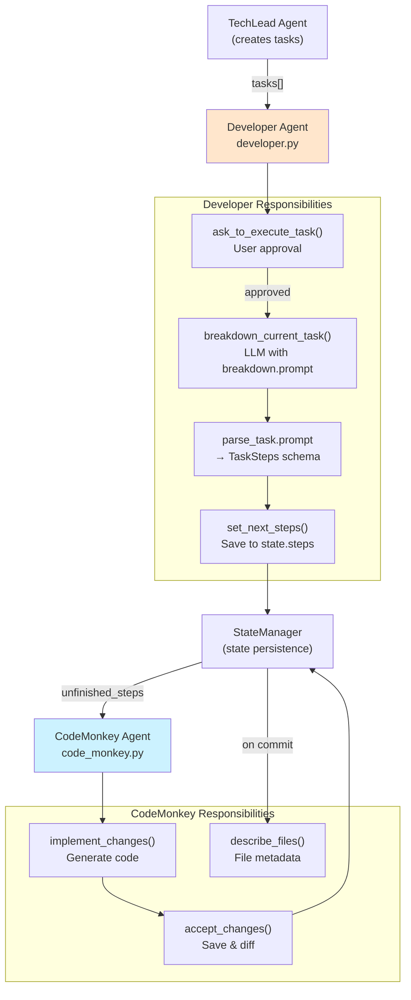
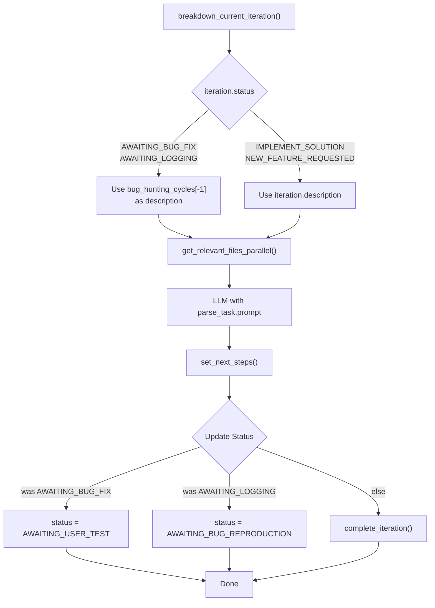
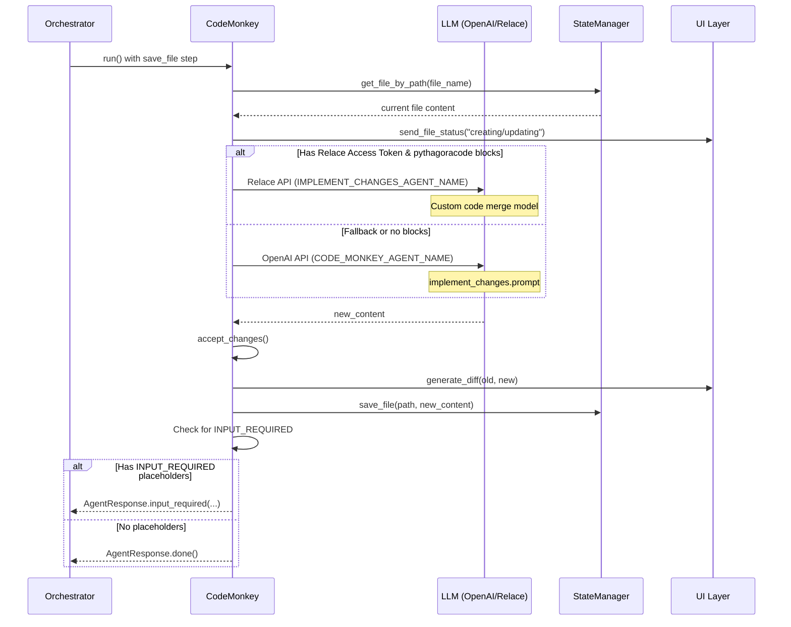
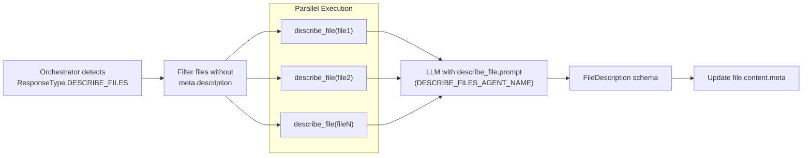
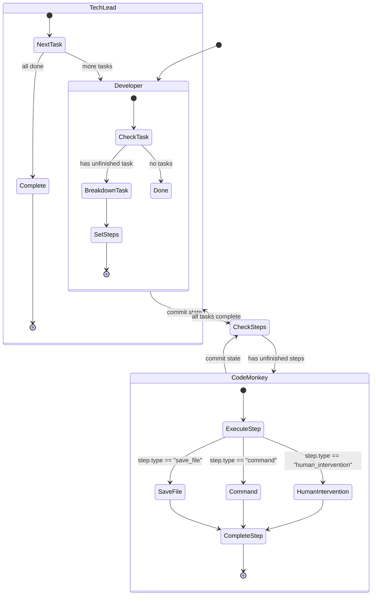
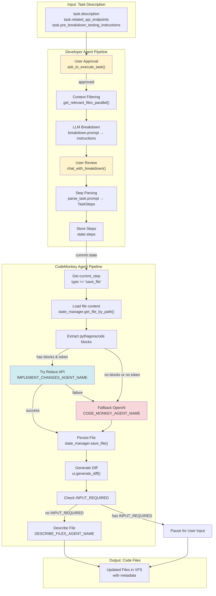

<!-- source: DeepWiki mcp.deepwiki.com · repo Pythagora-io/gpt-pilot · page 4.3 Implementation Agents · fetched 2026-10-26 -->

# Implementation Agents

<details>
<summary>Relevant source files</summary>

The following files were used as context for generating this wiki page:

- [core/agents/bug_hunter.py](core/agents/bug_hunter.py)
- [core/agents/code_monkey.py](core/agents/code_monkey.py)
- [core/agents/developer.py](core/agents/developer.py)
- [core/agents/mixins.py](core/agents/mixins.py)
- [core/agents/tech_lead.py](core/agents/tech_lead.py)
- [core/agents/troubleshooter.py](core/agents/troubleshooter.py)
- [core/prompts/bug-hunter/iteration.prompt](core/prompts/bug-hunter/iteration.prompt)
- [core/prompts/bug-hunter/log_data.prompt](core/prompts/bug-hunter/log_data.prompt)
- [core/prompts/developer/breakdown.prompt](core/prompts/developer/breakdown.prompt)
- [core/prompts/problem-solver/get_alternative_solutions.prompt](core/prompts/problem-solver/get_alternative_solutions.prompt)
- [core/prompts/troubleshooter/iteration.prompt](core/prompts/troubleshooter/iteration.prompt)

</details>


## Purpose and Scope

This page documents the **Developer** and **CodeMonkey** agents, which form the core implementation layer of GPT Pilot's code generation pipeline. These agents are responsible for converting high-level task descriptions into executable implementation steps and then generating the actual code files.

The Developer agent ([core/agents/developer.py]()) breaks down tasks into structured step-by-step plans, while the CodeMonkey agent ([core/agents/code_monkey.py]()) executes those plans by generating and modifying code files. For information about task planning and epic creation, see [Planning Agents](#4.2). For quality assurance and bug fixing, see [Quality Assurance Agents](#4.5).

**Sources:** [core/agents/developer.py:1-485](), [core/agents/code_monkey.py:1-233]()

---

## Implementation Flow Overview

The implementation workflow follows a clear producer-consumer pattern where Developer produces implementation plans and CodeMonkey consumes them to generate code:



**Key Workflow Stages:**

1. **Task Assignment**: TechLead creates tasks and stores them in `state.tasks`
2. **User Approval**: Developer asks user to confirm, skip, or edit the task
3. **Task Breakdown**: Developer uses LLM to generate human-readable implementation instructions
4. **Step Parsing**: Instructions are parsed into structured `TaskSteps` (save_file, command, etc.)
5. **Code Generation**: CodeMonkey iterates through `save_file` steps and generates code
6. **File Persistence**: Files are saved to disk and state, with diffs generated
7. **Description**: Files receive AI-generated descriptions for future context filtering

**Sources:** [core/agents/developer.py:95-120](), [core/agents/code_monkey.py:72-80](), [core/agents/orchestrator.py]()

---

## Developer Agent: Task Breakdown

### Agent Architecture

The Developer agent is defined in `core/agents/developer.py` and inherits from multiple mixins:

```python
class Developer(ChatWithBreakdownMixin, RelevantFilesMixin, BaseAgent):
    agent_type = "developer"
    display_name = "Developer"
```

**Inheritance Chain:**
- `BaseAgent` - Core agent functionality, LLM access, state management
- `RelevantFilesMixin` - Filters relevant files to include in LLM context
- `ChatWithBreakdownMixin` - Enables user chat/feedback during breakdown

**Sources:** [core/agents/developer.py:91-93]()

---

### Task Breakdown Workflow

The Developer's primary workflow centers on the `breakdown_current_task()` method:

```mermaid
stateDiagram-v2
    [*] --> CheckState
    
    CheckState --> UtilityFunction: current_step.type == "utility_function"
    CheckState --> NoTasks: no unfinished_tasks
    CheckState --> IterationMode: unfinished_iterations
    CheckState --> TaskMode: else
    
    UtilityFunction --> UpdateKB["update_knowledge_base()"]
    UpdateKB --> [*]
    
    NoTasks --> [*]
    
    IterationMode --> BreakdownIteration["breakdown_current_iteration()"]
    BreakdownIteration --> [*]
    
    TaskMode --> AskExecute["ask_to_execute_task()"]
    AskExecute --> Skipped: button == "skip"
    AskExecute --> Edited: button == "edit"
    AskExecute --> CheckDocs: button == "yes"
    
    Skipped --> [*]
    Edited --> SaveEdits["Save edited description"]
    SaveEdits --> [*]
    
    CheckDocs --> FetchDocs: docs == None
    CheckDocs --> BreakdownTask: else
    
    FetchDocs --> [*]: return EXTERNAL_DOCS_REQUIRED
    
    BreakdownTask --> GetRelevant["get_relevant_files_parallel()"]
    GetRelevant --> LLMBreakdown["LLM with breakdown.prompt"]
    LLMBreakdown --> ChatLoop["chat_with_breakdown()"]
    ChatLoop --> ParseTask["LLM with parse_task.prompt"]
    ParseTask --> SetSteps["set_next_steps()"]
    SetSteps --> [*]
    
    note right of LLMBreakdown
        Uses TASK_BREAKDOWN_AGENT_NAME
        Streaming output enabled
        Temperature = default
    end note
    
    note right of ParseTask
        Uses PARSE_TASK_AGENT_NAME
        Requires TaskSteps schema
        Temperature = 0
    end note
```



**Sources:** [core/agents/developer.py:95-120](), [core/agents/developer.py:204-311]()

---

### Step Types and Data Structures

The Developer produces steps that conform to a discriminated union type system:

| Step Type | Purpose | Fields |
|-----------|---------|--------|
| `SAVE_FILE` | Create or modify a file | `path: str` |
| `COMMAND` | Execute a shell command | `command: str`, `timeout: int`, `success_message: str` |
| `HUMAN_INTERVENTION` | Request human action | `human_intervention_description: str` |
| `UTILITY_FUNCTION` | Mock API integration | `file: str`, `function_name: str`, `description: str`, `status: "mocked"\|"implemented"` |

**Pydantic Schema Definition:**

```python
# From core/agents/developer.py:32-77
class StepType(str, Enum):
    COMMAND = "command"
    SAVE_FILE = "save_file"
    HUMAN_INTERVENTION = "human_intervention"
    UTILITY_FUNCTION = "utility_function"

Step = Annotated[
    Union[SaveFileStep, CommandStep, HumanInterventionStep, UtilityFunction],
    Field(discriminator="type"),
]

class TaskSteps(BaseModel):
    steps: list[Step]
```

**State Storage:**

Steps are stored in `ProjectState.steps` with metadata:
```python
{
    "id": uuid4().hex,
    "completed": False,
    "source": "app" | "troubleshooting" | "bug_hunt",
    "iteration_index": int,
    "type": StepType,
    # ... type-specific fields
}
```

**Sources:** [core/agents/developer.py:32-82](), [core/agents/developer.py:313-329]()

---

### LLM Prompts and Context Management

The Developer uses two distinct prompt templates:

#### 1. breakdown.prompt - High-Level Instructions

This prompt generates human-readable implementation instructions (not structured steps):

**Template Location:** [core/prompts/developer/breakdown.prompt]()

**Key Context Injected:**
- Project details and specification
- List of all tasks with completion status
- Current task description with `related_api_endpoints`
- File list (filtered by `get_relevant_files_parallel()`)
- External documentation snippets (if available)
- Previous redo feedback (if task was previously attempted)

**Critical Instructions:**
```
- Use <pythagoracode file="path/to/file"> tags around code changes
- Never mix multiple files in one <pythagoracode> block
- Add meaningful logs for debugging
- Remove mocked frontend API calls and implement real requests
```

**LLM Configuration:**
```python
llm = self.get_llm(TASK_BREAKDOWN_AGENT_NAME, stream_output=True)
# TASK_BREAKDOWN_AGENT_NAME can be configured per-agent in config.json
```

**Sources:** [core/prompts/developer/breakdown.prompt:1-77](), [core/agents/developer.py:233-263]()

#### 2. parse_task.prompt - Structured Step Extraction

This prompt converts the human-readable instructions into structured `TaskSteps`:

**LLM Configuration:**
```python
llm = self.get_llm(PARSE_TASK_AGENT_NAME)
convo = AgentConvo(self).template(
    "parse_task", 
    implementation_instructions=response
).require_schema(TaskSteps)
response: TaskSteps = await llm(convo, parser=JSONParser(TaskSteps), temperature=0)
```

**Temperature Setting:** Uses `temperature=0` for deterministic structured output.

**Sources:** [core/agents/developer.py:292-296]()

---

### User Interaction Points

The Developer agent has three primary user interaction mechanisms:

#### 1. Task Execution Approval

```python
async def ask_to_execute_task(self) -> bool
```

**Buttons Presented:**
- `"yes"` - Execute task as-is
- `"edit"` - Edit task description
- `"skip"` - Skip this task (only if multiple tasks remain)
- `"redo"` - Redo task from scratch

**Auto-Skip Conditions:**
- Task has `redo_human_instructions` (already edited)
- Task is marked `quick_implementation` (user-added after completion)
- Task is `user_added_subsequently` (hot-fix task)
- Task is `hardcoded` (authentication setup task)

**Sources:** [core/agents/developer.py:349-477]()

#### 2. Breakdown Review Chat

After generating implementation instructions, the system asks:
> "Does this plan look good? If yes, just press ENTER. Otherwise, tell me what you want me to change."

This is implemented via `ChatWithBreakdownMixin.chat_with_breakdown()`:

```python
async def chat_with_breakdown(self, convo: AgentConvo, breakdown: str) -> str
```

Users can:
- Press ENTER (or click "Yes, looks good!") to approve
- Provide feedback, which triggers LLM to regenerate the breakdown
- Iterate until satisfied (with conversation pruning after `CONVO_ITERATIONS_LIMIT`)

**Auto-Skip:** If `state_manager.auto_confirm_breakdown` is True, this step is skipped.

**Sources:** [core/agents/mixins.py:42-79](), [core/agents/developer.py:284]()

#### 3. Task Description Editing

When user selects "Edit Task", they can modify the task description:

```python
user_response = await self.ask_question(
    "Edit the task description:",
    initial_text=description,
)
self.next_state.current_task["description"] = user_response.text
self.next_state.current_task["run_always"] = True
```

The `run_always` flag ensures the edited task executes immediately without re-prompting.

**Sources:** [core/agents/developer.py:457-476]()

---

### Iteration Handling

The Developer also handles breaking down **iterations** (bug fixes, changes) via `breakdown_current_iteration()`:



**Key Differences from Task Breakdown:**
- No breakdown.prompt step (description comes from BugHunter or Troubleshooter)
- Goes straight to parse_task.prompt
- Updates iteration status based on previous state
- Source tagged as `"troubleshooting"` or `"bug_hunt"`

**Sources:** [core/agents/developer.py:121-202]()

---

## CodeMonkey Agent: Code Generation

### Agent Architecture

The CodeMonkey agent is defined in `core/agents/code_monkey.py`:

```python
class CodeMonkey(FileDiffMixin, BaseAgent):
    agent_type = "code-monkey"
    display_name = "Code Monkey"
```

**Inheritance:**
- `BaseAgent` - Core agent functionality
- `FileDiffMixin` - Diff generation using Python's `difflib`

**Primary Responsibilities:**
1. Execute `save_file` steps from Developer's breakdown
2. Generate or modify file contents using LLM
3. Create file descriptions for context filtering
4. Generate diffs for UI display
5. Detect `INPUT_REQUIRED` placeholders

**Sources:** [core/agents/code_monkey.py:68-70]()

---

### Code Implementation Workflow



**Sources:** [core/agents/code_monkey.py:72-79](), [core/agents/code_monkey.py:81-158]()

---

### Implementation Strategy: Relace vs. OpenAI

CodeMonkey uses a two-tier strategy for code generation:

#### Tier 1: Relace API (Preferred)

```python
# From core/agents/code_monkey.py:118-133
if blocks and self.state_manager.get_access_token():
    try:
        block = next((item for item in blocks if item["file_name"] == file_name), None)
        if block:
            llm = self.get_llm(IMPLEMENT_CHANGES_AGENT_NAME)
            convo = Convo().user({
                "initialCode": file_content,
                "editSnippet": block["file_content"],
            })
            response = await llm(convo, temperature=0, parser=OptionalCodeBlockParser())
    except Exception:
        response = None
```

**Conditions for Relace:**
1. `<pythagoracode file="...">` blocks exist in Developer's instructions
2. Access token is available (`state_manager.get_access_token()`)
3. Current file matches a block's `file_name`

**Relace Model:** Configured via `IMPLEMENT_CHANGES_AGENT_NAME` (typically `"relace-code-merge"`)

**Advantages:**
- Specialized in code merging and editing
- More accurate diffs for existing files
- Faster inference

**Sources:** [core/agents/code_monkey.py:118-133]()

#### Tier 2: OpenAI Fallback

```python
# From core/agents/code_monkey.py:135-152
llm = self.get_llm(CODE_MONKEY_AGENT_NAME)
convo = AgentConvo(self).template(
    "implement_changes",
    file_name=file_name,
    file_content=file_content,
    instructions=instructions,
    user_feedback=user_feedback,
    user_feedback_qa=user_feedback_qa,
)
response = await llm(convo, temperature=0, parser=OptionalCodeBlockParser())
```

**Prompt Template:** `implement_changes.prompt`

**Context Provided:**
- Target file name
- Current file content (empty string for new files)
- Developer's human-readable instructions
- User feedback (if in iteration mode)
- User feedback Q&A (if available)

**Sources:** [core/agents/code_monkey.py:135-152]()

---

### Code Block Extraction

The `extract_code_blocks()` function parses `<pythagoracode>` tags from Developer's instructions:

```python
# From core/agents/code_monkey.py:61-65
def extract_code_blocks(content):
    code_blocks = re.findall(
        r'<pythagoracode\s+file="(.*?)">(.*?)</pythagoracode>', 
        content, 
        re.DOTALL
    )
    return [{"file_name": file_name, "file_content": file_content} 
            for file_name, file_content in code_blocks]
```

**Example Input:**
```
<pythagoracode file="server/routes/users.js">
router.get('/api/users', async (req, res) => {
  // implementation
});
</pythagoracode>
```

**Parsed Output:**
```python
[{
    "file_name": "server/routes/users.js",
    "file_content": "router.get('/api/users', async (req, res) => {\n  // implementation\n});"
}]
```

**Sources:** [core/agents/code_monkey.py:61-65]()

---

### File Metadata Generation

After files are committed to state, CodeMonkey describes them via `describe_files()`:



**FileDescription Schema:**

```python
class FileDescription(BaseModel):
    summary: str = Field(
        description="Detailed description of what the file is about, major classes, functions, elements"
    )
    references: list[str] = Field(
        description="List of local project file paths that this file imports/includes"
    )
```

**Metadata Storage:**

```python
file.content.meta = {
    **file.content.meta,
    "description": llm_response.summary,
    "references": llm_response.references,
}
```

**Purpose:** These descriptions are used by `RelevantFilesMixin.get_relevant_files()` to filter which files to include in LLM context for future tasks.

**Sources:** [core/agents/code_monkey.py:160-208](), [core/agents/code_monkey.py:52-58]()

---

### Diff Generation and File Saving

The final step in code implementation is `accept_changes()`:

```python
# From core/agents/code_monkey.py:213-232
async def accept_changes(self, file_path: str, old_content: str, new_content: str) -> AgentResponse:
    await self.ui.send_file_status(file_path, "done", source=self.ui_source)
    
    n_new_lines, n_del_lines = self.get_line_changes(old_content, new_content)
    await self.ui.generate_diff(
        file_path, old_content, new_content, n_new_lines, n_del_lines, source=self.ui_source
    )
    
    await self.state_manager.save_file(file_path, new_content)
    self.step["save_file"]["content"] = new_content
    self.next_state.complete_step("save_file")
    
    input_required = self.state_manager.get_input_required(new_content, file_path)
    if input_required:
        return AgentResponse.input_required(
            self,
            [{"file": file_path, "line": line} for line in input_required],
        )
    else:
        return AgentResponse.done(self)
```

**Key Operations:**

1. **Status Update**: UI shows "done" badge for the file
2. **Diff Calculation**: Uses `difflib` to count added/deleted lines
3. **UI Diff Display**: Sends unified diff to VSCode extension or CLI
4. **File Persistence**: Saves to Virtual File System (disk or memory)
5. **Step Completion**: Marks `save_file` step as `completed: true`
6. **Input Detection**: Checks for `INPUT_REQUIRED` placeholders

**INPUT_REQUIRED Detection:**

```python
# From state_manager.py (referenced)
def get_input_required(self, content: str, file_path: str = None) -> list[int]:
    """Returns list of line numbers containing INPUT_REQUIRED placeholders"""
    lines = content.split('\n')
    return [i+1 for i, line in enumerate(lines) if 'INPUT_REQUIRED' in line]
```

If placeholders are found, returns `AgentResponse.input_required()` which pauses execution and prompts user to fill in values.

**Sources:** [core/agents/code_monkey.py:213-232](), [core/agents/mixins.py:196-208]()

---

## Integration with Orchestrator

The Orchestrator coordinates Developer and CodeMonkey through a step-based state machine:



**Step Execution Loop:**

1. Developer creates steps: `state.steps = [...unfinished steps]`
2. Orchestrator calls CodeMonkey repeatedly while `state.unfinished_steps` exists
3. Each CodeMonkey iteration:
   - Gets `state.current_step` (first unfinished step)
   - Executes based on `step.type`
   - Calls `next_state.complete_step()` to mark it done
4. When no unfinished steps remain, Orchestrator advances to next agent

**Sources:** [core/agents/orchestrator.py]() (referenced in high-level diagrams)

---

## Error Handling and Retries

### Developer: Incomplete Code Generation

The Developer has retry logic for incomplete `<pythagoracode>` blocks:

```python
# From core/agents/developer.py:265-282
max_retries = 2
retry_count = 0

while retry_count < max_retries:
    if has_correct_num_of_tags(response):
        break
    
    convo.user(
        "Ok, now think carefully... If your last response finishes with an incomplete file, "
        "implement that file and any other that needs implementation..."
    )
    continue_response: str = await llm(convo)
    
    last_open_tag_index = response.rfind("<pythagoracode file")
    response = response[:last_open_tag_index] + continue_response
    
    retry_count += 1
```

**Recovery Strategy:**
1. Check if opening `<pythagoracode file` tags match closing `</pythagoracode>` tags
2. If mismatch, prompt LLM to continue from last incomplete block
3. Concatenate responses, removing the incomplete opening tag
4. Retry up to 2 times

**Sources:** [core/agents/developer.py:84-88](), [core/agents/developer.py:265-282]()

### CodeMonkey: Review Feedback Loop (Disabled)

The code contains review infrastructure that is currently unused:

```python
# Constants in core/agents/code_monkey.py:29-32
MAX_REVIEW_RETRIES = 2
MAX_CODING_ATTEMPTS = 3
```

The `implement_changes()` method accepts a `data` parameter with `attempt` and `feedback` fields for rework cycles, but the review logic is not currently invoked by the Orchestrator.

**Historical Context:** Previous versions likely had CodeMonkey review its own changes and iterate based on self-critique. This has been simplified to a single-pass generation.

**Sources:** [core/agents/code_monkey.py:29-32](), [core/agents/code_monkey.py:81-102]()

---

## Configuration and LLM Assignments

Implementation agents can use different LLM models for different sub-tasks:

| Configuration Key | Purpose | Typical Model | Agent |
|-------------------|---------|---------------|-------|
| `TASK_BREAKDOWN_AGENT_NAME` | Generate human-readable implementation instructions | `gpt-4o`, `claude-sonnet-4` | Developer |
| `PARSE_TASK_AGENT_NAME` | Parse instructions into structured steps | `gpt-4o-mini` | Developer |
| `CODE_MONKEY_AGENT_NAME` | Generate code (OpenAI fallback) | `gpt-4o` | CodeMonkey |
| `IMPLEMENT_CHANGES_AGENT_NAME` | Generate code (Relace API) | `relace-code-merge` | CodeMonkey |
| `DESCRIBE_FILES_AGENT_NAME` | Generate file metadata | `gpt-4o-mini` | CodeMonkey |

**Example config.json:**

```json
{
  "agent": {
    "default": {
      "provider": "openai",
      "model": "gpt-4o-2024-05-13"
    },
    "code-monkey": {
      "provider": "anthropic",
      "model": "claude-sonnet-4"
    },
    "describe-files": {
      "provider": "openai",
      "model": "gpt-4o-mini"
    }
  }
}
```

This allows cost optimization (using `gpt-4o-mini` for simple tasks) and quality optimization (using `claude-sonnet-4` for complex code generation).

**Sources:** [core/config/__init__.py]() (referenced), [core/llm/base.py]() (referenced)

---

## Summary: Implementation Pipeline

The complete implementation pipeline can be visualized as:



**Key Takeaways:**

1. **Two-Phase Generation**: Separate phases for planning (Developer) and execution (CodeMonkey) enable human oversight
2. **Multiple LLM Strategies**: Relace for precise code edits, OpenAI for flexible generation
3. **Context Optimization**: Relevant file filtering reduces token usage by 60-80%
4. **User Checkpoints**: Three approval points (task start, breakdown review, input placeholders)
5. **Metadata Layer**: File descriptions enable intelligent context filtering for future tasks

**Sources:** [core/agents/developer.py:1-485](), [core/agents/code_monkey.py:1-233]()

---

