<!-- source: DeepWiki mcp.deepwiki.com · repo Pythagora-io/gpt-pilot · page 4.4 Frontend Development Agent · fetched 2026-10-26 -->

# Frontend Development Agent

<details>
<summary>Relevant source files</summary>

The following files were used as context for generating this wiki page:

- [core/agents/architect.py](core/agents/architect.py)
- [core/agents/frontend.py](core/agents/frontend.py)
- [core/agents/orchestrator.py](core/agents/orchestrator.py)
- [core/agents/spec_writer.py](core/agents/spec_writer.py)
- [core/agents/wizard.py](core/agents/wizard.py)
- [core/templates/tree/vite_react/client/src/api/api.ts](core/templates/tree/vite_react/client/src/api/api.ts)
- [core/templates/tree/vite_react_swagger/client/.env](core/templates/tree/vite_react_swagger/client/.env)
- [core/templates/tree/vite_react_swagger/client/src/api/api.ts](core/templates/tree/vite_react_swagger/client/src/api/api.ts)

</details>


## Purpose and Scope

The Frontend Development Agent is responsible for building the user interface layer of applications in GPT Pilot. This agent generates frontend code, handles UI iterations based on user feedback, and manages the transition from mock data to real API endpoints in Swagger-based projects. The Frontend agent operates after project specification and architecture planning are complete, typically as the first implementation phase of a project.

For information about backend implementation, see [Implementation Agents](#4.3). For the overall agent coordination system, see [Orchestrator and Control Flow](#3.3). For task breakdown and planning that precedes frontend work, see [Planning Agents](#4.2).

**Sources:** [core/agents/frontend.py:1-603](), [core/agents/orchestrator.py:486-488]()

---

## Agent Architecture

### Class Structure

The `Frontend` agent inherits from `BaseAgent` and incorporates two key mixins:

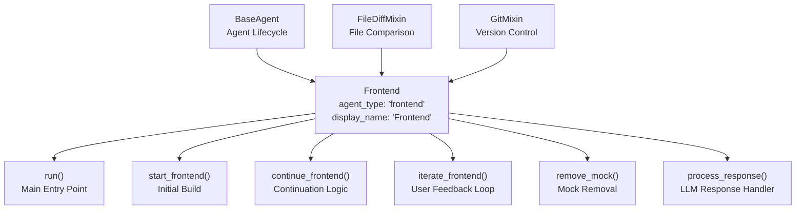

**Sources:** [core/agents/frontend.py:40-42]()

---

## Frontend Development Workflow

### State Transition Flow

The Frontend agent operates through a state machine that progresses through multiple phases:

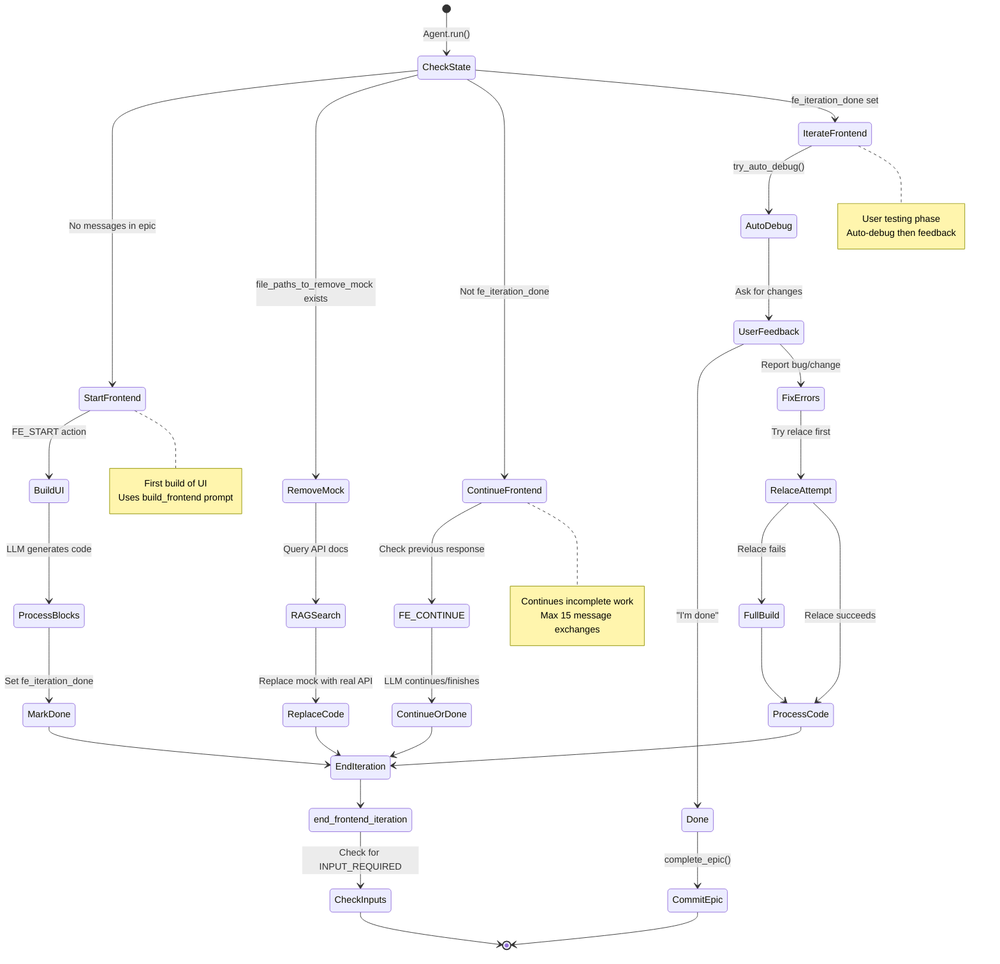

**Sources:** [core/agents/frontend.py:44-59](), [core/agents/frontend.py:61-110](), [core/agents/frontend.py:112-149](), [core/agents/frontend.py:151-318]()

---

## Initial Frontend Build

### Start Frontend Process

The `start_frontend()` method initiates the first UI build:

| Stage | Action | State Update |
|-------|--------|--------------|
| **Initialization** | Set `fe_auto_debug = True`, clear logs | `action = FE_START` |
| **LLM Invocation** | Call FRONTEND_AGENT_NAME with `build_frontend` template | Stream output to user |
| **Template Wait** | Await `async_tasks[-1]` completion if present | Ensure template is ready |
| **Response Processing** | Parse `DescriptiveCodeBlockParser()` blocks | Process files and commands |
| **Completion Check** | Check for "done" in last 20 chars OR message count > 11 | Set `fe_iteration_done` |

The agent uses the following LLM configuration:

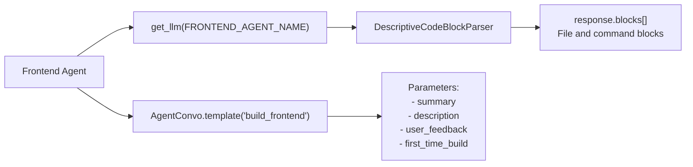

**Sources:** [core/agents/frontend.py:61-110](), [core/agents/frontend.py:82-92]()

---

## Continuation and Completion

### Continue Frontend Logic

When the initial build is incomplete, `continue_frontend()` resumes work:

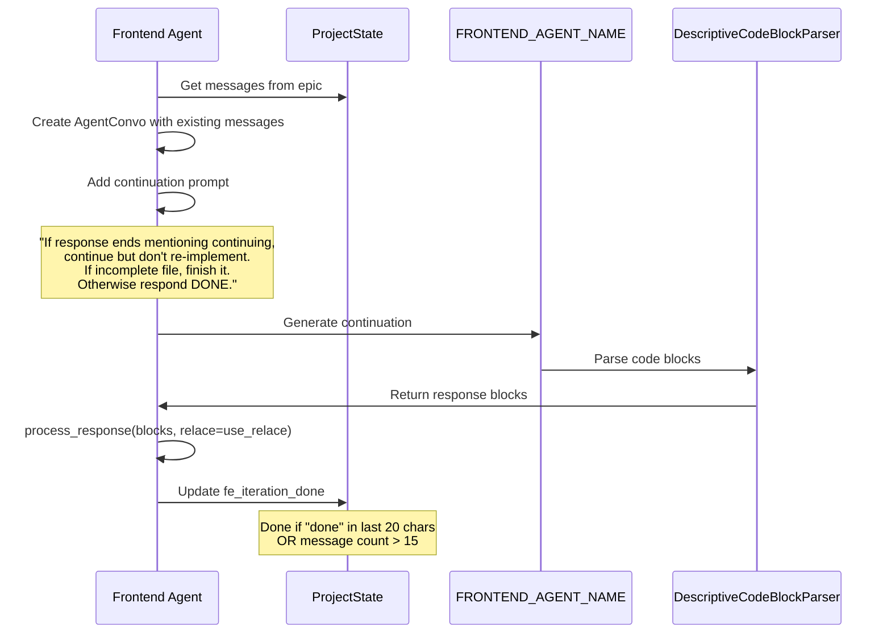

The continuation has two completion modes:

1. **Manual Iteration Mode** (`manual_iteration=True`): Completes when backticks are balanced OR retry_count ≥ 2
2. **Auto Mode**: Completes when "done" appears in response OR message count exceeds 15

**Sources:** [core/agents/frontend.py:112-149](), [core/agents/frontend.py:124-127]()

---

## User Feedback and Iteration

### Iterate Frontend Cycle

The `iterate_frontend()` method implements the core user testing loop:

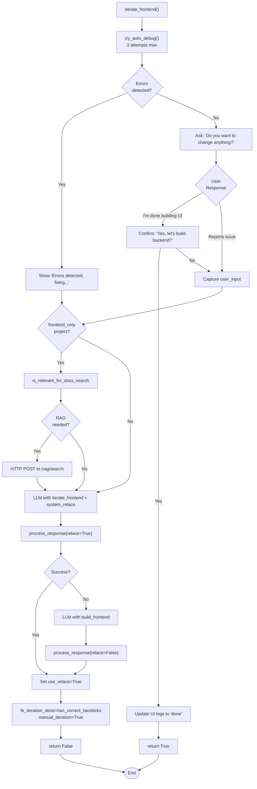

**Sources:** [core/agents/frontend.py:151-318](), [core/agents/frontend.py:159-229](), [core/agents/frontend.py:280-317]()

---

## Response Processing System

### Code Block Processing

The `process_response()` method handles LLM output containing file modifications and commands:

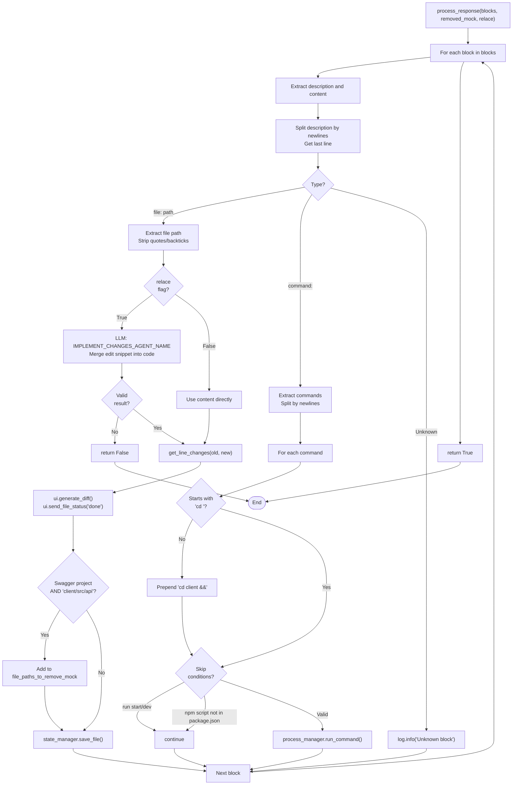

**File Path Extraction Rules:**
- Last line must contain `"file:"` keyword
- Path extracted after `"file:"` (index + 5)
- Strips quotes (`"'` \`) and backticks
- Empty paths are skipped

**Command Processing Rules:**
- Last line must contain `"command:"` keyword
- Multiple commands split by newlines
- Auto-prefixes `cd client &&` if not present
- Validates npm scripts against `package.json`
- Skips `run start` and `run dev` commands

**Sources:** [core/agents/frontend.py:356-449](), [core/agents/frontend.py:367-378](), [core/agents/frontend.py:408-443]()

---

## Mock Removal System

### Swagger API Integration

For Swagger-based projects, the Frontend agent replaces mock API implementations with real endpoint calls:

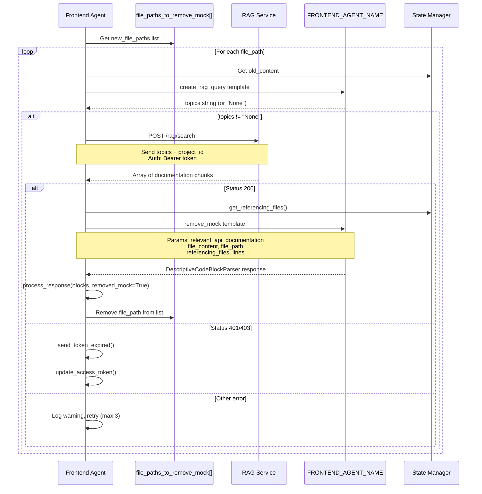

**Key Implementation Details:**

| Aspect | Implementation |
|--------|---------------|
| **Trigger Condition** | `file_paths_to_remove_mock` exists in epic state |
| **File Detection** | During `process_response()` when path contains `"client/src/api"` |
| **RAG Query Generation** | LLM creates search query from file content |
| **Documentation Retrieval** | Posts to `PYTHAGORA_API/rag/search` with Bearer auth |
| **Code Replacement** | Uses `remove_mock` template with RAG documentation |
| **Error Handling** | 3 retry attempts, token refresh on 401/403 |
| **Completion** | Returns `None` on fatal error, `False` on success |

**Sources:** [core/agents/frontend.py:451-517](), [core/agents/frontend.py:47-50](), [core/agents/frontend.py:400-405]()

---

## Auto-Debugging System

### Frontend Error Detection

The `try_auto_debug()` method automatically detects and reports frontend errors:

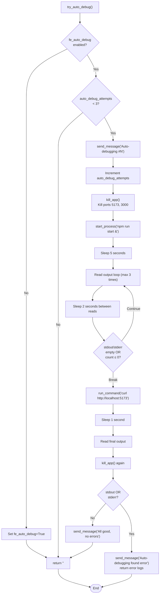

**Platform-Specific Port Killing:**

| Platform | Command | Ports |
|----------|---------|-------|
| **Windows** | `netstat -ano \| findstr :PORT \| findstr LISTENING` → `taskkill /F /PID` | 5173 (frontend), 3000 (backend) |
| **Unix/Linux** | `lsof -ti:PORT \| xargs -r kill` | 5173 (frontend), 3000 (backend) |

**Auto-Debug Configuration:**

- **Maximum Attempts:** 3 per iteration (tracked in `epics[-1]["auto_debug_attempts"]`)
- **Initial Wait:** 5 seconds after starting npm
- **Poll Interval:** 2 seconds for output checks
- **Test Method:** curl request to `http://localhost:5173`
- **State Reset:** `fe_auto_debug` flag toggles on/off between iterations

**Sources:** [core/agents/frontend.py:554-602](), [core/agents/frontend.py:532-552]()

---

## LLM Integration

### Prompt Templates and Parsing

The Frontend agent uses specific prompt templates and parsers:

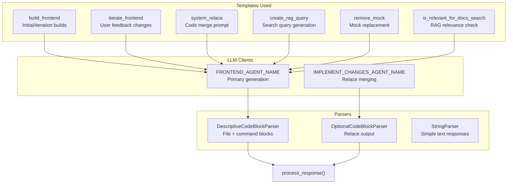

**Template Parameters:**

| Template | Key Parameters |
|----------|----------------|
| `build_frontend` | `summary`, `description`, `user_feedback`, `first_time_build` |
| `iterate_frontend` | `description`, `user_feedback`, `relevant_api_documentation`, `first_time_build` |
| `create_rag_query` | `file_content` |
| `remove_mock` | `relevant_api_documentation`, `file_content`, `file_path`, `referencing_files`, `lines` |

**Sources:** [core/agents/frontend.py:83-92](), [core/agents/frontend.py:281-292](), [core/agents/frontend.py:382-393](), [core/agents/frontend.py:461-490]()

---

## State Management

### Epic State Structure

The Frontend agent uses the epic state to track progress:

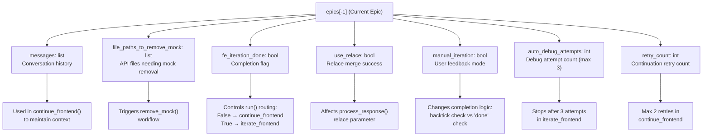

**State Transitions:**

| State Field | Set By | Used By | Purpose |
|-------------|--------|---------|---------|
| `messages` | All frontend methods | `continue_frontend()` | Maintain LLM conversation context |
| `file_paths_to_remove_mock` | `process_response()` | `run()` → `remove_mock()` | Track Swagger API files to update |
| `fe_iteration_done` | `start_frontend()`, `continue_frontend()`, `iterate_frontend()` | `run()` | Route to correct handler method |
| `use_relace` | `iterate_frontend()` | `continue_frontend()` | Enable/disable Relace merging |
| `manual_iteration` | `iterate_frontend()` | `continue_frontend()` | Switch completion detection mode |
| `auto_debug_attempts` | `iterate_frontend()` | `try_auto_debug()` | Limit debug attempts per iteration |
| `retry_count` | `continue_frontend()` | `continue_frontend()` | Prevent infinite continuation loops |

**Sources:** [core/agents/frontend.py:104-108](), [core/agents/frontend.py:135-147](), [core/agents/frontend.py:312-316](), [core/agents/frontend.py:402-404]()

---

## Application Setup Methods

### Runtime Configuration

The Frontend agent configures the development environment:

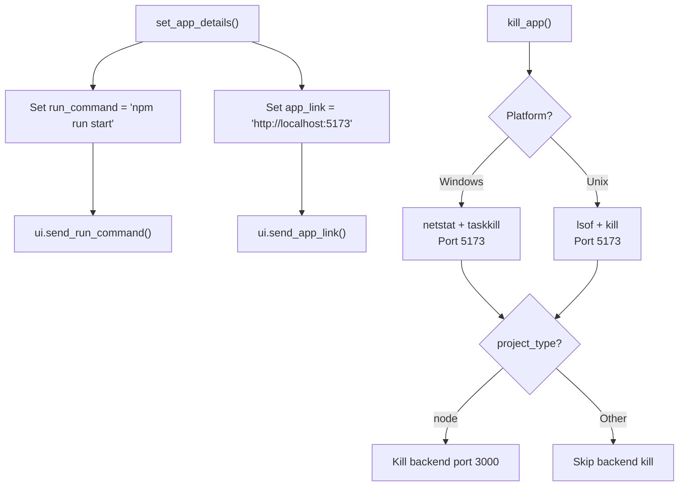

**Port Management:**

| Port | Purpose | Killed When |
|------|---------|-------------|
| **5173** | Vite development server (frontend) | Always during auto-debug and cleanup |
| **3000** | Express server (backend) | Only for `project_type == "node"` |

**Sources:** [core/agents/frontend.py:519-530](), [core/agents/frontend.py:532-552]()

---

## Completion and Handoff

### End Frontend Iteration

The `end_frontend_iteration()` method handles completion:

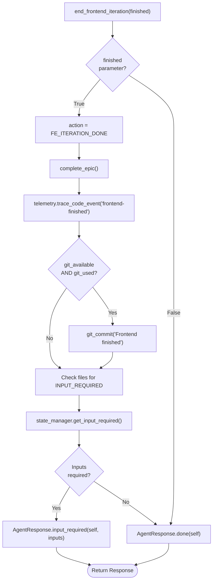

**Input Required Detection:**

The agent scans all files for special markers indicating user input is needed:

```python
inputs = []
for file in self.current_state.files:
    if not file.content:
        continue
    input_required = self.state_manager.get_input_required(
        file.content.content, 
        file.path
    )
    if input_required:
        inputs += [{"file": file.path, "line": line} for line in input_required]
```

If any inputs are found, the system triggers the `HumanInput` agent before proceeding.

**Sources:** [core/agents/frontend.py:320-354](), [core/agents/frontend.py:344-352]()

---

## Integration with Project Templates

### Template Application

The Frontend agent works with project templates defined during the Architect phase:

```mermaid
graph TB
    SpecWriter["SpecWriter Agent"] --> ApplyTemplate["apply_template()"]
    ApplyTemplate --> GetOptions["Get user_options from KB"]
    GetOptions --> SelectTemplate{auth_type?}
    
    SelectTemplate -->|"api_key" or "none"| ViteSwagger["vite_react_swagger"]
    SelectTemplate -->|"login"| ViteReact["vite_react"]
    
    ViteSwagger --> CreateTemplate["PROJECT_TEMPLATES.get(name)"]
    ViteReact --> CreateTemplate
    
    CreateTemplate --> Instantiate["template_class(options, state_manager, process_manager)"]
    Instantiate --> Store["state_manager.template['template'] = template"]
    Store --> Apply["template.apply()"]
    Apply --> SetSummary["specification.template_summary = summary"]
    
    SetSummary --> Frontend["Frontend Agent"]
    Frontend --> UseSummary["Use template summary in build_frontend prompt"]
```

**Template Integration Points:**

| File | Purpose | Template Variables |
|------|---------|-------------------|
| `client/src/api/api.ts` | API client configuration | `options.auth_type`, `options.auth`, `options.api_key` |
| `client/.env` | Environment variables | `options.api_key`, `options.external_api_url` |
| `client/index.html` | HTML scaffold | Script injection points |
| `client/vite.config.ts` | Build configuration | Host, watch settings |

**Sources:** [core/agents/spec_writer.py:34-62](), [core/agents/frontend.py:83-91](), [core/templates/tree/vite_react/client/src/api/api.ts:1-172]()

---

## Error Handling

### Exception Management

The Frontend agent implements comprehensive error handling:

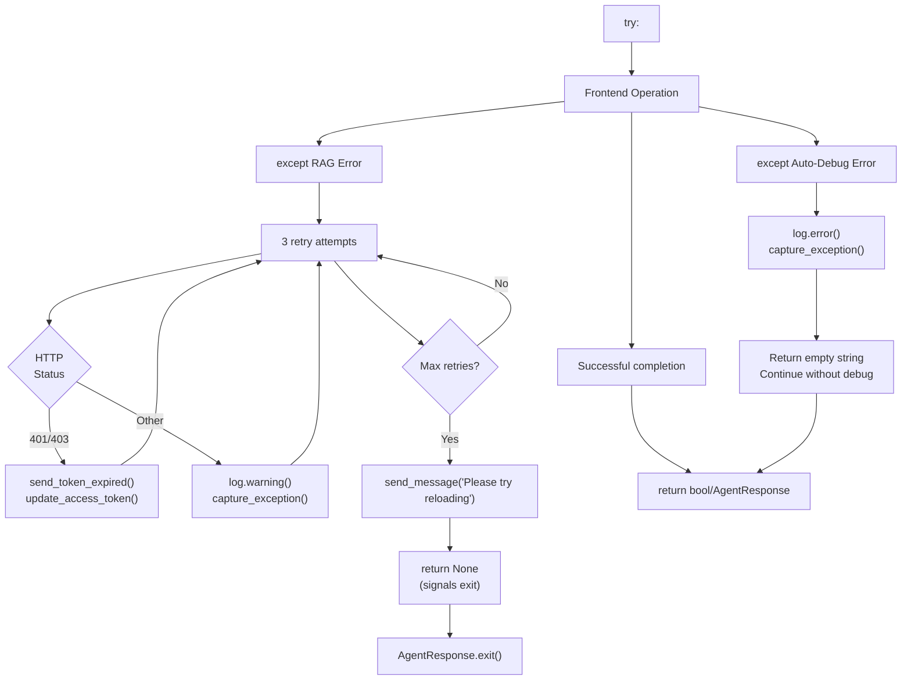

**Error Recovery Strategies:**

| Error Type | Strategy | Max Attempts | Fallback |
|------------|----------|--------------|----------|
| **RAG API Errors** | Token refresh + retry | 3 | Exit with error message |
| **Auto-debug Exceptions** | Log and continue | N/A | Return empty string (no errors) |
| **Relace Failures** | Fall back to full build | 1 | Use `build_frontend` template |
| **Invalid LLM Output** | Check backtick balance | 2 (via retry_count) | Mark iteration done |

**Sources:** [core/agents/frontend.py:243-276](), [core/agents/frontend.py:465-515](), [core/agents/frontend.py:597-599]()

---

## Summary Table

### Key Methods and Their Roles

| Method | Trigger Condition | Primary Action | Return Value |
|--------|------------------|----------------|--------------|
| `run()` | Orchestrator calls Frontend agent | Route to appropriate handler | `AgentResponse` |
| `start_frontend()` | No messages in epic | Initial UI build with template | `False` (continue) |
| `continue_frontend()` | Not `fe_iteration_done` | Continue incomplete build | `False` (continue) |
| `iterate_frontend()` | `fe_iteration_done` set | User feedback loop | `True` (done) or `False` (continue) |
| `remove_mock()` | `file_paths_to_remove_mock` exists | Replace mock APIs with real endpoints | `None` (error) or `False` (success) |
| `process_response()` | After LLM generation | Parse and apply code blocks | `True` (success) or `False` (failure) |
| `try_auto_debug()` | Before user feedback | Detect frontend errors | Error string or empty string |
| `end_frontend_iteration()` | After iteration completes | Check inputs, complete epic | `AgentResponse` |
| `set_app_details()` | Before user testing | Configure run command and link | `None` |
| `kill_app()` | During auto-debug | Kill frontend/backend processes | `None` |

**Sources:** [core/agents/frontend.py:44-603]()

---

